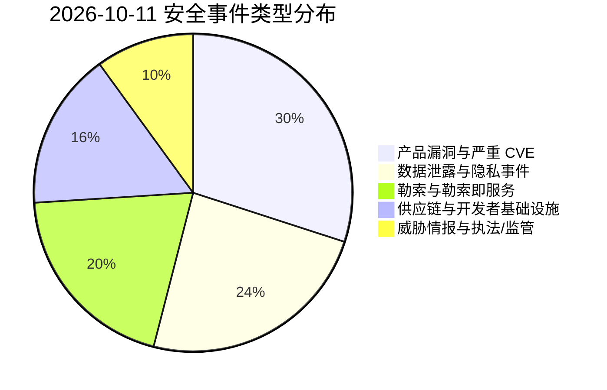
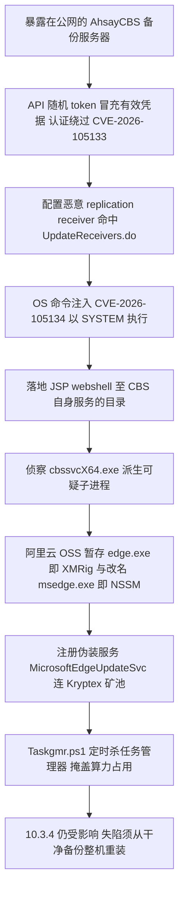
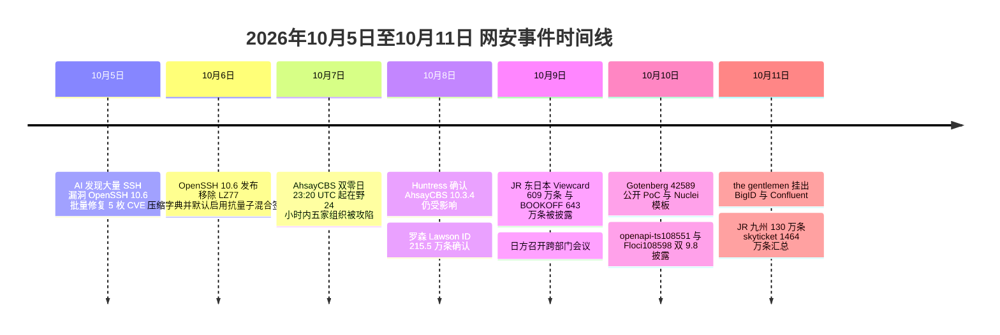

# 网安日报速递 · 2026年10月11日（第 183 期）

> AI城 · 网络安全 | 每日精选 · 值得关注

**今日关键词：** AhsayCBS备份双零日SYSTEM·Gotenberg42589×9.8·日本超3900万条泄露·openapi-typescript108551·BigID与Confluent遭勒索

---

## 一、今日重点

### 1. 【头条】AhsayCBS 备份服务器双零日链：认证绕过 + 命令注入直达 SYSTEM，JSP 木马与挖矿已落地，迟迟无补丁

一个针对 **MSP 备份基础设施**的零日利用活动正在扩大。安全厂商 **Huntress** 记录：自 **2026-10-07 23:20:15 UTC** 起，攻击者把两枚刚披露（**10-04**）的 **AhsayCBS** 漏洞串成链条，对**暴露在互联网上的备份服务器**实现**以 `NT AUTHORITY\SYSTEM` 权限执行的未认证远程代码执行**；到 **次日**已有**至少五家组织**被攻陷。

- **两枚 CVE，一弱一强**：**`CVE-2026-105133`** 是 `checkSysPwd` 函数中的**认证不当**（`com/ahsay/obs/api/ApiStructsAction.java`），CVSS v4.0 仅 **5.5（Medium）**——看着不起眼的"半枚"；**`CVE-2026-105134`** 是**复制接收端 `POST /rps/api/json/UpdateReceivers.do`** 的**操作系统命令注入**，CVSS 3.1 高达 **10.0**（v4.0 为 9.3 / Critical）。API 中**随机 token 可冒充有效凭据**完成认证绕过，攻击者据此**配置一个恶意的 replication receiver**，把 **JSP webshell 落进 CBS 应用自身对外提供服务的目录**里。**5.5 的那枚开门，9.3 的那枚大摇大摆走进去——带着 SYSTEM 权限。**
- **无补丁 + 版本存疑**：NVD 记录显示受影响版本为 **10.3.0 – 10.3.2**，厂商称 **10.3.4.0**（2026-08-04 发布）已修复两处。但 **Huntress 在 10-08 进一步核查后指出：10.3.4 同样受影响**。截至 **10-10** 仍无官方补丁，**BleepingComputer 称 Ahsay 未回应其关于修复计划的询问**。两枚 NVD 记录状态均为 `Deferred`。
- **落地的东西**：Huntress 从 **`cbssvcX64.exe` 派生的可疑子进程**入手（webshell 命令直接表现为该服务的子进程，是可用检测锚点），还原出常见的后渗透链路：**侦察 → JSP webshell → XMRig（Monero）矿机**。矿机文件 **`edge.exe`** 从**阿里云对象存储**暂存，同批还有一个**改名的 NSSM 持久化工具 `msedge.exe`**，最终被装成一个名为 **`MicrosoftEdgeUpdateSvc` 的 Windows 服务**——与合法的 Edge 更新器**只差一个字母**——以 **SYSTEM** 运行。挖矿流量指向 **Kryptex 矿池**（`xmr.kryptex[.]network:8029`，pool user `krxYMRN97D/creativejs`）。
- **两处值得单独记的细节**：其一，脚本 **`Taskgmr.ps1`**（Huntress 从代码注释判断**疑似由 AI 辅助生成**）会**持续监视任务管理器**——窗口一打开就**暂停挖矿**、关闭后**自动重启**，并在**本地时间 18:00** 或**夜间保持开启超过一小时**时**直接杀掉任务管理器**；其二，攻击者用 **`certutil.exe` 投放已知脆弱的驱动 `WinRing0x64.sys`**——这次**不是为了致盲 EDR**，而是让矿机拿到**内核级硬件访问以最大化算力**。"自带有漏洞的驱动"从防御规避用途，小步进化到了性能工具。

**为何值得关注：** **备份服务器是攻击者最想站上去的那台机器**。AhsayCBS 是备份操作的集中管理点——用户、策略、存储位置、复制关系都在一处——且高度集中在 **MSP 与系统集成商**手里，一次部署管理多家客户的备份。拿到管理服务器的 SYSTEM，意味着**凭据、存储库与管理员功能全部暴露**，并通向连接的存储、域服务和特权服务账号。更关键的是，它**恰好是你遭遇勒索后要伸手去够的那套基础设施**：今天的载荷是矿机，但已经演示出来的访问能力（webshell、SYSTEM 服务、次级后门）**可以是下一个攻击者想要的任何东西**。Huntress 明确提醒：**已确认失陷的服务器必须从可信备份整机重装**，因为次级后门会**比软件更新活得更久**。

---

### 2. Gotenberg CVE-2026-42589（CVSS 9.8）：未鉴权的元数据键注入，一条 HTTP 请求拿到容器内 RCE

研究人员公开了被广泛依赖的 Docker 文档转换服务 **Gotenberg** 的一处**未认证命令注入**：只要单条 HTTP 请求，就能以容器用户身份执行任意命令，而**响应看起来只是一次正常的 PDF 转换**。

- **漏洞与端点**：**`CVE-2026-42589`**，CVSS **9.8（Critical）**，CWE-78（操作系统命令注入）/ CWE-77（参数注入）。出问题的端点是 **`/forms/pdfengines/metadata/write`**，它**未做鉴权**，并把**用户可控的 JSON metadata key 直接传给 ExifTool**。
- **利用手法（参数走私 → Perl eval）**：攻击者在 metadata 的 **key 里塞入换行符 `\n`**，用来**切断 ExifTool 的 stdin 输入流**，随后**走私一个 `-if` 参数**——类似 `{"Title\n-if\nsystem('sleep 6')||1\n-Comment":"x"}`——`-if` 会把后续内容当作 **Perl 表达式求值**，于是 `system('…')` 被触发，**单条 HTTP 请求即完成 RCE**。最阴的地方在于：**返回的是干净的 `200` 加一份合法的 PDF**，监控侧只看到"一次成功的转换"。
- **影响与修复**：受影响版本 **≤ 8.30.1**，官方修复版本 **8.31.0**；值得注意的是 **8.30.1 的修复并不彻底、仍可绕过**。同一条利用链还有一个"姐妹"编号 **`CVE-2026-40281`（CVSS 10.0）**。**Nuclei 模板已经发布**（作者 `fineman999`），可直接用于批量探测。

**为何值得关注：** Gotenberg 在很多技术栈里"安静地"存在——**Paperless-ngx、Nextcloud、Documenso**，以及大量企业内部的发票/合同文档流水线都直接调用它的 HTTP API 做格式转换。它一旦暴露在公网、或被内网穿透，**攻击面就直接顶到 RCE**；而"未鉴权 + 返回正常"的组合，让这类漏洞**既好打又难发现**。如果非必要，不要把它暴露在公网；无法立即升级时，应在网关层**限制该端点的可达性**。

---

### 3. 日本数据泄露连环扩大：罗森、JR 东日本、JR 九州、BOOKOFF、skyticket 相继确认，累计超 3900 万条

日本多家企业在 **10-08 至 10-11** 相继确认**第三方非法访问**导致用户信息外泄，**共同社、IT之家**在 **10-11** 汇总报道了这批案件的规模。加上此前已披露的案例，本轮累计涉及**超过 3900 万条**个人信息。

- **本轮新确认/新增的受害方**：
  - **JR 东日本**（10-09 公布）：集团旗下信用卡 **"Viewcard"** 等服务，累计约 **609 万条**含电子邮箱等内容的个人信息**可能外泄**。
  - **JR 九州**（10-09 公布）：官网注册会员的**邮箱地址**最多约 **130 万个**可能泄露；除邮箱外其他个人信息未泄露。
  - **BOOKOFF 集团控股**（10-09 公布）：从事二手商品业务的子公司运营的**会员管理系统**遭第三方非法访问，可能外泄数据最多约 **643 万条**——含姓名、出生日期、电子邮箱、电话、住址，**以及积分卡号与会员编号**。
  - **skyticket**（运营商 **ADVENTURE**，10-09 公布）：机票预订网站遭非法访问，受影响客户信息约 **1464 万条**，含姓名、邮箱与住址。
- **此前已披露、本轮被一并汇总的案例**：便利店巨头 **罗森**的会员服务 **"Lawson ID"** 约 **215.5 万个 ID**（**9-12 至 9-14** 遭非法访问，10-07 调查中发现，10-08 公布，泄露邮件、姓名、性别、电话与住址）；卡拉 OK 连锁 **第一兴商**（BIG ECHO / MEGA BIG 等）约 **872 万条**客户信息可能外泄，起因是**业务外包企业的员工终端感染恶意软件**。
- **政府层面**：日本**网络安全保障担当相古川俊治**于 **10-09** 在内阁会议后表态，"将要求迅速采取对策应对漏洞，并强化举措防止外泄的信息被恶意利用"。

**为何值得关注：** 这组案件把**同一条日本供应链的两个断点**同时暴露了出来。一端是**第三方/外包**——第一兴商的入口是**外包企业员工终端染毒**，说明"数据在你手上、漏洞在别家"的外包模型正在成为批量失守的通道；另一端是**多家企业共用相似的系统组件/托管形态**，使得一轮针对性的非法访问能连续命中不同行业的会员库。而**累计超 3900 万条、"姓名+住址+电话+邮箱"级别**的数据，足以支撑**高度可信的定向钓鱼**。结合 **10-07 软银旗下 IDC Frontier 勒索（495 家企业与地方政府受影响）**，日本近一周的信息安全态势已明显吃紧——这也解释了**为何日方在 10-09 火速召开跨部门会议**。

---

### 4. openapi-typescript-codegen CVE-2026-108551 + Floci CVE-2026-108598：代码注入"双 9.8"，一条污染构建流水线、一条打穿云模拟器

**10-10** 同日披露了两枚 **CVSS 3.1 = 9.8**（v4.0 均为 9.3）的**代码注入**漏洞，同属 **CWE-94**，均无公开利用、未入 CISA KEV——但触发条件都很"日常"。

- **`CVE-2026-108551` —— openapi-typescript-codegen（≤ 0.31.0）：把不可信 OpenAPI 文档变成生成客户端里的 JS**。该代码生成器在 **Handlebars 模板**中，把**未转义的值插进了单引号字符串字面量**；攻击者只要能控制 OpenAPI 文档，就能通过 **path keys、参数名、`servers[0].url`、`info.version`** 等字段**注入 JavaScript**。载荷会在**生成的客户端被 `import` 或调用其服务方法时执行**，从而**污染整条构建流水线的下游**——浏览器应用、Node 服务、以及后续构建步骤的每一个消费方。修复版本 **> 0.31.0 待定**。若你的 CI/CD 会消费来自**供应商、合作方或公共仓库**的 OpenAPI 规范，这条链直接把攻击者的"数据"变成了你构建环境里的"代码"。
- **`CVE-2026-108598` —— Floci（1.1.0 之前 ~ 2.2.0）：云模拟器里的未认证 OS 命令执行**。**Floci** 是一款类 LocalStack 的 **AWS API Gateway 模拟器**。其 **`VtlTemplateEngine`** 允许**未认证攻击者**创建一个带 **MOCK 集成**的 REST API，其 **Velocity 模板**可借 **`$util` 反射**触达 **`Runtime` 或 `ProcessBuilder`**，最终**在 Floci 所在 JVM 内执行操作系统命令**。修复版本 **2.2.0**。

**为何值得关注：** 这两枚"日常工具链"漏洞指向同一句话——**"你信任的输入格式，本身就是一条代码通道"**。OpenAPI 规范本该是描述性的数据，却在模板渲染中变成了可执行脚本；Velocity 模板本用于 API 编排，却在模拟器里成了反射跳板。两者机制不同、**结局同为 CWE-94**，且**分属构建期与运行期**：一个是"别人给的规范污染你的产物"，一个是"任何能访问实例的人拿到你的主机"。**"无公开利用、未入 KEV"不该成为延后修补的理由**——这两类组件的暴露面通常藏在内部，而内部恰恰是补丁最容易被无限期推迟的地方。

---

### 5. "the gentlemen" 勒索盯上安全与数据巨头：BigID 与 Confluent 同日被挂泄露站

勒索团伙 **"the gentlemen"** 于 **10-11** 把两家重量级企业**同时**挂上其数据泄露站：企业数据安全平台 **BigID**，以及被 IBM 收购的数据流平台 **Confluent**。需强调：**这是勒索团伙在勒索过程中的单方主张，尚未被独立证实**。

- **BigID**：企业级**数据安全平台**——发现并分类跨云应用、数据库与文件中的敏感数据，近年主攻 AI 方向（识别影子 AI 工具、核查 Copilot 与智能体触及的数据），**2026 年 9 月**推出 **AgentIQ**，让 AI 助手可经 Claude、Copilot、ChatGPT 触发数据清理与访问复核。客户含 Telenor、Fiserv 等数百家大型企业，**估值 10 亿美元以上**。
- **Confluent**：基于 Apache Kafka 的企业级**数据流平台**，**2026 年 3 月被 IBM 以约 110 亿美元收购**；截至 2025 年底有 **6,690 家客户**（含约 40% 的《财富》500 强），客户包括宝马、欧莱雅、米其林、Ticketmaster，运行在 60 多个云区域。
- **团伙背景**：**the gentlemen** 是一家以经济利益为动机的 **RaaS** 组织，通过外泄数据、威胁公开披露来施压受害者付款。据泄露站统计口径，该团伙**本月已挂出 81 家**，位列**本月榜首**（其后为 Qilin 30、Nightspire 24）。

**为何值得关注：** 这轮名单的**讽刺性**很难忽视——**一家专门帮企业"发现并保护敏感数据"的安全厂商，和一家承载《财富》500 强实时业务流的平台，同一天出现在勒索站上**。它再次印证：**勒索团伙的挑选逻辑与行业声誉无关，只看"数据集中度"**：谁手里握着你最不想外泄的东西，谁就是目标。同时也提醒防御方：**"我们做安全的/我们做基础设施的"从来不是免疫标签，反而常常意味着更高的杠杆价值**。

---

## 二、速览区

### 6. Citrix NetScaler CVE-2026-88771 / 88772（+ 88773–88778）簇入选 CISA KEV：超 5 万设备，9-24 起在野

CISA 把 Citrix **NetScaler ADC / Gateway** 的一组漏洞并入 **KEV** 目录，其中 **`CVE-2026-88771`（命令执行，9.5）** 与 **`CVE-2026-88772`（RCE / DoS，9.5，默认启用 DTLS 时触发）** 最受关注，同批还有 **88773–88778**（官方公告 **CTX697096**）。威胁行为者以**预认证命令**利用，**潜在受影响设备超 50,000 台**，**攻击尝试自 2026-09-24 起持续被观测**。攻击者还被发现**篡改 Web 服务器文件植入恶意代码**、用 **webshell** 维持持久访问。这与本期及近期"边缘设备/网关高危补丁连发"的态势一致——**对外暴露的 VPN/网关是初始访问的高频入口**，版本核对与暴露面收敛要同步做。

### 7. OpenSSH 10.6（10-06）移除 LZ77 压缩字典，默认启用抗量子混合签名

**OpenSSH 10.6** 于 **10-06** 发布，做了一件"减法安全"的典型事：**直接移除 SSH 压缩所用的 LZ77 字典编码器**，以斩断一类**选择明文侧信道**——当攻击者可控数据与密文/秘密共享同一压缩上下文时，压缩后长度差异会**泄露秘密信息**（即 CRIME / BREACH 在 SSH 上的同类问题，该问题自 2002 年即已知）。同时：**默认启用**混合后量子签名算法 **`ssh-mldsa44-ed25519`**（ML-DSA 与 Ed25519 混合）；新增 **`WarnWeakCrypto`** 日志项标记使用非抗量子密钥交换的连接；**命令行传入的用户名不再允许 `$` 与 `\`**（降低 `ProxyCommand` / `Match exec` 场景下的 Shell 注入）；SFTP 收紧了路径校验（防恶意服务端借递归拷贝写到目标目录之外）。项目还表示将**转向更频繁的发布节奏**。值得一提的是，相关 **PoC 由 Claude 等 AI 编码助手辅助构建**——**AI 驱动的漏洞发现**正在把"从漏洞到利用"的周期从数年压缩到数天，这也是 OpenSSH 主动加快节奏的动因之一。

### 8. Cisco SSM On-Prem CVE-2026-20328（9.1）密码重置漏洞可接管管理员账户

**Cisco Smart Software Manager On-Prem（SSM On-Prem）**披露 **`CVE-2026-20328`**（CVSS **9.1**）：一处**密码重置流程缺陷**可被利用来**接管管理员账户**。同期另一枚 **`CVE-2026-76482`（CVSS 10.0）** 由 Cisco 内部安全审查发现并随**加固版本**一并修复——厂商虽定性为"主动加固"，但满分本身说明该缺陷**很可能涉及认证绕过或 RCE**，且"公告本身会加速攻击者对该修复的逆向研究"。运行 SSM On-Prem 的环境应**尽快升级**。

### 9. 丹麦中央人口登记（CPR）因弱口令"123456"发生大规模泄露

丹麦**中央人口登记系统（CPR）**在一处缺陷中发生大规模泄露，报道指其**弱管理员口令被暴露**——其中出现的口令是 **`123456`**。这一案例的警示不在于技术复杂度，而在于**关键公共登记系统的"最后一公里"竟停在一个默认弱口令上**：**再强的架构也拦不住一个可猜的管理员密码**。对所有拥有"高价值中央系统"的组织，**特权账号的强口令 + MFA + 轮换**是成本最低、收益最高的那道闸。

### 10. Silent Ransom Group 无恶意软件社工勒索 2.07 亿美元；MonsterCloud 老板因私下代付赎金被诉

**Silent Ransom Group** 被指**不使用任何恶意软件**，纯靠**社会工程**（冒充、电话社工）实施勒索，累计**勒索金额达 2.07 亿美元**——这再次说明**勒索的"杠杆"是数据与信任，而非加密本身**。另一侧是"勒索生态的反噬"：**MonsterCloud 的老板**因**私下替客户支付赎金又赚取差价**（涉及 **1,100 万美元解密加价**）被**以欺诈罪名起诉**；另有一名**美国网络安全高管**因 **1,100 万美元解密骗局**被起诉。这些案件共同暴露了**"勒索谈判/解密中介"这条灰产带**：**受害者最无助的时候，正是最容易被自己请来的"救兵"二次收割的时候**。

### 11. 安天 10-11 通告：GnuTLS / Linux 内核 rxe+xfrm / Splunk 本提权

安天"网络行为检测能力升级通告（2026-10-11）"列出本期活跃漏洞：**GnuTLS 主机名验证绕过（`CVE-2026-88647`）**、**IBM DataPower Gateway 跨站脚本（`CVE-2026-14990`）**、**Linux 内核 rxe 整数溢出（`CVE-2026-98365`）**、**Linux 内核 xfrm 释放后重用（`CVE-2026-98370`）**、**Splunk Enterprise 本地权限提升（`CVE-2026-76266`）**。其中内核两枚与 Splunk 本提权值得**本地提权（LPE）**方向的读者重点关注；Splunk 一侧此前还修复了 **Patroni REST API 未认证命令执行（`CVE-2026-76268`，CVSS 9.8）** 等一批问题，SIEM 平台自身的漏洞会**直接影响组织的检测与响应能力**，不宜积压。

---

## 三、风险分析

### 3.1 漏洞严重性 × 利用状态象限

```mermaid
quadrantChart
    title 2026-10-11 漏洞严重性 × 利用状态
    x-axis "未利用" --> "在野/公开可用"
    y-axis "低危" --> "严重"
    quadrant-1 "紧急修复"
    quadrant-2 "密切关注"
    quadrant-3 "持续监控"
    quadrant-4 "常规更新"
    "AhsayCBS105134×9.3": [0.95, 0.97]
    "Gotenberg42589×9.8": [0.80, 1.00]
    "NetScaler88772×9.5": [0.92, 0.95]
    "Cisco SSM 76482×10.0": [0.10, 0.99]
    "openapi-ts108551×9.8": [0.42, 0.98]
    "Floci108598×9.8": [0.40, 0.97]
    "Cisco SSM 20328×9.1": [0.30, 0.91]
    "the gentlemen 勒索": [0.78, 0.80]
    "OpenSSH 10.6 侧信道": [0.25, 0.66]
    "丹麦 CPR 弱口令": [0.68, 0.74]
```

### 3.2 安全事件类型分布



### 3.3 AhsayCBS 零日攻击链（认证绕过 → SYSTEM webshell → 挖矿）



### 3.4 本周事件时间线



---

## 四、参考出处

| 主题 | 来源 | 链接 |
| --- | --- | --- |
| AhsayCBS 105133/105134 | AL-ICE — Backup Server, Attacker Server: AhsayCBS Zero-Days Chained to SYSTEM Webshells and XMRig | https://al-ice.ai/posts/2026/10/ahsaycbs-cve-2026-105133-105134-zero-day-webshell-xmrig-miner |
| AhsayCBS 105133/105134 | Cyber Unit — Attackers Hijacking Backup Servers: AhsayCBS Zero-Day Active Since October 7 | https://cyberunit.com/insights/ahsaycbs-backup-zero-day-msp-attack-october-2026 |
| AhsayCBS · 10-10 综述 | CyberRecaps — Daily Cybersecurity News – October 10, 2026 | https://cyberrecaps.com/news/cybersecurity-news-october-10-2026 |
| AhsayCBS · 威胁简报 | SecurityIntel — 10 Oct: Max Severity Exploits Target SonicWall SMA1000 and Citrix | https://buttondown.com/SecurityIntel/archive/securityintel-10-oct-max-severity-exploits-target |
| Gotenberg 42589 | CN-SEC 中文网 — 一条 HTTP 请求就能 RCE，你部署的 PDF 转换服务可能正在裸奔 | https://cn-sec.com/archives/5479446.html |
| Gotenberg 42589 | Vulners — Nuclei: CVE-2026-42589 Gotenberg Command Injection | https://vulners.com/nuclei/NUCLEI:CVE-2026-42589 |
| 日本泄露连环（10-11） | 今日头条 / IT之家（引共同社）— 日本罗森、JR 九州等多家企业遭非法访问，超千万条用户信息外泄 | https://www.toutiao.com/article/7695183088490332672 |
| 日本泄露 · IDCF 勒索 | 网易订阅（引 ITmedia NEWS）— 被黑 7 小时没发现！软银旗下 IDC Frontier 遭勒索 | https://dy.163.com/article/L8SR7MUD0511D6RL.html |
| openapi-ts 108551 + Floci 108598 | ThreatAft — Code Injection Duo: CVE-2026-108551 openapi-typescript-codegen & CVE-2026-108598 Floci | https://threataft.com/articles/code-injection-duo-cve-2026-108551-108598 |
| the gentlemen / BigID | GalaxyWarden — BigID Listed by The Gentlemen Ransomware Group | https://www.galaxywarden.com/blog/breach/bigid-thegentlemen-2026-10 |
| the gentlemen / Confluent | GalaxyWarden — Confluent Listed by The Gentlemen Ransomware Group | https://www.galaxywarden.com/blog/breach/confluent-thegentlemen-2026-10 |
| the gentlemen 统计 | Cybersecurity Tracker — Stats（本月泄露站主张口径，2026-10-11） | https://cybersecuritytracker.ai/stats |
| Citrix 88771/88772 入 KEV | The CISO Brief — Critical Citrix Flaws Under Global Attack | https://thecisobrief.com/critical-citrix-flaws-under-global-attack-exploit-exploited-worldwide |
| Citrix 88772 · 周报 | defend.network — Vulnerability Report – Week 1 of October 2026 | https://defend.network/vulnerability-reports/2026-w41.html |
| OpenSSH 10.6 | wimantis blog — OpenSSH 10.6 patches a 30-year compression flaw and enables post-quantum cryptography | https://wimantis.ninja/openssh-10-6-patches-a-30-year-compression-flaw-and-enables-post-quantum-cryptography-by-default/ |
| OpenSSH 10.6 · AI 挖洞 | sspom.org — OpenSSH 10.6: Security Overhaul Breaks Features, But Why? | https://sspom.org/article/openssh-10-6-security-overhaul-breaks-features-but-why |
| Cisco SSM On-Prem 20328 | Doonsec / wy876 — 每日安全漏洞文章聚合（CVE-2026-20328 9.1 密码重置接管管理员） | https://wy876.github.io/SecAlerts/ |
| Cisco SSM 76482 | Enigma Global — Daily Threat Intelligence Digest, October 9, 2026 | https://www.enigma-global.com/blog/daily-digest-2026-10-09 |
| 丹麦 CPR 弱口令 | IT Security News — Roundup: 2026-10-10 Evening（'123456' password in massive Danish CPR data breach） | https://www.itsecuritynews.info/it-security-news-roundup-2026-10-10-evening |
| Silent Ransom Group / 解密中介 | IT Security News — Roundup: 2026-10-10 Evening（$207M 社工勒索 / MonsterCloud 老板被诉） | https://www.itsecuritynews.info/it-security-news-roundup-2026-10-10-evening |
| 安天 10-11 通告 | 安天 — 网络行为检测能力升级通告（20261011） | https://antiy.cn/Support/upgrade_20261011.html |
| Atlassian 21589 在野 | Geek Feed — Hackers exploit critical Atlassian flaw after public PoC release | https://geekfeed.net/hackers-exploit-critical-atlassian-flaw-after-public-poc-release |
| Splunk 76268/76266 | 神龙漏洞库 — Splunk 安全公告（Patroni REST API 未认证命令执行 / 本地提权） | https://cve.imfht.com/detail/CVE-2026-76280 |
