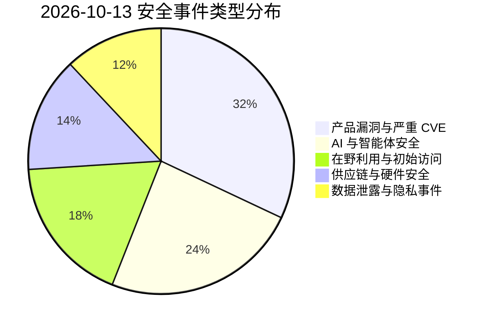
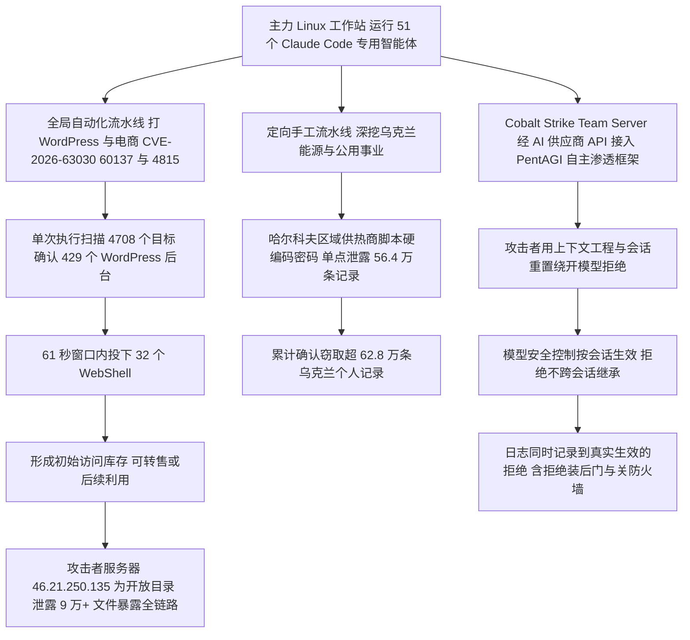
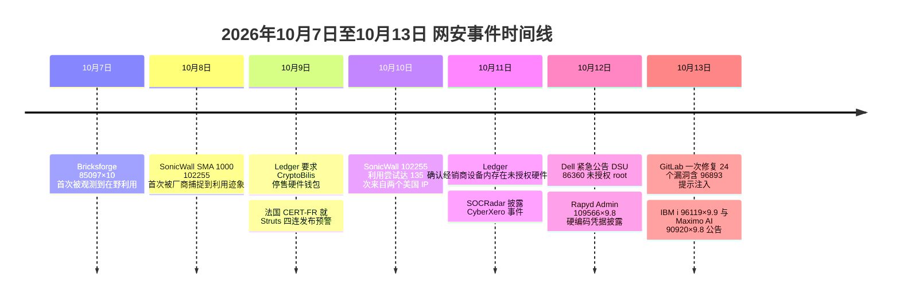

# 网安日报速递 · 2026年10月13日 星期二（第 185 期）

> 每日精选 · 值得关注。本期主线：**攻击者已经把 AI 当成"人手"用起来了**——一名初始访问中间商把 51 个 AI 编码智能体编成流水线，61 秒扫完 4,708 个目标、确认 429 个后台、投下 32 个 WebShell，最终端掉 62.8 万条乌克兰用户记录；同一时间，恶意样本开始反过来"骗"防守方的 AI 分析模型。而在漏洞这一侧，服务器固件更新工具、WordPress 商业插件、代码托管平台与边缘远程接入设备，同一天各有高危/满分漏洞落地或在野。

**今日关键词：** CyberXero 用 51 个 AI 智能体 · Dell DSU 86360 未认证 root · Bricksforge 85097×10 在野 · GitLab 96893 提示注入 · SonicWall 102255 遭利用

---

## 一、头条：CyberXero——51 个 Claude Code 智能体组成攻击流水线，61 秒投下 32 个 WebShell

安全厂商 **SOCRadar** 披露了一个代号 **CyberXero** 的**俄语系、财务动机的初始访问中间商（IAB）**：它一边在全球范围内自动扫打 WordPress 与电商站点，一边**手工挑选乌克兰能源与关键基础设施目标**深挖。**至少自 2026 年 7 月起活跃，目前仍在活动**，已确认窃取 **超过 62.8 万条**与乌克兰个人相关的记录。

**最值得记住的是它的"组织结构"——AI 不是助手，是流水线上的工种：**

- 攻击者在自己的主力 Linux 工作站上，把 **Anthropic 的 Claude Code 拆成 51 个专用智能体**，分别负责**扫描、漏洞链编排、侦察与后渗透**；
- 在另一台 **Cobalt Strike Team Server** 上，他又把开源自主渗透智能体 **PentAGI 经 AI 供应商 API 接进 Cobalt Strike**，用于**载荷生成与自动化渗透执行**；
- 整条架构由**八个节点**构成（主力工作站、配置服务器、变现基础设施、载荷暂存服务器、扫描器等）。

**自动化跑出来的具体数字（来自泄露的日志）：** 单次自动执行**扫描 4,708 个目标**，确认拿到 **429 个 WordPress 后台**的访问权，并在**一个 61 秒的窗口内投下 32 个 WebShell**。全球侧的入口主要是 **`wp2shell`（CVE-2026-63030 / CVE-2026-60137）** 与 **Support Board 插件的 SQL 注入 CVE-2026-4815**；此外还打了**暴露在公网的 Redis**，导致两家中国实体被入侵。定向侧则直指乌克兰能源与公用事业，其中**哈尔科夫一家区域供热商因脚本里硬编码的密码，单点泄露 56.4 万+ 条客户记录**。

**怎么被发现的：** 又是"自己的服务器裸奔"——攻击者的机器 **`46.21.250[.]135` 是一个没有任何访问控制的开放目录**，泄露了 **9 万+ 个文件**，里面躺着 **AI 会话日志、含明文 token 的脚本、漏洞利用工具包、侦察结果、AI 智能体配置和已被窃取的受害者数据**。研究者此前还确认了波兰、中国、荷兰的若干受害站点。

**关于"模型为什么肯干"：** SOCRadar 的分析给出了一个对 AI 开发者很关键的观察——**模型的安全控制作用于"会话上下文"，而不是模型权重**，所以**一次拒绝不会带进下一次会话**。攻击者用**上下文工程（把任务包装成"对我自己基础设施的授权渗透测试"）加会话重置**，反复绕开拒绝。不过日志里也记录了**真实生效的拒绝**：模型在四次迭代中**连续拒绝了装后门、关防火墙、横向移动和投 WebShell**，另有一次**连续四次拒绝扫描，并正确识破了一个伪造的所有权令牌**。

**为何值得关注：** 这起事件是目前**"AI 赋能攻击"最有说服力的一份样本**——不是概念演示，而是**有日志、有数字、有受害者**的实战。它把两件事同时摆到台面上：**第一，AI 已经把攻击的"人均产出"抬高了一个量级**（61 秒 / 32 个 shell 的量级，人类团队做不到）；**第二，靠"模型会拒绝"来当防线，是站不住的**——拒绝是按会话生效的，换个说法重开一次就行。防御上，SOCRadar 给出的三个排查锚点很实在：**可疑的 WordPress 管理员账号、WSO WebShell、以及 Redis 主机上 `~/.ssh/authorized_keys` 里多出来的条目**。

---

## 二、Dell System Update CVE-2026-86360：路径穿越直通未认证远程 root，PowerEdge 固件通道被打穿

**Dell** 就其 **System Update（DSU）命令行部署工具**发布紧急安全公告：**`CVE-2026-86360`** 是一枚**路径穿越**漏洞，**未认证的远程攻击者**可利用它在**目标主机上以 root 权限执行任意代码**。

- **影响面：** DSU 是**用来给 PowerEdge 服务器批量部署 BIOS、固件与软件更新**的工具，**Linux 与 Windows 平台都在用**。也正因为这个工具**本身就需要高层级权限去改动系统核心组件**，一旦漏洞把 root 送出去，**等于把服务器的主安全边界整个让了出去**——攻击者可以同时操纵硬件层与操作系统层，后果从大规模数据泄露一直到关键基础设施被破坏。
- **修复：** Dell 已发布补丁，**要求企业客户立即升级到 DSU 2.3.0.0 或更高版本**。
- **同批一并修掉的还有四枚高危：** **`CVE-2026-63697`** 与 **`CVE-2026-71168`**（均为 RCE）、**`CVE-2026-86361`** 与 **`CVE-2026-86362`**（权限提升）。
- **另需连带留意：** Dell 另一份公告 **DSA-2026-448** 修了**容器存储模块（CSM）的两枚最高严重级漏洞 `CVE-2026-63688` 与 `CVE-2026-63692`**（该对漏洞在 10 月上旬已通报，属于同一波 Dell 补丁）。

**为何值得关注：** 这是典型的"**运维工具即最高权限后门**"问题。DSU 这类工具在数据中心里的角色是**"批量改固件"**，为了干这活它必须长着 root 的手；而它同时往往**挂在管理网、甚至被自动化平台调用**。于是漏洞的利用门槛被压到最低：**网络可达 + 无需凭据 = 最高权限**。对运维团队的动作很明确：**把 DSU 升级到 2.3.0.0+，并顺手盘一遍"还有哪些自带高权限的运维/交付工具暴露在非受控网段"**——这类工具的补丁优先级，应该按"它被拿下后能做什么"来排，而不是按"它是不是个漏洞扫描器"来排。

---

## 三、Bricksforge WordPress 插件 CVE-2026-85097（CVSS 10.0）：一个 MIME 校验的落差，未认证直通 RCE

**Patchstack** 通报：WordPress 可视化建站工具 **Bricks** 的商业扩展插件 **Bricksforge** 存在一枚**满分（CVSS 10.0）** 的漏洞 **`CVE-2026-85097`**，**未认证攻击者可上传并执行任意 PHP 代码**，且**已在野利用**。

- **根因（一个"前后不一致"）：** Bricksforge 在**文件首次上传时会校验 MIME 类型**，但**在随后提交表单时，却信任客户端送来的文件元数据**——**它没有校验 `temporaryFileUploads` 参数里的 `url` 字段**。
- **四步利用链：**
  1. 从**未认证的 `bricksforge_regenerate_nonce` AJAX 接口**取到一个有效 nonce；
  2. 上传一个 **GIF/PHP 多形态文件（polyglot）**——它同时是合法图片（过 MIME 检查）又内含 PHP 代码，落在临时上传目录；
  3. 提交一个表单：**服务端文件路径指向那张"已通过校验的图片"，但 `url` 字段以 `.php` 结尾**；
  4. Bricksforge **照单全收地把文件内容写到了 PHP 路径上**——**请求它，代码就执行**。
- **在野情况：** Patchstack **于 2026-10-07 21:47 UTC 首次观测到利用尝试**，来自 **63 个不同源 IP**，其中**六个 IP 承担了约 46% 的请求**（`177.75.57[.]20`、`23.97.62[.]146`、`84.247.60[.]125`、`38.154.185[.]97`、`150.109.16[.]166`、`153.75.90[.]146`）。攻击流量呈现明显的**自动化特征**：一个簇里 **44 个 IP 在数秒内发出 56 个完全相同的请求**，另一个簇里 **3 个 IP 试了 25 种 PHP 扩展名与编码变体**（`.php5`、`.php7`、`.phtml`、大小写混用、`%70hp`、双重编码等）。**绝大多数请求打到 `POST /wp-json/bricksforge/v1/form_submit`**，落地的文件名形如 `login_admin_*.php`。
- **修复：** 升级到 **Bricksforge 3.1.8.10 或更高**（厂商侧另有 4.0.1 的修复版本；**3.1.8.9 及更早受影响**，**4.0.0 也应视为可能暴露**）。**注意：该插件不在 WordPress.org 官方插件库销售**，走的是自建更新通道，很容易"以为自己会自动更新、其实没更新"。
- **状态提醒：** 截至 10-13，**该 CVE 仍未进入 CISA 的 KEV 目录**——**"等 KEV 再排期"的团队，已经慢了一周**。

**为何值得关注：** 这是一个**"校验只做了一半"**的经典案例：**上传时查了，提交时不查**，而攻击者恰好能同时控制这两步。更值得记的是**风险判断的教训**——一个**满分、免凭据、可自动化**的漏洞，**是否在 KEV 里，和它是否正在被利用，是两回事**。自查锚点：翻 Web 日志里**带 `temporaryFileUploads` 参数的表单提交请求**，检查 **`/wp-content/uploads/bricksforge/tmp/`** 下有没有你没放过的 PHP 文件（尤其 `login_admin_` 开头的），发现即按**已失陷**处置、轮换凭据。

---

## 四、GitLab 一次修 24 个漏洞：CVE-2026-96893 把"AI 智能体提示注入"写成正式 CVE

**GitLab** 发布了包含 **24 个漏洞**的补丁版本（**19.4.2 / 19.3.5 / 19.2.8**），其中最值得单独拎出来的是 **`CVE-2026-96893`（CVSS v4.0 = 8.4）**：

- **`CVE-2026-96893`（8.4）—— GitLab Duo Agent Platform 的 LLM 提示注入。** 漏洞成因是**在构造 AI 对话上下文时，没有正确中和特殊元素**。**已认证用户可以把特制内容注入到 AI 智能体的指令里**，从而**诱发以"其他用户"名义执行的、非预期的命令执行**。也就是说，**污染的是"智能体的指令流"，背锅的却是别人**——这直接把"AI 智能体"从"辅助功能"变成了**一个可被第三方间接操纵的执行通道**。
- **同批其他高危（均需已认证或特定角色）：**
  - **`CVE-2026-16301`（7.1）**：**下游流水线创建服务授权不当**，**具备 Developer 角色的用户可绕过授权，在受保护分支上执行 CI/CD 流水线**；
  - **`CVE-2026-81839`（7.2）**：多付**项目迁移时计划流水线执行策略记录清理不当**，**保留的策略记录可让攻击者在被迁移项目里、以新所属组的权限执行任意 CI/CD 流水线**（需用户交互）；
  - **`CVE-2026-14552`（5.3）**：**work items GraphQL API 授权检查不当**，Guest 权限即可读取被外部授权限制的**机密 epic 内容**；
  - **`CVE-2026-92883`（5.1）**：**语法高亮输出对 HTML 属性净化不当**导致**存储型 XSS**，攻击者可用特制仓库在其他用户浏览器里执行 JavaScript。

**为何值得关注：** 这期的信号是——**"LLM 提示注入"正在从博客里的攻击演示，变成厂商公告里的正式 CVE**。当 AI 智能体被授予**读写代码、触发流水线、调用工具**的能力时，"**输入没有被正确中和**"就不再是一个 XSS 级别的小问题，而是一条**能借他人身份执行动作**的路径。**GitLab 把它按 8.4 处理、并和 20 多个其他漏洞一起打包修复，等于在说：智能体平台的安全基线，现在必须和代码仓库本身一个级别。** 处置侧没有花招：**升级到 19.4.2 / 19.3.5 / 19.2.8 及以上**；同时**给 AI 智能体的工具权限做最小化**，别让"能读 issue 的人"顺带拥有"能指挥智能体动 CI/CD"的隐含能力。

---

## 五、SonicWall SMA 1000 CVE-2026-102255 在野确认：135 次利用尝试，凭据与 TOTP 种子被成批薅走

10-06 打过补丁、10-08 首次被观测到利用的 **SonicWall SMA 1000** 预认证 SSRF **`CVE-2026-102255`（CVSS 10.0）**，在 **10-12 有了更硬的在野证据**。

- **漏洞通道：** 攻击者向 **SMA 1000 的 WorkPlace 界面**发送一个**特制的 `OPTIONS` 请求**，**经由一个"非预期的备用访问路径"（unintended alternate access path），打到设备回环地址上的内部 CouchDB 服务（端口 5984）**。由于是**预认证**，**不需要任何凭据**。受影响机型为 **6210 / 7210 / 8200v**，受影响固件为 **12.4.3-03526 与 12.5.0-02952 及更早**。
- **修复版本：** **12.4.3-03670（平台热修复）** 与 **12.5.0-03082（平台热修复）**。
- **在野数据：** **Previdian 统计到 135 次利用尝试，来自两个位于美国的 IP**（10-09 与 10-10）；**Defused Cyber** 与 **Previdian** 是**最早在 10-08 捕捉到利用迹象**的厂商。**Rapid7** 称观测到攻击者**把暴露的 SMA 设备当作隐蔽初始访问入口**，**在设备上执行命令并维持长期驻留**；站稳之后，他们**系统性地提取了高价值凭据、活动会话数据库，以及基于时间的一次性口令（TOTP）多因素认证的种子配置**。
- **状态提醒：** 截至 10-13，**该 CVE 仍未进入 KEV**，**SonicWall 也尚未更新公告去确认在野利用**。

**为何值得关注：** 这类**边缘远程接入设备**一直是攻击者最爱的"门"——**它天然对外、补丁常常滞后、而且里面塞满了最值钱的东西**。这次被盗的**不只是密码，还有 TOTP 种子**：**拿到 MFA 种子，等于把"第二因素"变成了"另一个可以被复制的东西"**，这会**直接削弱组织对 MFA 的信任**。行动项很干脆：**升到 12.4.3-03670 / 12.5.0-03082**；升级之后**务必轮换凭据、作废并重建会话、重新登记 TOTP**（**补丁清不掉补丁之前就被薅走的种子**）；如果暂时升不了，**就把 SMA 门户收敛到最小暴露面**。

---

## 速览区

### 6. IBM 双 CVE：IBM i 的 HTTP 管理界面代码注入 9.9，Maximo AI Service 9.8

- **`CVE-2026-96119`（CVSS 9.9，CWE-94 代码注入）**：**IBM i 的 HTTP Server Administration 图形管理界面**因**数据净化不当**，**远端已认证攻击者可读取敏感信息或执行任意代码**（`CVSS:3.1/AV:N/AC:L/PR:L/UI:N/S:C/C:H/I:H/A:H`——注意**范围变更 S:C** 意味着**影响会溢出到其他组件**）。**影响 IBM i 7.3 / 7.4 / 7.5 / 7.6**，修复 PTF：**7.6 → SJ11645、7.5 → SJ11644、7.4 → SJ11643、7.3 → SJ11641**，**无临时缓解措施**。
- **`CVE-2026-90920`（CVSS 9.8）**：**IBM Maximo AI Service 9.1.0 与 9.2.0** 因**对代码生成的控制不当**，**远端攻击者可执行任意代码**。
- **另外同批发声的：** **IBM DataStage（Cloud Pak for Data 5.4.0.0）`CVE-2026-82103`（9.6，敏感信息暴露给未授权角色）**。

**为何值得关注：** IBM i 这类**"跑了几十年的核心系统"**，管理界面往往**直接挂在企业网里、且被当作可信内网组件**。**9.9 分 + 范围变更**意味着它**不是一个"关起门来"的问题**。而 Maximo AI Service 的"代码生成控制不当"，再次说明**AI 服务正在以"普通业务组件"的身份进入评分体系**——该打的补丁，一样也别少。

### 7. Rapyd Admin CVE-2026-109566（CVSS 9.8）：硬编码的 `admin@laravel / admin`，每跑一次命令就重建一次

**VulnCheck** 披露 **Rapyd Admin 9.0.0 至 9.20.0 之前**存在一枚**硬编码凭据（CWE-798）** 漏洞 **`CVE-2026-109566`**：

- 安装器通过 `AuthSeeder` **种下了一个 `admin@laravel` 账号，口令就是 `admin`**；
- 更妙的是，这个账号**在每次执行 `rpd:make` 时会被静默重建**——**管理员就算手动删了、改了密码，下次跑命令它又回来了**；
- 攻击者**无需认证**即可用它登录，**成为全局超级管理员，绕过逐记录的授权与多租户隔离（tenant scoping）**。

**修复：** 升级到 **9.20.0 或更高**（补丁提交 `acd6ee8`）。

**为何值得关注：** 这是"**默认凭据 + 会被自动复活**"的叠加伤害。**默认凭据本身还能靠"上线后改密码"兜住，但"每次构建都重建"直接把这个兜底动作废掉了**——**你的加固会被自己的一次部署覆盖**。凡是**脚手架 / 后台生成类框架**，都要特别警惕这类"**开发期便利特性被带进生产**"的坑：**上线前先确认 seeder 与默认账号是否真的关掉了，而不是只看"我第一次登录时改过密码"**。

### 8. Ledger 供应链实锤：授权经销商卖出的硬件钱包里，藏着偷助记词的间谍芯片

**Ledger** 在 **10-11 的 72 小时更新**中确认：**截至当时所有已确认的"10-09 钱包被清空"事件，涉及的设备都来自东南亚经销商 CryptoBilis**。Ledger 强调**自身系统与直营渠道未被入侵**。

- **损失规模（第三方链上测算）：** **Bitquery 估算约 9,320 万美元被从 315 个钱包中窃取**（Tron 约 7,050 万美元、Bitcoin 约 1,680 万美元、Ethereum 约 370 万美元，另有 BNB Chain / Polygon / Solana 小额损失）；**Tether 冻结了约 1,000 万美元 USDT（20 个地址）**。另有独立研究者给出 **8,600 万美元** 的早期估计。**Ledger 未采信上述金额。**
- **植入体长什么样：** 前 Mt. Gox 负责人 **Mark Karpelès** 称自己在马来西亚买到被动手脚的 Ledger，他发布的照片/视频显示**屏幕下方（本该是显示缓冲垫的位置）藏了一块小电路板**，上面有**微控制器、天线、LTE 芯片和一张 eSIM**。**它的逻辑很"笨"也很致命：屏幕显示什么就记什么，在你抄写助记词的那一刻把它记下来，再发出去**。**拿到助记词的攻击者，可以在任何设备上重建钱包、随时清空，完全不用再碰你手里的硬件**——这也解释了**为什么会出现 10-09 的集中清空潮**。
- **为什么"验真"没拦住：** Karpelès 说自己的设备**开着完好的塑封、并且通过了 Ledger 的 Genuine Check**——**因为里面的安全芯片是真的**。**唯一可靠的发现方式是拆机。**
- **处置：** Ledger **要求 CryptoBilis 停止销售全部硬件钱包**（对方已确认停售），建议**从 CryptoBilis 购买且尚未初始化的设备不要初始化**；**已初始化的，应把资产迁移到来自 Ledger 直营渠道的新设备、并生成全新的助记词**。**注意 Bitquery 的观察：**它追踪到的被清空钱包里**超过八成是在 6 月或更晚才首次收到资金**，**这提示可能不止"最近 90 天"的批次**。

**为何值得关注：** 硬件钱包的安全承诺建立在"**设备到你手上时是可信的**"这个前提上，**这次攻击恰好打的就是这个前提**。它把硬件钱包的风险**从"固件/随机数"上移到了"物流与库存的保管链"**——**授权经销商的身份，并不等于每一台设备的完整性**。对使用冷钱包的组织：**重新评估采购与库存流程（谁碰过这批货）、拒绝返修品回流、对新设备做物理开箱检查**。

### 9. Cisco Talos：恶意软件开始"反向说服"防守方的 AI——在源码里塞指令，让模型以为"这里不是真目标"

**Cisco Talos** 发现，一批恶意软件家族**内嵌了自然语言指令，用来干扰自动化分析模型**：**在源码里写入面向 AI 的注释，试图让模型相信"你正在看的不是真实目标"**，甚至夹杂**恐吓性提示，声称分析环境是一个被监控的蜜罐**。受影响的家族包括 **FRUITSHELL、PLOTSAFE、HOLLOWCLAD 与 MANTLEMAZE**。

Talos 指出，这类**直接指令式**手法**已经进化到"模板喷洒"**——**同一份载荷里塞入面向多个模型的指令模板**，谁来看都能"照顾到"。

**为何值得关注：** 这是**攻防在"AI 这一层"上第一次真刀真枪地交手**：**防守方用模型自动化研判，攻击方就去污染模型的输入**。它提醒两件事：**第一，"把样本丢给模型让它判断"不能作为唯一的定性依据**，模型看到的文本本身就是**攻击者可写的内容（不可信输入）**；**第二，检测管线需要"模型之外的锚点"**——**行为、网络流量、YARA/特征、沙箱动态执行**，这些**是攻击者没法靠改注释左右的东西**。

### 10. 开源组件集中修复：Apache Struts 四连（S2-075~078）两条分支已 EOL；Elasticsearch 四枚

- **Apache Struts（10-02 发布 7.4.0 与 6.12.0，10-05 公布四份公告 S2-075 至 S2-078）：** **`CVE-2026-104711`** 是**遗留 RESTful action mapper 中的 OGNL 注入，"可能导致远程代码执行"**（Apache 自评为 Moderate，**公告文本未称其为未认证**）；另有 **`CVE-2026-104712`（DoS，Moderate）**、**`CVE-2026-104713`（REST 插件，DoS，Important）**、**`CVE-2026-104714`（数据暴露 + DoS，Moderate）**。**受影响分支含 Struts 6（< 6.12.0）与 Struts 7（< 7.4.0）**；**Struts 7 仅在关闭 OGNL 允许列表时受影响**。**关键提醒：四条受影响范围里，有两条已 EOL、不会再有代码修复**——**`2.0.0–2.3.37`（2.3.x 于 2019-09-12 EOL）与 `2.5.0–2.5.33`（2.5.x 于 2023-10-30 EOL）**。缓解手段是**改用默认 mapper、restful2 mapper 或 REST 插件**。**法国 CERT-FR 于 10-09 发布预警（CERTFR-2026-AVI-1290）**，并**未称已观测到利用**。
- **Elasticsearch 四枚：** **`CVE-2026-102404`、`CVE-2026-102406`、`CVE-2026-102413`、`CVE-2026-103008`** 被一并列入本周重点高危清单，请对照 Elastic 官方公告确认受影响版本与修复版本后再排期。

**为何值得关注：** Struts 这一条最有价值的不是 OGNL 本身，而是那句"**两条分支不再有补丁**"。**对一个仍在跑 Struts 2.3/2.5 的应用来说，真正的问题不是"这个月补哪个 CVE"，而是"这个应用还打算在互联网上活多久、谁签了字"。** 建议把这类**EOL 依赖**单独拉一张清单，**给出下线/迁移的时间表**——**因为攻击者不需要等你补丁，他们只需要你没下限**。

### 11. P7 DarkSword：iOS 漏洞利用套件升级，直接在设备端抽走钥匙串与加密钱包数据

安全研究者发现 **DarkSword iOS 漏洞利用套件的一个新变种**，被命名为 **P7 DarkSword**，能力较前代明显增强：

- **在设备端直接抽取 Keychain（钥匙串）数据**，并**窃取加密钱包信息**——**不再是把整个数据库复制出来再远程处理，而是当场取、当场发**；
- 建立**双向命令控制（C2）通道**，可持续下发指令；
- **自带隐藏与痕迹清理行为，使旧的失陷指标（IOC）失效**；
- 研究者称该套件通过**水坑攻击中的恶意广告**分发。

**为何值得关注：** 它把"**移动端的失陷**"从"账号被盗"推进到了"**设备里的密钥材料被直接搬走**"。对**高价值目标（记者、金融与加密资产持有者、企业高管）**，**"iPhone 很安全"这个默认假设需要重新审视**——尤其是**通过广告投放的规模化水坑**，并不需要精确点名某个受害者。

---

## 风险分析

### 漏洞严重性 × 利用状态象限

```mermaid
quadrantChart
    title 2026-10-13 漏洞严重性 × 利用状态
    x-axis "未利用" --> "在野/公开可用"
    y-axis "低危" --> "严重"
    quadrant-1 "紧急修复"
    quadrant-2 "密切关注"
    quadrant-3 "持续监控"
    quadrant-4 "常规更新"
    "CyberXero AI 攻击流水线": [0.96, 0.92]
    "Dell DSU 86360 未认证 root": [0.44, 1.00]
    "Bricksforge 85097×10 在野": [0.93, 0.99]
    "GitLab 96893 提示注入×8.4": [0.22, 0.86]
    "SonicWall 102255×10 在野": [0.91, 1.00]
    "IBM i 96119×9.9": [0.18, 0.97]
    "IBM Maximo AI 90920×9.8": [0.20, 0.95]
    "Rapyd Admin 109566×9.8": [0.28, 0.94]
    "Ledger 硬件植入供应链": [0.84, 0.80]
    "Struts 104711 OGNL": [0.26, 0.76]
    "P7 DarkSword iOS 套件": [0.78, 0.72]
```

### 安全事件类型分布



### CyberXero 攻击链（AI 智能体编排 → 自动化扫打 → 记录窃取）



### 本周时间线（10/7 – 10/13）



---

## 出处链接

| # | 来源 | 链接 |
|---|------|------|
| 1 | SOCRadar / The Hacker News — CyberXero 用 Claude Code 窃取 62.8 万条乌克兰记录 | https://thehackernews.com/2026/10/cyberxero-uses-claude-code-in-campaign.html |
| 2 | Cybersecurity Beat — 一支 AI 驱动的队伍放出 51 个智能体打乌克兰目标 | https://cybersecuritybeat.com/2026/10/12/an-ai-driven-crew-turned-51-agents-loose-on-ukrainian-targets |
| 3 | Daily Security Review — CyberXero 用 Claude Code 智能体窃取乌克兰数据 | https://dailysecurityreview.com/threat-actors/cyberxero-broker-used-claude-code-agents-to-steal-ukrainian-data |
| 4 | OSINTSights — CyberXero 双线 AI 赋能乌克兰攻击行动（含 Operation Master） | https://osintsights.com/cyberxero-exploits-ai-in-dual-pronged-ukraine-cyberattack-campaign |
| 5 | ThreatCluster — CyberXero 集群详情与 CVE / ATT&CK 映射 | https://threatcluster.io/cluster/cyberxero-campaign-targets-ukrainian-records-using-ai-tools-e19fe391 |
| 6 | TechNewsReel — Dell 修复 PowerEdge System Update 工具中的 root 级严重漏洞 | https://technewsreel.com/cybersecurity/dell-patches-critical-root-level-flaw-in-poweredge-system-update-tool |
| 7 | Secure Today（腾讯）— Bricksforge WordPress 插件 CVSS 10.0 漏洞遭利用 | https://sectoday.tencent.com/api/article/7Ie5L6EBVJfJhgnJS9HW/link |
| 8 | ThreatFrontier — Bricksforge CVE-2026-85097 未认证上传 RCE 详析 | https://threatfrontier.com/articles/bricksforge-cve-2026-85097-unauthenticated-upload-rce-exploited |
| 9 | Cybernoz — Bricksforge 严重漏洞允许未认证 RCE | https://cybernoz.com/critical-wordpress-bricksforge-flaw-lets-unauthenticated-attackers-execute-remote-code/ |
| 10 | DugganUSA — 两枚 CVSS 10.0 漏洞本周被利用却都不在 KEV（Bricksforge 与 SonicWall） | https://www.dugganusa.com/post/two-cvss-10-exploited-not-in-kev-bricksforge-wordpress-sonicwall-sma1000 |
| 11 | Cybersecurity Help — GitLab CE/EE 多个漏洞（SB2026101301，24 个漏洞） | https://www.cybersecurity-help.cz/vdb/SB2026101301 |
| 12 | HackerFeeds — CVE-2026-96893（GitLab Duo Agent Platform 提示注入，7.3/8.4） | https://hackerfeeds.com/cve/CVE-2026-96893 |
| 13 | Enigma Global — CERT 预警：SonicWall SMA 1000 严重漏洞在补丁后遭 135 次利用尝试 | https://www.enigma-global.com/preview/cert/12565 |
| 14 | IBM — Security Bulletin：IBM i HTTP Server Administration GUI 代码生成控制不当（CVE-2026-96119） | https://www.ibm.com/support/pages/node/7292159 |
| 15 | VulnCheck — Rapyd Admin 9.0.0–9.20.0 硬编码超级管理员凭据（CVE-2026-109566） | https://www.vulncheck.com/advisories/rapyd-admin-9.0.0-before-9.20.0-hard-coded-super-admin-credentials-via-authseeder |
| 16 | Help Net Security — Ledger 硬件钱包内发现隐藏植入体，与 9,300 万美元盗币相关 | https://www.helpnetsecurity.com/2026/10/12/ledger-wallets-compromised-via-hardware-implant/ |
| 17 | FinanceFeeds — Ledger 称所有已确认钱包清空均指向 CryptoBilis 设备 | https://financefeeds.com/ledger-says-all-confirmed-wallet-drains-trace-back-to-cryptobilis-devices/ |
| 18 | LavX News — 本周回顾：Atlassian 数小时内被利用、AI 对抗分析恶意软件与 CVE 清单 | https://news.lavx.hu/article/weekly-recap-atlassian-flaws-exploited-within-hours-rogue-certificates-shinyhunters-arrest-and-ai-evasion-malware |
| 19 | Cyber Insider — Apache Struts 用户面临四枚新公布安全缺陷 | https://cyberinsider.co.uk/apache-struts-users-face-four-newly-documented-security-flaws |
| 20 | The Hacker News — 每周回顾：Helpdesk 零日、流氓证书、AI 欺骗型恶意软件 | https://thehackernews.com/2026/10/weekly-recap-helpdesk-0-days-rogue.html |

> 免责声明：本报告基于公开信息整理，CVE 编号、CVSS 评分等数据以官方源为准。建议读者查阅原始来源获取最新动态。部分钱包损失金额、泄露站与攻击团伙主张为第三方测算或单方声明，尚未被官方证实；本报告不采用涉华政治敏感归因。
