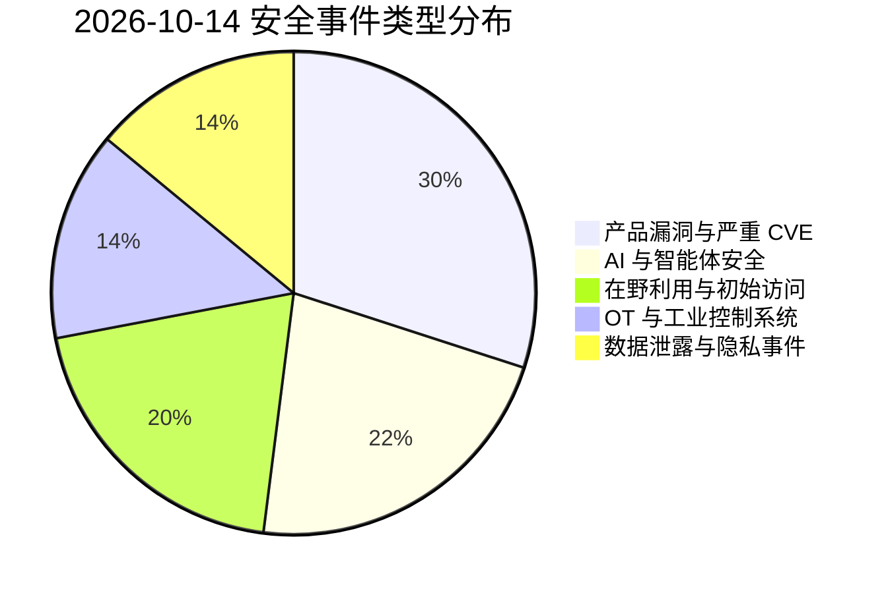
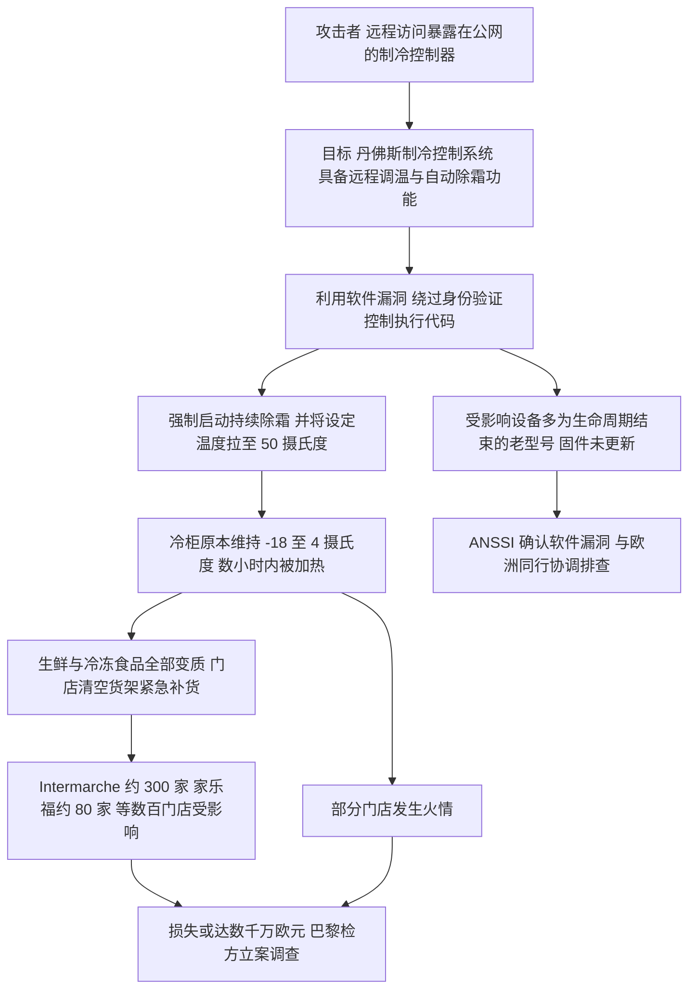
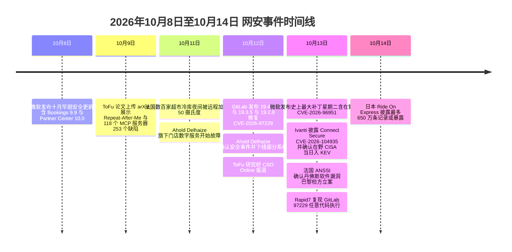

# 网安日报速递 · 2026年10月14日 星期三（第 186 期）

> 每日精选 · 值得关注。本期主线：**同一夜，两件事把"安全边界"的问题摆到了台面上**——一边是微软交出**史上最大的一次补丁星期二**：一次修掉 1,400+ 个 CVE，里面还夹着一枚**正在被利用的 Windows Shell 零日**，攻击者靠它把"这是从网上下载的文件"的警告整个抹掉；另一边，法国数百家超市的**联网冷柜被远程加热到 50℃**，黑客没去偷收银机里的数据，而是让生鲜整夜报废、损失数百万欧元。前者是"补丁多到管不过来"，后者是"设备连上了网却没人管"——它们其实是同一个问题的两面。

**今日关键词：** 微软补丁星期二 1407 个 CVE · 96951 MotW 在野零日 · GitLab 97229×10RCE · Ivanti 104935 在野 · 法国超市冷库被加热到 50 度 · Adobe ColdFusion

---

## 一、头条：微软十月补丁星期二创下历史纪录——1,400+ 个 CVE，其中一枚 Windows Shell 零日正在被利用

微软在 **10 月 13 日**发布了**公司历史上规模最大的一次补丁星期二**：一次性修复 **1,400 多个漏洞**，打破 2020 年 1,261 个的旧纪录。不同机构的统计口径略有差异——**Tenable 计 1,407 个、BleepingComputer 计 1,411 个、CrowdStrike 计 1,413 个、约 176 个独立更新包**——但结论一致：**这是一次"创纪录量级"的发布**，官方原定的下午 1 点（美东）发布时间也被推迟了数小时，把管理员们等得有点上火。

- **规模与结构：** 其中 **70 个为严重（Critical）**，57 个是远程代码执行；按类别看，**权限提升（EoP）约 677 个、占比约 47.9%**，远程代码执行约 317 个；涉及**约 301 个产品与组件**。占比最大的是 Office Excel（69）、DNS 服务器（52）、Windows 内核（46）、Windows Installer（38）与 Office SharePoint（34）。
- **一枚在野零日——`CVE-2026-96951`（Windows Shell 安全特性绕过，CVSS v3.1 = 8.8）：** 这是本次**最该优先处理**的一枚。它是一个 **Windows Shell 的命令注入**问题，攻击者可用它**绕过 Mark of the Web（MotW）**——也就是 Windows 给"从互联网下载的文件"打的那个"不可信"标记。**MotW 正是 SmartScreen 警告、Office 受保护视图等一大堆下游防护的触发开关**；一旦被绕过，"下载来的文件"会像本地文件一样被放行。**微软确认它已在野被利用**，攻击者通过邮件或消息等社工方式诱导目标打开恶意文件；**CISA 已于 10-13 当天把它列入 KEV 目录**。Tenable 指出，这已经是 **2026 年第三枚被在野利用的 Windows Shell 漏洞**（前两枚是 2 月的 `CVE-2026-21510` 与 4 月的 `CVE-2026-32202`）——**2026 年至今已修了 26 个 Windows Shell 漏洞**，而 2025 全年只有 3 个。
- **另两枚"零日"（披露时尚未有补丁）：**
  - **`CVE-2026-108398`（.NET Framework 安全特性绕过，CVSS v3.1 = 8.8）：** 由 **Google Project Zero 的 James Forshaw** 发现，一个"不受信任的搜索路径"问题，可让**已认证攻击者在无用户交互的情况下绕过 Windows Defender Application Control（WDAC）**、把恶意 .NET 程序集加载进受保护进程。**凡是拿 WDAC 当"应用白名单"用的环境，这枚都要重点看。**
  - **`CVE-2026-92707`（MessagePack-CSharp 拒绝服务）：** 一个内存分配缺陷导致远程拒绝服务。**注意：光打 Windows 更新补不掉它**——它需要**捆绑了该库的应用同步升级依赖**，得去问开发或供应商。
- **管理侧的新变化：** 为应对如此庞大的量，微软本月首次引入了**"风险队列（risk cohorts）"**——把"回答同一个环境问题"的 CVE 归成 **15 组**（如"Windows 文件系统、存储与备份"136 个、"Office 文档与邮件客户端"135 个、"Windows 核心与内核权限边界"109 个、"远程访问与 RDP 部署"65 个等）。**它的用途是帮你组织排查顺序（比如"我到底在哪儿暴露了 RDP？"），而不是替你判断风险**——微软明确说队列不改变补丁指引、也不替代逐条核对利用状态。
- **同批值得顺带留意的严重项：** **`CVE-2026-70229`（Active Directory 域服务 RCE）**、**`CVE-2026-70571`（Exchange Server RCE）**，以及 **`CVE-2026-70279`（Exchange Server 欺骗，CVSS 9.3，"更可能被利用"）**。微软同时提醒：**本月是 Windows 11 24H2 家用版/专业版与 Windows 10 LTSB 2016 的最后一次安全更新**，Windows Server 2012/2012 R2 的最后一期扩展支持（ESU）也将在 10-13 画上句号。

**为何值得关注：** 这期最值得记住的不是某一条 CVE，而是**"补丁这件事的性质变了"**——当一次发布就是 1,400 条，"逐条读完再决定"已经不可能，防御者真正需要的是一套**按"是否在野、是否公网可达、是否承载身份/邮件/备份/域服务"排序的暴露面管理流程**。而在这份长长的清单里，**`CVE-2026-96951` 应该被单独放进"当天就补"的队列**：因为 **MotW 是很多其它防护的共同上游**，它被绕过之后，靠"文件来自互联网"这条判断撑起来的防线会**成片失效**。对 Windows-only 环境里的每个人来说，**先补它，再补两枚零日，然后才轮到量最大但优先级最低的那部分**。

---

## 二、法国数百家超市的冷柜被远程加热到 50℃：一次把"网络攻击"打成"物理损失"的工控事件

**10 月 11 日夜至 12 日凌晨**，法国数百家超市的**联网制冷控制系统遭到网络攻击**。黑客没有去碰收银系统或客户数据，而是**直接打进超市用来远程管理冷柜的制冷控制器**，把设备**强制切换到持续除霜模式，并把设定温度拉到 50 摄氏度**——让原本维持在 **-18℃ 至 4℃** 的冷柜**连续数小时被加热**，大量生鲜与冷冻食品在一夜之间报废。

- **受影响范围（据多家连锁与法新社/路透社）：** **Intermarché 及其 Netto 品牌约 300 家门店**（其所属集团称约 150 家门店冰柜被加热至 50℃、持续约 6 小时）、**Coopérative U 上百家（另有口径称不足 100 家）门店**、**家乐福约 80 家门店**、**Monoprix 约 5%（约 30 家）门店**；部分独立商户、尤其是肉店也可能受影响。**E.Leclerc** 确认其**一家制冷设备供应商**遭攻击，影响了数家门店的制冷系统。
- **被攻击的是什么：** 涉事超市配备的是**丹麦制造商丹佛斯（Danfoss）的制冷控制系统**。这类设备**配有自动除霜功能，并允许总部或技术人员通过网络远程调节温度与除霜周期**——正是这个"为运维方便而开放的公网可达接口"成了入口。
- **损失与后果：** 门店被迫**清空货架、销毁全部受影响商品**；Intermarché 的 CEO 在 BFM 电视台称损失**可能达数千万欧元**。部分门店还**发生火情**。**巴黎检察官办公室已立案调查**，调查中纳入了"食品损失与火灾爆发"。**法国国家信息系统安全局（ANSSI）确认丹佛斯相关软件存在漏洞**，已联系开发商，并与欧洲同行协调排查其它可能受影响的企业；法国总理勒科尔尼的团队表示正**亲自跟进**该事件。
- **厂商回应：** **丹佛斯**称已知晓法国境内**数量有限的制冷系统**受影响，受波及设备**"运行的是过时的固件"**，并表示"长期以来一直建议客户把受支持的系统保持在最新状态"。**法国商业及零售业联合会**则呼吁丹佛斯就事件**保持"完全透明"**。另据今年 8 月的安全研究，丹佛斯曾发布更新，修复"可能允许攻击者绕过身份验证控制、在受影响设备上执行代码"的问题——**也就是说，这类漏洞并非毫无预警**。

**为何值得关注：** 这是一起**教科书级的"网络攻击造成物理后果"案例**：攻击者的**目标不是数据，而是温度**，代价是**真金白银的食物和人身上的火情**。它把三个老问题一次性摆了出来：**第一，工业与楼宇物联网设备"为了好运维"被接到公网，却常年没有像样的身份认证与访问控制**；**第二，被攻破的往往不是最新设备，而是"生命周期结束、固件没更新"的老型号**——Danfoss 的说法恰好印证了这一点；**第三，冷库这类"冷链"设施连着食品、药品与疫苗供应，它一旦成为攻击面，影响会溢出到公共安全**。对运营方的动作很明确：**盘点所有"能远程改参数"的控制器**、把管理接口从公网收回到受控网段或 VPN、淘汰无补丁的 EOL 设备，并把"温度设定点"这类**能造成物理损害的写操作**当成高价值权限去管。

---

## 三、GitLab `CVE-2026-97229`（CVSS 10.0）：CI/CD 正则编译器里的整数溢出，未认证即可远程执行代码

**GitLab** 在 **10 月 12 日**发布补丁版本 **19.4.2 / 19.3.5 / 19.2.8**（Community 与 Enterprise 版同源），其中包含一枚**满分（CVSS 10.0）** 的漏洞 **`CVE-2026-97229`**。

- **漏洞成因：** 位于 **CI/CD 的"正则表达式编译器"**。由于**对正则的校验不充分**，在特定条件下会触发**整数溢出**，攻击者可借一条**特制的正则表达式（写在 CI/CD 配置里）**在 **GitLab 服务器上执行任意代码**。GitLab 给出的评分向量是"**远程、低复杂度、无需权限、无需用户交互**"。
- **谁能打、怎么打：** **Rapid7 在 10-13 复现了任意代码执行**——在一台**未打补丁的官方 GitLab CE 镜像（19.4.1）**上成功，而在**已修补的 19.4.2** 上同样的输入不再生效。不过 Rapid7 也指出了一条**现实前提**：攻击者**需要先能把一个恶意的 `.gitlab-ci.yml`（且仓库路径含 UTF-8 字符）提交到某个分支上的公开项目**；在**允许用户自建公开项目的自管实例**上，**一个普通账号就够满足这个条件**。这也解释了为什么 GitLab 的 10.0 评分与"无需认证"看似矛盾——**它是"低门槛"而非"零前提"**。
- **影响与修复：** **19.2 至 19.2.8 之前、19.3 至 19.3.5 之前、19.4 至 19.4.2 之前**的所有**自管（self-managed）**实例受影响。**GitLab.com 已在服务端修复**，**GitLab Dedicated 客户无需操作**。**CERT-EU 于 10-12 发布安全公告 2026-016**，强烈建议**优先升级公网可达的实例**。（另注意：CERT-EU 初版公告里写的修复版是 19.3.4，GitLab 官方已改为 **19.3.5**，因为 19.3.4 在合并请求页面与 Ona 集成上引出另一个问题，**请以官方发布说明为准**。）
- **同一版本还修了一批问题：** 包括一枚**存储型 XSS**（可用特制仓库在他人浏览器里执行 JS）、一枚**受保护分支的流水线授权缺陷**，以及一枚**缓存投毒**问题（**可能泄露受保护的 CI/CD 变量**）。
- **状态：** 漏洞由研究员 **joaxcar（Johan Carlsson）** 通过 HackerOne 报告；**截至 10-13 尚无已确认的在野利用**，但**网络上已出现声称的 PoC，需谨慎对待**。

**为何值得关注：** CI/CD 服务器在企业里的位置，决定了这类漏洞的**"杀伤半径"远大于它自己**——它常年握着**仓库、构建产物、部署凭据与集成 token**。这也是安全工程师把它称作"**把软件供应链的关键一环推到风险里**"的原因：**一个未认证的代码执行，可能等于把这家公司的交付通道交出去**。处置优先级很清楚：**自管实例立刻升到 19.2.8 / 19.3.5 / 19.4.2 或更高**（这一步要**跳出常规补丁周期**）；容器与 Helm 部署要**逐一核对实际运行的版本**（旧镜像、测试实例最容易漏）；升级之后，**翻一遍 CI/CD 配置的异常改动、异常进程、新出现的 token 或部署、以及反常的外连**，必要时**轮换凭据**。

---

## 四、Ivanti Connect Secure `CVE-2026-104935`：一枚"伪造身份即过关"的认证绕过，厂商确认在野利用，CISA 当天入 KEV

**Ivanti** 在 **10 月 13 日**披露其远程接入设备 **Connect Secure** 存在一枚**认证绕过**漏洞 **`CVE-2026-104935`（CVSS 8.6）**：**远程、未认证攻击者可绕过认证并在设备上执行任意命令**。Ivanti 明确表示**已经知晓该漏洞被"有限范围地"在野利用**（攻击当时影响少数客户），并**致谢 Volexity 的协助**。

- **漏洞类型（CWE-290，伪造绕过认证）：** 设备**被诱骗相信一个未认证请求携带了它从未验证过的身份**，从而放行本应待在登录之后的功能，进而按 CISA 的概括**升级为任意命令执行**。
- **影响与修复（按分支）：**
  - **25.1.1.1 及更早** → 修复于 **25.1.1.2**；
  - **25.1.2.2 及更早** → 修复于 **25.1.3.0 或 25.1.3.1**；
  - **22.8R2.4 及更早** → 修复于 **22.8R2.5**；
  - **22.7R2.14 及更早不受影响**（这一点很关键，别一刀切）。
- **时限信号：** **CISA 于 10-13 当天把它列入 KEV 目录，并给出联邦机构 10-16 的修复大限**（BOD 26-04），**并按"需取证排查"归类**。同日 Ivanti 的十月安全更新还包括**同一条利用链上的一枚权限提升漏洞**（修复"将在未来几周内"发布）。
- **要留意的期限：** **22.7 与 22.8 两条分支都将在 2027-01-31 到期（EOL）**——如果你现在跑在这两条线上，**这次修复版只是"桥"，不是"目的地"**。

**为何值得关注：** Connect Secure 这个位置很特殊：**它正是"远程接入的终点站"，设备本身看得见穿过它的每一个会话**。所以对攻击者来说，把它拿下等于**拿到一个天然的、可信的落脚点**。Ivanti 用"披露时利用有限"来描述现状，但**业内对这句话的解读相当谨慎**——过去两年 Ivanti Connect Secure 一直是**最常被利用的边缘设备之一**，很多攻击都是"从少量利用"开始的。行动项很干脆：**按分支升到修复版本（25.1.1.2 / 25.1.3.0 / 25.1.3.1 / 22.8R2.5）**，**升级后按"可能已失陷"去查日志**（认证绕过类漏洞的可怕之处在于，**补丁只能堵住"之后"，堵不住"之前"进去的**），并**把 22.7/22.8 的迁移计划提前**。

---

## 五、Adobe 十月安全更新：ColdFusion 与 Commerce 各带一枚满分未认证 RCE，共修 170+ 个 CVE

Adobe 在本月补丁周期发布了 **11 份安全公告、覆盖 174 个 CVE**（ZDI 统计；Adobe 部分公告口径略有出入）。虽然官方总评为"中危"，但**真正该先动的是两个产品**——它们各自揣着**满分漏洞**。

- **ColdFusion（APSB26-144，共 32 个 CVE，10 个严重）：** 含**三枚未认证、网络可达、评分 9.8 以上**的漏洞——**`CVE-2026-105899`（10.0）、`CVE-2026-106622`（10.0）、`CVE-2026-106624`（9.8）**。ZDI 特别提醒：这 10 个严重漏洞里还包含**不受限文件上传（CWE-434）、代码注入（CWE-94）、SSRF 与授权不当**，构成**互联网面向前置认证 RCE 的典型画像**。**升级到 ColdFusion 2025.0.14 或 2023.0.26。**
- **Commerce（APSB26-153，共 11 个 CVE，5 个严重）：** 含 **`CVE-2026-103849`（10.0）与 `CVE-2026-92909`（9.8）**，**均为未认证**。**Commerce 是上月（9 月）那枚已被在野利用的 `CVE-2026-75650` 的同一高分目标**，官方要求**同时打上 9 月 7 日 APSB26-146 中针对 `CVE-2026-75650` 的热修复**。
- **Experience Manager（APSB26-152，33 个 CVE，Critical 10.0）：** 是本月**面最广**的一份，除大量 XSS 外，还含**操作系统命令注入、SQL 注入、XXE、XML 注入与路径穿越**，可致代码执行、提权与安全特性绕过。
- **其余为三优先级（Priority 3）：** Photoshop（18）、Content Credentials SDK（30）、Substance 3D Stager（16）、FrameMaker（10）、Substance 3D Designer（9）、Dimension（7）、Bridge（4）、Substance 3D Sampler（4）。
- **利用状态：** **Adobe 表示对上述漏洞均"未发现已被利用"**。

**为何值得关注：** 这一条的核心不是"Adobe 又修了很多"，而是**"ColdFusion 和 Commerce 这两个老牌互联网面向前置认证 RCE 的常客，又同时出现了满分未认证漏洞"**。它们一个常年挂在企业内网与公网边界、一个承载电商与支付链路，**都属于"一旦被打穿就直接触及业务系统"的位置**。而 Adobe 把整体评成"中危"、把这两个放在 Priority 2，很容易被"按总评办事"的团队降级处理——**这正是要提醒的地方：总评是均值，风险看极值**。只要你在跑 ColdFusion 或 Adobe Commerce，**这两份公告就该按"紧急"去排**。

---

## 速览区

### 6. "跟我念一遍"就绕过了 6 大 AI Agent 框架：ToFu 还在 118 个 MCP 服务器里挖出 253 个漏洞

**宾州州立大学、蒙彼利埃大学与达特茅斯学院**的研究者（arXiv 论文，10-09 上传，10-12 经 CSO Online 报道）展示了一种叫 **"Repeat-After-Me（跟我念）"** 的攻击：**只要让底层模型把"调用某工具及其参数"的那段文本复述一遍，编排层就可能把它当成一次真实的工具调用去执行**。受影响的是 **LangChain 的 LangGraph、微软 Agent Framework 与 AutoGen、谷歌 Agent Development Kit 2.0、AWS Strands Agents 与 CrewAI** 六个主流框架。论文里记录得很直白：模型**嘴上拒绝了，却仍把调用打印了出来**，随后 **LangGraph 照单执行了它**——"**系统提示词塑造的是模型说什么，而不是编排器做什么**"。同一篇论文的配套模糊测试工具 **ToFu**，在**能跑起来的 273 个开源 MCP 服务器中，于 118 个里确认了 253 个真实漏洞**（覆盖 343 个工具），其中**64 个路径穿越、7 个 SSRF、5 个数据外泄、3 个 OS 命令注入**最严重。**论文尚未同行评审，也未报告在野利用。** **为何值得关注：** 它戳中的是一个**架构级的信任假设**——**"模型输出了符合 schema 的调用"不等于"这次调用被授权了"**。给智能体的建议很务实：**把"请求动作"和"授权执行"彻底分开**，每个敏感工具调用都要走**独立授权检查**，并用受限的文件/网络权限与隔离环境跑 Agent。

### 7. Siemens SIMATIC S7-1500 的"追踪文件"三连：三枚 CVSS 9.6，导入一个文件即可越权操作 PLC

**西门子**通过公告 **SSA-591731** 披露了**三枚严重漏洞 `CVE-2026-63350`、`CVE-2026-63353`、`CVE-2026-63354`**（由西门子 ProductCERT 作为 CNA 打分为 **CVSS 3.1 = 9.6、CVSS 4.0 = 9.4**，发布于 10-13）。它们都在**"导入追踪文件（trace file）"**这一环：**`63350`** 是未能限制导入文件中的可执行内容（CWE-95）；**`63353`/`63354`** 则是**未对注释字段（或 CSV 中的可视化标记数据）做净化**导致的 XSS（CWE-79）。**影响面很广**：**SIMATIC S7-1500 CPU 系列、ET 200SP CPU 与 Open Controller、SIMATIC Drive Controller（CPU 1504D TF / 1507D TF）、S7-1500 软件控制器、S7-PLCSIM Advanced 以及 SIPLUS 变体**。利用需要**社工**：**诱使一个拥有"读取诊断（Read diagnostics）"权限的用户导入特制的追踪文件**，随后攻击者控制的 JavaScript 会在其浏览器会话里执行，**并在该用户授权范围内通过 Web 服务器对 PLC 下发操作**。**暂无在野确认。** **为何值得关注：** 它把 ICS 世界里一个**"看起来无害的诊断功能"**变成了**进攻面**——**只要有人"导入一个文件"，攻击者就能借他的权限去动 PLC**。这再次说明：**工控系统的风险不只在协议与网络，也在"人类操作"这条通道上**；对该权限做最小化、对导入文件做来源管控，比事后审计更有用。

### 8. 荷兰零售巨头 Ahold Delhaize 遭网络安全事件，主动下线部分系统

**Ahold Delhaize** 在 **10-12** 确认其**网络内存在安全事件**，并**主动下线了部分系统**作为保护措施。客户侧的问题从 **10-11 晚**开始：**Albert Heijn（阿尔贝特·海恩）的网站与 App、客服系统不可用，线上配送暂停，且 10-12 17:20 的更新确认"已下单的线上订单全部取消，另行通知"**；同属该集团的 **Etos、Gall & Gall** 也出现网站/App/客服不可用。美国侧，**Food Lion、The Giant Co.、Giant Food、Hannaford、Stop & Shop** 五个品牌的网站被报道同时不可用。**门店与收银仍正常，荷兰境内自建配送中心据报停运**，电子价签一度显示上周促销价、会员积分暂不可用。**公司按欧盟市场滥用条例把声明标为"内幕信息"**（说明其可能具有价格敏感性）。**截至 10-12，尚无任何一方说明起因，也未确认是否发生勒索加密或数据被盗。** **为何值得关注：** 这是**Ahold Delhaize 两年内的第二起重大事件**（2024 年 11 月 INC Ransom 曾窃取逾 220 万人的数据）。"**主动下线系统**"是**入侵取证期间的常见遏制动**，但它**既不能证明发生了勒索加密，也不能证明数据被盗**——在没有定论之前，最该做的是**按最坏情况准备**：确认关键系统的隔离与恢复能力、排查横向移动痕迹。

### 9. 日本外卖品牌 Gin no Sara 运营商：勒索攻击后最多 650 万条记录或个人信息可能暴露

**Ride On Express Holdings**（运营 **Gin no Sara、Kamatora、Sushi Joto** 三个外卖品牌）在 **10-13** 披露：因**外部服务器遭勒索攻击**，**最多约 650 万条**在三个品牌官网与 App 注册的个人信息**可能已被暴露**，包含**姓名、地址、电话、邮箱、性别、出生日期、口令哈希、订单历史与积分 ID**；若用户填写过家人或收件人信息，也会一并波及（信用卡信息除外，公司称不持有）。公司强调**尚未确认信息真的被窃、也未确认泄露范围**，650 万是**"潜在受影响记录的最大值"**，不是已确认的窃取量；这是在**10-08 首次通告、10-13 第三次通告**中逐步扩大的。**三个品牌的官网与 App 下单自 10-07 起暂停，重开时间未定。** 叠加此前数周，**日本已确认的个人信息泄露累计涉及约 5,700 万人**，日本前数字大臣此前已用**"网络空间紧急状态"**形容当前局面。**为何值得关注：** 它延续了日本这一轮**"外包/外部服务器单点失守、牵连一串品牌"**的模式——**攻击入口越来越集中在"你信任的第三方替你保管数据"的地方**。对企业来说，**第三方服务器的安全能力，就是你自己数据的实际安全水位**。

### 10. 印度 AI 公司遗留了一个无密码数据库：1,370 万条"历史泄露数据"被集中二次暴露

安全研究员 **Jeremiah Fowler** 发现一个**无加密、无口令保护的数据库**，其中**集中存放了 1,370 万条**敏感记录——**邮箱、用户名、口令、电话与银行账户信息**。这些数据**大多来自以往的重大泄露**：**AT&T（790 万条）、赌博类组合（224 万条）、Casio.ru（171 万条）、Amazon/Walmart/PayPal 组合（121 万/42 万/1.8 万条），以及 FBI 员工名录（4,000 条）与 Interpol 数据（929 条）**。数据库的 IP 被指向**印度一家 IT 服务与 AI 软件开发公司 Vibetech**，但**其与这些数据的关联尚不清晰**。研究员上报后，**数据库已被限制访问**，但**暴露时长、是否被攻击者访问过仍未知**。**为何值得关注：** 它说明了一个被忽视的风险：**"把历史泄露数据集中起来做威胁情报/风控"，如果自己不设防，等于亲手造了一个更大的泄露源**。而对普通人来说，**旧的密码并不会因为"旧"就失去价值**——它们仍是撞库与钓鱼的燃料，**该轮换的凭据，一个都别拖**。

### 11. Firefox 158 与两个 ESR 通道修掉 79 个 CVE：含多枚沙箱逃逸

**Mozilla** 随 **Firefox 158、ESR 153.5 与 ESR 115.43** 修复了 **79 个独立 CVE**，其中 **30 个为高危**。**有多枚可直接导致沙箱逃逸**，包括 **`CVE-2026-109705`、`CVE-2026-109707`、`CVE-2026-109708` 与 `CVE-2026-109712`**。公告显示**未发现已被利用**。需要注意的是，**Mozilla 现已改为"一个 bug 一个 CVE"**，因此**数量比过去几个月看起来更多，不代表风险同比上升**。**为何值得关注：** 浏览器是**每天都在跑不可信内容**的软件，**沙箱逃逸意味着"从网页到系统"的那道墙被拆**。这类漏洞单看每一条都不起眼，但它们**恰恰是漏洞利用链的关键一环**——**攻击者通常用一条链里最廉价的漏洞去"破沙箱"**。所以浏览器补丁的价值从来不在"这 79 条里哪条最严重"，而在**"及时把整墙补完"**：把它纳入**自动更新 + 定期核对版本**的常规动作，比逐条研判划算得多。

---

## 风险分析

### 漏洞严重性 × 利用状态象限

```mermaid
quadrantChart
    title 2026-10-14 漏洞严重性 × 利用状态
    x-axis "未利用" --> "在野/公开可用"
    y-axis "低危" --> "严重"
    quadrant-1 "紧急修复"
    quadrant-2 "密切关注"
    quadrant-3 "持续监控"
    quadrant-4 "常规更新"
    "微软 96951 MotW 在野": [0.95, 0.90]
    "法国超市冷库攻击": [0.88, 0.86]
    "GitLab 97229×10": [0.32, 1.00]
    "Ivanti 104935 在野": [0.90, 0.88]
    "Adobe ColdFusion×10": [0.20, 1.00]
    "Siemens 63353×9.6": [0.25, 0.96]
    "ToFu MCP 253 缺陷": [0.36, 0.80]
    "Ahold Delhaize 事件": [0.72, 0.74]
    "日本 Ride On 650 万": [0.70, 0.70]
    "Vibetech 1370 万": [0.60, 0.62]
    "Firefox 158 沙箱逃逸": [0.22, 0.72]
```

### 安全事件类型分布



### 法国超市冷库攻击链（远程控温 → 物理损失）



### 本周时间线（10/8 – 10/14）



---

## 出处链接

| # | 来源 | 链接 |
|---|------|------|
| 1 | Tenable — Microsoft's October 2026 Patch Tuesday addresses 1407 CVEs（CVE-2026-96951） | https://zh-tw.tenable.com/blog/microsofts-october-2026-patch-tuesday-addresses-1407-cves-cve-2026-96951 |
| 2 | AceFortis — October 2026 Patch Tuesday: What to Patch First（含风险队列与零日详情） | https://acefortis.com/2026/10/13/october-2026-patch-tuesday-priorities |
| 3 | National CERT Uganda — Microsoft's Largest Patch Tuesday on Record Includes One Actively Exploited Windows Shell Zero-Day | https://cert.ug/index.php/microsofts-largest-patch-tuesday-record-includes-one-actively-exploited-windows-shell-zero-day-cve |
| 4 | NT Compatible — Microsoft October 2026 Patch Tuesday: Largest Release Ever Ships Live Windows Shell Zero-Day | https://www.ntcompatible.com/story/microsoft-october-2026-patch-tuesday-largest-release-ever-ships-live-windows-shell-zeroday |
| 5 | CIS / MS-ISAC — Critical Patches Issued for Microsoft Products, October 13, 2026 | https://www.cisecurity.org/advisory/critical-patches-issued-for-microsoft-products-october-13-2026_2026-114 |
| 6 | 新华网（新华社）— 法国数百家超市制冷系统遭网络攻击 | https://www.news.cn/world/20261013/41ca848b7a5848ab8332f39850137d75/c.html |
| 7 | 环球时报（网易转载）— 冷藏设备升至50℃，损失或达数百万欧元，法国数百家超市制冷系统遭黑客攻击 | https://www.163.com/dy/article/L96C4FAK0514R9OJ.html |
| 8 | 扬子晚报 — 法国数百家超市冰箱遭黑客入侵：温度被调至50℃，数百万欧元食品报废 | https://www.yzwb.net/news/txs/202610/t20261013_402091.html |
| 9 | 光明网 — 法国超市遭黑客攻击，冰箱升温至50度，大量生鲜被销毁 | https://m.gmw.cn/2026-10/13/content_1304574898.htm |
| 10 | Help Net Security — GitLab admins urged to patch critical RCE flaw（CVE-2026-97229） | https://www.helpnetsecurity.com/2026/10/13/gitlab-ci-cd-regular-expression-compiler-vulnerability-cve-2026-97229/ |
| 11 | CERT-EU — Critical Vulnerability in GitLab CE and EE（Security Advisory 2026-016） | https://www.cert.europa.eu/publications/security-advisories/2026-016 |
| 12 | Cyber Insider — GitLab fixes critical unauthenticated code execution flaw in CI/CD compiler | https://cyberinsider.co.uk/gitlab-fixes-critical-unauthenticated-code-execution-flaw-in-ci-cd-compiler |
| 13 | Cybersecurity Beat — GitLab patches maximum-severity CI/CD regex bug under CVE-2026-97229 | https://cybersecuritybeat.com/2026/10/13/gitlab-patches-maximum-severity-ci-cd-regex-bug-under-cve-2026-97229 |
| 14 | Zero Hunt — Ivanti Connect Secure CVE-2026-104935: exploited auth bypass, patch now | https://zerohunt.ai/blog/ivanti-connect-secure-cve-2026-104935-auth-bypass |
| 15 | Ivanti — October 2026 Patch Tuesday（含 Connect Secure 与 Adobe / Mozilla 概览） | https://www.ivanti.com/blog/october-2026-patch-tuesday |
| 16 | Zero Day Initiative (ZDI) — The October 2026 Security Update Review（Adobe 与微软） | https://www.thezdi.com/blog/2026/10/13/the-october-2026-security-update-review |
| 17 | Adobe（ColdFusion Blog）— NOW LIVE: ColdFusion 2025 and 2023 October 2026 Security Updates | https://coldfusion.adobe.com/?p=41384 |
| 18 | HKCERT — Adobe Monthly Security Update (October 2026) | https://www.hkcert.org/security-bulletin/adobe-monthly-security-update-october-2026 |
| 19 | Pivot News — 'Repeat-After-Me' prompt tricked six AI agent frameworks | https://pivotnews.ai/security/repeat-after-me-prompt-tricked-six-ai-agent-frameworks |
| 20 | AL-ICE — Repeat After Me: ToFu Turns Six Agent Frameworks Into Confused Deputies（arXiv:2610.13651） | https://al-ice.ai/posts/2026/10/tofu-arxiv-2610-13651-repeat-after-me-253-mcp-tool-bugs |
| 21 | The Circuitry — Siemens discloses three critical trace-file flaws across SIMATIC S7-1500 controllers | https://thecircuitry.to/article/siemens-discloses-three-critical-flaws-in-simatic-drive-controller-mv6j8l87 |
| 22 | Hacker Feeds — CVE-2026-63353（Siemens PLC Trace XSS，CVSS 9.6） | https://hackerfeeds.com/cve/CVE-2026-63353 |
| 23 | CyPro — Ahold Delhaize Incident Update（incident disrupts online orders） | https://cypro.co.uk/insights/cyber-bulletins/ahold-delhaize-incident-disrupts-online-orders |
| 24 | TSNMedia — Ahold Delhaize Takes Systems Offline After Security Issue | https://tsnmedia.org/ahold-delhaize-security-issue-albert-heijn-etos-online-orders-offline |
| 25 | Asia Daily — Gin no Sara Operator Warns Up to 6.5 Million Records May Be Exposed After Ransomware Attack | https://asiadaily.org/news/15226 |
| 26 | Security Magazine — 14M Credentials Re-Exposed by AI Development Company（Vibetech） | http://www.securitymagazine.com/articles/102600 |
| 27 | Rankiteo — FBI, AT&T, Walmart, PayPal, Amazon, Interpol & Vibetech: 13.7 million breached records | https://d48.ggn.io/vibattamapayfbiintwalcas1791910145-fbi-att-walmart-paypal-amazon-interpol-vibetech-casioru-breach-october-2026 |
| 28 | AboutDFIR — InfoSec News Nuggets 10/13/2026（Ahold Delhaize 与日本泄露汇总） | https://aboutdfir.com/infosec-news-nuggets-10-13-2026 |
| 29 | FreeBuf — 早报：GitLab 严重 RCE 与 AI Agent 框架绕过研究等 | https://www.freebuf.com/news/506160.html |
| 30 | 新浪财经 / 日经中文网 — 9月来全球3亿人信息泄露，AI成帮凶？（日本累计约 5,700 万） | https://finance.sina.com.cn/roll/2026-10-13/doc-iniuzzhf4978013.shtml |

> 免责声明：本报告基于公开信息整理，CVE 编号、CVSS 评分等数据以官方源为准。建议读者查阅原始来源获取最新动态。部分攻击团伙主张、损失金额与受影响规模为第三方测算或单方声明，尚未被官方证实；本报告不采用涉华政治敏感归因。不同机构对补丁数量的统计口径存在差异，请以厂商官方公告为准。
