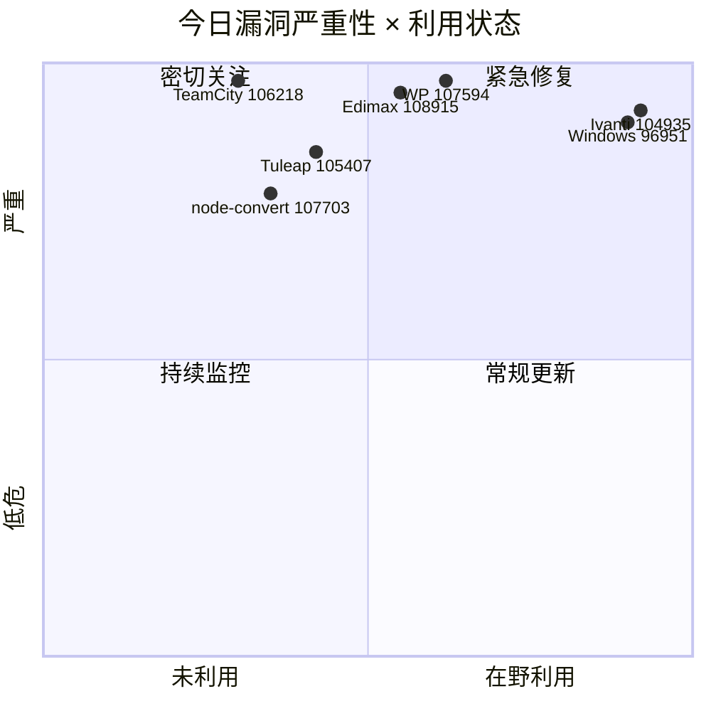
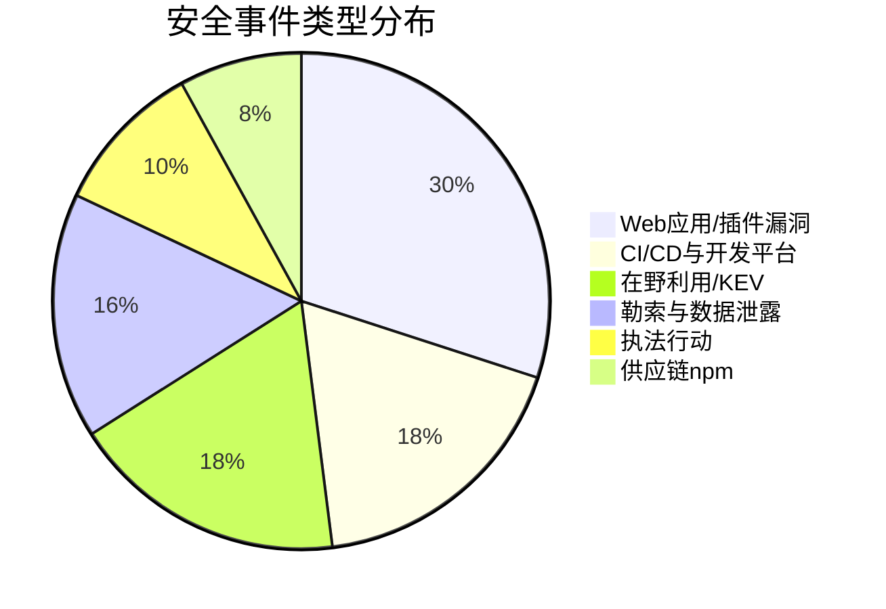
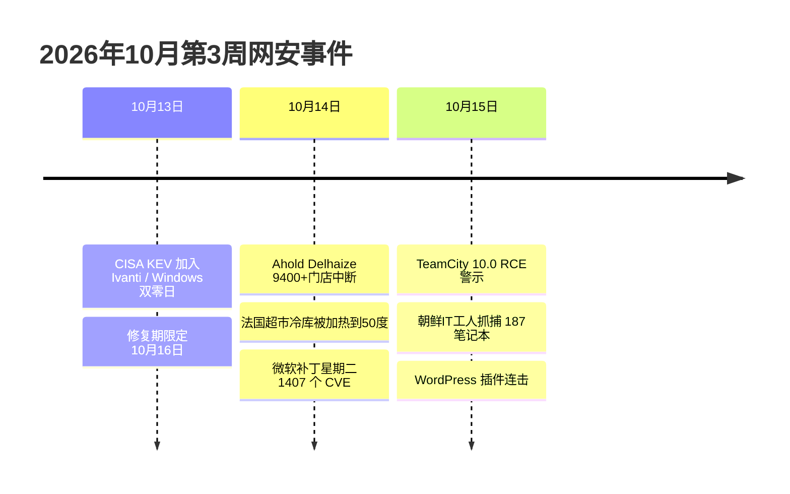

# 网安日报速递 · 2026年10月15日（第 187 期）

> 每日精选全球网络安全动态，覆盖 CVE 漏洞、安全事件、威胁情报与执法行动。
> 本期聚焦：TeamCity 满分 RCE、CISA KEV 双零日修复期限、Ahold Delhaize 零售中断、朝鲜 IT 工人渗透打击、WordPress 插件连击。

**今日关键词：** TeamCity106218×10 RCE · Ivanti104935 KEV在野 · Windows96951命令注入KEV · Ahold9400店中断 · 朝鲜IT工人187笔记本

---

## 头条

### JetBrains TeamCity 曝满分漏洞：Kotlin DSL 沙箱逃逸致未认证 RCE（CVSS 10.0）

CI/CD 平台 JetBrains TeamCity 在 `before 2026.1.3 / 2025.11.7` 版本中存在 **CVE-2026-106218**，Kotlin DSL 沙箱逃逸可导致服务器侧远程代码执行，CVSS 3.1 评分 **10.0**。该漏洞无需认证、无需用户交互、网络可达即可触发（AV:N/AC:L/PR:N/UI:N/S:C/C:H/I:H/A:H）。TeamCity 通常持有源码、构建产物与大量高权限凭据，一旦失陷等于把整条软件供应链的交付环节交到攻击者手中。

---

## 精选条目

### 1. JetBrains TeamCity CVE-2026-106218 — Kotlin DSL 沙箱逃逸，未认证 RCE（严重 / CVSS 10.0）

**事件内容：** JetBrains 在 2026.1.3 与 2025.11.7 修复了 TeamCity 的 Kotlin DSL 沙箱逃逸漏洞。攻击者可通过构造恶意的 Kotlin DSL 构建配置绕过沙箱限制，在 TeamCity 服务器上执行任意命令。NVD 与多家 CTI 平台标注其为 **CRITICAL 10.0**，目前尚无公开 PoC、未进入 CISA KEV。

**漏洞机制 / 攻击方式：**
- **类型：** 沙箱逃逸 / 不完整禁用输入清单（CWE-184）
- **攻击方式：** 通过版本化设置的 Kotlin DSL 提交绕过沙箱，触发服务器端命令执行
- **影响范围：** 所有公网可达或内网未隔离的 TeamCity 服务器（CI/CD 基础设施）
- **后果：** 源码泄露、构建产物被植入后门、生产凭据与密钥失窃，构成典型供应链攻击面

**值得关注的原因：**
- CI/CD 服务器属 Tier-0 资产，单一漏洞即可污染下游所有发布物
- 无需认证即可触发，极适合自动化蠕虫式扫描与利用
- 修复版本已发布，但大量老旧实例可能仍在运行受影响版本

---

### 2. CISA KEV 双零日修复期限将至：Ivanti Connect Secure + 微软 Windows（高危 / CVSS 9.5）

**事件内容：** CISA 于 **2026-10-13** 将两枚在野零日加入 KEV 目录，修复期限定为 **2026-10-16**：
- **CVE-2026-104935** — Ivanti Connect Secure 认证绕过（冒名），确认在野利用，可未认证 RCE；该漏洞属于一个三零日链的一环，目前仅有其中两个有补丁。
- **CVE-2026-96951** — 微软 Windows Shell 命令注入，可从网络侧绕过安全特性执行任意命令，与"去除 Mark of the Web（MotW）"的利用链相关。

**受影响组件：**

| 组件 | 风险 |
| --- | --- |
| Ivanti Connect Secure VPN | 严重 · 在野 · 部分链无补丁 |
| Microsoft Windows（Shell） | 严重 · 在野 · 10-16 前须缓解 |

**值得关注的原因：**
- 联邦机构 10-16 前必须完成缓解，公网暴露资产优先级最高
- Ivanti 链仅部分修复，仅靠"扫 WebShell"判断失陷会得到假阴性
- Windows Shell MotW 绕过直接影响 SmartScreen / Office 受保护视图等防线，钓鱼运营会快速采用

---

### 3. Ahold Delhaize 跨国零售遭网络攻击：9400+ 门店数字服务中断（高危）

**事件内容：** 荷兰食品零售巨头 **Ahold Delhaize**（运营 Albert Heijn、Etos、Gall & Gall、Delhaize、Stop & Shop、Food Lion 等，全球 9400+ 门店、近 40 万员工）于 **2026-10-12** 披露内部网络存在安全问题，为防扩散主动切断部分系统。事件波及荷兰、比利时、美国三地的网站、App、客户服务平台与线上杂货配送，门店虽正常营业但电子价签、个性化折扣与配送暂停。公司称暂无数据泄露证据，但荷兰国家网络安全中心确认与同期法国超市制冷系统被篡改事件**无关联**。

**值得关注的原因：**
- 零售业连续成为高影响目标，跨境多品牌数字生态放大横向移动与级联中断
- 实体门店虽开门，但支付、配送、会员体系数字化依赖导致"软中断"同样沉重
- 与法国超市冷链被恶意加热事件时间点接近，凸显国际零售业被重点盯防

---

### 4. 朝鲜 IT 工人渗透计划遭美方打击：逮捕 2 人、缴获 187 台笔记本（中高危）

**事件内容：** FBI 警告朝鲜 IT 工人正付费诱使美国人协助其使用被盗身份获取美国公司的远程岗位，朝鲜政府拿走 **85–90%** 收入用于武器计划。美司法部宣布对多名个人提起诉讼，逮捕 2 名美国籍嫌疑人、突袭德州 **40 处**据点、缴获约 **187 台**笔记本（笔记本农场），波及 **70+** 美国雇主、涉案约 **300 万美元**。部分工人被解雇后威胁前主管暴力与数据泄露，甚至瞄准需安全许可的岗位。

**值得关注的原因：**
- 这是"内部访问型"威胁的典型代表，传统边界防御无效
- 远程用工身份核验流程存在系统性盲区，应强化承包商/远程员工验证
- 与朝鲜黑客资金链直接挂钩，属国家级经济与安全双重风险

---

### 5. WordPress 插件连击：未认证文件删除（10.0）与任意文件读取（8.8）（中高危）

**事件内容：** 两枚 WordPress 插件漏洞值得站长立即处置：
- **CVE-2026-107594** — "File Upload to Order" 插件（< 1.1.4）未校验来自会话数据的文件路径，删除动作可由**未认证**用户触达，CVSS **10.0**。
- **CVE-2026-91136** — "Divi Plus" 插件（<= 2.4.0）通过 `/wp-json/elicus/v1/dipl-modules/svg-animator` 的 `svg_image` 参数存在**未认证任意文件读取**，CVSS 8.8。

**受影响组件：**

| 组件 | 风险 |
| --- | --- |
| File Upload to Order < 1.1.4 | 严重 · 未认证任意文件删除 |
| Divi Plus <= 2.4.0 | 中高危 · 未认证任意文件读取 |

**值得关注的原因：**
- WordPress 插件是互联网暴露面最大的攻击入口之一
- 未认证 + 满分评分 = 一旦公开利用会被大规模自动化扫描
- 老旧站点常长期不更新插件，风险窗口极长

---

## 速览区

### 6. @enmaso/node-convert（npm）命令注入 — CVE-2026-107703（8.6）
`convert.js` 未对 `filepath` 与 `convertTo` 参数做净化，攻击者可借此执行 shell 命令；影响 <= 1.0.0，属 npm 供应链风险。

### 7. Tuleap Enterprise OS 命令注入 — CVE-2026-105407（9.3）
Tuleap 企业版 17.0–17.5 的时间/区域管理子系统存在 OS 命令注入，可在服务器上执行任意命令。

### 8. Edimax BR-6208AC 路由器缓冲区溢出 — CVE-2026-108915（9.9）
`/goform/formWlanMP` 的 `ateBW` 参数可触发缓冲区溢出，厂商已停止维护、未回应披露；攻击者可远程执行，公开 PoC 已现。

### 9. 微软 Windows 补丁致 RDP 故障
微软确认近期 Windows 更新在启用 **Administrator protection** 时，会导致非管理员用户远程桌面（RDP）连接失败，影响 Windows 11 与 Windows Server 2025；临时方案为禁用该保护或授予本地管理员权限，修复仍在调查中。

---

## 风险分析

### 漏洞严重性 × 利用状态象限

### 安全事件类型分布

---

## 本周事件时间线

---

## 相关出处

1. **CISA KEV 目录** — CVE-2026-104935 / CVE-2026-96951 在野确认：<https://www.cisa.gov/known-exploited-vulnerabilities-catalog>
2. **JetBrains TeamCity 安全修复页** — CVE-2026-106218：<https://www.jetbrains.com/privacy-security/issues-fixed?product=TeamCity>
3. **NVD — CVE-2026-106218**：<https://nvd.nist.gov/vuln/detail/CVE-2026-106218>
4. **CTIWatch — CVE-2026-106218 分析**：<https://ctiwatch.com/vulnerabilities/CVE-2026-106218>
5. **安全内参 — Ahold Delhaize 跨国零售被黑**：<https://www.secrss.com/articles/94696>
6. **Aviatrix — Ahold Delhaize 攻击路径分析**：<https://aviatrix.ai/threat-research-center/ahold-delhaize-cyberattack-2026-retail-systems-offline>
7. **CyberMaterial — 2026.10.14 每日简报（朝鲜IT工人 / RDP 故障）**：<https://www.cybermaterial.com/p/cyber-briefing-20261014>
8. **Cyber-Defence — This week in CVEs（WP 插件 / Tuleap / node-convert）**：<https://www.cyber-defence.io/tools/cve/this-week>
9. **CTIWatch — CVE-2026-108915（Edimax 路由器）**：<https://ctiwatch.com/vulnerabilities/CVE-2026-108915>
10. **Enigma Global — 2026-10-14 每日威胁情报**：<https://www.enigma-global.com/blog/daily-digest-2026-10-14>
11. **CVE Brief — 2026-10-14 归档（KEV 与关键 CVE）**：<https://cvebrief.com/archive/2026/10/14>

---

*免责声明：本报告基于公开信息整理，CVE 编号、CVSS 评分与 KEV 状态以官方源（NVD / CISA / 厂商公告）为准。建议读者查阅原始来源获取最新动态。每日精选 · 值得关注 | 2026年10月15日*
