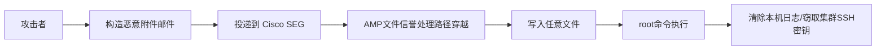
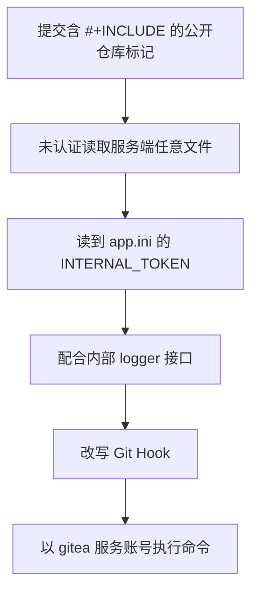
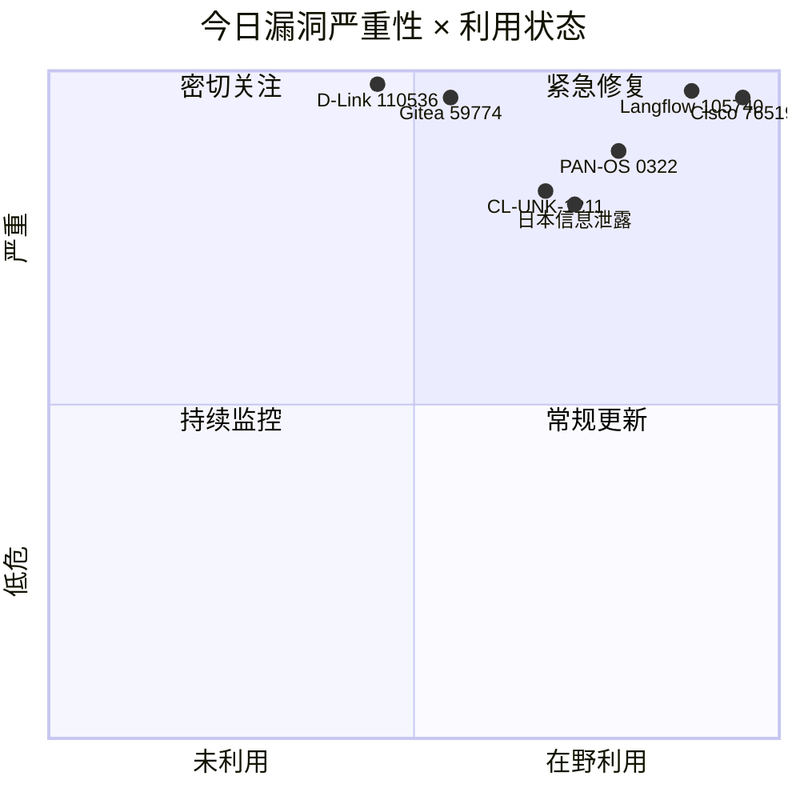
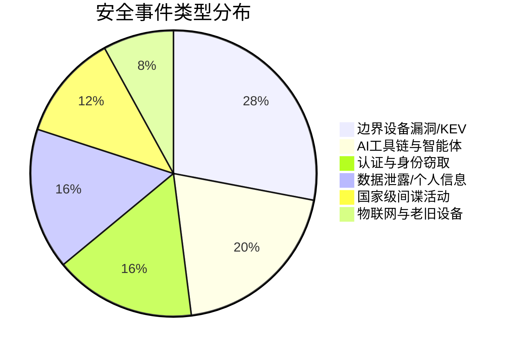
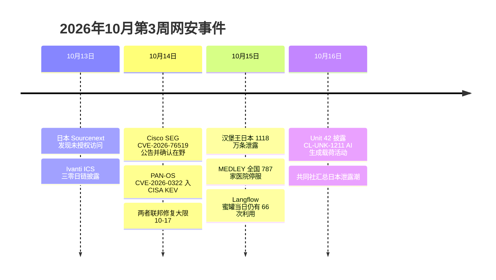

# 网安日报速递 · 2026年10月16日（第 188 期）

> 每日精选全球网络安全动态，覆盖 CVE 漏洞、安全事件、威胁情报与执法行动。
> 本期聚焦：Cisco 邮件网关「一封信即 root」零日在野、PAN-OS 管理面 KEV 大限、Langflow 提示词工具链被大规模扫打、Gitea 未认证读取到 RCE、日本个人信息泄露连环爆发。

**今日关键词：** Cisco76519邮件root在野 · PAN-OS 0322防火墙root · Langflow105740在野 · Gitea59774未认证 · 日本Sourcenext2251万

---

## 头条

### Cisco Secure Email Gateway 零日「一封邮件换 root」：在野利用，CISA 大限 10-17（CVSS 9.8）

Cisco 于 **2026-10-14** 更新公告，确认 **CVE-2026-76519** 已在野利用。该漏洞位于 Secure Email Gateway（AsyncOS）的 **高级恶意软件防护（AMP）文件信誉（File Reputation）** 处理路径，属**相对路径穿越**（CWE-23）：攻击者**无需认证**，只需向网关投递一封带特制附件的邮件，即可把文件写到操作系统任意路径，并进一步以 **root** 身份执行命令。这是继 9 月中旬 **CVE-2026-76461** 之后，同一产品的第二枚在野 root 级零日。

**关键事实：**

- **公告编号：** cisco-sa-esa-afw-zqYJkjxp，Bug ID CSCwu56223
- **触发条件：** 邮件策略中**启用了 File Reputation**，且 **Content Scanner Tools 低于 25.3.0.5525**（物理与虚拟设备均在内；Secure Email and Web Manager、Secure Web Appliance 不受影响）
- **修复路径：** 首选更新 Content Scanner Tools 至 **25.3.0.5525+**（**无需重启**，`contentscannerupdate` 命令即可），或升级 AsyncOS **15.5.5-014 / 16.5.0-780**（这两个构建原挂在 CVE-2026-76440 名下，现已确认同时覆盖 76519）；**16.0 分支的 16.0.4-302 单靠 AsyncOS 升级无效，需迁移**
- **无官方 workaround**；CISA 于 **10-14** 将其收录 KEV，联邦修复大限 **2026-10-17**
- **暴露面：** Shadowserver 追踪到约 **300 台**公网可达的 Cisco Secure Email Gateway
- **事后处置：** Cisco 建议在设备**外部的防火墙/链路日志**做取证（拿到 root 的攻击者可改写本机日志），虚拟设备建议**重建新 VM + 轮换全部凭据**，而非「打补丁即恢复可信」

**值得关注的原因：**

1. **安全功能本身成了攻击面**——File Reputation 是客户为了防恶意软件才开启的，越"买全功能"的部署越暴露。
2. **邮件网关是天然的东西向跳板**：一台机器拿到 root，等于同时掌握收发邮件、目录集成，以及集群成员之间互信的 SSH 密钥。
3. **"补丁 ≠ 干净"**：Cisco 明确要求按"已处理过恶意附件即视为不可信"来处置，这种口径在厂商公告里并不常见，说明其已按入侵事件而非普通漏洞来处理。

---

## 精选条目

### 1. Palo Alto PAN-OS CVE-2026-0322 — 管理面认证后 RCE 直达 root，已入 KEV（高危 / CVSS 4.0 8.6）

**事件内容：** Palo Alto Networks 于 **2026-10-14** 发布公告，披露 PAN-OS 管理界面中的远程代码执行漏洞 **CVE-2026-0322**（CWE-94 代码注入）。具备管理面网络访问权限的**已认证**攻击者可在防火墙上以 **root** 权限执行任意代码。厂商称观测到"**非常有限**的利用"，并给出三个美国境内 IP：`66.42.72[.]14`、`208.83.239[.]114`、`149.248.47[.]234`。CISA 同日收录 KEV，联邦修复大限同为 **2026-10-17**。

**受影响与修复：**

| 组件 | 说明 |
| --- | --- |
| PA-Series / VM-Series 防火墙、Panorama（虚拟与 M 系列） | 受影响 |
| Cloud NGFW、Prisma Access | **不受影响** |
| 修复版本 | 12.2.4，及 12.1 / 11.2 / 11.1 / 10.2 各自的热修复（11.2.16 预计 10-15 发布） |
| 缓解 | 无官方 workaround；只能把管理面收敛到可信内网 IP；Threat ID 510046 / 510047 覆盖有限且需 SSL 解密 |

**值得关注的原因：**

- 本周与 Cisco SEG 构成"**边界设备三连**"（VPN 网关 → 邮件网关 → 防火墙），攻击者明确在压边界可信层。
- 虽然是认证后漏洞，但**凭证并非难获得**：信息窃取日志（infostealer log）成批在售，管理员凭据复用极其普遍，"需要登录"的安慰性极低。
- 防火墙管理面一旦被拿下，等于攻击者掌握了流量编排、VPN 会话与设备内存储的秘密，横向价值远高于一台普通服务器。

---

### 2. Langflow CVE-2026-105740 — MCP Stdio 命令注入致认证后 RCE，蜜罐已记录 1423 次利用（严重 / CVSS 9.9）

**事件内容：** IBM / DataStax 旗下开源 AI 应用与智能体工作流平台 **Langflow** 存在 **CVE-2026-105740**（CWE-78，CVSS 9.9）。漏洞在 MCP（Model Context Protocol）服务器的 `stdio` 传输配置上：**用户提交的 command 字段被直接交给 `bash -c "exec {command}"` 执行**，无校验、无白名单、无沙箱；`env` 字段还允许注入任意环境变量（如 `LD_PRELOAD`、覆盖 `PATH`）。**任意认证用户（含非管理员）** 即可获得 Langflow 进程权限下的 OS 命令执行能力。修复版本 **1.9.0**，公告与 CVE 于 **10-05** 发布（GHSA-7w94-79vh-5mr2）。

**在野态势：** Previdian 蜜罐自 **9-19** 起记录 **1,423 次**利用尝试，来自 **27 个独立 IP**、覆盖 **15 个国家/地区**；**10-11** 起显著提速（单日 333 次），**10-15** 当天仍有 66 次。捕获载荷包括窃取 `LANGFLOW_SECRET_KEY`、`LANGFLOW_SUPERUSER_PASSWORD` 等敏感配置并外传至 `146.70.211[.]`。攻击链为：查询版本 → 尝试 `/api/v1/auto_login`（被禁用则 403）→ 用常见弱口令登录 → 拿 bearer token 打 `/api/v2/mcp/servers/{name}`。上月同族的 **CVE-2026-105697**（同为 9.9）也走 MCP stdio 命令注入。

**值得关注的原因：**

- **恶意配置可持久化**：MCP 服务器配置存在项目设置里、**不显示在流程编辑器中**，常规的"看一遍流程图"式的代码审计根本发现不了，而且每次拉取服务器列表都会重新执行，等于固化后门。
- AI 工作流平台大量被部署在**开发/预发环境**，这些环境通常缺乏生产级的加固、监控与访问控制，且团队共用凭据，"需要认证"这道门槛形同虚设。
- MCP 及同类智能体协议正在快速铺开，**"把用户输入的命令直接送 shell"这一类风险还没被系统性地威胁建模**，Langflow 大概率不是最后一个。

---

### 3. Gitea CVE-2026-59774 — Org-mode INCLUDE 未认证任意文件读取，可链至 RCE（严重 / CVSS 9.8）

**事件内容：** Gitea 的 Org-mode 渲染器（go-org）在处理仓库标记时，未限制 `#+INCLUDE` 指令的本地文件读取回调（CWE-22）。攻击者只要在**公开仓库**中提交含 `#+INCLUDE` 的 Org-mode 标记，即可**未认证**读取 Gitea 服务账号可访问的任意文件。**影响 1.22 至 1.27.0（含）**，修复版本 **1.27.1**。

**升级路径（从"读文件"到"拿命令执行"）：**

**值得关注的原因：**

- **前置条件极低**：实例只要有**一个公开仓库**，后续步骤完全不需要身份认证。
- 被读取的高价值文件不止配置：**CI/CD 变量、Runner 令牌、日志中的敏感内容**同样在射程内，极易成为横向渗透的跳板。
- 该漏洞被主流 CVE 追踪平台列入"上升速度快"梯队（EPSS 显著抬升），虽尚未入 KEV，但修复成本极低，没有拖延的理由。**已暴露实例必须轮换 `INTERNAL_TOKEN` 并检查仓库 Git Hook 是否被改动**。

---

### 4. 日本个人信息泄露连环爆发：Sourcenext 2251 万条、汉堡王日本 1118 万条、医疗 IT 全国停服（高危）

**事件内容：** 据共同社 **10-16** 报道，日本综合性软件企业 **Sourcenext**（主营安全防护软件、电子贺卡）于 **10-13 上午 9 时许**发现会员信息管理系统遭**未授权访问**，已切断连接；**最多约 2251 万条**客户记录可能外泄，涉及姓名、住址、电话号码、密码，工作单位与职务信息也可能泄露（该公司称信用卡信息未受影响），正通过邮件通知并呼吁改密。同日：

- **BK Japan（汉堡王日本）** 宣布其官方 App 约 **1118 万条**会员信息发生泄露；
- 医疗 IT 企业 **MEDLEY** 面向医院的业务支持系统因未授权访问**暂停服务**，全国 **787 处**医疗机构无法进行互联网预约等操作，患者个人信息是否外泄仍在调查；
- 数字漫画平台 **Comic Cmoa** 运营商在服务器疑似遭未授权访问后**暂时关闭**相关服务；
- 发布防灾信息的 **Arcadia**（大阪府箕面市）遭未授权访问后，**多个地方政府居民已收到可疑邮件**——说明泄露信息可能已被实际滥用。

**值得关注的原因：**

- 这是日本本轮个人信息泄露潮的又一次集中爆发（此前已连续出现 JR 东日本、BOOKOFF、skyticket、罗森、第一兴商等大案），**累计影响规模已达数千万级**。
- 攻击模式高度相似：**直打存储个人信息的客户数据库/会员系统**，而非勒索加密——目的是批量数据变现。
- **"未授权访问 + 无篡改迹象"** 的组合意味着受害企业往往在数日后才发现，留给防守方的响应窗口被压缩到几乎为零。企业应重新审视个人信息的保存方式与保存期限。

---

### 5. Unit 42：CL-UNK-1211 用 AI 生成代码攻击政府 Linux 服务器（中高危）

**事件内容：** Palo Alto Networks Unit 42 披露编号 **CL-UNK-1211** 的长期间谍活动（观测期 **2025-10 至 2026-04**），目标为政府机构与国家关联基础设施的 **Linux 服务器与数据库**。攻击者使用自定义与开源 Web Shell 获取初始访问，通过篡改 `/etc/php/` 与 `/opt/plesk/php/` 下的 **`auto_prepend_file`** 实现持久化（每个 PHP 请求前静默执行），并部署自研的 Go 语言跨平台后门 **SysGoRAT** 与内存态反弹 shell 以最小化落盘痕迹。

**最值得记录的细节：** 恶意 PHP 与 shell 脚本中**残留了对话式的 LLM 推理注释**——包含"向给出初始指令的操作者解释逻辑"的分步说明，且攻击者在 PHP、JavaScript、Bash、Python 之间切换时**没有任何正常开发过程中的摩擦痕迹**。Unit 42 判断这符合 **AI 辅助代码生成或自动化 AI 智能体**的产出特征，但未能识别具体模型厂商。

**其他行为：** 枚举政府邮箱以提取关联社交媒体的账号邮箱、整库 dump 后外传、**时间戳伪造（timestomping）与清除系统日志**、尝试禁用端点防护（被 Cortex XDR 拦截）、并植入**伪造的红队标记**让活动看起来像合规的安全评估。IOC：`104[.]194[.]158[.]65:443`、`Solarwinds[.]StatusLog[.]txt`。

**值得关注的原因：**

- **AI 注释本身成了最好的指纹**，但真正值得防御方对焦的是持久化机制——监控 `auto_prepend_file` 改动、PHP-FPM 子进程拉起 shell、以及 `.bashrc` 中被塞入的 sudo 别名。
- 攻击者主动伪造红队标记，说明"**先假设这是授权测试**"的惯性心理正被武器化。
- 目标虽在境外政府，但检测思路与 IOC 对任何跑 Linux + PHP 的企业同样适用。

---

## 速览区

### 6. 零点击广告间谍软件 AdFection：Discover-Tech 广告把设备引向 Candiru 服务器（高危）
Citizen Lab 披露，广告公司 **Discover-Tech** 的投放被用来将设备静默导向 **Candiru** 的服务器，至少 **45 台半岛电视台（Al Jazeera）设备**被实施零点击攻击，与 Candiru 的关联达"高置信度"。Confiant 发现这些广告同时出现在**美国国防部与北约网络**等敏感网络中。Google 与 IAB Europe 已将 Discover-Tech 移出供应商名单。建议对高风险岗位人员的终端限制或过滤第三方广告内容。

### 7. GreyNoise：proxyjacking 借老旧漏洞劫持边缘设备转卖带宽（中高危）
GreyNoise 在 **34 个国家**发现至少 **143 台**被入侵设备，在未经同意的情况下运行 **Pawns.app** 用于转卖带宽牟利。攻击者使用的入口为 **CVE-2024-3272 / CVE-2024-3273**（D-Link NAS）、**CVE-2021-44228**（Log4Shell）、**CVE-2025-31324**（SAP NetWeaver Visual Composer），目标还包括 **Hikvision / Dahua** 录像机、**Ubiquiti UniFi Video NVR**。这类"不加密、只要算力与出口 IP"的变现方式更难被察觉，NAS 与视频监控设备仍是重灾区。

### 8. EvilTokens：设备代码钓鱼即服务，16 天打穿 344 家组织（中高危）
EvilTokens 自 **2026-02** 起在 Telegram 以订阅制出售（**1,500 美元启动费 + 500 美元/月**，另有群发与绕过过滤器插件），滥用 **OAuth 设备代码流程**：攻击者先自行发起设备码流程，再诱导受害者在**真实的微软页面**上输入代码，受害者"正确地完成了 MFA"，攻击者却拿到**有效会话令牌**。因此**强制改密码无效，必须吊销令牌并终止会话**。Huntress 追踪到其在约 16 天内打穿 **5 个国家 344 家**组织；Barracuda 称四周内检测到 **700 万+** 次设备代码钓鱼。缓解要点：用条件访问**屏蔽非必要的设备代码流程**，并对特权账户的异常设备码登录告警。

### 9. D-Link DIR-868L 路由器 HNAP 命令注入 — CVE-2026-110536（CVSS 10.0，公开 PoC）
`/htdocs/cgibin` 的 HNAP CGI 处理器未安全处理 `SOAPACTION` 参数，导致 OS 命令注入；**未认证、无需交互、网络可达**即可触发（AV:N/AC:L/PR:N/UI:N/S:C/C:H/I:H/A:H），CVE 记录中已列出 **GitHub 公开 PoC**。该型号固件 2.01b05 受影响，D-Link 支持公告 **SAP10189** 确认 DIR-868L 已 **停止支持 / 生命周期终止**，固件开发已停止，**无修复版本**。处置建议：不把 Web 管理界面与 HNAP 服务暴露到公网，规划替换设备。

### 10. 朝鲜 Kimsuky「Operation GitPower」：回复式钓鱼 + 滥用 GitHub 打乌克兰政策专家（中危）
Genians Security Center 报告，朝鲜关联组织 **Kimsuky**（亦称 Emerald Sleet / Velvet Chollima / THALLIUM）正针对乌克兰外交、安全与国际政策领域专家。手法为**先说人话建立信任的"回复式"钓鱼**（reply-baiting），随后投递恶意 **LNK 文件**拉起 **PowerShell**，并**把 GitHub 当作攻击基础设施**（从 raw 内容拉取载荷）。建议对 LNK 附件与由快捷方式拉起的 PowerShell 进程直接告警或阻断，并监控终端向 GitHub raw 内容的异常访问。

### 11. OpenAI 生态观察：地下论坛讨论重心从"越狱聊天机器人"转向 AI 智能体与开源权重模型
Bitsight 分析了 **2026 年 2 月至 8 月**间 16 个地下论坛的帖子：**AI 相关讨论增长 45%**，而**勒索软件相关提及下降 49%**；**MCP、AI 智能体与间接提示注入**的提及量上涨 **67%**，攻击者越来越多在**租用的 GPU 上运行开源权重模型**。一个名为 **MONST3R-AI** 的平台允许买家把窃取的 OpenAI / Anthropic / Google API Key 粘贴进自主渗透测试工具。这条趋势线与本期的 Langflow、CL-UNK-1211 相互印证：**攻击侧已把模型当成流水线上的一个工种**。

---

## 风险分析

### 漏洞严重性 × 利用状态象限

### 安全事件类型分布

---

## 本周事件时间线

---

## 相关出处

1. **Cisco 安全公告（CVE-2026-76519）**：<https://sec.cloudapps.cisco.com/security/center/content/CiscoSecurityAdvisory/cisco-sa-esa-afw-zqYJkjxp>
2. **CISA KEV 目录（CVE-2026-76519 / CVE-2026-0322 / CVE-2026-105740）**：<https://www.cisa.gov/known-exploited-vulnerabilities-catalog>
3. **Daily Security Review — Cisco Secure Email Gateway Zero-Day Exploited**：<https://dailysecurityreview.com/resources/cisco-secure-email-gateway-zero-day-cve-2026-76519-exploited>
4. **DataWater — CVE-2026-76519 分析与修复路径**：<https://datawater.com/cve-2026-76519-cisco-email-gateway-zero-day>
5. **Palo Alto Networks 公告 — CVE-2026-0322**：<https://security.paloaltonetworks.com/CVE-2026-0322>
6. **Canadian Centre for Cyber Security — AV26-1041（PAN-OS）**：<https://www.cyber.gc.ca/en/alerts-advisories/palo-alto-networks-security-advisory-av26-1041>
7. **TSNMedia — PAN-OS CVE-2026-0322 Exploited, CISA KEV**：<https://tsnmedia.org/palo-alto-pan-os-cve-2026-0322-exploited-cisa-kev>
8. **The Hacker News / zeroHour — Langflow CVE-2026-105740 蜜罐利用统计**：<https://zerohour.day/item/50367ee6ae87dcd5e1b39b493e658ad9d82660d1>
9. **BtCIRT 20261013009 — Langflow MCP Stdio RCE 通告**：<https://btcirt.bt/authenticated-remote-code-execution-in-langflow-via-mcp-stdio-transport-cve-2026-105740-20261013009>
10. **IONIX — CVE-2026-59774（Gitea Org-mode INCLUDE）**：<https://www.ionix.io/threat-center/cve-2026-59774>
11. **Cyber-Defence — CVE-2026-59774 记录页**：<https://www.cyber-defence.io/tools/cve/CVE-2026-59774>
12. **共同社（共同网）— 软件商逾 2000 万条信息或外泄**：<https://tchina.kyodonews.net/articles/-/14977>
13. **新华社 / 腾讯新闻 — 日本一软件企业逾 2000 万条客户记录或遭泄露**：<https://news.qq.com/rain/a/20261016A07F7S00>
14. **Unit 42 — AI-Powered Espionage Campaign Targets Government Linux Infrastructure**：<https://unit42.paloaltonetworks.com/>
15. **CyberSixt — CL-UNK-1211 概要**：<https://cybersixt.com/a/rLjf0W9NVWB2inVwewM37f>
16. **Enigma Global — Daily Threat Intelligence Digest, 2026-10-15**：<https://www.enigma-global.com/blog/daily-digest-2026-10-15>
17. **CyberSecBrief — Daily Cybersecurity Briefing, 16 October 2026**：<https://www.cybersecbrief.com/news/cybersec/cybersec-2026-10-16>
18. **CVETodo — Daily Cyber Threat Report, 15 Oct 2026**：<https://cvetodo.com/threat-report/sg>
19. **Huntress — Passkeys Raise the Bar（EvilTokens 与设备代码钓鱼）**：<https://www.huntress.com/blog/passkeys-raise-the-bar-but-attackers-can-still-get-in>
20. **Key IT — Device code phishing: block it in Microsoft 365**：<https://keyit.com.au/news/device-code-phishing-microsoft-365>
21. **IONIX — CVE-2026-110536（D-Link DIR-868L HNAP）**：<https://www.ionix.io/threat-center/cve-2026-110536>
22. **Tech Jacks Solutions — 日本 IDC Frontier 与泄露潮分析**：<https://techjacksolutions.com/scc-intel/ransomware-attack-on-idc-frontier-disrupts-495-japanese-organizations-ai-tools-lowering-attacker-barriers>
23. **Cybersecurity Canada — Burnaby SD41 勒索与数据泄露**：<https://cybersecuritycanada.ca/news/posts/burnaby-school-district-ransomware-attack-student-data-breach-lessons>
24. **ICSDA 中華民國資通安全發展協會 — 2026-10-16 資安日報**：<https://icsda.org.tw/>
25. **Fnet 云网安 261016（网易转载）**：<https://www.163.com/dy/article/L9BS2DIG05384JSS.html>

---

*免责声明：本报告基于公开信息整理，CVE 编号、CVSS 评分与 KEV 状态以官方源（NVD / CISA / 厂商公告）为准。建议读者查阅原始来源获取最新动态。每日精选 · 值得关注 | 2026年10月16日*
