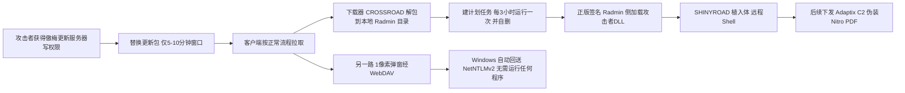
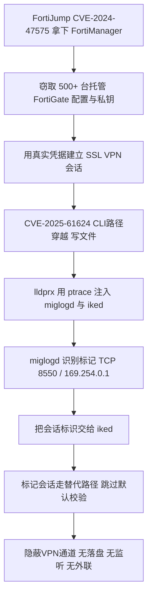
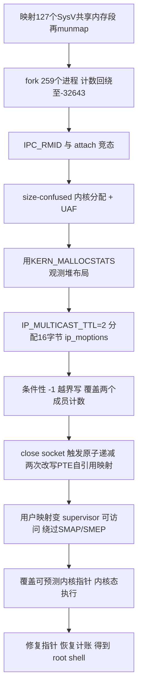
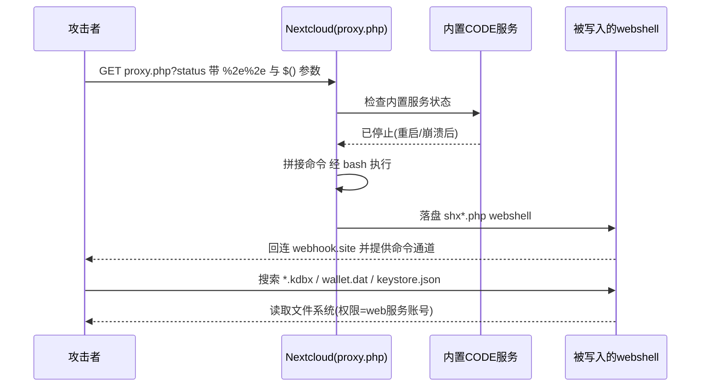
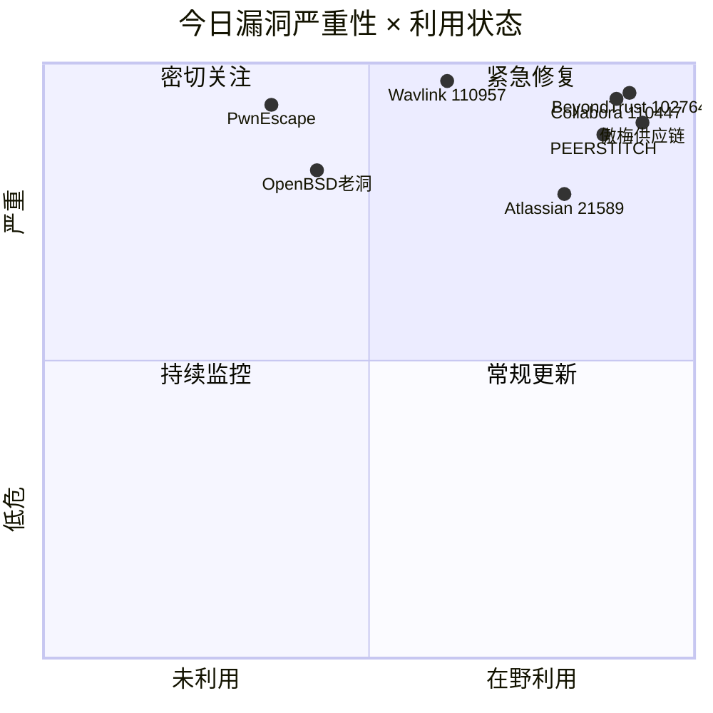
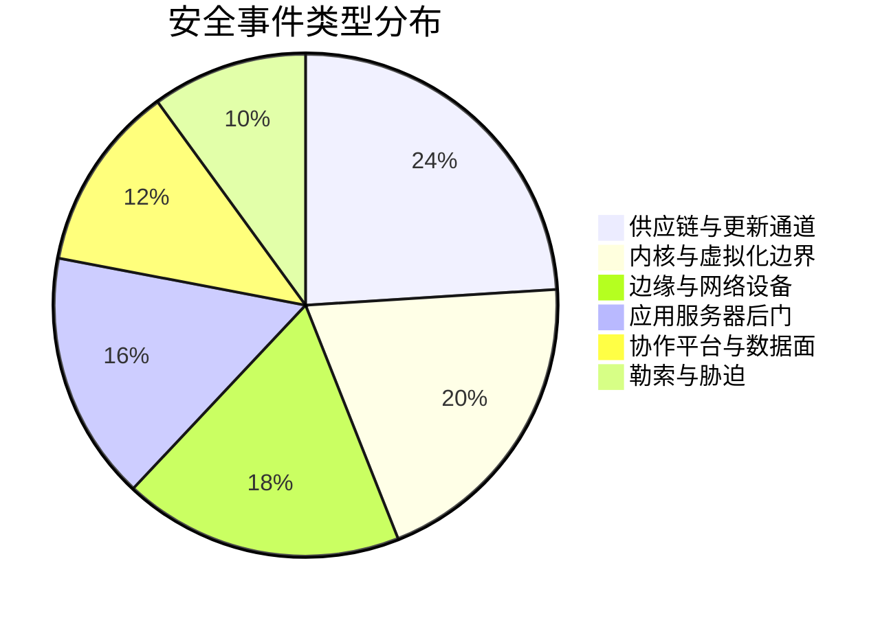
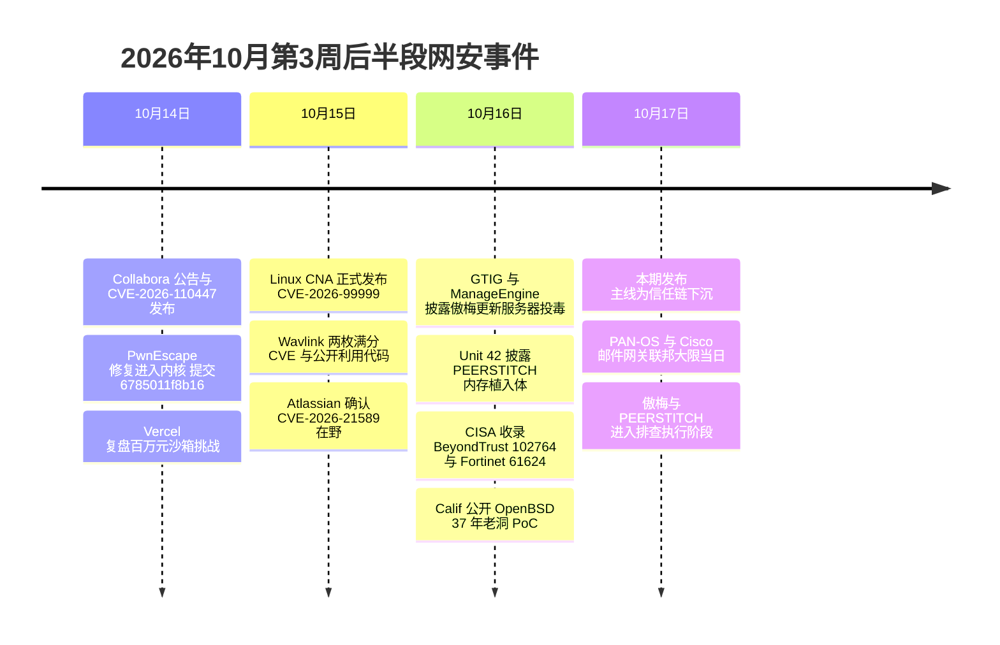

# 网安日报速递 · 2026年10月17日（第 189 期）

> 每日精选全球网络安全动态，覆盖 CVE 漏洞、安全事件、威胁情报与执法行动。
> 本期聚焦：傲梅备份更新服务器被投毒（5–10 分钟窗口即可长期驻留）、FortiOS 内存植入 PEERSTITCH 与「中危」漏洞的真实风险、PwnEscape 宿主内核越界读取、OpenBSD 37 年老洞打出 root、Collabora「有补丁无 CVE」的一个月空窗。

**今日关键词：** 傲梅更新服务器被投毒 · FortiOS内存驻留植入PEERSTITCH · PwnEscape宿主逃逸 · OpenBSD三十七年老洞提权 · Collabora110447无CVE空窗

---

## 头条

### 傲梅备份（AOMEI Backupper）更新服务器被投毒：每次只开 5–10 分钟，却留下长期后门（严重）

Google Threat Intelligence Group（GTIG）、Mandiant 与 ManageEngine 威胁分析实验室于 **2026-10-16** 同步披露：**AOMEI Backupper 的更新服务器在 2026 年春末至 7 月间被攻击者短暂控制**，在 **3 个 5–10 分钟的窗口**内向正在轮询更新的 Windows 设备下发了带后门的安装包。三个已确认窗口合计仅约 **21 分钟**，首尾相隔 **53 天**；受影响组织分布在 **11 个国家**，集中在 IT 服务、电信与高等教育。

问题的根因不在加密传输，而在**产品本身不校验更新包的密码学签名**——文件是从官方服务器、走 HTTPS、由程序按正常更新流程主动拉取的，因此"AOMEI 官方渠道 + HTTPS"这两道看似充足的信任假设同时失效。

**关键事实：**

| 项目 | 内容 |
| --- | --- |
| 披露方 | GTIG + Mandiant（攻击活动编号 UNC7017，未给出国家或已知组织）、ManageEngine 实验室（独立复现） |
| 暴露窗口 | 2026 年春末至 7 月，3 个窗口，每次 5–10 分钟，合计约 21 分钟；7-20 窗口另含无代码手法 |
| 首见线索 | 5-28 端点软件在两个不同国家、互不相关的客户设备上记录到 Backupper 自动安装 Radmin；6-07 客户上报，同日通报傲梅 |
| 厂商初次说法 | "更新内容在传输过程中被拦截篡改"；实验室不认可——两台设备位于不同国家、不同网络，均通过 HTTPS 从官方服务器拉取，且由程序正常流程主动获取 |
| 关键证据 | 7 月中旬实验室实时捕获一次篡改窗口，证实恶意内容由**服务器端**下发；Mandiant 7-17 通报、7-29 傲梅回复已整改，但实验室称截至发布未独立确认彻底遏制 |
| 载荷 | CROSSROAD 下载器 → 解包至本地 Radmin 目录 → 建每 3 小时计划任务 → 自删；捆绑**正版签名 Radmin** 做侧加载 → SHINYROAD 植入体（远程 shell + 按指令下载执行）；后续叠加伪装成 Nitro PDF 的 Adaptix C2 |
| 单点可断 | SHINYROAD 仅连接一个硬编码地址、无备用，封锁该地址即可切断控制通道 |
| 感染面 | 未披露受影响版本；实验室分析样本为 8.3.0，当前 8.5.0（10-09）的更新日志**未体现**校验机制变更 |
| 检测难点 | 下载器在落盘后把本地更新文件恢复成正常内容；窗口过后服务器下发的又都是干净文件——曾导致分析人员把真实告警误判为误报 |

**值得关注的原因：**

1. **"修补服务器"不等于"清理终端"**。傲梅已整改服务器，但凡是窗口期内拉到过恶意包的机器仍是失陷状态；厂商侧动作无法回溯清除已投递的植入体。
2. **窗口期极短，是靠"时机"而非"技巧"取胜**。传统 IOC 与样本比对的前提是"文件在一段时间内稳定可查"，几分钟的替换把这一前提打掉了；GTIG 称这是其遇到的第一个专门利用"极短窗口 + 正常更新流程"的 Windows 供应链入侵。
3. **签名校验缺失是行业级通病**。这次被利用的不是某个 0day，而是一个设计选择：更新包没有独立签名验证，HTTPS 一旦在服务端失守就等于全线失守。
4. **无代码泄露路径被顺带发现**。7-20 窗口里攻击者篡改通知配置文件，打开一个不可见的 1 像素弹窗经 WebDAV 指向其服务器，Windows 渲染时自动回送当前登录用户的 NetNTLMv2 响应——即使后门被拦截，凭据仍可能已经泄露。
5. **排查动作必须跨 4 个月**：保留程序自身缓存目录中的更新文件、回查告警发生**当时**的网络日志，而不是现在去打开厂商下载页（那一刻的内容早已是正品）。

---

## 精选条目

### 2. PEERSTITCH：寄生在 FortiOS 两个守护进程之间的内存植入体，配合「中危」漏洞打穿电信 MSP（高危 / CVSS 5.4–6.0）

**事件内容：** Palo Alto Networks Unit 42（Daniel Gott、Shawn Westfall）披露一起起始于 **2024 年 9 月**的长期入侵，目标是一家**电信行业托管服务商（MSP）**，活动编号 **CL-STA-0954（UNC5820）**。入口是 FortiManager 的 **FortiJump（CVE-2024-47575）**；攻击者从管理设备上取走了一个包含 **500 多台托管 FortiGate** 运行配置的归档：设备序列号、管理关系、配置文件、网络拓扑、路由与接口设置、加密的管理员与 VPN 凭据，以及证书与私钥。随后用 **CVE-2025-61624**（FortiOS 命令行解释器路径穿越，CVSS 5.4 / 厂商记 6.0，2026-04 已修）在选定设备上投放 **PEERSTITCH**。

**技术要点：**

- **形态**：64 位 Linux **ARM64** 可执行体，C 语言编写；多组件下发（准备脚本、JavaScript 运行时模块、WebAssembly 组件、部署编排器、核心注入器，落地文件含 `pM.js`、`a.wasm`、`lldprx`）。
- **注入**：`lldprx` 用 `ptrace` attach 到合法的 `/bin/miglogd`（日志）与 `/bin/iked`（VPN），分配可执行内存、写入代码、重定向执行流。
- **隐蔽通道**：miglogd 侧的钩子识别流量中的标记（**TCP 端口 8550**、地址 **169.254.0.1**），把会话标识传给 iked；iked 侧看到同一标记时走**替代执行路径，跳过 FortiOS 默认校验**，且仅对该会话生效。
- **反检测**：无持久化二进制、不开监听端口、不主动外联，通信全部寄生在合法进程产生的流量里——文件扫描与网络签名几乎无从下手。
- **附带手法**：用 Apache 的 **mod_md** 模块搭 SSH 反连 shell；关闭日志、清除崩溃记录、中断遥测、事后删除越权管理员账号与自动脚本。
- **下载源**：`23.240.77[.]233:8085`。

**值得关注的原因：**

1. **"中危"评分在这里几乎失效**。CVE-2025-61624 需要高权限前置——但攻击者从 FortiManager 拿到的正是这个前置条件。按分数排序补丁的团队会把这类漏洞留上几个月。
2. **补丁不负责"退场"**。被窃取的配置、证书、私钥在设备升到最新版后依然有效，攻击者可以凭几个月前的材料重新进入一台完全打好补丁的设备。
3. **托管服务商的信任集中度风险**。一次管理面失守，向下游扩散到 500 多台客户边界设备；这是"管理生态被反向武器化"的教科书案例。
4. **CISA 已于 10-16 收录 CVE-2025-61624**（该 CVE 记录 4 月发布，此前无公开在野记录），说明"老 CVE 突然被用起来"是常态。
5. **猎捕方式要换**：查 `miglogd` / `iked` 进程内存中的匿名 **16KB RWX** 区域、守护进程异常崩溃、遥测缺口、对 `/proc/<pid>/mem` 的访问；同日志务必外送到设备之外（攻击者会清本机日志）。

**修复：** FortiOS **7.6.5** / **7.4.10** 及以上；7.2、7.0、6.4 已无修复分支需迁移；FortiProxy、FortiSwitchManager、FortiPAM 各有修复构建；虚拟补丁见 FMWP 库更新 25.120（FG-VD-59270）。同时确认 FortiJump 已修，并轮换可能经 FortiManager 泄露的凭据与密钥。

---

### 3. PwnEscape（CVE-2026-99999，CVSS 9.3）：一个包的校验和写错位置，就能读到宿主内核的 32 字节（严重）

**事件内容：** Linux 内核网络栈的**延迟校验和（deferred checksum）**处理存在缺陷：`csum_start` / `csum_offset` 两个元数据字段由**客机**提供，而 `skb_checksum_help()` 在 IPv4 头已被解析并信任之后才完成校验和写入；精心构造的元数据会让这次写入落进**已经通过校验的 IPv4 头**——首字节从 `0x45` 变成 `0x4f`，IHL 字段因此宣称头长 **60 字节**。等到分片时 `ip_do_fragment()` 按 60 字节读取，而包里只有 28 字节有效数据，多出来的 **32 字节宿主内存**被当作 IP options 复制进包，直接发回攻击者。

**验证程度（关键区分）：**

| 效果 | 验证环境 | 说明 |
| --- | --- | --- |
| 宿主内存泄露 | **Vercel 生产沙箱** | 客机持续发包即可持续读取，每个包约 32 字节 |
| 宿主崩溃 | 研究者自建 KVM / Firecracker（配置对齐 Vercel） | 两个包即可触发 |
| 宿主 root 代码执行 | 同上，实验室环境 | 4 次冷启动中获得定向 64 字节内核写，进而执行 root 命令 |

**来龙去脉：** Vercel 于 **8-18** 发起 100 万美元的 Sandbox 逃逸挑战，pwn.ai 的 Paulos Yibelo 在第 3 天提交报告——虽然没能逃出 Vercel 沙箱，却挖到了更底层的东西。1,285 份提交中这是**唯一一枚 critical**，Vercel 在 10-14 的复盘里称其为整场挑战最重要的报告。pwn.ai 表示，其 AI 辅助研究系统 **Omega-Pwn** 用 **3 天、不到 700 美元**的 API 费用找到了这个缺陷。

**修复：** 上游提交 `6785011f8b16`（Red Hat 的 Michael S. Tsirkin），《ipv4: validate checksum_start before completing checksum》，在 **5 处 / 6 个文件**加了防护；作者本身称其为"纵深防御措施"，入口处的完整校验仍待补齐。已修复版本：**5.10.272、5.15.223、6.1.190、6.6.159、6.12.113、6.18.57、7.2.11**（及 7.3-rc7）；Debian 侧为 **DSA-6568-1**（6.12.113）。

**值得关注的原因：**

1. **信任边界的位置被说清楚了**：缺陷不在 KVM 模拟层，而在**宿主的通用网络栈**——所有跑 KVM / Firecracker / 微虚机的云厂商、CI/CD 平台、AI 沙箱都共享这一层，一个 bug 的辐射面等于"所有多租户"。
2. **只补客机完全无效**。漏洞代码在宿主，必须升级宿主内核并**重启**；只有重启后的运行内核才算修好。
3. **AWS 明确表示 EC2 / Lambda / Fargate 不受影响**，自建 KVM 与小云厂商需要自行确认——这正是"向供应商索取证据"（发行版公告 + 实际运行内核 + 重启记录）而非看 `uname -r` 的场景。
4. **成本曲线的变化**比漏洞本身更值得记住：3 天、700 美元就能找到一枚云端隔离 critical。这类发现的节奏会显著加快。
5. 截至 10-15 的 CISA KEV 中**没有**该条目，也无在野利用报告，属于预防性修复窗口。

---

### 4. OpenBSD 37 年老洞打出 root：一个 1988 年的 `short`，加上一次越界写（高危）

**事件内容：** 安全公司 **Calif**（研究者 Andrew Griffiths，MAD Bugs 项目）于 **2026-10-16** 公开了在 **OpenBSD 7.9** 上本地提权到 root 的完整 PoC。链条入口是一个可以追溯到 **1988 年原始 BSD 源码**的设计：共享内存挂接计数器 `shm_nattch` 被定义为**有符号 16 位 short**，上限 32,767，OpenBSD 一直沿用未加宽。反复 fork 带共享内存挂接记录的进程即可把计数推过上限并**回绕为负值**，由此引发竞态导致的内核 use-after-free；再叠加一处条件性越界写，就能在不依赖任何信息泄露的前提下拿到 root。

**为什么能绕过 KARL：** OpenBSD 的 KARL 会给内核镜像重链接、随机化函数与数据地址，但**内核内存分配器仍是确定性的**——启动分配器与 best-fit 分配器都缺乏基址随机化，因此早期启动分配的结构（包括 `lo0`、`enc0` 网络接口的 `ioctl` 处理函数指针）在同一硬件上跨重启落在同一位置。研究者正是覆盖其中一个取得控制流，再用另一个把指针改回去。

**修复与加固：**

- 整数溢出：**errata 018**（9-14 发布，当初归类为**可靠性**修复），OpenBSD 7.8 亦覆盖
- 引用计数 UAF：**errata 026**（9-30 发布，安全修复）
- 均经 `syspatch` 提供（amd64 / i386 / arm64），需**重启**才能生效
- 加固建议：内核双链表 **safe-unlinking**（FreeBSD / NetBSD 的 `sys/queue.h` 已有实现）、PTE 自引用映射随机化（用 `.openbsd.randomdata` 随机字节选 PML4 slot，`320 + (rand & 127)`）、内核分配器随机化、编译器数组边界检查与分配隔离

**值得关注的原因：**

1. **"最安全的操作系统"的盲区是 1988 年的一个类型选择**。37 年间它跨过了无数轮代码审计与模糊测试，因为没人会去怀疑一个"计数器"的宽度。
2. **分类错误会延迟修复**：入口漏洞最初按"可靠性修复"发布，不发布安全公告——只订阅安全公告的团队会漏掉这一半。
3. **公开 PoC + 无需信息泄露 + 绕过三大缓解**，意味着任何能拿到本地低权限账号的场景（共享主机、被拿下的服务、CI runner）都能直上 root。
4. 目前**无 CVE 编号、无在野利用**，但 OpenBSD 常用于防火墙、VPN 网关与网络设备，本地提权的边际价值很高。

---

### 5. Collabora CVE-2026-110447：补丁 9-09 就位、CVE 10-14 才发，一个月的空窗被用来打 Nextcloud 后门（严重 / CVSS v4 9.2）

**事件内容：** Nextcloud 的 **Collabora Online – Built-in CODE Server** 应用（`richdocumentscode`，低于 **26.4.303**）存在 **CWE-78 命令注入**：`proxy.php` 在处理 `remote_font_config.url` 参数时未正确转义即拼进 bash 命令，`$()`、`${IFS}`、base64 管道喂 `sh` 均可触发，**无需认证、无需交互**。唯一前置条件是内置 CODE server 处于**停止状态**（重启、升级或崩溃之后）——一个运维上再正常不过的瞬间。

**时间线（这才是重点）：**

| 日期 | 事件 |
| --- | --- |
| 2026-09-09 | 修复提交进入仓库 |
| 2026-09-11 | 版本 26.4.303 发布；同日已有管理员在仓库 issue 中报告攻击（版本 26.4.302） |
| 2026-09 中旬 | 修复版本可通过应用商店获取，但无公告、无 CVE |
| 2026-10-03 | 社区发布紧急升级提醒，仍无 CVE 编号 |
| 2026-10-14 | 安全公告与 CVE-2026-110447 正式发布 |
| 2026-10-15 | Collabora 发布博客，敦促立即升级 |

**影响范围：** 仅 `richdocumentscode` 这个可选内置应用；**独立部署的 Collabora Online、Docker 镜像、RPM/DEB 包、Nextcloud All-in-One 均不受影响**。Nextcloud 29 及更早已 EOL 的版本需先升级 Nextcloud 或直接移除该应用。

**CVE 为什么迟到：** Collabora 把延迟主要归因于 GitHub 的 CVE 处理积压——AI 生成的安全审计报告让提交量激增，一个 CVE 从"约一天"变成"数周"。BleepingComputer 引用的 Second Security 研究给出了更硬的数字：**修复公开到 CVE 发布的中位间隔，从 1 月的 5.1 天涨到 8 月的 39 天**；并且公开修复本身就成了攻击信号，攻击者可以对着 diff 直接写利用。

**处置要点：**

- 升级 `richdocumentscode` 至 **26.4.303+**，或**彻底移除**该应用；**仅禁用不够**（`proxy.php` 不经 Nextcloud 核心安全框架，属于绕过平台主防线的盲区）
- 猎捕：在应用目录查找 `shx*.php`；在 Web 日志中查 `richdocumentscode/proxy.php` 携带 `%2e%2e`、`%24%28`、`IFS` 的请求
- 命中即视为失陷：轮换数据库口令、`config.php` 中的 secret、应用专用密码与机器上的密钥，并评估 web 服务账号能读到的一切
- 出站侧关注 `webhook.site`；管理员另报 `139.28.18.122`、`89.38.98.50`（未经独立验证，仅作线索）

**值得关注的原因：**

1. **"有补丁、无 CVE"的窗口期是真实存在的攻击窗口**，而多数漏洞管理流程以 CVE 为触发器——这一个月里它们等于没有信号。
2. **捆绑组件是平台的自留地**：内置服务为了"小团队开箱即用"绕过了主框架的鉴权与中间件，安全评审时最容易漏。
3. **补给线断裂的代价可量化**：39 天的中位延迟 + 公开 diff 即等于利用代码，把"补丁—CVE—扫描器告警"这条传统链路整体推迟了一个量级。
4. **补丁不退 shell**：升级只关掉入口，9 月以来写入的 webshell 仍在，必须做一次面向凭据库与钱包文件的失陷评估。

---

## 速览区

### 6. BeyondTrust Remote Support CVE-2026-102764 入 KEV，联邦大限 10-19（严重 / NVD 9.3）

漏洞位于 Remote Support（原 Bomgar）**内部消息组件的来源校验**：组件间未充分验证消息来源，特定条件下可对设备执行文件操作，进而写入 webshell 并拿到 root。修复不是"换版本号"，而是打 **BT26-05-RS** 补丁（适用于 24.3.1–26.2.3；低于 24.3.1 须先升级再打；PRA 有独立构建）；SaaS 租户已于 **10-09** 全部修完。后渗透手法值得单独记住：植入 **SAWFLY** webshell（`mangoapi.php`，不带正确参数一律返回 404，扫描器看不到）、把 `/bin/sh` 复制成 `/usr/bin/dbus-authd` 并置 SUID、写启动脚本向 sudoers 模板注入免密 sudo（**重启与配置重置都存活**）、用厂商自带 `bt-secrets` 导出凭据库后删日志、改 HAProxy 配置把 WebSocket 路径 `/uidchanarge` 转发到本机 SOCKS（对外看就是正常 HTTPS）、把管理员账号的 Jump Item 与 Team 角色从 No Access 提到 Administrator。设备主机文件系统客户无法审计，因此**暴露期内未打补丁的设备应按已失陷处置**；轮换凭据必须在隔离之后做，否则新凭据会被同一通道截获。

### 7. Atlassian CVE-2026-21589 确认在野，八款 Data Center 产品受影响，大限 10-18（严重 / 厂商 9.3）

任意文件访问（路径穿越）：未认证攻击者可在**所有版本**的 Bamboo / Bitbucket / Confluence / Crowd Data Center、Crucible、Fisheye、Jira Software / Jira Service Management Data Center 上读取 Web 应用根目录文件，并可越出根目录访问受限制路径。缓解因素是攻击者必须**已知确切文件名与路径**、无法列目录——但 `WEB-INF` 下的配置与密钥文件名是公开知识，这条缓解的实际价值有限。CISA 于 10-15/16 确认在野并收录 KEV，联邦大限 **10-18**；云版已修复，且未在云侧发现利用。无法立即修补时，把实例从互联网摘除并限制出站连接（含需认证的实例）。

### 8. F5 与 Juniper 同日大补：NGINX 11 个漏洞、Junos 150 余个（高危）

F5 修复 **11 个 NGINX** 缺陷，其中三个为 critical：**CVE-2026-15176** 与 **CVE-2026-93479** 可由**未认证**攻击者用特制 HTTP 请求触发缓冲区溢出；在 ASLR 被关闭或可绕过的条件下可升级为 RCE；**CVE-2026-97205** 同样可致内存破坏或 worker 进程终止。Juniper 发布 **17 份公告**、覆盖 Junos OS / Junos OS Evolved **150 余个**缺陷，另有 JCNR 4 个；约**两打**为 critical，可导致 root 级代码/命令执行、整机接管、内核 panic、路由引擎重启。两家均称**未发现在野利用**——但 NGINX 的未认证前置加上"ASLR 关闭"这一常见于容器与嵌入式固件的配置，实际风险高于评分。

### 9. Arch 用户仓库出现假 `yay` / `paru` 包，安装脚本以 root 拉远程 shell（高危）

用户 `marchos1as` 上传了与流行 AUR 助手同名的**抢注包**，安装脚本在构建阶段以 **root** 执行远程 shell 脚本。社区成员于 **10-13** 举报，AUR 团队当天封禁账号并删除包。凡安装过的系统应直接按失陷处置——AUR 的 PKGBUILD 在 `makepkg` 阶段以当前用户（通常是可 sudo 的账号）运行，等脚本跑到 root 段落时已经没有任何沙箱。建议把"AUR 包名与上游仓库一致性校验"加入构建管线的准入检查。

### 10. Semperis：四分之一的勒索案件伴随暴力威胁，53% 真的兑现（趋势）

Semperis 对过去 12 个月案件的统计显示：**约 25%** 的勒索攻击包含心理胁迫与人身暴力威胁；在这些案件中 **53%** 的受害者表示攻击者**确实兑现了威胁**，**24%** 的受害者或其家人遭遇 **swatting**（报假警引特警上门），**25%** 因此寻求心理或医疗帮助，**24%** 为家属雇了私人安保。勒索的经济模型正在从"加密数据"转向"胁迫人身"，这对 incident response 的预案提出新要求：谈判、执法对接与员工保护需要提前写入流程，而不是事发后再补。

### 11. Wavlink 两枚满分 CVE 且已公开利用：`api.cgi` 登录处理是入口（严重 / CVSS 10.0）

**CVE-2026-110957**：`api.cgi` 登录处理函数把 `REMOTE_ADDR` 直接拼入系统命令，远程未认证即可命令注入；**CVE-2026-110958**：同文件堆缓冲区溢出。两者 CVSS 均为 **10.0**，NVD 明确记录**已有公开利用代码**，影响 WL-WN530BE2-A 等型号（至 `M30BE2_V250604`）。修复固件 **2026-09-24-841a51c6d5**：Wavlink 把登录脚本改为**参数数组（argv）调用**并校验客户端地址，属于正确修法。处置：只从官网取固件升级、关闭 WAN 侧管理、升级后改管理员口令并复查 DNS / 端口转发 / 账号。

---

## 风险分析

### 漏洞严重性 × 利用状态象限

### 安全事件类型分布

---

## 本周事件时间线

---

## 相关出处

1. **The Hacker News — Attackers Tampered With AOMEI Backupper Update Servers for Minutes to Deliver a Backdoor**：https://thehackernews.com/2026/10/attackers-tampered-with-aomei-backupper.html
2. **Canadian Cyber Security Journal — 2026-10-16 每日简报（含 GTIG / ManageEngine 要点）**：https://cybersecurityjournal.ca/news/85074-cybersecurity-daily-brief-2026-10-16
3. **FreeBuf — 攻击者篡改傲梅备份更新服务器，数分钟窗口投递后门**：https://www.freebuf.com/news/507089.html
4. **The Hacker News — PEERSTITCH Malware Deployed via FortiOS Flaw**：https://thehackernews.com/2026/10/peerstitch-malware-deployed-via-fortios.html
5. **Protect.Computer — PEERSTITCH: Memory-Only FortiOS Malware Skips VPN Checks（含 IOC 与文件清单）**：https://protect.computer/news/2026-10-16-peerstitch-fortios-memory-implant-cve-2025-61624
6. **Hunter Strategy — Keys to the Kingdom: PEERSTITCH 技术拆解与猎捕建议**：https://blog.hunterstrategy.net/keys-to-the-kingdom-how-attackers-are-turning-management-tools-against-you
7. **pwn.ai / Calif — PwnEscape: Guest-to-Host KVM Escape 原始研究**：https://calif.io/
8. **Protect.Computer — PwnEscape: Linux Kernel Flaw Lets VMs Read Host Memory（修复版本清单）**：https://protect.computer/news/2026-10-16-pwnescape-linux-kernel-guest-host-leak
9. **IT之家 — Linux 内核爆出 9.3 分超高危漏洞，可"越狱"虚拟机攻击宿主机**：https://www.ithome.com/1/014/222.htm
10. **Calif — Big Fish: Exploiting a 37-Year-Old Kernel Bug in OpenBSD（原始 PoC 与分析）**：https://pan.parallax.kr/article/openbsd-kernel-vulnerability-37-year-old-code-root-access
11. **The TechBriefs — Researchers Demonstrate OpenBSD Root Exploit Chaining 37-Year-Old Bug**：https://thetechbriefs.com/researchers-demonstrate-openbsd-root-exploit-chaining-37-year-old-shared-memory-bug
12. **OpenBSD 7.9 Errata（018 与 026）**：https://www.openbsd.org/errata79.html
13. **CtrlAltNod — Collabora CVE-2026-110447 让攻击者后门 Nextcloud（含猎捕命令）**：https://www.ctrlaltnod.com/news/collabora-cve-2026-110447-nextcloud-webshells
14. **BleepingComputer / Cybernoz — Hackers exploit Collabora RCE flaw to backdoor Nextcloud servers（含 Second Security 延迟数据）**：https://cybernoz.com/?p=40455
15. **DataWater — This Week in CISA KEV: 7 Exploited Flaws（10-16 汇总与大限）**：https://datawater.com/?p=2065
16. **HOL — CVE-2026-102764 BeyondTrust Remote Support 处置指南（含 SAWFLY 细节）**：https://hol.org/blog/cve-2026-102764-beyondtrust-remote-support-file-upload-kev
17. **IntelFusions — CISA flags exploited Fortinet and BeyondTrust flaws**：https://www.intelfusions.com/news/cisa-kev-fortinet-file-write-beyondtrust-exploited
18. **The CyberWire — Daily Briefing 10.16.26（Atlassian 在野确认 / Semperis 暴力威胁报告）**：https://thecyberwire.com/newsletters/daily-briefing/15/198
19. **至顶科技 / 网易 — Atlassian 严重漏洞波及八款企业核心产品**：https://www.163.com/dy/article/L9DELBIG05118UGF.html
20. **SecurityWeek — F5, Juniper Networks Patch Critical Vulnerabilities**：https://www.securityweek.com/f5-juniper-networks-patch-critical-vulnerabilities/
21. **BleepingComputer — Fake yay and paru Packages Push Root-Level Malware on the Arch User Repository**：https://www.bleepingcomputer.com/news/security/fake-yay-and-paru-packages-push-root-level-malware-on-the-arch-user-repository/
22. **CVEO — Wavlink / Jooan / Lantronix 三设备三答案（固件与缓解对比）**：https://cveo.tech/en/blog/iot-wavlink-jooan-lantronix-cve-2026-110957-111281-109439-en
23. **East Bay Cyber — Threat Digest 2026-10-16: Active Exploits（Wavlink / OPNsense / Neptune）**：https://eastbaycyber.com/content/2026-10-16-digest-beyondtrust-collabora-vulnerabilities
24. **CISA KEV 目录**：https://www.cisa.gov/known-exploited-vulnerabilities-catalog

---

*免责声明：本报告基于公开信息整理，CVE 编号、CVSS 评分与修复版本以厂商公告及官方源为准；建议读者查阅原始来源获取最新动态。*
