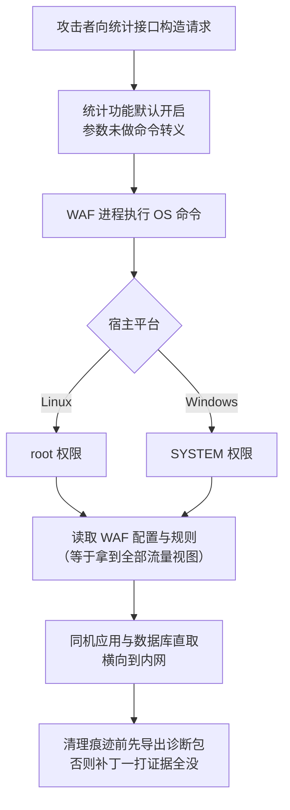
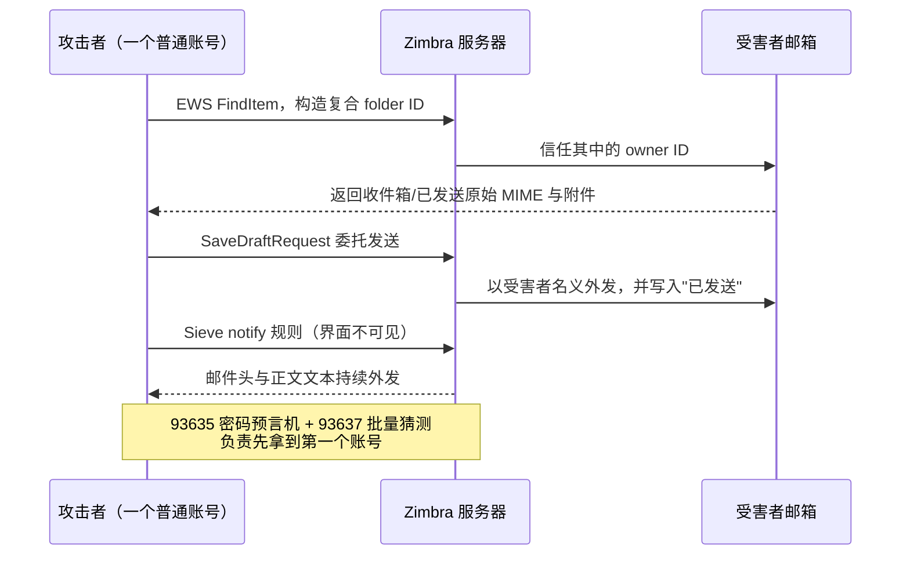
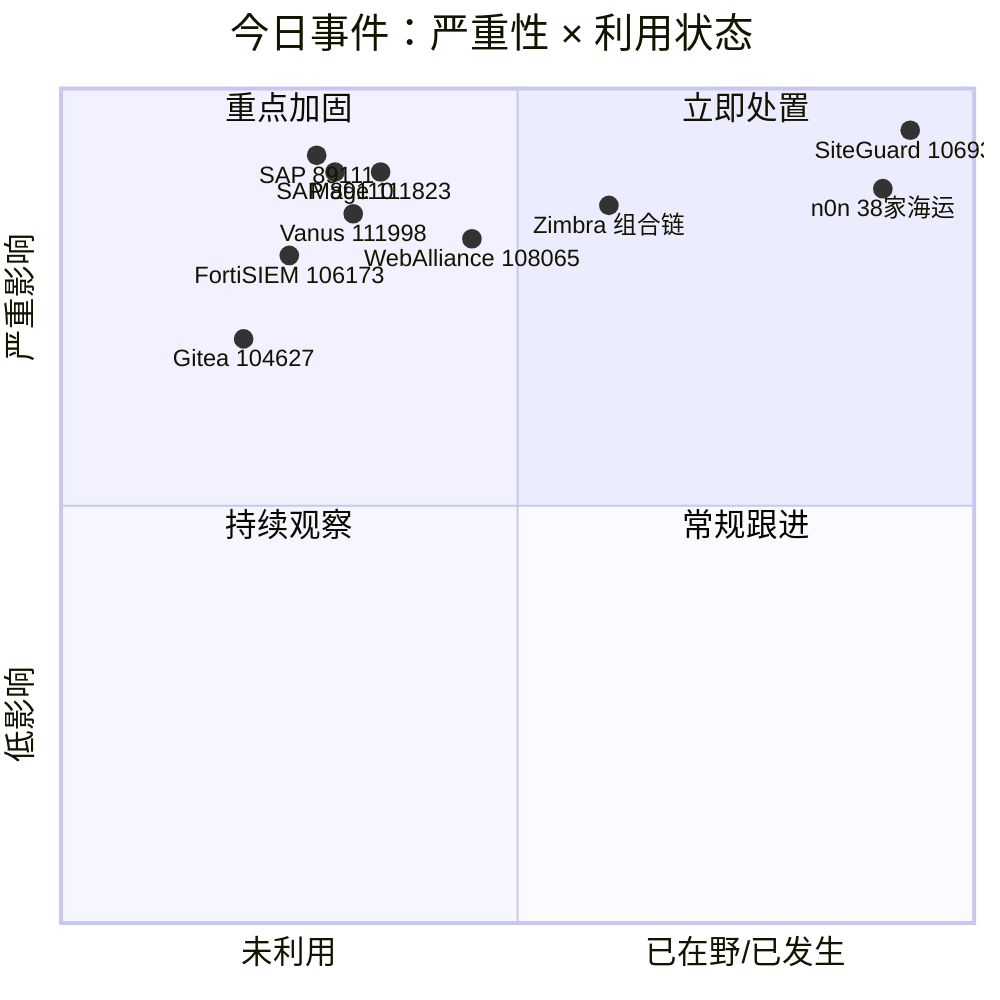
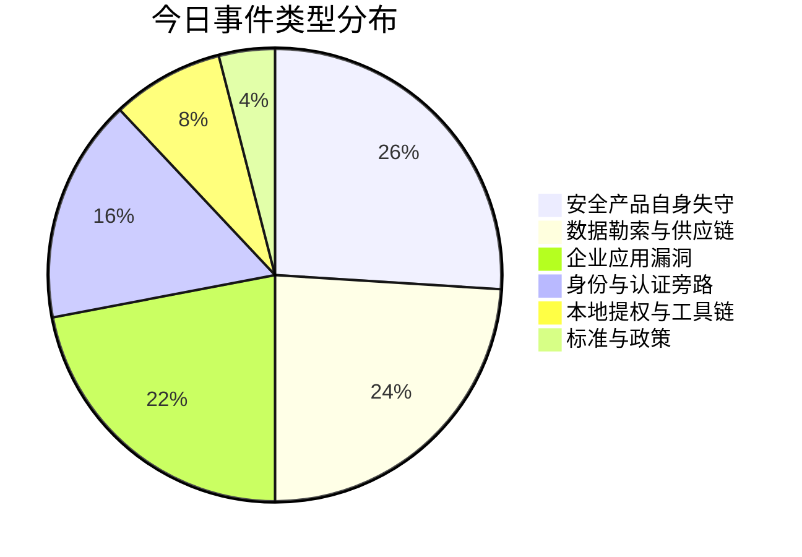
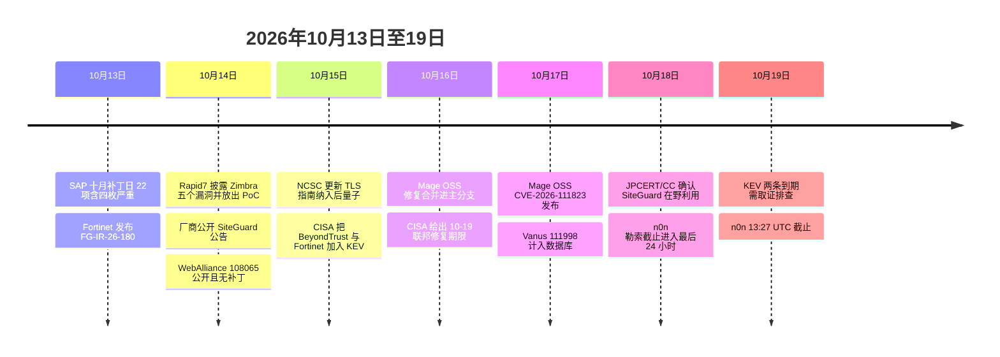

# 网安日报速递 · 2026年10月19日（星期一）

> 第 191 期 | 总第 191 期
> 今日关键词：守门人自己先倒下
> 覆盖窗口：2026-10-13 至 2026-10-19（重点为 10-18 / 10-19 新增披露与在野确认）

---

## 今日要点一览

| # | 事件 | 类型 | 关键编号 | 状态 | 优先级 |
|---|------|------|----------|------|--------|
| 1 | 日本 SiteGuard Server Edition WAF 统计功能命令注入，root/SYSTEM 已在野 | 安全产品自身失守 | CVE-2026-106931（CVSS 4.0 8.5 / 3.0 7.8） | JPCERT/CC 10-18 确认在野 | ★★★ 立即 |
| 2 | Rapid7 公开 Zimbra 五个漏洞 PoC，其中两枚至今无补丁 | 邮件系统横向越界 | 10631 / 50055 / 73571 / 93635 / 93637 | 3 枚已修，2 枚无修复 | ★★★ 立即 |
| 3 | SAP 十月补丁日四枚严重，最高 10.0 落在 Python SDK | 企业核心系统 | 89111 / 89110 / 89107 / 89108 | 已修，暂无在野 | ★★☆ 本周 |
| 4 | Mage OSS 未认证会话伪造 9.8，"升到最新版"其实没修 | 数据管道 | CVE-2026-111823 | 仅 master 有修复 | ★★☆ 本周 |
| 5 | n0n 一次上游泄露，切片勒索 38 家海运企业 12.2 亿美元 | 数据勒索 | —（勒索团伙行动） | 10-19 13:27 UTC 截止 | ★★★ 今日 |

**今日主线**：被攻破的不是防线后面的资产，而是防线本身——一台主机式 WAF、一个邮件账号边界、一条被固定版本锁死的依赖链、一家海运软件商的数据库。攻击者越来越不需要 0day，只需要你亲手装上去、亲手信任的那个组件。

---

## 1. SiteGuard Server Edition 命令注入（CVE-2026-106931）：防火墙自己变成了入口

### 事件内容

日本厂商 **EG Secure Solutions（e-guardian）** 的主机式 Web 应用防火墙 **SiteGuard Server Edition** 存在 OS 命令注入漏洞。漏洞位于**统计功能（statistics）**中——这个功能用于汇总被拦截与被放行的流量，**默认开启**。

| 项目 | 内容 |
|------|------|
| 漏洞编号 | CVE-2026-106931（JVN#88474777） |
| 类型 | OS 命令注入（统计功能） |
| 影响结果 | 以 **root**（Linux）或 **NT AUTHORITY\SYSTEM**（Windows）执行任意命令 |
| 评分 | JVN 给 CVSS 4.0 基准 **8.5**；CVSS 3.0 为 **7.8**；厂商自己标为 **critical** |
| 受影响版本 | Apache httpd / Nginx / IIS 版（FreeBSD 除外）：**2.20 及以后，8.00 Update 5 之前**；FreeBSD 上 Apache httpd / Nginx 版：**2.20 及以后，7.00 Update 6 之前** |
| 不受影响 | IIS 版 **3.10 至 4.00 Update 4**（含） |
| 修复 | 升级到 **8.00 Update 5**（FreeBSD 为 **7.00 Update 6**）；无法升级者可用替换统计处理文件的补丁，**连 EOL 版本也覆盖** |

### 时间线值得单独记一笔

| 日期 | 事件 |
|------|------|
| 2026-09-29 | 厂商已通知**有直签支持合同**的客户 |
| 2026-10-14 | 厂商发布公开公告 |
| 2026-10-18 | **JPCERT/CC 与厂商共同确认漏洞正在被利用** |

也就是说，公开公告发出时攻击已经在发生。通过经销商购买、或没有支持合同的用户，实际暴露窗口**早于**自己读到公告的那一天。厂商与 JPCERT/CC 均未披露攻击者身份、受害组织与影响规模。

### 为什么这条最值得看

1. **WAF 的部署位置决定了它的破坏力**。主机式 WAF 通常与应用装在同一台机器上，才能解密流量做检测。一旦 WAF 进程被拿到命令执行，攻击者得到的不是"一个可以绕过的过滤器"，而是**源站主机的 root**——防火墙、数据库、应用在同一台机器上，一个洞全塌。
2. **默认开启的可观测性功能成了 RCE 路径**。统计模块是为运维看图表准备的，绝大多数部署根本没意识到它在跑。受影响区间从 2.20 一直到 2026 年的更新，跨度是数年。
3. **修复会抹掉证据**。厂商明确警告：升级或打补丁会覆盖统计处理文件，攻击痕迹一起没。**打补丁之前先去 Web 管理界面 → Diagnostic information → Download diagnostic information 导出诊断包，并保存在设备之外**。如果这台机器可能已经被 root，这个动作比补丁本身更紧急。
4. **厂商为 EOL 版本继续发补丁**，这是罕见的破例，本身说明厂商对危害的判断。

### 顺手区分一件事

SiteGuard 还有一个 WordPress 插件（WP Plugin），装机量约 50 万，常被和本条混为一谈。**本次公告只覆盖 Server Edition**，与 WP 插件无关。厂商宣称整体保护超过 150 万个站点。

---

## 2. Rapid7 公开 Zimbra 五个漏洞的 PoC，两枚至今没有补丁

### 事件内容

Rapid7 研究员 **Jonah Burgess** 在 **2026-10-14** 披露 Zimbra Collaboration Suite（ZCS）的五个漏洞，**每一个都附带公开的 PoC 脚本**，系列文章标题《From One Account to Every Mailbox》Part 1。测试环境为 **ZCS 10.1.16 Network Edition on Ubuntu 22.04**。Rapid7 称这轮评估总共报告了 **80 多个漏洞**，后续还会继续发。

| CVE | 缺陷 | Rapid7 评分 | 修复版本 |
|-----|------|-------------|----------|
| CVE-2026-10631 | EWS 跨用户邮箱读取（FindItem 信任复合 folder ID 里的 owner ID） | 6.5（CVSS 3.1） | **10.1.20** |
| CVE-2026-50055 | Sieve `notify` 绕过转发限制 | 6.5（CVSS 3.1） | **10.1.20** |
| CVE-2026-73571 | `SaveDraftRequest` 委托发送路径可冒充他人发信 | 8.3（CVSS 4.0；NVD 3.1 仅 4.3） | **10.1.17** |
| CVE-2026-93635 | 登录处 LDAP filter 注入 → 密码预言机 | 5.3（CVSS 3.1） | **无** |
| CVE-2026-93637 | GraphQL 认证失败计数被绕过 | 3.7（CVSS 3.1） | **无** |

### 单独拆开都不高，串起来就不一样

- **读**：只需一个开过 EWS 的普通账号，就能读同服务器上其他本地用户的收件箱、已发送、草稿、联系人、日历，**含原始 MIME 与附件**，不需要任何共享或委派授权。目标账号自己不必启用 EWS，**跨集群服务器同样生效**。NVD 标记影响 10.1.0 至 10.1.19。
- **冒充**：`SaveDraftRequest` 的委托发送路径让任何已认证用户以同一邮箱服务器上另一个本地账号的名义发信，**不需要 send-as 权限**。邮件走正常外发通道，并且会落进受害者的"已发送"文件夹——看起来像是本人发的。
- **外带**：管理员关掉邮件转发后，Zimbra 只阻断 Sieve 的 `redirect` 动作，`notify` 仍然会把邮件头与正文文本发到外部地址，且规则**持久存在**。Modern Filters 界面根本看不到这条规则，Classic 界面只显示规则名不显示目标地址。
- **拿第一个账号**：`CVE-2026-93635` 在使用外部 LDAP search-filter 认证并开启 lazy provisioning 的域上，登录处未转义的通配符给出目录用户的密码预言机；默认的本地认证不受影响。`CVE-2026-93637` 的失败 GraphQL 认证不计入每 IP 失败计数，且可以用 alias 把大批猜测塞进一个请求——Rapid7 实测 **10,000 个候选、每请求 100 个、不到两分钟跑完**。两者组合可同时避开两套锁定计数。

### 还有两枚没有修复

`CVE-2026-93635` 与 `CVE-2026-93637` 在披露时**没有列出任何修复版本**，NVD 记录影响到 **10.1.21**（Rapid7 提到的最新版本）。这意味着即使打到最新补丁仍然暴露。

### 值得关注的原因

Zimbra 把"账号"当作安全边界。这五个漏洞恰好都在这条边界上打洞：**一个普通账号可以读、可以冒充、可以外带**，而两枚未修复的洞负责让外部人先拿到那第一个账号。低分不等于低风险——CVSS 算的是单个缺陷，攻击者算的是组合。若组织依赖邮件作为身份与审批的凭据载体（密码重置、合同确认、财务指令），这条链的杀伤力远高于分数。

处置顺序建议：先查 EWS 是否对外可用、审计所有 Sieve 规则（直接读数据库里的 sieve 脚本而不是看界面）、把 10.1.20 作为底线版本、对 93635/93637 用网络层限制登录接口暴露面。

---

## 3. SAP 十月补丁日：四枚严重，最高 10.0 不在 ABAP 而在一个 Python 库

### 事件内容

SAP 于 **2026-10-13** 发布十月安全补丁日，共 **22 项**（16 条新 note、4 条 GitHub 安全公告、2 条更新），其中 **4 枚 Critical**。

| CVE | 产品 | CVSS | 缺陷 |
|-----|------|------|------|
| **CVE-2026-89111** | SAP Cloud SDK for Python（< 0.45.2） | **10.0** | OAuth2 SSRF（CWE-918），`tenant_subdomain` 可改写令牌端点，**客户端凭据跟着请求一起被送到攻击者服务器** |
| CVE-2026-89110 | NetWeaver Visual Composer，VC70RUNTIME 7.50 | 9.9 | 权限校验不足（CWE-749），低权限用户可对预配置远程系统调用内部操作，Scope Changed |
| CVE-2026-89107 | S/4HANA Manage Substitution/Validation Rules，S4CORE 105–109 | 9.9 | 规则定义里的领域脚本被当 ABAP 代码解释执行（CWE-94） |
| CVE-2026-89108 | Manufacturing Integration and Intelligence，XMII 15.4 / 15.5 | 9.1 | 配置服务缺授权校验（CWE-862），MII 管理员可造出 Java 应用服务器上的高权限账号 |

另有 CVE-2026-89113（Commerce Cloud SQL 注入，8.8）与 CVE-2026-58249（NetWeaver / Web Dispatcher ICM 内存破坏，7.5，影响 7.53、7.54、7.77、7.93、9.16 等多个内核版本，未认证请求可打崩进程）。

### 10.0 那枚为什么最有意思

`CVE-2026-89111` 在多租户 BTP 应用中，SDK 会把配置好的令牌 URL 第一个 DNS 标签替换成租户子域。修复前的版本没有校验这个子域，于是一个能影响 `tenant_subdomain` 的输入（常见来源：请求 Host、请求头、JWT claim、URL 参数）就能把携带 client credentials 的令牌请求指到别处。修复方式是按要求用 RFC 1123 DNS 标签规则校验子域。

**时间差是这条的关键**：PyPI 上 **0.45.2 早在 2026-08-21 就已上传**，而公告到 **10-13** 才发。习惯随手升级依赖的团队早就修好了却不知道；把版本 pin 死在旧版、等公告再动的团队，在这一个多月里完全裸奔，扫描器什么也不会报。

**另外**：`CVE-2026-89110` 所在的 Visual Composer，正是 2025 年 `CVE-2025-31324`（CVSS 10.0，未认证文件上传，数日内被在野利用）的攻击入口组件。同一组件再出严重洞，补丁队列里应该排第一位。注意本次与 2025 年不同：这次需要登录，风险取决于谁能访问 Visual Composer、以及它挂了多少条高权限远程连接。

目前无来源报告这些漏洞已被利用，也都不在 CISA KEV 中。

---

## 4. Mage OSS 未认证会话伪造 9.8：最新版本号不等于已修复

### 事件内容

数据管道编排工具 **Mage OSS** 存在严重认证绕过，**CVE-2026-111823**，CVSS **9.8**，公告编号 **GHSA-93gm-r5p2-wxq7**。

| 项目 | 内容 |
|------|------|
| 缺陷类别 | CWE-390（检测到错误状态却没有采取动作）/ CWE-287 |
| 影响版本 | 至 **0.9.80**（含） |
| 触发条件 | 未认证、网络可达、无需用户交互 |
| 修复 | commit **76c4f46**（PR #6204 / #6205），2026-10-16 合并进主分支 |
| 私报时间 | **2026-06-12** |

### 机制：报错了，但会话照样建好了

Mage 的 OAuth 回调逻辑在 `mage_ai/api/resources/OauthSessionResource.py` 里。当请求携带一个**无法识别的或空的 provider 名**时，异常处理捕获了解析错误、写了日志，**但没有终止流程**，执行继续落入默认的会话令牌创建逻辑。请求里带的邮箱地址会被用于查找甚至创建账号。结果是：身份根本没有经过任何有效 OAuth 提供方验证，攻击者却拿到了一个有效会话——可以冒充他人、也可以新建账号。

### 为什么危害被放大

Mage 是 ETL 编排器，手里握着 **S3、Snowflake、Salesforce** 这类数据源的凭据，并且本身就能执行任意 Python。绕过认证等于直接站到生产数据湖与后端计算资源前面。

### 最该记住的一句

**Releases 页面上最新的 0.9.80，早于修复合并，所以它不是安全版本。** 官方稳定版还没带上修复，装"最新 tag"并不能解决问题，只能从修好的主分支构建。这也是本次最容易被运维误判的地方：版本号看着是最新的，凭据却还在裸奔。

另需注意 PR #6205 是限制版本控制 API 执行 Git 命令的另一处缺陷，与 CVE-2026-111823 不是同一个问题，来自同一份私报。

**PoC 状态存在冲突**：有来源引用公开利用材料，也有聚合源称无公开 PoC。在澄清之前，按"已有可利用细节"处理更稳妥。目前无在野利用确认，不在 KEV。

### 同日另外两枚 9.8，都是"默认值被当成了信任"

**WebAlliance eCommerce（CVE-2026-108065，9.8，未认证 SQL 注入）**：Channel Software 的 B2B 电商/客户门户，`/preapproval.asmx` 的 `GetUser` SOAP 方法未转义 `sUserID`，后端是 MSSQL，支持堆叠查询。Rapid7 从 8-28 起联系厂商共 **5 次**，10-09 发出最后通知，**全程零回应**，10-14 公开披露时**没有任何补丁**。唯一缓解措施是在 Web 服务器、反向代理或 WAF 上**封掉 `/preapproval.asmx`**。数据库账号若是 sysadmin，还能用 OLE Automation 上传文件；若数据库与 Web 应用同机，上传的 ASPX 可以直接执行系统命令。注意 Rapid7 自己的文章存在不一致：正文请求用 `GetUser` / `sUserID`，curl PoC 用 `GetCustomer` / `sCustID`，自查时两个都要测。

**Vanus（CVE-2026-111998，9.8，硬编码管理员令牌）**：事件网关 **0.8.0 至 0.9.0** 内嵌固定的管理员 Bearer token，未认证攻击者把它发给 gateway 的 gRPC 代理端口，即可管理命名空间、事件总线、用户、令牌、角色绑定，并读写事件——相当于 **cluster-admin**。目前**没有任何经确认的修复版本**，唯一的办法是把 gRPC 代理端口收回内网。别以为端口没直接暴露在公网就安全：内网、VPN、容器网络、被攻陷的工作站都能到。

---

## 5. n0n 一次上游泄露，切片勒索 38 家海运企业

### 事件内容

勒索团伙 **n0n** 于 **2026-10-12** 在暗网泄漏站**一次性**挂出 **38 家海运相关组织**，横跨 **18 个国家**，包含航运公司、码头运营商、物流企业与船舶管理公司。索要总额约 **12.2 亿美元**，单家 **240 万至 1400 万美元**（比特币），**截止时间 2026-10-19 13:27 UTC**。

### 关键判断：这可能不是 38 次入侵

安全公司 **Cydome** 指出，38 家里**至少 21 家**是韩国海运软件与 IT 服务商 **CyberLogitec** 的已记录客户。初步分析认为，n0n 很可能把**源自 CyberLogitec 的一次数据泄露**按客户切片，变成 38 份单独的勒索单。**SOCRadar** 的判断方向一致：多家受害者的数据集都很小、且高度集中于特定应用，更像是共享了同一个应用或同一个漏洞，而不是 38 次独立入侵。

泄露内容据称包括**凭据、个人信息与 EDI 报文**，部分数据已有数年历史——这意味着相关的账号与对接配置可能早就该轮换了。

**重要限定**：被挂上泄漏站**不等于**该公司自己的系统被入侵。这几家截至 10-15 均未确认遭到入侵。

### 为什么值得关注

1. **数据勒索比加密勒索更难防**。n0n 于 2026 年 9 月才出现，做的是**纯数据勒索**——不加密、没有解密钥匙、没有"付钱恢复系统"这条路，只有"付钱别公布"。备份做得再好也挡不住。
2. **一次信任上游，代价按客户数量倍增**。海运业的 EDI、订舱、单证系统天然互联，一家软件商同时是几十家船公司与码头的接口方。它出一次事，勒索单就会按客户名单分发。这是供应链风险最直白的经济学：攻击者的成本是一次，收益是 38 份。
3. **截止时间就在今天**。今天 13:27 UTC 之后是否真公布，是观察这个团伙"说到做到"比例的一个样本。

### 当日勒索面快照

截至 **2026-10-19 01:50 UTC** 的 24 小时内，**23 家**组织被 **8 个**团伙挂出（n0n 10 家、Qilin 6 家、Cloak 2 家）；前一日 23 家，7 日均值 **46.0 家**；**10 月至今 645 家，2026 年累计 8,672 家**。单日数字波动大，看趋势别看一天。

---

## 速览

### 6. FortiSIEM 路径穿越（CVE-2026-106173，9.4）：厂商公告与 CVE 记录的受影响版本对不上

**2026-10-13** 随 Fortinet 月度 PSIRT 发布，公告 **FG-IR-26-180**：gRPC 服务 `phQueryMaster` 存在任意文件写入（路径穿越），未认证攻击者可用特制报文执行任意代码或命令。**问题在于公告只说 7.5.0 受影响，Fortinet 自己作为 CNA 提交的 CVE 记录却列了 7.5.0、7.4.0–7.4.2、7.3.0–7.3.5、7.2.0–7.2.7、7.1.0–7.1.9、7.0.0–7.0.4**，且 7.0–7.4 各线都没有给修复版本。公开信息无法判断哪个对。可确认的只有：7.6 不受影响，7.5.0 升到 **7.5.1**，以及**封住 TCP 27918 能阻断该问题**。CVSS 向量的时间分项里利用代码成熟度为 **High**，CISA 的补充信息标记为可利用性强、技术影响完全。SIEM 为了收日志通常对内网开很大的入站规则，这个 workaround 恰好要求把这些规则收紧——先做这件事。

### 7. Metasploit 收录两枚本地提权：任何本地 shell 一键变 root

Rapid7 在 **10-09** 的 Metasploit 周报里加入两个模块：`linux/local/dirtyclone_cve_2026_43503`（PR #21613）与 `linux/local/cve_2026_3888`（PR #21532）。

- **DirtyClone（CVE-2026-43503）**：Linux 内核缺陷，DirtyFrag 家族第四个成员。JFrog 的 Eddy Tsalolikhin 与 Or Peles 于 **2026-05-19** 独立发现并报告，5-21 合入主线，5-23 发 CVE，首个修复 tag 为 **v7.1-rc5**（5-24）。JFrog 6-25 发布分析时**保持 PoC 私有**，当时无在野利用。
- **CVE-2026-3888**：Ubuntu snapd 竞态。`snap-confine` 建立沙箱时依赖 `/tmp/.snap`，而 `systemd-tmpfiles` 会周期性清理这个目录；时间点可预测时，攻击者可以抢先重建该目录并放入载荷，下一次沙箱初始化时 `snap-confine` 建立的 bind mount 就把这些文件暴露到 root 上下文。Qualys 的分析指出清理周期带来 **10–30 天**的窗口。

这两个模块的实际意义很直接：**Web shell、被偷的低权限登录、被攻陷的容器用户，这些"半只脚"如今有现成的从 shell 到 root 的路径**。打了补丁没重启内核的机器仍然中招。

### 8. Gitea 28.2.0 批量披露：OpenID 2.0 无请求断言可以绑到你头上

随 **28.2.0** 版本发布集中披露多条：

- **CVE-2026-104627**：安全设置里的 OpenID 关联回调**接受未经验证的 OpenID 2.0 正向断言**，不检查当前登录用户是否发起过这次关联。因为 OpenID 2.0 允许"未被请求的断言"（unsolicited assertion），攻击者控制的 OpenID 提供方可以把**攻击者的身份绑到受害者账号上**，之后通过 OpenID 登录**以受害者身份进入——且这条路径不经过本地 TOTP 或 WebAuthn 校验**。修复后要求带有时效、绑定用户的 state 值。
- **CVE-2026-97859**：`/api/v1/users/{username}` 下 7 条路由（followers、following、following/{target}、starred、subscriptions、keys、gpg_keys）漏挂 `individualPermsChecker`，已认证用户可读**受限或私有可见性用户**的关注/粉丝列表、星标与关注仓库、公开 SSH 与 GPG 公钥。修复于 1.27.3 与 28.0.0。
- **CVE-2026-110324**：用户档案可见性校验只加在 GET 上，`POST /{username}`（关注/取关）只校验登录；任何人可拿到私有档案用户的全名、所在地、网站与简介。修复于 28.1.0。

三条合起来是一个熟悉的形状：**双因素认证做得很认真，但绕过去的那条旁路没人看**。

### 9. 英国 NCSC 更新 TLS 指南，正式纳入后量子配置

**2026-10-15** 发布，跟进 IETF 的 **RFC 10024**（TLS 1.3 的后量子与传统混合密钥协商）。要点：**TLS 1.3 是唯一会支持后量子的版本**，TLS 1.2 及更早不会被升级补齐，还在跑旧版本的应当立即迁移；**混合式与纯后量子**两类密码套件都推荐；时间表沿用既有口径——**2028 年**完成目标定义、发现与初步计划，**2031 年前**完成最高优先级迁移，**2035 年**完成全部。NCSC 表示待相关 RFC 定稿后还会更新 IPsec 指南，并补充 TLS 的后量子认证建议。对普通团队的落地动作只有一条：**先做密码学资产清单**，尤其是那些需要保密十年以上的数据通道。

### 10. 澳大利亚 ACSC 就海外制冷系统攻击发布 OT / 边缘设备告警

澳大利亚信号局的 ACSC 针对运行**联网运营技术（OT）**（含商用制冷系统）的组织发布告警，背景是海外发生的同类攻击（10-14 法国数百家超市冷库被远程加热事件）。ACSC 表示**尚未观察到澳大利亚基础设施被主动针对**，但建议立即评估暴露面：**把 OT 接口与边缘设备从公网直接暴露中撤出**、启用强认证与网络分段、及时打补丁、监控异常自动化动作。这条尤其适用于托管服务商、设施运营商，以及那些**从承包商手里继承了远程访问通道、却没有完整资产清单**的组织。

### 11. 今天到期的两个 KEV：都带"取证排查"标记

CISA 于 **10-16** 把两条边缘设备漏洞加入 KEV，联邦修复期限均为 **2026-10-19**，且都标注了 forensic triage：**不是打完补丁就算完，还得查有没有已经被打**。

- **CVE-2026-102764**（BeyondTrust Remote Support，认证绕过/欺骗），Mandiant 将其零日利用关联到威胁集群。
- **CVE-2025-61624**（FortiOS / FortiPAM / FortiProxy / FortiSwitchManager，CLI 路径穿越，读写权限管理员可写删任意文件），Unit 42 将其关联到 FortiGate 植入体。

对非联邦机构而言这个日期没有强制力，但含义是明确的：**利用代码已经在流通**，而这两类资产都在边界上。

---

## 风险矩阵

## 时间线

## 防御动作清单

| 优先级 | 动作 | 对象 |
|--------|------|------|
| P0 | **先导诊断包再打补丁**，升级到 8.00 Update 5 / FreeBSD 7.00 Update 6 | 所有 SiteGuard Server Edition 主机 |
| P0 | 确认 EWS 暴露面、导出并审阅 Sieve 脚本（读库不看界面）、底线版本 10.1.20 | Zimbra ZCS |
| P0 | 封掉 `/preapproval.asmx`（无补丁可用） | WebAlliance eCommerce |
| P1 | 把 gateway gRPC 代理端口收回内网并轮换令牌 | Vanus 0.8.0–0.9.0 |
| P1 | 升级 sap-cloud-sdk 至 0.45.2+ 并重建镜像；自查 `tenant_subdomain` 来源 | 多租户 BTP 应用 |
| P1 | 从主分支构建 Mage（0.9.80 不安全），限制管理面访问 | Mage OSS |
| P1 | 收紧 TCP 27918 入站；7.5.0 升 7.5.1 | FortiSIEM |
| P2 | 把 Visual Composer 排进补丁队列首位 | NetWeaver Java 栈 |
| P2 | 核查 OpenID 关联记录、私有可见性用户的关注类接口审计 | Gitea |
| P2 | 内核升级后**必须重启**才算修好 DirtyClone | Linux 服务器 |

---

## 相关出处

**SiteGuard / CVE-2026-106931**
- Protect.Computer — SiteGuard WAF 命令注入被用于获取 root：https://protect.computer/news/2026-10-18-siteguard-waf-command-injection
- ETTAYEB — 主机式 WAF 的结构性风险与证据保全：https://ettayeb.fr/en/security/siteguard-waf-command-injection-cve-2026-106931
- DEV Community — 统计功能以 root 执行攻击者命令：https://dev.to/randomchaos/siteguards-statistics-feature-runs-attacker-commands-as-root-5go7
- ATLABYTE — JPCERT/CC 确认在野与受影响版本：https://atlabyte.com/en/news/hackers-exploit-cve-2026-106931-in-japan-s-siteguard-waf-to-run-commands-as-system-and-root
- GoKawiil — BleepingComputer 报道摘要：https://gokawiil.com/article/356749

**Zimbra（Rapid7 五枚）**
- ThreatFrontier — 五个 CVE 明细与两枚未修复：https://threatfrontier.com/articles/zimbra-rapid7-five-cves-public-poc-two-unpatched
- endoflife.ai — CVE-2026-73570 在野与 EOL 版本情况（背景）：https://endoflife.ai/exploited-and-unpatchable
- secnews.in — Zimbra 在野利用后渗透手法（背景）：https://secnews.in/article/article-zimbra-cve-2026-73570-rce-active-exploitation

**SAP 十月补丁日**
- ThreatFrontier — Visual Composer 9.9 与四枚严重：https://threatfrontier.com/articles/sap-visual-composer-cve-2026-89110-october-2026-patch-day
- about InfoSec — 补丁日分级与处置顺序：https://aboutinfosec.com/2026/10/18/sap-october-2026-security-patch-day
- Safeguard — CVE-2026-89111（10.0）SSRF 细节与自查命令：https://safeguard.sh/resources/blog/sap-cloud-sdk-python-cve-2026-89111-oauth2-ssrf

**Mage OSS**
- Forkast — 错误处理不终止流程的机制与十连发背景：https://forkast.news/mage-oss-ships-an-oauth-bypass-that-creates-sessions-from-unrecognized-providers-the-tenth-trust-through-defaults-incident-in-twenty-one-days/
- SecNews.gr — 0.9.80 仍非安全版本、修复 commit 76c4f46：https://www.secnews.gr/en/741169/cve-2026-111823-mage-oss-oauth/
- ThreatCluster — 时间线与 PoC 状态：https://threatcluster.io/cluster/critical-oauth-bypass-vulnerability-in-mage-oss-disclosed-4ea6f087
- CyberSecurity Today — 影响面与利用后可达资产：https://cybersecuretoday.com/article/mage-oss-oauth-session-bypass-flaw-cve-2026-111823

**WebAlliance / Vanus**
- ThreatFrontier — CVE-2026-108065 无补丁与披露时间线：https://threatfrontier.com/articles/wealliance-ecommerce-cve-2026-108065-unpatched-sql-injection
- East Bay Cyber — CVE-2026-111998 硬编码令牌与缓解：https://eastbaycyber.com/content/cve-2026-111998
- OffSeq Threat Radar — CVE-2026-111998 CVSS 向量与 CWE：https://radar.offseq.com/threat/vanus-080-through-090-contains-a-default-credentials-vulnerability-that-allows-unauthenticated-remote-2cecdef85568fa98

**n0n 勒索**
- Maritime Briefs — 38 家、18 国、12.2 亿美元与 CyberLogitec 关联：https://maritimebriefs.com/cyber-extortion-group-n0n-targets-38-maritime-companies-worldwide
- The CODEW — 单家 240 万–1400 万美元与 SOCRadar 判断：https://www.thecodew.com/2026/10/daily-news-coverage-october-19.html
- Ransomnews — 10-19 勒索快照：https://ransomnews.com/ransomware-attacks-today

**速览**
- Safeguard — FortiSIEM CVE-2026-106173 版本口径冲突与 27918 缓解：https://safeguard.sh/resources/blog/fortisiem-cve-2026-106173-port-27918-path-traversal
- ThreatFrontier — Metasploit 收录 DirtyClone 与 snap-confine 模块：https://threatfrontier.com/articles/dirtyclone-cve-2026-43503-snap-confine-cve-2026-3888-metasploit
- ThreatMonitor — Gitea CVE-2026-104627：https://threatmonitor.io/cve/CVE-2026-104627
- ThreatMonitor — Gitea CVE-2026-97859：https://threatmonitor.io/cve/CVE-2026-97859
- ThreatMonitor — Gitea CVE-2026-110324：https://threatmonitor.io/cve/CVE-2026-110324
- The Intelligent — NCSC TLS 后量子指南（10-15）：https://theintelligent.co.uk/technology/2026/national-cyber-security-centre-publishes-updated-tls-guidance-incorporating-post
- CVETodo — 第 42 周综述（ACSC OT 告警、KEV 增补、NCSC 指南）：https://cvetodo.com/newsletters/weekly/weekly-cyber-update-2026-week-42
- CISA KEV 目录（官方）：https://www.cisa.gov/known-exploited-vulnerabilities-catalog

---

*免责声明：本报告基于公开信息整理，CVE 编号、CVSS 评分等数据以官方源为准。所有"在野利用"表述均引自厂商或 CERT 的公开确认；团伙主张的受害者名单不等同于已核实的入侵事件。*
