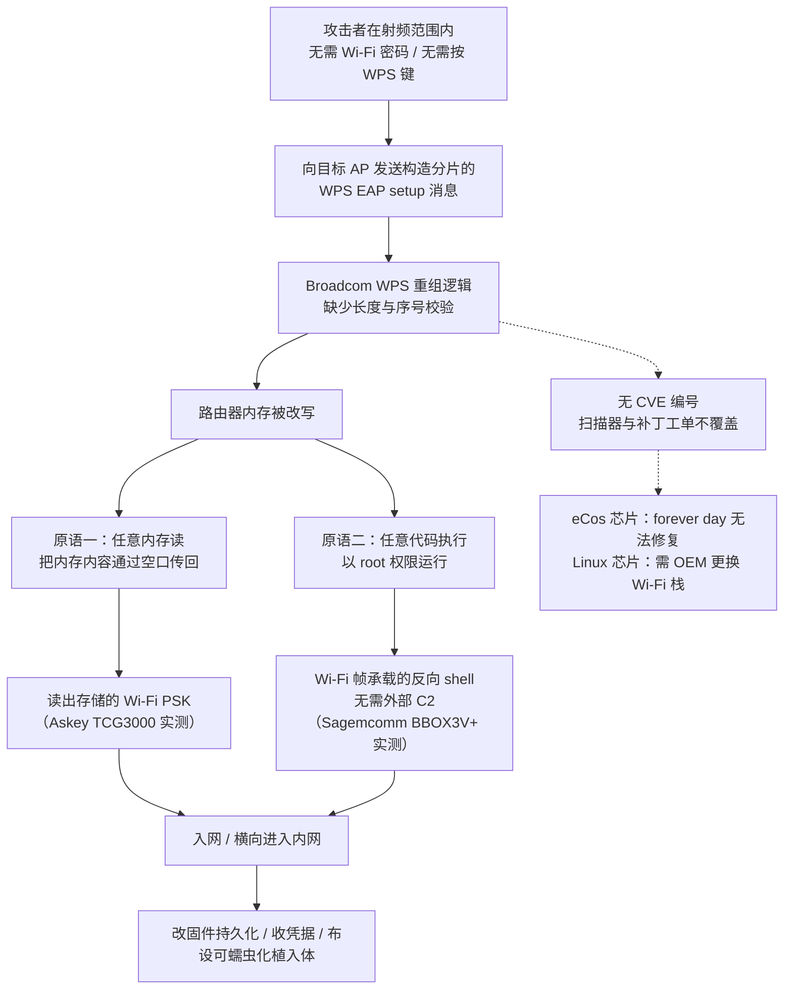
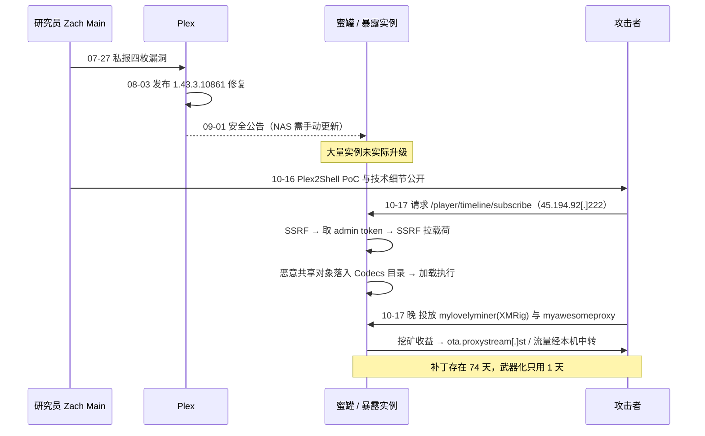
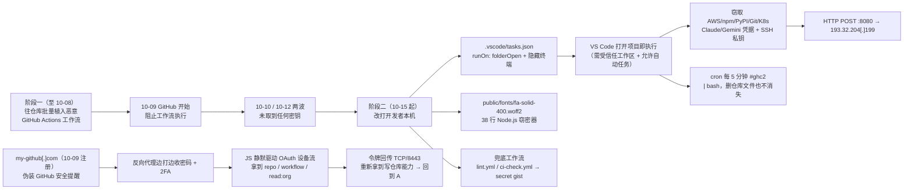
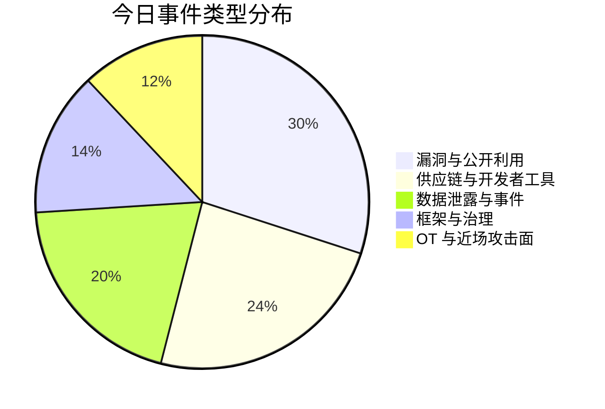
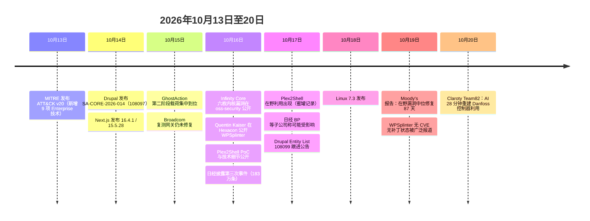

# 网安日报速递 · 2026年10月20日（第 192 期）

> **今日关键词：** Broadcom WPS 无CVE射频root · 六枚内核漏洞齐带利用代码 · Plex补丁74天后PoC一日被利用 · Drupal双RCE厂商称数小时被利用 · 日经第三次183万条
>
> **今日主线：** 今天最值得记的四件事，都发生在"编号之外"和"补丁之后"——一枚 2010 年就存在的 Broadcom WPS 漏洞连 CVE 都拿不到，扫描器永远看不见它；六枚 Linux 内核漏洞带着可用利用代码一起公开，且刻意绕开了一切"加固建议"；Plex 的补丁 74 天前就发了，可公开 PoC 一出，24 小时内就被打成矿机；Drupal 的核心 RCE 在 NVD 里还查不到，厂商自己说"数小时到数天内就会有利用"。**漏洞的保质期，从来不由厂商的公告日期决定。**

---

## 一、Broadcom WPS 溢出（WPSplinter）：一枚连 CVE 都拿不到的漏洞，在射频距离上以 root 执行代码

**一句话：** 安全研究员 Quentin Kaiser 在巴黎 Hexacon 会议（10-16）公开 Broadcom 私有 Wi-Fi 栈 WPS 实现中的缓冲区溢出，攻击者只要在无线电距离内、不需要 Wi-Fi 密码、不需要按 WPS 按钮、不需要用户做任何事，就能在受影响的路由器上以 **root** 执行代码。**截至 10-19，没有 CVE 编号，没有官方补丁，没有任何厂商安全公告。**

**技术成因。** 漏洞在 Broadcom 的 WPS（Wi-Fi Protected Setup）**EAP 消息重组**逻辑：把分片的 WPS setup 消息拼回完整报文时，长度与序号状态没有被正确校验，构造的分片序列可以直接改写路由器内存。Kaiser 由此做出两个原语——**任意内存读**（把路由器内存内容通过空口传回）与**任意代码执行**。前者在 **Orange Belgium 的 Askey TCG3000** 网关上直接读出了存储的 Wi-Fi PSK 并成功入网；后者在 **Proximus 的 Sagemcom BBOX3V+** 网关上开出一个**完全承载在 Wi-Fi 帧里的反向 shell**，不需要外部 C2 服务器。演示视频里那根贴近的天线只是为了实验室干净抓包，攻击在正常 Wi-Fi 覆盖范围内即可生效。

**为什么它比绝大多数满分 CVE 更麻烦：**

- **时间线长得离谱**：缺陷代码至少可追到 **2010 年**；2018 年 Broadcom 发过一个**不完整的补丁**，并建议客户改用开源 `hostapd` 栈来代替修自己的代码。**2026 年 7 月** Broadcom 又告知 Kaiser"已向制造商提供补丁"，但到 **10-15** 他复测的那批网关仍然没有修。
- **一部分芯片永远修不了**：老 **eCos** 平台（BCM3380 / BCM3383 / BCM33834）没有可行修复路径，Kaiser 直接称其为 **forever day**；较新的 **Linux** 平台（BCM3390 / BCM65xx / BCM68xx）理论上可修，但前提是各家 OEM 愿意换掉 Wi-Fi 栈。
- **治理链条整条断了**：Broadcom 拒绝登记 CVE、拒绝公开声明。CERT/CC 在收到报告的**当天结案**，理由是"CVE 编号权归 Broadcom 自己，而它不打算提交"。结果就是：**资产清单、漏洞扫描器、补丁工单系统，全都不会为这个洞亮红灯**。
- **影响面按"芯片家族"而不是"品牌"算**：Kaiser 公布的清单里既有 Cisco 小企业级 AP，也有华为、ARRIS 的设备，部分标注"已确认"、部分是自动化检测给出的"疑似受影响"。比利时三家 ISP（Proximus、Orange Belgium、VOO）每家粗估**数十万台**网关，Telenet 未能实测。全球量级以百万计。
- **没有可用缓解**：在路由器管理界面里**关掉 WPS 并不构成经过验证的缓解**（漏洞在 EAP 重组路径上）。Kaiser 放出了 **YARA 规则**（扫固件里是否存在脆弱代码）与一个**监听脚本**（对着现网 AP 判断是否可疑）作为分诊工具，但两者都会有误报，需要人工复核。**无法修补的设备，唯一现实方案是更换硬件。**

**值得关注的原因：** 这类漏洞的杀伤力不在 CVSS，而在**可见性**。它专门落在"近场攻击"这个现代企业几乎不设防的面上——大堂、会议室、停车场，一个带网卡的人就够了。而这次披露真正暴露的问题不是代码，是**编号机制本身**：当厂商既是编号的所有者又是风险的承担者，"不提交 CVE"就成了一种成本最低的处理方式。对防守方而言，唯一可操作的结论是——**别再拿"扫描器没报"当"设备是干净的"**，尤其是那些插在墙上、三年没人登录过管理界面的接入点。



---

## 二、Infinity Core：六枚 Linux 内核漏洞携带公开利用代码同时落地，容器逃逸与 Android 提权都在射程内

**一句话：** 研究员 Hyunwoo Kim 于 **10-16** 在 `oss-security` 邮件列表一次性公开六枚 Linux 内核漏洞（合称 **Infinity Core**），其中**五枚已附带能拿到 root shell 的公开利用代码**，其自测环境为 **Ubuntu 26.04（内核 7.0.0-30-generic）** 与 **Arch Linux（7.2.4-arch1-2）**。研究明确声称可用于 **Linux 服务器本地提权、容器逃逸、Android 本地提权**。

**六枚漏洞的分布（子系统 / 类型 / 修复版本）：**

| 子系统 | CVE | 缺陷类型 | 修复版本（SecurityOnline 整理） |
|---|---|---|---|
| Timer | CVE-2026-98260 | POSIX CPU timer 清理中的 UAF | 6.6.158 / 6.12.112 / 6.18.54 / 7.2.8 |
| Signal | CVE-2026-98256 | 待处理信号队列 UAF | 6.18.54 / 7.2.8 |
| Memory | CVE-2026-89754 | `mincore()` 背后页表遍历越界写 | 6.18.50 / 7.2.4 |
| Futex | CVE-2026-80775 | 私有 futex 哈希初始化 UAF | 6.18.47 / 7.1.11 / 7.2.1 |
| Scheduler | CVE-2026-98385 | 调度器缓存记账 UAF | 7.2.9 |
| SLAB | CVE-2026-97941 | SLUB 分配器链表破坏 | 7.2.7 |

**几个必须知道的细节：**

- **以 UAF（释放后重用）为主**：内核释放了一块内存却继续使用，攻击者可以把这块内存填成自己的数据；其中多枚还依赖竞态——比如 timer 与 signal 两枚，是在多线程程序里 `exec()` 失败或被竞态打断时触发。
- **Timer 那枚挖得最深**：SecurityOnline 认为该缺陷可回溯到 **Linux 5.7**，所以它同时打到了多个长期支持（LTS）分支，这也是 6.6 / 6.12 系列仍有修复版本的原因。Scheduler 与 SLAB 两枚只影响 **7.2** 系列。
- **SLAB 那枚暂时只能把内核打崩**，仓库自述"LPE 链尚未写出"——**这是六枚里唯一还没有 root 利用的一枚**，别把"六枚全部可利用"当成事实传播。
- **Scheduler 那枚约束更窄**：需要编译期打开 `CONFIG_SCHED_CACHE` 且在运行时开启对应开关，利用代码还假设了 4 个 vCPU。
- **研究刻意跳过了网络、BPF 以及"需要用户命名空间"的缺陷**——这一点极其关键：**惯常的加固手段（关掉非特权用户命名空间、关掉 BPF）对这六枚全部无效**。你没法靠"我们已经禁了 unprivileged userns"来安慰自己。
- **Android 也在射程内**：timer 那枚在 **三星 Galaxy S26 Ultra** 上，从普通应用即可拿到 root，"不需要任何额外应用权限"。Kaiser 式的克制这次出现在 Kim 身上——**这份 Android 利用被扣住**，要等三星修复、或别人先放出利用，才会公开。目前没有三星公告，也没有补丁时间表。
- **披露流程本身合规**：先私报给 `linux-distros`（各发行版预先准备修复的封闭列表），与维护者约定的禁运期到期后公开。公开日（10-16）距离 **Linux 7.3 发布（10-18）** 只差两天。
- **尚无在野利用**，六枚都不在 CISA KEV 里。SecurityOnline 给其中四枚评 High，最高 CVSS 7.8，另两枚待分析。

**处置要点：** 打上发行版最新内核**并重启**——内核补丁不重启等于没打。发行版通常会把修复回移进自己的版本号，所以**按发行版安全公告里的 CVE 编号去核对，不要拿版本号跟上面那张表硬比**。优先级上先修"最危险的那批机器"：**容器逃逸意味着一个容器里的代码可以接管整台宿主**，所以 Kubernetes 节点、共享构建机、CI runner 排在最前面，尤其是会跑陌生人 PR 的 runner。

---

## 三、Plex2Shell 在野：补丁 74 天前就发了，PoC 公开 24 小时内服务器变成矿机与代理节点

**一句话：** 四枚 Plex Media Server 漏洞串成一条**未认证 RCE** 链（合称 **Plex2Shell**），PoC 于 **10-16** 公开，**10-17** 就有互联网暴露的蜜罐记录到成功利用，落地载荷是 **XMRig 挖矿程序**与 Linux 反向代理后门 **myawesomeproxy**。而修复版本 **1.43.3.10861 早在 8-03 就发布了**。

**链条的四个环节（单看都不致命，串起来就是 RCE）：**

| CVE | CVSS | 类型 | 在链中的角色 |
|---|---|---|---|
| CVE-2026-96652 | 5.3 | 未认证 SSRF | 切入点：`/player/timeline/subscribe` 让 Plex 向任意地址发 POST |
| CVE-2026-96654 | 6.9 | URL 值处理不当 | 调用其它插件函数，拿到 owner 级 admin token |
| CVE-2026-96655 | 5.3 | 认证后 SSRF | 经 transcode 路径拉取攻击者托管的载荷 |
| CVE-2026-96656 | 8.6 | 路径穿越 + 任意共享对象加载 | 把恶意文件放进 **Codecs 目录**，Plex 加载时执行 |
| CVE-2026-96651 | 7.1 | 关联缺陷 | 同批次披露、同版本修复 |

**最后一步才是真正恶心的地方**：Plex 加载共享库时**不校验签名、不校验文件名、不要求可执行权限、也不要求特定符号**。前面几级丢进 Codecs 目录的恶意库，在 Plex 加载时会自动执行其构造函数，权限就是 `plex` 用户。

**时间线（这条时间线本身就是结论）：**

- **7-27**：漏洞私报给 Plex（研究者 Zach Main）。
- **8-03**：修复版本 **1.43.3.10861** 发布（Plex 另在 **9-01** 发安全公告，提示 NAS 用户可能需要手动更新）。
- **10-16**：Plex2Shell 的 PoC 与技术细节公开。
- **10-17**：蜜罐记录到实际利用，攻击者从 **45.194.92[.]222** 开始，后续出现 **91.92.40[.]202**、**176.65.139[.]228**；载荷下载源 **217.60.194[.]116**。
- **10-18 之后**：Reddit 上陆续有用户报告自己的实例里出现 `mylovelyminer` 进程。

**落地的两样东西：**

- **`mylovelyminer`**：XMRig 变种，挖矿服务器指向 `ota.proxystream[.]st`——这个域名此前已被关联到 **AISURU DDoS 与 proxyware 僵尸网络**。
- **`myawesomeproxy`**：一个会自己弹提示"运行即表示同意他人使用本机网络流量"的反向代理，把受害主机变成别人的出口节点。

**值得关注的原因：** 这是"补丁差距"最干净的一份标本——**补丁发了 74 天，武器化只用了 1 天**。真正推动攻击者动手的从来不是 CVE 发布，而是**利用代码公开**。今天所有还暴露在公网、且因为"NAS 不自动更新"而停在旧版本的 Plex，等于是**在一个已知会炸的装置上坐着，只是之前没人点火**。处置只有一条是完整的：升到 **1.43.3.10861 或更高**；此外检查 Plex 的 **Codecs 目录**有没有多余文件、进程树里有没有 `mylovelyminer` / `myawesomeproxy`、以及对 `proxystream.st` 的出站连接。



---

## 四、Drupal 双核心 RCE：厂商自己说"数小时到数天内就会有利用"，而 NVD 里还查不到

**一句话：** Drupal 修复两枚**未认证 RCE**——核心 **Field UI** 模块的 **CVE-2026-108097**（风险评级 **Critical 19/25**，CVSS 9.8）与贡献模块 **Entity List** 的 **CVE-2026-108099**。公告在 **10-14 至 10-16** 之间陆续发出，Drupal 提前一周就发过预警，明确说"利用代码可能在**数小时到数天内**出现"。

**为什么这两枚的评估比一般核心漏洞更难：**

- **核心本身不能直接触发**：CVE-2026-108097 位于管理字段与显示方式的 Field UI 功能，**纯核心安装理论上不可直接利用**；但多个贡献模块能拼出严重利用路径，**其中至少一条已知路径不需要任何认证**，站点自定义代码也可能把相关功能暴露出来。所以"我跑的是受影响版本"不等于"匿名访客现在就能打进来"，反过来"要登录才能用"也不等于安全。
- **受影响区间很宽**：8.9.0 起至 **10.6.19** 之前、11.0.0 起至 **11.3.19** 之前、11.4.0 起至 **11.4.10** 之前，以及 12.0.0-alpha1 起至 **12.0.0-beta2** 之前的 12.x 预发布版。10.5.x 及更早、11.2.x 及更早、Drupal 8/9 已不在安全支持范围内——这些站点面对的不是"打个补丁"，而是"要么升级到受支持分支，要么先卸模块顶住"。
- **唯一的官方 workaround 是"卸载"**：Drupal 的原话是**卸载**核心 `field_ui` 模块。**把界面藏起来、限制菜单访问，都不算**。同时 **Drupal Steward** 保护服务只覆盖部分已知攻击路径，官方明说"不覆盖全部"，订阅了也要升级。
- **数据链路缺位**：截至今天，这两枚在 NVD / EPSS 里**查不到有效记录**——不是"风险低"，而是编号刚发布、库还没跟进。这正是今天最该记住的一条纪律：**验证链缺位时，以厂商公告为准，别等 CVSS 分数出来再动作。**
- **Entity List 要单独升**：模块修复独立于核心发布，升到 **3.0.10**。只升核心不升模块，等于只补了一半。

**处置顺序：** 先按分支确认版本（10.6.x → 10.6.19；11.3.x → 11.3.19；11.4.x → 11.4.10），把**互联网可达的站点排在最前**，当天升不完的立刻卸 `field_ui`。Drupal 全球装机超过一百万站点，政府、高校、非营利组织占比高——这类机构往往实例数量多、清单不全，预警窗口又只有几天。

---

## 五、日经一个月内第三次事件：183 万条记录，靠的是偷来的凭据而不是漏洞

**一句话：** 日本经济新闻（Nikkei Inc.，旗下拥有 Financial Times）在 **10-16** 披露约一个月内的**第三起**网络安全事件：攻击者用**窃取的凭据**在 **10-07 凌晨**进入其网络内的一套**开发系统**，访问到存放于云端的 **183 万条**记录。公司已撤销凭据并于 **10-11** 向日本个人信息保护委员会报告。

**数据构成（分层很清楚，别被"183 万"这个总数带偏）：**

- **15 万条**至少含一项个人信息：姓名、邮箱、住址、电话号码、出生日期；
- 其中 **12 万条**含邮箱地址；
- **168 万条**只含无法单独识别个人的标识符；
- **不涉及信用卡信息**。

**三起事件的共同点，比单起事件更有信息量：**

| 时间 | 入口 | 后果 |
|---|---|---|
| **7 月下旬** | 员工 **Google Workspace** 账号被入侵 | 员工与业务伙伴个人信息可能外泄，涉及约 **1,646 人** |
| **9 月** | 员工 **Microsoft 365** 账号被劫持 | 借该账号向员工与外部联系人发出约 **9,000 封**钓鱼邮件 |
| **10-07** | 云开发环境的**凭据**被窃 | **183 万条**记录被访问 |

三起事件**全部是云服务上的账号/凭据问题**，没有一起依赖精巧的漏洞利用。日经表示尚未确认三者之间存在关联，也未认定同一威胁行为体。截至 10-16，未发现被访问信息被滥用或已在网上扩散，也没有服务中断或数据篡改迹象。**10-17**，日经 BP 与日经 National Geographic 分别表示其服务用户的信息**可能包含在这批数据中**，调查仍在进行——这两条是同一事件的延伸，不是新增的独立泄露。

**值得关注的原因：** 一家有自有 IT 团队、年收入约 25 亿美元、1 万余名员工的大型媒体集团，在 30 天内被同一类手法打了三次。这说明问题不在"有没有防护"，而在**凭据生命周期的治理**：开发环境往往沿用生产的高权限、却缺少同等级的监控与 MFA 强制；账号被接管后，钓鱼邮件借的是"已建立信任的通信渠道"，收件人几乎没有怀疑的理由。对国内使用 MSP/外包开发通道的企业同样成立——**第三方维护账号，是最容易绕开你自己的登录策略的那扇门**。

---

## 六、GhostAction 换第三副皮：把窃密器做成"字体文件"，靠 VS Code 打开文件夹就执行

**一句话：** 供应链行动 **GhostAction** 在 GitHub 于 **10-09** 开始拦截其恶意 Actions 工作流后，**六天内**换了载体：把凭据窃取器伪装成 `public/fonts/fa-solid-400.woff2`，配合 `.vscode/tasks.json` 的 `runOn: folderOpen`，**开发者用 VS Code 打开项目就触发**。OpenSourceMalware 在 **94 个 GitHub 仓库**（66 个所有者）中确认了载荷，可分析的 **79 个**全部命中。

**为什么要用"字体"当外壳：** 字体是二进制、几乎没人静态审阅、又常被当作静态资源随项目一起分发；仓库里多一个 woff2 文件，看不出任何异常。这个文件名还直接沿用了 **2026 年 1 月朝鲜 PolinRider 行动**用过的 `fa-solid-400.woff2`——但研究者未发现两者共享基础设施，**只能当"借用手法"，不能当同源证据**。

**三文件持久化结构：**

1. `.vscode/tasks.json`——触发器。任务名伪装成 `eslint-check`，用 `runOn: folderOpen` 在打开文件夹时请求执行，并把终端显示压掉（`presentation` 设置）。真正跑起来需要工作区被标记为受信任、且允许自动任务。
2. `public/fonts/fa-solid-400.woff2`——载荷本体，**38 行未混淆的 Node.js 代码**。
3. `.github/workflows/security-audit.yml` 等——**兜底**。若窃密器从未执行，就复用原来那套恶意工作流，并多加一手：**外发 POST 失败时，把结果传到一个 secret gist**。文件名都很无害：`lint.yml`、`ci-check.yml`、`audit.yml`、`code-review.yml`、`cache-cleanup.yml`。

**偷什么、往哪送：** 用户名、主机名、选定环境变量，以及 **AWS、npm、PyPI、Git、Kubernetes、Claude、Gemini** 相关凭据文件；**RSA 与 Ed25519 私钥完整读取**，另外八类凭据文件只读前 3,000 字符；再递归扫家目录匹配凭据特征。数据经 **HTTP POST 到 8080 端口**外发，基础设施指向 **193.32.204[.]199**。在支持 cron 的系统上还会装一条**每 5 分钟**执行一次的计划任务，标记为 `#ghc2`，从按主机名区分的服务端路径拉脚本并直接 `| bash`——**删掉仓库里的恶意文件，这条持久化依然在**。

**还有一条人肉通道：** 行动方 **10-09** 注册 `my-github[.]com` 并指向同一个 IP，当天就有伪装成"GitHub 安全提醒（莫斯科新登录）"的钓鱼邮件发给开源维护者。落地页是个反向代理，边打字边收密码与 2FA 验证码，同时用 JS **静默驱动 GitHub OAuth 设备流**——脚本自己拿到 device code 与 user code、打开 `/login/device`、把 user code 填进去、再补 `authorize=1` 提交。受害者**从没输过验证码，也没点过批准**，OAuth 应用就拿到了 `repo`、`workflow`、`read:org` 三个 scope；令牌回传到 `my-github[.]com` 的 **TCP/8443**。

**别高估，也别低估：** 94 个仓库里有 **15 个**已被删除、改名或转为私有；剩下的大多荒废——有一个**九年多没动过**，**65 个**超过一年没有提交。行动方的实现也粗糙：环境变量过滤漏掉大部分 API 密钥、家目录搜索会超时并丢掉自己的结果、一个 IP 同时承担外发、钓鱼和扫描。**但这些都不影响结论**：两个曾清理过恶意工作流的仓库所有者**被二次感染**，说明"清文件"没清掉访问权。正确顺序是**先吊销被污染的 GitHub 访问权、再清理**，然后在干净设备上轮换所有暴露过的凭据。



---

## 速览

### 7. MITRE ATT&CK v20 落地：提示注入与"AI 智能体被当枪使"正式成为编号技术

v20 是上周发布的版本，本周才被广泛解读，但它的影响是长期的：**Enterprise 域新增 9 项技术/子技术**，其中五项专攻 AI——

| 编号 | 名称 | 含义 |
|---|---|---|
| **T1699** | Direct Prompt Injection | 直接在 LLM 界面输入恶意提示以绕过防护 |
| **T1698** | Indirect Prompt Injection | 提示藏在网页、文档、邮件、工单或代码里，等 AI 读到 |
| **T1700** | AI-Enabled Exfiltration | 用注入提示让企业自己的 AI 智能体经其工具连接把数据送出去 |
| **T1608.007** | AI Result Poisoning | 污染公开网页内容，让 AI 搜索/助手引用或推荐攻击者页面 |
| **T1685.007** | Impair Autonomous Defenses | 把提示嵌进恶意代码，让 LLM 辅助分析失效或中断 |

此外新增 **T1697**（窃取应用专用密码绕过 MFA）、CAPTCHA 绕过相关技术，并把"受污染的依赖"子技术扩展到 **IDE 与编码智能体的配置文件**——这一条和今天的 GhostAction 正好对上。防守侧新增 **15 项检测策略**（Enterprise 6 / ICS 9）与 **38 条分析**，其中 ICS 的新分析专门设计成**过滤正常的工程与维护操作**，因为工控环境里合法的运维命令和攻击行为长得太像。ICS 还记录了两起真实行动：**明尼苏达州 30 多家水务/污水公用事业暴露在互联网的 PLC 被攻击、运维人员被锁在系统外**（MITRE 明确表示**归因未确认**），以及一起**AI 辅助的墨西哥政府 IT/OT 双域入侵并触达市政水务**。威胁行为体侧新增 **Nimbus Manticore**（IRGC 关联，打航空航天/国防/电信）与勒索软件即服务团伙 **The Gentlemen**，APT38 条目改为反映其从金融盗窃转向软件供应链攻击。

### 8. Moody's：在野漏洞的中位修复时间是 87 天

10-19 发布的这份分析用的数据不算新（Bitsight 2026 年 2 月数据，覆盖前两年披露的漏洞），但结论足够刺眼：**已被确认在野利用的漏洞，中位修复时间 87 天**；没有已知利用证据的漏洞更慢，中位 **107 天**。对照今天的头条与第三条——**Plex 补丁 74 天没人升，Drupal 公告出来几小时内就可能被利用，WPSplinter 的窗口是十六年**——"缺口就是勒索的舒适区"这句话在这个月的数据里是字面成立的。报告同时提醒，AI 智能体已经能在数天内完成漏洞利用并拿下系统，开源权重模型与前沿模型的网络能力差距已从 6–10 个月收窄到 **4–7 个月**；现阶段仍受算力成本与前沿模型准入限制，但报告判断这些壁垒"很可能是暂时的"。

### 9. Lorem Ipsum Loader：ClickFix 投递的加载器，用 260 个随机单词当解码字典

Forescout 披露 9 月底一起攻击的完整链路：**ClickFix** 社会工程诱导用户自行执行命令 → 投放 **Lorem Ipsum Loader**。攻击包很"正规"：一个**合法签名程序**、一个**恶意 DLL**、一个批处理脚本；脚本建注册表 Run 项和计划任务后启动那个合法程序，由 **DLL 侧加载**接管执行。恶意 DLL 把编码内容放在 `.cpoc` 节里，**资源段里塞了 260 个随机五行字母单词**当解码字典，再经 XOR 还原出下载器 shellcode——用"看起来像占位符文本"的单词表做密钥材料，静态特征几乎抓不到。C2 侧，载荷伪装成 **JPEG 上传**向服务器注册，之后**每 5 秒**取一次任务；后续 Python 载荷用**加密 WebSocket** 建隧道，用来转发流量、访问内网资源。同一篇报告还对比了另一条通过木马化安装包 + 多阶段 PowerShell 的投递路径。这起事件在**勒索软件部署前被处置**——差别只在于有人看得见。

### 10. Next.js 紧急更新：两枚未认证 RCE

**10-14** 发布 **16.4.1 与 15.5.28**，修两枚 Critical RCE 加一枚高危 DoS。第一枚影响 **16.0.0–16.4.0**：在启用 **Cache Components** 的 App Router 应用中，当 `use cache` 函数返回**多个 typed array** 时可触发未认证代码执行。第二枚 **CVE-2026-96889** 落在 Next.js 通过 `sharp` 调用的 **librsvg** 图像处理链上：向运行在 **glibc Linux** 上的应用提交特制 **SVG** 即可 RCE。第三项是 App Router 的 **Server Actions** 可被特制请求持续占用 CPU、阻塞同进程后续请求。对前端/全栈团队来说这类漏洞的麻烦在于：**它们常常被当成"静态站点托管"而漏出补丁流程**，而 App Router 的 Node 侧实际是有执行面的。

### 11. CenterPoint Energy：106.2 万名得州居民，从"论坛上有人贴数据集"开始

向得州监管机构提交的文件显示，这家能源公司此前披露的泄露影响 **1,062,060 名**得州居民，涉及姓名、地址、**社会安全号码**信息与**驾照号码**。9-14 的文件称，公司在 9 月发现第三方在网络犯罪论坛发帖声称掌握其客户数据集（9-12 有人发布约 **2.5GB** 文件），随后确认**未授权第三方通过一个面向外部的系统**获取了部分客户个人信息；已启动响应、调查与系统加固，并向执法部门与部分监管机构报告。**电力与天然气服务未受影响**。这类事件的教训重复度极高：**面向外部的系统 → 客户数据集 → 论坛叫卖**，从"外部系统"到"核心身份数据"之间通常只隔着一层不该有的权限。

### 12. Claroty Team82：AI 用 28 分钟从公开漏洞重建出 Danfoss 控制器的可用利用

在 Moody's 说"修一个洞要 87 天"的同一周，Team82 给出另一侧的数字：**用 AI 从已披露漏洞出发，28 分钟重建出针对 Danfoss 控制器的可用利用代码**。这个数字的意义不在"AI 会不会写 exploit"，而在**披露到武器化之间的窗口被压到了分钟级**，而这类资产（互联网可达的 OT 控制器）恰恰是补丁最难快起来的一类——停机窗口要协调生产、固件由 OEM 控制、很多设备根本不给你升级路径。两条新闻放在一起看就是今天真正的主线：**攻击侧的周期以小时计，防守侧的周期以季度计，中间的差额就是所有事件的发生地。**

---

## 风险分析

```mermaid
quadrantChart
    title 今日事件：严重性 × 利用状态
    x-axis "未利用" --> "已在野/已发生"
    y-axis "低影响" --> "严重影响"
    quadrant-1 "立即处置"
    quadrant-2 "重点加固"
    quadrant-3 "持续观察"
    quadrant-4 "常规跟进"
    "Broadcom WPS 无CVE": [0.72, 0.96]
    "Infinity Core 六枚": [0.55, 0.94]
    "Plex2Shell 在野": [0.95, 0.85]
    "Drupal 108097/108099": [0.40, 0.90]
    "Nikkei 183万条": [1.0, 0.78]
    "GhostAction 假字体": [0.86, 0.74]
    "Next.js 双RCE": [0.28, 0.82]
    "ATT&CK v20": [0.15, 0.55]
    "Moody's 87天": [0.10, 0.62]
    "Claroty 28分钟": [0.30, 0.70]
```





---

## 出处

- **Infinity Core（六枚 Linux 内核漏洞与公开利用）**
  - DEV Community / TechAIWire — Infinity Core: six Linux kernel flaws with public exploits
    <https://dev.to/techaiwire/infinity-core-six-linux-kernel-flaws-with-public-exploits-4427>
- **Plex2Shell（四枚 CVE 链与在野利用）**
  - Cybersecurity News — Hackers Exploiting Plex Vulnerabilities in the Wild to Deploy Cryptominer Malware
    <https://cybersecuritynews.com/plex-vulnerabilities-exploited-in-wild/amp/>
  - Shield53 — Plex2Shell Exploitation: Why Patched Vulnerabilities Still Kill
    <https://news.shield53.com/plex2shell-exploitation-why-patched-vulnerabilities-still-kill>
  - Pid / Cyber Defense Magazine — Plex2Shell: The Patch Is Out, the Exploit Is Public
    <https://pid.co.il/plex-media-server-plex2shell-patch-now>
  - Cyber Warriors Middle East — 四个 CVE 编号与 CVSS 明细
    <https://cyberwarriorsmiddleeast.com/plex2shell-hackers-deploy-crypto-miners-backdoors>
  - TechCapsules — CVE-2026-96651 与修复版本 1.43.3.10861
    <https://techcapsules.com/hackers-exploit-plex2shell-flaws-to-install-crypto-miners-and-linux-proxy-backdoor>
- **Drupal 双 RCE**
  - Drupal 官方公告 SA-CORE-2026-014
    <https://www.drupal.org/sa-core-2026-014>
  - Daily Security Review — Drupal Patches Two Critical RCE Flaws, Warns Exploits Could Follow
    <https://dailysecurityreview.com/resources/drupal-patches-two-critical-rce-flaws-warns-exploits-could-follow>
  - GBHackers — Drupal Warns Critical RCE Flaw Could Let Unauthenticated Attackers Compromise Websites
    <https://gbhackers.com/drupal-warns-critical-rce-flaw-could-let-unauth-users-compromise-sites/>
  - Cybernoz — 受影响版本区间与卸载 field_ui 的官方缓解口径
    <https://cybernoz.com/drupal-warns-critical-rce-flaw-could-let-unauthenticated-attackers-compromise-websites/>
  - aviatrix.ai — Threat Research Center：CVE-2026-108097 / 108099 对照
    <https://aviatrix.ai/threat-research-center/drupal-patches-critical-rce-flaws-cve-2026-108097-cve-2026-108099-exploits-may-emerge-soon>
- **日经第三次数据事件**
  - BleepingComputer — Nikkei discloses third data breach in a month, 1.8M records exposed
    <https://www.bleepingcomputer.com/news/security/nikkei-discloses-third-data-breach-in-a-month-18m-records-exposed/>
  - BreachNews — Nikkei Suffers Third Cybersecurity Incident as 1.83 Million Records Exposed
    <https://breachnews.com/breaches/nikkei-suffers-third-cybersecurity-incident-as-1-83-million-records-exposed>
  - ATLABYTE — 记录构成与三起事件时间线
    <https://atlabyte.com/en/news/japan-s-nikkei-discloses-third-data-breach-in-a-month-1-83m-records-affected>
  - Mezha（中文）— Nikkei 称数据泄露导致 183 万条个人信息记录暴露
    <https://mezha.net/ch/news/mezha-b2284eab9ad8465506ea5a8b_nikkei-says-breach-exposed-1-83/>
- **GhostAction 假字体（第二阶段/第三阶段）**
  - Cybernoz — GhostAction Hackers Hide Credential-Stealing Malware in Fake Font Files Across 94 GitHub Repositories
    <https://cybernoz.com/ghostaction-hackers-hide-credential-stealing-malware-in-fake-font-files-across-94-github-repositories/>
  - Random Chaos — Fake font steals developer credentials（tasks.json / cron #ghc2 / OAuth 设备流细节）
    <https://randomchaos.us/articles/fake-font-steals-developer-credentials>
  - RedSide Security — GhostAction Attackers Plant Fake Font Stealer in 94 GitHub Repos
    <https://blog.redsidesecurity.com/post/ghostaction-attackers-hide-credential-stealer-inside-a-fake-font-across-94-github-repositories>
  - TechBeacon — GhostAction Group Deploys Font-Masquerading Credential Stealer
    <https://techbeacon.net/article/ghostaction-group-deploys-font-masquerading-credential-stealer-across-nearly-a-hundred-github-repos>
- **Broadcom WPS（WPSplinter，无 CVE）**
  - Pid / Cyber Defense Magazine — A 16-Year-Old Broadcom Wi-Fi Bug Is Still Wide Open
    <https://pid.co.il/broadcom-wps-flaw>
  - Ghost Protocol — Broadcom Wi-Fi Flaw Allows Root Access on Millions of Routers, No Patch in Sight
    <https://ghost-protocol.app/news/broadcom-wi-fi-flaw-allows-root-access-on-millions-of-routers-no-patch-in-sight-1792433157>
  - BeyondMachines — Unpatched Broadcom Wi-Fi Flaw Allows Root Access Without Authentication
    <https://beyondmachines.net/event_details/unpatched-broadcom-wi-fi-flaw-allows-root-access-without-authentication-e-r-v-y-p>
  - Rescana — WPSplinter 受影响设备清单与攻击面分析
    <https://www.rescana.com/post/active-exploitation-alert-unpatched-broadcom-wi-fi-wpsplinter-vulnerability-enables-remote-root-code-execution-on-millio>
  - BugCore — 芯片家族划分与"为什么没有 CVE"
    <https://bugcore.org/article/unpatched-broadcom-wi-fi-flaw-millions-of-routers-vulnerable-to-root-rce>
- **MITRE ATT&CK v20**
  - Brandefense — ATT&CK v20 adds AI prompt injection techniques（技术编号对照）
    <https://brandefense.io/security-news/mitre-attack-v20-ai-abuse-water-utility-attacks>
  - CyberWorldOps — ATT&CK v20: AI Abuse, MFA Bypass, ICS Attacks
    <https://cyberworldops.eu/en/mitre-attck-v20-adds-ai-abuse-mfa-bypass-and-water-system-intrusions>
  - NetCyberBase — v20 更新要点汇总
    <https://netcyberbase.com/article/mitre-att-ck-v20-unveils-critical-updates-ai-abuse-mfa-bypass-and-water-utility--mvfakk1c>
  - AI Governance Institute — v20 将提示注入与智能体滥用列为正式威胁类别
    <https://aigovernance.com/news/mitre-attck-v20-names-prompt-injection-and-ai-agent-abuse-as-formal-threat-categories>
- **Moody's 87 天**
  - Enigma Global — Exploited Vulnerabilities Typically Take Three Months to Patch, Moody's Finds
    <https://www.enigma-global.com/preview/news/45327>
  - TechBeacon — Moody's Report Shows Median 87-Day Lag in Patching Actively Exploited Flaws
    <https://techbeacon.net/article/exploited-vulnerabilities-typically-take-three-months-to-patch-moody-s-finds>
- **Lorem Ipsum Loader / ClickFix**
  - Forescout — From ClickFix to C2: Comparative Analysis of Two Malware Loaders
    <https://www.forescout.com/blog/from-clickfix-to-c2-comparative-analysis-of-two-malware-loaders/>
  - 安天威胁情报中心 — 今日安全简讯（20261020）
    <http://ti.antiy.cn/>
- **Next.js 双 RCE**
  - Next.js 官方安全公告（2026-10-14）
    <https://nextjs.org/blog/nextjs-security-update-october-14-2026>
  - 安天威胁情报中心 — 今日安全简讯（20261020）
    <http://ti.antiy.cn/>
- **CenterPoint Energy**
  - 得州总检察长数据泄露报告入口（官方）
    <https://oag.my.site.com/datasecuritybreachreport/apex/DataSecurityReportsPage>
  - 安天威胁情报中心 — 今日安全简讯（20261020）
    <http://ti.antiy.cn/>
- **Claroty Team82 / Danfoss**
  - AI Security Digest — October 20, 2026（引 Industrial Cyber 报道）
    <https://deniskim1.com/writing/ai_security_digest__october_20_2026>
- **每日风险数据参考**
  - Cyber Resilience — Daily CVE Tracker（EPSS / KEV / 风险分）
    <https://security-resilience.ai/vulnerabilities.html>
  - CISA KEV 目录（官方）
    <https://www.cisa.gov/known-exploited-vulnerabilities-catalog>
