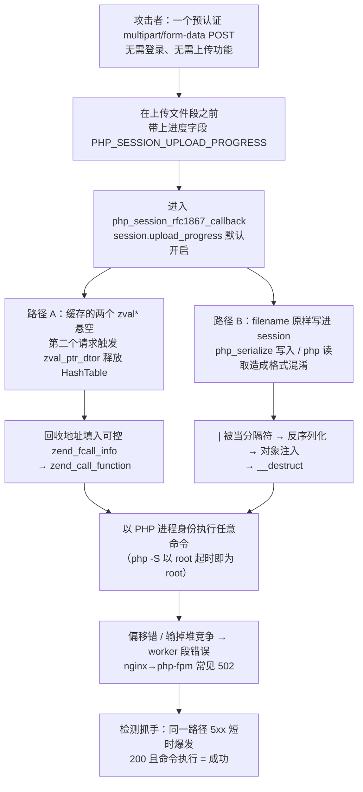
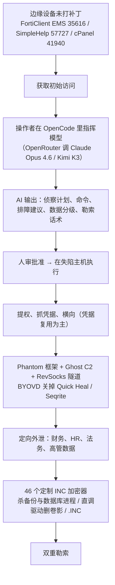
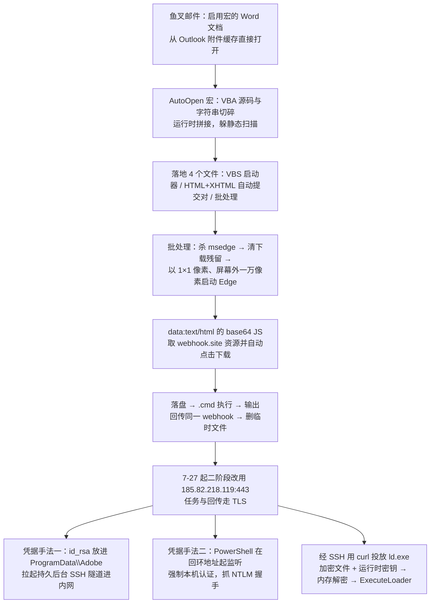
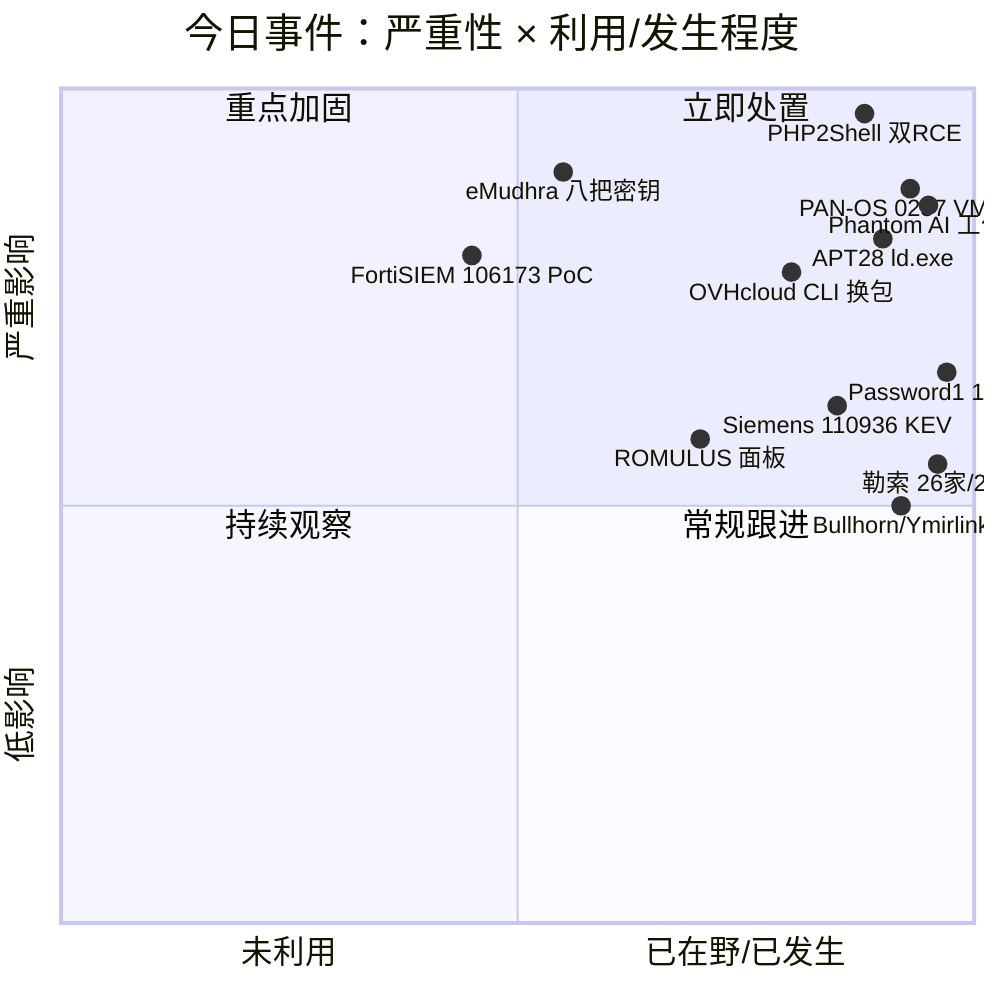
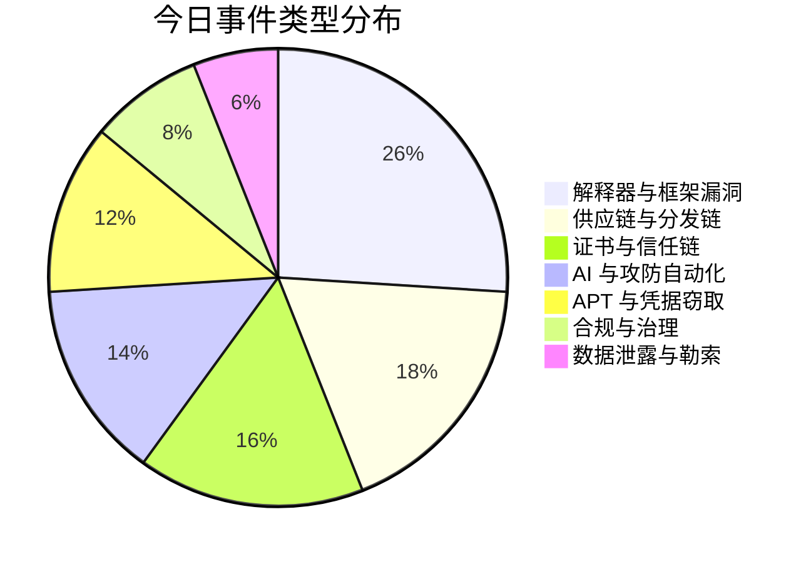
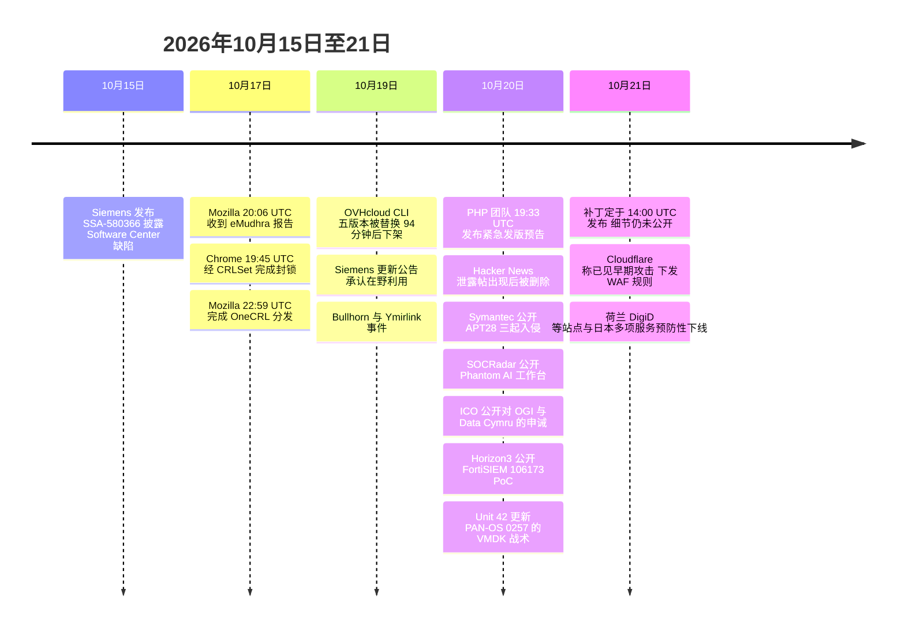

# 网安日报速递 · 2026年10月21日（第 193 期）

> **今日关键词：** PHP2Shell发布后15分钟 · eMudhra八把CA私钥 · OVHcloud换包94分钟 · Phantom智算勒索 · APT28像素窗下载器 · Password1活12年半
>
> **今日主线：** 今天六件事讲的是同一个变量——**窗口期**。PHP 的补丁还没发出，安全公司给出的预测是"发布后 15 分钟开始大规模利用"；eMudhra 从收到报告到浏览器完成封锁只用了 2 小时 53 分，但非浏览器客户端到今天还在信任那八把钥匙；OVHcloud 的 CLI 被换包 94 分钟后才下架，全程没经过 CI/CD；APT28 在三十秒内下发七个任务，是活人在敲键盘。而英国监管机构刚公布的那起事件里，入口是一个 2012 年创建、密码 `Password1`、活了**十二年半**的测试账号。**防守方的反应速度差，比漏洞本身更能决定结果。**

---

## 一、PHP 的两枚 9.2 分核心 RCE：补丁还要一小时才发，而窗口期被算成了"15 分钟"

**一句话：** PHP 安全团队把两枚 **CVSS v4.0 9.2** 的核心远程代码执行漏洞的紧急修复定在 **2026-10-21 14:00 UTC（北京时间 22:00）**，编号 **CVE-2026-109618** 与 **CVE-2026-109619**，社区昵称 **php2shell**。截至本文成稿（10-21 13:00 UTC），补丁尚未发布，官方仍未公布受影响版本、修复版本与根因。漏洞在**解释器本身**，不在任何插件或框架里——改 CMS、升级主题、换 WordPress 版本，一样挡不住。

**这事的起点不是官方公告，是一次泄密。** 两个漏洞原定 **10-22（周四）** 在禁运期内披露。10-20 白天，Hacker News 上出现一个帖子，声称两枚 PHP RCE 是 **CVSS 10.0**、影响 **PHP 5 起所有版本**、自动化利用工具已经全网泄露。帖子随后被删除，发帖人自己承认证据只有 `source: trust me, bro`。但 PHP 团队当晚 **19:33 UTC** 就发布了提前通知：发版提前到 10-21，而且是**保留随时再提前的权利**——理由是"细节已经公开，或发现活跃利用证据"。这句话的分量比公告本身重：它意味着 PHP 团队最初判断这是一个**活着的禁运**，而非例行补丁周期。

已被确认的部分（PHP 官方 / watchTowr / CERT-EU）：

| 项 | 内容 |
|---|---|
| 编号 | CVE-2026-109618、CVE-2026-109619 |
| 官方评分 | 均为 **CVSS v4.0 9.2**（泄露帖里的 10.0 不是官方值） |
| 性质 | 公开报道均描述为远程代码执行；watchTowr 表示已复现 **109618** |
| 修复时间 | 2026-10-21 **14:00 UTC**（北京 22:00） |
| 覆盖分支 | 只给 **8.2 / 8.3 / 8.4 / 8.5** 发修复；8.1 及更早为 EOL，无官方补丁 |
| 预期版本号 | 8.5.12 / 8.4.27 / 8.3.36 / 8.2.35（Kevin Beaumont 说法，**官方未确认**） |
| 在野状态 | 截至 10-21 无确认在野利用；两枚均不在 CISA KEV |
| 官方通告 | CERT-EU **2026-018**；英国 NCSC 发布警报，建议打不了就先下线 |

**但"没有确认在野利用"这句正在失效。** 10-21，Cloudflare CTO **Dane Knecht** 公开表示公司"**已经看到早期攻击出现**"，并已针对已知利用向量下发一版 WAF 规则——**所有套餐包括免费版都有**——同时明确说这是 **STOPGAP only**（临时止血），"真正的解法是等 14:00 UTC 打补丁"。同时 Cloudflare 也提醒：这些规则只对"流量完全经过 Cloudflare"的站点有效。另一家专门做电商清马的 **Sansec** 给出的判断更直接：**补丁发布后 15 分钟内，大规模攻击就会开始。**

**技术成因（官方未公布，目前两套独立分析都指向同一处）。** 两条路径都落在 `ext/session/session.c` 的 `php_session_rfc1867_callback()`——也就是 `session.upload_progress` 的上传进度处理：

- **说法 A：堆 UAF（Upwind 分析）。** 该回调把 `post_bytes_processed` 与 `current_file_bytes_processed` 两个 `zval *` 缓存进 HashTable。第二个请求触发 session 重读与 `zend_hash_update`，经 `zval_ptr_dtor` 销毁 HashTable，缓存指针随即悬空。攻击者在被回收的地址上放置可控的 `zend_fcall_info` / `zend_internal_function`，下一次使用这个悬空指针就会走进 `zend_call_function`，从而被导向 `system()` 一类函数。
- **说法 B：session 文件格式混淆（独立研究者 PoC 仓库）。** `filename` 被原样写进 session 数据；当写入用 `php_serialize`、读取用 `php` 处理器时，`filename` 里的 `|` 会被当成 key/value 分隔符，`|O:...` 之后的内容被当作合法序列化对象反序列化 → 对象注入 → `__destruct`。同一个仓库还指出：POST 体里携带 session id 可以绕过 `session.use_only_cookies`；而且**即使 decode 返回 FAILURE，`__destruct` 也已经执行完毕**。

两种说法在工程约束上差别很大：前者需要**每构建版本的偏移**（`zval_ptr_dtor` 到 `zend_call_function` 的距离），偏移错或输掉堆竞争通常只让 worker 段错误；后者需要**应用侧的一个 gadget**。但两者共同的结论是：**入口是预认证的 `multipart/form-data` POST，默认 `php.ini` 就够**（`session.upload_progress.enabled=1` 默认开启），只需在上传文件段之前带上进度字段（默认名 `PHP_SESSION_UPLOAD_PROGRESS`）。Knecht 与多家厂商的措辞一致：**这不是某个应用的洞，是解释器的洞。**

**为什么"改配置"这条路基本被堵死了。** PHP 的一位 release manager 公开说得很直白：**"ini 设置救不了你"**。Aikido 已经撤回了早前"关掉 `session.upload_progress.enabled` 就行"的建议。不过在补丁到位之前，关闭该特性、开启 `session.use_strict_mode`、把 `session.serialize_handler` 全站统一，仍然是多数防守方实际在做的止血动作——它挡不住所有路径，但把门槛抬高了。

**暴露面有多大。** W3Techs 的口径是 PHP 覆盖 **69.3%** 的"已知服务端语言"站点。Mallory 统计到 **约 88.4 万台**公网主机的 banner 报的是 **PHP 8.1 或更早**（占所有报了版本的主机约 59%），另有 **约 74 万台**只报 PHP 不报版本；研究者 Silas Cutler 粗估可能受影响主机 **超过 130 万台**，Henk Poley 用 Shodan 数到 **190 万台以上**公网 PHP 主机。**这些数字都是 banner 计数，不是已确认可被利用的系统**——但 EOL 那部分的性质是确定的：没人会给它们发补丁。

各分支的支持状态值得单独看一眼，因为它决定"升到最新版"这句话能不能成立：

| 分支 | 当前版本 | 支持状态 |
|---|---|---|
| 8.5 | 8.5.11 | 活跃支持至 2027-12-31 |
| 8.4 | 8.4.26 | 活跃支持至 2026-12-31 |
| 8.3 | 8.3.35 | 仅安全修复至 2027-12-31 |
| 8.2 | 8.2.34 | 仅安全修复至 **2026-12-31**（只能当过渡，不是终点） |
| 8.1 / 8.0 / 7.x / 5.x | — | EOL，PHP 官方不发修复；只能看发行版是否回移 |

**现实里的反应已经跑到监管前面了。** 荷兰广播公司 NOS 报道，**DigiD、MijnOverheid、荷兰众议院网站、Tweakers、以及荷兰国家网络安全中心（NCSC-NL）自己的站点**在补丁发布前下线；日本 ITmedia 报道 **Kodmon、Shadowverse: Worlds Beyond、Sakura Rental Server** 等紧急维护，**BASE、Xserver** 预期跟进；WordPress 插件 The SEO Framework 的开发者直接把自己的服务器关了。

**值得关注的原因：** 这是"补丁日正在变成攻击日"最干净的一个样本。三个细节值得记住——

1. **窗口期不再是周，是分钟。** Sansec 给的 15 分钟不是危言耸听，它是 2026 年的操作现实：补丁 diff 一公开，反推利用的速度以小时计。所以真正的准备工作必须在补丁之前完成——盘点清楚每一台跑 PHP 的机器（包括容器、镜像、控制面板、厂商设备里内嵌的 PHP），并把"今晚谁能升、谁能重启"落实到具体的人。
2. **EOL 池子是这次真正的死结。** 支持分支再快，也救不了那八十多万台跑 8.1 及更早的主机。这些机器没有补丁路线，只有三条路：升级、隔离（VPN / IP 白名单 / 反向代理后置）、下线。
3. **"没有在野"与"安全"之间没有等号。** Cloudflare 已经看到早期攻击，官方公告还没出。这两个事实可以同时为真——而这正是最需要动手的时刻。

---

## 二、八把 CA 私钥的取值是 4、56、66……：浏览器两小时五十三分完成封锁，非浏览器客户端到今天还在信任

**一句话：** 印度 CA **eMudhra**（emSign 品牌）的 **8 张中间 CA 证书私钥**被发现在生成环节存在致命缺陷——P-384 私钥本应有约 384 位的密钥空间，实际取值是 **4、56、66、115、155、156、230、237**，**全部小于 256**。攻击者最多试 256 个数就能还原私钥，然后为**任意域名**签发一张会被信任的 HTTPS 证书。

**时间线紧得罕见。**

| 时间（UTC） | 事件 |
|---|---|
| 2025-04-30 | eMudhra 一次密钥生成仪式（Utimaco HSM）创建这 8 张中间 CA |
| 2026-10-17 20:06 | Mozilla 收到报告 |
| 2026-10-17 19:45 | Chrome 通过 **CRLSet** 按 SPKI 哈希封锁 6 张 TLS 中间证书（**无需更新或重启浏览器**，交叉签名证书一并覆盖） |
| 2026-10-17 22:59 | Mozilla 通过 OneCRL / Remote Settings 完成分发——**距收到报告 2 小时 53 分** |
| 2026-10-19 | Apple 平台完成封锁 |
| 2026-10-20 | Microsoft 平台完成封锁；Firefox 158.0.1 等版本内置封锁列表 |
| 2026-10-27（预计） | Chrome 43 移除 **emSign ECC Root CA - G3**（太平洋时间早晨到达所有依赖 Chrome Root Store 的设备） |

**成因初步指向"脚本写错"。** eMudhra 在 Mozilla 的 bug 里说明：当日密钥生成仪式所用脚本存在缺陷，**额外产生了一套更弱的密钥**，而这套弱密钥被**误用于签发**。RSA 中间证书走的是另一套流程，不受影响；其他 HSM 供应商生成的密钥未显示同样弱点。Mozilla 同时注意到一个历史线索：这 6 张 TLS 中间证书曾在 **2025 年一次 CRL 签名无效问题**中出现过，正在追问"错误的密钥是怎么签出那些吊销列表的"——这是线索，不是成因定论。

**发现者是个化名研究者。** 一位化名 **Wayne** 的独立研究者（据报可能借助了 AI 辅助）在周末找出这些密钥，通报了 Apple / Google / Microsoft / Mozilla 四家，并建了一个站点 `emudhra.we-have-a-problem.com`；**10-20**，他在上面发布了一条用其中一张受影响证书私钥签名的消息，内容是"We have a problem here – Wayne"。

**CVE 与状态。** 两枚编号，**都不在 CISA KEV**，**均无已知利用**，Cloudflare 表示复查自家服务后未发现利用迹象：

- **CVE-2026-113470**（Firefox / Thunderbird，MFSA 2026-111，Mozilla 评 high impact；NVD 状态仍为"待分析"，CISA ADP 给的 CVSS 3.1 是 5.4 medium）
- **CVE-2026-111943**（Go `crypto/x509`，由 Go CNA 发布；NVD 状态"Received"）

**这里有个容易被忽略的结构性问题：浏览器封锁 ≠ 生态封锁。** 浏览器是唯一能"推送"吊销数据的客户端；而 Go 编译出的二进制、用 certifi 的 Python 程序、Node 服务、自建或内置信任库的设备、容器镜像、API 客户端、大量工控与网络设备——**它们不看 CRL，也不看 OCSP，很多在查不到吊销状态时还会 fail-open**。它们会一直信任这 8 张中间证书，直到各自的代码或根证书包被更新。所以修复清单是一张表，不是一条命令：

| 软件 | 修复版本 | 做了什么 |
|---|---|---|
| Go | **1.27.3 / 1.26.10** | `crypto/x509` 拒绝含这 8 把 key 的链（CVE-2026-111943）；**无开关可关**；程序必须**重新编译**才生效；Go 1.25 及更早不再支持 |
| Firefox / Thunderbird | 158.0.1 / ESR 153.5.1 / ESR 115.43.1 | 内置 OneCRL 封锁，供 Remote Settings 被策略禁用或被网络阻断的安装使用 |
| NSS | **3.131.1** | 从信任列表里移除 emSign ECC Root CA - G3 |
| Python certifi | **2026.10.19** | 根证书包里删掉 emSign ECC Root CA - G3 |
| Rust webpki-roots | **1.0.10** | 同上 |
| Composer ca-bundle | 1.6.0 / 1.4.16 | 不信任这 8 张中间证书并刷新根列表 |
| Homebrew ca-certificates | 2026-09-25_1 | 按公钥排除 emSign ECC Root CA - G3、emSign Root TLS CA - G3 与 **AAA Certificate Services** |
| Debian ca-certificates | DSA-6572-1 / DLA-4845-1 | 移除 emSign ECC Root CA - G3 与 Comodo AAA Services root |
| Node.js | **尚未发版** | 阻挡这 8 把 key 的改动 10-20 已合入 main，但还没有包含它的 release |
| macOS 自带 curl | **仍接受** | 它校验的是 Apple 尚未更新的 bundle 文件 |

**代价也是真的。** 移除根比封锁中间证书更狠：它会连带切断所有正当链到该根的证书。eMudhra 估计约 **3 万张证书**需要迁移，其中约 **97% 走 ACME**，并提出把订户迁到链到 **emSign Root CA - G1（RSA）** 的中间证书上，之后称已停止在 G3 根下签发。Mozilla 也提醒：根移除后，一部分服务器对非 Firefox 用户会不可用，直到它们换链——**遇到这种报错，不要用"关掉证书校验"去修**。需要提前排查的是：自家服务端证书、mTLS 客户端证书、代码签名链、以及写死了指纹或内置 bundle 的设备。

**值得关注的原因：** 这次不是"某个洞被打了"，而是**信任锚本身失去了完整性**，而且失效方式极其低级——一个能产出数值 4 的密钥生成脚本，运行了**约 18 个月**没有任何自检把它拦下来。eMudhra 的说法是除一张 G3C DV TLS 中间证书外其余都未部署生产，且所有受影响证书都未签发终端实体证书——**这是 CA 的声明加 CT 记录佐证，不是独立审计**，Chrome 已表示还在复核 eMudhra 留在其根库里的另一张根证书。对防守方的结论只有一句：**把"根证书包"当成一个需要版本管理、需要盘点、需要重新构建的组件**，它现在和操作系统补丁一样重要，而绝大多数资产清单里根本没有它。

---

## 三、OVHcloud CLI：五个已发布的版本被原地替换，94 分钟窗口，而 CI/CD 整条流水线根本没被碰过

**一句话：** 攻击者接管了一名贡献者的 GitHub 账号，进入 OVHcloud CLI 仓库，**把 0.11.0 到 0.15.0 这五个已经发布出去的版本包和校验和直接替换掉**。篡改版本于 **10-19 14:47 UTC** 上线，**16:21** 因客户报告被发现并阻断，存活约 **94 分钟**。

**这件事最关键的一句话来自 OVHcloud 的 CEO 本人：** "整套 CI/CD 流水线——单元测试、功能测试、CVE 检测——**都没有受到影响**。" 原因是它**根本没走流水线**：当时 GitHub 的 **release immutability（发布不可变性）是关闭的**，一个有足够权限的账号可以绕过所有检查，直接改动**已经发布的 release 资产**。这不是"防线被突破"，是"防线外面有一条不需要过检的路"。修复方式是一个开关——**现在打开了**。

几个必须记清的范围边界：

- **干净的：** **0.10.0** 与最新的 **0.16.0**、**源码构建**、**Docker 镜像**。
- **被污染的：** 0.11.0 – 0.15.0 的**发布包**（macOS Intel 与 ARM、Linux x86_64 与 ARM64、Windows x86-64）。
- **载荷目的：** 从磁盘上捞密钥与令牌。厂商对恶意代码质量的评价很低（"二进制质量很差"），但目的明确；CEO 的原话是"**如果中招，它可以一路做到底，请更换磁盘上的所有密钥**"——不是删包，是换密钥。

**溯源线索指向 GlassWorm，但这是线索不是定论。** OpenSourceMalware 称该账号可能已被控制**超过 6 个月**，并利用一个 Solana 钱包指标把活动关联到 GlassWorm；公开仓库中可见 **2026-03-05** 的一次脚本化历史重写，以及一个隐藏的 `preinstall.js` 加载器，解码后通过 **Solana memo 死信箱**取第二阶段。需要说明的是：该机构并未分析本次载荷，关联结论属于基础设施层面的线索。

**值得关注的原因：** 供应链攻击的入口，正在从"污染源码"移到"污染**已经签好名的分发产物**"，而多数团队的防线假设还停在源码与 CI。这条链上每一个环节都"正常"：仓库是真的、release 页面是真的、校验和文件也是真的（因为它一起被换了）、签名可以是有效的——**唯一错的是这个产物不是作者构建的那一份**。今天最便宜的一条加固，就是去把自家与依赖项目的 release immutability 打开，并让发布资产只能由 CI 产出。顺带一条判断：**如果你用过 0.11.0–0.15.0，按凭据泄露处理，不要只删包。**

---

## 四、Phantom：勒索团伙把自己的 AI 工作台留在了公网上，8257 条对话成了呈堂证供

**一句话：** 安全公司 **SOCRadar** 的威胁研究团队在 **2026 年 9 月底**通过开放目录发现一台暴露在公网的攻击者服务器，里面有 **AI 会话数据库、一个持久知识库，以及一套叫 Phantom 的"自主红队杀伤链框架"源码**；顺着其中的凭据与配置，又定位到**另外 6 台**，共 7 台。SOCRadar 于 **10-20** 公开了这份调查。

**规模用数字说话：**

| 项 | 数据 |
|---|---|
| AI 会话 | **133 个会话 / 8257 条消息** |
| 界面与模型 | 界面 **OpenCode**，模型经 **OpenRouter** 调用 **Claude Opus 4.6** 与 **Kimi K3** |
| AI 支出 | **超过 23,920 美元**（说明是持续使用，不是玩票） |
| 关联团伙 | **INC Ransomware** 与 **The Gentlemen** 的附属成员 |
| 具名受害组织 | **62 家**（36 家在美国；工业制造 16.1%、医疗 14.5%） |
| 加密器 | **46 个**按受害方定制的 **INC 加密器**，为 6 家准备，计划 **10-01** 部署 |
| 操作者作息 | 俄语操作者在 **06:00–14:00 UTC** 最活跃 |

**AI 在里面干什么，记录写得很具体。** 侦察规划与目标评估、技术选型与命令生成、攻击工具排障、审阅窃得的数据挑出有价值的、在失陷主机上协调 living-off-the-land、起草勒索话术与对受害方的沟通。**但人始终在环**：指令里常见"协调任务并等待批准"这类措辞，说明它是**人类指挥的助手**，不是自主攻击者。更有意思的是两个细节：当模型拒绝请求时，操作者会**改口把活动重新描述成"授权的红队演练"**；记录里还有一个标着 **WormGPT** 的人设提示，SOCRadar 判断那是**提示标签与集成模式**，不是真的接入了另一个无审查模型。

**加密不是计划，至少执行过一次。** 加密器是 Rust 写的，会终止备份与数据库进程、**通过直接驱动调用删除卷影副本**、给加密文件加 `.INC` 后缀。配套工具还包括 **Phantom** 框架本身（自称"自主红队杀伤链框架"，含 **18 个技能模块**）、**Ghost C2**、**RevSocks** 隧道，以及一枚针对 **Quick Heal / Seqrite** 的 **BYOVD**（自带脆弱驱动）安全软件杀手。9-30 的一张截屏（经 SimpleHelp 获取）显示某受害工作站**正在加密**——这证明环境里不只有计划材料。

**初始访问：还是那几个没打补丁的边缘设备。** 按操作者自己的记录：

- **FortiClient EMS CVE-2026-35616**（7.4.5–7.4.6，2026-04-05 修复，04-06 进 KEV）：记录称涉及 **2,236 台系统 / 4,140 个受管端点**
- **SimpleHelp CVE-2024-57727**：**242 个**独立 IP
- **cPanel CVE-2026-41940**：**49 起**声称的入侵

**有独立印证，也有边界。** Atos 的 Threat Research Center 另外发现了一台配置错误的攻击者 HTTP 服务，里面有运营日志、工具、OpenCode 与 Phantom 平台；Atos 联系了可识别的受害方，发现部分记录中的组织后来确实出现在 INC 的泄露站上。不过 Atos **没有**复现 SOCRadar 给出的精确消息数与加密器数量——两家的结论方向一致，细节口径并不相同。

**值得关注的原因：** 这是**攻击侧的 AI 智能体部署**，不是"AI 被攻击"。攻防两侧第一次可以用同一套词汇描述同一件事：工具调用、知识库、人在环审批、上下文持久化。更值得记的是它的**失败方式**——这群人不是被溯源打掉的，是**把自己的工作台留在了公网上**。那份"共享记忆"帮他们维持了跨天、跨目标的连续性，也在服务器暴露的那一刻变成了最完整的证据链。对防守方，这是一句反问：**我们自己的 AI 会话、知识库、代理配置，现在躺在谁的开放目录里？**

---

## 五、APT28：把"一像素的 Edge 窗口"当下载器，在海军造船厂里手动操作了两个月

**一句话：** Symantec 威胁狩猎团队（Broadcom）**10-20** 公开：与俄罗斯 GRU 关联的 **APT28**（Symantec 跟踪代号 **Swallowtail**，亦称 Fancy Bear / Forest Blizzard；Recorded Future 称 BlueDelta）攻入**两个北约成员国的三个机构**——**执法机构、海军造船厂、军机发动机厂商**。攻击者全程使用 **HOOKEDGE** 后门，并在造船厂那条线上动了两个月的手。

**先说清楚边界。** 受害机构名与两个国家都**没有公开**。有报道把这次事件联系到罗马尼亚、西班牙、土耳其，但那三国是 HOOKEDGE **上一轮**（2025-09 至 2026-04）针对政府与外交目标的活动范围，**不是这一批受害方**，不要混。

**入口是宏，手法很旧，但包装很新。** 最早确认的感染发生在 **2026-07-24 下午**的造船厂：一个恶意 Word 文档**直接从 Outlook 附件缓存里被打开**（证明它是收到的邮件附件）。文档里的 `AutoOpen` 宏做了重度混淆——把 VBA 源码与字符串切成碎片、运行时再拼起来，专门躲静态扫描。执行后往用户目录落四个文件：一个 VBS 启动器、一对"加载即自动提交隐藏表单到 webhook 端点"的 HTML/XHTML、以及一个批处理。

**批处理干的事，是把一个已签名的浏览器变成下载器：**

1. `taskkill /f /im msedge.exe`，杀掉所有 Edge 进程；
2. 清掉 Downloads 里的 `*.000`、`*.tmp`、`*.crdownload` 等残留；
3. 用 `--window-size=1,1 --window-position=10000,10000 --ignore-certificate-errors` 启动 Edge，URL 位置放一段 base64 的 `data:text/html` JavaScript——**窗口是 1×1 像素、跑到屏幕外一万像素处，人看不见**；
4. 解码后的 JS 去取 webhook.site 上的资源，通过自动点击链接触发下载落盘；内容复制成 `.cmd` 执行；把输出传回同一个 webhook 端点；删临时文件。

一个完整的 **fetch–execute–callback** 循环，全部由"可信 SaaS（webhook.site）+ 已签名二进制（msedge.exe）"构成。**这条链上没有一个组件是恶意的。**

**从 7-27 起，二阶段弃用 webhook.site**，改用专用 IP **185.82.218.119:443** 做任务下发与回传，走 TLS。

**"活人在敲键盘"这件事有数据支撑：** 约 **30 秒内下发 7 个任务**，每个都在前一个完成后 **2–8 秒**内完成。这不是自动化 beacon 的节奏，是有人坐在屏幕前一条条敲。

**两种凭据窃取，指向两个不同目标：**

- **SSH 私钥：** 操作者把 `id_rsa` 放进 `C:\ProgramData\Adobe`、改好权限，随即用它在**后台拉起一条持久的 SSH 隧道**——从攻击者服务器直通目标内网，全程不装木马。
- **NTLM：** 一段自包含的 PowerShell 在**本机回环地址**起监听，强制本机向它认证，抓走 NTLM 握手。

**新工具 ld.exe。** 一个此前未见文档的**反射加载器**：命令行收一个加密文件与一把解密密钥，在内存里解密后调用导出函数 `ExecuteLoader`。加密载荷本身没被取到，所以它的最终功能仍属未知；投放方式是经 SSH 用 `curl` 拉下来。

**时间线：** 7-24 首次感染 → 7 月底一周内反复回到同一台主机、偷凭据、开隧道、铺工具 → **9-24** 最后一次相关活动（在造船厂网络里再次见到 HOOKEDGE 的 VBS 启动器）。上一轮 HOOKEDGE 由 Recorded Future Insikt Group 在 **2026-08** 首度公开，与 APT28 早年对 diplomats 使用的 **HEADLACE** 存在大量代码与战术重叠。

**值得关注的原因：** 这件事**一枚 CVE 都没有**。防线是"宏 + 可信服务 + 已签名进程"这三件套拼出来的，任何单点拦截都拦不住：邮件网关看到的是一个普通 Word 附件，EDR 看到的是签名正常的 `msedge.exe`，网络侧看到的是访问 webhook.site 这种合法 SaaS。所以检测抓手只能是**行为**：离屏的 1×1 像素浏览器实例、指向 webhook.site 的出站、回环地址上的 NTLM 认证、不该出现在工作站上的 SSH 隧道、父进程是浏览器或终端的 `curl`。而"三十秒七个任务"的节奏说明，这类行动不是撒网，是**对着高价值目标做人工干预**——这也意味着它更难被"可疑流量阈值"发现。

---

## 六、两份申诫：一个 2012 年的测试账号，密码 `Password1`，活了十二年半

**一句话：** 英国信息专员办公室（ICO）在 **10-20** 公开对 **Ogi Networks Limited（ONL）** 与威尔士地方政府数据机构 **Data Cymru** 的**申诫**（决定书 10-14 发出，**未处罚款**）。起因是 **2024-11-01** 的一起勒索软件攻击：攻击者从一个 **2012 年创建、密码为 `Password1`** 的 Active Directory 测试账号进去，偷走 **42GB**、加密 **182.7GB**，涉及 **3,300 人**，**大多数是儿童**。

**攻击路径全是"基本功"，没有一枚漏洞：**

- **入口：** 账号 `Test2`，由 ONL 于 **2012-01-13** 创建（当时是为了在正式用户迁移前测试访问），密码 `Password1`。ICO 引用 Bitwarden 的强度工具：**very weak，1 秒内可破**。这个账号存在了**超过 12 年**，且"要么一直有效，要么在事件前被意外重新启用"；Data Cymru 的 AD 里**没有例行审计**能发现并停用多余账号。
- **横向：** 三台受影响系统上的**本地管理员账号用的是同一个密码**，且部署后从未复核，**十二年半没换过**——从一台机器抓本地哈希，就能登进另外两台。
- **窃取先于加密：** 42GB 来自主域控制器、文件服务器与一台内部 SQL Server；随后 182.7GB 被加密。**这意味着"从备份恢复"解决不了数据已经泄露这件事。**

**合规层面的问题比技术层面更值得看：**

| 主体 | 违反条款 | 具体缺失 |
|---|---|---|
| ONL | UK GDPR 第 32(1)(b)、32(1)(d) | 建号时未施加密码强度要求；未对它在 Data Cymru 网络内建的账号做例行审计，使一个"运营上已无必要"的测试账号存活 12 年以上（其中超过 6 年发生在 GDPR 生效之后）；部署后从未复核本地管理员账号 |
| Data Cymru | 第 28(4)、32(1)(b)、32(1)(d) | 与 ONL 之间**没有包含法定数据处理条款的合同**；未书面明确 ONL 提供的 AD 服务如何交付、监控、审计，责任划分留了空档；未确保休眠的 `Test2` 被发现并移除或升级密码 |

ICO 调查负责人 **David Doodson** 的原话被各家媒体引用最多：**"`Password1` 不是一个合适的密码，它是一扇对恶意行为者敞开的大门。"** 他同时强调责任不在单一方："ONL 建了测试账号，而 Data Cymru 保留着对自身网络的整体控制权，包括指示 ONL 建号或删号的权力。"

**事后动作：** 两家已补签合规的数据处理合同、加强账号复核、在远程访问上启用 MFA；ONL 称攻击后**一周内**审完了 Data Cymru 网络上的每个账号、关停不需要的、并引入独立专家，且事件仅限于它为 Data Cymru 托管的那台服务器。ICO 没有公布任何 IOC，也没有公开归因到某个团伙。

**值得关注的原因：** 今天六件事里，唯一一件**完全没有漏洞**的。它把"窗口期"这条主线拉到了另一个极端：前面几件事的窗口是 15 分钟、94 分钟、2 小时 53 分，这件事的窗口是**十二年半**。而且它戳破了一个很常见的心理安慰——"安全是供应商的事"。当网络的所有权（Data Cymru）与账号的创建权（ONL）分属两家、而两家都没有把"谁负责发现多余账号"写进合同，那个账号就会一直活着。**外包转移的是工作，不是责任。**

---

## 速览

### 7. PAN-OS CVE-2026-0257：勒索团伙开始从 VMDK 里离线刨凭据
Unit 42 在 **10-20** 的更新里给出战术演进：除此前已知的 Qilin（Spikey Scorpius）与使用 Settra 的团伙，**INC（Tarnished Scorpius）**也在用这枚 GlobalProtect 认证绕过建未授权 VPN 会话，覆盖教育、金融、医疗、高科技、酒店、制造、专业与法律服务、政府、交通物流、公用事业能源、批发零售共 **11 个行业**。最要命的一步是**直插虚拟化层**：某案例里攻击者从被打的 VPN 网关进到 **vCenter 管理设备**，在那里关掉 ESXi 的 `execInstalledOnly`，再用自制工具对**域控的虚拟磁盘（VMDK）做离线凭据提取**——全程在 guest OS 之外，**虚拟机内的 EDR 看不见**。Unit 42 还在多起响应里发现同一个误配：**GlobalProtect 配置文件被映射到了管理接口的 443/HTTPS 端口（最常见 4443 与 3879）**，管理面就这么对公网开着，浏览器直接连一下就能自测。检测抓手三个：GlobalProtect 日志里的可疑 host ID（`aa:bb:cc:dd:ee:ff`、`00:11:22:33:44:55`、`WINDOWS-LAPTOP-001`、`DESKTOP-GP01`、`GP-CLIENT`）、PoC 的硬编码客户端特征（`endpoint_os_version` 为 `Microsoft Windows 10 Pro 64-bit`、`source_user_info.domain` 为空）、以及 vCenter 异常登录与 `execInstalledOnly` 是否被改过。EPSS **96.9%**，KEV 自 **5-13**。（本 CVE 的在野利用已在 10-12 期报过，本条只记新增战术）

### 8. Siemens Software Center CVE-2026-110936：8.4 分进了 KEV，因为攻击者用的是正版签名程序
DLL 旁加载（CWE-427 不受控搜索路径），**CVSS v4.0 8.4**，**V4.0.9.8 之前所有版本**受影响。Siemens 的说法把这件事讲透了：攻击者用的是**一份正版、带有效签名的 Software Center 3.5.8.7**，把自己的恶意 DLL 放在同一目录旁边；**可执行文件一个字节都没改**，签名与哈希全都正常。载体 `AllMyBasic.msi` 经 **ROMULUS** ClickFix 面板在官方渠道之外分发，落点是 `AppData\Local\Programs` 下的 "SM Software Provisioning Service" 目录，持久化走启动项/计划任务，外联 **96.62.218.59** 与 `wizardexpensive.com`。时间线值得注意：**10-15** 发公告（SSA-580366）→ **10-17** 更新说明 4.0.9.8 已修复 → **10-19** 才承认在野利用。漏洞由 Huntress 的 **Jose Oregon** 报送。检测思路：看 `msiexec` 从 `AppData` 拉起 `SiemensSoftwareCenter.exe`、同目录出现 `activate.bak` 或 `statinfasta.DB`、以及 `FTSuite` 目录下的 `ftc.uml`。

### 9. ROMULUS：一个被重复出租的 ClickFix 面板，六个 IP 在跑同一套后端
Forescout Vedere Labs 在调查一起事件时发现一台服务器上跑着一个叫 **ROMULUS** 的面板，进一步确认**六个 IP** 在跑同一套东西——其中 **2.27.248.127** 正是 Siemens 列出的 `AllMyBasic.msi` 分发地址。它提供 PowerShell 暂存脚本与被木马化的 MSI 安装包，两条路线：一条发 Stardock 系的 DLL 旁加载包（Huntress 先前报过），另一条发**带密码的压缩包**塞 **LegionLoader**；加载器藏在一个用填充膨胀到约 **882MB** 的可执行文件里，用 RC4 + Base64 与 C2 通信。研究者的判断很关键：这是**可复用的投放后端**，不是单一硬编码的马服务器——它可能是一个私有面板、一项商业化投放服务、一个附属框架，或者被不同操作者复制走的软件。**这意味着"封 IP"只是暂时的。**

### 10. 勒索快照：24 小时 26 家、10 月 677 家、2026 年累计 8704 家
按 **10-20 13:50 UTC** 的快照：过去 24 小时有 **26 家**被挂上泄露站，来自 **7 个团伙**（**N0N 10 家、Qilin 9 家、Global Secret Group 2 家**），前一日 24 家，**7 日均值 37.6 家/天**；10 月累计 **677 家**，2026 年累计 **8,704 家**。当天值得单独记两条：**PingCAP / TiDB Cloud** 被 Fulcrumsec 挂出；**Baker Donelson** 被 Redact 挂出 **355GB / 102,390 个文件**。以上全部是团伙单方面的声称，**不是已核实事件**。

### 11. FortiSIEM CVE-2026-106173：补丁发了一周，Horizon3 的 PoC 就到了
**CVSS 9.4**、未认证路径穿越 → 代码执行，入口是 FortiSIEM 的 gRPC 服务（**TCP 27918**）。Horizon3.ai 的技术拆解很典型：根因在 `QueryResultReq` 的 `SendQueryResult()`——用户提供的 `query-id` 未校验就被拼进文件路径（拿到任意写位置），但文件名被固定成 `result–0-0-.dat`，所以只有"任意写"还不够；**在参数里注入空字节把固定后缀截断**，才把"只能写固定名"变成"想写什么写什么"，进而落到代码执行。Fortinet 在 **10-12 那周**就发了修复版本，PoC 晚一周到——这正是"补丁即地图"的标准节奏。打不了就把 **27918** 从公网收掉。（10-19 期已记过该 CVE 与厂商公告版本范围矛盾的问题，本条只记 PoC 落地）

### 12. Bullhorn 停摆与 Ymirlink 900 万条：两起"服务型"事件
**10-19**，攻击者让招聘/人力 SaaS **Bullhorn** 下线，并强制所有用户改密码；同日，日本 **Ymirlink** 称其 Cuenote 邮件投递服务后端系统被窃约 **900 万条**记录。两起都还没有到可复盘的阶段，但指向同一件事：**"服务型"供应商一旦被打，受害名单不是按客户数算的，是按客户的客户算的。** 对照 10-18 期的 ConnectWise（一个应用身份开 173 个租户）、10-20 期的日经（第三次事件、183 万条），这条线在这个月已经是第三次。

---

## 风险分析

**今天最该先动的三件事：**

1. **今晚把 PHP 的升级路径钉到人头上。** 不是"通知一下运维"，是明确写出"哪台机器、谁升、几点重启、升不了怎么办"。特别注意容器基础镜像、控制面板、厂商设备内嵌的 PHP，以及 8.1 及更早那批无法修复的主机——它们只有升级、隔离、下线三条路。
2. **把根证书包当补丁管理。** 清点所有不走系统信任库的客户端（Go 编译产物、Python/Node 服务、自建 bundle、mTLS、设备固件），并提前排查服务端证书是否链到 emSign ECC Root CA - G3——**10-27** 之后 Chrome 43 会把它摘掉，链在上面的站点会直接不可用。
3. **去关掉一个开关。** GitHub 的 release immutability。这是今天投入产出比最高的一条加固，也是 OVHcloud 那 94 分钟唯一的差别。

---

## 事件时间线

---

## 出处

### PHP2Shell（CVE-2026-109618 / CVE-2026-109619）
- Patchstack — Major security alert: PHP vulnerable to critical RCE, attacks ongoing
  <https://www.patchstack.com/articles/php-major-vulnerability-alert-10-2026>
- Tenable — php2shell FAQ（官方评分 9.2 / 修复分支 / 版本号来源）
  <https://www.tenable.com/blog/php2shell-cve-2026-109618-cve-2026-109619-frequently-asked-questions-about-critical-php-remote>
- Cyber Kendra — PHP2Shell: Critical PHP Flaws Allow Remote Code Execution
  <https://www.cyberkendra.com/2026/10/php2shell-cve-2026-109618-cve-2026-109619.html>
- Upwind — Initial Assessment（UAF 技术分析、默认配置可利用、502 检测抓手）
  <https://www.upwind.io/feed/initial-assessment-php2shell-two-critical-unpatched-php-rces-cve-2026-109618-cve-2026-109619>
- CERT-EU — Security Advisory 2026-018
  <https://cert.europa.eu/publications/security-advisories/2026-018/>
- Phoenix Security — PHP Core RCE 修复与检测指引
  <https://phoenix.security/php-core-rce-cve-2026-109618-109619-critical-remote-code-execution/>
- 博客园 r00tananananan — PHP2Shell：session.upload_progress 文件名注入 → 对象注入 → `__destruct`
  <https://www.cnblogs.com/r00tananananan/p/23391372>
- 博客园 lovebing — 已确认 / 未确认 / 被当成事实传播的三栏对照
  <https://www.cnblogs.com/lovebing/p/23390519>
- Secure in Seconds — PHP2Shell: Your Patch Window Is 15 Minutes（Sansec 的 15 分钟判断）
  <https://www.secureinseconds.com/blog/2026-10-21-php2shell-patch-window>
- Aardwolf Security — Critical PHP Security Release: Two CVSS 9.2 Flaws
  <https://aardwolfsecurity.com/critical-php-security-release-two-cvss-9-2-flaws-and-what-to-do-right-now>

### eMudhra 中间 CA 私钥
- The Hacker News — Eight eMudhra CA Keys Compromised（修复矩阵、根移除时间）
  <https://thehackernews.com/2026/10/eight-emudhra-ca-keys-compromised.html>
- Rescana — eMudhra CA Key Compromise（CVE 状态、各生态修复版本）
  <https://www.rescana.com/post/emudhra-intermediate-ca-key-compromise-october-2026>
- Enigma Global — Eight eMudhra CA Keys Compromised, Triggering Emergency Fixes
  <https://www.enigma-global.com/preview/news/45490>
- PK Sharma — eMudhra CA keys: recoverable P-384 values, Firefox blocks and root distrust（3 万张证书迁移估算）
  <https://www.pk-sharma.com/briefing/firefox-emudhra-eight-intermediate-keys-onecrl-17-october>
- 0dayNews — Browsers Block eMudhra After Eight CA Keys Exposed
  <https://0daynews.com/articles/2026-10-21-emudhra-ca-eight-keys-compromised-browsers-block>
- The Indian Express — 'Potentially catastrophic': How eMudhra incident put global web security at risk
  <https://indianexpress.com/article/technology/tech-news-technology/cert-in-emudhra-certificate-compromise-catastrophic-say-experts-10930785/>
- IT之家（腾讯新闻转载）— 印度 eMudhra 中间证书私钥存在严重缺陷
  <https://news.qq.com/rain/a/20261021A08JS700>

### OVHcloud CLI 供应链投毒
- CyberSecBrief — Daily Cybersecurity Briefing (21 October 2026)
  <https://www.cybersecbrief.com/news/cybersec/cybersec-2026-10-21>
- CyberSecurity SEE — Cyber Briefing October 20, 2026
  <https://cybersecurity-see.com/cyber-briefing-october-20-2026>
- 全球威胁情报日报 2026-10-21（含 CEO 表态与 GlassWorm 线索梳理）
  <http://mp.weixin.qq.com/s?__biz=MzI4Mjg2ODc0Mw==&mid=2247488304&idx=1&sn=ff454f08d72b0b15e68511b76cb216ff>

### Phantom / INC 与 The Gentlemen 的 AI 基础设施
- CyPro — AI Ransomware Infrastructure Exposed
  <https://cypro.co.uk/insights/cyber-bulletins/ai-ransomware-operation-exposes-hacker-secrets>
- CyberMaterial — INC/Gentlemen Ransomware AI Infrastructure Exposed
  <https://www.cybermaterial.com/p/incgentlemen-ransomware-ai-infrastructure>
- eyeon.ai — INC / The Gentlemen run an AI-driven intrusion ecosystem via OpenCode + MCP
  <https://eyeon.ai/f/3107>
- Threadlinqs — INC 使用 Claude 与 Phantom 框架（含 CVE 关联）
  <https://intel.threadlinqs.com/threat/TL-2026-4020>

### APT28 / Swallowtail（HOOKEDGE + ld.exe）
- Symantec（Security.com）— Swallowtail: Russian Espionage Group Targets Defense Firms in Two NATO Countries
  <https://www.security.com/threat-intelligence/swallowtail-russia-nato-targets>
- ThreatCluster — Russian APT28 Breaches NATO Naval Shipbuilder, Deploys New Reflective Loader
  <https://threatcluster.io/article/russian-apt28-breaches-nato-naval-shipbuilder-in-nato-countr-ab6c7b99>
- CyPro — APT28 NATO Campaign Hits Defence Contractors
  <https://cypro.co.uk/insights/cyber-bulletins/apt28-nato-campaign-hits-defence-contractors>
- Enigma Global — Swallowtail 报告全文摘要（宏混淆、离屏 Edge、两种凭据手法）
  <https://www.enigma-global.com/preview/report/swallowtail-apt28-targets-nato-defense-industrial-base-with-hookedge-backdoor-mvhs0rj5-1un1>

### ICO / Data Cymru 与 Ogi Networks
- ICO 官方新闻稿 — "'Password1' is not an appropriate password"
  <https://ico.org.uk/about-the-ico/media-centre/news-and-blogs/2026/10/password1-is-not-an-appropriate-password/>
- CyPro — Data Cymru Ransomware Draws ICO Reprimands（技术细节与时间线）
  <https://cypro.co.uk/insights/cyber-bulletins/data-cymru-ransomware-draws-ico-reprimands/>
- LavX News — ICO reprimands Ogi Networks and Data Cymru
  <https://news.lavx.hu/article/ico-reprimands-ogi-networks-and-data-cymru-after-password1-breach-affects-3-300-people>

### 速览条目
- heise online — Attack warnings issued for Plex, SiteGuard and Siemens Software Center
  <https://www.heise.de/en/news/Attack-warnings-issued-for-Plex-SiteGuard-and-Siemens-Software-Center-11495087.html>
- Help Net Security — Attackers exploit Siemens Software Center flaw in active ClickFix campaign
  <https://www.helpnetsecurity.com/2026/10/20/exploitation-siemens-software-center-vulnerability-cve-2026-110936/>
- Expert Insights — Siemens Software Center Flaw Exploited In ClickFix Malware Campaign（IOC 清单）
  <https://expertinsights.com/news/siemens-software-center-flaw-exploited-in-clickfix-malware-campaign>
- Cybersecurity Beat — ClickFix crews weaponised a signed Siemens installer as a DLL carrier
  <https://cybersecuritybeat.com/2026/10/20/clickfix-crews-weaponised-a-signed-siemens-installer-as-a-dll-carrier>
- Daily Security Review — Public Exploit Released for Critical FortiSIEM Flaw CVE-2026-106173
  <https://dailysecurityreview.com/resources/public-exploit-released-for-critical-fortisiem-flaw-cve-2026-106173>
- Ransomnews — Ransomware attacks today（24 小时快照与累计值）
  <https://ransomnews.com/ransomware-attacks-today>
- TSNMedia — Ransomware and Major Cyber Attacks Story Hub
  <https://tsnmedia.org/ransomware-cyber-attacks-hub>
- CyberRecaps — Daily Cybersecurity News, October 20, 2026
  <https://cyberrecaps.com/news/cybersecurity-news-october-20-2026>
- Cyber Resilience — Daily CVE Tracker（EPSS / KEV / 风险分）
  <https://security-resilience.ai/vulnerabilities.html>
- CISA KEV 目录（官方）
  <https://www.cisa.gov/known-exploited-vulnerabilities-catalog>
