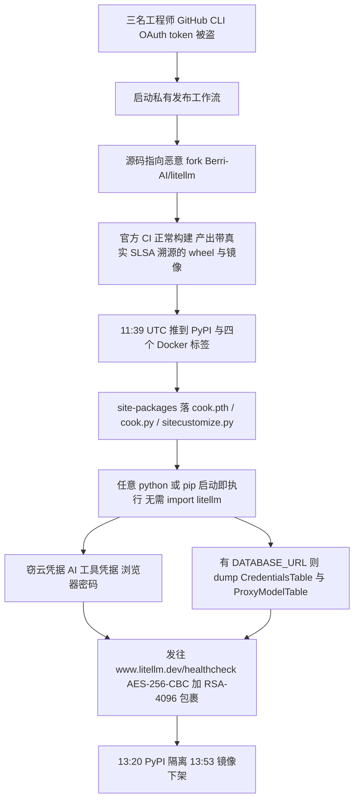
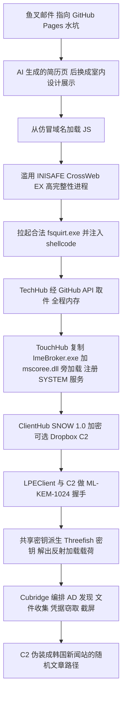
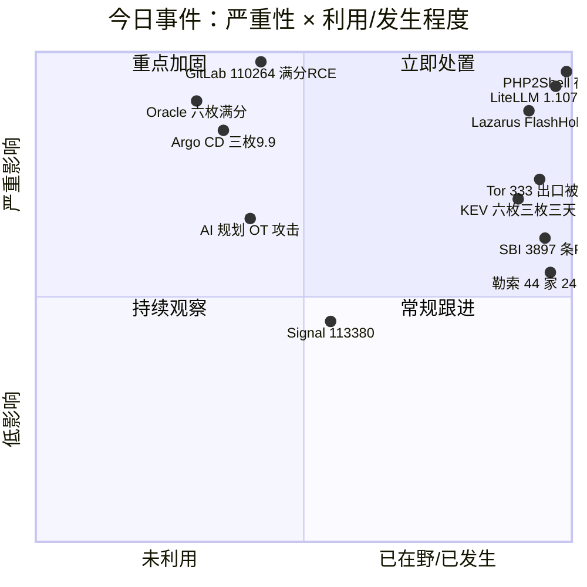
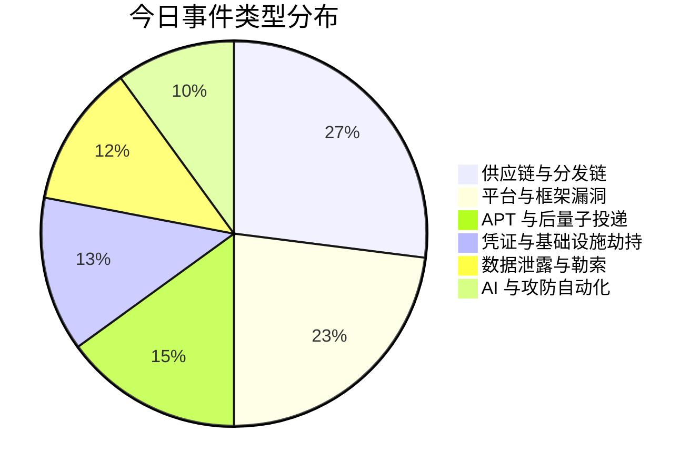
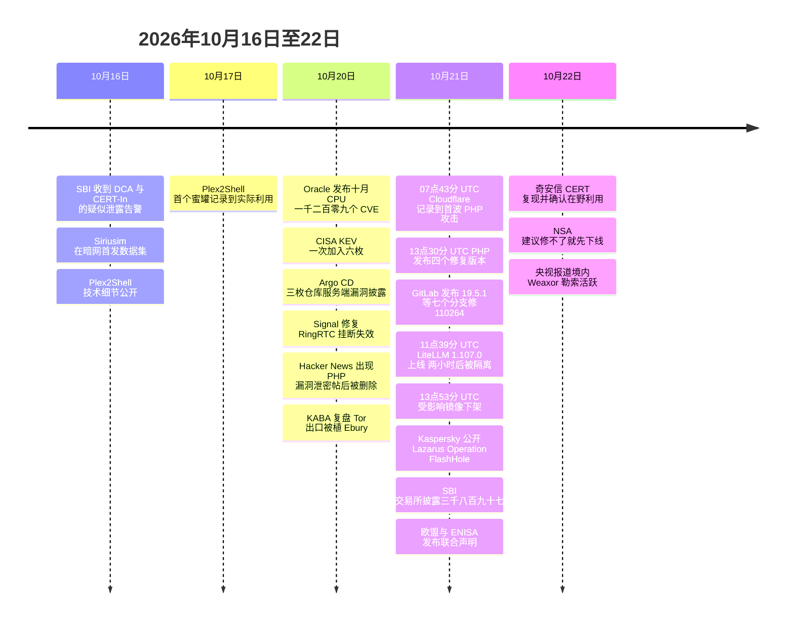

# 网安日报速递 · 2026年10月22日（第 194 期）

> **今日关键词：** LiteLLM一个连字符的坑 · GitLab110264补了两次 · Oracle六枚满分 · ArgoCD只读权限即可执行 · Lazarus后量子加密投递 · SBI三千八百九十七人
>
> **今日主线：** 今天六件事的形状是同一个——**每个信任信号都是真的，只有它指的那个东西是错的。** LiteLLM 的 `v1.107.0` 标签干净、提交带 Verified 绿标、镜像带 SLSA 溯源，三样全过；溯源也确实忠实地写下了源仓库，只是那个仓库叫 `Berri-AI/litellm`，比真名少一个连字符。GitLab 把一枚 CVSS 10.0 的未认证 RCE 追到 2014 年的 7.0，却没公布"特定条件"是什么，所以你没法靠翻自己的配置把自己排除。Argo CD 那两个 9.9 只需要 `Application get`——一个只读权限。Lazarus 拿 NIST 标准的后量子算法，只为让载荷在传输途中不被看清。而 SBI 那 3,897 条记录，是从 37.5 万条里筛出来的，筛完照样够做诈骗。**防守方检查的是"来源可信吗"，攻击方改的是"来源是谁"。**

---

## 一、LiteLLM 1.107.0 被投毒：一个连字符，把整条发布流水线指向了别人的仓库

**一句话：** 2026-10-21，PyPI 上发布了 `litellm==1.107.0`，同时被推到 LiteLLM 官方四个 Docker 标签。这个包会在**任何 Python 进程启动时**自动执行一个凭据窃取器——**哪怕你从来没 import 过 litellm**。周下载量约 **2,300 万次**。整条链上唯一动手改的东西，是发布时指向的那个仓库比真名少一个连字符。

**时间窗口只有两小时。** 按 Datadog Security Labs 记录的 UTC 时间轴：

| 时间（UTC） | 事件 |
|---|---|
| 11:39 | 恶意版 `1.107.0` 发布到 PyPI |
| 13:20 | PyPI 隔离该版本 |
| 13:53 | 受影响的 Docker 镜像被移除 |

Upwind 的记录是约 90 分钟。差别在于"PyPI 隔离"与"镜像删除"哪个算结束——但无论用哪个口径，这都不是"挂了一整天没人管"的那种事故，而是在两小时内被下游发现并处置。**问题在于那两小时正好覆盖了 CI 的构建窗口。**

**每一层完整性证据，都是真的。** 这是这件事最值得记住的地方：

| 你会检查的东西 | 当时给出的答案 | 为什么没能拦住 |
|---|---|---|
| `v1.107.0` 的 git tag | 干净，里面没有恶意代码 | 恶意代码不在 tag 里，构建时从别处拉进 |
| 提交上的 GitHub 签名 | Verified 绿标 | 提交通道本身是合法的 |
| 镜像的 SLSA 溯源 | 有，且指名了真实 builder 与"真实源仓库" | 那个源仓库就是 `Berri-AI/litellm` —— 只差一个连字符 |
| 发布渠道 | LiteLLM 官方 PyPI 项目与官方 Docker 仓库 | 走的就是官方通道 |

攻击者没有"突破"流水线，他们**让流水线为他们构建**。手法是：**三名工程师账号的 GitHub CLI OAuth token 被盗**（初步原因未公布），这三份凭据被用来启动 LiteLLM 的私有发布工作流、批准这次运行、并在事后删除痕迹；被构建的源码来自恶意 fork `Berri-AI/litellm`（真实组织是 `BerriAI`）。**溯源信息没有撒谎，它只是如实记录了错误的仓库名。**

**载荷落在 `site-packages`，与 litellm 本身解耦。** 三个文件：

| 文件 | 大小 | 作用 |
|---|---|---|
| `cook.pth` | 12 字节 | 内容只有一行 `import cook`；Python 启动时自动执行 `.pth` |
| `cook.py` | 22,252 字节 | 凭据窃取器（自称 privcollect），zlib + base64 包裹 |
| `sitecustomize.py` | 25,509 字节 | 二阶段 RAT：每小时去固定 GitHub 仓库取域名，再下载并执行代码 |

因为 `.pth` 与 `sitecustomize.py` 是**解释器级**的自动加载点，**这个虚拟环境里任何一次 `python`、`pip` 调用都会重新触发它**——删掉 `litellm` 目录不算清理，反而会在下一次 pip 时再中一次。这是本次处置最容易做错的一步。

**它偷的东西，是按"这是一个 AI 网关"来写的。** 除常规的云凭据（AWS / GCP / Azure，含实例元数据）、K8s / Docker / Vault / Terraform、SSH 与 GPG 私钥、`.git-credentials` / `.npmrc` / `.pypirc`、浏览器解密后的密码与 Cookie、`/proc/*/environ` 之外，有两条是**专门为这个包设计的**：

- **AI 工具链凭据：** Claude、Codex、Gemini、Qwen、Cursor、Windsurf、Kiro、VS Code MCP、Copilot、Hugging Face token——这是第一份把"AI 编码助手登录态"明确列进清单的窃取器
- **LiteLLM 自己的数据库：** 如果环境里有 `DATABASE_URL`，它会拉起 Prisma 去 dump `LiteLLM_CredentialsTable` 与 `LiteLLM_ProxyModelTable`。**这两个表就是整家企业经由 LiteLLM 转发的全部上游 provider key**

还有一处细节说明写载荷的人在验货：云元数据里的角色凭据，会**先用 STS `GetCallerIdentity` 验证有效**，再外传。不白拿。

**外传与二阶段都用了"看起来像官方"的域名。** 数据发往 `www.litellm.dev/healthcheck`——**`.dev`，不是项目真正的 `.ai`**。真站 `litellm.ai` 注册于 2023-08-07、在 GoDaddy、四把注册商锁（delete / renew / transfer / update）全开；仿冒域名是 2026 年新注册的独立域名。抓包能证明"连过"，但拿不到内容：载荷是 AES-256-CBC，密钥用 RSA-4096-OAEP 包裹。二阶段指向 `raw.githubusercontent.com/letters9813/pythonclient-test/main/domain.txt`，**该文件只放过测试值，因此未观察到二阶段载荷真正落地**——这是运气，不是设计。

**容器那条线更糟：四个标签一起指过去。**

- 受影响：PyPI `litellm==1.107.0`；GHCR 与 Docker Hub 的 `v1.107.0`、**`latest`**、**`main-latest`**、**`main-stable`**
- 结果：compose 文件里写着 `litellm/litellm:latest` 的人，**没有任何机会"跳过 1.107.0"**——他没有选版本，是版本选中了他
- 镜像索引哈希（受感染）：`sha256:1bbcb144…c339e`；六个平台的 wheel 哈希在 Datadog 的 IOC 表里全列了

**处置顺序不能反：**

1. **手动删掉** `site-packages` 里的 `cook.pth`、`cook.py`、`sitecustomize.py`（删 `litellm` 目录不够）
2. 回退到 **`litellm==1.106.2`**（已知最后一个干净版本）
3. **在干净机器上**轮换全部凭据——不是在这台被污染的机器上改密码
4. 查日志：泄露窗口内这些凭据有没有被用过；同时查 `/tmp/.pc_once_72129118c59f5636c0bb` 与 `/tmp/remote_code_loader.lock` 两个落地痕迹

**这是 LiteLLM 2026 年第二次供应链事件。** 上一次是 `1.82.7` / `1.82.8`，Datadog 归到 TeamPCP 活动（经 Trivy 的 CI/CD 流水线偷到 PyPI 发布令牌）。**两次之间目前没有建立关联。**

**值得关注的原因：** 供应链攻防的战场已经从"污染源码"移到"**决定这次构建从哪儿取源码**"，而绝大多数团队的检查清单还停在源码与产物两端。今天这条链上，tag 是真的、提交签名是真的、SLSA 溯源是真的、发布渠道是真的——**四个真信号指向一个假来源**。而且攻击者挑得很准：一个 AI 网关的数据库里，装着全公司所有模型的 key。**最便宜的三条加固：把发布工作流锁死到白名单仓库（而不是"任何有权限的 fork"）、把开发者的 CLI token 当生产密钥管、以及在任何镜像里禁掉 `latest`。**

---

## 二、GitLab CVE-2026-110264：CVSS 10.0、未认证、回溯到 2014 年的 7.0，而且这是同一个洞一个月内第四次

**一句话：** GitLab 在 **10-21** 的例行安全发版里修了 **11 个问题**，其中一枚 **CVE-2026-110264，CVSS 3.1 满分 10.0**：未认证远程攻击者可让服务器在编译一个精心构造的正则时发生**整数溢出**，进而执行任意代码。受影响范围**回溯到 GitLab 7.0（2014 年）**，约十二年。

**必须先说清一件事：这不是"又发现一个新洞"，是"上次没补干净"。** 同一个研究者（化名 **joaxcar**，经 HackerOne 报送）一个月内在 GitLab 的**正则引擎**上打出了第四个 RCE：

| 日期 | CVE | 评分 | 前提 | 修复版本 |
|---|---|---|---|---|
| 2026-09-23 | CVE-2026-93577 | 9.9 | 需登录 | 19.2 之后 |
| 2026-09-23 | CVE-2026-89078 | 9.9 | 需登录 | 19.2 之后 |
| 2026-10-12 | CVE-2026-97229 | 10.0 | 未认证 | 19.2.8 / 19.3.5 / 19.4.2 |
| **2026-10-21** | **CVE-2026-110264** | **10.0** | **未认证** | **见下表，最低到 18.11.13** |

`97229` 在 10-14 期已报过。**关键的一句是：那次只补到 19.2 之后。** 也就是说，**九天前刚刚升到 19.2.8 把自己"修好"的实例，今天又在 `110264` 的范围内**——因为 110264 修在 19.2.9 / 19.3.6 / 19.4.3 / 19.5.1 上。

**根因在别人家的编译器里。** 出问题的是 **Onigmo**——Ruby 内置的正则编译器，GitLab 把它打进自己的包并自行打补丁。所以"这个缺陷存在于该引擎出现过的每一个版本"，而它从 7.0 起就一直在。

| 分支 | 升级到 |
|---|---|
| 19.5 | 19.5.1 |
| 19.4 | 19.4.3 |
| 19.3 | 19.3.6 |
| 19.2 | 19.2.9 |
| 19.1 | 19.1.9 |
| 19.0 | 19.0.10 |
| 7.0 – 18.11 | 18.11.13 |

**四个回移版本比正常支持线还低两级**——GitLab 的政策只覆盖当前版与之前两个月度版（19.5 / 19.4 / 19.3），18.11、19.0、19.1、19.2 属于"仅对严重问题破例"。这一条本身就是严重性的旁证。

**最难受的地方：没有 workaround，也没法自查。** GitLab 只说"**在某些条件下**"，没说什么条件。于是你无法通过检查自己的配置来证明"我不在范围内"——只能升。同时它**没有公开 PoC、不在 CISA KEV、GitLab 称未见利用迹象**。同批另外两个值得注意：**CVE-2026-15723（8.2）**，在管理员同时开启 **SAML 与 LDAP 自动关联**时，任意登录用户可无交互接管一个 LDAP 后端账号（LDAP 邮箱查找路径未净化）；**CVE-2026-112212（7.5）**，OAuth / OIDC 端点的**缓存投毒**，可在共享缓存架构下把部分登录流重定向到攻击者服务器。

**只影响自建。** gitlab.com 已跑在修复版上；GitLab Dedicated 租户在 `19.3.5-internal0` / `19.4.2-internal0` 及以上即已覆盖。

**升级本身有成本，要排窗口。** 19.4.3 与 19.3.6 带**数据库变更**，单机部署会在升级过程中停机等待迁移完成；多机可用官方零停机流程。

**检测抓手是现成的。** GitLab 在其开源 **TLDR** 框架里发了两条 Sigma 规则，读的是 GitLab 自己的应用日志：**`Onigmo native worker crash`** 与 **`Org mode render error burst`**。前者是编译器崩溃，后者是渲染错误爆发——都属于"打崩了但没打通"的痕迹。**这类规则的价值在于：它抓的是失败尝试，而失败尝试通常比成功早很多天。**

**值得关注的原因：** 一枚 10.0 分、无需登录、无需交互的 RCE，在补丁发出的同一时刻就公开了版本矩阵，而**受害面里包含大量"跑在没人管的旧分支上"的自建实例**——它们连 19.x 都不到，只能升到 18.11.13。更值得记的是这里的节奏：**同一个组件、同一个研究者、一个月四次**，说明"把正则编译器当攻击面"这件事才刚开始被人系统性挖掘。**如果你们有自建 GitLab，今晚就该升级；如果上不去，先把它从公网摘掉，别指望 WAF。**

---

## 三、Oracle 十月 CPU：1,295 个补丁、六枚 10.0，全部不需要登录

**一句话：** Oracle 在 **10-20** 发布十月 Critical Patch Update。按 Tenable 的统计，**1,295 个补丁修 1,209 个唯一 CVE，覆盖 33 个产品族**；Oracle 自己的风险矩阵里，**562 条**属于"无需任何凭据即可远程利用"；**六枚 CVSS 3.1 满分 10.0**，全部网络可达、低复杂度、无权限要求、无用户交互，且 **scope changed**（打穿之后能往外扩）。

**六枚满分分别在哪：**

| CVE | 产品 / 组件 | 协议 | 受影响版本 |
|---|---|---|---|
| CVE-2026-91216 | SOA Suite · Fabric Layer | T3 / IIOP | 12.2.1.4.0、14.1.2.0.0 |
| CVE-2026-91221 | SOA Suite · Fabric Layer | T3 / IIOP | 12.2.1.4.0、14.1.2.0.0 |
| CVE-2026-91231 | SOA Suite · Adapters | HTTP | 12.2.1.4.0、14.1.2.0.0 |
| CVE-2026-87337 | Access Manager · Authentication Engine | HTTP | 12.2.1.4.0、14.1.2.1.0 |
| CVE-2026-101809 | E-Business Suite · Workflow Notification Mailer | HTTP | 12.2.3 – 12.2.15 |
| CVE-2026-91299 | JD Edwards EnterpriseOne Orchestrator | HTTP | 9.2.0.0 – 9.2.26.5 |

（ThreatFrontier 的统计里只数了五枚，因为它把 JDE 排除在外——两个口径的差别就是 `91299` 这一条。）

**9.8 那一档同样不好看：** WebLogic Server Core 的 **CVE-2026-83399**（T3 / IIOP）与 **CVE-2026-91323**（HTTP）、Database RDBMS 里 OpenSSL 的 **CVE-2026-75803**（TLS）、APEX 的 **CVE-2026-101521**（HTTPS）、EBS Application Object Library 的 **CVE-2026-101767**（HTTP）。另有 SOA Suite 三枚 9.9（`91224` / `91232` / `91250`）、BPM Suite `91222`、Outside In `91354`、WebCenter Sites `101499`（CWE-287 + CWE-306）。

**补丁分布：** Fusion Middleware **206** 个（其中 **134** 个未认证可远程利用）、E-Business Suite **194**、Siebel CRM **122**、Communications **110**、PeopleSoft **109**、JD Edwards **102**。Tenable 数到 **112 个 critical 补丁覆盖 95 个唯一 CVE**——补丁数大于 CVE 数，是因为一个 CVE 要在多个产品里各修一次。

**为什么这六枚要排在最前，而不是按分数排：**

- **Access Manager 的 Authentication Engine 是单点登录的正门。** `87337` 让未认证攻击者**读取并修改 OAM 数据**——不是"登录绕过"，是"改认证库"
- **SOA Suite 在集成层。** 它两侧连着业务系统与数据库，`91216` / `91221` 走 **T3 与 IIOP**，这两个协议在多数网络策略里是"内网可信"的，出问题时往往不受 WAF 覆盖
- **EBS Workflow 在财务。** `101809` 的直接结果是 Workflow 被接管。EBS 在 KEV 里的记录很密：2025 年的 **CVE-2025-61882** 就被用在一次大规模数据窃取与勒索里

**一个容易踩的坑：** Oracle 明确说明 **EBS 的安全更新不包含底层 Oracle Database 与 Fusion Middleware**，所以 EBS 的风险矩阵**不覆盖**这两层。只看 EBS 矩阵就排期，会漏掉一半。

**目前状态：** Oracle 公告**没有说任何一枚已被利用**，六枚均不在 KEV。**"未在野"和"不要紧"是两件事**——六枚满分、全部未认证网络可达、其中三枚能让攻击者接管产品，这个组合在补丁 diff 公开后通常不会安静太久。

**值得关注的原因：** Oracle 的补丁量级每年都在涨，而这种量级的发布最容易被"按分数排序"处理掉。但真正决定后果的是**位置**：一个 10.0 分在 Access Manager 上，等于把整个身份的根交出去；一个 9.8 分在只对内网开放的 Test 实例上，可能什么都不是。**先画暴露面，再排期——顺序反了，1,295 个补丁只会变成 1,295 条待办。**

---

## 四、Argo CD 三枚高危：只需要"读"权限，就能在 repo-server 里执行命令

**一句话：** **10-20** 披露的三枚 Argo CD 漏洞里，**CVE-2026-113708** 与 **CVE-2026-113709** 都是 **NVD 9.9**，都发生在 **`argocd-repo-server`** 容器内；第三枚 **CVE-2026-113672** 是 Jsonnet import 可读 repo-server 上的任意文件。三枚共同的恐怖之处不是分数，是**最低前提只要对一个已有 Application 的 `get` 权限**——**不需要 update、不需要 sync、不需要仓库写权限。**

**两条 RCE 路径，成因都很"低级"：**

- **`113708`（CWE-88）：** Kustomize 处理远程 base / component URL 时，把 URL 里的 query 值直接传给 `git fetch`，**没有加"选项结束"分隔符 `--`**。于是 URL 里以连字符开头的值会被 git 当成参数解析——具体是 **`--upload-pack`**。当远程传输是**本地传输**（`file://`）时，`git` 会在 **repo-server pod 内**执行指定的命令，权限就是 repo-server 运行用户的权限，**这个用户能读仓库凭据**。命令输出可以通过"清单生成报错"回显出来——既确认执行成功，也顺手带数据出去。历史背景值得记：**Kustomize 5.0.0 起接受 `file://` 传输，4.5.7 会拒绝**。而**单纯把 Kustomize 升级到新版本并不能修好**，缺的是分隔符本身
- **`113709`（CWE-829）：** Kustomize 构建时若开了 **`--enable-helm`**，`helmGlobals.configHome` 可以指向**Git 仓库内的路径**。Helm 会**自动加载 `.data/plugins` 下的插件**，不需要任何安装步骤。于是只要让 helmCharts 的仓库 URL 用上该插件的协议，恶意下载器插件就会在 repo-server 进程里跑起来。Kustomize **4.1.0** 起把 `configHome` 透传给 Helm，攻击面从那时开始

**入口有两个，都便宜：**

1. **往 Application 会构建的仓库里提交一个恶意 Kustomization**（或 Kustomization + 插件文件）
2. **`POST /api/v1/applications/manifestsWithFiles`**——这条只需要对已有 Application 的 `get` 权限。**`argocd app diff --local --server-side-generate` 也暴露同一路径**

**"封出站"在这里没用。** 因为本地传输不离开 pod：`lfile://`…`remote` 不会真的去连外面，命令就在本机执行。这条会打破很多团队"repo-server 不准出网所以安全"的假设。

| 项 | 内容 |
|---|---|
| 受影响（113708） | 2.7.0 – 3.3.14、3.4.0-rc1 – 3.4.9、3.5.0-rc1 – 3.5.3、3.6.0-rc1 |
| 受影响（113709） | **2.1.0 起**，至同一批未修版本；且要求开了 `--enable-helm` |
| 修复版本 | **3.3.15 / 3.4.10 / 3.5.4 / 3.6.0-rc2** |
| 在野 | 无已知利用 |
| 缓解 | 无（升级是唯一解）；可临时把 `Application get` 权限收到最小，并审计 `manifestsWithFiles` 访问日志 |

**顺带一句 CVE-2026-113672：** 一个 Jsonnet import 能读 repo-server 上的文件（CWE-22 路径穿越）。单看不致命，但它读的是**同一个进程能读到的所有仓库凭据**——和上面两条拼起来，就是"先读凭据，再执行命令"。

**检测：** repo-server 日志里出现非预期的插件执行；API 访问日志里 `manifestsWithFiles` 被调用；以及 Git 仓库里出现"带远程 URL 的 Kustomization"这类不该有的东西。前两条是运行时，第三条是静态——**第三条最便宜，也最可能提前发现。**

**值得关注的原因：** GitOps 把"谁能改集群"这件事集中到了 repo-server：**它手上有所有 Git 仓库的凭据，又能渲染出任意清单**。今天这三枚说明，在 Argo CD 的权限模型里，**"读"这个字一点也不便宜**——一个只读账号足以在渲染进程里执行命令。所以真正要审的不是"谁有 sync 权限"，而是**"谁有 Application 的 get 权限"**，以及**"哪些仓库有资格被这个 Application 构建"**。

---

## 五、Lazarus 的 Operation FlashHole：把 NIST 的后量子算法，第一次用在恶意载荷投递上

**一句话：** 卡巴斯基 GReAT 的 **Sojun Ryu** 在 **10-21** 公开 **Operation FlashHole**：针对韩国**软件、建筑、有线通信设备制造**三个行业，至少 **3 家受害**，最早痕迹追到 **2025-07**。整条链的进入点，是**韩国人为了网银和政务网站必须安装的那款安全软件 —— INISAFE CrossWeb EX**。

**入口伪装得极其耐心。** 鱼叉邮件把目标引向 **GitHub Pages** 上的水坑站：一个伪装成"资深网络设备开发者简历"的页面（研究者判断照片是 **AI 生成**）；到 **1 月**，同一个站点被换成**室内设计作品展示**——显然是为建筑公司准备的。页面从仿冒域名 **`javadevhouse.co[.]kr`** 或 **`pythonapischool[.]com`** 加载 JS，随后触发链走到 **CrossWeb EX**（`INISAFECrossWebEXSvc.exe`，V3 **3.4.1.2**）：它以**高完整性**拉起合法的 **`fsquirt.exe`**（Windows 蓝牙文件传输向导），并注入 shellcode。**CrossWeb EX 具体被怎么滥用，卡巴斯基没有给出结论**——这是本案最大的未知。

**第一阶段几乎不落地。** shellcode 加载 **TechHub**，一个通过 **GitHub API**（用 issue 与文件当留言板）从私有仓库取件的下载器。第二阶段才开始留痕：

| 组件 | 作用 |
|---|---|
| **TechHub** | 下载器，GitHub API 作信道；磁盘上几乎不留东西 |
| **TouchHub** | 把合法的 `printfilterpipelinesvc.exe` 复制成 `C:\Windows\System32\RasConv\ImeBroker.exe`，旁边放恶意 **`mscoree.dll`（TouchShift）** 做 DLL 旁加载，注册服务；服务名 = 真实 `netsvcs` 服务名 **+ 两个随机字母**，描述就叫 **"Microsoft Service"**，命令行 `ImeBroker.exe -TimeBroker`，**SYSTEM 运行**，文件时间戳从 `monitor.sys` 复制 |
| **ClientHub** | 模块化后门 / 加载器，**SNOW 1.0** 加密，有时用 **Dropbox** 做 C2；会补上 Chromium 的 `Sec-CH-UA` 与 `Sec-Fetch` 头伪装成真浏览器 |
| **LPEClient** | 画像与密钥处理组件，**后量子算法的落点在这里** |
| **Cubridge** | 最终编排器，插件覆盖 AD 发现、文件收集、浏览器凭据窃取、截屏 |

**后量子那一段值得单独拆开，因为它是首例。** LPEClient 先从 C2 取回**四个 1,568 字节的块**，每块装着一把 **ML-KEM-1024 公钥**（NIST 已标准化的后量子 KEM）。用它生成四组"共享密钥 / 密文"对，**密文用 GOST 算法加密后经 ClientHub 回传**；C2 侧解出的共享密钥，则成为 **Threefish** 的密钥材料，用来解密 C2 的响应——里面是参数和一份**反射加载的可执行载荷**，也就是 Cubridge。卡巴斯基的原话意思是：ML-KEM 本来是被用来防"先存后解"的防御性标准，**这里被拿去保护恶意载荷在传输途中的机密性**。这是**已记录的首个国家级行为体把 NIST 标准后量子算法用于攻击载荷投递**的案例。

**C2 藏在真新闻站里。** Cubridge 的信道看起来像在看新闻：在被攻陷的**真实韩国媒体与设计站点**上，请求随机的 `/news/economy/article/12345678` 这类路径。**域名合法、路径合理、内容正常**——这类流量靠域名信誉是抓不到的。

**归因与关联（按报告口径）：** 卡巴斯基以**中到高置信度**把 FlashHole 归到 **Lazarus**，并把它放进更宽的 **Cascade Hole** 活动簇，与 2025 年那份 **Operation SyncHole**（同样滥用 Cross EX 的水坑）关联；共同工具是 **LPEClient**。**TechHub、Cubridge、TouchShift** 是 Lazarus "Dream Job" 系列工具（**CLOUDBURST / SIDESHOW / LightlessCan**）的新版本；**ClientHub** 像是 **CookiePlus** 的进阶版。两次活动共同命中的唯一行业是**软件制造**——研究者把这条读成对**源码**的需求。另外，卡巴斯基还描述了韩国自 7 月以来的另一簇 **COPPERHEDGE** 后门活动，那一簇最终落到勒索与泄露站；FlashHole 本身是纯间谍活动。

**值得关注的原因：** 两句话。第一，**"全国强制安装的安全软件"是最高效的发射台**——它必须运行、必须和浏览器对话、通常以高权限运行，而且几乎没有用户会去质疑它。CrossWeb EX 在 2021、2022、2023 都被 Lazarus 用过，这次是第四次。第二，**后量子加密进入攻击方的工具箱，意味着"抓流量以后再说"这条退路变窄了**：如果 C2 与载荷投递都用 ML-KEM 保护的会话，那么今天录下来的流量，未来也解不开。**防守方唯一还站得住的抓手是行为，不是内容**——异常的服务名（真服务名 + 两个字母）、`RasConv` 目录下不该存在的 `ImeBroker.exe` 与 `mscoree.dll`、时间戳来自 `monitor.sys` 的文件、以及"浏览器在访问新闻站"但进程不是浏览器的流量。

---

## 六、印度国家银行：37.5 万条里筛出 3,897 条真实 PII，暗网挂出五天股价才动

**一句话：** **10-21**，印度最大的银行 **SBI** 向交易所提交披露：在暗网上约 **37.5 万条**记录中，初步分析确认 **3,897 条**含真实**个人可识别信息（PII）**。银行称客户余额安全、核心业务无重大影响，已聘请 CERT-In 名录内的独立机构调查。

**时间线值得注意：**

| 时间 | 事件 |
|---|---|
| 10-16 | 威胁情报供应商、**Defence Cyber Agency** 与 **CERT-In** 同时向 SBI 发出疑似泄露告警 |
| 10-16 | 自称 **Siriusim** 的团伙在暗网"首发"数据集，被安全监测账号 CyberPulse56 在 X 上记录 |
| 10-21（周三） | SBI 依 SEBI 第 30 条规定向交易所披露，启动事件响应与遏制 |

**被确认泄露的字段：** 注册手机号、出生日期、姓名、性别、邮箱、住址、**分行与 CIF 编号**（客户信息文件号）、**lead ID**（潜客线索唯一编号），以及贷款/线索记录的元数据。

**为什么 3,897 条也不能当小事。** 这些字段凑在一起不是"联系方式泄露"，而是一份**现成的诈骗脚本**：知道你在哪家分行、什么时候申请过贷款、CIF 号是多少——来电者一开口就能报出你自己的故事。Grant Thornton Bharat 的合伙人 **Akshay Garkel** 提醒得对：**其余那 37.1 万条"没识别出 PII"的记录，不应自动当成无害**；63SATS Cybertech 的 **Srinivas L** 说得更直白："泄露的密码一分钟就能改，泄露的贷款档案改不了。"

**团伙声称的规模远大于银行确认的数字。** Siriusim 声称持有约 **37.5 万条 CSV 记录 + 2,722 份 PDF**，内容含贷款申请与开户文件。**这些是攻击方单方面说法**，SBI 既未确认来源，也未说明数据是从银行系统、供应商、还是旧泄露里流出的。

**值得关注的原因：** 这是本月第四次"**服务型 / 数据型**"事件（10-18 的 ConnectWise 一个应用身份开 173 个租户、10-20 的日经第三次 183 万条、10-21 的 Bullhorn 停摆）。它们的共同形状是：**受害方都在事件发生后强调"核心系统未受影响"**——这句话在技术上多半成立，在业务上几乎没有意义。因为**泄露的从来不是"核心系统"，是核心系统里存着的那些人**。另一件要记住的事：告警来自**外部**（DCA 与 CERT-In），不是自查发现的。**这意味着从 10-16 到 10-21 的这五天，是别人替你在看你的数据。**

---

## 速览

### 7. PHP2Shell 跟踪：首波攻击比补丁早六小时，PoC 已公开，在野利用已被确认

（前情见 10-21 期第 193 期，本条只记 10-21 至 10-22 的新增事实。）Cloudflare 记录到**首批攻击发生在 10-21 07:43 UTC**，而补丁发布在 **13:30 UTC**（PHP 官方口径）/ 13:40（ENISA 口径）——**攻击者比补丁早动手约六小时**，起点是 10-20 的泄密帖。**10-22，奇安信 CERT 宣布已成功复现**两枚漏洞，并把状态从"未发现在野"改为"**已发现在野利用**"，PoC 与 EXP 均标为**已公开**；其通告同时给出**天眼规则 `0x10022A87`**（15155 版本覆盖）。欧洲方面的反应升级到最高级：**欧盟委员会 DG CNECT、ENISA、CERT-EU、Europol EC3 与 CSIRTs 网络发布联合声明**；**NSA 也发了紧急建议**，核心是"**修不了就先下线**"。暴露面出现新数字：**Palo Alto Cortex Xpanse 遥测识别出超过 2,260 万个公网暴露的、可能受影响的 PHP 实例**。两个**处置禁区**必须记住：① **不要用 `RLIMIT_AS` / `RLIMIT_DATA` 当缓解**——它们会让 `mmap()` 失败，正好触发 `109618` 依赖的 `longjmp()` 路径；② `memory_limit=-1` 只能缓解 `109618`，对 `109619` 的陈旧全局状态无效，而且必须用 `php_admin_value` 固定住才不会被应用覆盖。另外 **`rpms.remirepo.net` 这个第三方仓库在发布日不会更新**，用它的人要么换发行版包，要么自己编译。**升级后必须重启 Apache / PHP-FPM / 所有常驻 worker**——只换二进制不重启进程，风险一点没减。

### 8. CISA KEV 新增六枚：三枚只给三天

CISA 在 **10-20** 一次性加入**六枚**已确认在野利用的漏洞：**Plex2Shell 四枚**（`96652` / `96654` / `96655` / `96656`）、**Siemens Software Center 的 `110936`**（8.4，DLL 旁加载，经 ROMULUS 的 ClickFix 投放）、**EG Secure Solutions SiteGuard 的 `106931`**（8.5，OS 命令注入）。其中 **`106931`、`96656`、`96654` 的联邦修复期限是 10-23**——**从列入到到期只有三天**，这是新规 **BOD 26-04（按风险排优先级）** 的实际效果：CISA 认为最急的那些，不再给标准的 21 天窗口，其余三枚给到 **11-03**。这三条在往期都单独报过（SiteGuard 见 10-19、Siemens 见 10-21），本条只记 KEV 状态与期限。

### 9. 333 个 Tor 出口节点被植入 Ebury：SSH 密码在三天里被批量收割

研究者 **KABA** 在 **10-20** 的复盘里完整还原了一次基础设施级攻击：**10-02 09:35 UTC 起，333 个已被植入后门的 Tor 出口中继**（约占全网出口的**十分之一**）开始把 **22 端口的 SSH 连接重定向到 12 台拦截服务器**。网页流量全部正常转发，所以没人觉得坏了——**陷阱只对 SSH 用户合上**。受害者的第一反应通常是 `REMOTE HOST IDENTIFICATION HAS CHANGED` 告警（拦截服务器用的是 ED25519 指纹 `SHA256:6baCZCPsl+AfQuujUS81fMEE/C7UeJ+AwjrImqmDB3E`）；**忽略告警继续登录的人，交出去三样东西**：输进攻击者服务器的密码、之后敲的每一条命令（拦截器同时向真服务器建一条连接，做实时中间人）、以及**服务器本身**——第二条并行连接会在受害者机器上装 **Ebury**。Ebury 是 OpenSSH 的后门与凭据窃取器，2009 年活跃至今，ESET 2024 年估计感染过 40 万台、2023 年底仍有 10 万台以上。本次版本是 **1.8.3**，落成**单个 setuid 库** `/usr/lib/x86_64-linux-gnu/libkeyutils.so.1.10.2` 加一个 `libkeyutils.so.1` 软链；**系统自带的那个库没被改**，所以 `dpkg -V` 与 `debsums` 都查不出来，sshd / sudo / PAM 的包校验也全过。中继侧至少潜伏了**两个月**（8 月起），操作者的根因老实得扎心：**一个密码同时用于 SSH 登录、sudo 和备份口令，明文存在两台服务器上，而管理机的 SSH 密码认证还开着**。处置阶段：目录权威在 10-04 18:00 UTC 开始投 `BadExit` 与 `MiddleOnly` 票，21:00 进共识；到 **10-05 17:00 UTC**，带攻击者策略的中继全部出局；Tor Metrics 的出口数在 10-03 至 10-05 之间掉了约 **370** 个，到 10-18 都没恢复。**给运维的一句话：10-01 至 10-05 之间在 Tor 上输过 SSH 密码的，按泄露处理——改密码，并去查那台服务器。**

### 10. Signal CVE-2026-113380（9.3）：挂断之后，音频还在继续

**10-20** 公开、**CVSS 4.0 9.3**，缺陷在 Signal 的 **RingRTC** 通话库（**2.72.0 之前**，修复提交于 **9-04**）。攻击者只要**是通话中的一个远端参与者**，就能灌满通话内部的事件队列，让**挂断动作失败**——结果是音频（可能还有视频）在对方"结束通话"之后**继续传输**。问题在**客户端**（Android / iOS / Desktop），不在服务器。**不在 KEV，无在野报告**，Signal 也没说哪些版本号包含修复。**动作很简单：所有手机和已链接的桌面端今天都更新。**

### 11. Frenos：前沿模型能给出可用的 OT 攻击计划，约九成

Frenos 在 **10-21** 发布的研究跑了 **10 个模型**（6 个前沿闭源 + 4 个开放权重）、**16,980 次测试**，时间跨度 **2025-10 至 2026-09**。结果：**最强的三个前沿模型，针对电力、水务这类 OT 系统给出的攻击计划，约 90% 是"可用"的**；但**只有 60–74% 的计划在每次重跑中都通过全部检查**——也就是说它一次能对，重复未必能对。Frenos 的估计是**距离"可靠的 AI 攻击规划"大约还有两年**，并明确说**AI 目前还没有把新手变成国家级攻击者**。**这条要和今天第五条对着看**：Lazarus 用后量子算法做交付层，AI 在做规划层——两件事都还没到"自主"，但都已经不再需要人类从零开始。

### 12. 勒索快照（10-22 02:36 UTC）＋ 国内 Weaxor 活跃

按 **10-22 02:36 UTC** 的快照：过去 24 小时 **44 家**被挂上泄露站，来自 **15 个团伙**，最多的是 **N0N 8 家、Brain Cipher 8 家、Sovcali 7 家**；**前一日 47 家**，**7 日均值 38.0 家/天**；**10 月累计 754 家，2026 年累计 8,781 家**（全部为团伙单方面声称，非已核实事件）。当天值得记的是 **Brain Cipher 一口气挂了一批美国医疗机构**：`prosomnus.com`（100GB / 78,000 文件，含患者 PHI 与"非公开 FDA 监管文件"）、`olyortho.com`（105GB / 146,000 文件，明确标注 HIPAA 下的 PHI）、`clinicaromero.com`（16,000 文件，含精神科与成瘾治疗患者记录）——**医疗数据的特征是"泄露即不可撤销"**。国内方向另有一条：**国家计算机病毒应急处理中心与计算机病毒防治技术国家工程实验室**（经央视新闻 10-22 报道）通报境内多起 **"Weaxor" 勒索病毒**攻击，文件被改名加 `.weax` 等后缀；该家族覆盖 Windows 与 Linux，**没有主动传播能力**，靠弱口令或系统/软件漏洞入侵后由攻击者投放，加密方式是**椭圆曲线加密 AES 密钥、AES 加密 ChaCha20 密钥、ChaCha20 加密文件**，后缀随版本变化（`.rox`、`.weax`、`.wxx`、`.wxr`、`.weaxor`、`.roxaew`、`.wax`）。

---

## 风险分析

**今天最该先动的三件事：**

1. **去查 `litellm==1.107.0`，并记住删三个文件而不是删目录。** 顺序：手删 `cook.pth` / `cook.py` / `sitecustomize.py` → 回退 `1.106.2` → **在干净机器上**轮换全部凭据（含 AI provider key 与 MaaS 的数据库表）→ 查日志。同时把 compose 里的 `:latest` 全部钉成具体版本。
2. **自建 GitLab 今晚升级，别等排期。** 目标是 19.5.1 / 19.4.3 / 19.3.6 / 19.2.9（更老的向 18.11.13 靠）；单机遇数据库迁移会停机，先排窗口。**同时把 `Application get` 这类"只读权限"重新审一遍**——今天 Argo CD 那两枚 9.9 就从这里进去的。
3. **把"未认证即可远程利用"当成一条独立清单来过。** Oracle 十月 CPU 有 562 条这种条目、六枚满分；GitLab 有一枚回溯十二年的 10.0。按分数排序会漏掉"位置"，按位置排序才不会。

---

## 事件时间线

---

## 出处

### LiteLLM 1.107.0 供应链投毒
- Datadog Security Labs — LiteLLM supply chain compromise: What you need to know（时间轴、载荷分析、完整 IOC 与哈希）
  <https://securitylabs.datadoghq.com/articles/litellm-compromised-pypi-docker/>
- Upwind — LiteLLM 1.107.0 发布链被指向同形 fork（privcollect 清单、litellm.dev 仿冒域名辨析）
  <https://www.upwind.io/feed/litellm-1-107-0-lookalike-fork-release-pipeline-compromise>
- LiteLLM 官方 — Security Incident October 21, 2026（官方复盘：三份被窃 CLI token）
  <https://docs.litellm.ai/blog/security-incident-oct-21-2026>
- Datadog — 2026 年第一次 LiteLLM 事件（1.82.7 / 1.82.8 与 TeamPCP）
  <https://securitylabs.datadoghq.com/articles/litellm-compromised-pypi-teampcp-supply-chain-campaign/>

### GitLab CVE-2026-110264
- The Hacker News — Critical GitLab Flaw (CVSS 10.0) Could Allow Unauthenticated RCE Across 12 Years of Releases
  <https://thehackernews.com/2026/10/critical-gitlab-flaw-cvss-100-could.html>
- Random Chaos — A crafted regex runs code on every GitLab since 2014（Onigmo、七个分支、检测规则、升级代价）
  <https://randomchaos.us/articles/a-crafted-regex-runs-code-on-every-gitlab-since-2014>
- Zero Hour — 12-Year-Old GitLab Vulnerability Allows RCE on Self-Managed Server（版本矩阵与 CVE 细节）
  <https://zerohour.day/item/696aa104375dd5f7a27532410377532e45456ed5>
- honeynet.org.mx — GitLab 修复版本对照表与 CVSS 向量
  <https://honeynet.org.mx/posts/critical-gitlab-flaw-cvss-10-0-could-allow-unauthenticated-rce-across-12-years-of-releases-en>

### Oracle 十月 Critical Patch Update
- ThreatFrontier — Oracle October 2026 CPU: five CVSS 10.0 flaws to patch（SOA / OAM / EBS 三处、协议与版本）
  <https://threatfrontier.com/articles/oracle-october-2026-cpu-soa-suite-access-manager-ebs-cvss-10>
- eSecurity Planet — Oracle Patches 1,209 Flaws, Including Six CVSS 10.0 Bugs（含 JDE 91299、Fusion Middleware 206 个补丁）
  <https://www.esecurityplanet.com/threats/html-smuggling-techniques-on-the-rise-microsoft/>
- Daily CyberSecurity — Oracle Critical Patch Update October 2026 Fixes 1,209 CVEs（562 条未认证条目、Top 10 排序）
  <https://securityonline.info/oracle-critical-patch-update-october-2026>
- Brandefense — Oracle October 2026 CPU（9.8 档与 EBS 覆盖范围的坑）
  <https://brandefense.io/security-news/oracle-october-2026-critical-patch-update>

### Argo CD CVE-2026-113708 / 113709 / 113672
- Upwind — Argo CD Repo-Server RCE via Kustomize Remote Ref and Helm Plugin Autoload
  <https://www.upwind.io/feed/threat-post/cve-2026-113708-cve-2026-113709-argo-cd-repo-server-rce-via-kustomize-remote-ref-and-helm-plugin-autoload>
- Threat Times — Argo CD Patched for Critical RCE in Kustomize（113708 影响范围、`--upload-pack`、`manifestsWithFiles`）
  <https://threattimes.com/category/vulnerabilities/cve-2026-113708-flaw-in-argoproj-argo-cd-scores-9>
- Threat Times — Argo CD Critical Flaw Allows RCE via Helm（113709 与 `--enable-helm` 前提）
  <https://threattimes.com/category/vulnerabilities/critical-severity-flaw-in-argoproj-argo-cd>
- CVE 详情 — CVE-2026-113672（Jsonnet import 任意文件读）
  <https://cve.imfht.com/detail/CVE-2026-113672>

### Lazarus Operation FlashHole
- The Layman Security — Lazarus Hid Its Spy Kit Behind Fake Résumé Sites and South Korea's Mandatory Banking Software（完整链条与工具表）
  <https://thelaymansecurity.com/lazarus-operation-flashhole-crossweb-ex>
- Aviatrix Threat Research — Operation FlashHole: Lazarus Weaponizes Post-Quantum Cryptography
  <https://aviatrix.ai/threat-research-center/lazarus-hackers-post-quantum-cryptography-malware-delivery>
- OSINTSights — Lazarus Hackers Deploy Post-Quantum Encryption for Malware Delivery（ML-KEM-1024 四块 1,568 字节的技术细节）
  <https://osintsights.com/lazarus-hackers-deploy-post-quantum-encryption-for-malware-delivery>
- Aviatrix — Operation FlashHole: AI Lures, Post-Quantum Crypto and GitHub C2（ATT&CK 映射）
  <https://aviatrix.ai/threat-research-center/lazarus-operation-flashhole-apt-espionage-south-korea-2025/>

### SBI 数据泄露
- Deccan Herald — Cyberattack hits SBI; nearly 4k customers' data leaked to dark web
  <https://www.deccanherald.com/business/cyberattack-hits-sbi-nearly-4k-customers-data-leaked-to-dark-web-4190687>
- The Tribune — 3,897 customer details found on dark web: SBI flags data breach（10-16 告警来源与字段清单）
  <https://www.tribuneindia.com/news/india/3897-customer-details-found-on-dark-web-sbi-flags-data-breach>
- The New Indian Express — SBI reports data loss incident
  <https://www.newindianexpress.com/business/2026/Oct/21/sbi-reports-data-loss-incident-3897-customer-records-found-exposed-on-dark-web>

### 速览条目
- 奇安信 CERT — PHP 远程代码执行漏洞安全风险通告（复现、在野、规则 0x10022A87、缓解禁区）
  <http://mp.weixin.qq.com/s?__biz=MzU5NDgxODU1MQ==&mid=2247507892&idx=1&sn=45c266f45e4dc7cd70db63eb3581d18f>
- CERT-EU — Security Advisory 2026-018（13:30 UTC 发布、memory_limit 缓解的边界）
  <https://cert.europa.eu/publications/security-advisories/2026-018/>
- ENISA — Joint statement on critical PHP vulnerabilities（欧盟委员会 / ENISA / CERT-EU / Europol EC3 / CSIRTs 网络）
  <https://www.enisa.europa.eu/news/joint-statement-on-critical-php-vulnerabilities>
- 财联社（今日头条）— PHP 高危漏洞遭泄露 黑客抢跑发起攻击（07:43 UTC 首波攻击、AI 发现过程）
  <https://www.toutiao.com/article/7699173087513690666>
- 新浪财经 — 全球互联网今夜炸雷 大量网站关站停服（Cortex Xpanse 2,260 万实例）
  <https://finance.sina.cn/tech/2026-10-22/detail-inivzumv5223255.d.html>
- 凤凰网科技 — AI 挖出潜伏十余年的 PHP 漏洞，美国安局警告修不了就先下线
  <https://tech.ifeng.com/c/8xQAqJMFQXw>
- The Hindu — Websites go dark as AI exposes critical security flaws（法国巴黎警察、澳洲 cyber.gov.au、维基媒体、Pokemon 应用下线）
  <https://www.thehindu.com/sci-tech/technology/websites-go-dark-as-ai-exposes-critical-security-flaws/article71609942.ece>
- 0dayNews — CISA Adds Plex2Shell, Siemens, SiteGuard to KEV（三枚 10-23 到期）
  <https://0daynews.com/articles/2026-10-21-cisa-kev-plex2shell-siemens-siteguard-patch-order>
- Have I Been Hacked Check — CISA Orders Federal Agencies to Patch Exploited Plex2Shell, Siemens, and SiteGuard Flaws
  <https://haveibeenhackedcheck.com/cisa-orders-federal-agencies-to-patch-exploited-plex2shell-siemens-and-siteguard-flaws>
- AL-ICE — PoC Friday, Miners Saturday, KEV Tuesday（BOD 26-04 三天窗口的实际效果）
  <https://al-ice.ai/posts/2026/10/plex2shell-poc-to-miners-cisa-kev-siteguard-siemens-october-2026>
- OSINTSights — Attackers Hijack 300+ Tor Exit Relays to Intercept SSH Passwords（Ebury 指标与处置清单）
  <https://osintsights.com/attackers-hijack-300-tor-exit-relays-to-intercept-ssh-passwords>
- Todd Pigram — Attackers Hijacked Over 300 Tor Exit Relays（KABA 复盘、Quetzalcoatl 家族、时间线）
  <https://www.toddpigram.com/2026/10/attackers-hijacked-over-300-tor-exit.html>
- AL-ICE — A Tenth of the Exits Were Listening: 333 Tor Relays Hijacked（exitmap 检测方法与三天处置）
  <https://al-ice.ai/posts/2026/10/tor-exit-relay-hijack-333-ebury-ssh-interception>
- CyberMaterial — Cyber Briefing, October 21, 2026（Signal 113380、Frenos OT 研究、Moody's 报告）
  <https://www.cybermaterial.com/p/cyber-briefing-october-21-2026>
- Ransomnews — Ransomware attacks today（24 小时快照与累计值）
  <https://ransomnews.com/ransomware-attacks-today>
- Recent Breaches — Brain Cipher 对三家美国医疗机构的挂单明细
  <https://recentbreaches.com/method/extortion>
- 央视新闻（网易转载）— 重要文件遭加密勒索，"Weaxor" 勒索病毒网络攻击持续活跃
  <https://www.163.com/dy/article/L9RBAP5Q0534A4SC.html>
- Cyber Resilience — Daily CVE Tracker（EPSS / KEV / 风险分）
  <https://security-resilience.ai/vulnerabilities.html>
- CISA KEV 目录（官方）
  <https://www.cisa.gov/known-exploited-vulnerabilities-catalog>
