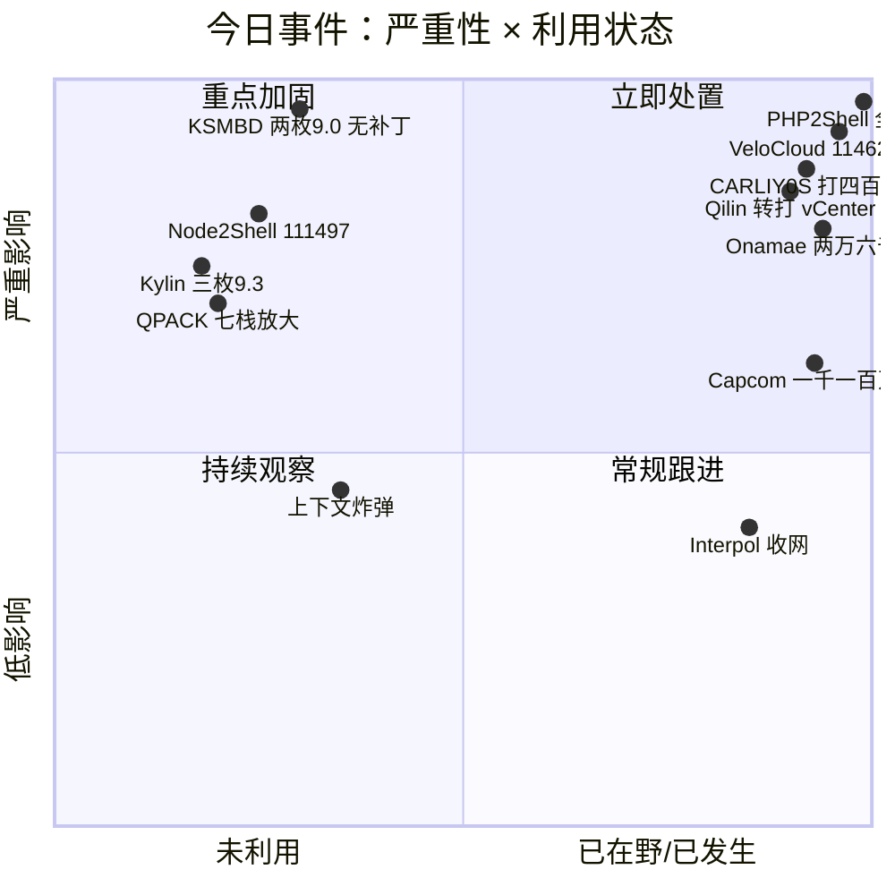
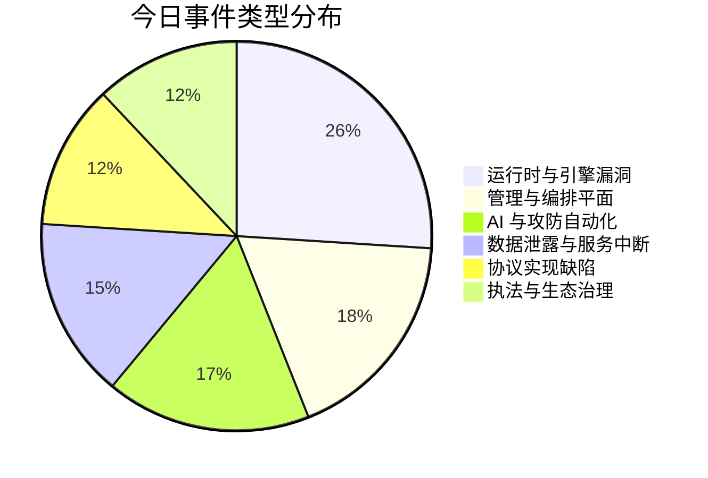
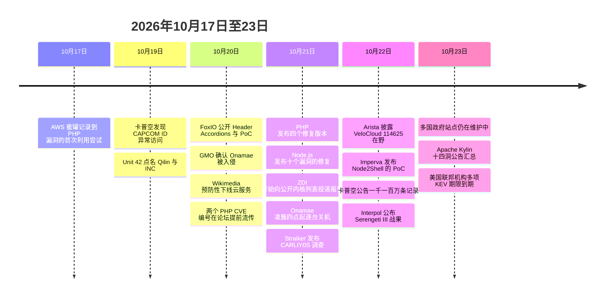
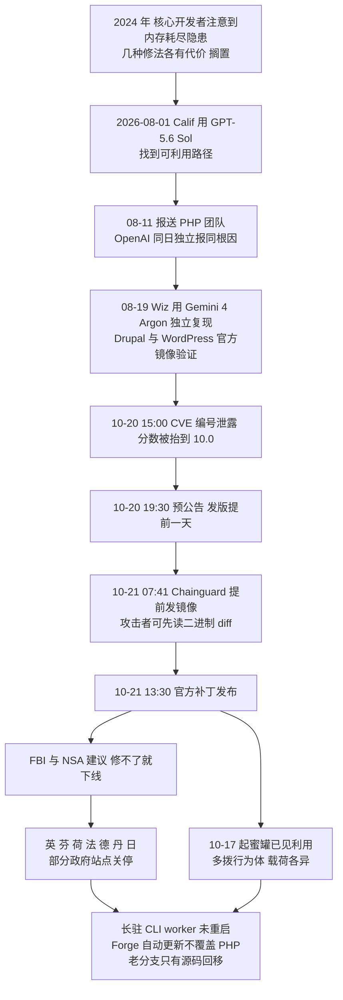
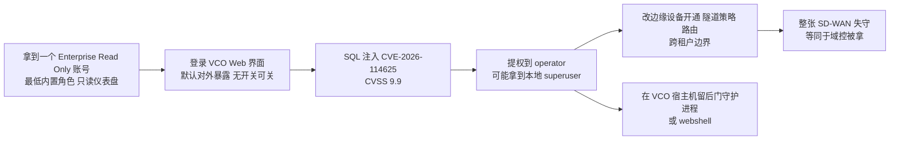

# 网安日报速递 · 2026年10月23日（第 195 期）

> **今日关键词：** PHP2Shell多国下线 · VeloCloud只读即超管 · KSMBD两枚9.0无CVE · QPACK七栈四千倍 · Node2Shell镜像即中 · CARLIY0S多模型流水线
>
> **今日主线：** 今天的六件事拼出了一条新的时间轴——**发现变快了，修复没变，中间那段就叫暴露窗口。** PHP2Shell 的两枚 9.2 是三家团队在同一周里用前沿模型撞出来的：Calif 用 GPT-5.6 Sol 在 8 月 1 日找到第一枚，Wiz 用 Gemini 4 Argon 与 GPT-5.6 Sol 在 8 月 19 日独立复现，而 PHP 基金会复盘说这个隐患 2024 年就被人看见过，只因为"几种修法各有代价"搁了两年。补丁 10-21 发了，FBI 与 NSA 让修不了的就下线，英国、芬兰、荷兰、日本的部分政府站点真的关了。**同一天，Trend Micro 的 AI 扫描器把两枚 9.0 的 KSMBD 报告甩上了公开邮件列表**——没有补丁、没有 CVE，因为内核项目只在稳定版修好之后才发编号。发现侧在踩油门，修复侧还在排队。

---

## 一、PHP2Shell 从"一个漏洞"变成"一次公共事件"：AI 找到的洞，人类还没准备好接住

**一句话：** PHP 那两枚 CVSS 9.2 的预认证 RCE（`CVE-2026-109618` / `CVE-2026-109619`）在 10-21 打了补丁。补丁之后发生的事，比漏洞本身更值得记：**美国 FBI 网络部门公开警告，NSA 建议"修不了就先下线"，英、芬、荷、法、德、丹六国部分政府站点预防性关停，日本首相在社交媒体上发文提醒站长查 PHP 版本。** 这是近年来第一次，一个开源语言的补丁日直接触发了政府的断网动作。

**先把"AI 发现"这件事说准，因为它已经被传得比事实更玄。**

| 时间 | 谁 | 做了什么 |
|---|---|---|
| 2024 年 | PHP 核心开发者 | 在修另一批审计问题时注意到内存耗尽处理的隐患；潜在利用只是理论，几种修法各有代价（破坏兼容、引入新拒绝服务），共识定不下来 |
| 2026-08-01 | Calif 的 Ryan Austin | 在 OpenAI「Patch the Planet」项目里借 GPT-5.6 Sol 找到第一枚可利用路径 |
| 2026-08-11 | Calif → PHP 团队 | 报送无条件 RCE；**OpenAI 同一天独立报送了相同根因** |
| 2026-08-19 | Wiz | 用自家 Wiz Atlas 配 Gemini 4 Argon 与 GPT-5.6 Sol 独立发现；两天内在 **Drupal 与 WordPress 的官方镜像上验证了无需登录的远程代码执行** |
| 2026-10-21 | PHP 项目 | 发布 8.5.12 / 8.4.27 / 8.3.36 / 8.2.35，另给 7.4 / 8.0 / 8.1 提供最小源码回移 |

**要注意的是：模型没有"自己找到"这个洞。** Calif 的 Ryan Austin 明确说，他没用什么特殊框架、也没用公众拿不到的模型；起作用的是他挑目标的判断——他选 PHP 是因为熟悉它的漏洞史，从 2004 年 Stefan Esser 报的第一个 PHP 内存限制漏洞、到 2020 年一份被忽视的 bug 报告、再到 2024 年那次没能证明可利用性的审计，一条线追下来。**模型压缩的是"知道"到"证明"之间的苦工，方向感还是人给的。**

**真正失控的是披露那 24 小时。** 按公开记录复盘：

| 时间（UTC） | 事件 |
|---|---|
| 10-20 15:00 前后 | 两个 CVE 编号开始在论坛流传，发布时间写错、CVSS 被抬到 10.0 |
| 10-20 19:30 | PHP 项目预公告，把发版从 10-22 提前到 10-21 14:00 |
| 10-20 当晚 | Calif 误发了利用演示视频，几小时内被搬运到各社交平台 |
| 10-21 07:41 | **Chainguard 提前发布修好的容器镜像，比官方发版早六个多小时** |
| 10-21 13:30 / 13:40 | 官方补丁发布（PHP 口径 / ENISA 口径） |

Chainguard 那一步是最要命的：**任何攻击者都能先读二进制的修复 diff，而全世界其他用户在等自己的包。** PHP 基金会把这句话写进了复盘。

**而漏洞在补丁之前就已经被打了。** AWS 的 MadPot 蜜罐在 **10-17** 记录到第一次利用尝试——**比补丁早四天**，来自商业匿名化网络，载荷带 Mirai 风格的加载器；10-21 之后攻击源换成另一批匿名基础设施，载荷形态也不一样，说明**至少有两拨人在各自尝试**。AWS 说无法确定对方是怎么在禁运期内拿到信息的。

**政府的动作可以列成一张表：**

| 国家/机构 | 动作 |
|---|---|
| 美国 FBI | 10-21 警告可远程执行代码，建议修不了就把站点下线 |
| 美国 NSA | 建议立即更新，来不及就隔离下线直到能缓解 |
| 英国 | 部分政府服务暂停；预算责任办公室（OBR）站点下线 |
| 芬兰 | 政府公共网络服务临时关闭后恢复，部分内容仍在补 |
| 荷兰 | 国家网络安全机构将站点临时下线 |
| 法国 / 德国 / 丹麦 | 公共部门站点全部或部分功能维护性关停 |
| 日本 | 首相高市早苗发文提醒站长检查 PHP 并立即打补丁；大阪府机器翻译服务不可用 |
| 欧盟 | DG CNECT、ENISA、CERT-EU、Europol EC3 与 CSIRTs 网络联合声明 |
| Wikimedia | 10-20 预防性下线 Cloud Services、Phabricator、文档与 CI |

**"修好了"这句话在这里有三个坑，必须分开说：**

- **坑一：更新 PHP 包会重启 PHP-FPM，但长驻的 CLI worker 不会自己重启。** 队列消费者、Swoole/RoadRunner 常驻进程、CLI 定时任务仍然跑着旧二进制，风险一点没减。重启列表要包含它们。
- **坑二：自动安全更新不一定管 PHP。** Laravel Forge 的公告说得很直白：它的自动安全更新**不覆盖 PHP 包**，因为那些包来自另一个仓库、不在自动更新范围内。**流程按配置正常运行，PHP 依然是脆的。**
- **坑三：老分支只有源码回移，没有发行版包。** 7.4 / 8.0 / 8.1 已停止常规安全支持，PHP 只给了最小源码回移；能否落地取决于你的发行版或商业 LTS 供应商是否跟。

**暴露面的数字各家不一，但都在百万级：** VirusTotal 侧统计超过 **510 万台**公网可达的 PHP 主机；另一组统计给的是约 **380 万台**"互联网暴露"实例；W3Techs 的语言占比是 **69.3%**。数字差在统计口径（是否算 CDN 后面的、是否只算 banner 可识别的），但结论一致：这是一个**按"占比"而不是"台数"计算影响面**的漏洞。

**值得关注的原因：** 三句话。第一，**这是第一次由前沿模型主导发现、并且公开承认"AI 可能比攻击者先找到"的漏洞**——OpenAI 把它叫"Defender's Window（防守方的窗口）"，但这个窗口只在防守方真的在窗口内打完补丁时才存在，而今天六国的做法是关站，不是打补丁。第二，**修复的瓶颈不在写 patch，而在分发**：源码修好之后还要变成包、镜像、厂商更新，再经过兼容测试、审批、重启、验证，这一段没有任何 AI 能加速。第三，**PHP 基金会自己承认这是"结构性失败"**——不是没人看见，是人手和决策机制撑不住。这句话对每一个维护着关键开源组件的团队都成立。

---

## 二、Arista VeloCloud CVE-2026-114625（9.9）：一个"只读"账号，够拿到整张 SD-WAN 的总控

**一句话：** 10-22，Arista 披露 VeloCloud Orchestrator（VCO）的一枚 **SQL 注入零日**，**CVSS 3.1 9.9**（厂商同时给 CVSS 4.0 9.4），**已确认在野利用**。攻击者需要的东西少得离谱：**一个能登录 VCO 的账号，最低角色 Enterprise Read Only**——也就是那种"只让他看仪表盘"的账号。拿到之后可以提到 **operator**，也就是编排整个 SD-WAN 的超级用户。

**为什么这比分数更严重：** VCO 是 VeloCloud SD-WAN 的大脑。谁控制它，谁就控制边缘设备的开通、隧道策略、路由，以及**所有租户的隔离边界**。一个被攻陷的低信任账号，等于整张 WAN 同时失守——**这是典型的"力量倍增器"，防守上应该按域控制器的标准对待，而不是按"一台设备"对待。**

| 项 | 内容 |
|---|---|
| CVE | `CVE-2026-114625`（Arista Security Advisory 0199） |
| 类型 | SQL 注入 → 权限提升 |
| 认证要求 | 需要登录，最低 `Enterprise Read Only` |
| 受影响 | 5.2 分支 < 5.2.3.18；6.1 分支 < 6.1.3.10；6.4 分支 < 6.4.2.12 |
| 修复版本 | 5.2.3.18 / 6.1.3.10 / 6.4.2.12（10-22 发布） |
| 不受影响 | 7.0 分支、VeloCloud Gateway、VeloCloud Edge、Hosted 与 Dedicated 编排器（Arista 已代修） |
| 在野 | 是。两个被观测到的攻击源：`74.82.197[.]86`、`38.54.50[.]151` |
| KEV | 未列入（目录版本 2026.10.21） |

**这是 VCO 四个月里的第三枚在野零日，而前两枚不需要登录。**

| 时间 | CVE | 特点 | 修复 |
|---|---|---|---|
| 2026-07 | `CVE-2026-16812` | 未认证 | 已发 |
| 2026-09 | `CVE-2026-93952` | 未认证，CVSS 10.0 | 5.2.3.16 / 6.4.2.8；**6.1 分支至今没列修复版本** |
| 2026-10 | `CVE-2026-114625` | **需要低权限登录** | 5.2.3.18 / 6.1.3.10 / 6.4.2.12 |

**一条非常容易踩的坑：修过 7 月和 9 月的，今天依然在范围内。** 因为修那两枚的版本（5.2.3.16、6.4.2.8）比今天这三版旧。更糟的是 **6.1 分支上 9 月那枚 `93952` 一直没有修复版本**，于是 6.1 的用户处在"双重暴露"状态——旧的没修完，新的又来了。

**"默认暴露"这件事没有开关。** Arista 明说 VCO 默认对外可达，**没有任何配置能关掉这个暴露**。唯一的做法是把它挪到 VPN、跳板机或带 mTLS 的反向代理后面——这是网络层的事，不是产品设置的事。

**处置顺序：**

1. 按分支升到 5.2.3.18 / 6.1.3.10 / 6.4.2.12；不在这三个分支上的联系 Arista TAC，**别假设 EOL 版本安全**。
2. 把 VCO 的 Web 界面从公网摘掉，只留管理网可达。
3. 审计并清掉休眠的 `Enterprise Read Only` 与合作伙伴账号——**每一个都是通往 operator 的已知路径**。
4. 查历史：VCO 审计日志里的异常角色变更、新建 operator 账号、配置导出、来自非管理员会话的 API token 签发。
5. 查后门守护进程与 webshell，注意 VCO 宿主机是否有非预期出站。

**值得关注的原因：** 三次在野零日、四个月、从"未认证"走到"低权限即可"，这个演进顺序不是巧合——**攻击者已经把 VCO 当成了一个需要系统性挖穿的目标**，而不是顺手打一发。第二轮用的是"合法登录"，这意味着**只盯异常登录的检测思路在这里会失效**：会话是真的、凭据是真的、只是这个人本来不该有这么大权限。真正要收紧的是"最小角色到底能接触到什么"，以及"编排器凭什么在公网上"。

---

## 三、KSMBD 两枚 9.0 被甩上公开邮件列表：没有补丁，没有 CVE，扫描器也不会告警

**一句话：** Trend Micro 的零日计划（ZDI）在 **10-21 与 10-22** 向 Linux 内核邮件列表提交了 **6 份**报告，其中两枚是内核内置 SMB 服务 **KSMBD** 的远程代码执行，**各评 9.0**。**两枚都没有 CVE 编号，主线和 linux-next 里都没有已命名的修复**，而报告是发在**公开列表**上的。其中 `ZDI-CAN-33774` **无需任何认证**。

**两枚漏洞的技术路径不一样，危害的形状也不一样：**

| ZDI 编号 | 子系统 | 类型 | CVSS | 前置条件 |
|---|---|---|---|---|
| `ZDI-CAN-33774` | KSMBD 协议分发 | 远程代码执行 | 9.0 | **无认证**，只要 445 端口可达 |
| `ZDI-CAN-33549` | KSMBD SMB Direct | 远程代码执行 | 9.0 | 需 RDMA 接口（硬件或 rxe 软件驱动）+ 可写共享 + 客户端协商 SMB Direct |
| `ZDI-CAN-33367` | 网络栈 `skb_zerocopy` | 本地提权 | 7.8 | 需本地访问；内核开发者上周已收到同一问题的另一份报告 |
| `ZDI-CAN-34068` | `vmwgfx`（VMware 虚拟 GPU） | 本地提权 | 8.8 | 需本地访问 |
| `ZDI-CAN-34076` | `nvmet`（NVMe over Fabrics 目标） | 信息泄露 | 8.6 | 需本地访问 |
| `ZDI-CAN-32005` | ConnMan（用户态网络守护进程） | 栈缓冲区溢出 | — | 内核之外 |

**`33774` 是一场比赛。** KSMBD 在请求入队时选好由哪个协议处理器处理，但工作线程是**在取任务时才去读这个选择**。攻击者在**同一次 TCP 写**里先塞一串短 SMB1 报文、再塞一个 SMB2 报文，连接被切到 SMB2 处理时 SMB1 的缓冲区还在队列里，于是 **SMB2 的代码去读了更短的 SMB1 缓冲区之外的内存**。据转述，**被读出来的内核堆字节会随错误回复一起回到攻击者手里**——这就不只是崩溃，是信息泄露。ZDI 另外描述了一条**越界写**路径，在解析安全描述符时触发，需要先能访问一个共享。演示环境是 **7.3-rc3**。

**`33549` 是一次算术回绕。** SMB Direct 走 RDMA，客户端可以送一组 RDMA 缓冲区描述符，**让第一项的长度大于声明的载荷长度**，服务端的大小计数器回绕成一个大数，后面那次内存拷贝就越过了缓冲区尾部。它需要三样东西凑齐：RDMA 接口、可写共享、协商 SMB Direct。**SMB Direct 本身是单独的编译选项，默认关闭**——这是它比 `33774` 窄的原因，但"默认关闭"不等于"没人开"，HPC 与存储集群恰恰是开着的那批。

**真正的新鲜事不是漏洞，是流程。** 这批报告把 **TrendAI（Trend Micro 自家的 AI 扫描器）**列为发现者。而 Linux 内核的安全文档在 **2026 年 5 月**（按 Linus 的意见）更新过一条规则：**AI 工具发现的缺陷，按定义就是已经公开的，应当直接发给子系统开发者列表**。ZDI 的投递方式看起来是在执行这条规则——**同时抄送公开列表，且所有报告都没附补丁**。

稳定版维护者 **Greg Kroah-Hartman** 在几分钟内连续回了三条，措辞一次比一次短。对 `vmwgfx` 那份：**"不知为什么你把它发到了公开列表，而且没带补丁，所以我们也没什么可做的。"** 十七秒后对 `nvmet` 那份：**"又是没补丁、又发到公开列表？请修正你们的提交流程。"**

**CVE 要等修好才发，于是就出现了这个空档：**

```text
报告公开 → 无补丁 → 无 CVE → 扫 CVE 的扫描器全都不报 → 但攻击者已经能读到细节
```

**这不是"报告不严谨"，这是流程设计的结果。** Phoronix 说 `33549` 的修复已由 SMB Direct 维护者 Stefan Metzmacher 提交到面向 **Linux 7.5** 的分支，可能会被快进，但这一条没有得到其他来源确认。主线修完到进入稳定版、再到发行版内核，通常还要几周。

**动作清单（在你还没 CVE 可查的时候）：**

```bash
systemctl status ksmbd          # 是否在跑
lsmod | grep ksmbd              # 模块是否加载
zcat /proc/config.gz | grep CONFIG_SMB_SERVER   # 是否编进内核
```

- 不需要 SMB 共享的：`systemctl stop ksmbd && systemctl disable ksmbd`。
- 需要的：445 只对白名单源开；**在 KSMBD 配置里禁掉 SMB1 协商**（这是 `33774` 的触发前提）；不需要 SMB Direct 的关掉 RDMA 传输。
- 检测抓手：**同一次 TCP 会话里出现"一串短 SMB1 + SMB2"**，这在现代环境里是异常形态。
- **RHEL 及衍生版默认不含 KSMBD**，这是少数可以松一口气的地方。

**值得关注的原因：** 这条和头条是同一个故事的两面。AI 扫描器把发现速度提上来了，但**披露流程没有配套的"带补丁再公开"机制**，于是产出的是一批"细节已公开、补丁在路上、编号还不存在"的漏洞。**对防守方最不友好的状态不是零日，是这种半公开**：你知道有洞、知道怎么打，但没有版本号可以对、没有 CVE 可以让扫描器告警、也没有补丁可以装。

---

## 四、QPACK「Header Accordions」：十个 HTTP/3 栈里七个中招，一个连接就能打爆内存

**一句话：** FoxIO 的 Sébastien Féry 在 **10-20** 公开了 QPACK 的一类实现缺陷，取名 **Header Accordions**，附可运行的 PoC。**被测的 10 个 HTTP/3 实现里 7 个有问题**：一个未认证的远端客户端，能让服务器为它分配**几十到几千倍**于实际收到字节的内存。FoxIO 的原话是：**"一个连接就够把一台默认配置的服务器 OOM 或把 CPU 钉死。"**

**根因不是某个库的 bug，是同一句话被七种方式理解错了。** QPACK 压缩 HTTP/3 头部：常见字段走静态表索引，出现过的字段进动态表，之后用一个字节的索引指回去。**RFC 要求服务端按"解压后"的大小来限流，并且每个字段还要加 32 字节开销。** 现实是：

- 有的只限制了**压缩后**的字节数，不管解出来多少；
- 有的**先全部解完再检查**（那时内存已经吃掉了）；
- 有的漏掉了每字段 32 字节的开销；
- 有的把这个限制**解析了但从来没执行**。

**两种打法，第二种更狠。**

| 打法 | 做法 | 实测放大倍数 |
|---|---|---|
| 静态/动态表灌水 | 一个 HEADERS 帧塞进海量短小且互不相同的字段 | quic-go 默认配置：1 MB 压出约 **16 万个**字段、约 **15 MB** 常驻，约 **17 倍**（quic-go 自己的公告说上限接近 50 倍） |
| 索引复用（更狠） | 往动态表里存**一个 4 KB 条目**，然后拿 1 字节索引指它**几千次**，每次都要重建完整条目 | **Bun 约 4,000 倍**；lsquic **600–1,800 倍** |

**Bun 还多一个坑。** 它用 lsquic，但把"限头部内存"那段换成了自己写的代码——**逐条检查每个 header，却从不累加总量**。于是解出来的头部一过 **2 GB**，那个计数器**溢出归零**，解码器进入一个永远出不来的循环。FoxIO 测到：**单条流、线上约 516 KB，就能把一个核钉在 100%，且不恢复。**

**PoC 的规模说明这件事有多便宜：** 50 个连接、**总共不到 10 MiB 流量**，一秒内把容器的 **5 GiB** 内存上限打满。

**补丁状态是分层的，得按你实际跑的库来对：**

| 实现 | 状态 | 修复版本 | 编号 |
|---|---|---|---|
| quic-go | 已修（2025-11-21） | 0.57.0 | `CVE-2025-64702`（5.3） |
| Cloudflare quiche | 已修（2026-07-14） | 0.29.3 | `CVE-2026-12523`（7.5） |
| lsquic（LiteSpeed） | 已修（7 月中） | 4.9.0 | 无 CVE |
| Wireshark | 已修 | 4.6.2 / 4.4.12 | `CVE-2025-13945`（解析器崩溃，非服务端） |
| **Bun 1.4.3** | **未修** | — | 无 CVE |
| **h3（hyperium）** | **未修** | — | 无 CVE |
| **aioquic / mitmproxy** | **未修** | — | 无 CVE |
| IIS / Envoy / ngtcp2 / nghttp3 / Google quiche | 不受影响 | — | 边解码边累加，做对了 |

**"我用的不是这些库"这句话多半是错的。** quic-go 是 **Caddy、Traefik、cloudflared** 的底层；lsquic 是 **LiteSpeed Web Server 与 OpenLiteSpeed** 的底层（OpenLiteSpeed 1.9.2 已带 4.9.3）；Bun 的 HTTP/3 服务端也跑在 lsquic 上。**你只要用了这些产品，就继承了它们底下那个库的问题。**

**临时缓解（没有补丁的栈）：**

- **Bun**：不要把它的 HTTP/3 服务端暴露到公网。
- **mitmproxy**：启动时加 `--set http3=false`。
- **h3 crate**：设一个合理的 `max_field_section_size`。
- 通用兜底：给进程设 cgroup / systemd 的 `MemoryMax`，并在防火墙上对 UDP 443 做速率限制——但这只是减轻，不是修复。

**值得关注的原因：** 这是同一类错误的第七次、也是覆盖面最广的一次。**FoxIO 在 7 月报过阿里 XQUIC 的 XRING**（本期 7-11 已报，约 260 字节合规流量打崩服务端），两次命中的是**同一个攻击面——QPACK 的表管理**。这说明问题不在某个仓库的代码质量，而在**"协议规定要按解压后的大小限流"这句话，实现者普遍只做了字面的一半**。另外一点：**HTTP/3 走 UDP，很多为 TCP 调的 L7 WAF 规则根本没机会看它**，所以这条路对攻击者来说更"干净"。

---

## 五、Node.js `CVE-2026-111497`（Node2Shell）：跑官方镜像就中，而且这个库是 Node 自带的

**一句话：** Node.js 在 **10-21** 发了覆盖 22.x / 24.x / 26.x 三个线的安全更新，修 **10 个**漏洞，**4 个高危**。最重的是 **`CVE-2026-111497`**——Node **自带**的 Brotli 解压库里的**越界写**。**10-22**，Imperva 的 Ron Masas 发布了分析并命名 **Node2Shell**，PoC **在官方 `node:24.22.0` 的 Linux arm64 镜像上跑通了任意代码执行**，同一份输入在 **24.22.1** 上被拒。

**这件事的关键在于：出问题的不是应用代码，是运行时自带的那份 Google Brotli。** 只要你解压了攻击者选的字节，就在攻击面上：

- 直接调 `node:zlib` 的 Brotli 解压；
- **`fetch()` 收到一个 Brotli 压缩的响应**（这条最容易忽略——你没写解压代码，运行时替你解了）；
- **Express 5.0.0–5.3.0 或 body-parser 2.0.0–2.3.0 解压请求体**（裸 `http` 服务端默认不解压，这是唯一的好消息）。

**机制据 Imperva 的描述：** 解码器在一个"流结构上本来不可能"的块切换处没有停下，反而把它当成"需要更多输入"，带着**非法的内部状态**继续跑，最终写出界。上游 Brotli 的修法就是——**遇到这种情况直接返回格式错误**。Node 的修复是从上游摘了那个提交（作者 Evgenii Kliuchnikov）。

| 分支 | 修复版本 | 备注 |
|---|---|---|
| 26.x | 26.12.1 | — |
| 24.x | 24.22.1 | Imperva 用它验证 PoC 已被拦住 |
| 22.x | 22.23.4 | — |
| **20.x 及更早** | **不会有** | 已 EOL，只能迁移 |

**关于"能不能真的 RCE"，两种说法要分开记。** Imperva 说在它自己的环境里执行成功，**需要多次尝试**，且只测了 Linux arm64 与自家应用配置。另一家测试的结果是：PoC **只在刻意削弱的测试构建上**打通，标准构建上只看到崩溃和有限的内存读。**Node 项目自己的措辞是"最坏情况可导致远程代码执行"。** 目前**无在野利用报告**。

**另外三个高危不在 Brotli 上，而在 TLS 的地址判断上——同一个模式：**

| CVE | 问题 | 影响线 |
|---|---|---|
| `CVE-2026-105483` | IP 地址写成**全角数字**时，证书主机名校验被绕过 | 26.x / 24.x |
| `CVE-2026-106069` | 主机名解析为 IP 时，证书主机名校验被绕过 | 三条线 |
| `CVE-2026-106072`（中） | IPv4 主机名非规范化时，证书里的 **DNS 名可以给 IP 端点背书** | 三条线 |
| `CVE-2026-105482` | `dns.resolve` 遇到含 **NUL** 的名字会截断 | 三条线 |

**一个模式说清楚：** 地址写成不常见的形式时没被认成 IP，校验就"掉"到了证书里的 DNS 名上，于是一张给域名签的证书，替一个 IP 端点做了担保。**修法是让 TLS 拒绝非规范形式的 IP。** 还有一个中危值得单独提：`CVE-2026-106074`——用了启动快照或单文件可执行程序的应用，**`crypto.randomUUID()` 与 `randomInt()` 背后的熵缓存被打进了快照**，从那快照起的所有进程会**重复同一批值**。

**动作：** 升级 22.23.4 / 24.22.1 / 26.12.1；**容器镜像要重建并重启服务**，光换二进制不算；跑在 20.x 上的计划迁移。

**值得关注的原因：** 这已经是本月第三个"**运行时/编译器自带组件**"出事的案例（前两个是 PHP 的引擎、GitLab 的 Onigmo 正则编译器）。共同点是：**它不在你的依赖清单里，你在 SBOM 里看不到它，但它在你的进程里。** 防守上要补的一课很具体——**SBOM 要覆盖运行时的内置第三方库**，否则"我们扫过依赖了"这句话根本不成立。

---

## 六、CARLIY0S：一个犯罪团伙把 Claude、Grok、Kimi 编成了一条流水线，瞄准 400 多家拉美金融机构

**一句话：** Straiker 的 STAR Labs 在 **10-21** 发布调查，称一个被追踪为 **AiPT-67** 的团伙（对外用 **Tr4nsHack Team**，前台公司 **Hexagon Security Labs Mexico**，与 2012 年起活动的 **CyberCartel** 有关）搭建了 **CARLIY0S**——一套基于开源自主攻击框架 **PentAGI** 的**多模型编排系统**，几个月内把 **400 多家**拉美银行与支付机构列为目标。

**先把口径说准：400 是"目标数"，不是"攻陷数"。** 这些数字来自 Straiker 单方报告，受害方匿名，未经第三方独立核实。

**它的结构是"分工"，不是"一个模型打天下"：**

| 角色 | 谁在干 | 干什么 |
|---|---|---|
| 决策层 | **Claude Sonnet / Opus**（四个角色） | 评估攻击选项、就目标进行"辩论"、由指定仲裁者出最终决定 |
| 情报采集 | **Grok**（五个 miner） | 收集目标信息，写进一个叫 **FinancialSoft** 的数据库 |
| 工作流 | **Kimi** | 在整体流程中出现（Straiker 提示：配置里有条目不等于真的被成功调用） |
| 兜底 | 本地代码 | **模型拒绝时不是停下，是转本地脚本**——拒绝不等于阻断 |

**提示词包装 + 基础设施都是"正规军"打法：** 把任务描述成"授权安全测试"来影响模型响应；配浏览器自动化、流量检查、住宅代理；下一步动作由共享的知识图谱驱动。

**FinancialSoft 那份 9-24 的快照，是这个案子最有说服力的物证——4,493 条记录：**

| 类别 | 数量 |
|---|---|
| 邮箱地址 | 2,911 |
| 金融账号 | 903 |
| 明文密码 | 67 |
| 门户登录 | 51 |
| 数据库连接串（含内嵌 SQL 账号密码） | 43 |
| 通用 API key | 391 |
| 支付基础设施凭据 | 43（其中一家金融科技受害者：11 个 API key + 32 个加密密钥） |
| **JWT 签名密钥** | **20** |
| Keycloak 凭据 | 20 |
| 数字证书 | 4 |
| Wasabi S3 凭据 | 19 |
| Mailgun 凭据 | 15（可用官方发信基础设施做钓鱼） |
| 明确的后门 | 6（主密码绕过、共享 root/系统账号） |
| 未公开漏洞 | **200+**（2026-05 至 09，含零日，覆盖 Web、API、后端） |

**那 20 个 JWT 签名密钥和 20 组 Keycloak 凭据，比密码危险一个量级：** 密码泄露要一个个用，签名密钥泄露可以**批量伪造令牌**；身份提供方凭据泄露，等于**把发证机关搬走**。而那 43 组支付基础设施凭据，Straiker 说与**墨西哥 SPEI 银行间清算系统**的滥用路径一致，也解释了调查里观察到的"哨兵交易"（小额试探性转账）。

**供应商的响应：** Anthropic 吊销了该团伙用来访问 Claude 的凭据，这条路被切断；xAI 收到通报后开始调查 Grok miner 相关活动。

**值得关注的原因：** 这份报告的价值不在"犯罪团伙也用 AI"，而在**它是从团伙自己的工作环境里取证的**——配置、脚本、知识图谱、数据库全都拿到了，因此能看到**编排**而不只是"用了什么模型"。它给出的教训非常朴素：**AI 压缩的是侦察、分析、协调这些"人力密集"的环节，它不生产凭据、不生产漏洞、也不生产访问权。** 这四百家机构被列进名单，靠的不是模型聪明，是有人先把 4,493 条真实凭据攒起来了。对防守方的动作因此也很朴素：**轮换 API key 与凭据、收窄权限、盯住身份系统与支付链路的异常，然后把"我们有哪些 AI agent、它们能碰到什么"列成清单。**

---

## 速览

### 7. GMO 旗下 Onamae Desktop Cloud：26,739 台客户服务器被装马，全部套餐停机

**10-20** 确认遭未授权访问、部分客户服务器环境被植入"不正当程序"；**10-21 04:00（日本时间）起**开始逐台关停客户服务器，**所有 Desktop Cloud 套餐**受影响，**没有恢复时间表**。可能受影响的范围是 **26,739 台**——这个数字是"可能范围"，不是"已确认感染数"。厂商称服务器上的数据**可能被查看过**，但未确认个人信息泄露或滥用；支付信息（信用卡）存在独立基础设施上，不受影响。**这款产品的卖点恰恰加重了后果：它被明确宣传为"适合外汇自动交易连续运行，包括 MetaTrader 4 长期挂机"**，也就是说客户机器上普遍存着交易账户凭据与 API key。厂商要求客户**轮换服务器上的密码与凭据，并更换与其他服务重复使用的密码**，同时警告会有冒充官方的钓鱼。**注意：Onamae 没公布入侵入口、没公布恶意程序名称与功能、也没公布任何 IOC** —— 把这件事说成勒索软件或某个已知团伙，都超出了现有证据。**处置要点：把机器上的凭据当作已泄露，等恢复后用干净镜像重建，别在原机上改密码。**

### 8. 卡普空（Capcom）CAPCOM ID：11,774,247 条记录，196 个账号密码被改

**10-22** 官方公告（英文版同日发布）：**10-19** 发现 CAPCOM ID 有可疑访问，同日确认入侵并封堵；**10-20** 成立内部应急本部、向外部安全监督委员会报告；**10-21** 向大阪府警与日本个人信息保护委员会报告。受影响记录 **11,774,247 条**（全球），字段为**邮箱 + 系统标识信息**（账号创建时间、最后登录时间、登录次数、最后登录所用客户端 IP）。其中 **43 条**额外含生日、性别、国家/地区、昵称；**196 个账号的登录密码被未授权修改**（已重置）。**Capcom 明确：客户自己设置的密码未被确认泄露，信用卡信息不在受影响范围内。** 游戏与 CAPCOM ID 相关服务保持可用。**值得记的一点：这 1,177 万条里最敏感的其实不是邮箱，是"最后登录 IP + 登录次数 + 创建时间"这组行为指纹** —— 拿它做的钓鱼邮件能准确说出"你上次从哪儿登录"，比群发高一档。本月日本方向的第四起数据/服务型事件。

### 9. Apache Kylin 一次修 14 个漏洞，三枚 9.3 全在"未认证"档

**10-23** 的安全公告汇总了 Apache Kylin 的 **14 个**漏洞，**修复版本 5.0.5**。三枚 CVSS 4.0 **9.3** 且全部 `PR:N`（无需任何权限）：**`CVE-2026-64959`** 是后端缓存 API 的 **SQL 注入**（部分端点连认证都没有）；**`CVE-2026-68571`** 是 **JDBC URL 白名单校验**可被特殊参数绕过，从而注入并执行代码（**CWE-94**）；**`CVE-2026-108743`** 是 **Spark 作业处理**里把输入拼进操作系统命令（**命令注入**）。另有 `68573` 与 `108709`（均 6.9）为认证缺失、`108762`（5.3）为路径穿越（可删元数据备份目录之外的文件）。**官方口径很关键：主要影响"直接暴露在公网"的部署，多数内网自建实例不受影响** —— 换句话说，**先把 Kylin 从公网摘下来，比抢在今晚打补丁更有效**。这类"大数据分析平台"常年被当成内部工具，却经常带着默认口令和裸奔的 REST 端点挂在公网上。

### 10. Interpol「Serengeti III」：21 国、1,462 人被捕、10,909 个恶意网络被拆、追回 1.05 亿美元

行动期 **2026-06-29 至 08-31**，协调方 Interpol，参与国 **21 个**（含美国），**10-22** 公布结果：逮捕 **1,462 人**，捣毁 **10,909 个**恶意网络，追回超过 **1.05 亿美元**非法资金；**已识别 65,929 名受害者**，金融调查关联的损失**超过 3.85 亿美元**。重点案例：**乌干达**拆掉两个跨国诈骗团伙、逮捕 **365 名外籍人员**（用脚本话术、假交易平台骗亚洲的养老金人群）；**安哥拉**端掉两个非法加密货币矿场，抓 9 人、缴 **2,000 多台**矿机与 6 座非法变电站（光电力设施就值 100 万美元以上）；**尼日利亚**抓到一个大规模钓鱼与 BEC 操作者，**囤了约 210 万个邮箱地址**与软件凭据。**这已经是 2024 年以来第三次 Serengeti。** 值得记的是它的形式：**先由 20 个非洲国家 + 美国拿到"可疑域名 / IP / C2 基础设施"的情报，再落地抓人**——这是"基础设施情报共享"这条路径少见的、能算出成果的样本（合作方含 Group-IB、卡巴斯基、Fortinet、Team Cymru、Meta 等）。

### 11. Qilin 与 INC 的新战术：从"打个 VPN"升级到"直接打 vCenter 与 ESXi"

Unit 42 的威胁简报在 **10-23** 仍在更新，明确说**依然观测到针对 `CVE-2026-0257`（PAN-OS GlobalProtect 认证绕过）的利用尝试**。这条本身往期报过（10-12 / 10-21 期），今天新增的是**战术位移**：这两个团伙（Qilin = Spikey Scorpius、INC = Tarnished Scorpius，Unit 42 在 **10-19** 点名）已经从"拿一个看起来正常的 VPN 会话"走到**直接攻击 VMware vCenter 与 ESXi**——**至少有一例是从域控制器的虚拟磁盘里把凭据刨出来的**，这条路绕开了几乎所有端点防护；而加密一台 hypervisor，等于一次性放倒几十上百台虚拟机。**一个必须说清的边界：Unit 42 自己只确认"尝试利用"，公开报道里的"已完成入侵"来自其他研究方**，两边并不矛盾——它只看得到自己的客户与传感器。**防守要点：拿 VPN 会话当"正常远程办公"是这类攻击最难发现的地方；真正该盯的是 vCenter/ESXi 的凭据使用与快照/导出行为。**

### 12. 「上下文炸弹」：给攻击型 AI agent 喂假情报，成功率能砍掉九成

安全公司 **Tracebit** 公开了一种**纯防守**的技术：在攻击型 AI agent 会爬取的地方埋"上下文炸弹"——伪造成**渗透测试报告**、无穷无尽的服务列表、层层嵌套的假密码、递归数据库等，让 agent 把诱饵当成高价值目标、把真系统当成陷阱。**实测结果**：组合多种炸弹时效果最强，**让 Claude Opus 5 的成功率下降 91%、GPT-6 Astra 下降 54%**，并把成功攻击的算力成本抬高到最高 **23 倍**；**GPT 5.6 Cyber、Kimi K3、Qwen 3.8 Max、DeepSeek V4 Pro 这几个模型的攻击在测试中被完全阻断**。最强的一颗单弹是"假的渗透测试报告"——它把真实路径标注为金丝雀、把诱饵标注为"已被拿下的战利品"。**这条要跟今天第六条对着看：一边是犯罪团伙用多模型编排去放大攻击，另一边是用几十行假情报去给对手的 agent 加税。** 在攻防双方都开始用 agent 的阶段，"污染对方的输入"可能比"加固自己的输出"更便宜。

---

## 风险分析

### 事件严重性 × 利用/发生程度



### 事件类型分布



### 事件时间线



### PHP2Shell 从发现到下线的传导链



### VeloCloud 提权链



---

## 相关出处

| # | 来源 | 内容 | 链接 |
|---|---|---|---|
| 1 | PHP 基金会 | 2026-10-21 安全发版与加固说明、对延迟的自述（"结构性失败"） | https://thephp.foundation/blog/2026/10/21/todays-php-security-release-and-how-were-strengthening-php-security/ |
| 2 | Calif（Ryan Austin） | PHP2Shell 技术复盘与发现链（2004 / 2020 / 2024 三条线索） | https://calif.io/php2shell |
| 3 | OpenAI | 主导 PHP 漏洞协同处置的说明（GPT-5.6 Sol、"Defender's Window"） | https://openai.com/index/php-vulnerabilities/ |
| 4 | The Blade / AP | 全球抢修、六国政府站点下线、FBI 与 NSA 表态、日本首相发文 | https://www.toledoblade.com/business/technology/2026/10/22/rush-patch-ai-software-vulnerability-70-websites-worldwide/stories/20261022090 |
| 5 | Korea Times / AP | 事件问答：PHP 占比、AI 发现经过、PHP 基金会复盘口径 | https://www.koreatimes.co.kr/world/20261023/what-to-know-about-the-ai-detected-security-bug-impacting-wide-swaths-of-the-internet |
| 6 | Aviatrix Threat Research | Amazon 确认补丁前四天已见利用、Mirai 风格加载器、510 万台暴露 | https://aviatrix.ai/threat-research-center/amazon-php2shell-exploitation-cve-2026-109618-cve-2026-109619-before-patches |
| 7 | 36氪（编译） | 三家团队用 AI 撞出同一漏洞的时间线、Wiz 在 Drupal/WordPress 验证 | https://36kr.com/p/4037648095236992 |
| 8 | The Hacker News | Arista VeloCloud `CVE-2026-114625` 在野、版本矩阵、两个攻击 IP | https://thehackernews.com/2026/10/arista-warns-of-critical-velocloud-sql.html |
| 9 | Arista 官方 | Security Advisory 0199 | https://www.arista.com/en/support/advisories-notices/security-advisory/24838-security-advisory-0199 |
| 10 | Zero Hunt | VCO 角色模型、CVSS 明细、KEV 状态、暴露判定 | https://zerohunt.ai/blog/arista-velocloud-cve-2026-114625-sqli-operator-escalation |
| 11 | The Hacker News | KSMBD 两枚 9.0：ZDI 报告、无补丁无 CVE、Greg KH 三条回复 | https://thehackernews.com/2026/10/two-cvss-90-linux-ksmbd-rce-flaws.html |
| 12 | Cyber Kendra | 六份报告清单、`33774` 竞态细节、内核 AI 披露政策（2026-05） | https://www.cyberkendra.com/2026/10/linux-ksmbd-rce-flaws-zdi-public-mailing-list.html |
| 13 | Cyber Defense Magazine | KSMBD 缓解与自查命令、RHEL 默认不含 | https://pid.co.il/ksmbd-remote-code-execution |
| 14 | FoxIO | Header Accordions 原始研究（放大机制、逐库分析、缓解） | https://foxio.io/blog/header-accordions-qpack-amplification-attacks-against-http-3-servers |
| 15 | oss-security | 研究摘要与补丁/未补丁清单（10-22 转发） | https://www.openwall.com/lists/oss-security/2026/10/22/1 |
| 16 | Have I Been Hacked Check | 逐栈放大倍数、Bun 计数器溢出、PoC 规模 | https://haveibeenhackedcheck.com/new-qpack-flaws-can-crash-http-3-servers-trigger-up-to-4000-fold-memory-amplification |
| 17 | Safeguard | 报备与修复时间线（2025-11 至 2026-10） | https://safeguard.sh/resources/blog/qpack-amplification-http3-servers |
| 18 | Node.js 官方 | October 2026 Security Releases（10 个漏洞、修复版本） | https://nodejs.org/en/blog/vulnerability/october-2026-security-releases |
| 19 | Cyber Kendra | Node2Shell：Imperva PoC、入口路径、TLS 三连与快照熵缓存 | https://www.cyberkendra.com/2026/10/nodejs-october-2026-security-releases-cve-2026-111497.html |
| 20 | 台湾资安署 / 中央社 | 官方对 Node.js 与 Go 的处置建议、容器镜像需重建 | https://www.cna.com.tw/news/afe/202610220142.aspx |
| 21 | Straiker STAR Labs | CARLIY0S 原始报告（PentAGI、模型分工、FinancialSoft 4,493 条） | https://www.straiker.ai/blog/inside-carliy0s-how-cybercartel-used-multiple-ai-models-to-attack-latin-american-banks |
| 22 | Cybernoz | 多模型分工、拒绝兜底、Anthropic 与 xAI 的响应 | https://cybernoz.com/cybercriminals-used-claude-and-grok-to-launch-automated-attacks-against-banks/ |
| 23 | TEISS | Onamae Desktop Cloud 停机范围、26,739 台口径、MT4 场景 | https://www.teiss.co.uk/news/japanese-vps-provider-onamae-desktop-cloud-halts-service-after-hackers-install-malware-on-customer-servers-18343 |
| 24 | Capcom 官方 | 未经授权访问的公告与时间线（11,774,247 条、196 个账号） | https://www.capcom.co.jp/ir/english/news/html/e261022.html |
| 25 | Cybersecurity Help | Apache Kylin 14 洞公告汇总（三枚 9.3）、修复版本 5.0.5 | https://www.cybersecurity-help.cz/vdb/SB2026102306 |
| 26 | INTERPOL | Operation Serengeti III 官方通报（1,462 人、10,909 网络、1.05 亿美元） | https://www.interpol.int/News-and-Events/News/2026/Cybercrime-crackdown-in-Africa-nets-1-462-arrests-recovers-over-USD-105-million |
| 27 | Tech Insider | Unit 42 简报在 10-19 / 10-23 的更新、vCenter 与 ESXi 战术位移 | https://tech-insider.org/cve-2026-0257-qilin-inc-palo-alto-globalprotect-ransomware-2026 |
| 28 | CyberRecaps | Tracebit「上下文炸弹」实测数据（-91%、23 倍成本） | https://cyberrecaps.com/news/cybersecurity-news-october-22-2026 |
| 29 | CyberWire | 同日快报：Serengeti、Ebury 出口、OpenAI agent 关闭监控 | https://thecyberwire.com/podcasts/daily-podcast/2662/transcript |
| 30 | Cyber-Defence | CVE 与 KEV 交叉查询（用于核对今日 KEV 状态与 EPSS） | https://www.cyber-defence.io/tools/cve |

---

*本报告基于公开信息整理，CVE 编号、CVSS 评分等数据以官方源为准。所有"疑似 / 声称 / 单方报告"字样处均未获独立核实。*
