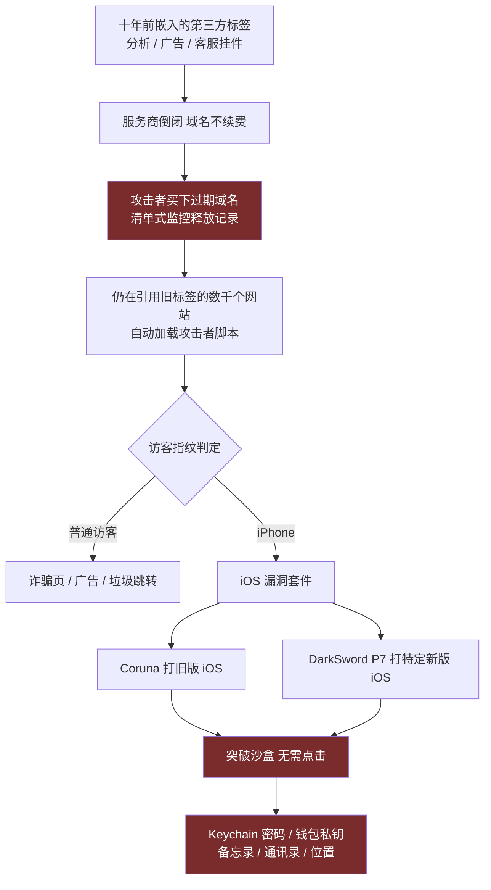
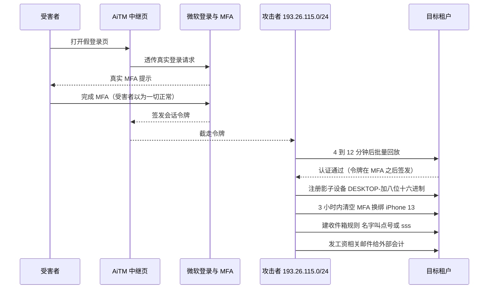
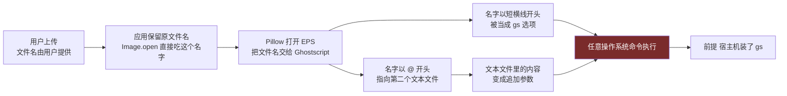
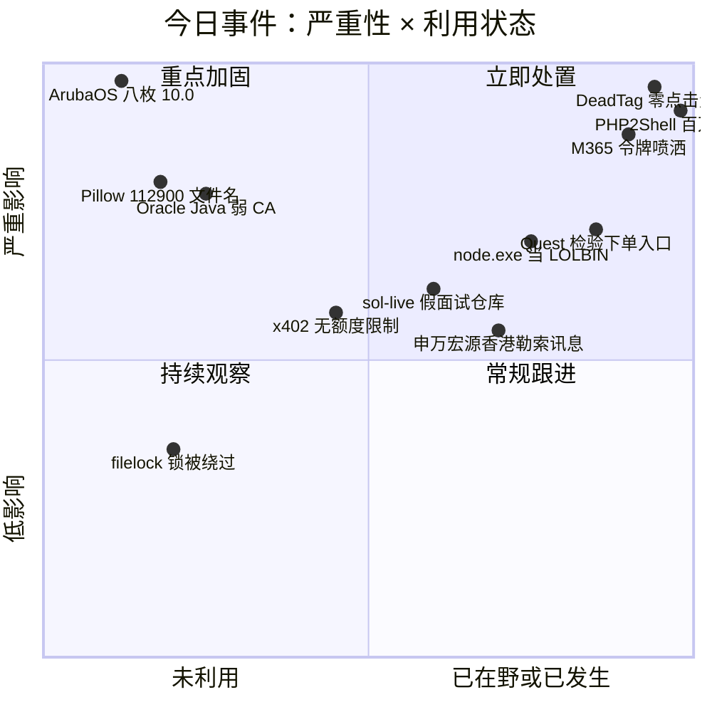
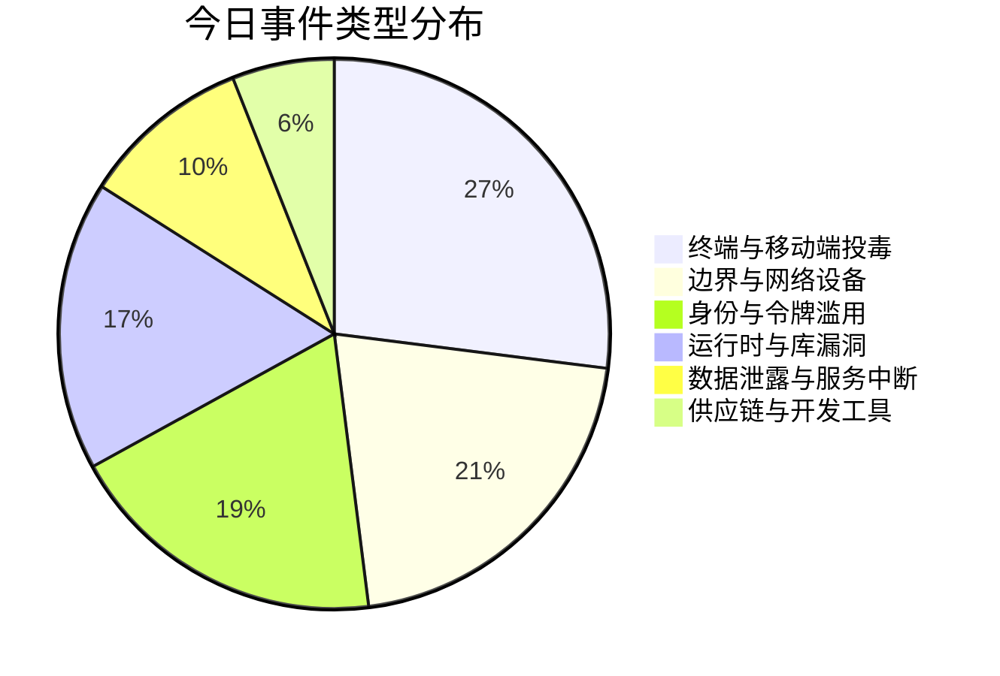
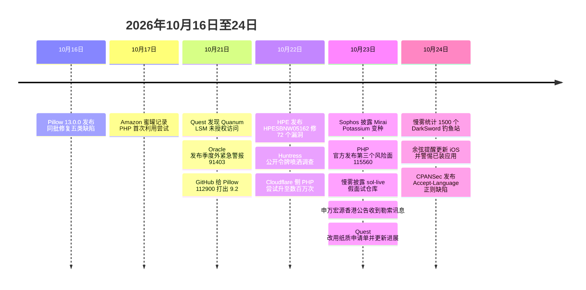

# 网安日报速递 · 2026年10月24日

> **第 196 期** ｜ 星期六 ｜ AI城 · 网络安全
>
> **今日主线：继承来的攻击面。**
> 今天最值得看的几件事，没有一件是"谁今天写错了代码"。它们全是很久以前留下的东西，今天还在原地跑：十年前嵌进页面的第三方统计标签，域名过期后被别人买走；2011 年就有的 `session.upload_progress` 特性；2013 年就存在的 TIFF 越界；默认开着、没人记得关的 UDP 8211 管理协议；还有八把 2025 年在 HSM 里生成时就已经弱掉的中间 CA 私钥。漏洞是新的，但这些"地基"是旧的。安全债的到期日，往往比披露日更早。

---

## 一、DeadTag × DarkSword：十年前的统计标签，今天成了零点击投毒的入口

**事件内容**

安全研究者 Scott Helme（Report URI）与移动安全公司 iVerify 联合披露了一个被命名为 **DeadTag** 的长期运营活动，核心机制简单到近乎荒谬：

大量网站在十几年前嵌入了第三方服务的"标签"（tag）——分析、广告、客服小挂件。提供方后来倒闭或放弃续费，**那段 `<script src="https://某域名/x.js">` 却还留在页面里**。攻击者盯着到期域名清单，一旦某个域名释放就立刻买下。买下的那一刻起，**所有还引用旧标签的网站、每一个页面、每一个访客，都开始在不知情的情况下加载攻击者的代码**——站主什么都没改，也什么都没察觉。

调查给出的规模是：**660 个以上**过期并被重新注册的域名仍在数千个网站里活着，估算 **每月约 1.35 亿次访问**暴露在这条链上。

更关键的是"筛人"这一步。这枚小脚本会先判断访客值不值得打：普通访客被引向诈骗页、广告或垃圾跳转；**被判定为 iPhone 的访客，则被送进专业 iOS 漏洞套件**。研究者识别出两套：

| 套件 | 目标 | 特点 |
|---|---|---|
| **Coruna** | 较老版本的 iOS | 针对旧系统，覆盖面更广 |
| **DarkSword（P7 变体）** | 特定较新版本 iOS | 针对新版本改过的变体 |

这两套都**打浏览器本身，不是钓鱼页、不是假 App**。也就是说：**不需要点击、不需要下载、不需要授权，页面打开就已经在中招路径上**。拿下之后，间谍软件直取 **Keychain 里的账号密码、加密货币钱包本地私钥、备忘录、通讯录与位置**，动机明确指向资金窃取。

投递渠道有两条被确认：

- **恶意 Instagram 广告**：iVerify 发现一条以世界杯为主题的广告，某客户组织的员工就是**在刷 App 内信息流时**被自动触发感染。
- **受感染的电商站**：研究者在**数百家使用 PrestaShop 的网店**上找到 DarkSword 的加载器，藏在一个伪装成分析代码的目录里；另有一家零售商同时加载 Coruna 与 DarkSword。

国内方向的补充来自慢雾。**10-24** 凌晨，慢雾创始人余弦在 X 上表示，旗下 MistEye 威胁情报系统全网狩猎发现**已部署超过 1500 个与 DarkSword 相关的钓鱼站点**，覆盖电商、仿冒币安、仿冒 OKX、虚假加密钱包、游戏与币币兑换等场景；**10-24 上午**他又提醒用户尽快更新 iPhone / iPad 系统，警惕**已安装的部分 App 被投毒**——即不只是"别点链接"，而是设备上已经装好的应用本身可能带毒。

**值得关注的原因**

第一，**这条链的入口既不在受害者身上，也不在网站代码里，而在 DNS 的续费记录上**。它绕开了所有常规防守动作——你不用钓鱼、不用投毒、不用找 0day 入口，你只需要等。第二，它把"零点击"从定向打击变成**批量化投喂**：过去的 iOS 零点击是打记者、打部长，现在是一条广告、一个还挂着旧标签的页面，就能选择性地把目标筛出来。第三，**这是一次对所有"资产清单"定义的挑战**：你的资产不只是你拥有的域名和服务器，还包括**你页面上还挂着哪些早就不用他家服务的标签**。建议动作很具体：抓一遍全站外链脚本域名，去掉一切已失效或不再维护的；对没有再续费保障的第三方依赖做本地化；给所有不可信来源的脚本加 CSP；手机端把 iOS 更新提到跟改密码一样的优先级。

> 归属方面，多方分析尚未形成一致结论，本文只记技术链路与基础设施事实，不涉及主体归因。

---

## 二、PHP2Shell：武器化只花了几十小时，但地下论坛说公开 PoC 大多是"AI 垃圾"

**事件内容**

这条是往期（第 193 / 194 / 195 期）的连续跟踪，今天有三块**新增事实**。

**新增一：从"被尝试"变成"被规模化尝试，并开始传播僵尸网络"。**
**10-23**，Sophos 与 Arctic Wolf 披露，攻击者正利用 `CVE-2026-109618 / 109619` 把受害主机拉进一个**新增强的 Mirai 变种**，Sophos 把它命名为 **Potassium**，其命令控制使用**硬编码的加密地址**。规模数据：全球**数百万次**注入尝试；Cloudflare 侧在漏洞披露后 **45 分钟**就观测到数万次尝试，到 **10-22 早间**升至数百万次；Amazon 蜜罐记录的首次尝试仍在 **10-17**，比补丁早四天。

**新增二：官方又补了一个"风险面"，但没有紧急补丁。**
**10-23**，PHP 官方发布信息级安全公告，指出了一个**第三风险面**，临时编号 **CVE-2026-115560**：当 Web 应用在进程内通过 `ini_set()` 把 `session.serialize_handler` 从 `php_binary` / `php_serialize` 运行时切换为 `php`，且切换发生在 `session_start()` 之前，并且会话上传进度功能开启时，存在代码执行风险。**官方评估现实风险低，不发紧急补丁**；缓解措施只有一行配置：`session.upload_progress.enabled=0`——与 10-21 修 109619 时给的那条完全相同。目前无在野利用。

**新增三：地下论坛的《PoC 鉴定报告》，这部分最值得读。**
安全公司 Flare 跟踪了 Exploit.in、XSS、Dread、BreachForums 等八个地下论坛在披露后 **48 小时**内的讨论，结论与恐慌情绪相反：**公开的 PoC 把 PHP 打崩远比弹 shell 靠谱**。

- 一位 Exploit.in 成员的总结被反复引用：**"AI will not handle this entirely for you. It is very complex. PoC yes. RCE no."**
- XSS 上的技术派说得更直：要打真实目标，需要**目标那份 `libphp.so` 的构建专属偏移**，每份构建都不同，且无法爆破。
- 一份结构化"迷你报告"给了自测数据：对 PHP **8.4.26 八次尝试八次崩溃**，对 **8.4.27 零次**；只有在服务器配置失当（能写 session 文件）时才拿到 RCE。
- 论坛对 GitHub 上那批 PoC 的评价是 "AI slop"、"vibe coded"、"copy-paster"；Exploit.in 管理员在 **10-19**（补丁前两天）就说自家漏洞赏金项目"收到海量神经垃圾报告"。
- **但有一个真实的例外**：**广泛部署的固定设备（家电类、嵌入式）常常把 ASLR 关着**。在这类目标上，"缺一个地址"的障碍直接消失。这批设备应该排在补丁队列最前面。

**值得关注的原因**

第一，**"武器化速度"和"利用门槛"是两件不同的事**，今天终于有了量化对照：几十小时全网铺开扫描，但真能打穿的还是少数。第二，**这给"AI 生成 PoC 洪水"提了个醒**：GitHub 上 PoC 的数量已经不能当能力指标用了，甚至不能当"有人在真打"的证据。第三，真正没有变化的那件事还是分发：官方 10-21 就发版了，到今天仍有大量实例在旧版本上跑，而**ASLR 关闭的嵌入式设备是唯一一类"即使有偏移问题也可能被直接拿下"的目标**。处置顺序建议：先盘点 PHP 8.2–8.5 的实际版本，再单独拉一张**关掉 ASLR 的设备清单**优先处理，最后确认长驻 CLI worker 是否真的重启过。

---

## 三、HPE ArubaOS 一次修 72 个漏洞，其中 8 枚是 10.0

**事件内容**

HPE 于 **10-22** 发布安全公告 **HPESBNW05162**（revision 1，严重级别 Critical），修复运行在 **AOS-8 与 AOS-10** 上的 **72 个漏洞**，涉及 Mobility Conductor、Mobility Controller、Central 托管的 Mobility Gateway、以及 AOS-10 AP 与 AOS-8 Instant AP。**其中 8 枚 CVSS 3.1 评为满分 10.0。**

**先看这 72 个的整体形状**，它比"8 个 10.0"更能说明问题：

| 维度 | 数据 |
|---|---|
| 总 CVE 数 | **72** |
| CVSS 10.0 | **8** |
| critical 计数 | 各家口径不一，**32 与 34 两种说法都有**（本文并列，不取单一值） |
| **完全不需要登录** | **58 个** |
| 网络可达 | **32 个** |
| 需相邻网络（如同一网段内已控主机） | **25 个**，其中相邻类 critical 记 9.6 |
| 落在 PAPI 协议上 | **22 个** |

八枚满分，按操作系统分：

| CVE | 平台 | 类型 |
|---|---|---|
| `CVE-2026-79844` | AOS-10 | 认证绕过 → 命令执行（HPE 注明"需满足攻击者控制之外的前置条件"，未说明是什么） |
| `CVE-2026-79845` | AOS-10 | **PAPI 协议认证绕过** → 管理员权限 |
| `CVE-2026-79847` | AOS-10 | 缓冲区溢出 → 远程代码执行 |
| `CVE-2026-79851` | AOS-10 | 缓冲区溢出 → 远程代码执行 |
| `CVE-2026-79846` | AOS-8 | 未认证命令注入（同样带前置条件说明） |
| `CVE-2026-79848` | AOS-8 | 未认证 SQL 注入 → 命令执行 |
| `CVE-2026-79849` | AOS-8 | 未认证 SQL 注入 → 命令执行 |
| `CVE-2026-79850` | AOS-8 | 认证绕过 → 远程代码执行 |

**为什么 PAPI 那 22 个特别刺眼。** PAPI 是 Aruba 用来管 AP 的私有协议，**监听 UDP 8211**，是无线基础设施"自己跟自己说话"的通道。同一批里还有一个独立的 `CVE-2026-79855`——**SSH 守护进程的认证绕过**，它和 PAPI 的洞一样，都是"不用有效凭据就能摸到管理面"的路。管理 Web 界面在 **HTTPS 4343**。

另外有两个**管理员级**漏洞能让设备**崩到必须人工现场重启**——在 AP 分散在几十栋楼的校园或医院里，这就把一个软件缺陷变成了跑腿任务。

**修复版本（五条分支，得对号入座）**

| 分支 | 修复版本 |
|---|---|
| AOS-10.8 | **10.8.1.2** 及以上 |
| AOS-10.7 | **10.7.2.7** 及以上 |
| AOS-10.4 | **10.4.1.14** 及以上 |
| AOS-8.13 | **8.13.3.1** 及以上 |
| AOS-8.10 | **8.10.0.24** 及以上 |

**现状**：HPE 表示**未发现任何公开讨论或利用代码**，72 个 CVE 均未进 CISA KEV；CISA 自己的富化记录写的是利用状态 **none**、可自动化 **yes**、技术影响 **total**。发现来源以 HPE 内部安全研究为主，另有 Bugcrowd 的 moonv、LIUPENG、zzcentury 与 Diego Gomez、David Kierznowski，以及 Siemens Energy 的团队。**EOL 版本 HPE 明说"未评估"，因此应当被认为可能受影响。**

**值得关注的原因**

第一，**这 8 个 10.0 不是 0day，是技术债到期**。PAPI 这种私有协议常年只在设备之间用、不在公网上"看起来"暴露，因此既少有外部研究，也少有内部重写；一次集中审计就掉出 22 个洞。第二，**58/72 无需登录这个比例，比任何一个单点分数都更能定义风险**——它意味着"只要你的管理接口能被摸到，账就不用输密码"。第三，**无线控制器是身份与流量的十字路口**：拿下它就能看流量、改分流、动 VLAN、改认证，而且它的固件级访问能活过重装系统。建议动作：先封锁所有边界的 UDP 8211 与 4343，把管理接口塞进专用 L2 段；按设备实际分支逐一匹配五个修复版本（AOS-8 与 AOS-10 混跑的环境最容易漏）；给管理面的登录失败与 PAPI 异常加告警。

---

## 四、Huntress：79 家组织的 M365 被"令牌喷洒"打穿，改密码没用

**事件内容**

Huntress 在 **10-22** 的博客里公布了一次长达十周的 BEC 行动，覆盖其客户中的 **79 家组织**，时间窗 **2026-07-14 至 09-22**。核心数据：

| 指标 | 数值 |
|---|---|
| 成功登录 | **497 次** |
| 失败尝试 | **超过 20 万次** |
| 影子设备 | **至少 48 台** |
| MFA 被换掉的组织 | **19 家**（在首次可疑登录后 **3 小时内**） |
| 回放地址 | **193.26.115.0/24** 内六个 IP，分**四个阶段**，阶段间隔一到两周 |
| 基础设施 | 德国汉堡的托管商 **1337 Services GmbH**（Entra ID Protection 独立标记过其中几个地址） |

**令牌从哪来。** 三条路，全都发生在"正常登录"里：**AiTM 中继**（假登录页把真实的微软登录页与 MFA 提示透传给受害者，登录完成后微软签发的会话令牌被截走）、**设备码钓鱼**（骗受害者在微软官方页面上输入攻击者给的码）、以及**正常登录过程中的社会工程**。关键在于**令牌是在 MFA 之后签发的**，所以拿着它的人不需要再过一次 MFA。

**"喷洒"这个词的由来。** 攻击者把偷到的一批令牌**批量回放**到很多租户上——和密码喷洒一个套路，只是把"猜密码"换成了"用偷来的令牌"。速度极快：**7-21** 一案里，受害者在 MFA 提示后 **12 分钟**就看到会话从 1337 Services 的地址出现；**9-22** 一案是 **4 分钟**。

**进去之后，重点全在"续命"。**

- **48 台影子设备**注册进受害者的 Entra 目录，命名规律统一：**`DESKTOP-` 加八位十六进制**。注册过的设备会一直留在目录里，直到有人手动删。
- **19 家组织**里，受害者的 MFA 方法被清空、换成攻击者自己的。**7-21** 那一例不到一小时就给账号挂上了一个名为 **"iPhone 13"** 的验证器 App。**挂上之后，攻击者可以随时自己过 MFA，而且这把钥匙在改密码之后依然有效。**
- **收件箱规则**，名字起得像噪音：**`.`、`sss`、`iT`**——把特定来信删掉，或者标记已读后丢进 **RSS 订阅 / 对话历史**这类没人看的文件夹。有一例更精细：先用被控邮箱给外部会计发一封工资相关的邮件，然后改规则抓所有含 **payroll / direct deposit / bank / bonus** 的邮件，**五分钟后**再建第二条，把那位会计的全部来信隐藏起来。

**9-11 起还换了打法**：切到新地址并跑了一个自动化程序重用抓到的令牌，四天内在**近 30 家组织**完成数百次成功登录。同一天，这个地址被**拦下 1052 次**——**1052 次全部来自四家配置了条件访问（Conditional Access）策略的组织**。

**值得关注的原因**

第一，**"改密码"在这里是无效动作**。密码重置不会吊销已有会话、不会删掉影子设备、不会移除攻击者注册的验证器、也不会清理收件箱规则——这四样才是攻击者真正的落脚点。第二，**条件访问策略在数据上被证明有效**：1052 次拦截全部来自四家有策略的组织，而同一批令牌在其他租户上照样进得去。第三，**影子设备的命名规律是极好的检测抓手**——`DESKTOP-` 后面跟随机十六进制，这在正常的企业命名规范里几乎不会出现。建议动作：搜 Entra 里所有 `DESKTOP-` 加八位十六进制的设备；对比 MFA 方法的注册时间与登录时间；审所有名字异常（`.`、`sss`、单字母）的收件箱规则；有条件访问策略的，把"全部用户 + 全部云应用 + 全部客户端类型"无条件覆盖掉。

---

## 五、Pillow CVE-2026-112900（9.2）：真正出问题的不是图片，是文件名

**事件内容**

Pillow 的 EPS 处理会**把调用方给的文件名直接交给 Ghostscript**，自己不做检查。Ghostscript 会把以 `-` 开头的"文件名"当成**命令行选项**来读，而以 `@` 开头的名字可以指向**另一个文本文件**，让那个文件里的内容变成追加参数。于是：**一个完全无害的 EPS 文件，配上一个攻击者能控制的文件名，就能让宿主机执行任意操作系统命令。**

- 编号：**CVE-2026-112900**
- 影响：**Pillow 2.6.0 至 12.3.0**
- 修复：**13.0.0**（发布于 **10-16**）
- 评分分歧：**GitHub 公告（10-21）给 CVSS 4.0 9.2 Critical，Pillow 自己的发布说明列为 Medium**。分歧的理由很具体——要成功得同时满足"攻击者能控制传给 `Image.open()` 的文件名"和"宿主机装了 `gs`"两个条件
- 规模：Pillow **月下载约 4.36 亿次**
- 真实入口：**上传接口里保留了用户提供的文件名**，或者从用户输入拼出存储文件名的地方。这类接口如果是公开的，**连登录都不需要**

**13.0.0 是一次大批量修复，同批还有几枚值得单独记：**

| CVE | 缺陷 | 影响 | 备注 |
|---|---|---|---|
| `CVE-2026-112900` | EPS 文件名注入 | 远程代码执行 | 需宿主机有 `gs` |
| `CVE-2026-112403` | 无损 JPEG 缩略图堆溢出 | 缓冲区溢出 | **由 Anthropic 用 Claude 研究开源代码找到**，Ada Logics 人工验证；公告只报崩溃，未报代码执行 |
| `CVE-2026-112393` | 压缩 TIFF 存内存时越界 | 缓冲区溢出 | **2013 年就在**；需要配合第二个地址泄露缺陷才能变成代码执行；存盘不受影响 |
| （未编号） | 陈旧图像数据 | 内存破坏 | 切换 mode 后内存被复用 |
| （未编号） | FlashPix（FPX）格式 | **远程代码执行** | 需装可选包 `olefile`；**按内容识别不看扩展名**，一次 `Image.open()` 就能执行，无需用户动作 |

**缓解（在做完升级之前）**

- **EPS / Ghostscript 线**：把 `gs` 从所有处理不可信上传的主机上删掉；永远不要把攻击者控制的文件名交给 `Image.open()`
- **JPEG 缩略图线**：不要对不可信 JPEG 用 `draft()` 与 `thumbnail()`，或者先 `load()`，或者传 `reducing_gap=None`
- **升级的坑**：13.0.0 弃用了 Python 3.10，装 3.10 的环境得同时上 3.11+；**容器基础镜像、wheel、打包好的镜像里自带的旧 Pillow 必须重建**，只 `pip install -U` 应用层是不够的

**值得关注的原因**

第一，**"9.2 还是 Medium"这个分歧本身才是重点**：一条漏洞链是否需要外部条件（这里是有没有装 gs），决定了它在一个具体环境里到底算不算严重——**照抄分数做决策，两边都会错**。第二，**FlashPix 那枚的形态值得记住**：按文件内容识别、不看扩展名、一次 `Image.open()` 就执行，这意味着"我们只允许 jpg/png 上传"这种白名单在 Pillow 这类库面前是无效的。第三，**CVE-2026-112403 是"AI 找到的漏洞"里少见的、有独立人工复核的一例**，与本月 PHP2Shell 那条线放在一起看：模型在找洞这件事上确实开始产出，但"找到"与"被利用"之间还隔着可利用性、环境条件与分发速度。

---

## 六、Quest Diagnostics：美国三分之一的成年人，走的是同一个下单入口

**事件内容**

美国临床检验巨头 Quest Diagnostics 在 **10-21** 发现未授权访问，当日向 SEC 提交 8-K，并在官网挂出说明页，**10-23** 上午更新进展。被打开的入口是 **Quanum Lab Services Manager（LSM）**——医生、医院员工、诊所行政用来**下单、查结果、追进度、订耗材**的门户。

| 项 | 内容 |
|---|---|
| 发现时间 | **2026-10-21** |
| 系统 | **Quanum LSM** |
| 数据 | 公司**确认部分患者数据（PHI/PII）被访问**，具体字段与范围仍在核查 |
| Containment | 停掉 LSM；**预防性暂停 Essential Insights 与 LabHQ**（称这两个系统内未发现数据被访问） |
| 业务降级 | 客户改用**纸质申请单（传真）**或 Quanum eLabs；LSM 页面目前重定向到 eLabs，凭据通用 |
| 未受影响 | 直接对接 LIS 接口或用 EMR 下单的客户 |
| 执法 | 已通报相关执法机构 |
| 认领 | 暂无团伙声明负责 |
| 与 PHP 的关系 | 公司明确表示**与近期的 PHP 漏洞无关** |

**规模决定了这件事的量级**：Quest 在北美有 **7,700 个服务点**、**6.5 万名员工**、年收入超过 **110 亿美元**，官方口径是**每年服务三分之一的美国成年人**；Quanum LSM 被约 **50 万名临床医生**使用。

**前情不能忽略**：2019 年 Quest 曾因第三方账单供应商 **AMCA** 被入侵而泄露约 **1,190 万**患者数据，随后至少 **19 起集体诉讼**被合并为多区诉讼，**至今仍未了结**。这是十年内的第二次。

**值得关注的原因**

第一，**医疗行业最值钱的不是病历库，是"下单入口"**——所有检验结果、所有患者身份、所有临床决策都要经过它，它是数据流的必经节点而不是仓库。第二，**纸质申请单是最后的降级方案**，这暴露了一个很实际的问题：这类核心业务系统**没有等效的热备路径**，一旦停就只能退回传真时代。第三，**"预防性暂停未受影响的系统"这个动作值得学**：在被入侵的初期，暂停的边界宁可比证据宽一点，代价是可算的，而漏掉一台的代价不可算。第四，**这次披露的节奏很规范**：发现两天内 8-K、官网 FAQ 逐条回答"是不是 PHP 引起的""哪些系统停了""数据是什么"——这种把不确定性讲清楚的做法，比含糊其辞更能减少二次伤害。

---

## 速览

### 7. Oracle 紧急警报 CVE-2026-91403（9.1）：eMudhra 那八把弱私钥，Java 终于不认了

**10-21** Oracle 发布**季度外**安全警报，`CVE-2026-91403`，CVSS 3.1 **9.1**，位于 **JSSE**（Java 的 TLS 实现）组件。攻击**不需要认证、不需要用户交互、复杂度低**；只影响机密性与完整性，**不影可用性**。根因按 OpenJDK 公告是**八张被攻陷的中间 CA 证书**——即本系列 **10-21 期**报过的 eMudhra 那批弱 P-384 私钥：攻击者能用它们给**任意主机名签发证书**，Java 客户端会照单全收，中间人就位后 HTTPS 的身份校验形同虚设。受影响：**Java SE 8u511 / 8u511-perf / 11.0.33 / 17.0.21 / 21.0.13 / 25.0.5 / 27.0.1**，GraalVM for JDK 17.0.21 与 21.0.13，GraalVM EE 21.3.20；OpenJDK 8 至 27 全系被列为受影响。**最关键的一句：这枚不在 10-20 的季度 CPU 里，打过十月 CPU 的仍然中招。** 缓解可用替换 `blocked.certs`（Java 8 叫 `blacklisted.certs`）保留自定义条目，或开 `-Dcom.sun.net.ssl.checkRevocation=true` 与 `-Dcom.sun.security.enableCRLDP=true`，JDK 17+ 还可用 `jarsigner -verify -revcheck -strict`。**这条把 10-21 期那句"吊销数据到不了非浏览器客户端"补上了后半句：现在它到了，但比浏览器晚了六天，而且要走一次计划外的紧急发版。**

### 8. 申万宏源（香港）：收到疑似勒索讯息，主动通报香港警务处

**10-23**，申万宏源（香港）有限公司依据港交所上市规则 **13.09(2)(a)** 与《证券及期货条例》XIVA 部内幕消息条文刊发公告：集团近期**收到疑似勒索讯息，对方声称获取了集团部分资料并索要回应**。公司已即时启动资讯科技网络安全应变及处理机制、开展多维度安全加固，并**主动向香港警务处通报**、保持密切沟通。截至公告日，**交易、结算等核心业务及管理系统运转正常，各项业务正常开展，未涉及任何客户资产或资金损失**；若后续核查确认产生重大影响将另行公告。**值得记的是这个措辞——"声称获取"**。窃密加曝光威胁已经是勒索产业的主流形态，而金融机构最难的从来不是防守，是"数据到底有没有丢、丢了多少"这个核查窗口：窗口越长越被动。**这套动作（先启动机制、再报警、同时发公告、核心业务不停）本身就是一个可抄的模板。**

### 9. Symantec：node.exe 被当成 LOLBIN，以太坊智能合约当 C2

Symantec 威胁狩猎团队披露，自 **2026 年 2 月**起多拨攻击者开始滥用**正版签名的 node.exe**：不放恶意 exe，而是装官方 Node.js 运行时去跑**恶意 JavaScript**，把逻辑藏在解释型脚本里，于是 AV/EDR 的启发式几乎不响；持久化靠把它写进 **Windows Run 键**。受害面覆盖**政府部门、科技公司、酒店**，亚洲与美国都有。一个有代表性的案例是亚洲某科技公司：攻击者反复投 **AdaptixC2** 与 **Cobalt Strike Beacon** 都被拦，**干脆从 nodejs.org 下官方安装包**，用运行时跑一个走**以太坊区块链网关**的植入——即 **EtherHiding**，指令藏在智能合约里。同一团伙还打过一家美国 fintech，用的是 Rust 后门 **C2Looper**（Zscaler 此前记录过，疑似为勒索团伙铺路），两起共享 C2 域名 `datalayerservice`。另有 **ModeloRAT** 与初始访问中介 **Woodgnat / KongTuke** 同行，该中介被指与 **Qilin、Interlock、Rhysida、Akira、8Base、Black Basta、Embargo** 多个家族有关；还观察到 **AsukaStealer 的 Node.js 版**（打亚洲酒店）与 **EtherRAT**。**检测抓手很具体：非开发机上出现 node 安装、Run 键里出现调 node.exe 的项、非开发主机向以太坊公共 RPC 端点发流量。**

### 10. sol-live：假 Solidity 面试仓库，后门藏在 `.vscode/settings.json`

**10-23** 慢雾披露一个名为 **sol-live** 的 GitHub 仓库，伪装成 **Solidity 面试练习项目**，瞄准 Web3 开发者——套路是"我们有个编码测评，你 clone 下来用 VS Code 打开"。真正的载荷在 **`.vscode/settings.json`**：里面写了一条**下载并执行**的终端命令，跟智能合约练习毫无关系。两处遮挡很讲究：**命令前塞了几百个空格**，用编辑器打开时被推到视野之外；同时用**文件排除规则**把 `.vscode` 目录从项目树里隐藏起来，肉眼翻目录根本看不到。触发条件：**macOS 与 Linux 上需要用户在工作区里主动开一个终端**才会执行；**Windows 链路未确认**（慢雾归因于引号处理问题）。取回的载荷有三个模块：收集**浏览器登录数据库与钱包扩展存储**、拷贝 **macOS Keychain**、扫描并上传本地文件；**远程命令执行并给交互 shell**；**监控剪贴板**（换钱包地址类攻击的前置）。慢雾还找到**另外 8 个**用同类"终端下载执行"手法的 GitHub 项目，名字未公布。**没有 CVE、没有 CVSS、没有 IOC。** 这条和 **10-24** 余弦那条 iOS 提醒、以及本期头条的 DarkSword 是同一个资金流向：**加密资产相关的开发者与用户，正在被当成一条独立的产品线来经营。**

### 11. x402 SDK：agent 自己签名的付款，一次恶意 API 就能把余额掏空

x402 系列 SDK 存在一个严重缺陷：**默认客户端不设置单笔交易的消费上限**，直到 **8-18** 才发布补丁。后果很直接——**只要 AI agent 被配置为"自动签名付款、不经人工审批"，一个恶意 API 就能把它的全部代币余额一次性划走**。有消费上限或有人工审批环节的配置不受影响。**这条的价值不在漏洞本身，在默认值**：agent 能自己花钱这件事，额度限制应该像信用卡的默认限额一样是开箱必备，而不是一个可选开关。往期报过的 Phantom 与 CARLIY0S 说明攻击侧已经把多模型编排用起来了，防守侧的"给 agent 一张有额度的卡"却还没成为默认。

### 12. 两枚小洞：filelock 的锁能被"骗过期"，Perl 的 12 字节 Accept-Language 能烧 CPU

**filelock `CVE-2026-112906`**（CVSS 4.7，**10-23** 发布）：**4.1.0 至 4.2.0** 判定"陈旧锁"的依据是 **(inode 号, 修改时间)** 这个二元组。在**inode 会被快速复用**的 Linux 文件系统上，本地攻击者可以操纵这两个属性，让正在等待的进程**误把活着的锁当成死锁删掉**，结果两个进程同时进临界区。修复 **4.2.1**（commit `740ff66`）加了 **ctime**、做了 **inode pinning**、并强制**原子化换名**。CWE-694。

**HTTP::Headers::ActionPack `CVE-2026-113877`**（CPANSec，**10-24** 发布）：**0.10 之前**的版本把 `Accept-Language` 里的每个 range **不转义**地插进正则 `/^$range\-/i`，于是**头里的正则语法直接进了正则引擎**。一个 **12 字节**的 range 如 `(a?|b?){26}z` 就能**回溯数秒**，量词每加一档时间翻倍；而一个非法的 range 比如 `(` 直接**编译失败**，让 `choose_language` 抛死。任何把不可信 `Accept-Language` 交给它的应用都能被远程打满 CPU。CWE-624。

**为什么这两条放一起**：都是**"看起来无害的辅助功能"**——一个是文件锁，一个是语言协商。它们不在任何人的威胁模型里，但它们都在关键路径上，而且修起来都是几行。**攻击面清单里最该补的一栏，往往是这些"没人认为它是安全组件"的组件。**

---

## 风险分析

## 事件时间线

## 今日处置优先级

| 优先级 | 动作 | 理由 |
|---|---|---|
| **P0** | 抓一遍全站外链脚本，清掉已失效的第三方标签 | DeadTag 的入口在 DNS 续费记录上，站主完全无感知 |
| **P0** | 边界封锁 UDP 8211 与 TCP 4343，管理面入专用段 | ArubaOS 58/72 无需登录，PAPI 占 22 个 |
| **P1** | 确认 PHP 实版本 + 单独列出关闭 ASLR 的嵌入式设备 | 唯一一类"偏移不是障碍"的目标 |
| **P1** | Entra 里搜 `DESKTOP-` 加八位十六进制，审 MFA 注册时间与收件箱规则 | 改密码在这里无效，必须删设备删方法 |
| **P1** | 升级 Pillow 到 13.0.0 并重建基础镜像；删掉不可信上传主机上的 gs | 只升应用层不够，镜像里那份还在 |
| **P2** | 盘点 Java / GraalVM / OpenJDK 全部运行时（含随应用打包的） | 打过十月 CPU 的仍需单独打这条警报 |
| **P2** | 给能自动付款的 agent 设单笔与日累计额度 | x402 的教训是"默认无上限" |

---

## 相关出处

**DeadTag / DarkSword**

- IBTimes SG — DeadTag 活动全貌：660 个过期域名、1.35 亿次月访问、Coruna 与 DarkSword P7、Instagram 世界杯广告、PrestaShop 店铺
  <https://www.ibtimes.sg/hackers-turn-malicious-ads-into-iphone-spyware-trap-infecting-users-without-click-95428>
- Odaily — DarkSword 针对 iPhone 加密用户的定向攻击（Keychain、钱包私钥、备忘录）
  <https://www.odaily.com.cn/en/newsflash/527120>
- PANews — 余弦 10-24 提醒：更新 iOS，警惕已安装 App 被投毒
  <https://www.panewslab.com/zh/articles/01a16b9b-4521-70d7-ad72-37587ec9285f>
- 深潮 TechFlow — 慢雾 MistEye：全网已部署超过 1500 个 DarkSword 相关钓鱼站点
  <https://www.techflowpost.com/newsletter/141193>

**PHP2Shell**

- CyberMaterial Cyber Briefing（10-23）— Pillow 修复、令牌喷洒、Capcom 三条并列
  <https://www.cybermaterial.com/p/cyber-briefing-october-23-2026>
- Flare — 地下论坛 48 小时观察：PoC yes RCE no、libphp.so 偏移、8.4.26 八次全崩
  <https://flare.io/learn/resources/blog/php2shell-exploits-underground-analysis>
- Sierra Leone NC3 / SL-CSIRT — 面向政府与企业的 PHP 漏洞预警（CVE-2026-109618/109619）
  <https://sierraloaded.sl/news/nc3-warns-of-critical-security-flaws>
- 网易 / 至顶科技 — PHP 紧急补丁、多国站点下线、VirusTotal 510 万台口径
  <https://www.163.com/dy/article/L9US72ST05118UGF.html>

**HPE ArubaOS**

- HPE 安全公告 HPESBNW05162（72 个 CVE，8 枚 10.0，五条分支修复版本）
  <https://support.hpe.com/hpesc/public/docDisplay?docId=hpesbnw05162en_us&docLocale=en_US>
- Daily Security Review — 58 个无需登录、32 网络可达、25 相邻网络、PAPI 与 SSH 绕过
  <https://dailysecurityreview.com/resources/hpe-patches-72-aruba-aos-8-and-aos-10-flaws-eight-at-cvss-10-0>
- TSNMedia — 八枚 10.0 逐个点名、受影响与修复版本对照表
  <https://tsnmedia.org/hpe-aos-wireless-flaws-patched>
- Safeguard — CISA 富化（利用 none、可自动化 yes、技术影响 total）、时间线逐分钟
  <https://safeguard.sh/resources/blog/hpe-aruba-aos-8-aos-10-cve-2026-79844-72-vulnerabilities>
- Rescana — 前置条件说明、无公开利用、不在 KEV
  <https://www.rescana.com/post/hpe-aruba-aos-cve-2026-79844-critical-october-2026>

**M365 令牌喷洒**

- Huntress 博客（10-22 原始调查，含缓解指引与 IOC）
  <https://www.huntress.com/blog>
- Cybernoz — 497 次成功、1052 次被条件访问拦下、DESKTOP- 命名规律
  <https://cybernoz.com/microsoft-365-accounts-compromised-at-79-organizations-no-passwords-needed/>
- Infosecurity Magazine — 4 分钟与 12 分钟的间隔、iPhone 13 验证器
  <https://www.infosecurity-magazine.com/news/tokenspraying-attacks-target/>
- iSec News — 48 台影子设备、19 家 3 小时内换 MFA
  <https://www.isec.news/2026/10/23/microsoft-365-token-replay-campaign>

**Pillow**

- Red Secure Tech — CVE-2026-112900 机制与 13.0.0 批量修复清单
  <https://www.redsecuretech.co.uk/blog/post/pillow-eps-vulnerability-critical-python-rce-patch/1601>
- CyberMaterial（10-23）— 9.2 与 Medium 的评分分歧、公开 PoC、未入 KEV
  <https://www.cybermaterial.com/p/cyber-briefing-october-23-2026>

**Quest Diagnostics**

- Quest 官方说明页与 Provider FAQ（10-23 08:00 ET 更新）
  <https://www.questdiagnostics.com/links/quanum-notice>
- BleepingComputer — SEC 8-K、10-21 发现、2019 年 AMCA 前情与 19 起诉讼
  <https://www.bleepingcomputer.com/news/security/quest-diagnostics-confirms-data-breach-exposed-patient-records/>
- TheNextGenTechInsider — 约 50 万临床医生使用 LSM、暂停 Essential Insights 与 LabHQ
  <https://www.thenextgentechinsider.com/pulse/quest-diagnostics-halts-quanum-lsm-access-following-cyberattack>

**Oracle Java SE**

- Cybersecurity News — 季度外警报、八张中间 CA、版本清单
  <https://cybersecuritynews.com/emergency-java-update/>
- BeyondMachines — 打了十月 CPU 仍需单独打这条、blocked.certs 与 revocation 缓解
  <https://beyondmachines.net/event_details/oracle-issues-emergency-patch-for-critical-java-jsse-vulnerability-s-o-c-x-4/gD2P6Ple2L>
- 腾讯新闻 / DoNews — 中文口径与影响范围
  <https://news.qq.com/rain/a/20261022A0DWOT00>

**申万宏源（香港）**

- 港交所公告（中文版，2026102301716）
  <https://www1.hkexnews.hk/listedco/listconews/sehk/2026/1023/2026102301716_c.pdf>
- 港交所公告（英文版，2026102301715）
  <https://www1.hkexnews.hk/listedco/listconews/sehk/2026/1023/2026102301715.pdf>

**其他**

- secnews.in — Symantec：node.exe 被当 LOLBIN、EtherHiding、ModeloRAT 与中介关联
  <https://secnews.in/article/article-nodejs-runtime-abuse-living-off-the-land-2026>
- Threadlinqs — sol-live 假面试仓库技术细节与载荷三模块
  <https://intel.threadlinqs.com/threat/TL-2026-4303>
- CyberRecaps（10-23）— x402 SDK 无额度、VeloCloud 与令牌喷洒并列
  <https://cyberrecaps.com/news/cybersecurity-news-october-23-2026>
- DEV Community CVEReports — filelock CVE-2026-112906（CWE-694、修 4.2.1、commit 740ff66）
  <https://dev.to/cverports/cve-2026-112906-cve-2026-112906-mutual-exclusion-bypass-via-inode-recycling-and-time-tracking-4beg>
- OffSeq Threat Radar — HTTP::Headers::ActionPack CVE-2026-113877（CWE-624、CPANSec）
  <https://radar.offseq.com/threat/cve-2026-113877-cwe-624-executable-regular-expression-error-2429c93b75ab1ab8>

---

*免责声明：本报告基于公开信息整理，CVE 编号、CVSS 评分与版本范围以厂商公告与官方记录为准。部分事件仍在进展中，具体结论请以原始来源为准。*
