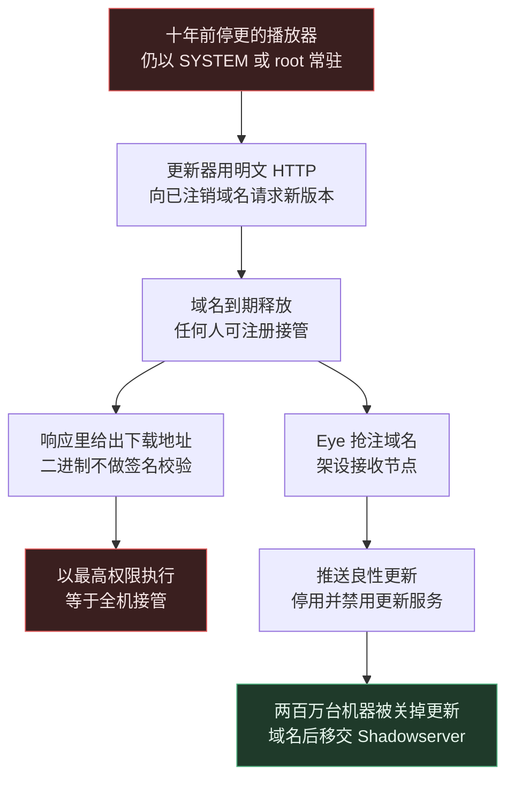
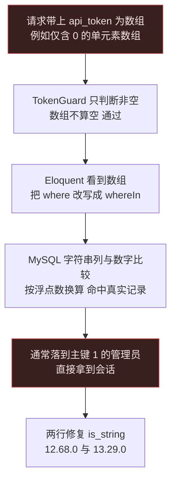
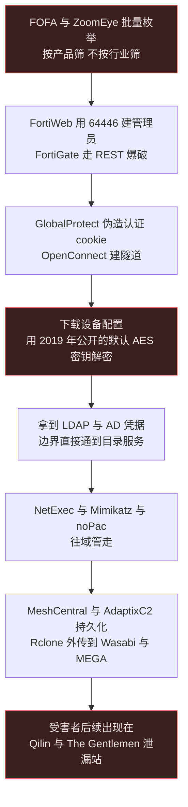
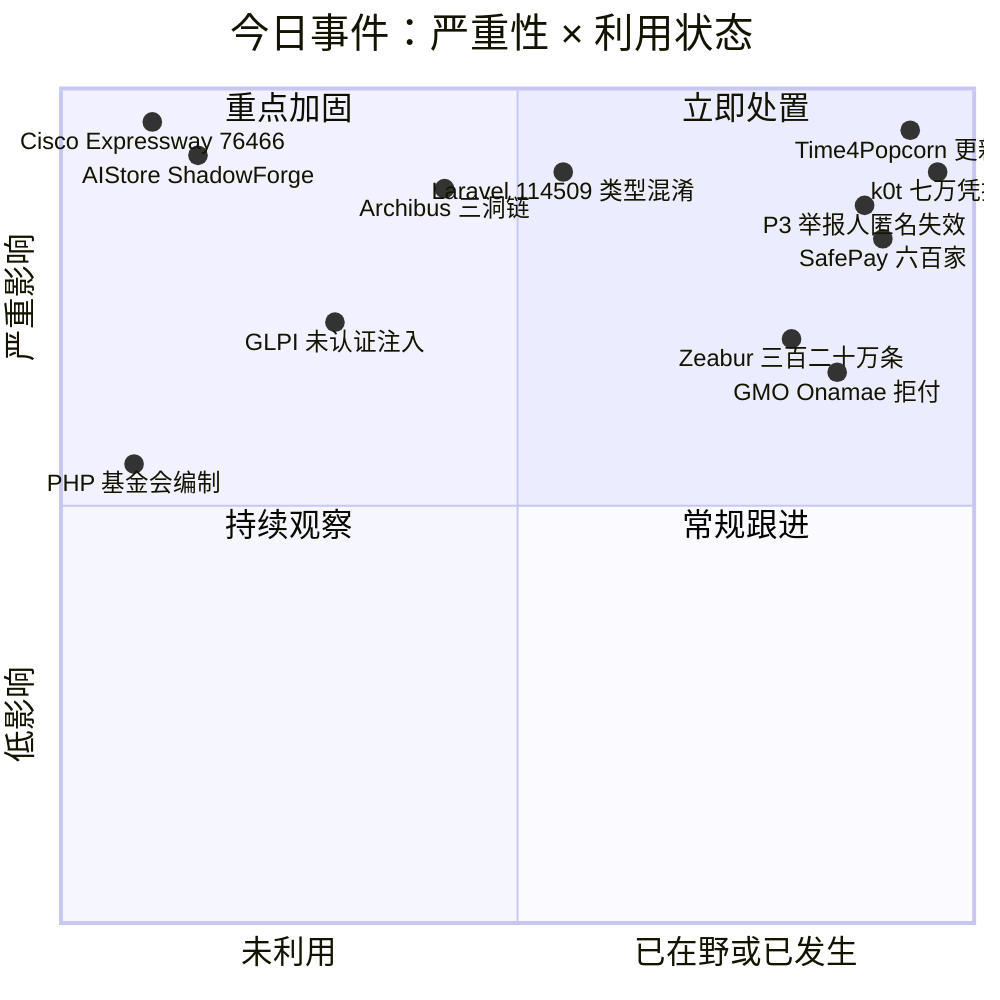
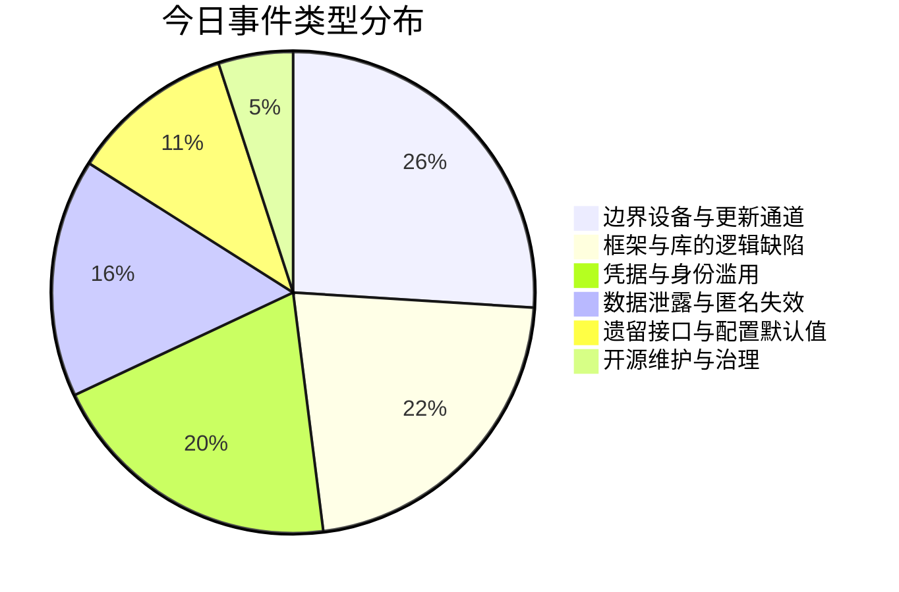
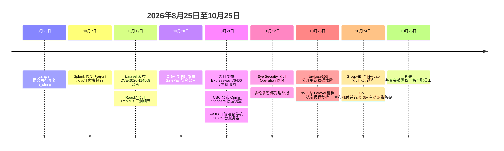

# 网安日报速递 · 2026年10月25日（第 197 期）

> AI城 · 网络安全 | 每日精选 · 值得关注

## 今日主线：洞都不新，新的是有人终于去数了一遍

十年前停更的播放器，今天仍以 SYSTEM 权限每隔一段时间向一个早就没人续费的域名请示"要不要执行新代码"。研究员把这个域名抢注下来，然后**用更新机制本身，给两百万台机器关掉了更新机制**。同一周：思科把"集群内部的客户端证书其实从来没被校验过"写成了一枚 9.8；Laravel 的两行类型判断在 8 月 25 日就修好了，公告拖到 10 月 19 日；一个 2019 年就被完整公开的默认 AES 密钥，今天还在替攻击者解开 FortiGate 的配置备份；一套自称被 40% 财富五百强使用的设施管理系统，十几年前的老接口至今免登录就能跑业务规则。**没有一件是今天写错的代码，全部是今天才被认真数了一遍的旧账。**

---

## 一、最值得关注的六件事

### 1. Time4Popcorn / Operation IXIM：用更新机制，关掉更新机制

**CVE-2026-30612** | CISA 侧记录 **9.8** | Eye Security 披露（10-22 报告，10-24 广泛报道）

十年前流行过一阵的 BitTorrent 流媒体客户端 Time4Popcorn，原项目早就停更解散，但装机量并没有消失。它自带一个后台常驻更新组件——Windows 上是 `Updater.exe`，macOS 上是 `PT.updd`——三个设计叠在一起，构成了一个教科书级的后门：

| 缺陷 | 实际后果 |
|---|---|
| 以最高权限驻留 | Windows 下直接跑在 **SYSTEM**，macOS 下以 **root** 常驻 launchd |
| 明文轮询、不校验签名 | 通过**未加密 HTTP** 取版本信息，收到的二进制**不做签名校验**直接执行 |
| 回连域名已过期释放 | 域名几年前到期注销，**任何人几十美元就能注册接管** |

也就是说，只要有人抢注那个域名（或者能在链路上做中间人），就能以 SYSTEM / root 权限向所有还在运行的客户端投递任意代码。Eye Security 在例行威胁排查中发现客户笔记本的异常回连，顺着查到这条链，随后做了一个很罕见的决定：**先抢注那些废弃域名，架设接收节点，然后给连上来的机器推送一份"良性更新"——内容是把更新服务停掉并禁用**。

规模比预想大得多：

- 节点上线后连接请求峰值达**每秒 50 次**；
- 数月监测记录到**超过 380 万个不同硬件指纹**，清洗去重后保守估计 **250 万至 300 万台 Windows** 与 **25 万至 35 万台 Mac**（此为估算口径，不等于确证受害数）；
- IP 采样里除普通个人终端，还出现了**多家跨国企业、政府部门乃至军方网络的内网设备**；
- 到 **2026-03-01**，指向其管辖域名的请求下降 **98%**，随后域名交给 Shadowserver 基金会托管。

影响版本：Windows ≤ 6.2.1.18、macOS ≤ 6.2.1.17、Android ≤ 3.5.0.173。**Android 走的是应用内主动检查，Eye 没有推送禁用更新**，只能卸载。手动处置命令（Eye 公布）：

```bat
sc.exe stop "Update service"
sc.exe config "Update service" start= disabled
```
```bash
launchctl unload -w /Library/LaunchDaemons/PT.updd.plist
```

**值得关注的原因：** 这是少见的"用攻击者的手法做防御"——更新通道本身就是最大的攻击面，而这次它被反过来当成补丁分发通道。更重要的是它揭示了一类被严重低估的资产：**停更软件里那些还在自动运行的组件**。应用本身也不安全（2014 年的浏览器引擎、沙箱关闭、明文加载内容），所以关掉更新不等于安全，卸载才是终点。给防守方的动作很具体：全网搜 `Updater.exe` 与 `PT.updd`，查 Eye 公布的 20 个域名与哈希，把"已停更但仍在运行"的软件纳入常规盘点——**它们的更新器比它们自己活得久。**



---

### 2. Cisco Expressway CVE-2026-76466：集群内部的证书，从来没人校验过

**9.8 / CWE-798** | 2026-10-21 16:00 UTC 公告（`cisco-sa-vcs-static-cred-hr7EWZ8t`，bug ID `CSCww27732`）

思科这次的问题不是"写错了一个函数"，而是**一套信任模型从来没真正成立过**。Expressway 数据库服务依赖两类凭据：

1. **持久 cookie**——持有它就能连上数据库服务，并调用特定的 RPC 命令；
2. **客户端证书校验**——但当集群的 TLS Verify Mode 设为 Enabled 时，客户端证书**并没有被正确校验**。

两条叠起来的结果是：一个未认证、只要能访问到该服务的远程攻击者，拿着 cookie 连上去发几个 RPC，就能在底层操作系统上**以 root 执行任意命令**（`AV:N/AC:L/PR:N/UI:N/S:U/C:H/I:H/A:H`）。

关键在于范围与出口都很窄、也很堵：

- **只影响配置成集群的 Expressway-C 与 Expressway-E**（虚拟与硬件都算），单机部署不在此 CVE 描述范围内；
- **无 workaround**，唯一出路是升到 **X15.5.20**；**X14 及更早在本分支没有修复版本，只能迁移**；
- 思科**没有说明数据库服务跑在哪个接口/端口**——所以不要把"它在内网"当成结论，先去实测可达性；
- 报告者：Jane Street 的 Stefan Aleksic；NVD 记录 10-21 17:19Z 建档，十天过去仍停在 **Awaiting Analysis**。

同一天同一批还发了两份值得一起读的公告：

| 公告 | 内容 | 要点 |
|---|---|---|
| Expressway 加固批（`cisco-sa-exwy-hardening-FhcqBVcs`） | **CVE-2026-76490 ~ 76497** 共 8 枚（4×8.6 可用性、4×7.8） | 按 **CWE 分桶**，一枚 CVE 代表一类缺陷，8.6 那组向量是"机密性无、完整性无、可用性全丢" |
| UC 加固批（`cisco-sa-voice-hardening-twgbH9e3`） | **CVE-2026-76473~76479 与 76481** 共 8 枚，最高 **9.8** | Unified CM / Unity Connection，修 **15SU5**；**Release 14 无补丁，只能迁移** |

思科在这批公告里写了一句正在变成行业惯例的话：这些缺陷是"用既有测试流程**以及前沿 AI 模型**在内部安全测试中发现的"。同一句话 10 月 7 日的 NX-OS 批次用过，Fortinet 10 月 22 日的加固版也用了。

**值得关注的原因：** 三点。第一，**9.8 的入口在边缘 DMZ 设备上**，而 Expressway-E 正是很多单位放在公网、让远程员工和合作伙伴接进内部电话与视频的那台机器。第二，**"集群内部可信"是一个假设，不是配置项**——这次出事的两半（持久 cookie、跳过证书校验）都在这个假设上。第三，还有一个叠加风险：Expressway 同时也是 PHP2Shell 的受影响产品，修复版本预计 **15.5.21** 且尚无日期，也就是说**升到 15.5.20 只关掉这一枚，PHP2Shell 那扇门还开着**，得排第二次升级窗口。


---

### 3. Laravel CVE-2026-114509：一个数组，换一个管理员的会话

**CVSS v4 9.2 / v3.1 9.8** | CWE-287 + CWE-704 | `GHSA-f9x3-7vq9-cph6`

修复提交的时间是 **2026-08-25 01:15 与 01:16 UTC**，公告发在 **10 月 19 日**，NVD 收录 10 月 21 日。也就是说，**代码早就修好了，消息在路上走了 55 天**。

漏洞本身是 PHP 圈子的老朋友：类型混淆。Laravel 内置的 `TokenGuard` 从四个地方取 token（查询串、请求体、Bearer、HTTP Basic 密码），然后只问了一个问题——**这个值是不是非空**。PHP 里"含有一个元素的数组"不算空，于是 `api_token: [0]` 顺利通过检查。接下来 Eloquent 的 `retrieveByCredentials` 看到值是数组，就把 `where` 改写成 **`whereIn`**；而 MySQL/MariaDB 在字符串列与数字比较时会**按浮点数比较**（官方手册的例子：`SELECT 0 = 'x6'` 返回 1），于是查询不再问"谁拥有这个 token"，而是"谁的 token 在这个列表里"——**命中一个真实用户记录**。

由于管理员通常是种子数据里第一条、主键为 1，一个通用真值匹配经常直接落到最高权限账号上。攻击者**不需要账号、不需要密码、不需要任何真实 token，也不需要有人点任何东西**。

修复就是两行，在 `src/Illuminate/Auth/TokenGuard.php`：

| 位置 | 改法 |
|---|---|
| `user()` | `if (is_string($token) && ! empty($token))` |
| `validate()` | 非字符串凭据直接返回 `false` |

暴露条件必须四个都满足：`laravel/framework` 低于 **12.68.0**（13.x 低于 **13.29.0**）、`config/auth.php` 里配了 `'driver' => 'token'`、有路由真的用了这个 guard、用户存在 MySQL/MariaDB。**Sanctum 与 Passport 不受影响。11.x 及更早没有修复版本**（已出安全支持期）。同批还有一枚 **CVE-2026-114508**（破坏性 API 路由上的关系绑定被篡改，可批量删记录）。

**值得关注的原因：** 第一，这类漏洞**只要框架老了几年就一定还躺在某个"当年给 App 用的"接口上**，Laravel 7 及更早的默认配置里就带着这个 token guard，很多项目迁到 Sanctum 后没有删。第二，**升级不等于生效**，三个地方会继续跑旧代码：Octane / Swoole / RoadRunner 的内存态热重载、Horizon 或 Supervisor 常驻的队列 worker、`config:cache` 与 `route:cache` 的序列化配置缓存。第三，也是最值得记的一条：**修复、发版、公告、NVD 收录是四个不同的事件**，这 55 天里任何只盯"公告有没有出"的流程都是失明的。



---

### 4. k0t：七万条边界凭据，与一个 2019 年就公开的默认密钥

**无单一 CVE** | 涉及 CVE-2025-64446 / CVE-2026-0257 / CVE-2019-6693 | Group-IB 与 NyxLab 联合调查（10-24 公开）

这不是一次针对性入侵，而是一条**流水线**。操作者 k0t（别名 CryptoFeel、Member19、QazWsxShop、Scrooge）不研究具体公司，而是用 FOFA、ZoomEye 这类资产搜索引擎**按产品批量拉清单**，再用地下的"按产品筛 IP"服务补齐。结果就是受害者横跨所有行业——**决定是否被攻击的不是你是干什么的，而是你那台设备是什么型号、挂在哪个位置。**

三条入口各管一类设备：

| 入口 | 手法 | 细节 |
|---|---|---|
| **FortiWeb** | CVE-2025-64446 相对路径穿越 | 自研 `fortnew.py` 并发跑清单，成功后**建一个 trusted-host 不设限的管理员账号**并验证口令 |
| **FortiGate** | 不走上面那枚，改 **REST API 爆破** | 内置锁退避逻辑，被锁就**等 60 秒**再试（与 FortiGate 默认锁定时长一致）——研究者说这体现"对设备相当熟悉" |
| **GlobalProtect** | CVE-2026-0257 认证覆盖 cookie 伪造 | 自研 `exploit_2026_0257.py` 伪造 cookie，再用 **OpenConnect** 建 VPN 隧道 |

真正让这条链"从边界掉进内网"的，是登录之后的一步：工具会**下载设备配置，并用 CVE-2019-6693 那个众所周知的 FortiOS 默认 AES 密钥解密存储的秘密**。这个 CVE 编号是 2019 年的。解出来的东西通常包括 **LDAP 绑定凭据、AD 凭据与管理员口令**——从一台边界设备直接通到目录服务。

落地之后的动作是典型的人工操作（hands-on-keyboard）：NetExec、Impacket、Kerbrute、PetitPotam、Mimikatz、noPac 一起上，取 Windows 秘密、收 Kerberos 服务账号哈希、往域管方向走。持久化不靠漏洞，靠**正经商业工具**：MeshCentral（一台控制服务器上 **84 台受控终端 / 28 个活跃分组**，另有 100 个分组已被删除，因此历史受害数无法回算）、AdaptixC2（`64.94.85.14`、`168.100.11.99`）、以及 Atera、AnyDesk、Teramind 这类 RMM。外传用 Rclone 打到 **Wasabi S3 与 MEGA**。

规模与归属：

- **7 万条以上**与网络设备、LDAP 目录转储相关的暴露凭据；
- 唯一域名分布：**亚太 37.6%、拉美 31.9%、欧洲 15.8%、中东北非 12.7%**（研究者强调这更可能反映暴露面而非定向选择）；
- k0t 自 2025-10-22 起活动，大规模集中在 **2026 年 2 月至 6 月**；
- 多名受害组织后来出现在 **Qilin 与 The Gentlemen** 的泄漏站上，因此评估其可能充**初始访问代理（IAB）**，但关系"仍未确认"；
- 与 FortiBleed 相比**"重叠可以忽略"**，所以 **7 万条凭据与 FortiBleed 的 86,644 台设备是两个不同的数，不能相加**。

**值得关注的原因：** 这条链上**没有一枚新漏洞**。CVE-2025-64446 是修过的，CVE-2019-6693 是七年前的，CVE-2026-0257 已被 Unit 42 观察到 Qilin 与 INC 在用。攻击者真正的杠杆是**"批量枚举 + 默认密钥 + 合规工具"三件套**——检测难点也在这里：NetExec 平时就是运维在用，AnyDesk 平时就是远程支持在用，**只按进程名告警会把 SOC 淹掉**。有效的判断需要上下文：谁在跑、从哪来、跑完接着做了什么。处置上必须把补丁和事件响应当同一件事：**补丁不会踢掉已经建好的 VPN 会话，也不会删掉已经建好的管理员账号**。



---

### 5. Eptura Archibus 三洞链：一个没人敢删的老接口，免登录接管服务器

**8.6 + 8.5 + 9.6** | Rapid7 发现（细节 10-19 公开）| `CVE-2026-107186` / `107187` / `107188`

Archibus 是设施管理与企业不动产平台，按 Eptura 自己的说法**财富五百强里有 40% 在用**。它的问题不是某一个洞有多狠，而是**三个各自"普通"的缺陷被串成一条完整链路，起点是一个十几年前的 DWR 接口**：

| 步骤 | CVE | 分数 | 做了什么 |
|---|---|---|---|
| 1 | 107186 | 8.6 | 老 **DWR** 端点（`/archibus/dwr/`）可以**未认证执行各种业务规则**——登录这道门被绕过去了 |
| 2 | 107187 | 8.5 | 最要紧的那条业务规则能**整库读**，包括**数据库里存的口令与秘密** |
| 3 | 107188 | 9.6 | 报表导出功能把**内容与文件扩展名都交给调用方**，落盘位置又是 Web 可访问目录——选 `.jspx` 就能被执行 |

细节里有个很说明问题的对照：**`.jsp` 会被要求登录，`.jspx` 不会**。落地的命令以 `NT AUTHORITY\Local Service` 执行——权限不高，但已经足够横向到数据库、图纸共享盘、邮件与日历连接器，以及这台主机持有的所有服务账号。

修复路线按版本分层，而且**分发方式很"供应商"**——只通过支持渠道给，不公开：

- **2025.02 及以后**：把涉及的 **DWR 端点换成 REST 调用**（发布说明写作"Replace many DWR endpoints with REST"），并在 Security 项下加了会话访问控制（AD-21220）；
- **2025.01**：一枚合并热修 **AD-24576** 覆盖三个 CVE；
- **2024.04 及更早**：只能改 `web.xml`，拦住绕过路径并阻止 `.jspx` 被创建。

检测抓手有四条：`/archibus/dwr/` 下**从未加载过登录页、也不持有效会话**的请求；Web 目录里**不是你或合作方部署的 `.jspx`**；名字以 **`DataViewReport`** 开头、扩展名异常的导出文件；以及 **Tomcat 服务拉起 `cmd.exe` / `powershell.exe`**。

**值得关注的原因：** 第一，**"老接口"是这个时代最稳定的漏洞来源**——它当初设计时集群是可信的，后来网络敞开了、还拿到了凭据，但**没人加上授权检查**，因为还有东西在调它。第二，**组合永远比单点危险**：8.6 只是"免登录跑业务规则"，9.6 只是"上传没限制扩展名"，合在一起就是"从一个能访问的 URL 直接拿服务器"。第三，**Archibus 这类系统比人们以为的更靠外**——Eptura 自己的部署指南说 Web Central 是远程用户通过浏览器访问的 Tomcat 应用，Smart Client 与 CAD 扩展还从各地分公司、建筑师、外包制图方连进来，**只要员工能在家里订会议室，这台机器大概率是能从外面碰到的**。

---

### 6. P3 Global Intel / Crime Stoppers：匿名这个承诺，在数据库里从来没成立

**无 CVE** | CBC 调查 10-21 · 平台方 Navigate360 10-23 公开承认（事发 3 月）

这条不是漏洞，是**一个产品最核心的承诺被证伪**。Crime Stoppers 的整套逻辑建立在"你可以匿名举报"上——举报人往往是唯一敢开口的人，很多还是被举报对象的邻居、同事、家人。它的举报数据托管在美国公司 Navigate360 旗下的 **P3 Global Intel** 平台。

CBC 拿到泄漏数据后统计：

- **150 万条以上**加拿大 Crime Stoppers 举报，时间跨度**约 25 年**；
- 其中**约 85 万条含个人信息**：住址、电话、邮箱，以及**部分与奖励挂钩的银行信息**；
- **多伦多**：176,859 条（2022-01 至 2025-11）中**14,973 个姓名**，而平台方**没有说明这些姓名属于举报人还是被举报人**；
- **萨斯卡通**：83,000 余条，其中**近 35,000 条不再匿名**；
- 泄漏内容里还有**警方与 Crime Stoppers 工作人员**的信息。

时间线比数据本身更值得看，因为它是一个 **7 个月里给了 6 个不同说法**的过程：

| 时间 | 发生了什么 |
|---|---|
| 2026-03 | 攻击者自称 "Internet Yiff Machine"，声称拿走 **93 GB**、800 万条举报；公司只说"正在调查是否发生了事件" |
| 2026-04 | 多伦多被告知**该市数据没有被拿走** |
| 2026-06 | 改口：多伦多数据**确实受影响**；滑铁卢警方同期获知 |
| 2026-07 | 滑铁卢警方停止推广 Crime Stoppers 作为举报渠道 |
| 2026-10-21 | CBC 公布调查结果 |
| 2026-10-22 | 多伦多宣布**停止受理电话、网站、App 举报**，要求平台方停止处理线索；Peel 警方同日退出 |
| 2026-10-23 | Kingston 警方停止使用；公司发布公开声明，承认姓名、住址、出生日期与**社会安全号**可能暴露 |

后果是连锁的：多伦多、Windsor、Kingston、London、Winnipeg 的警方相继暂停参与，萨斯卡通等五个地方组织**立即停止受理线索**，公开话术是"在找到更安全的方式之前，请不要通过电话、网站或 App 给我们线索"。多伦多警方仍在收案，但明确告知**那些渠道不匿名**。

**值得关注的原因：** 第一，**匿名不是一句政策，是一个技术承诺**——只要原始提交（含可识别信息）被存进数据库，前端把姓名抹掉不算数，因为攻击者拿到的是底层原文。第二，**"供应商说没事"是这条链上最贵的六个字**：执法机构替市民担保了七个月的匿名性，依据是供应商的口头保证，而对方自己也在改口。第三，这类数据的伤害**不可撤销**：密码可以重置，住址和"你举报过谁"不能。可执行的动作也清楚：做匿名/举报类产品，**默认不落原文**，能脱敏就在采集端脱敏；做采购的，**把"数据保留多久、原文存不存"写进合同与审计项**，而不是只问一句"你们安全吗"。

---

## 二、速览

**7. NVIDIA AIStore CVE-2026-65162「ShadowForge」：10.0，老 ETL 接口把 K8s 安全配置交给了调用方**
AegisSec Research 披露。问题在 AIStore 的 **legacy ETL Kubernetes PodSpec 初始化 API**：远程调用方可以自己指定 `hostNetwork`、`hostPID`、`hostIPC`、`privileged: true`、附加 capability、hostPath 挂载等字段。CVSS 3.1 **10.0**，向量里 **Scope 是 Changed**——这一项说明逃逸已经越过了组件自身边界、打到宿主。影响 **0 到 4.9 全版本**。关键是它把"配置作业"变成了"选择逃逸路线"，而存储集群的 service account 往往是那个命名空间里权限最高的身份（因为它要能创建作业）。缓解：升级、**停用不用的老 ETL 接口**、把 ETL 与管理端点从应用网段里摘出去、审计集群创建过的 PodSpec 里有没有没人写过的 `hostNetwork` 或特权容器。

**8. SafePay 勒索：600+ 受害者，五个洞全在 2020–2024**
CISA、FBI、特勤局联合德国 LKA Rheinland-Pfalz、英国 NCA 与西北 ROCU 发布 **AA26-293A**（10-20）。自 2024 年 8 月起**至少 600 家**受害，跨美洲、欧洲、澳洲关键基础设施。入口是暴露或被盗凭据、口令猜测、VPN 访问，以及对边缘设备的自动化利用——公告点名的五枚全是老洞：**CVE-2020-3259、CVE-2023-20269**（Cisco ASA/FTD）、**CVE-2023-27532、CVE-2024-40711**（Veeam）、**CVE-2024-40766**（SonicOS）。还记录了 Mullvad VPN 出口 IP 的使用。手法顺序固定：先偷数据，再**改/停防御与破坏恢复能力**（重置 NAS、删卷影），最后加密，后缀 `.SafePay`；外传工具包括 FileZilla、7-Zip、Rclone、WinRAR 与 `b2.exe`。**这条的判断很直白：不是 0day 打穿了谁，是几年前就该关的门还在原地开着。**

**9. GMO Onamae 拒绝支付，并请求政府动用"主动网络防御"权限**
10-24 的交易所公告里，GMO 明确表示不付赎金（理由是付了也不保证数据被删、也不保证停止滥用），已请警方刑事立案，并**请求日本政府启用 10-01 刚刚生效的主动网络防御权限**——据报道这是该权限生效后的**首个已知请求**。攻击方威胁的三件事：继续通过**日本国内外 70 多家证券与外汇公司的账户下单**、公开客户与公司数据、发起勒索攻击。前情：10-20 起 26,739 台客户服务器（主打 MT4/MT5 挂机，机器上全是交易凭据）被装马，10-21 04:00 起逐台停机。**这条的真正看点是"改密码不一定能停手"**——部分券商的既有会话在改密后仍然存活，所以必须显式断开所有已登录会话。

**10. Zeabur：320 万条环境变量、32 万账号，平台宣布关停**
开发平台 Zeabur 因一起安全事件宣布**自 2026-12-01 起停止服务，12-31 前完成**。攻击者利用**以明文存储的内部凭据**拿下基础设施，窃走**超过 320 万条环境变量记录**与 **321,810 个账号**信息。环境变量正是这类平台最集中的秘密存放处（数据库口令、第三方 API key、云凭据）。**教训不在"被黑"，在"内部凭据明文存"这个默认**——它把一个单点失守放大成了全平台的横向移动。

**11. GLPI 11.0.8 未认证 SQL 注入：能读整库，进而接管管理员**
`GHSA-753w-2942-4pxm`，Mobeta 报告。**11.0.8** 存在未认证 SQL 注入，可读取 GLPI 应用**整库**；按版本不同，读权限还能进一步变成**管理员账号接管与远程代码执行**。已在 **11.0.9** 修复。GLPI 是资产与工单系统，库里往往同时装着**全员账号、设备清单与内部流程**——这类系统常被当成"内部工具"而暴露在办公网甚至公网，属于典型的"不在威胁模型里但一直在攻击面上"。

**12. 补一句背景：PHP 基金会只有一名全职员工**
10-25 的采访里，PHP 基金会执行董事 Elizabeth Barron 说得很直接：**"我们只有一名全职员工，也就是我，另外还有十四名大多是兼职的外包人员"**，董事会成员是无薪志愿者，资金靠捐赠。与此同时，AI 让代码修改提案接近一年前的**两倍**，而"可贡献者人数并没有同步翻倍"。这一周全球为 PHP2Shell 抢修的场面，和这个编制数字放在一起看，比任何漏洞公告都更能说明开源基础设施的真实处境。

---

## 三、风险分析





## 四、事件时间线



## 五、相关出处

| 主题 | 来源 | 链接 |
|---|---|---|
| Time4Popcorn / CVE-2026-30612 | Eye Security 原始报告（Operation IXIM）经 worldprogramming.org 转述细节 | https://www.worldprogramming.org/posts/time4popcorn-cve-2026-30612-supply-chain-risk-from-abandoned-update-domains-to-systemroot-code-execution-kih3ux |
| Time4Popcorn 规模与命令 | 安全圈（网易）— 380 万硬件指纹、250–300 万台 Windows、每秒 50 次 | https://www.163.com/dy/article/LA1DRDHM0511A5GF.html |
| Time4Popcorn 处置与域名移交 | OSINTSights — 20 个域名、手动命令、移交 Shadowserver | https://osintsights.com/eye-security-disables-popcorn-time-updater-in-2-million-systems |
| Time4Popcorn 摘要 | The Hacker News 经 bestsec 日报（10-25）— 超 200 万次更新、9.8 | http://bestsec.net/daily/2026-10-25 |
| Cisco Expressway CVE-2026-76466 | ThreatFrontier — CWE-798、持久 cookie、集群限定、X15.5.20 | https://threatfrontier.com/articles/cisco-expressway-cve-2026-76466-hard-coded-credential-root-rce |
| 思科同批三份公告与时间线 | Safeguard — 21 日 16:00 UTC 发布、五份公告、AI 自查表述 | https://safeguard.sh/resources/blog/cisco-expressway-cve-2026-76466-unified-cm-15su5-october-2026 |
| Expressway 加固批逐条 CVE | AL-ICE — 76490~76497 按 CWE 分桶、8.6 与 7.8 的向量差异 | https://al-ice.ai/posts/2026/10/cisco-expressway-cve-2026-76466-cluster-root-rce-frontier-ai-hardening |
| Laravel CVE-2026-114509 技术链 | Brandefense — 8-25 提交时间、两行 diff、whereIn 与 MySQL 比较 | https://brandefense.io/security-news/laravel-tokenguard-authentication-bypass-cve-2026-114509 |
| Laravel 暴露条件自查 | World Programming — 四问判断、Octane 与 worker 残留 | https://www.worldprogramming.org/posts/laravel-tokenguard-auth-bypass-cve-2026-114509-what-site-owners-must-do-now-kdkpgm |
| Laravel 与 114508 同批 | CyberInfos — 蜜罐观察、持久化三处、114508 | https://www.cyberinfos.in/laravel-mysql-token-bypass-cve-2026-114509 |
| k0t 调查全文 | SecurityOnline — Group-IB 与 NyxLab、工具链、MeshCentral 84 台 | https://securityonline.info/k0t-fortigate-globalprotect-attacks |
| k0t 技术细节与 IOC | Cybernoz — 64446 建管理员、64463 默认密钥、C2 地址 | https://cybernoz.com/?p=57131 |
| k0t 区域分布与企业影响 | Pid / Cyber Defense Magazine — 亚太 38%、拉美 31.9% | https://pid.co.il/exposed-firewall-campaign |
| k0t 与 FortiBleed 的区别 | Cryptopolitan — 7 万凭据 vs 86,644 台设备不可相加 | https://www.cryptopolitan.com/k0t-campaign-exposes-70000-firewall-credentials-on-fortinet-palo-alto-gear/ |
| Archibus 三洞链与检测抓手 | Safeguard — DWR、.jspx、DataViewReport、Local Service | https://safeguard.sh/resources/blog/eptura-archibus-cve-2026-107186-auth-bypass-rce |
| Archibus 与 Rapid7 原始结论 | QPulse — 8.6/8.5/9.6、40% 财富五百强、受影响版本 | https://qpulse.quasarcybertech.com/news/7197/critical-rce-vulnerabilities-in-eptura-archibus-cve-2026-107186-cve-2026-107187-cve-2026-107188 |
| P3 / Crime Stoppers 数据统计 | CBC 调查 — 150 万条、25 年、85 万条含个人信息 | https://www.cbc.ca/news/investigates/crime-stoppers-data-breach-whats-next-9.7392709 |
| P3 时间线与说法变更 | Wasteland — 3 月声称、4 月否认、6 月改口、10-23 承认 | https://wasteland.me/intel/crime-tip-platform-vendor-breach-acknowledged |
| P3 停收与匿名声明 | Malwarebytes — 多伦多 10-21 声明、停收渠道 | https://www.malwarebytes.com/blog/data-breaches/2026/10/crime-stoppers-chapter-freezes-tips-after-breach-breaks-anonymity-promise |
| P3 萨斯卡通数据 | CTV News — 8.3 万条、近 3.5 万条不再匿名 | https://www.ctvnews.ca/saskatoon/article/saskatchewan-crime-stoppers-programs-pause-tip-lines-after-data-breach |
| NVIDIA AIStore CVE-2026-65162 | DEV Community — legacy ETL PodSpec、Scope Changed、0–4.9 | https://dev.to/bianliang/aistores-legacy-etl-api-accepted-kubernetes-security-settings-from-the-caller-3mc0 |
| SafePay AA26-293A 五个 CVE | CyberTech Edition — 600 家、五枚老洞、Mullvad IP、扩展名 | https://cybertechedition.com/news/cisa-fbi-safepay-ransomware-600-organizations-aa26-293a |
| SafePay 处置清单 | VigilSecureInfo — 四阶段响应、按资产问三个问题 | https://www.vigilsecureinfo.com/?p=3427 |
| GMO Onamae 拒付与主动网络防御 | Wasteland — 10-24 公告、首个请求、70 多家券商威胁 | https://wasteland.me/intel/gmo-internet-group-cloud-ransomware-extortion |
| Zeabur 与 GLPI | ThreatsDay 汇总（LavX）— 320 万条环境变量、321,810 账号、GLPI 11.0.9 修复 | https://news.lavx.hu/article/threatsday-bulletin-authentication-bypasses-ai-infrastructure-breaches-and-a-signal-call-that-won-t-hang-up |
| PHP 基金会编制 | 腾讯新闻 / IT之家（10-25）— 一名全职、14 名兼职外包、提案翻倍 | https://news.qq.com/rain/a/20261025A03BLE00 |
| 本周总览（交叉核对用） | The LaymanSecurity 周报 19–25 Oct | https://thelaymansecurity.com/cybersecurity-news-this-week-2026-10-25 |

---

*免责声明：本报告基于公开信息整理，CVE 编号、CVSS 评分与受影响版本以厂商公告与 NVD 记录为准。泄漏站声明、攻击者自我陈述均未经独立验证，文中已标注来源口径。建议读者查阅原始来源获取最新动态。*

*2026年10月25日 · 第 197 期*
