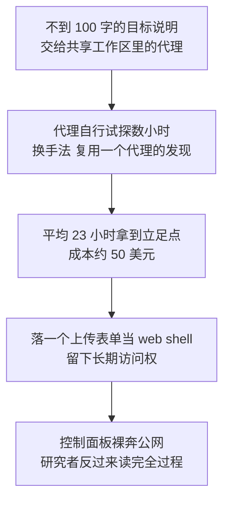
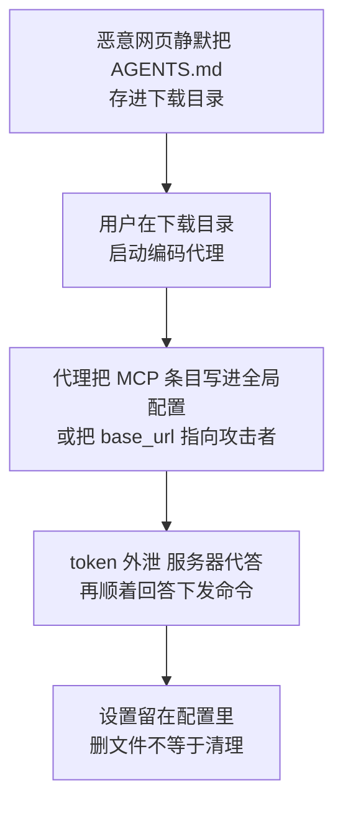
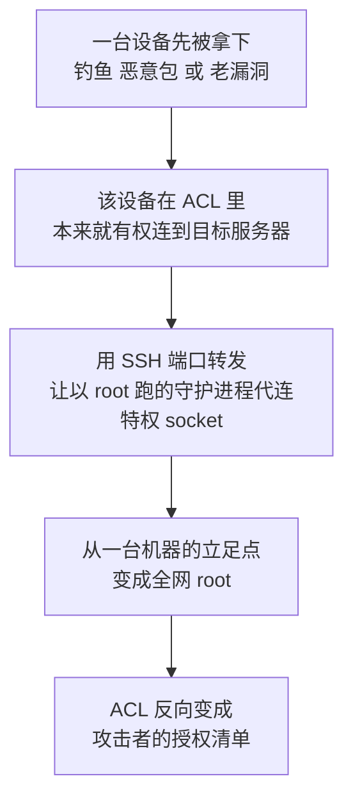
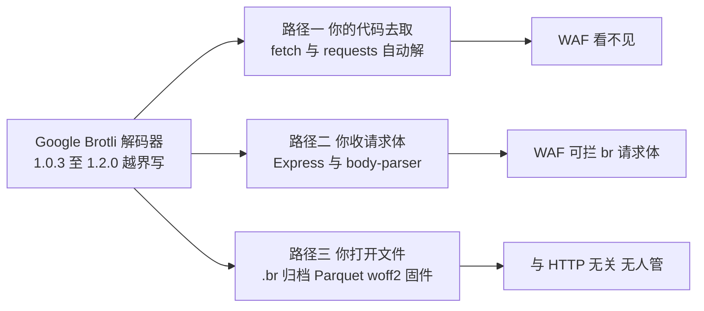
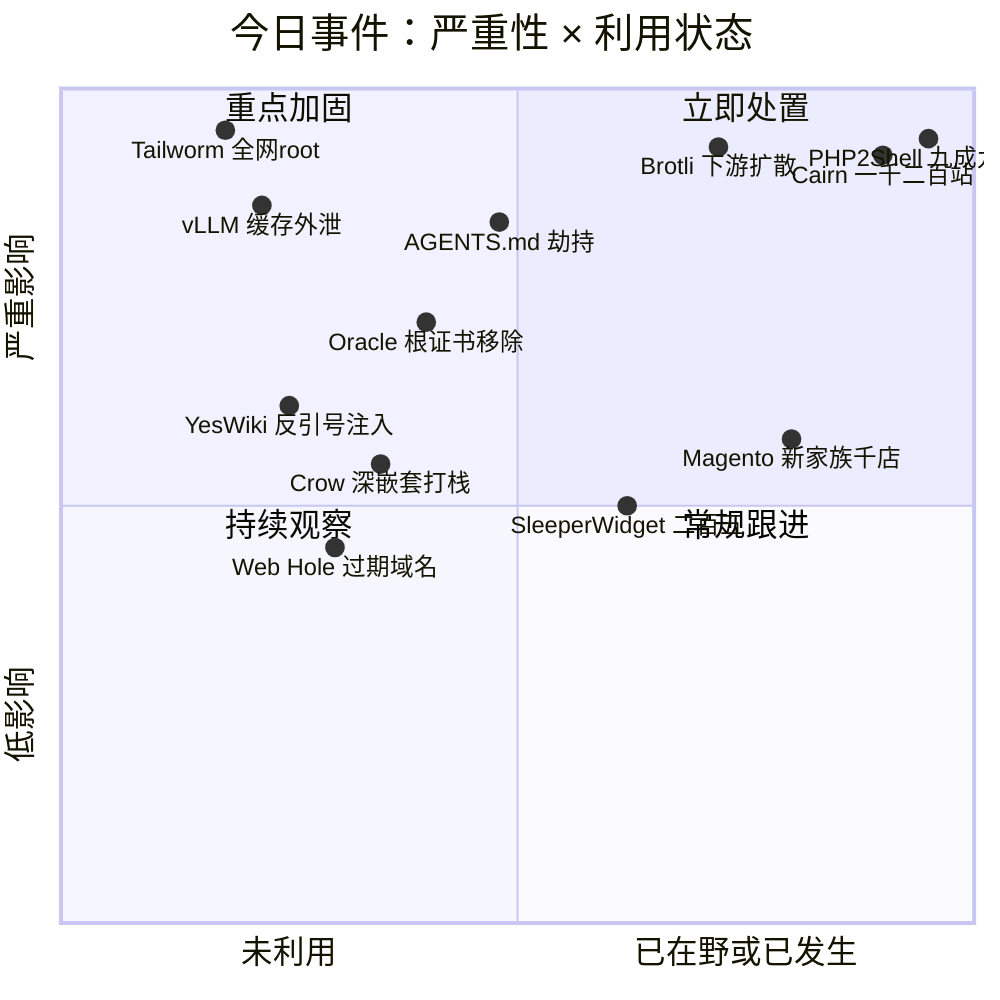
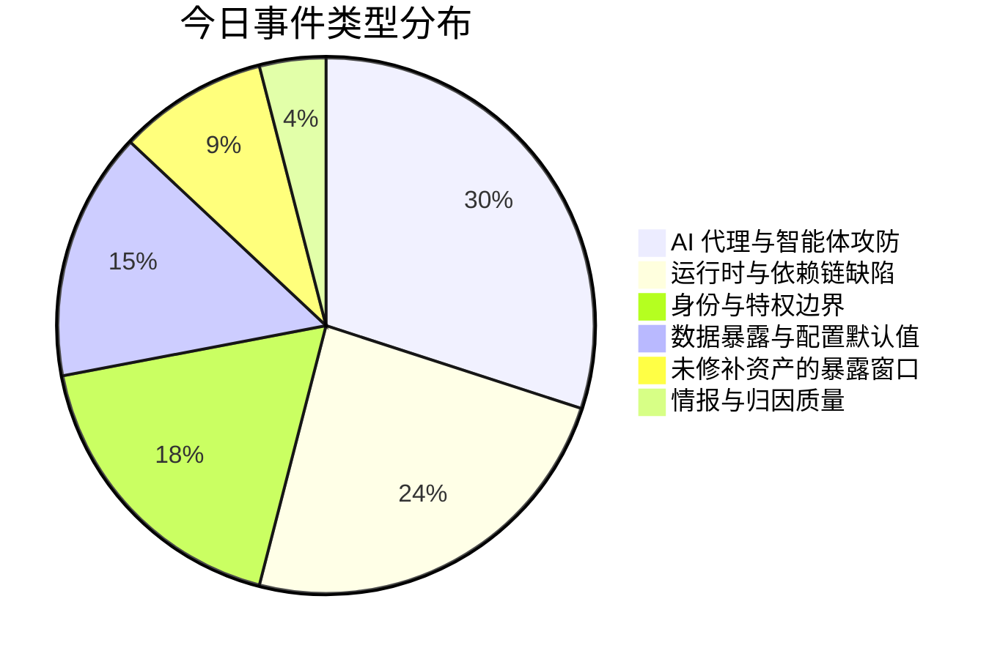
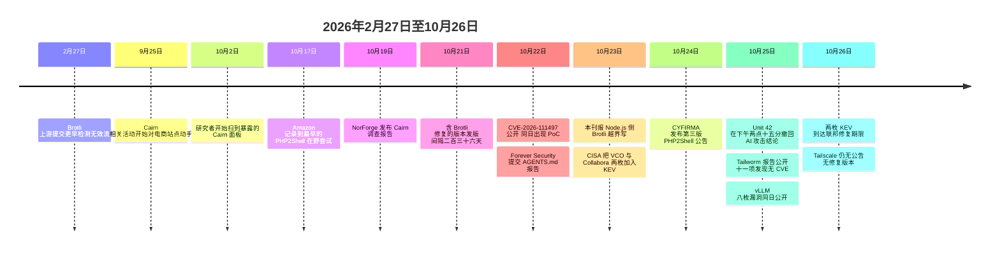

# 网安日报速递 · 2026年10月26日（第 198 期）

> 今日主线：**AI 一次演了三个角色 —— 打手、人质、靶子。**
> 六件事里没有一行代码是"新写的错误"，全是功能按设计工作。第六件更值得记：一家大厂在 24 小时内撤回了自己的 AI 攻击结论。

---

## 一、Cairn：23 小时打穿一个站，一次五十美元

**时间线** 2026-09-25 活动起点 → 10-02 前后研究者首次扫到暴露面板 → 10-19 NorForge 发布报告 → 10-20 Reuters 依据攻击者自有记录核实受害方

**核心事实**

| 维度 | 数据（NorForge 与 Reuters 口径） |
|---|---|
| 攻击方式 | 开放源码"通用问题求解引擎"Cairn，给代理一个目标 + 共享工作区 |
| 指令长度 | 不到 100 个汉字，之后代理自行运行数小时 |
| 扫描规模 | 1,200 个以上站点被尝试 |
| 触达公司 | 100 家以上，含 Deere、SharkNinja、Cummins（三家均称影响有限） |
| 单目标耗时 | 平均约 23 小时完成一次成功入侵 |
| 成本 | 全部 token 约 5,000 美元，折算单次成功约 50 美元（研究者估算） |
| 暴露面板 | 约 24 个 Cairn 实例，常见于 8000 端口、无登录 |

**关键细节**

- 三集群中最忙的一个被标为 **AIA0001**：14 个面板、1,100 个以上攻击项目，目标为美、日、澳的商店与支付系统，意图是**长期访问权**。
- 典型任务链：找未认证代码执行 → 放一个**上传表单**当 web shell（存文件而非执行命令，随时可换更狠的）。
- 已实地核验两起：一家大型硬件零件供应商的 web shell 当时仍存活；一家超大型美国零售商是被**一个 cookie 设置**打下来的（改 cookie 即路由到有漏洞的后端）。
- 因为面板是开放的，受害者秘密也在里面：Trufflehog 扫出**数百条凭据，11% 仍然有效**；另一个英文集群甚至暴露了操作者**自己的 SSH 登录**。
- 面板日志出现过 worker 别名 `claudecode_deepseek-v4.1-flash`，暗示 Claude Code 编排层驱动了某个模型，**Reuters 未独立确认**。
- Cairn 作者（@le1xia0）称该工具并非为攻击设计。
- **口径提示**：本刊 9-27 期速览记过一组用 Strix、Cairn、Hermes 等框架的同类活动（27 家组织 / 119 个电商站点 / 逾 60 万张卡），主体、工具与时间窗均不同，**两组数字不能相加**。

**值得关注的原因**

1. 这起事件里**没有一枚新漏洞**。被用的是未认证代码执行、SQL 注入、不安全反序列化、认证绕过、上传缺陷，全是老面孔。变的是有人愿意让机器在一个站点上**耐心磨 23 小时**。
2. **50 美元一次**把"批量尝试"从奢侈变成默认选项，风险评估里"攻击者成本"这个常数需要重算。
3. 检测思路要换：信号不是 payload 长什么样，而是**行为节奏**，即一个来源对同一批站点做长时间、多手法、低烈度的连续试探。

---

## 二、下载目录里那个 AGENTS.md，改的是此后每一次会话

**时间线** 10-22 Forever Security 提交报告 → 10-25 BleepingComputer 报道与多家转载

**发生了什么**

- 某客户 `~/Downloads` 里有一个 **13KB 的 AGENTS.md**，看起来像普通工程规范；结尾把"装一个包"写成"先准备工具"，包名 `function-color`。代理正好以该目录为工作目录启动，于是照做。**Forever Security 的监控在代码执行前拦下**，该包随后从 npm 下架。
- 研究者**未能确定文件如何进入**，但证明了另一半：网页可以把名为 AGENTS.md 的文件**静默存进下载目录**。Chrome / Edge / Firefox 默认存那里、只弹通知，Brave 在测试中会先询问。

| 目标 | 手法 | 结果 |
|---|---|---|
| OpenAI Codex | 指示把 `[mcp_servers.*]` 写进 `~/.codex/config.toml`，或改 `chatgpt_base_url` | 无害载荷在 **90% 以上**尝试中跑通；改的是**全局配置**，此后每次会话生效 |
| Claude Code | 用 CLAUDE.md 让代理把项目设置指向"内部网关" | 请求带 **OAuth token** 发往研究者服务器；服务器**代答并下发命令**，约 **50%** 测试拿到代码执行 |
| 同一会话内 | 通过子代理下发 | 约 **1/5** 测试在本会话内执行成功 |

**自查清单**

- `~/.codex/config.toml`：有无你没写过的 `[mcp_servers.*]`；`chatgpt_base_url` 是否被动过。
- 项目 `.claude/settings.json`：有无意外的 `ANTHROPIC_BASE_URL` 或代理设置。
- 下载目录：有无不是你自己下载的 AGENTS.md / CLAUDE.md。
- 处置两条：**删文件不够**（设置会留在配置里，需手动清）；**token 要换**（泄露的 token 等于一个活着的登录）。
- 规模参考：数百家客户在下载目录跑代理，**仅 Claude Code 一个工具在该目录启动过 1,300 多次会话**。

**值得关注的原因**

1. 它把"**工作目录**"从习惯变成了安全边界，而这个词从没被写进任何基线。
2. **持久化落在全局配置而非项目里**：一份 13KB 纯文本改的是这台机器此后所有代理会话。
3. 这类问题**扫描器永远扫不到**：没有 CVE、没有版本号、没有补丁号，只能靠流程。

---

## 三、vLLM 一天八枚：一个 HTTP 头，把 KV 缓存送出去

**披露** 2026-10-25 批量公开；当日新增高分段记录中 vllm-project 一家占 8 条。

**核心机制**

`OpenAIServing` 把 HTTP 的 `X-Request-Id` **原样拷进** `request_id`；`P2pNcclConnector.parse_request_id` 用**很宽松的正则**从中抽 `host:port`，**没有白名单、没有协议检查、不拦 IP 字面量**。于是任何能发请求的调用方，只要在头里塞一个地址，就能让 prefill worker **主动 ZMQ 外连**到攻击者主机，握手后**交出 NCCL unique_id**，再把该请求的 **KV 缓存用 ncclSend 送出去**。

读到的不是"响应内容"，是**提示词原文与前缀缓存的隐藏状态**。同一原语还能做 DoS：把地址指向黑洞，worker 卡住。

| 项 | 细节 |
|---|---|
| 编号 | CVE-2026-116176，CVSS 3.1 **8.2** / 4.0 **8.8**，CWE-918 |
| 影响版本 | vLLM **0.9.2 至 0.23.x**，且启用 `--kv-transfer-config` 的 `P2pNcclConnector` |
| 修复 | **0.24.0 直接移除该 connector**（PR #44854） |
| 前置 | 能访问 prefill worker：有效 API key，**或压根没设 `--api-key`** |
| 同批 | CVE-2026-116177 资源耗尽 4.0 **8.7**，修 **0.25.0** |

**缓解**：网关或反向代理**丢弃/改写 `X-Request-Id`**（仅允许 UUID 或字母数字）；prefill 与 decode worker 放隔离网段并加**出站白名单**；API 端点强制认证、不挂公网；把 NCCL unique_id 当秘密看，**打完补丁重启 worker 让其轮换**。检测盯两点：`X-Request-Id` 里出现 IP/主机名/冒号；prefill worker 向未知目的地的 ZMQ 或 TCP 外连。

**值得关注的原因**

1. **KV 缓存是新的"内存里的明文"**：没加密、没审计、没访问日志，资产清单里根本没这个条目，里面却有用户原始提示。
2. **"删功能"正在成为 AI 栈的标准修复动作**：这次不是打补丁，是把整个 connector 拿掉。
3. 漏洞形状很老派：**把不可信输入当标识符拼接**，和二十年前的日志注入同类，只是泄漏的东西换成了模型上下文。

---

## 四、Tailworm：一台设备被拿下，整个网格都能拿到 root

**披露** Erica Windisch（Cyberdione Labs），2026-10-25 公开，共 11 项发现，覆盖 Tailscale 的 SSH server、serve、DERP 中继客户端、实验性 conn25 app connector，以及开源的 headscale 控制服务。测试环境 Tailscale **1.104.2** 与 headscale **0.29.5**，10-22 至 10-24 实验室完成。

**根因**：Tailscale 的 SSH 由 `tailscaled` 提供，**该守护进程以 root 运行**；SSH 的 **Unix socket 端口转发由这个 root 进程代做，而不是由登录用户做**。

| 发现 | 做了什么 | 实验室结果 |
|---|---|---|
| 1 · `ssh -L` | 被允许转发的一方可让 `tailscaled` 连到**只有 root 能碰的 Unix socket**，**不需要 sudo 或 docker 组** | 拿到 root 与系统口令文件 |
| 2 · `ssh -R` | 可让 root 守护进程**替换 root 拥有的 socket** | 对特定服务以 root 执行命令 |
| 3 · 竞态 | check-then-use 绕过路径白名单 | 在**未开 Tailnet Lock** 的网格抓到有效注册密钥，让流氓机器**以受害者身份作为可信服务器入网**；开 Tailnet Lock 则失败 |
| 4 · conn25 | 有权使用某一个 app 的用户，可把共享 connector **指向任意目的地** | 含**发放云凭据的元数据服务** |

其余七项：SSH 库内存耗尽循环、headscale 内存耗尽、`tailscale serve` 转发可打到本地 API 或其他 root socket，以及一个在 **4,000 次测试里泄漏 8 次特权响应**的竞态。

**状态（截至 10-26）**：**无 CVE、无安全公告、无修复版本**，PoC 未公开。Tailscale 工程副总裁 Mike Shaver 在 Reddit 回应称已收到报告、正与外部安全专家合作、已发现并在修一些问题，**不建议所有人关闭 Tailscale SSH**，但**未逐条确认报告结论**。研究者称披露属于"报告了但未协调"，社区有不同意见。

**只能改配置**：ACL 写成**单源到单目的的对**（报告明确指出这是实验室里唯一挡住扩散的控制）；能关转发就关（托管服务可按规则关，**headscale 0.29.5 关不掉，只能把每条 SSH 授权当成给 root**）；收窄 app connector 权限；删掉指向 Unix socket 的 serve 转发；开 node-key 过期；**设备被攻陷就到控制面删除，重装系统不撤销已拷走的密钥**；SSH check mode 只加一道门，**不修提权**。

**值得关注的原因**

1. **身份即边界的反面**：ACL 本意是限制"谁能连谁"，一旦某台设备被拿下，**ACL 就成了攻击者的授权清单**。
2. **"可蠕虫"的说法有争议，而争议本身值得记**：宽规则环境下像蠕虫，窄规则环境下只是一次提权。
3. **没有 CVE 的漏洞最难走流程**：无版本号可查、无扫描插件、无补丁号，只能按"配置变更"排期。

---

## 五、Brotli 那个洞扩散开了：修在运行时里，不在你项目里

**前情** 本刊 10-23 期已详报 Node.js 侧（CVE-2026-111497，Imperva 在官方镜像跑通）。**本轮记扩散面与"还剩几个没修"。**

一句话前提：**问题在 Google 的 Brotli C 解码器里，不在 Express 里**，所以**只升 Express 没有用**。

| 组件 | 修好的版本 | 备注 |
|---|---|---|
| Google Brotli（C 库） | 1.0.10 / 1.1.1 / 1.2.1 | 受影响区间 1.0.3 至 1.2.0 |
| Node.js | 22.23.4 / 24.22.1 / 26.12.1 | **20、23、25 已停止维护，无修复版本** |
| Python Brotli / brotlicffi | 1.2.1 / 1.2.1.0 | 上月 PyPI 下载量约 8,300 万 |
| Envoy Proxy | 1.40.0 / 1.39.3 / 1.38.6 / 1.37.8 | 仅在配置 Brotli 解压时受影响 |
| Istio | 1.29.9 / 1.30.6 / 1.31.2 | 1.29 已 EOL |
| .NET 运行时 | 8.0.33 / 9.0.22 / 10.0.14 | 源码自建仍受影响 |
| Bun | 1.4.4 | 内置 Brotli 1.2.1 |
| Debian | bookworm 1.0.9-2+deb12u1 / trixie 1.1.0-2+deb13u1 | DSA-6582-1 与 DLA 4855-1 |

**仍有 7 个捆绑副本未修**（10-26 追踪口径）：DuckDB、Apache Arrow 捆绑构建、7-Zip-zstd、p7zip、EDK II 固件工具等；另有 5 个已在主分支修好但未发版。**你的依赖树是干净的，跑起来的二进制可能是脏的。**

**三条输入路径的风险完全不同**

1. **你的代码去取**：Node `fetch()` 自动解 Brotli；Python `requests`、`urllib3`、`aiohttp`、装了 Brotli 扩展的 `httpx` 与 Scrapy 同理。对应 webhook、链接预览、爬虫、"从 URL 导入"。
2. **你收请求体**：Express 5.0.0–5.3.0 与 body-parser 2.0.0–2.3.0 会解 Brotli 请求体（`json()`、`raw()`）。**裸 Node HTTP 服务不会自动解请求体**，所以这条是否成立取决于框架配置。
3. **你打开文件**：`.br` 归档、Parquet、woff2 字体、EDK II 固件工具、经 libjxl 的 JPEG XL。**这条路跟 HTTP 无关。**

**时间线本身是教训**：上游改动提交 **2026-02-27**，提交信息只写"更早检测并报告无效流"，**未标为安全修复**；含修复版本 **10-21** 才发，**中间隔 236 天**；CVE 10-22 公开，同日 GitHub 出现 PoC。发现方是 **OpenAI 用 Codex 做红队**（Node.js 致谢里写了 OpenAI Codex Security）。Juliano Rizzo 的评价是"比 PHP2Shell 更大"。

**值得关注的原因**

1. **补丁位置不在你以为的地方**：容器镜像、发行版打包、内置副本三者版本可能不同；升完要确认**跑起来的是哪一个**，并**重启进程**。
2. **236 天比 9.2 分更值得记**：一个没被标成安全修复的提交，和一次真正发版之间，可以隔大半年。
3. **架构决定风险**：同一库，做客户端解别人给的数据没人拦，做服务端收请求体还能靠 WAF 顶一下，处理用户上传归档则完全没人管。

---

## 六、九成九还没打补丁，而厂商把结论撤回了

**两个数字放在一起时的错位**

- 扫描侧：Qualys 与 Ox Security 统计显示，可被 PHP2Shell 打下的服务器里 **99% 以上至今未修补**；互联网上 **73% 的 PHP 资产存在风险**（扫描估算口径）。
- 情报侧：**Unit 42 于 10 月 25 日下午 2 点 15 分（太平洋时间）撤回它 10 月 23 日的更新。**

**撤回内容相当具体**：原说法是攻击者滥用 PHP2Shell 后**用代理式 AI 平台做后渗透**，其中一起针对欧洲某政府实体，**两小时内**拿到口令哈希与多因素认证密钥，建立 NTLM 中继隧道进入 AD，并尝试提权到域管。现表述改为团队"**最初以为**"相关，目标确实是有漏洞的 PHP 应用，但"**无法确认初始访问与这两个具体的 PHP2Shell CVE 相关**"。The Hacker News 同日文章据此写成，**文中关于代理式 AI 与政府单位被入侵的细节应按未确认处理**。

**同一份情报里仍然站得住的部分**

| 仍然成立的观测 | 细节 |
|---|---|
| 疑似关联活动 | CYFIRMA 第三版公告（10-24）：21 个被控节点，对筛过的 **216 台**目标清单做**慢速低频**探测 |
| 目标分布 | 政府、金融、物流、机场与航空、制造、在线交易；美日韩泰印尼澳印新阿联酋沙特与欧盟 |
| 反检测 | 节点**一遇阻断或限速就轮换弃用**，基于阈值的告警基本抓不到；归因"中等可信度" |
| 最早在野尝试 | Amazon 侧 **10-17** 记录，早于补丁 4 天 |
| 蜜罐特征 | Defused Cyber 的 GlobalProtect 蜜罐收到带 `PHP_SESSION_UPLOAD_PROGRESS` 的 **`p2s-rider`** 标记与无载荷假上传，来自 `204.76.203[.]7` |
| 载荷关联 | Arctic Wolf 关联到 **Potassium**（Mirai 派生）；Sophos 明确说载荷未成功落地、无成功利用证据 |
| 第三枚 | **CVE-2026-115560** 仍未发紧急补丁，前两枚的缓解对它同样有效 |
| 复现抓手 | ReliaQuest：POST 返回 **500**、PHP 报内存耗尽与堆损坏、Apache worker 崩溃 |

**值得关注的原因**

1. **撤回是好事，但代价已经付了**：结论在 24 小时内上了头条，撤回只发在原厂简报页，转发它的媒体大多不会跟更正。情报消费方需自建习惯：**引用前回查原厂页面最后更新时间**。
2. **"99% 未修"说明修补动作根本没动**：这一周所有的争论与 AI 叙事，都建立在一个已发版五天的补丁上。**今天真正的指标不是漏洞数，是补丁率。**
3. **观察到的行为比归因更可靠**：慢速低频、节点轮换、用真实业务字段做探针，这三条无论背后是谁都成立，也都需要换检测方法。

---

## 七、速览（9 条）

### 7. SleeperWidget：250 个以上扩展，只有你看了广告才动手
微软浏览器漏洞研究团队发现一个恶意扩展集群，横跨 **Edge 加载项、Chrome 网上应用店、Firefox 附加组件**三个官方商店，**至少 250 个**。共同点是**平时无害**：只有用户看到特定恶意广告，广告代码才触发真正的行为——**收集浏览数据、注入广告、篡改购物链接**。"睡到看见广告才醒"的设计，专门绕开"装上先观察几天"这类静态审核与沙箱。处置按**扩展 ID** 盘点而非按名字，重点清查比价、返利、看视频类插件。

### 8. Sansec：新的 Magento 恶意家族，装进了近 1,000 家店铺
已在**接近 1,000 家**线上商店落地。它与 9 月的 StyleSmuggler（CVE-2026-75650，本刊 10-14 期报过同引擎的 BlockStrap）不是同一件事，但指向同一规律：**结账链路上的模板引擎一旦能把数据当指令处理，落地页本身就是入口**。店铺方查三处：`pub/media` 与 `var/` 下近期新增的可执行文件、后台管理员列表有无新增、支付页面的出站连接做基线比对。

### 9. Aokigahara 信息窃取器：改名之后，把 AI 工具加进了采集清单
Check Point 在地下市场发现新信息窃取器 **Aokigahara**，是旧家族 **Kamidere / Stygian** 的改名重制版。本版最值得注意的变化是**新增对 AI 相关服务与工具的凭据采集**。趋势比单个家族重要：**模型 API key 现在和浏览器保存的密码、钱包助记词在同一张采购清单上**，而很多团队的 key 没有过期策略、没有用量告警、也没绑来源限制。

### 10. Web Hole：聊天代理默认读搜索结果第一条，而那条域名可能刚被人买下
Air Security 提出的手法：很多 AI 聊天代理回答时会**默认拉取搜索结果的靠前条目**，而顶部存在若干**已过期、可被任意注册**的域名。买下它们，就能在代理"引用来源"的路径上放恶意提示与内容。它不需要攻破模型，只需**占据模型会去读的位置**。防守动作：给代理联网检索加**域名白名单**；对"回答里出现你没听说过的来源域名"做人工抽检。

### 11. GhostShares：Muse 的私聊被生成了公开 URL，功能已下架
Meta 关闭 Muse AI 私密对话的分享能力。该功能会为对话**生成公开可访问的 URL**，任何人拿到或猜到链接即可打开，并被搜索引擎与爬虫抓走。ChatGPT 与 Grok 去年出现过同类问题，说明这不是某一家实现失误，而是**"分享"这个动作在 AI 产品里的默认危险度被系统性低估**：一段对话里可能同时有代码、客户名单与内部决策。

### 12. Crow CVE-2026-116011（7.5）：一段深层嵌套 JSON 打空 worker 线程栈
C++ 微型 Web 框架 **Crow 1.3.4 之前**的版本，可被一个**未认证的远程请求**打挂：请求体放**深度嵌套 JSON**，递归解析耗尽 worker 线程栈，随后**所有连接一起掉**。公开 PoC 于 **10-25** 首次被记录，修复版本 **1.3.4**。杀伤力取决于部署形态：单 worker 直接全站不可用，多 worker 还留余量。Crow 常被嵌进小型网关与内部服务，资产清单未必认得出来，值得顺手查 `crow_all.h` 的版本宏。

### 13. YesWiki CVE-2026-116207（9.1）：转义函数用错了地方
YesWiki 从**未认证 HTTP 参数**取字段名，用反引号包成 SQL 标识符，再用 `mysqli_real_escape_string` 转义内容——**而该函数只管字符串字面量里的引号、反斜杠、换行与 NUL，不管是反引号**。攻击者给一个反引号即可闭合标识符、写进 SQL、再开一个新标识符。向量 `C:H/I:N/A:H`，**完整性无影响**：这是**只读加拒绝服务**的注入，能从 JSON 响应直接回显 `yeswiki_users` 口令哈希，或用 `SLEEP()` 挂住数据库线程。**按"能改数据"去找痕迹会一无所获。** 修 **4.7.0** 与 **5.0.0-alpha4**；这是 2026 年针对 YesWiki 的**第七个** SQL 注入类公告，其中五个免登录。

### 14. Oracle CVE-2026-114820（9.1）：JSSE 移除 eMudhra 相关根证书
十月 CPU 里的正式编号，覆盖**全部在支持期的 Java SE**（8u511、11.0.33、17.0.21、21.0.13、25.0.5、27.0.1）与 GraalVM for JDK 17.0.21 / 21.0.13、GraalVM EE 21.3.20，CWE-327，向量 `AV:N/AC:L/PR:N/UI:N/C:H/I:H/A:N`。**公开 PoC 于 10-25 首次被记录**，未进 KEV。处理方式就是应用十月 CPU；跑在 WebLogic、JBoss、Tomcat 或厂商自带 JRE 里的，要**另查厂商自己的公告节奏**。**前情提示**：本刊 10-21 期报过 eMudhra 八张中间 CA 私钥问题、10-24 期报过同批证书的 **CVE-2026-91403**，本轮是同一根因在 CPU 里的**正式编号**，不是新事件。

### 15. 今天到期的两条：Arista VCO 与 Collabora CODE
CISA 在 **10-23** 把 **CVE-2026-114625**（Arista VeloCloud Orchestrator，SQL 注入，9.9）与 **CVE-2026-110447**（Collabora Online 内置 CODE Server，OS 命令注入，9.2）加入 KEV，联邦修复期限**就是今天，10-26**，并按 BOD 26-04 要求做取证分诊。两枚本刊分别在 10-23 期与 10-17 期详报过，此处只提醒期限：**VCO 升 5.2.3.18 / 6.1.3.10 / 6.4.2.12，Collabora 修在 26.4.303，禁用不等于修好，需升级或移除。**

---

## 八、风险分析

### 事件严重性 × 利用状态

### 事件类型分布

---

## 九、事件时间线

---

## 十、相关出处

| # | 内容 | 链接 |
|---|---|---|
| 1 | Reuters（经转述）：Cairn 活动 9-25 起、1,200 站点、Deere 与 SharkNinja 与 Cummins 三家回应 | https://www.obiguard.ai/news/autonomous-ai-agents-breach-1200-websites-cairn |
| 2 | secnews.in（10-26）：24 个暴露面板、AIA0001 集群 14 面板 1,100 项目、23 小时与 50 美元口径、worker 别名 | https://secnews.in/article/?slug=article-norforge-cairn-ai-agent-attacks-exposed-panels |
| 3 | UNIXSHADOW：三集群划分、Trufflehog 数百条密钥 11% 有效、面板泄漏操作者 SSH 登录 | https://www.unixshadow.com/?p=1106 |
| 4 | Forever Security 原始报告（Markdown Is the New Executable）：13KB 文件、function-color、Codex 与 Claude Code 两条路径 | https://protect.computer/news/2026-10-25-agents-md-downloads-folder-ai-agent-hijack |
| 5 | BleepingComputer（经转述）：Chrome 与 Edge 与 Firefox 默认不询问、Brave 会问、1,300 次会话 | https://zot.news/article/ai-coding-agents-hijacked-via-agents-md-file-downloads-zrtg8 |
| 6 | NeoTeo（10-26）：Codex 90% 与 Claude Code 50% 与子代理五分之一、config.toml 与 ANTHROPIC_BASE_URL 自查项 | https://www.neoteo.com/en/forever-security-reports-a-malicious-agentsmd-attack-in-downloads |
| 7 | Tenable：CVE-2026-116176 三个版本的 CVSS 与描述原文 | https://www.tenable.com/cve/CVE-2026-116176 |
| 8 | eyeon.ai：X-Request-Id 拼接、P2pNcclConnector 正则、KV 缓存与 NCCL unique_id、0.24.0 移除该 connector 的 PR | https://eyeon.ai/f/3248 |
| 9 | AI Threat Alert：缓解清单（网关丢弃 X-Request-Id、出站白名单、unique_id 当秘密并重启轮换） | https://aithreatalert.com/cve/CVE-2026-116176 |
| 10 | OffSeq：CVE-2026-116177 资源耗尽 8.7 与修在 0.25.0 | https://radar.offseq.com/threat/cve-2026-116177-uncontrolled-resource-consumption-in-vllm-project-vllm-2c4faa6dc7fadb0a |
| 11 | The LaymanSecurity：Tailworm 十一项发现逐条、4,000 次测试泄漏 8 次、披露方式争议 | https://thelaymansecurity.com/tailscale-ssh-tailworm-flaws |
| 12 | Enigma Global（CERT 摘要）：缓解六条（单源单目的 ACL、关转发、node-key 过期、控制面删除设备） | https://www.enigma-global.com/preview/cert/13087 |
| 13 | TechNewsReel：headscale 0.29.5 无法关闭转发、conn25 指向云元数据、前情 TS-2026-004 | https://technewsreel.com/cybersecurity/tailworm-flaws-could-grant-root-access-across-tailscale-networks |
| 14 | Geek Salad：CVE-2026-111497 逐组件修复矩阵与三条输入路径 | https://geeksalad.org/what-the-broccoli2shell-bug-means-for-node-js-python-and-other-stacks |
| 15 | NanoMachines（10-26）：7 个捆绑副本仍未修、2-27 提交与 10-21 发版间隔 236 天、OpenAI Codex 红队 | https://nanomachines.net/technology/does-your-python-or-node-js-app-use-an-affected-compression-component |
| 16 | Protect.Computer（10-25）：Unit 42 撤回原文表述、CYFIRMA 216 台清单与 21 节点、Defused Cyber 蜜罐标记 | https://protect.computer/news/2026-10-25-php2shell-unit42-retraction-dprk-scanning |
| 17 | Risky Business 简报（10-26）：Qualys 与 Ox Security 的 99% 未修与 73% 资产口径、SleeperWidget 250 个扩展 | https://news.risky.biz/risky-bulletin-while-everyone-was-looking-at-php-another-rce-is-wrecking-whats-left-of-the-internet |
| 18 | securityonline.info 周报（10-19 至 10-25）：4,222 条新 CVE、348 条严重、KEV 收录对照 | https://securityonline.info/weekly-cve-report-oct-19-25-2026 |
| 19 | CVETodo 每日威胁报告（10-25）：Oracle 114820 公开 PoC、Crow 116011、YesWiki 116207 与 KEV 期限 | https://cvetodo.com/threat-report/uk |
| 20 | ThreatAft：YesWiki 116207 反引号与 mysqli_real_escape_string 的域错配、I:N 只读语义、2026 年第七个同类 | https://threataft.com/articles/yeswiki-cve-2026-116207-sql-injection-preparesearchrequest |
| 21 | CVEFeed：CVE-2026-114820 受影响版本全表、CWE-327、CVSS 向量 | https://cvefeed.io/vuln/detail/CVE-2026-114820 |
| 22 | 0dayNews（10-25）：JSSE 覆盖全部在支持版本、CISA SSVC 判为 automatable、未入 KEV | https://0daynews.com/articles/2026-10-25-oracle-java-jsse-cve-2026-114820-critical |
| 23 | Ghost Protocol（10-25）：CISA KEV 两枚的利用细节、VCO 第三枚在野、两个日本 IP | https://ghost-protocol.app/news/cisa-warns-active-exploitation-collabora-online-arista-velocloud-vulnerabilities-1792864893 |
| 24 | The Hacker News（10-25）：PHP2Shell 与代理式 AI 的原始报道（结论已撤回，仅作时间线参照） | https://thehackernews.com/2026/10/php2shell-exploitation-hits-government.html |

---

> 免责声明：本报告基于公开信息整理，CVE 编号、CVSS 评分等数据以官方源为准。泄漏站声明与攻击者自我陈述均未经独立验证，文中已标注来源口径与时间。建议读者查阅原始来源获取最新动态。
>
> AI城 · 网安日报 | 2026年10月26日 星期一 | 第 198 期
