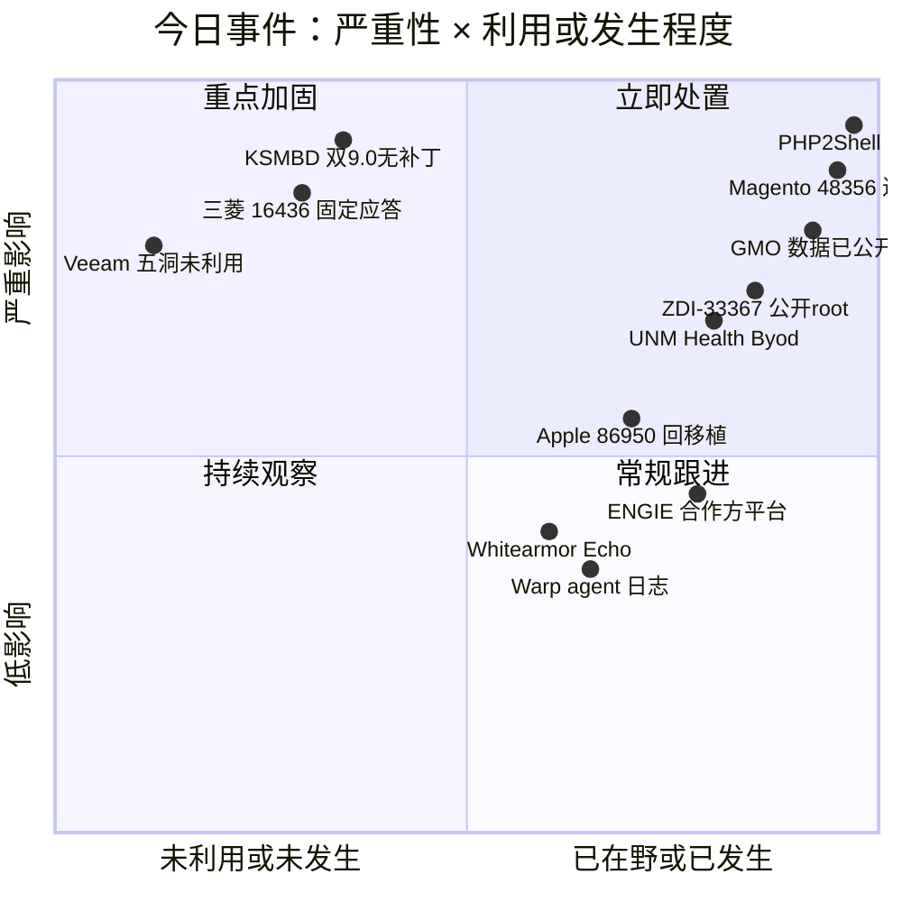
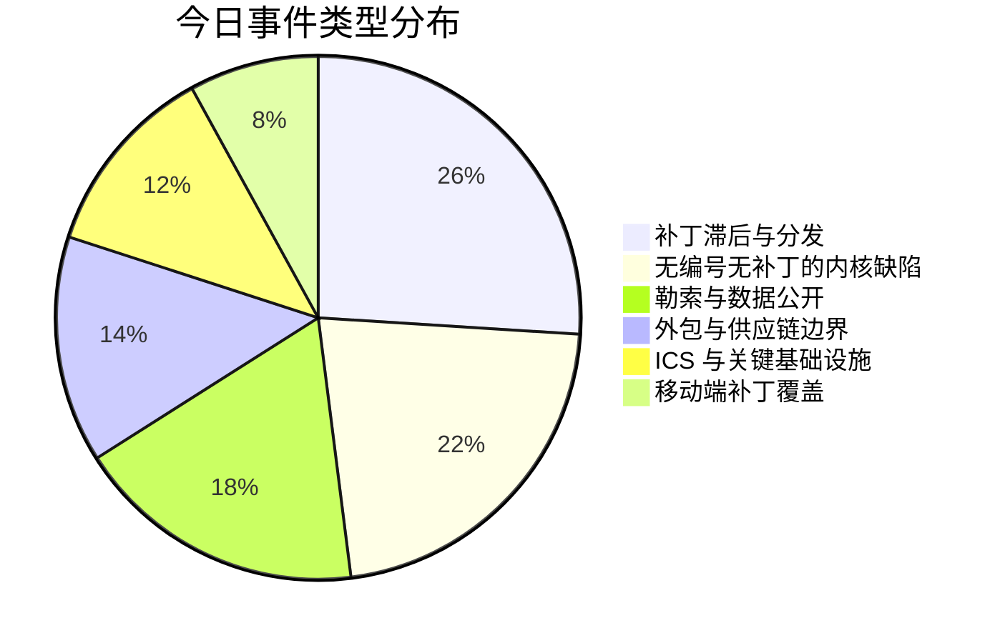
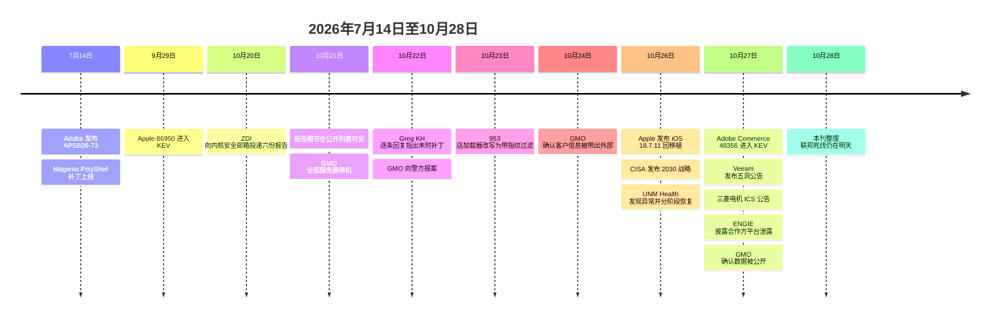
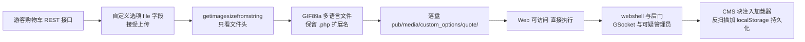
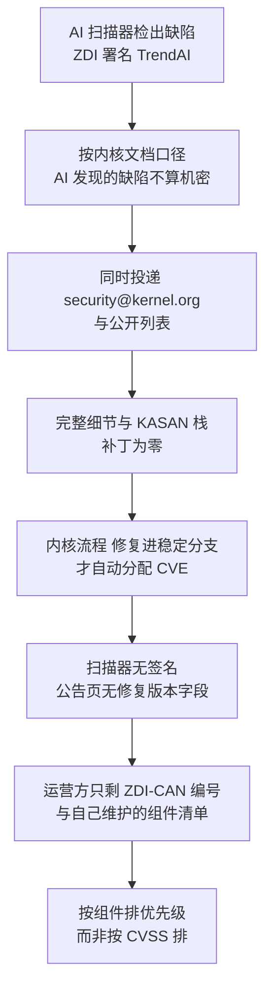

# 网安日报速递 · 2026年10月28日（第 200 期）

> 今日主线：**补丁存在、补丁不存在、补丁根本没法存在——三种状态今天同时到齐。**
> Magento 的洞七月就修了，十月二十七日才进 KEV；Linux 内核那两枚 9.0 至今没有编号和补丁，而同批那枚本地提权已经有了公开的 root 利用清单，覆盖六个发行版家族；Veeam 一次发了五个洞，目前没人利用；三菱电机三条老产品线直接宣布不修，建议换掉；日本 GMO 拒付五千万美元赎金，客户的交易凭据照样被挂到网上；一所州立医院的创伤中心因为勒索事件把救护车改道两小时；法国 ENGIE 的内网完好无损，客户资料是从合作方的营销工具里被拿走的。
> 六件要闻里，只有一件是"补丁没打"。其余五件分别卡在分发、产品寿命、托管边界、应急响应和资产台账上。

---

## 一、Adobe Commerce / Magento CVE-2026-48356 进 KEV：七月十四日的补丁，十月二十七日的利用

**严重程度：严重｜时间：7-14 修复发布，10-27 18:57 UTC 加入 KEV**

CISA 在 **10 月 27 日**把 `CVE-2026-48356` 加入已知被利用漏洞目录（KEV），联邦民事机构限期 **11 月 10 日**前完成修复。这枚洞的补丁叫 **APSB26-73**，发布于 **7 月 14 日**——距今 **105 天**。

**这枚洞长什么样。**Adobe Commerce 与 Magento Open Source 的游客购物车 REST 接口，`/rest/default/V1/guest-carts/{cartId}/items`，自定义选项里那个 `file` 类型字段接受上传。校验只用 `getimagesizefromstring` 看文件头——**一个 `GIF89a` 开头的多语言文件（polyglot）既满足"是图片"，又保留 `.php` 扩展名**。落盘位置是 `pub/media/custom_options/quote/`，Web 可访问，PHP 直接执行。无需登录，CVSS 3.1 向量 `AV:N/AC:L/PR:N/UI:R/S:C/C:H/I:H/A:N`，NVD 记 **9.3**（Adobe 公告标 critical，另一处口径记 9.6，两处不一致，以 NVD 记录为准）。

**受影响的版本跨度很大：**

| 分支 | 受影响上限 | 修复 |
|---|---|---|
| 2.4.9 | 2.4.9 本体 | APSB26-73 对应补丁级别 |
| 2.4.8 | 2.4.8-p5 及更早 | 2.4.8-2026-jul 及更高 |
| 2.4.7 | 2.4.7-p10 及更早 | 2.4.7-2026-jul 及更高 |
| 2.4.6 / 2.4.5 / 2.4.4 | p15 / p17 / p18 及更早 | 各分支 2026-jul 版本 |
| Commerce B2B | 1.3.3 – 1.5.3 | 1.x-2026-jul |

**为什么"三个月前修了"和"今天才进 KEV"能同时成立。**三件事叠在一起：

1. **这枚洞三月就被大规模利用了。**Sansec 的记录是：三月某一小时内，操作者通过 PolyShell 上传的 webshell 在 **471 家店铺**里一次性种下加载器——接近整个战役总量的一半。也就是说，**补丁发布前四个月，利用就已经在跑**。
2. **KEV 是"确认在野"的滞后指标，不是"风险开始"的起点。**Adobe 七月的公告写的是 priority 2、"未发现任何在野利用"。对当时读到这句话就把工单关掉的店铺，那个判断在今天正式失效。
3. **补丁修不了已经在里面的人。**Sansec 在 169 台缺核心补丁的 Magento 2 安装里，发现 102 台（60%）同时有通过 PolyShell 或 SessionReaper（`CVE-2025-54236`）上传的文件；作为对照，另一批 3,024 台被不同 skimmer 感染的店铺里这个比例是 32%。更直接的例子：一台**跑着 2.4.7-p10、核心补丁一个不缺**的店铺，10 月 23 日 16:46 UTC 拿到了新版加载器——**就在一小时前它刚通过一次干净扫描**。eComscan 早在 9 月 16 日就在这台机器上发现了可疑管理员账号，9 月 24 日发现了 GSocket 后门。

**加载器为什么扫不到。**十月的版本把指纹采集做进了加载器本身：检查自动化痕迹，收集硬件信息、屏幕尺寸、时区、语言，再由服务端决定返回什么。urlscan.io 用自动化浏览器打开被感染的店铺，**页面里没有任何注入内容**——攻击者的检测逻辑当场生效。另外它会把代码存进浏览器的 localStorage，域名挂了或被墙了，下次访问照样重放。

**自查用的是数据库查询，不是页面扫描**（Sansec 给的原文）：

```sql
SELECT block_id, identifier, update_time FROM cms_block
WHERE content LIKE '%fpCode%' OR content LIKE '%se_referrer%'
   OR content LIKE '%localStorage.getItem%';
```

`cms_page` 表同样跑一遍，然后：

```bash
find pub/media/custom_options/ pub/media/customer_address/ -type f ! -name '.htaccess'
find . -name 'accesson.php' -type f
```

前者是上传落点，后者是操作者常用文件名。清完脚本还要改**数据库、管理员、API 集成**三处口令——删脚本不会删掉攻击者对数据库的写权限，这是 Sansec 说得最直的一句。

**值得关注的原因：**

- **第一，105 天不是异常值，是中位数附近。**"厂商修了"和"我修了"之间隔着一个组织自己的补丁日历；"我修了"和"攻击者停了"之间还隔着一层后门清理。三段都要走完，KEV 才算处理完。
- **第二，电商的暴露面是公开的。**店铺首页必须对全世界开放，`/rest/default/V1/guest-carts/` 不能只对内网开。这类漏洞没有"缩到内网"这条退路，只能升级或在上游拦路径。
- **第三，扫描器会给你假的安全感。**这次的加载器专门做了反扫描，而"扫描干净"是绝大多数店铺唯一的日常检测手段。**对着数据库和文件系统查，比对着页面查有用。**
- **第四，公开工具已经在了。**10 月 27 日以 Magento 与 PolyShell 为关键词在 GitHub 搜索，返回 14 个仓库，其中至少三个自称提供利用代码，最早的一个建于 4 月 8 日，README 里直接写着"通过 REST API 购物车未认证上传"。

---

## 二、新团伙 Byod 认领 UNM Health：声称 36,000 台，官方只说"终端设备"

**严重程度：严重｜时间：10-26 约 11:00 发现，14:30 起分阶段恢复**

新墨西哥大学健康科学中心（UNM Health）是全州专科医疗的主要提供方，年就诊量 **100 万次以上**，旗舰 UNM Hospital 拥有新墨西哥州**唯一的一级创伤中心**。

| 时间（10-26） | 事件 |
|---|---|
| 约 11:00 | 发现异常，启动遏制，通知州与联邦执法，引入外部伙伴 |
| 12:30 – 14:30 | **限制新收病人，救护车改道**往阿尔伯克基与圣菲的其他医院 |
| 14:30 起 | 系统分阶段恢复 |
| 当日 | **30 多家诊所**的门诊手术与预约停摆；四所健康科学学院课程取消两天，非必要员工回家 |
| 10-27 | 两家医院正常开放，诊所恢复预约；UNM 称**关键电子系统全部回线**，救护车通行恢复正常 |

**官方口径很克制。**UNM 只说"网络安全事件"，**没有使用勒索一词**，也没说原因；评估结论是**影响了部分终端设备，未穿透核心系统与服务器**，能在约一天内恢复是因为 IT 团队与外部伙伴一起把网络重新锁了一遍，目前案件在刑事调查中，能披露的内容有限。

**攻击者口径完全是另一个量级。**上月才出现的团伙 **Byod** 在泄漏站声称拿下 **36,000 台**、两个 Active Directory 林、组策略基础设施、**整个 Microsoft Entra 租户**、两个 Oracle 数据库，以及含 SSN 的学生与员工数据、HR／薪酬、Banner 学籍、内部邮件、研究数据、Cerner EHR 名册。它还向医院员工的电脑推送了一段合成语音，宣称"拿到了你的数据"。**这些数字与清单全部来自攻击者自述，未经独立验证。**

**然后是那句最值得记下来的话。**Byod 宣布给医疗机构**免费的解密密钥**、每名受影响患者最高补偿 **2,500 美元**，同时**保留全部窃得数据**。原话是"我们有道德，也有心，我们不是坏人，但我们仍会继续让公司为其糟糕的安全负责"。它在 FAQ 里把自己的行为称作"渗透测试"，并称会挑选"把消费者当成一个数字的那些顶层公司"。

**值得关注的原因：**

- **第一，"攻击者说的数字"和"受害者能确认的数字"这次差了三个数量级。**36,000 台与"部分终端设备"之间，差的不是统计口径，而是**调查还没做完**。这类事件在头两天唯一可信的结论是"还在查"。
- **第二，医疗机构的停机代价不在系统里，在救护车路线里。**两小时的改道会外溢到邻近医院的急诊排队、等待时长与"未就诊即离开"的比例——这类连锁反应在任何 SLA 里都不体现。2023 年一项针对圣地亚哥某次为期一个月的勒索事件的研究就记录过这个外溢。
- **第三，"有道德的勒索"是话术工程。**免费解密加保留数据，等于把"加密"这层压力去掉，只留"公开"这层压力——**对医院来说，真正付钱的动机从来不是解锁，是不上新闻**。这套话术正是冲着这一点设计的。
- **第四，UNM 不是第一次。**2021 年那次，未授权方 5 月 2 日进入网络，直到 6 月 4 日才发现，影响 **637,252 名患者**。同一个机构、同一类边界问题，隔了五年。

---

## 三、日本 GMO「お名前.com デスクトップクラウド」：拒付八十七亿日元之后，客户数据真的被挂出来了

**严重程度：严重｜时间：10-19 接报，10-20 确认，10-27 12:30 JST 确认数据公开**

（前情：本刊 10-27 期速览提过这起事件"拒付 + 请求政府动用主动网络防御权限"。今天补上完整事实与结局。）

GMO インターネットグループ旗下的 `お名前.com デスクトップクラウド` 是一台台**租给散户跑 MT4/MT5 自动交易**的云端 Windows 桌面。这条业务线的客户把交易账户密码、券商登录信息、自动化脚本全放在这台机器上——**它被攻破，等于把一堆人的券商账户交出去**。

**时间线：**

| 时间（JST） | 事件 |
|---|---|
| 10-19 | 客户反映异常，开始调查 |
| 10-20 | 确认部分客户服务器环境被安装恶意程序；**可能受影响服务器 26,739 台** |
| 10-21 约 04:00 | 所有方案服务器陆续停机，新申请与控制面板访问暂停 |
| 10-21 前后 | 收到约 **80 亿日元（约 5,000 万美元）**赎金要求，要求以 BTC 或 ETH 支付，期限为 10-27 正午 |
| 10-22 | 向警方报案 |
| 10-24 | 第 4 次官方通报：确认客户信息被带出外部；**70 家以上证券／FX 公司**的客户反映出现非本人交易 |
| 10-26 | 预警：攻击者计划公开信息并触发预置勒索软件 |
| **10-27 12:30** | **确认公司与客户相关数据已被公开上网**；要求客户**断网、关机、拔掉所有线缆** |
| 10-27 下午 | 说明预置的勒索软件**始终没有被激活**；威胁对传播泄露数据者采取法律行动 |

**处置与代价。**每名受影响客户补偿 **5,000 日元（约 30 美元）**，与 Trend Micro 合作扫描客户系统、为受损客户提供同等配置的替代机。**支付信息未泄露，但 MT4/MT5 凭据与交易账户信息可能已泄露**，要求客户改密并终止活动会话。单笔交易损失有报道称在 **55 万到 600 万日元**之间（用户自述与单一来源，未经官方确认）。勒索要求中途还出现过一次"降到约 100 万美元（1.5 亿到 1.6 亿日元）"的说法，同样只有单一日本来源。**入侵路径与恶意软件类型，GMO 至今未披露。**

**只有单一来源、置信度低的部分**（来自 ITmedia 一位分析者的记录，不是 GMO 官方）：跨客户 VPS 环境的**共享管理凭据与 Active Directory 配置错误**；分发的 `.rdp` 配置文件里**默认开启的驱动器重定向**被滥用，从客户的云端机器一路摸到客户本地的 PC，窃取浏览器缓存口令与联系人并植入后门。

**值得关注的原因：**

- **第一，"云端那台机器"是信任的最后一环。**券商侧看到的是来自客户常用 IP 的正常登录，二次验证也在同一台机器上。**托管方被攻破，等于所有租户的 MFA 一起失效**。这类共享宿主的业务，隔离边界不能靠"每台 VM 一个 IP"来做。
- **第二，拒付的代价由客户承担。**拒付在原则上是对的，但数据已经在别人手里，公开只是时间问题。**赎金谈判里没有"零成本"选项**，只有"谁付"的区别。
- **第三，威胁声明不必为真，也必须按真处理。**这次预置的勒索软件最终没被激活——但"要不要让两万六千台机器同时断网关机"这个决定，是在**无法验证**的前提下做出的。预案里没有这一条，现场就只能靠公告催。
- **第四，.rdp 的驱动器重定向是个老配置项，配在新业务上。**它在远程桌面场景里默认开启、很多人不知道它把本地磁盘映射进了会话。任何发放 `.rdp` 文件的托管商都该重新看这一项。

---

## 四、Veeam 一次五个洞：备份服务器上"未认证绕过授权"，评 9.1

**严重程度：高｜时间：10-27 发布两份公告（KB4948 / KB4951）**

备份服务器是勒索软件的第一优先目标，所以这类公告的处置优先级不看"有没有在野"，看"它守的是什么"。

| CVE | CVSS v4.0 | 问题 | 修复版本 |
|---|---|---|---|
| **CVE-2026-108142** | **9.1** | CDP Coordinator Service **未认证绕过授权检查**，Windows 与 Veeam Software Appliance 部署均受影响 | VBR 13.1.2（13.1.2.57）／13.0.3（13.0.3.63） |
| CVE-2026-107671 | 8.5 | Veeam ONE：持有有效管理员凭据者可在**完成 MFA 校验之前全局关闭 MFA** | Veeam ONE 13.1 P1（13.1.0.7940） |
| CVE-2026-105477 | 7.3 | Veeam Agent for Linux 被 VBR 管理时的本地提权 | Agent 13.1.2（13.1.2.11） |
| CVE-2026-108140 | 5.9 | 控制被备份 NAS 共享的 Restore Operator 可通过相对路径穿越**向备份服务器写任意文件** | 13.1.2 / 13.0.3 |
| CVE-2026-108141 | 5.9 | 同上，另一个入口 | 13.1.2 / 13.0.3 |

**只影响 13.x，12.x 与 6.x 分支不受影响**——这一点很重要，因为大量环境的迁移还没做完，这次不用为了这五个洞紧急跨大版本。受影响上限：VBR 13.1.1.18 及更早的 13.1 构建、13.0.2.29 及更早的 13.0 构建；Agent for Linux 13.1.1.4 及更早；Veeam ONE 13.1.0.7233 及更早。五个洞全部通过 **HackerOne** 报送，目前**无公开 PoC，无在野确认**。Veeam 自称覆盖 **55 万家以上**组织。

**值得关注的原因：**

- **第一，9.1 那枚是"未认证绕过授权"。**不是"低权限用户能做什么"，而是**连登录都不需要**就能进 CDP 协调服务。这种描述在备份产品上出现，等于把"最后一层恢复能力"的门直接打开。
- **第二，8.5 那枚把 MFA 做成了单点。**能关掉全局 MFA 的功能本身是给管理员用的，问题在于**它在校验完成之前就生效**——攻击者只要有一个管理员凭据，就能把整个租户的 MFA 一次性关掉，后续所有登录都不再有第二因子。
- **第三，5.9 的两枚不该被忽略。**Restore Operator 是个"只管恢复"的低权角色，但它能往备份服务器的文件系统写文件。**备份服务器的文件系统写权限，等价于下一次恢复时投毒的能力。**
- **第四，"暂无在野"是最适合打补丁的时刻。**备份产品一旦被利用，处置成本是重装加重建信任链，不是打一个补丁。

---

## 五、三菱电机 GENESIS64 / ICONICS：固定挑战应答，等于给所有人配了同一把万能钥匙

**严重程度：严重｜时间：10-27 ICS 公告，CVSS 3.1 综合 9.1**

十款产品线一次性覆盖，四枚缺陷里最要命的那枚不是内存问题，是**逻辑上根本没有"每个用户不同"这个概念**。

| CVE | 问题 |
|---|---|
| **CVE-2026-16436** | **口令找回用了固定的挑战应答，所有用户共用同一个答案**——远程攻击者无需有效凭据即可解锁系统 |
| CVE-2023-4863 | 导入构造文件触发 libwebp 堆越界写（需已认证的本地用户），GENESIS64 / ICONICS Suite 受影响 |
| CVE-2026-16437 | 已认证的本地管理员可通过篡改保存挑战应答的管理文件来解锁系统 |
| CVE-2026-16438 | 权限分配错误，导致本不该有的任意操作（信息泄露或拒绝服务） |

**受影响与修复：**

| 产品 | 受影响 | 修复 |
|---|---|---|
| GENESIS64 / ICONICS Suite | 10.97 – 10.97.2 | **10.97.3 或更高** |
| GENESIS | ≤ 11.03 | **11.04 或更高** |
| Hyper Historian / AnalytiX / MobileHMI | ≤ 10.97.3 | 随 10.97.3 线 |
| IoTWorX | ≤ 10.97.3 | **10.98 或更高**（Docker Hub 拉取） |
| **MC Works64 / GENESIS32 / BizViz** | 全版本 | **无修复计划，厂商建议替换** |

**临时缓解只有一条，但要求很具体：**删除并重建 `ClientChallengeTable.dat`（或 `SecurityChallenges.dat`），并给新文件设置受限 ACL。这不是"打个配置就行"——**这个文件本身就是那枚万能钥匙的存放处**，重建之后旧的挑战应答才失效。

**值得关注的原因：**

- **第一，这是把"找回密码"做成了后门。**固定挑战应答的设计目的通常是"现场工程师忘了密码也能进"，代价是**任何知道这个固定值的人都能进**。SCADA/HMI 这类系统的物理隔离假设正在失效，这条假设就不成立了。
- **第二，"不修了，换掉"是这次真正的结论。**MC Works64、GENESIS32、BizViz 三条线直接宣布没有修复计划。**对还在跑这三条线的工厂，今天要做的不是打补丁，是排迁移预算**——而这类系统的迁移周期以年计。
- **第三，和 CVE-2023-4863 打包发布说明依赖树还没换。**libwebp 那枚 2023 年的洞出现在 2026 年的公告里，意味着产品仍然链着老版本解码库。**这类"顺带修"的条目，通常是产品线维护投入的直接读数。**

---

## 六、法国 ENGIE：内网完好，客户资料是从合作方的营销工具里被拿走的

**严重程度：中｜时间：10-27 公开**

ENGIE 在 30 个国家运营，9 万余人，去年营收 719 亿欧元。10 月 27 日它确认：攻击者攻破了**业务合作方使用的一个营销／获客平台**，客户数据由此被拿走。**"我们的内部 IT 系统没有被攻破"这句话是真的**，公司也已经切断了攻击者对该平台的访问。

**被拿走的字段，组合起来就是一套定向诈骗材料：**姓名、邮寄地址、电子邮件、电话、客户编号、合同编号，以及能源行业特有的**交付点编号（PDL）或计量估算点编号（PCE）**。范围仅限**法国客户**；**不含银行数据**；已通知监管机构（法国 CNIL）并逐户告知，提醒防范欺诈与钓鱼。ENGIE 未做归因，到发稿时没有勒索或窃密团伙认领。

**值得关注的原因：**

- **第一，"内部系统没事"和"客户数据被拿走"可以同时为真。**这句话回答的是"我的边界牢不牢"，而客户资料并不只存在自己的系统里——它也在合作方用于获客和营销的工具里，**而那一层通常不在安全团队维护的资产台账上**。营销工具往往由业务部门直接采购，和核心系统不在同一份清单里。
- **第二，PDL / PCE 把一份名单变成了"能对应到具体用能位置"的名单。**这大幅提高后续电话与邮件诈骗的可信度——对方能说出你家表计编号。
- **第三，这是一年多里的第二次，走的是同一条路。**一年前，Scattered LAPSUS$ Hunters 曾泄露一批据称来自 ENGIE 北美零售子公司 Engie Records 一个 Salesforce 实例的记录。**同一个失效点重复出现，说明问题在"外部平台"这一层的持续清点，而不是边界强度。**

---

## 七、速览

### 7. KSMBD 两枚 9.0 的增量：公开 PoC 已在六个发行版家族拿到 root（前情见 10-23 期）

10-23 期报过的部分是：六份报告、全部抄送公开列表、无一附补丁、两枚 KSMBD 各 9.0、没有 CVE 编号、主线与 linux-next 均无已命名修复、Greg Kroah-Hartman 逐条回复指出未附补丁。**今天的新增事实有三条。** 一，同批里那枚本地提权 `ZDI-CAN-33367`（7.8）**已有公开 PoC**，TuxCare 用它拿到 root 的清单是 **AlmaLinux 8 到 10、CloudLinux 9 与 10、Debian 12 与 13、Ubuntu 24.04 与 26.04**——不是理论风险，是可复现的清单。二，**这条路径不在 Dirty Frag 页缓存缺陷的修复覆盖范围内**，回移植过 Dirty Frag 补丁的发行版不会自动免疫；Sysdig 提的缓解是关闭非特权 user namespace，但 rootless 容器建在这上面，且 TuxCare 未验证它有效。三，修复状态更具体了：`ksmbd` 竞态修复**已在维护者 Namjae Jeon 的树里**，SMB Direct 下溢预计随**面向 7.5 的重构**覆盖；截至 10-23，AlmaLinux 的修复内核只在 testing 通道，**按修复版本号判断的扫描器会把生产机读成"未受影响"**。

### 8. Apple 把 CVE-2026-86950 回移植到 iPhone XS / XR 一代

10 月 26 日发布的 **iOS / iPadOS 18.7.11** 把 CoreGraphics 越界写（`CVE-2026-86950`，CWE-787，Meta Product Security 报送）的修复带到 **iPhone XS / XS Max / XR、iPad 第 7 代、iPad Air 第 4 代及以后、iPad 第 9 代及以后、iPad mini 第 6 代及以后**。这枚洞九月已在 iOS/iPadOS 26.7.1、macOS Tahoe 26.7.1、Sequoia 15.8.1 修过，KEV 9 月 29 日收录、联邦限期 10 月 2 日（前情见本刊 9 月底至 10 月初各期）。同期 **27.2 一次修了 286 个问题**（iOS/iPadOS 163、macOS 263，约 140 个重叠），其中 `CVE-2026-86990` 是恶意 App 未经许可调用相机，`CVE-2026-65339` 是逻辑问题导致敏感信息泄露。**关键点是那条时间差**：新系统先拿到补丁，旧机型等了约一个月——**在攻击者眼里，"官方仍支持"和"已打补丁"是两件事**。

### 9. Whitearmor 挂上 Echo Global Logistics，开价 1,000 万美元

10 月 28 日上架，索要 **1,000 万美元等值 BTC**。自称持有：**206 万条理赔记录、153,727 条货运单、261,440 条报价（7.05 亿美元采购量）、136,273 条投标、59,607 条轨迹记录、3,890 条含邮箱的员工身份映射、2,418 家客户、9,122 家承运商**，以及仓库地理数据。这些数字都是**攻击者自述**，未经独立核实。

### 10. Warp：第三方供应商被入侵，泄露的是 agent 的决策日志

agentic 开发环境 Warp 披露，其基础设施中一家第三方供应商被入侵，**泄露了用户的 agent 决策日志与遥测数据**。对使用 agent 写代码的团队，这比"代码泄露"更难评估——**决策日志里通常包含被读取的仓库路径、被调用的工具、被拒绝的操作，以及模型为了完成任务而尝试过的全部中间步骤**。

### 11. PHP2Shell：欧盟四方联合声明，明天是联邦死线

ENISA 联合欧盟委员会、CERT-EU、欧洲刑警组织发布声明，要求立即排查受影响系统并部署更新；加拿大网络安全中心、荷兰国家网络安全中心同步预警。CISA 的 KEV 死线是 **10 月 29 日**（前情见本刊 10-21 至 10-27 各期）。CYFIRMA 记录了 **216 台**被筛选的目标主机，集中在政府、金融、制造、物流，慢速低频、一遇阻断即轮换。**OpenAI 与 Wiz 各自独立发现**了相关缺陷——这枚洞从发现到补丁再到在野，全程有 AI 参与，这一点比漏洞本身更值得记一笔。

### 12. DreamHost 强制重置部分邮箱与 SFTP 口令

主机商 DreamHost 在安全事件后**强制重置了部分邮箱与 FTP／SFTP 账号的口令**，受影响范围包括 File Manager 与 webmail。浏览器版 File Manager 已于 10 月 26 日恢复，但受影响用户需由账号所有者重新下发凭据才能重新登录。**事件性质与受影响账号数量均未披露**——对托管商而言，"不说数量"本身就是一种表态。

### 13. CISA 发布 CISA 2030 战略

10 月 26 日发布《CISA 2030: Defend, Harden, Prevail》，三大支柱，承诺 **180 天内**拿出实施计划。对防守方的实际影响要等实施计划落地，但它确定了未来几年美国关键基础设施侧的资源投向。

---

## 八、风险分析







**Magento 这条链的完整走向：**



**KSMBD 这批为什么防守方"看不到"：**



---

## 九、出处

**Magento / Adobe Commerce**

- Zero Hunt（10-27 21:17 CET）— KEV 加入时间、APSB26-73 三个月差、版本矩阵、CISA 到期 11-10、勒索使用未知：<https://zerohunt.ai/blog/adobe-commerce-cve-2026-48356-file-upload-kev>
- Sansec 原始研究经转述 — 游客购物车接口、`getimagesizefromstring` 校验、落盘目录、三月 471 店一小时、169 台中 102 台：<https://sansec.io/research/magento-polyshell>
- Brandefense — 60% 对照 32%、2.4.7-p10 一小时内复发、9 月 16 日可疑管理员与 9 月 24 日 GSocket、GitHub 14 个仓库中三个含利用代码：<https://brandefense.io/security-news/magento-cms-block-loader-hides-from-scanners-953-stores>
- PrivateDevOps — CMS 查询语句原文、`accesson.php`、上传目录排查命令、SessionReaper 对照：<https://privatedevops.com/news/magento-cms-block-loader-953-stores>
- Cyfar / 加拿大网络安全中心（10-27 四份公告）— KEV 条目标注与联邦到期日：<https://cyfar.ca/posts/cyber-centre-daily-advisory-digest-2026-10-27-4-advisories>

**KSMBD / ZDI 公开投递**

- CyberSecureFox — 两枚 9.0 机制、Red Hat 不受影响的确切理由、10-22 时主线与 linux-next 均无修复、Metacmacher 的重构计划：<https://cybersecurefox.com/en/ksmbd-linux-kernel-rce-zdi-can-33549-33774>
- TECH VEDA（10-27）— 六份报告投递日期与名单、Greg KH 原话、ZDI 署名 TrendAI、Linux 7.4 移除 `__get_user` 的旁证：<https://www.techveda.live/2026/10/27/linux-7-4-removes-get-user>
- deniz.in — 33367 公开 PoC 打通的发行版清单、Dirty Frag 修复不覆盖、Sysdig 建议关闭非特权 user namespace、AlmaLinux testing 通道状态：<https://deniz.in/public-root-exploit-surfaces-for-one-of-six-linux-kernel-flaws-still-without-cve>
- dev.to（10-26）— 30 秒自查命令、KSMBD 与 Samba 的区别、同批其余四枚的性质区分：<https://dev.to/theglitchfixer/ksmbd-vulnerability-your-nas-runs-samba-but-is-it-the-kernel-one-4hhm>

**GMO お名前.com デスクトップクラウド**

- BleepingComputer（10-27）— 26,739 台、80 亿日元、断电拔线原话、5,000 日元补偿、勒索未激活、法律行动表态、MT4/MT5 凭据：<https://www.bleepingcomputer.com/news/security/japans-gmo-urges-customers-to-shut-down-pcs-amid-ransomware-threat/>
- ATLABYTE（10-27）— 12:30 确认公开、Trend Micro 协作、免费替代机、数据外泄与赎金时间线：<https://atlabyte.com/en/news/japan-s-gmo-group-urges-customers-to-power-down-pcs-after-ransomware-threat>
- Threadlinqs TL-2026-4580（10-28）— 逐日时间线、70 家以上券商、单笔 55 万至 600 万日元、单源说法（共享管理凭据、AD 配置错误、.rdp 驱动器重定向）及其置信度标注：<https://intel.threadlinqs.com/threat/TL-2026-4580>
- 搜狐（10-27）— 中文口径与业务背景（云端跑 MT4/MT5 自动交易）、10-19 至 10-21 处置节奏：<https://www.sohu.com/a/1093536293_122255084>

**Veeam**

- SecurityOnline（10-27）— 五枚 CVE 矩阵、KB4948 与 KB4951、受影响构建号、仅 13.x、HackerOne 报送、无在野：<https://securityonline.info/veeam-vulnerabilities-backup-replication-veeam-one>

**三菱电机 GENESIS64 / ICONICS**

- Cyfar（10-27）— 四枚 CVE 与综合 9.1、固定挑战应答机制、十条产品线的受影响与修复版本、无修复产品线清单、`ClientChallengeTable.dat` 缓解：<https://cyfar.ca/posts/mitsubishi-electric-genesis-genesis64-iconics-suite-hyper-historian-analytix-mobilehmi-iotworx-m>

**ENGIE**

- BleepingComputer（10-27）— 合作方营销平台、仅法国客户、字段清单含 PDL 与 PCE、无银行数据、未归因、一年前 Engie Records 的 Salesforce 事件：<https://www.bleepingcomputer.com/news/security/energy-giant-engie-discloses-data-breach-affecting-customers/>
- 网易号「Fnet 云网安」（10-28）— 中文口径与"内部系统没事不等于客户数据没事"的分析角度：<https://www.163.com/dy/article/LAAQPQB305384JSS.html>

**速览条目**

- SQ Magazine（10-27）— iOS 18.7.11 覆盖机型、27.2 的 286 个修复、86990 与 65339 的报告者、九月与十月的补丁时间差：<https://sqmagazine.co.uk/apple-coregraphics-zero-day-old-iphones-ios/>
- CyberMaterial 简报（10-27）— 286 个修复的拆分（iOS 163 / macOS 263）、KEV 收录日与联邦到期日、CISA 2030 与 DreamHost：<https://www.cybermaterial.com/p/cyber-briefing-october-27-2026>
- BleepingComputer（10-27）— UNM Health 处置时间线、Byod 的 36,000 台与数据清单、免费解密密钥与每患者 2,500 美元、官方"未穿透核心系统"口径：<https://www.bleepingcomputer.com/news/security/unm-health-ransomware-attack-disrupts-patient-care-surgeries/>
- nm.news（10-27）— 本地口径：救护车改道时间窗、30 多家诊所、四所学院停课、1,000 万次年就诊量背景：<https://nm.news/2026/10/27/ransomware-group-claims-unm-hack-as-health-clinics-reopen/>
- HackerFeeds（10-28）— Whitearmor 对 Echo Global Logistics 的完整索价与数据条目清单：<https://hackerfeeds.com/ransomware/echo-com-by-whitearmor-1fczn>
- Cybersecurity Tracker（10-28）— Warp 第三方供应商事件、agent 决策日志与遥测的表述、Oracle PeopleSoft 35273 的 KEV 状态：<https://cybersecuritytracker.ai/>
- 光明网经今日头条（10-28）— ENISA 与欧委会、CERT-EU、欧洲刑警组织联合声明、CYFIRMA 216 台、OpenAI 与 Wiz 各自独立发现：<https://www.toutiao.com/article/7701548956576989734/>
- 腾讯新闻 / IT之家（10-28）— CISA 确认在野、三日修复要求、70% 网站依赖 PHP、历史处置背景：<https://news.qq.com/rain/a/20261028A02RQE00>

---

*本刊每日择要整理，CVE 编号与 CVSS 以 NVD 与厂商公告为准。文中"攻击者声称"类数据均未经独立验证，已逐条标注来源口径。*
