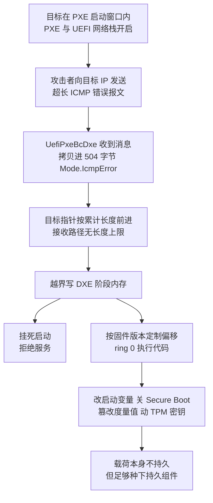
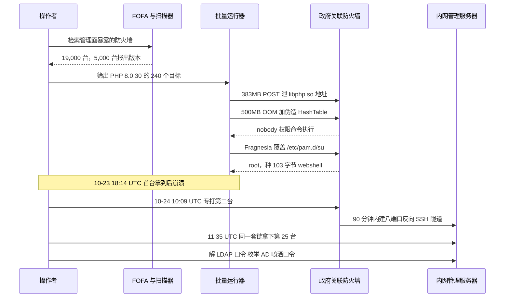
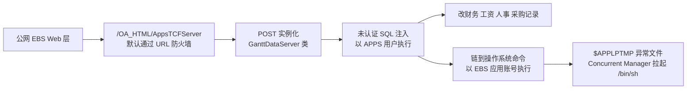
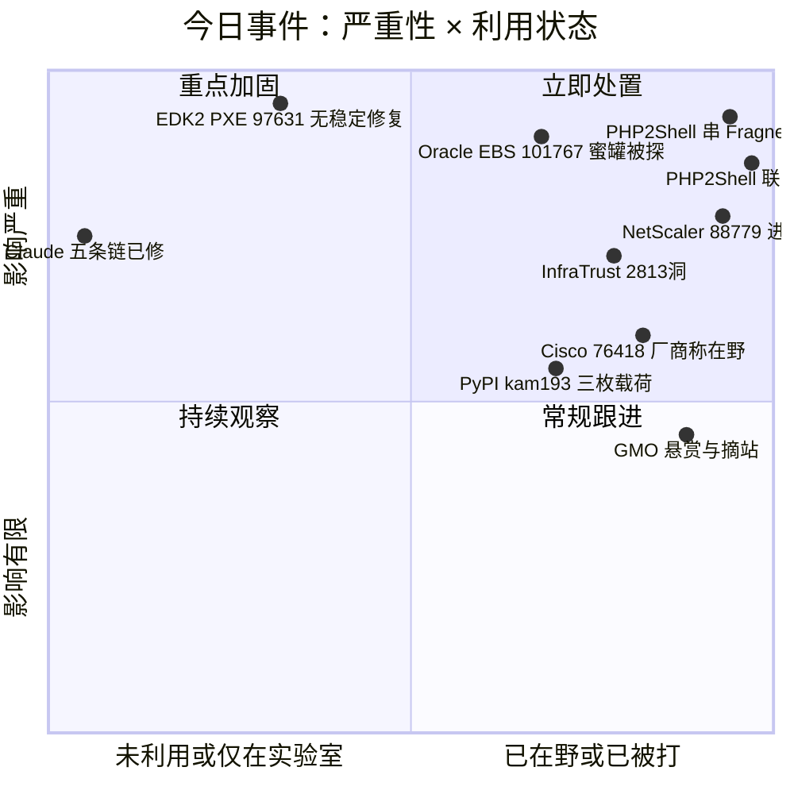
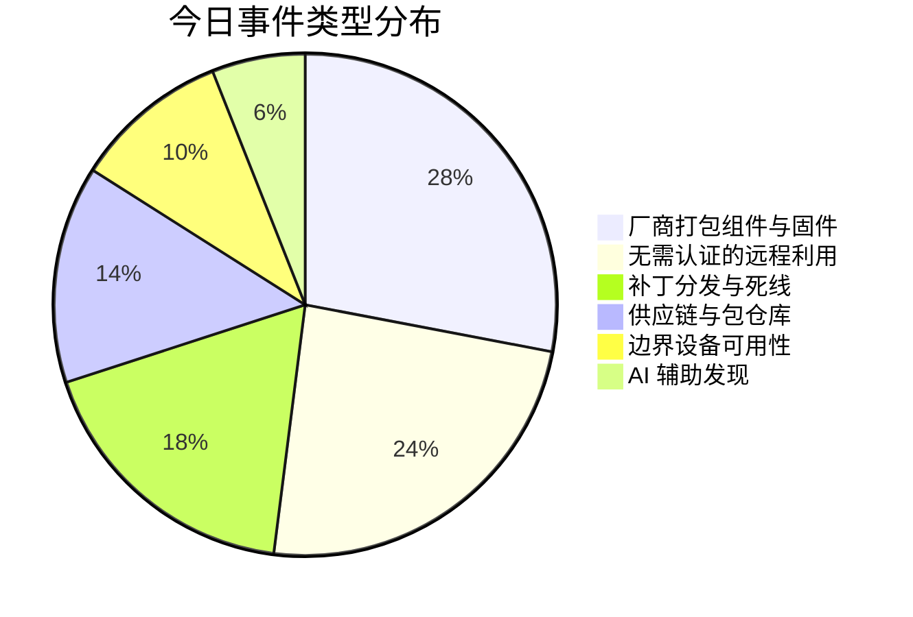
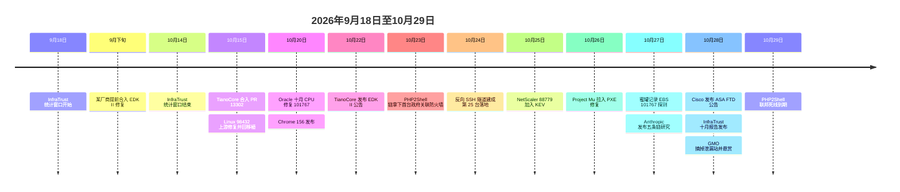

# 网安日报速递 · 2026年10月29日（第 201 期）

> 今日主线：**六件事，五件修不修不由你决定。**
> UEFI 参考实现里的 PXE 驱动有一条从 2010 年 11 月躺到今天的越界写，源码修了但没有任何稳定版包含它；防火墙固件里那份 PHP 8.0.30，客户连包都装不了，只能等厂商重灌固件，有人在十五分钟里用它拿到 root；ERP 的 TCF servlet 默认就在 URL 防火墙白名单里，补丁发布第七天蜜罐上就有人试；边缘设备一个月冒出 2,813 个洞，58 个不需要认证；思科的 SSL VPN 又一次因为一条没检查的返回值重启，厂商说在野，NVD 还写着 none。
> 第六件事是找洞的那一侧：一个还没发布的模型一次串出五条能跑通的链，其中一条零点击从网络拿到 root，验证用了 53 分钟。

---

## 一、TianoCore EDK II PXE 驱动 CVE-2026-97631：504 字节的缓冲区，没人检查的十六年

**严重程度：严重（CVSS v4 9.5）｜时间：10-22 TianoCore 公告，源码 10-15 合入，稳定版至今无修复**

`CVE-2026-97631` 在 `NetworkPkg/UefiPxeBcDxe`，也就是让服务器从网络而不是本地盘加载启动镜像的那个驱动。EDK II 不是一个厂商的代码，它是 AMI、Insyde、Phoenix 共同的上游，微软加固过的 Project Mu 分叉里也带着同一份有问题的组件。换句话说，**这条洞在全世界数据中心的地板下面**。

**它长什么样。**PXE 启动期间，这个驱动会挂着一个接收请求等 ICMP 错误消息，每收到一条就拷进一个固定 **504 字节**的字段 `Mode.IcmpError`。问题出在拷贝循环的边界判断：IPv4 的 `PxeBcIcmpErrorDpcHandle` 与 IPv6 的 `PxeBcIcmp6ErrorDpcHandle` 都写错了，目标指针按**累计长度**前进而不是按**单条报文长度**前进，接收路径上也没有任何一处提前拦下超长报文。于是一条超长的 ICMP 错误消息就能把攻击者控制的字节写到字段外面。

**能造成什么。**最低限度是把启动过程挂死，也就是拒绝服务。如果攻击者知道目标固件的具体版本，公告的说法是这次溢出可以被引导成在 DXE 阶段执行攻击者代码，那是 ring 0，**发生在操作系统加载之前，也发生在 Secure Boot 与度量启动验证任何操作系统组件之前**。载荷本身不持久，但跑一次足够种下持久的东西：改启动变量、关掉 Secure Boot、篡改度量值让远程证明报出一个干净状态。Dragos 首席研究官 HD Moore 对 Ars Technica 点了一个具体用途：那个阶段仍然能碰到 TPM 这类敏感部件，**拿来破坏磁盘加密是现实可用的方向之一**。

**触发条件需要三个同时成立：**固件里 PXE 网络启动开着（数据中心为了批量装机，很多是开着的）；目标正处于 PXE 启动窗口内（窗口很窄，但每次重启都重来一遍）；攻击者能把 ICMP 送到目标所在网段。Eclypsium 首席研究员 Jesse Michael 补了一句关键的：利用需要猜具体内存地址，**每个型号、每个固件版本、每种配置都得单独调**，不能对着一个机群盲打。

**时间线比漏洞本身更值得看。**

| 时间 | 事件 |
|---|---|
| 2010-11 | 提交引入缺陷，此后十六年未变 |
| 2026-09 | AMI 在公开 PR 中提交修复，细节随之可见 |
| 2026-10-15 | TianoCore 合入 PR #13302 |
| 2026-10-22 | TianoCore 发布公告，仍标注 Not patched currently |
| 2026-10-26 | 微软 Project Mu 拉入修复并构建带标签版本 |

漏洞由 **Anthropic 的 Alex Matrosov 与 Google 的 Dan Holmes** 发现，原定的协调披露是**明年 1 月**。AMI 九月的提前修复把这个计划打散了。现在的情况是：源码修了，公告发了，**没有任何一个稳定版包含修复**，RHEL 8/9/10、SUSE、Debian 的 edk2 包全部标为未修复，影响范围列到 `edk2-stable202608`。攻击者今天就能读着补丁反推触发条件。

**能做什么。**不需要网络启动的机器，进固件设置把 PXE 与 UEFI 网络栈一起关掉，这是唯一一步到位、立刻生效的动作。确实依赖网络启动的，把启动流量关进独立网段，并盯厂商支持页面上带 `CVE-2026-97631` 字样的固件更新。好消息是这次不需要吊销证书、不需要推吊销列表，就是一个 BIOS 更新的代码修复；坏消息是它得穿过几千棵 OEM 固件树，每棵都要重编、验证、再有人愿意去刷。

**值得关注的原因：**

- **第一，"开源等于被审计过"这句话今天又一次失效。**同一个 EDK II 网络栈在 2024 年初出过 PixieFail 一整批，后续的模糊测试没有命中这一条。十六年、一个固定大小缓冲区、拷贝循环写错边界，这不是深奥的逻辑缺陷，是没人看。
- **第二，固件漏洞的修复路径是"分发"而不是"打补丁"。**操作系统补丁一个 yum 更新就到手了；这一条要等 OEM 重编、企业验证、停机窗口、有人真的去刷。中间任何一环卡住，洞就一直在。
- **第三，它绕过的正是你最信的那一层。**Secure Boot、度量启动、远程证明，这三样在攻击者眼里都建立在"启动早期没有被改过"这个假设上。这条洞打的恰好是假设本身。

---

## 二、PHP2Shell 串 Fragnesia：一次 HTTP 请求换到 root，全程不到十五分钟

**严重程度：严重｜时间：10-25 观测，10-28 公开（Dream 研究）**

这条不是新漏洞，是**新的用法**。前面几期反复讲的 `CVE-2026-109618` 与 `CVE-2026-109619`（CVSS 9.2）被做成了一个**不基于任何公开 PoC 的自研实现**，针对某家大型厂商防火墙的管理面专门调过；它与 Linux 内核的 `CVE-2026-46300`（Fragnesia，CVSS 7.8）串起来，**在一条 HTTP 请求里从无凭据走到 root**。

**两步怎么走。**第一步打的是防火墙 `appweb` 管理服务上那份 **PHP 8.0.30**，走 `session.upload_progress` 机制：先灌 **383MB** 的 multipart POST，通过一个 cookie 头把 `libphp.so` 的内存地址泄出来，再触发一次 **500MB** 的 OOM 状态，最后伪造 HashTable 条目，**以受限的 nobody 用户执行命令**。第二步解决"nobody 改不了系统文件"这个问题：SELinux 挡着，于是走 XFRM ESP-in-TCP 子系统里的 Fragnesia，用页缓存写入覆盖那个 **774 字节的 `/etc/pam.d/su`**，换成 `pam_permit.so`。**之后 su 不需要密码就是 root。**

**侦察到落地是一条流水线。**操作者用 FOFA 抓了约 **19,000 台**管理界面暴露在公网的防火墙，自写版本扫描器让其中约 **5,000 台**报出了版本号，再筛到跑 PHP 8.0.30 的那批，剩下 **240 个目标**交给批量运行器自动打。第一轮拿下 **24 台**，每台种一个 **103 字节的 PHP webshell**，验证 root，把主机名与 IP 写进 CSV。其中 **22 台只是把 shell 停在那里**，没有后续动作。

**然后是那条从边界走进内网的路径。**两个命中目标属于一处与美国政府关联的网络。第一台在 10 月 23 日 18:14 UTC 拿到 root 后不久崩溃，再没回来；操作者在 10 月 24 日 10:09 UTC 专门打了第二台，**90 分钟内建起一条八端口反向 SSH 隧道**，11:35 UTC 顺着这条隧道拿下第三台：一台**只能从内网访问**的防火墙管理服务器。总数 **25 台**。

**进去之后的目标很明确，就是身份。**用 root master key 解 LDAP 服务账号口令，枚举 AD 用户与组，然后用"组织主题"的口令对**每一个账号**做喷洒。这里有一个致命配置：**该域的锁定阈值是 0**，等于不限次数。还尝试创建后门 AD 账号，以及从 Keycloak 服务器里导出 SAML 签名密钥。是否真的拿到有效凭据、是否真的建成后门账号，研究方说**不确定**，因此这起事件的完整影响范围也**无法确定**。

**AI 的那部分要分开说。**研究方在操作者基础设施上找到了 **Claude Code 的安装、FOFA 的 API key，以及一个叫 aiscan 的攻防平台**，后者配置了 DeepSeek 与 Kimi 的模型。近 **40 个脚本**在代码结构、注释风格与一致性上表现出 AI 辅助开发的痕迹。研究方同时写明：**没有直接证据表明 AI 被用来写这个漏洞利用或这些后渗透脚本**。另外还有 **11 个 JSON 版本配置文件**，说明操作者在虚拟实验室里先提取固件库、调好堆偏移，再出去打。

**值得关注的原因：**

- **第一，"PoC 打不动真实目标"这句话在今天被打破了一半。**地下论坛这几天的主流说法是这枚洞"实际不可利用，真实目标需要每份 `libphp.so` 构建专属的偏移，没法暴力试"。这个案子给出的答案是：**自己调一份**。实验室、固件库、11 个版本配置文件，工作量是可以量化的，不是玄学。
- **第二，SELinux 不是终点。**很多加固清单把"开 SELinux"当作拿到 web 权限之后的止损点。这里它确实挡住了改系统文件，然后攻击者换了一条路：**改内核页缓存里那份 PAM 配置**。限制用户态写权限，挡不住内核态写页缓存。
- **第三，锁定阈值为 0 是这起事件里最便宜的那个漏洞。**不需要 CVE，不需要 PoC，只要一次成功的凭据枚举就能无限次试。前两个洞是入口，这一条才是能横向铺开的原因。
- **第四，22 台只是"停着"的 shell。**这类资产通常不会自己消失：补丁打完、日志清完，那些 webshell 还在原地等人回来。**这也是为什么"补丁不等于清除"在这类边界设备上格外重要。**

---

## 三、Oracle E-Business Suite CVE-2026-101767：补丁发布第七天，蜜罐上就有人在试

**严重程度：严重（CVSS 9.8）｜时间：7-24 报送，10-20 CPU 修复，10-27 蜜罐记录探测**

漏洞在 `Oracle Application Object Library` 的 Thin Client Framework servlet，路径 `/OA_HTML/AppsTCFServer`。**关键的一句是：这个端点默认就在 EBS 的 URL 防火墙白名单里。**也就是说，一套按默认配置部署、直接对公网开放的 EBS，天然暴露。

**利用链两段。**先是一个不需要认证的 SQL 注入，以 **APPS 数据库用户**身份执行 SQL；然后从数据库走到操作系统，以 **EBS 应用账号**执行命令。投放的方式是构造 POST 请求让 servlet 实例化 `oracle.apps.jtf.gantt.server.GanttDataServer` 这个类。APPS 是 EBS 的中心 schema，权限很宽，所以这条链的风险不是"读到数据"，而是**能改数据**：悄悄改掉供应商的收款账号、改掉一条工资记录，比一次性拖库更难被发现，烧得也更慢。

**影响版本与时间线。**

| 项目 | 内容 |
|---|---|
| 受影响版本 | EBS 12.2.3 – 12.2.15（Oracle 称更早的不支持版本很可能同样受影响） |
| 报送 | Horizon3.ai 的 Brandon Peterson、Jimi Sebree、Noah King，2026-07-24 |
| 修复 | 2026-10-20 十月 CPU，属该批 194 个 EBS 补丁之一 |
| 首次探测 | 2026-10-27 上午，Defused Cyber 的 EBS 诱饵记录到 exploratory exploits |
| KEV | 尚未收录 |

**探测不等于被攻破，这个区分必须保留。**Defused 记录的是打在自己诱饵系统上的流量，没有任何组织声称因此被入侵，SecurityWeek 也写明没有其他在野利用报告。但诱饵被打中的意义在于：**已经有人把这条链读到能对准目标的程度，正在找目标。**

**为什么这件事今天值得单列。**距今最近的两次同产品事故摆在那里：`CVE-2025-61882` 被 Cl0p 用来打了 100 多家组织，`CVE-2026-46817` 在今年 6 月就被 Defused 记录过攻击。EBS 是财务、工资、人事、采购的落脚点，这类系统在企业里的补丁窗口通常按季度算。**补丁到首次探测之间隔了七天，比大多数企业的变更窗口都短。**

**临时缓解就两条，都有代价。**把 `/OA_HTML/AppsTCFServer`（对应 `oracle.apps.fnd.tcf.SocketServer`）从 EBS URL 防火墙白名单里移出去；把 EBS Web 层的访问限制在可信网段。前者是把路堵上，**漏洞代码还在原地**，而且依赖 TCF 的功能可能受影响，改完要走正规变更流程，否则下一次普通配置变更会把这个白名单悄悄恢复。后者有个常见误操作：**"可信网段"里绝对不能包含放公网站点的那一段**。

**失陷痕迹怎么找：**未经认证的 POST 请求实例化 `GanttDataServer` 之后紧跟数据库探查（版本、当前用户、目录对象）；`$APPLPTMP` 目录出现意外文件；oracle 账号通过 Concurrent Manager 拉起 `/bin/sh`。

---

## 四、Eclypsium InfraTrust 十月报告：一个月 2,813 个洞，PHP 被编进了固件

**严重程度：高｜时间：10-28 发布，统计窗口 9-18 至 10-14**

这份月报的数字本身就有分量：**18 家厂商、133 条新公告、2,813 个漏洞**，其中 **37 条严重**、**5 条满分 10.0**、**58 条可远程未认证利用**。更值得看的是另一项：**16 条公告在发布当时就带着已进 KEV 的漏洞**，也就是发公告的时候，攻击已经在跑了。

**PHP2Shell 在这里暴露了一个结构性问题。**大家讨论这枚洞时盯的是网站和 PHP 应用，但 PHP 同样被编进了防火墙、应用交付控制器、VPN 网关、NAS 的**管理界面**。厂商把 PHP 编译进固件，**客户装不了 PHP 官方的安全更新**，只能等每一家厂商重灌固件、重新发版。披露之后很快确认受影响、且当时修复还在开发中的厂商名单里有 **Palo Alto Networks、F5、NetScaler、Check Point、QNAP**。InfraTrust 的建议很直接：补丁到之前，**把 PHP 支撑的管理界面从公网撤下来**。

**同一份报告里另一条线是"别人打包进来的老组件"。**`CVE-2026-31431`（Copy Fail，Linux 内核提权）已经从六家厂商 19 条公告扩散到**八家厂商 29 条公告**。再往下还有更老的：HP LaserJet Enterprise 打印机固件里嵌的 Android 内核旧漏洞，Dell Data Lakehouse 里一份 2020 年的 jQuery。

**修补顺序报告也给了。**第一批是 **NetScaler 与 Ivanti Connect Secure**，理由是这两类是远程接入网关，本身就是进内网的门；第二批是 Fortinet 10 月 22 日的 FortiOS / FortiManager / FortiAnalyzer 更新；第三批依次是 Check Point 安全管理服务器、Cisco Catalyst SD-WAN Manager、VeloCloud Orchestrator、FortiMail、Cisco Secure Email Gateway、BIG-IP APM、PAN-OS 管理口。

**值得关注的原因：**

- **第一，这解释了为什么"我们资产台账里没有这台设备"是最危险的一句话。**报告点出的这批设备都在网络边缘，或者用来管别的设备。它们的补丁节奏跟服务器不是一套流程，很多组织连清点都靠人工。
- **第二，PHP2Shell 在这类设备上是"等"而不是"打"。**网站可以今晚升级 PHP，防火墙只能等固件。这中间的时间差，靠的是把管理口收进内网这一个动作。
- **第三，满分 10.0 的五个洞不是零日，是技术债到期。**同一批组件被反复打包、反复不做版本清点，迟早会以这种形式出现。

---

## 五、Cisco ASA / FTD CVE-2026-76418：厂商说在野，NVD 还写着 none

**严重程度：高（CVSS 3.1 8.6）｜时间：10-28 Cisco 公告，10-29 HKCERT 通报在野**

漏洞在 Cisco Secure Firewall ASA 与 FTD 的**远程访问 SSL VPN 服务**里，Cisco 归因为**隧道组配置了二次认证时的逻辑错误**，CWE-690（未检查返回值）。一个不需要认证的远程攻击者，在连接 SSL VPN 的过程中发一条构造请求，就能让设备**意外重启**，形成拒绝服务。向量 `AV:N/AC:L/PR:N/UI:N/S:C/C:N/I:N/A:H`：只影响可用性，但影响跨出了组件本身的范围。

**触发前提是配置：**SSL 远程访问 VPN 必须开着，且隧道组上配了二次认证。Cisco 公告（`cisco-sa-asaftd-tunnel-dos-s6mgkb75`，Bug ID `CSCwx26625`，2026-10-28 发布）明确写着**已确认 2026 年 10 月的在野利用**；香港电脑保安事故协调中心 10 月 29 日的通报同样标为高风险、说明正在被利用。

**这里有一处必须标注的源间矛盾。**截至 10 月 29 日，NVD 侧 CISA-ADP 的 SSVC 数据仍把利用状态写成 `none`，可自动化 `yes`，技术影响 `partial`，CISA KEV 字段为空，该条也未出现在 KEV 目录中。也就是说：**厂商侧说在野，NVD 侧尚未跟上。**读哪个都行，但别把"KEV 里没有"当成"没人在打"。

**没有永久 workaround。**临时缓解只有两条，都要付代价：关掉隧道组列表，或者去掉二次认证（等于降低安全强度换可用性），修复版本在公告里逐条列出。漏洞由 Cisco TAC 处理工单时由 **Eric Fernald** 发现。它与 2026 年 8 月的 `CVE-2026-20349`（HTTP 请求处理错误检查不足）**不是同一个问题**。

**值得关注的原因：**

- **第一，可用性漏洞在边界设备上就是业务中断。**一台 SSL VPN 集中器重启，影响的不只是"远程办公断了"，还包括经过它的流量检查与中转。这类设备通常没有第二台热备。
- **第二，"只影响可用性"不等于低优先级。**攻击者拿它做压制，配合别的动作做视线遮蔽，成本极低：一个不需要认证、不需要交互的请求。
- **第三，源间不一致是常态，不是意外。**同一天同一个洞，厂商、CERT、NVD 三个口径可以完全不同。做判断时以厂商公告与本地 CERT 为主，NVD 的富化字段是补充，不是结论。

---

## 六、Anthropic 未发布模型一次串出五条链：Chrome 62 个 CVE，Linux 零点击 root

**严重程度：观察级（均为实验室复现，漏洞已修）｜时间：10-27 研究发布**

一个**未公开发布的内部研究模型**在 Chrome、Safari、Android、Windows、Linux 上找到漏洞，并把它们串成 **5 条可运行的攻击链**。全部按协调披露先报厂商，所有洞都已修复，**没有任何一条在真实攻击中出现过**。真正值得记的不是"AI 会找洞"，而是**一个模型自己把几个不同的洞拼成了一条能跑通的链**——这件事此前是少数专业团队的活。

**Chrome 那条最完整，四个洞接力。**先用 V8 的一个内存破坏拿下堆，再用第二个洞逃出 V8 的内存沙箱、破掉 ASLR、控制渲染进程；接着用 `CacheStorage` 的一个竞态读到不该读的内存、摸清权限更高的浏览器进程的内存布局；最后用 FedCM 的一个释放后使用（UAF）彻底跳出沙箱。演示效果是在**一台默认配置的 macOS 上，页面加载后几秒内弹出计算器**，不需要任何点击。Anthropic 说报给 Google 的这批里有 **62 个被分配了 CVE**，全部为严重或高危，其中 **13 个是沙箱逃逸**、**21 个能控制渲染进程**，随 **Chrome 156（10 月 20 日）**修复。Google 的发布说明里确实署了"Anthropic 的 Xinyang Ge，在 Claude 协助下"，但不是 62 个都署了。

**Safari 那条根本不需要执行代码。**先拿到浏览器内存的完整读写，然后**改一个值把同源策略关掉**。规则一关，恶意页面就能读历史、读 cookie、带着用户已登录的身份去请求别的站点。核心那个 UAF 在 **iOS / iPadOS 26.5.2** 修好，苹果署了"Milad Nasr 与 Nicholas Carlini，配合 Claude"。

**Android 那条要物理接触。**锁屏的 Pixel 9 插 USB，串三个洞分别跳过 USB 数据阻断、配对授权、六位码校验，把照片等数据拷出来。Google 说已处理。

**Windows 与 Linux 值得分开看，因为它们的公开记录与 Anthropic 的描述对不上。**Windows 那条是拒绝服务：几个包让应答 HTTP/3 的服务器崩溃，重复发就起不来，Anthropic 说是内核 QUIC 代码里的越界读，指向 `CVE-2026-33096`（7.5，2026 年 4 月修）；而 NVD 记录写的是 HTTP.sys，也没署发现者。Linux 那条最严重：对着跑 **multipath TCP** 监听器的服务器，**不需要登录、不需要用户交互就能拿到 root**，公开记录是 `CVE-2026-98432`（Tenable 记 9.8，10 月 15 日修，已回移植到所有维护中的稳定分支）。实测两步：**48 分钟泄出内核指针破 KASLR，5 分钟拿到 shell**。竞态失败只会让握手失败、不会崩机器，所以可以反复试。

**值得关注的原因：**

- **第一，"发现"和"武器化"之间的墙变薄了。**过去的流程是研究员报洞、另一批人写利用；这次的链条里有沙箱逃逸、ASLR 绕过、竞态、IPC 缺陷四种不同性质的工作，由一个模型串起来。
- **第二，Safari 那条提醒一件事：不是所有严重漏洞都需要代码执行。**改一个内存里的标志位，同源策略就没了。防守方盯"有没有执行"会漏掉这一类。
- **第三，公开记录与厂商叙述不一致的地方，要照原样标出来。**这不是质疑 Anthropic，是提醒做资产判断的人：**别把 CVE 描述当作组件定位的唯一依据**，Windows 那条的组件名两边说的就不是一个东西。
- **第四，同期数字：合作方在 4 月到 7 月之间验证了至少 12.9 万个缺陷。**这个量级下，"补丁速度"已经不是流程优化问题，是能不能跟上的问题。

---

## 速览

**7. GMO 悬赏一百万美元，并把泄漏站域名摘了（10-28）**

在前几期连续报道的 `お名前.com デスクトップクラウド` 事件里，GMO 在 10 月 28 日凌晨约 04:00 JST **关停了攻击者的泄漏站域名及其镜像**，随后上线"GMO Cybercrime Bounty"，**最高 100 万美元**征集能导致逮捕或国际通缉（如 Interpol 红色通报）的线索，期限到逮捕、通缉或 2027 年 10 月 27 日，先到为准。当天结束前已收到 **100 多条线索**。补偿方案也升级了：除每人 **5,000 日元**，个人数据被泄露的最多再补 **300 万日元**，并承诺赔付因攻击者下单造成的交易损失。攻击者此前索要 **80 亿日元（约 5,000 万美元）**，第三天降到 100 万美元，期限周二正午。目前**没有证据表明勒索载荷真的被激活**，让客户断电是预防性动作。

**8. Citrix NetScaler CVE-2026-88779 进 KEV，两个自研 webshell 被点名（前情见 9 月底至 10 月初各期）**

这枚内存溢出（需 SAML 加 Gateway/AAA 前置条件）在 **10 月 25 日（周日）**被 CISA 加入 KEV，联邦民事机构限期 **10 月 28 日**（周三）。Rapid7 的 Andrew Galvin 说攻击者把它和 `CVE-2026-88771`（RCE）串起来用，两个手法：一个是**认证前的日志投毒注入**，另一个是**不相干的 SAML 解析崩溃**。Google 威胁情报组与 Mandiant 在入侵中找到了两个自研 webshell：**Whipshot** 负责指挥控制，**Slapshot** 负责持久化。Shadowserver 记录 **20,000 多台**公网暴露实例可能受影响。最要紧的一句：**对疑似已失陷的系统，打补丁不足以清除**——攻击者在部分案例里**清掉了本地日志**，所以 CISA 在周五专门发布了 Sigma 检测规则。本地自查工具在日志被清之后基本失效。

**9. PHP2Shell 的联邦死线就是今天，另有一枚不在修复范围里**

CISA 把 `CVE-2026-109618` 与 `CVE-2026-109619` 加入 KEV 后给的期限是 **10 月 29 日**，也就是今天，走的是今年新出的一条约束性操作指令里那个三日通道。可验证的在野证据也在增加：Perplexity 的研究员 Adel Karimi 在 **三个跑 PHP 8.4.26 + Apache mod_php 的蜜罐上记录了 35 次成功的 shell 执行**；代尔夫特理工的威胁情报实验室跟踪到 **600 多个 IP、70 个国家、5 万多次**利用请求，其中只有一部分越过了探测阶段。修复版本是 **8.5.12 / 8.4.27 / 8.3.36 / 8.2.35**，而 **PHP 8.2 年底（12 月 31 日）就 EOL**。另需注意：10 月 23 日披露的 `CVE-2026-115560`（运行时用 `ini_set` 把 `session.serialize_handler` 切成 php，且切换发生在 `session_start` 之前、上传进度开着）**不在 10 月 21 日那批修复范围内**，加拿大网络安全中心给的缓解是临时设 `session.upload_progress.enabled=0`。

**10. PyPI 三枚确认载荷，其中一枚把 GitHub Gist 当 C2**

10 月 27 日 06:00 至 10 月 28 日 06:00 UTC 之间，GitHub  Advisory Database 集中发布了约 30 条 npm 与 PyPI 恶意包条目，其中三枚是**确认带真实恶意代码**的 `kam193` 载荷：`trajmetrics@0.5.3`（MAL-2026-18354）全盘扫描并按文件类型持续外传，出口走 `.sslip.io` 通配域名；`numprint@1.2.0`（MAL-2026-18343）覆盖 `setup.py` 的 install，然后**轮询 `api.github.com/gists/` 下某个固定 Gist 取指令**在后台执行——这是把 Gist 当免费、抗封锁的 C2；`h13t0ry-hello-demo@0.1.0`（MAL-2026-18336）**import 即反弹 shell**。同一批里还有一条更值得警觉的：正规包 `@camera.ui/camera-ui-nvr-windows-amd64` 的 **1.6.1 版本被经 trusted publisher 的 OIDC 流程攻陷**——**发布链路本身合法、签名与来源证明都齐**，这类污染用"校验来源"是查不出来的。

**11. 补丁之外的两件小事**

一是**微软 Project Mu 在 10 月 26 日拉入 EDK II 那条 PXE 修复并出了带标签的构建**，说明下游厂商侧的动作已经在动，只是还没到终端用户的固件更新里。二是**Chrome 156 于 10 月 20 日发布**，是本文第六条那 62 个 CVE 的落地版本，浏览器版本号可以当作一个可验证的进度标记。

---

## 风险象限与类型分布

## 事件时间线

---

## 相关出处

**EDK II / CVE-2026-97631**

- Security Affairs（10-28）— 9.5 评分、PXE-Base Code 驱动、504 字节字段、IPv4 与 IPv6 两个处理函数、2010 年 11 月引入、影响至 edk2-stable202608、AMI 提前修复打乱一月披露计划、发现者 Alex Matrosov 与 Dan Holmes：<https://securityaffairs.com/201928/security/cve-2026-97631-16-year-old-uefi-flaw-threatens-servers.html>
- Hardware Busters — HD Moore 关于 TPM 与磁盘加密的评述、Jesse Michael 关于需按型号调偏移的说明、PR #13302 与 10-22 公告、TianoCore 标注未修复、RHEL/SUSE/Debian 状态、Project Mu 10-26 动作：<https://hwbusters.com/news/edk-ii-vulnerability-lets-a-rogue-icmp-packet-run-code-before-secure-boot-on-pxe-booting-systems>
- Shield53 — 三个条件同时成立、预启动阶段可做哪四件事、检测与缓解清单：<https://news.shield53.com/cve-2026-97631-pre-boot-uefi-flaw-exposes-pxe-enabled-servers-to-network-attackers>
- SC Media — 影响面与厂商侧表述：<https://www.scworld.com/brief/critical-firmware-vulnerability-discovered-in-tianocore-edk-ii>

**PHP2Shell 串 Fragnesia**

- The Hacker News（10-28）— 25 台服务器、自研非公开实现、`session.upload_progress` 机制、PHP 8.0.30、AD 目标与后渗透范围、Claude Code 与 aiscan 与 FOFA 的物证、未公开受影响厂商：<https://thehackernews.com/2026/10/php2shell-attack-roots-25-servers.html>
- SecurityOnline（10-28）— 383MB 与 500MB 两阶段、cookie 头泄 `libphp.so` 地址、伪造 HashTable、Fragnesia 走 XFRM ESP-in-TCP、774 字节 `/etc/pam.d/su` 换 `pam_permit.so`、15 分钟内完成：<https://securityonline.info/php2shell-exploit-fragnesia-roots-firewalls>
- Pivot News（10-28）— FOFA 19,000 台与 5,000 台报版本、240 个目标、24 台首轮、22 台仅停放 shell、10-23 18:14 与 10-24 10:09 两个时间戳、11 个 JSON 版本配置文件、论坛"实际不可利用"说法与本案的对照：<https://pivotnews.ai/security/dream-ties-ai-assisted-php2shell-attack-to-25-rooted-servers>

**Oracle EBS / CVE-2026-101767**

- Orca Security — 9.8、TCF servlet 路径、默认 URL 防火墙放行、APPS 用户到 OS 命令、12.2.3 至 12.2.15、Horizon3.ai 7-24 报送、10-20 CPU、Defused 10-27 诱饵、缓解与未入 KEV：<https://orca.security/resources/research/cve-2026-101767-critical-oracle-ebs-sql-injection-actively-probed-in-the-wild>
- TSNMedia（10-28）— Defused 原帖时间、194 个 EBS 补丁、KA923、失陷痕迹清单、无入侵报告、Cl0p 与 61882 与 46817 前情：<https://tsnmedia.org/oracle-ebs-exploit-attempts>
- SiteGuarding — "诱饵被打不等于有人被攻破"的界定、白名单缓解可能被后续变更覆盖的风险、可信网段不应包含公网站点：<https://www.siteguarding.com/security-blog/oracle-ebs-flaw-website-owners>

**Eclypsium InfraTrust 十月报告**

- BleepingComputer（10-28）— 18 厂商 133 公告 2,813 洞、37 严重、5 个 10.0、58 个未认证远程、16 条带 KEV、逐条在野清单、PHP 编入固件与客户无法自装补丁、修补优先级：<https://www.bleepingcomputer.com/news/security/infratrust-report-warns-of-exploited-flaws-in-critical-network-infrastructure/>
- TechManNews — 统计窗口 9-18 至 10-14、Copy Fail 由 19 条 6 厂商扩至 29 条 8 厂商、HP LaserJet 与 Dell Data Lakehouse 的老组件：<https://techmannews.com/news/infratrust-report-warns-of-exploited-flaws-in-critical-network>

**Cisco ASA / FTD / CVE-2026-76418**

- Threadlinqs TL-2026-4695 — 8.6 向量拆解、CWE-690、二次认证前置、公告号与 Bug ID、10-28 发布、NVD SSVC 仍为 none 的源间差异、无永久 workaround、发现者：<https://intel.threadlinqs.com/threat/TL-2026-4695>

**Anthropic 五条链**

- The Hacker News（10-28）— 五条链对照表、Chrome 四个洞的接力顺序、62 个 CVE 与 13 个沙箱逃逸、Safari 改一个值关掉同源策略、Android 三个洞、Windows 与 Linux 的公开记录不一致之处、12.9 万缺陷：<https://thehackernews.com/2026/10/anthropics-unreleased-ai-model-chains.html>
- Cybersecurity News — Chrome 156 修复、Google 与 Apple 的署名、时序细节（48 分钟泄指针加 5 分钟 shell）、竞态失败不崩机可重试：<https://cybersecuritynews.com/claude-ai-builds-exploit/>
- 腾讯新闻 / IT之家（10-29）— 中文口径：五条链概览、Chrome 62 个 CVE 的构成、Pixel 9 锁屏取数据、CVE-2026-33096 与 CVE-2026-98432：<https://news.qq.com/rain/a/20261029A02LQ200>

**速览条目**

- BankInfoSecurity（10-28）— GMO 100 万美元悬赏、100 多条线索、5,000 日元与最高 300 万日元补偿、赔付交易损失、攻击者第三天降价至 100 万美元、泄漏站被摘：<https://www.bankinfosecurity.eu/japans-gmo-group-offers-1m-bounty-for-hackers-identity-a-33235>
- Daily Security Review（10-28）— 04:00 JST 摘站、悬赏期限、载荷未激活的判断、MT4/MT5 凭据与已发生的非本人交易：<https://dailysecurityreview.com/cyber-security/gmo-offers-1m-bounty-after-onamae-desktop-cloud-data-leak>
- secnews.in（10-29）— NetScaler 88779 的 KEV 时间与期限、Rapid7 的两种串法、Whipshot 与 Slapshot、20,000 多台暴露、CISA 周五发布 Sigma 规则、日志被清导致本地自查失效：<https://secnews.in/article/?slug=article-citrix-netscaler-cve-2026-88779-zero-day>
- Newshunt（10-29）— PHP2Shell 联邦死线、35 次蜜罐 shell、600 多 IP 与 70 国与 5 万多次请求、8.2 年底 EOL、115560 不在修复范围：<https://newshunt.io/news/137174969271114/mlq-ai-cisa-adds-two-php-flaws-to-exploited-vulnerability-list-sets-oct-29-federal-deadline-a200629308c67504>
- DependencyWatch（10-28）— 三枚 kam193 载荷的机制与 MAL 编号、Gist 当 C2 的手法、trusted publisher OIDC 被攻陷的正规包、同批 typosquat 与依赖混淆：<https://dependencywatch.io/incident/multi-2026-10-28-ghsa-malware-sweep>

---

*本刊每日择要整理，CVE 编号与 CVSS 以 NVD 与厂商公告为准。同一事实在不同来源出现分歧时，正文已标注两边口径；"攻击者声称"类数据均未经独立验证。*
