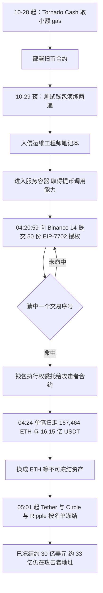
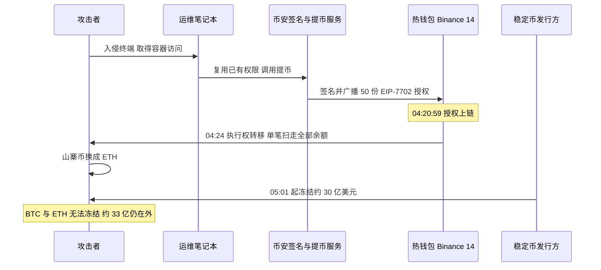
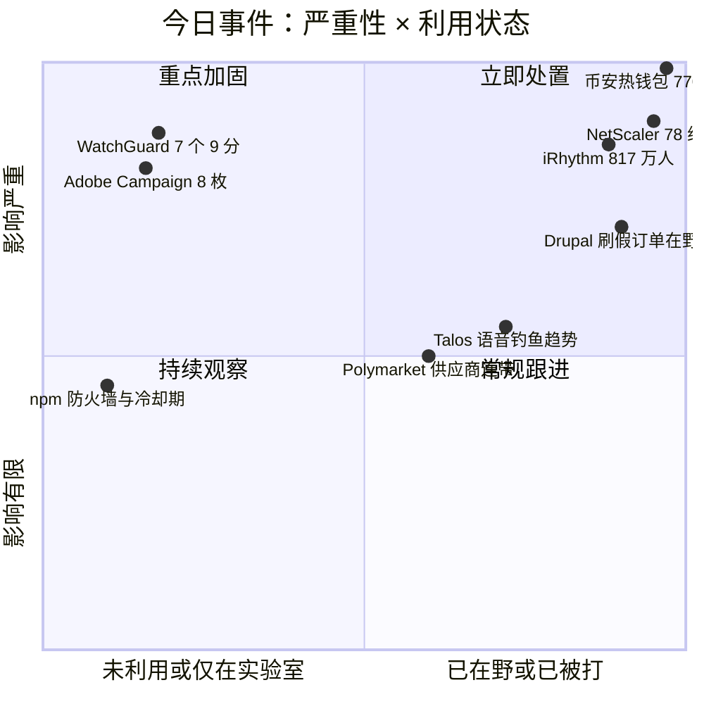
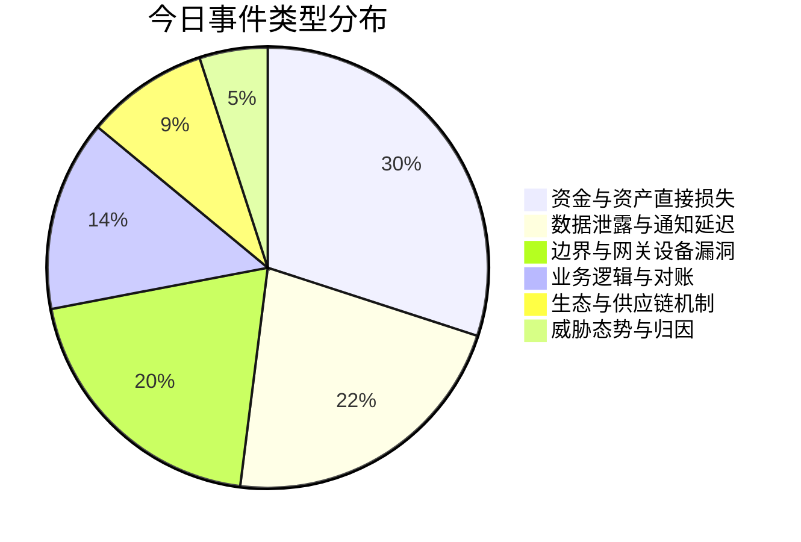
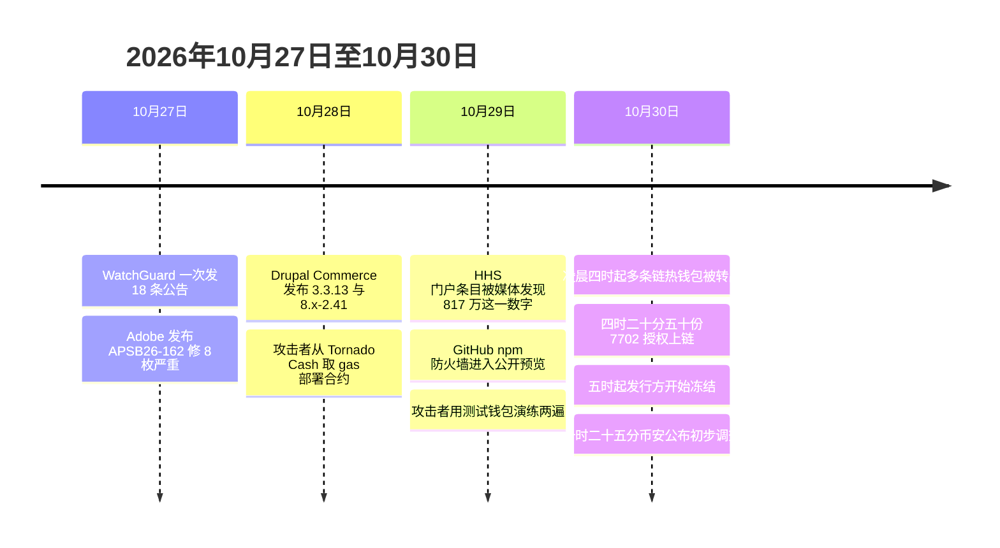

# 网安日报速递 · 2026年10月30日（第 202 期）

> 今日主线：**六件事，钥匙都不在自己手里。**
> 币安的热钱包没有私钥泄露，是它自己的签名系统替攻击者签了 50 份授权，3 分 24 秒后以太坊上 16.7 万枚 ETH 被一笔扫走；iRhythm 6 月 8 日就检测到入侵，10 月 2 日才发出第一封信，HHS 门户上写着 8,179,772 人；WatchGuard 一次发 18 条公告、7 个 9 分以上，其中五个不需要登录；Adobe 的营销平台八枚严重，最早那枚 SQL 注入连账号都不要；Drupal Commerce 是商户先在真站上看见假订单，官方 10 月 28 日才发补丁。
> 同一天，GitHub 给 npm 装了一道安装时闸门，它靠的不是审查，是等。

---

## 一、币安热钱包：没有私钥泄露，钱是被自己的签名系统签走的

**严重程度：严重（史上最大规模交易所失窃）｜时间：10-30 凌晨（北京时间）**

先说结论，因为这次最容易被误读：**攻击者手里没有币安的私钥。**官方在 10 月 30 日 10:25 的初步调查里明确写了"目前未发现私钥外泄"，而钱确实走了。这两句话同时成立，说明出事的位置不在"钥匙保管"，而在"谁有权让钱包签名"。

**发生了什么。**北京时间 10 月 30 日凌晨 4 点前后，币安多条链上的热钱包相继向外转账。以太坊上最关键的一笔发生在 **04:20:59**：一笔交易向标记为 `Binance 14` 的热钱包提交了 **50 个 EIP-7702 授权**。**3 分 24 秒后**，这个钱包里的 **167,464 枚 ETH、16.15 亿 USDT 以及 UNI、LINK、AAVE、PEPE 等 63 种代币**被同一笔交易全部扫走。链上口径的流出总额从"以太坊单链逾 33 亿美元"到"跨 9 条链 56.4 亿至 62.6 亿美元"都有，官方在 10:25 的公告里给出的数字是**影响约 63 亿美元**。

**EIP-7702 是这次的核心，也是它为什么看起来像"钱包自己动的手"。**传统以太坊里，普通钱包（EOA，靠私钥控制）和合约账户是两套东西。去年 Pectra 升级引入的 EIP-7702 把这堵墙拆了：只要钱包签一份特殊授权，它就可以把自己的执行权临时委托给一段合约代码，**而且只要不主动撤销，这份委托就一直有效**。链上分析师复原那段攻击合约的逻辑时给了一句很直白的话——"它只认一个主人，只做一件事：搬钱"。50 份授权是押交易序号，猜中一个，钱包从此按攻击者的合约行事。

**所以"私钥没泄露"和"钱没了"能同时为真。**按币安自己的说法，攻击者是通过**一台被入侵的运维（DevOps）工程师笔记本**进入服务容器，再从里面发出未授权的提币交易。OKX 创始人徐明星公开表示没看到私钥外泄的确切证据，问题更可能在权限控管与钱包管理系统一侧；链上分析师 Dickson Wu 的推断更具体：**很可能不是攻击者偷到了钥匙，而是币安自己的签名服务被拿来替攻击者签了名。**

**这不是临时起意。**按链上回滚，10 月 28 日下午起，攻击者分三次从 Tornado Cash 取出小额资金作为后续部署合约与演练的 gas；10 月 29 日夜间到 30 日凌晨，又用一个测试钱包把整套动作完整跑了两遍。最后一次演练结束到真正开打，只剩三个半小时。

| 时间（北京时间 10-30） | 事件 |
|---|---|
| 10-28 下午起 | 从 Tornado Cash 三次取小额资金，部署扫币合约 |
| 10-29 夜至 10-30 凌晨 | 用测试钱包完整演练两遍 |
| 04:00 前后 | XRP、Solana、比特币、波场等热钱包相继被转出 |
| 04:20:59 | 以太坊 `Binance 14` 收到 50 份 EIP-7702 授权 |
| 04:24 | 167,464 ETH 与 16.15 亿 USDT 与 63 种代币被单笔扫走 |
| 05:01 | Tether、Circle 开始冻结攻击者地址 |
| 07:06 | 币安 Alpha 交易暂停 |
| 08:13 | 币安宣布承担全部损失，暂停充提 |
| 10:25 | 官方初步调查：影响约 63 亿，已冻结约 30 亿 |

**冻结这一侧是整件事故里唯一像样的止损。**Tether 冻结逾 **15.67 亿 USDT**，Circle 冻结逾 **8 亿 USDC**，Ripple 冻结约 **2 亿 RLUSD**，World Liberty Financial 冻结 **2,700 万 USD1**，Paxos 冻结约 **1,906 枚 PAXG**，Arbitrum 安全委员会另冻结约 **3,050 万美元**。ZachXBT 统计的冻结总额逾 **28.3 亿美元**，币安官方口径"超 30 亿，且可能继续增加"。但冻结只对"能被发行方按名单拦下"的资产有效，**BTC 与 ETH 冻不住**——按 Odaily 的统计，攻击者手里还留着约 18,270 枚 BTC 与 46.7 万枚 ETH 没动。

**口径分歧必须写明，因为差了一个数量级。**Glassnode 援引链上数据说流失约 **53 亿美元**；Odaily 跨 9 链统计 **56.4 亿至 62.6 亿**；币安官方 **约 63 亿已确认受影响、约 30 亿已冻结**；而赵长鹏引用 DefiLlama 创始人 0xngmi 的估算说**净损失"可能略超 10 亿美元"，会全额覆盖**。这三个数字不是互相打脸，是三种算法：链上流出、官方认定受影响、扣掉已冻结与可追回后的净敞口。**引用任何一个都得说清是哪一个。**

**市场反应。**比特币盘中跌破 **78,500 美元**，以太坊失守 **2,250 美元**，BNB 盘中跌 **9%**，一小时内全网爆仓 **6.29 亿美元**，其中多头 **6.07 亿**。币安称将通过 SAFU 基金与公司自有资金承担全部损失，并承诺调查结束后发布完整技术复盘。

**归因还没定。**ZachXBT 在回复网友时推测可能是朝鲜的 Lazarus Group，但**这只是推测，币安官方没有归因**，也没有任何机构给出技术证据。这条只当线索记，不当结论用。

**值得关注的原因：**

- **第一，这是"授权"型失窃，不是"密钥"型失窃，防守模型完全不同。**过去十年交易所安全的主线是"私钥别泄露、冷热分离、多签"。EIP-7702 之后多出一条：**一次合法的签名，可能等于永久交出执行权**。撤销机制存在，但没人会天天去查自己的钱包有没有被委托出去。任何持有大额热钱包的机构，今天该做的第一件事是盘点"最近有没有未经核对的 7702 授权"。
- **第二，入口是一台工程师笔记本。**不是零日、不是供应链、不是内鬼。终端到服务容器这一段权限边界，是这类机构最薄的地方，因为运维必须有权限，而权限一旦落在被控终端上，等于把签名能力交了出去。
- **第三，稳定币发行方的冻结能力，在这次事件里第一次成为"事实上的止损层"。**30 亿美元被拦下不是靠币安，是靠 Tether、Circle、Ripple、Paxos 按名单动手。这层能力很强，但它只覆盖"可被发行方改写余额"的资产，**这也是攻击者为什么第一时间把山寨币换成 ETH**——把能冻的换成冻不住的。

---

## 二、iRhythm：8,179,772 人，和一封晚了 116 天的信

**严重程度：高（医疗数据，规模 817 万）｜时间：10-29 由 HHS 门户披露**

10 月 29 日，SecurityWeek 等媒体在美国卫生与公众服务部（HHS）民权办公室的泄露门户上看到一条记录：**iRhythm Technologies，加州，医疗提供方，8,179,772 人受影响**，类型 `Hacking/IT Incident`，位置 `Network Server`。这家公司做的是 Zio 可穿戴心电监测——贴在身上记录最长 14 天心电信号的那种贴片，以及由此生成的报告。

**时间线是这件事最刺眼的部分。**公司自己的通知与提交给加州总检察长的样本信里写着：**6 月 3 日至 6 月 8 日**，未授权人员访问并下载了某些**第三方托管的业务应用**里的数据；**6 月 8 日前后**检测到未授权访问；**6 月 9 日**，威胁者主动联系，声称握有专有数据、患者受保护健康信息与其他个人信息，要求付款；**6 月 10 日**的 8-K 里认定该事件具有重大性；**10 月 2 日**才开始给受影响者发信。**从检测到第一封信，116 天。**

| 日期（2026） | 事件 | 出处 |
|---|---|---|
| 6-03 至 6-08 | 数据被未授权访问并下载 | 公司通知与样本信 |
| 6-08 前后 | 检测到第三方托管业务应用中的未授权访问 | 公司通知 |
| 6-09 | 威胁者索取赎金 | 8-K（经 Security Affairs 转述） |
| 6-10 | 8-K 认定事件具有重大性 | SEC 备案 |
| 10-02 | 开始向受影响者发信 | 公司通知 |
| 10-03 | 报告进入 HHS 门户 | HHS OCR |
| 10-29 | 门户条目被媒体发现并报道 817 万这一数字 | SecurityWeek |

**被拿走的字段不长，但拼得起来。**姓名、地址、出生日期、邮箱、电话、iRhythm 患者账号、**设备序列号**、**保险号**、服务日期。公司说产品本身、临床与医疗器械系统、与客户的连接、制造与分销、患者安全均未受影响，也不存储个人金融账户或支付卡信息。

**这段话技术上是对的，风险上是不完整的。**设备序列号加保险号加服务日期，足够拼出一句"某人在某段时间戴过心脏监测仪"。医疗身份盗用的门槛从来不是拿到完整病历，而是拿到"能让对方相信我知道你病史"的那几个字段。公司通知里**没有提到免费的身份盗用或信用监控服务**。

**关于那 116 天，只摆规则，不下结论。**HIPAA 泄露通知规则要求"无不合理延迟，且在任何情况下不超过发现后 60 个日历日"。从 6 月 8 日算，60 天是 8 月 7 日，发信晚了 56 天。但规则的时钟从"认定泄露"起算，而不是从"发现可疑访问"起算，且执法机构可以合法要求延迟。**没有任何来源说明 iRhythm 把哪一天当作发现日，也没有说明是否有延迟请求**，所以这 116 天是一个可核实的间隔，不是一个已认定的违规。HHS 门户把这条列在"正在调查中的 HIPAA 案件"下，列上去不等于结论。

**值得关注的原因：**

- **第一，"第三方托管的业务应用"这个说法正在变成标准免责句式。**被拿走的是托管在别人那里的业务系统里的数据，公司自己的器械没被碰。但站在患者角度，数据在谁手里不重要，重要的是它在 6 月就出去了、10 月才被告知。
- **第二，社交工程打进了托管应用。**8-K 里写的是 social engineering，不是漏洞利用。这意味着攻击面不是某个 CVE，而是"谁有那个后台的账号"。
- **第三，817 万这个数字要看清它是什么。**它是公司向联邦申报的**人数**，不是记录数、不是账号数、不是设备数，也没有任何监管机构发布过自己的统计。

---

## 三、WatchGuard Fireware：一次 18 条，7 个 9 分以上，5 个不用登录

**严重程度：严重（CVSS 4.0 9.1–9.5）｜时间：10-27 公告**

10 月 27 日，WatchGuard 一次性发布了覆盖 Fireware OS 与 Windows Mobile VPN with SSL 客户端的 **18 条**安全公告，其中 **7 条为严重级，评分在 9.1 到 9.5 之间**。受影响的是 Firebox 防火墙——那种摆在网络边界、通常还兼任 VPN 网关的设备。

| CVE | CVSS 4.0 | 组件 | 影响 |
|---|---|---|---|
| CVE-2026-103594 | 9.5 | WireGuard 配置（FireCloud Gateway 场景） | 栈溢出，配置流量被篡改后可致拒绝服务或代码执行 |
| CVE-2026-112709 | 9.2 | Active Directory 认证服务 | 堆溢出，**认证前**远程代码执行 |
| CVE-2026-112710 | 9.2 | Active Directory 认证服务 | 同上，向量一致 |
| CVE-2026-93857 | 9.2 | SIP 代理 | 栈溢出，**认证前**远程代码执行 |
| CVE-2026-93865 | 9.2 | FireCluster 同步守护进程 | 缺失认证，可远程注入 **root 级**动作 |
| CVE-2026-93866 | 9.2 | Access Portal | 整数溢出，**认证前**越界写 |
| CVE-2026-103593 | 9.1 | 日志服务 | 栈溢出，远程代码执行 |
| CVE-2026-90464 | — | 文件操作 | 已认证攻击者可以 root 身份改任意文件（缺命令校验） |
| CVE-2026-93864 | — | firewalld | 本地攻击者经链接跟随覆写任意文件为 root |

**修复版本：**多数条目为 **Fireware OS 2026.4 与 12.12.4**；T15 与 T35 机型按厂商矩阵需要 **12.5.22**；Windows SSL VPN 客户端的凭据暴露问题在 **2026.4** 修复。受影响范围多数为 **2025.1 起至 2026.4 之前**、**12.0 起至 12.12.4 之前**；`CVE-2026-103594` 范围更窄，仅 2026.2 至 2026.4 之前与 12.12 至 12.12.4 之前。

**这里必须纠一个传播中的错误。**部分聚合站把这一批写成"7 个 RCE 正在被活跃利用"，**WatchGuard 在公告里的原话是未发现这些漏洞在生产环境被利用**。同一家厂商早前确实出过一个被在野利用的零日（`CVE-2025-14733`），但那与这一批是两回事，把两件事混成一件，会让读者对"到底该多急"失去判断。

**为什么"理论利用"仍然要按急事处理。**因为五个认证前漏洞落在**认证服务、SIP 代理、访问门户**这三类组件上，而这三类恰好是"装的时候顺手开、后来没人记得关"的典型：SIP 代理可能在某次语音改造时打开，FireCluster 可能在某次高可用测试后留着，Access Portal 可能因为一个外部供应商要登录而开放。厂商按"我方使用方式"逐条标注了前提，但**前提是需要去核对的配置，不是可以按记忆打勾的配置**。

**值得关注的原因：**

- **第一，一次发 18 条这件事本身是信息。**对防守方来说，这更像一次版本升级而不是挑一个最响的 CVE 打补丁——因为挑着打必然漏掉前提成立的那一条。
- **第二，边界设备的认证前内存破坏，是当前最不该存在的缺陷类别。**防火墙在架构里的全部意义就是"在认证之前拦住东西"，而这类漏洞发生在认证逻辑内部。
- **第三，"未发现在野"是一句有时效的话。**补丁与公告同时出现，意味着从今天起任何人都能读着 diff 反推触发条件；这句话的有效期通常以周计。

---

## 四、Adobe Campaign Classic：八枚严重，最早那枚连账号都不要

**严重程度：严重（Adobe 自评最高 10.0）｜时间：10-27 发布 APSB26-162，优先级 2**

Adobe 在 10 月 27 日发布了 Campaign Classic v7 的安全更新 **APSB26-162**（优先级 2），修掉 **8 枚严重漏洞**，受影响版本为 Windows 与 Linux 上的 **7.4.4 build 9402 及更早**，修复版 **build 9403**。同一批还发了 Adobe Connect 的 **APSB26-182**。

| CVE | 类型 | 评分（Adobe 自评） | 备注 |
|---|---|---|---|
| CVE-2026-105781 | SQL 注入 | **10.0** | 无需认证、无需交互，可致代码执行 |
| CVE-2026-105780 | 授权错误（CWE-863） | 9.9 | 可致代码执行，需低权限账号 |
| CVE-2026-104353 | 操作系统命令注入（CWE-78） | 9.9 | 同上 |
| CVE-2026-104351 | 代码注入（CWE-94） | 9.9 | 同上 |
| CVE-2026-105489 | SQL 注入 | 9.9 | 可绕过安全功能 |
| CVE-2026-104350 | 反射型 XSS（CWE-79） | 9.3 | 可致权限提升 |
| CVE-2026-104354 | SQL 注入 | 9.1 | — |
| CVE-2026-105779 | SQL 注入 | 9.1 | 可绕过安全功能 |
| CVE-2026-48360 | 代码注入（Connect，APSB26-182） | 9.6 | 可致任意代码执行 |

**评分口径说明：**上述分数是 **Adobe 自己的评分**，NVD 在 10 月 27 日收录后状态仍为 Awaiting Analysis，尚未发布自己的分数。澳洲 AUSCERT 的周报把这一批的最高分记为 **10.0**，与 Adobe 对 `CVE-2026-105781` 的自评一致。传播中出现的 9.8、9.9 混用，多数是把不同 CVE 的分数串了行。

**为什么营销平台值得单独讲。**Campaign Classic 这类系统握着两样东西：**全量客户名单**和**发信通道**。它不是一个可以被"放到内网就没事"的系统，因为它的业务就是对外发信。八枚里有四枚需要低权限账号——而在营销平台里，低权限账号是最不缺的东西：外包代理、活动运营、临时项目组，都是 operator 级。**一个 operator 账号被打，等于发信权被打**，接下来能做的事包括向全量客户发钓鱼、导出名单、在模板里埋跟踪。

**能做什么。**先把构建号查清，7.4.4 build 9402 及更早必须升到 9403；不能立刻升的，把实例从公网收回来，只保留跟踪页与公开表单这类确实需要外露的路径；同时清理 Campaign 的 operator 账号——不用的删掉、外包的限期、全部强制 MFA。Adobe 表示未发现在野利用。托管版用户需要直接向 Adobe 确认补丁是否已应用，公开来源没有说明这一点。

---

## 五、Drupal Commerce：商户先在真站上看见假订单，官方 10 月 28 日才发补丁

**严重程度：高（直接对应资金损失）｜时间：10-28 发布修复，在野利用已被观测**

这条的性质和前面几条都不一样：**它不是"可能被利用"，是已经有人在真站上刷单了。**Drupal Commerce 的维护方 Centarro 与 Drupal 安全团队联合发布说明：修复版本 **Commerce Core 3.3.13 与 8.x-2.41**（安全公告 **SA-CONTRIB-2026-254**）于 **10 月 28 日**发布，起因是**收到两份报告，有人在真实站点上利用这个漏洞下欺诈订单**。

**报告来自商户，不是研究员。**Centarro 特别强调了这一点：来报告的是在自己的线上站点上看到可疑活动的商家，不是在做平台评估的安全研究者。这意味着**漏洞在被修之前已经进过一次生产环境**，而发现它的是对账的人，不是监控。

**手法分三层，按 sophistication 递进：**

1. **绕过结账付款步骤**——订单下了但没付，既没有待处理的支付也没有已授权的支付。攻击者跳过了结账里的付款环节。
2. **伪造"已付"**——订单在订单管理系统里显示为已付，但**没有任何 payment 实体与之关联**。这一层主要影响开放了 JSON:API 的站点，攻击者通过 API 直接把订单状态改成已付。
3. **改价与改调整项**——在正常结账流程里把单价改掉，或者塞进员工不会添加、也不来自任何促销规则的折扣与费用。报告里出现过 **0.01 美元**的订单，**也出现过正常价格的订单**（后者更难发现，因为金额看起来没问题）。

**全栈站与 headless 站都受影响，只是攻击向量按架构不同。**Centarro 目前判断这不是脚本化攻击，也没有扩散到最初报告的站点之外——但这句话是"截至目前"，不是"不会"。

**自查给了三条 SQL，思路值得抄：**

- 查"下了单、余额大于 0、但没有任何已完成支付记录"的订单（注意：员工下单、Commerce API 自定义流程、只有授权未捕获的网关回调会产生正常误报）。
- 查"`total_paid` 大于该订单所有已完成支付金额之和"的订单——总付款额高于实际收款额，说明这个数字是被别的方式写进去的。
- 查 `overridden_unit_price = 1` 的订单项——正常购物不会把单价标记为手工覆写，被改成 0.01 美元再走结账的订单只有这一条能捞出来。

**值得关注的原因：**

- **第一，这是"漏洞的价值不在 RCE，在对账"的典型。**没有 shell、没有提权、没有数据外泄，攻击者要的就是把商品以 1 分钱买走，或者干脆不付钱把货发出来。这类洞在 CVSS 体系里往往拿不到高分，因为"影响"被算成完整性而不是机密性。
- **第二，检测窗口是空的。**商家靠肉眼看订单发现异常，说明这类业务逻辑漏洞基本没有可用的自动检测手段。补丁发了之后，还得回头翻历史订单——**打过补丁不等于没被刷过**。
- **第三，电商平台这个月的第三次。**Magento 的 `CVE-2026-48356` 刚进 KEV，Drupal Commerce 又在野被刷单，共同点是**付款流程的状态机被外部输入改写**。这不是巧合，是这类系统里最容易被忽略的一层。

---

## 六、GitHub 给 npm 装了道闸门：不靠审查，靠等

**严重程度：中（生态级变化，非漏洞）｜时间：10-29 前后进入 public preview**

GitHub 宣布 **npm 包防火墙**进入公开预览，目前只支持 npm，面向所有 GitHub Enterprise Cloud 客户（包括 data-resident 版本）。它的位置很关键：**摆在端点或内部 registry 与上游公共仓库之间**，在安装那一刻做策略判断。

**为什么现在做这件事，理由写得很直白：**AI 编码 agent 与 CI runner 会在无人确认的情况下自动装依赖。这个行为把"人看一眼再装"这道最后的软防线拿掉了，于是必须有一个机器能执行的闸门。

**五类策略：**

| 策略 | 判断依据 | 默认值 |
|---|---|---|
| 已知恶意包 | GitHub Advisory Database 的恶意软件公告 | 开启 |
| 漏洞严重度 | 公告库里影响该版本的漏洞等级 | 只挡 Critical，可选 High 及以上 / Medium 及以上 / 任意 |
| 证明降级 | 新版本缺 SLSA 证明、或证明弱于旧版本 | 开启 |
| 新增安装脚本 | 该版本新出现 preinstall / postinstall 钩子 | 开启 |
| 冷却期 | 版本发布至今不足设定天数 | 1 天，可设 1–365 天，0 为关闭 |

被误挡的包可以提例外申请，由企业管理员或安全经理批准。

**同一周的另一半动作在 Rust 那边。**计划 11 月 12 日发布的 **Rust 1.100** 将支持 `global-min-publish-age`，在 `cargo/config.toml` 里配置，**不填时默认 7 天**——也就是新发布的 crate 七天之内不会被装进来。

**这不是孤立事件，是一年来的同一个方向。**npm、PyPI、VS Code 扩展市场、Ruby、Bun、pnpm、Yarn 都已经上了类似的等待期。Socket 对这套做法的评价比较中肯：**合法修复也得跟着等**，而且**恶意代码不会因为放久了就变无害**——一个躲过检测的版本，只要比冷却期活得久，照样能进构建。它的价值在于给研究者、维护者、仓库方争取反应时间，而不是替代审查。

**值得关注的原因：**

- **第一，供应链防守的重心从"识别坏包"转到"让坏包来不及"。**识别是军备竞赛，且永远滞后；延迟是新版本必须付的税，对攻击者的杀伤是确定的。
- **第二，闸门装在了 agent 与 CI 这两条新入口上。**过去两年大量恶意包事件的传播路径就是"某个自动化流程顺手装了一下"，把策略点放在这里，比放在人身上有效。
- **第三，代价是真的。**默认 1 天冷却、7 天的 crate 等待，意味着安全修复也要排队。这是一次明确的取舍：用一点发布速度换一段反应时间。

---

## 速览

**7. Citrix NetScaler：至少 78 个组织，荷兰两家医院下线了患者门户（前情见 9 月底至 10 月 29 日各期）**

Arctic Wolf 的统计是**至少 78 个组织**受影响，分布在美国、加拿大与欧洲，行业包含能源、医疗、金融、地方政府、媒体、教育与专业服务。Google 威胁情报组（GTIG）与 Mandiant 说的是"数十个组织"，认为攻击活动具备国家级背景与相应的技术水平，但**未归属到任何已知组织**。荷兰 NCSC 在周五向关键基础设施单位发出预警，医疗行业的 Z-cert 建议医院加强监控或临时下线，**Frisius MC 与 Amphia 已经把基于 NetScaler 的系统下线，患者门户暂停在线访问**。Citrix 在周日一次公布了 NetScaler ADC 与 Gateway 上的 **8 个漏洞**。LevelBlue 的观测补了利用侧细节：恶意认证事件里反复出现 `pitboss` 与 `NSPPE` 字符串变体；二级载荷 `update_c08937.pl` 会改 `ns.conf` 建一个叫 `sec_monitor` 的超级用户、把 `/flash/nsconfig` 打包外传、把 `/bin/sh` 权限改成 6555、在 `LogonPoint` 下放一个 `.local_journal` 当 webshell、改 `httpd.conf` 让 `.deb`/`.sig`/`.ico` 也按 PHP 解析；另一个 `main.py` 先 `kill -9` 掉 `customsnmpd`，再向 `45.141.21[.]130:443` 反连。

**8. 同一天，加密行业的连带损伤**

Polymarket 因**第三方供应商被入侵**暂停交易，公告称受影响者会得到全额补偿；Coinbase 本周早些时候也承认**第三方供应商的安全事件**导致部分客户资料外泄（资金未受影响）。加上 10 月 21 日的 eMudhra 与这个月的 PHP 事件，这个月的共同点是：**出事的往往不是主角，是主角信任的那家小公司。**

**9. Cisco Talos 第三季度 IR 趋势：进门靠打电话，进来先关 EDR**

Talos 的季度事件响应复盘给出两条趋势：**冒充 IT 服务台的语音钓鱼**成为主要初始访问方式，攻击者大量借用合法的远程监控管理（RMM）工具；进到内网之后的第一件事往往是**关掉 EDR**。勒索活动同步回升，其中 VYPR 这个家族在试非常规 TTP。边缘设备被利用仍是主要入口之一。

**10. 微软：朝鲜相关组织把 AI 用进了日常作业**

微软安全博客给出的观察是：这类组织在用 AI **加速并扩大**行动规模，但目标没变——**创收与情报收集**。文中点名了 ARTEX 这类开源的 agentic 渗透测试框架被拿去做自动化。对防守方的含义不是"AI 攻击来了"，而是**钓鱼文案的质量与投放量会同时上升**，人对"这句话不像骗子写的"的判断会越来越不可靠。

**11. 一周勒索声称 25 家**

勒索泄漏站上一周新增 **25 个受害者声称**，其中 Booba Project 7 家、everstake 4 家、qilin 4 家、emperador 2 家、rhysida 2 家。**这些是攻击者的单方面声称，未经独立验证**，列入只为观察节奏。

---

## 风险分析

---

## 相关出处

**币安热钱包事件**

- 深潮 TechFlow（10-30）— EIP-7702 机制、04:20:59 与 50 份授权、3 分 24 秒后单笔扫走 167,464 ETH 与 16.15 亿 USDT 与 63 种代币、04:28 前后的准备期、Tornado Cash 三次取 gas 与两遍演练、冻结清单与金额、市场反应（BTC 78,500、ETH 2,250、BNB 9%、6.29 亿爆仓）：<https://www.techflowpost.com/en-US/article/34981>
- Odaily（10-30）— 跨 9 链 56.4 亿至 62.6 亿、已冻结约 25.4 亿、攻击者仍持约 18,270 BTC 与 46.7 万 ETH、山寨币换算与抛售细节：<https://www.odaily.news/en/post/5213664>
- Grenade（10-30 11:00 更新）— 官方口径影响约 63 亿与已冻结约 30 亿、运维工程师笔记本与容器路径、未发现私钥外泄、ZachXBT 冻结统计 28.3 亿与 Lazarus 推测、Arbitrum 安全委员会冻结 3,050 万：<https://grenade.tw/blog/binance-hack-2026/>
- India Today（10-30）— 官方声明原文、SAFU 约 10 亿美元规模、Tether 15.5 亿至 16 亿与 Circle 8 亿冻结、Polymarket 因第三方供应商停盘、Coinbase 上周供应商事件：<https://www.indiatoday.in/technology/news/story/binance-hack-explained-in-5-points-latest-updates-on-the-biggest-cyber-incident-ever-3028190-2026-10-30>
- 财联社／新浪财经（10-30）— 中文口径：Glassnode 约 53 亿、冻结超 30 亿、USTD 16.6 亿与 17,985 ETH 与 USDC 7.67 亿、CZ 表述、何一称 Ripple 帮助拦下约 2 亿：<https://finance.sina.com.cn/stock/t/2026-10-30/doc-iniwyncy2310415.shtml>
- Odaily 快讯（10-30）— 币安暂停充提与 Alpha 交易、CZ 与何一表态、ZachXBT 对 Lazarus 的推测、ZachXBT 统计攻击者已卖出约 1.58 亿山寨币换成 70,480 ETH：<http://m.odaily.news/en/newsflash/528981>

**iRhythm**

- pk-sharma 简报（10-29 11:19 UTC 读取）— HHS 门户字段、8,179,772 人、6-03 至 6-08 访问窗口、6-08 检测、6-09 索赎、10-02 首封信、116 天与 HIPAA 60 天规则的关系、门户"正在调查"的性质：<https://www.pk-sharma.com/briefing/irhythm-data-breach-8-2-million-hhs-zio-third-party-applications>
- All About Cookies（10-29）— 被泄露字段清单、8-K 于 6-10 认定重大性、社交工程与第三方托管应用、未提供信用监控、加州与华盛顿州检察长备案：<https://allaboutcookies.org/irhythm-data-breach>

**WatchGuard Fireware**

- Cryptika（10-29）— 18 条公告与 7 条严重、逐条 CVE 与评分与组件、影响范围与修复版本、T15 与 T35 的 12.5.22、与 CVE-2025-14733 的区别：<https://www.cryptika.com/watchguard-discloses-7-critical-firewall-flaws-allowing-remote-code-execution-and-root-level-attacks>
- Breachroad（10-29）— 按组件与前置条件的分组、CVE-2026-103594 需要能篡改设备与云之间 TLS 解密流量的场景、厂商称未发现在生产环境被利用、"按升级包处理而不是挑一个 CVE"的建议：<https://breachroad.com/en/blog/watchguard-fireware-critical-rce-october-2026>
- Threadlinqs TL-2026-4699 — 影响范围 2025.1 至 2026.4 之前、12.0 至 12.12.4 之前、状态标为已修补、覆盖缺口：<https://intel.threadlinqs.com/threat/TL-2026-4699>

**Adobe Campaign Classic 与 Connect**

- Protect.Computer（10-29）— 八枚严重的逐条评分、Connect CVE-2026-48360 与各平台修复版本、build 9402 到 9403、Adobe 称未发现在野利用、托管客户需向 Adobe 确认：<https://protect.computer/news/2026-10-29-adobe-campaign-classic-connect-critical-patches>
- Threadlinqs TL-2026-4744（10-29）— APSB26-162 与 APSB26-182 的 CWE 分类、NVD 收录时间与 Awaiting Analysis 状态、与 Veeam 与 Juniper 同批发布的背景：<https://intel.threadlinqs.com/threat/TL-2026-4744>
- cveo.tech — `CVE-2026-105781` 的 10.0 评分来源拆解（无认证、无交互、changed scope）、需要低权限账号的三枚、检测思路与缓解建议：<https://cveo.tech/blog/adobe-commerce-cve-2026-48356-kev-campaign-classic-apsb26-162-en>
- AUSCERT 周报（10-30）— 把这一批的最高分记为 10.0、优先级 2 的定性：<https://auscert.org.au/week-in-review/auscert-week-in-review-for-30th-october-2026>

**Drupal Commerce**

- Centarro 官方说明（10-28 发布日同步）— SA-CONTRIB-2026-254、3.3.13 与 8.x-2.41、两份商户报告与"在真站上刷单"的定性、三层手法、全栈与 headless 的向量差异、三条自查 SQL 与误报说明、目前不认为是脚本化：<https://www.centarro.io/blog/update-drupal-commerce-sites-exploit-observed-wild>

**GitHub npm 防火墙与 Rust 冷却期**

- The Hacker News（经腾讯安全今日聚合，10-29）— public preview 范围、闸门位置、五类策略与默认值、面向 agent 与 CI runner 的定位、例外申请流程、Rust 1.100 的 `global-min-publish-age` 与 7 天默认、各生态一年来的同类机制、Socket 的取舍评论：<https://sectoday.tencent.com/api/article/iUSBh6EB4lgF16BlsMPq/link>
- Cybersecurity Journal 日报（10-29）— 该发布的独立收录，可交叉核对时间：<https://cybersecurityjournal.ca/news/85182-cybersecurity-daily-brief-2026-10-29>

**速览条目**

- secnews.in（10-30）— 至少 78 个组织、GTIG 与 Mandiant 的国家级背景判断与未归属、荷兰 NCSC 与 Z-cert 的动作、Frisius MC 与 Amphia 下线患者门户、周日一次公布 8 个 CVE、Shadowserver 的 20,000 多台：<https://secnews.in/article/?slug=article-citrix-netscaler-critical-rce-campaign-2026>
- secnews.in（10-30）— LevelBlue 的利用侧细节：`pitboss` 与 `NSPPE` 字符串、`update_c08937.pl` 建 `sec_monitor` 与打包 `nsconfig` 外传与 `/bin/sh` 6555 与 `.local_journal` webshell 与 `httpd.conf` 改解析、`main.py` 反连与 `kill -9 customsnmpd`：<https://secnews.in/article/article-citrix-netscaler-cve-2026-88771-exploitation-levelblue>
- mlab 每日摘要（10-30）— Talos 第三季度 IR 趋势（语音钓鱼冒充 IT 服务台、RMM 滥用、EDR 被关、VYPR）、微软关于朝鲜相关组织用 AI 的观察、一周勒索声称 25 家与分布：<https://news.mlab.sh/digest>
- BestSec 日报（10-30）— Talos 与微软两篇的要点归纳、受影响面与前四个处置动作：<https://bestsec.net/daily/2026-10-30>

---

*本刊每日择要整理，CVE 编号与 CVSS 以 NVD 与厂商公告为准。同一事实在不同来源出现分歧时，正文已标注两边口径；"攻击者声称"类数据与链上归因推测均未经独立验证。*
