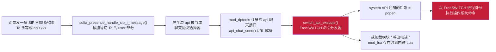
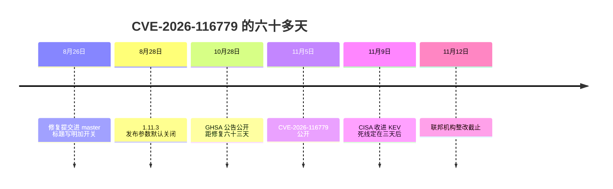
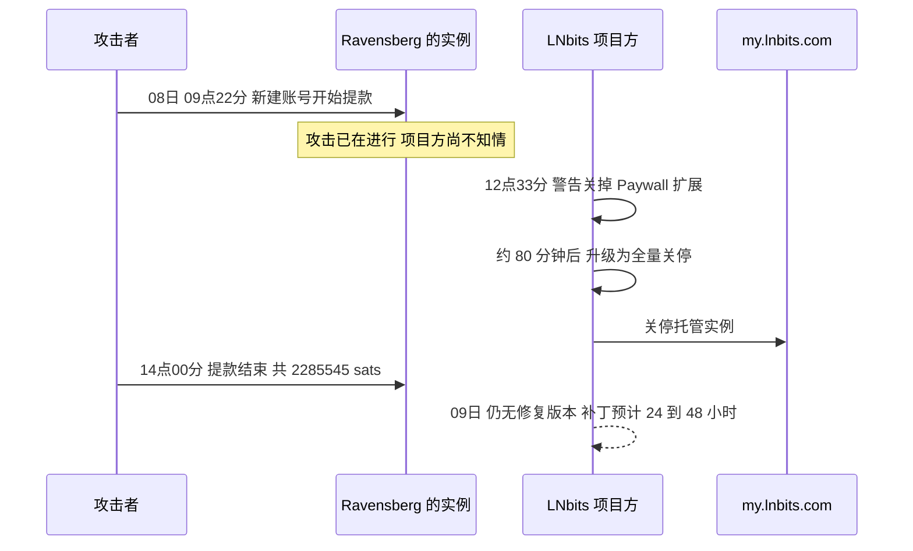
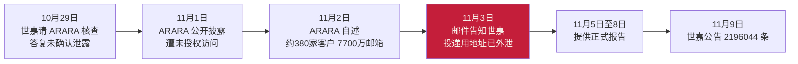
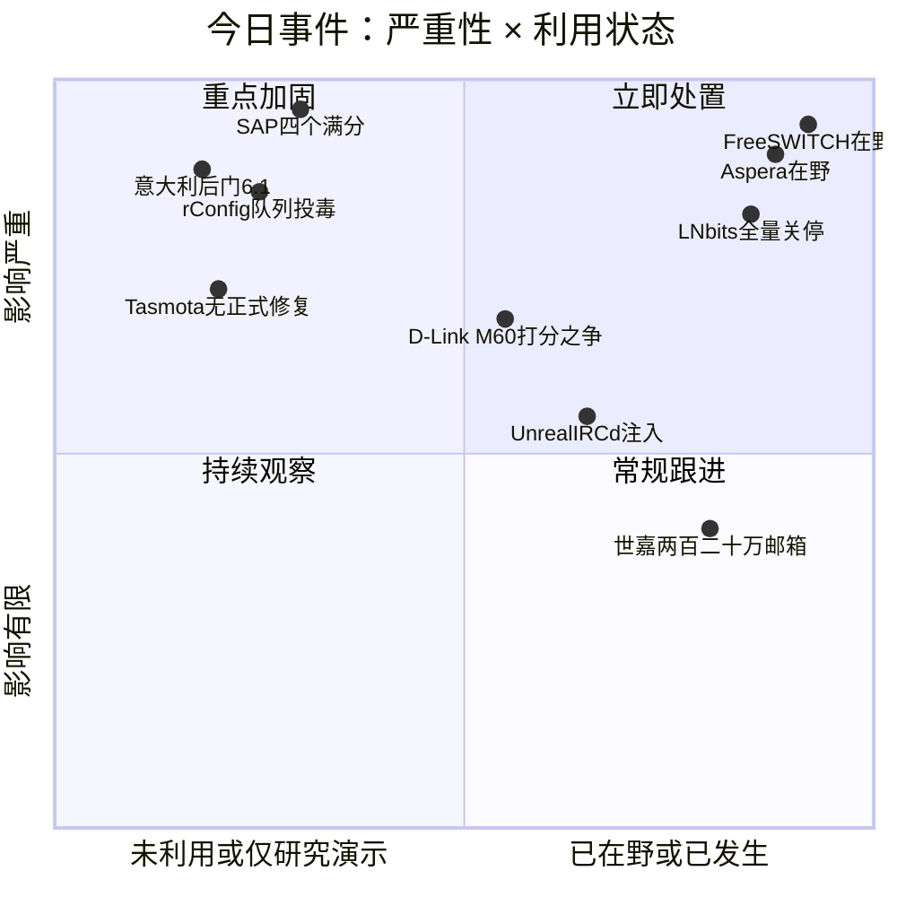
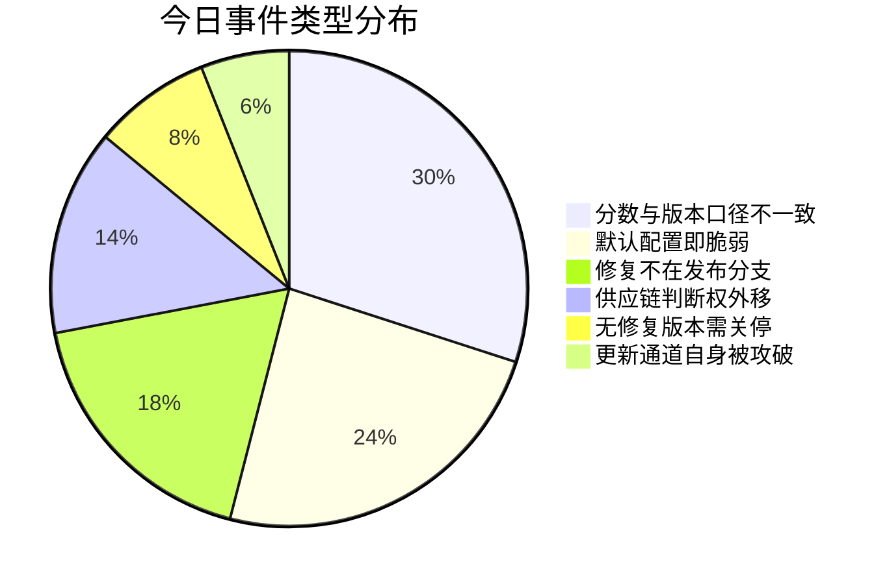
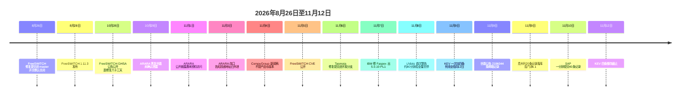

# 网安日报速递 · 2026年11月10日（第 213 期）

> **今日主线：谁定的分数，谁写的版本号**
>
> SAP 在补丁日前一分钟内落库 40 条 CVE，四个 10.0 全部在底座上，其中一个不是写错的代码，是装完就有的默认配置——分数由厂商自己给。意大利网络安全局一次交了 20 条记录，其中一条写着"未文档化的后门，可绕过认证并创建特权账户"，评分 6.1 中危，因为攻击向量标了本地。VulDB 给一台 D-Link 家用路由打了 10.0，而把固件拆开、写出那份技术说明的研究者，自己在仓库里贴的向量是相邻网络、范围不变、机密性低。Tasmota 的修复提交在开发分支上，没有任何一个已发布的固件带着它。rConfig 的记录写"8.2.19 之前"，官方公告页叫 Core 用户装 8.2.20。ARARA 十月二十九日告诉世嘉"没确认泄露"，十一月三日改口。LNbits 连是哪个扩展被利用都还没公开，就让所有运营者立刻关服务器。
>
> 六个数字，六个出处，没有一个出处在你自己那台机器上。

---

## 一、SAP 十一月补丁日：四十条记录一分钟落库，四个满分全在底座上

**关键数据**：40 条 CVE / 9 条严重 / 4 条 CVSS 3.1 满分 10.0 / 全部 CVSS:3.1/AV:N/AC:L/PR:N/UI:N/S:C/C:H/I:H/A:H / 均不在 CISA KEV / 厂商未报告在野

2026 年 11 月 10 日 01:17 UTC——美国中部时间十一月九日晚上七点十七分——SAP 的 CVE 编号机构在**同一分钟里**提交了 40 条 CVE 记录，赶在周二的安全补丁日之前。按 NVD 查询的严重性分布是：9 条严重、17 条高危、13 条中危、1 条低危。中文侧的口径是 38 条新记录、34 份 SAP 安全说明、9 严重 / 15 高 / 13 中 / 1 低（合 38），差的两条大概率是同一批里的重复计数或后续补录，两个数都记在这里。

真正值得注意的是那四个 10.0 的**位置**。没有一条在 ERP 模块、CRM 前端或者报表工具里，四条全在底座：

| CVE | 组件 | CWE | SAP Note | 为什么是 10.0 |
|---|---|---|---|---|
| CVE-2026-89103 | SAP Gateway | CWE-863 授权不当 | 3798345 | 产品"以高权限激活默认访问控制列表"，外部未认证攻击者被归类为内部应用服务器 |
| CVE-2026-76964 | NetWeaver AS ABAP 的 ICM | CWE-1287 类型校验不当 | 3778530 | 网络输入校验不足导致内存破坏，未认证可执行任意代码 |
| CVE-2026-89126 | SAP Web Dispatcher | CWE-122 堆溢出 | 3778556 | 同样的输入校验表述，同样未认证直达代码执行 |
| CVE-2026-120017 | NetWeaver AS ABAP / ABAP Platform 的 SAML2 服务提供方 | CWE-347 签名验证不当 | 3849308 | 特定配置下不充分验证传入的认证断言，未认证可冒充任意用户，含特权账户 |

**CVE-2026-89103 要读两遍，因为它不是编码失误。** SAP 自己的描述是"以高权限激活默认访问控制列表"——也就是说，**有漏洞的状态就是安装完成后的状态**。不需要管理员误配，不需要打开某个可选功能，装完就是这样。受影响的内核版本横跨 KRNL64NUC 7.22、7.22EXT、KRNL64UC 7.22 / 7.53 / 8.04，以及 KERNEL 7.22、7.54、7.77、7.93、9.16、9.20、9.21。这条的 PR:N 是真的没有门槛，S:C 是真的跨了安全边界，所以 10.0 不是评高了。

**SAML2 那条（120017）的现实影响面可能更大。** 受影响版本是 SAP_BASIS 702、731、740，以及 750 到 758 的每一个版本，加 816、920、921、922。SAML 断言验不严意味着：只要知道一个用户名（比如 `DDIC` 或某个业务管理员），就能自己造一张"认证通过"的票进去。ABAP 系统的用户枚举成本极低，这条更像是"知道账号名就等于拿到账号"。

其余五条严重级：**CVE-2026-109795**（9.9，CWE-94，S4CRM 远程启用功能，低权限即可代码注入）、**CVE-2026-109803**（9.9，CWE-94，NetWeaver 知识管理 XML Forms，XSL 转换选择不受限）、**CVE-2026-76965**（9.9，CWE-749，note 3792735，缺授权检查一路走到操作系统命令执行，低权限账号起手）、**CVE-2026-89119**（9.6，CWE-352，Web Dispatcher 与 ICM 的 CSRF，九条严重里唯一需要用户交互的）、**CVE-2026-109798**（9.1，BusinessObjects Web Intelligence 的 XXE）。

**尚未确认在野。** 这 40 条一条都不在 CISA KEV 里，SAP 也没有报告主动攻击。但 KEV 里已经躺着 14 条更早的 SAP 漏洞——这个数字说明 SAP 底座是被人翻过的，不是没人看的角落。

**该怎么做**：先动能从互联网上摸到的系统上的那四个 10.0，再动低权限起手的三条 9.9。补丁窗口排不开的话，先做两件不依赖补丁的事——把 SAP Gateway、Web Dispatcher、ICM 的端口收到内网，然后去 ABAP 系统里核一遍 SAML2 配置有没有真的在验签。89103 那条尤其要查：默认高权限 ACL 是装完就有的，意味着老系统上如果没人动过这个配置，它一直开着。

---

## 二、CISA KEV 十一月九日一次加四条，死线全部指向十一月十二日

**关键数据**：catalogVersion 2026.11.09 / 共 1773 条 / 本次新增 4 条 / 联邦整改截止 2026-11-12 / 从 CVE 公开到死线 4～7 天

十一月九日，CISA 往 KEV 里加了四条，全部给了同一个截止日：**2026 年 11 月 12 日**。联邦民事机构只有三天。

| CVE | 产品 | KEV 标题 | 我们此前是否写过 |
|---|---|---|---|
| CVE-2026-102895 | GPUStack | 认证不当 | 是，11-06 期头条 |
| CVE-2026-123158 | OpenBSD OpenSSH | 意外的状态码或返回值 | 是，11-06 期头条 |
| CVE-2026-116779 | SignalWire FreeSWITCH | 代码注入 | 本期首次 |
| CVE-2026-123218 | IBM Aspera Faspex | 授权不当 | 本期首次 |

前两条我们在十一月六日已经写过本体机制——GPUStack 的 `force_auth_localhost` 默认 false 加 `client_ip_getter` 收 `X-GPUStack-Real-IP`，OpenSSH 那个 musl `crypt()` 失败返回星号、刚好等于 shadow 字段里的星号。这两条当时就写着"已在 2.1.1 观察到在野"、"AI 智能体跑了约 17,600 次认证测试发现"，CISA 是在它们公开四天后才把它们收进 KEV 的。**这不是补录的错，这是两套时钟的正常差速：厂商的在野证据比 KEV 的收录早，KEV 的收录比很多人的补丁早。** 真正新的只有后两条。

### FreeSWITCH：一个加号后面接的是系统命令

**CVE-2026-116779**，CVSS 3.1 **9.8**（AV:N/AC:L/PR:N/UI:N/S:U/C:H/I:H/A:H），CWE-77 / CWE-78 / CWE-749 三条弱点同时命中一条路径。受影响：**1.11.3 之前的全部版本**。修复在 **1.11.3**。

缺陷在 `sofia_presence_handle_sip_i_message()`。FreeSWITCH 支持在 SIP 上跑聊天，判断一条消息该投给哪个聊天后端的方式是**把 To 头里的 user 部分按加号切开，左半边当协议名**。于是往 `api+随便什么@你的交换机` 发一条 MESSAGE：`api` 这半边选中了 `mod_dptools` 注册的一个聊天接口，而这个接口把载荷原样递给 `switch_api_execute()`。那是 FreeSWITCH 的命令分发器——`status`、`reloadxml`、`sofia profile`、`originate` 都从这里走，`system` 也从这里走，而 `system` 背后是 `popen`。

链条短的原因很直白：**聊天面和控制面共用了一个解析器。**

默认配置决定了这条洞的分布面。入站聊天在出厂的 internal 和 external 两个 SIP profile 上都是**开着**的（`enable-chat` 不关就是开），而收紧 `apply-inbound-acl` **并不能**覆盖 SIP MESSAGE。认证这一关也没有想象中牢：`auth-messages` 从 1.10.7 起默认开启，所以正常情况下"该 profile 上任意一个注册账号"就够了；更糟的是出厂 `conf/vanilla` 目录里带着**没有密码、没有 a1-hash** 的用户（default 用户，以及一个 Skinny 示例），除非显式把 `allow-empty-password` 设为 false，否则它们能直接认证通过。一个 2024 年照着入门镜像装起来、把 5060 开到 SBC 上、忘了删 1000 到 1019 号分机的呼叫中心，正好就是公告里"任意一个已认证账号即可"的那个账号。

时间线本身也是样本：

修复提交在 master 上公开了整整 **63 天**才等到公告。这 63 天里，任何看 master 的人读一遍提交标题、读一眼 vanilla profile 里的注释，就能复现打补丁前的原语。公告里那句"已在野观察到利用"和这个时间差放在一起看，更像是**在描述一件已经发生的事**，而不是预警。

**该怎么做**：升到 1.11.3 或更高，然后重启。升不动的，先 reload profile 或重启进程——这会把该 profile 上所有入站 MESSAGE 聊天关掉（不只是 api 那条路），代价是聊天功能一起停。另外两件事顺手做掉：删掉目录里没有密码也没有 a1-hash 的用户、把 `allow-empty-password` 设 false；`disable_system_api_commands=true` 能摘掉 `system` 这个最大的坑，但别的 API 还在，不算完整修复。已经被暴露过的机器按失陷处理：翻 FreeSWITCH 日志里的 MESSAGE 处理和 403、查 `/etc/freeswitch` 与 autoload 里有没有多出来的模块、查新的系统用户和 cron、查从守护进程发起的呼出。

### IBM Aspera Faspex：任何一张能用的登录，就够换成管理员

**CVE-2026-123218**，CVSS 3.1 **9.8**，CWE-863 授权不当，影响 **Faspex 5.0.0 到 5.0.19**。IBM 十一月七日修（**5.0.19 PL1**，容器部署要确认 `faspex-core` 镜像报的是 `5.0.19 (1ce4b13)`，Fix Pack 1），十一月九日进 KEV。**IBM 没有给任何变通方案。**

IBM 的公告措辞是"已认证用户构造特定消息可以跳过授权检查、拿到完整管理员权限"。而 CVSS 向量写的是 **PR:N**——不需要任何权限。这两个说法看起来打架，其实不打架：向量描述的是"一旦持有任意一个有效 Faspex 账号，不需要额外角色或特权"。所以真正的门槛是**一张能用的登录**，而不是一个已经有点权限的账号。而文件传输门户的登录，恰恰是钓鱼、撞库、密码复用最容易拿到的那个东西——它本来就是给外部合作方用的，注册入口通常是开着的。

这条特别值得多看一眼，是因为这个产品有过前科：2022 年 12 月 IBM 修 Faspex 4.4.2 及更早的 **CVE-2022-47986**（未认证 YAML 反序列化 RCE，9.8），几周之内 IceFire 和 Buhti 两个勒索即服务团伙就把它拿去打了对外的 Faspex，用的还是 IceFire 的 Linux 勒索二进制。同一个产品上"授权做错一格"这件事一旦被验证可利用，历史会重演。

Faspex 管理员能看到服务器上每一个包、每一个用户、每一个共享收件箱。在文件传输平台上，那就是数据本身。

**该怎么做**：`docker ps` / `podman ps` 看 `faspex-core` 是不是 5.0.19 PL1。没有变通方案，意味着补不上就只能把服务从公网拿下来或者塞进 VPN/白名单——对一台合作方要从外部访问的传输服务器来说，这个决定是业务决定，不只是安全决定。顺便核一遍管理员账号列表和审计日志里有没有新出现的特权账户。

---

## 三、意大利网络安全局一次交 20 条：一个未文档化后门，评了 6.1 中危

**关键数据**：20 条记录 / 同一 CNA（source identifier `a6d3dc9e-...`）/ 最高 9.2 / 后门那条 6.1 中危 / 全部无 CPE / 全部为 CNA 自评（Secondary）/ 全部 vulnStatus=Received

2026 年 11 月 9 日 12:16 到 13:17 UTC 之间，20 条 CVE 落到 NVD，全部来自同一个 CNA，引用的只有 `acn.gov.it` 上的页面（意大利国家网络安全局，CSIRT Italia 的上级）加一份 CompuGroup Medical 的新闻稿。受影响产品是 CompuGroup 的 XDent、XMedical、Infantia、Profim、Venere、Phronesis、Wingesfar，以及 GALENO SISTEMI 的 MAGISTRA 3.12。

**这批里最该坐一会儿的是 CVE-2026-112169。** 描述第一句是："Magistra 软件包含未文档化的后门功能，允许绕过认证并在不验证凭据的情况下创建特权用户账户。"弱点标了 CWE-288（通过替代路径绕过认证）和 CWE-912（隐藏功能）。评分：**6.1 MEDIUM**。

向量解释了为什么是 6.1：`CVSS:4.0/AV:L/AC:L/AT:N/PR:N/UI:N/VC:H/VI:H/VA:H/SC:N/SI:N/SA:N/E:U`。机密性、完整性、可用性影响**全是 High**，不需要任何权限，但 **AV:L（本地攻击向量）** 把结果压在了中段。

这个分不算评错。CVSS 问的是"这个洞有多难够到"，软件跑在诊所自己的 Windows 机器上，本地向量确实降低可达性。问题在于 **CVSS 不问"厂商是不是自己留了一扇门"**。CWE-912 这个弱点分类存在的意义就是描述隐藏功能——记录也确实用了它。但一个只存在于产品内部的、绕过认证的、能创建特权账户的入口，落到 6.1，在周一的分诊队列里就会排在一堆中危 Web 漏洞后面。

更值得看的是同批的兄弟记录：同一款 MAGISTRA 还有三条，分别 6.0、6.3、4.4。**后门不是它自己软件里分最高的那条**——6.3 的 CVE-2026-112170（升级文件下载后不校验完整性）比它高。

然后是版本数据，这批记录在这一层上更麻烦：

- **CVE-2026-118462**（9.2，CWE-494，本批最高）：描述开头是"更新组件下载并执行代码而不做恰当的真实性验证，依赖被忽略的哈希或可伪造的"。受影响包 `cgm.files.delivery` 到 1.3.0、`cgm.liveupdates` 到 2.12.0。**漏洞就在更新通道本身**——用一条"会执行未验证代码"的通道，去投递它自己的修复。
- **CVE-2026-118458**（8.1，CWE-798 硬编码凭据）：共享的 AIS 登录路由会选中生产环境里发布出去的**测试用 DAO**、用明文比对，并接受固定管理员账户。受影响 `cgm.it.ais.common`，上界写的是 `lessThanOrEqual 5.1.15.1.1`，`versionType: semver`。**那不是语义化版本号**——五个点分段，semver 只有三段，记录里没有任何解释。按字面读没法解析；当笔误读，可能是 5.1.1，可能是 5.1.15，也可能都不是。
- 同一个 CNA 在这条之前 **19 秒**提交了 **CVE-2026-118459**，同一个包、同两个产品，上界写 **5.1.1**。同一分钟里提交的两条记录，对"哪些版本受影响"给了两个不一样、其中一个还不是数字的答案。
- **Wingesfar** 四条记录用了两套不兼容的版本方案：**CVE-2026-118790**（7.2，代码里嵌了多组硬编码凭据）上界写 `lessThan 2026.07a`；**CVE-2026-118791**（7.2，更新功能）上界写 `lessThan 10.2.1`；**CVE-2026-118792**（6.1）和 **118798**（4.4）又回到 `2026.07a`。一个产品，一个日历版本号、一个语义版本号当两条边界，记录里没有任何东西把两者关联起来。
- **五条根本没有范围**：CVE-2026-118450 只写 Venere `version 8.33.2`，没有 `lessThan`。四条 MAGISTRA 只写 `version 3.12`、`versionType: custom`，没有区间——**3.11 受不受影响，记录不说**。
- 20 条里没有一条带 NVD 自评的 CVSS，全部标 Secondary；核过的记录**都没有 CPE 配置数据**，读完整的几条还停在 `vulnStatus: Received`。**没有一个扫描器能靠 CPE 匹配到这 20 条。**

链条断在哪里很清楚：厂商新闻稿说"技术细节、CVE 标识符和受影响版本见公告"，公告在 CSIRT Italia 的网页上（意英两条路径对自动抓取都返回客户端错误），CNA 五天后才把结构化记录交上去。**每一环单独看都站得住，整条链走完没交出一个版本号。**

CompuGroup 的新闻稿落款是 2026 年 11 月 4 日（"Milano, 4 novembre 2026"），页面自身 `article:published_time` 是 `03.11.2026 23:00`。内容说修了认证系统、密钥分发、更新投递和日志留存四处，"补丁自动下发到所有受影响的安装"，"未发现这些漏洞被利用的证据"，并称这是意大利 NIS2 法（Decreto Legislativo 138/2024）下的协同披露。**通篇不提产品名、不提版本号、不提 CVE。** 自动下发修好的东西关掉了那些代码路径，但它没法告诉管理员硬编码凭据在这之前有没有被用过。

**该怎么做**：在意大利诊所或药房跑 CompuGroup 软件的，去确认更新真的落地了，别信"应该已经自动装了"。118462 是更新通道里的 9.2，一条会执行未验证代码的通道不是一个好的自我修复工具。Phronesis/Venere 别自己去解 `5.1.15.1.1`，按兄弟记录支持的读法把 `cgm.it.ais.common` 5.1.1 及以下全当受影响，真实边界去问厂商。Wingesfar 问清你手上是 `2026.07a` 还是 `10.2.1`。MAGISTRA 3.12 在 GALENO 明说之前，按更早版本也受影响处理，并且**不管那条 6.1，先把现存的特权账户审一遍**。

---

## 四、LNbits 让所有人立刻关服务器：连是哪个扩展被利用都还没说

**关键数据**：2026-11-08 12:33 UTC 首次警告 / 约 80 分钟后升级为全量关停 / 单一运营者损失 2,285,545 sats（≈0.023 BTC，约 1,730 美元）/ 截至 11-09 09:00 UTC 无修复版本 / 被利用扩展未公开 / 托管服务 my.lnbits.com 一并关停

LNbits 是比特币闪电网络上用得最广的开源自托管钱包/账户系统之一，个人和小机构拿它开自托管钱包、给多个用户分账户、在上面写扩展。**它是自托管的，所以项目方没有总开关。**

2026 年 11 月 8 日 12:33 UTC，项目方发第一条警告：跑 **Paywall** 扩展的运营者立刻关掉这个功能，正在排查一个可能的缺陷。大约 **80 分钟后**，警告升级成对所有人的："**所有 LNbits 用户立刻停掉你们的 LNbits 服务器。** 在一波攻击之后，我们有一批安全补丁要推。"托管服务 `my.lnbits.com` 一并停掉，预计 24 小时内恢复（约 11-09 17:20 UTC）。

最清楚的一笔损失来自荷兰运营者 **Kevin Ravensberg**，他的实例上跑着 Telegram 打赏机器人 Bittipbot。他的说法是：攻击者在他的实例上**新建账号**，然后在 **11 月 8 日 09:22 到 14:00 UTC** 之间提走了 **2,285,545 sats**（约 0.0229 BTC，按当时约 75,800 美元的币价算约 1,730 美元）。注意这个时间：**攻击开始于 09:22，项目方第一条警告在 12:33——已经晚了三个多小时。** 他说会个人赔付受影响的 Bittipbot 用户，但资金要等项目方把补丁推出来才能动。

截至 11 月 9 日项目方最后一次更新，**没有发布任何修复版本**；GitHub releases 页最新的还是 **v1.6.2**，一个 9 月 18 日的 PostgreSQL 备份热修。核心贡献者 Ben Arc 估计补丁会在 24 到 48 小时内合并可用——那是一个估计，不是发布通知，也不是"可以安全重启"的许可。他同时确认开发者和安全测试团队已经查清"用的是哪个扩展的漏洞"，但**至今没有公开是哪一个**，也没说是不是 Paywall。总损失金额、受害实例数量、受影响的实例清单，一概未公布。项目方也**没有给出任何"自查是否被打过"的方法**。

顺带一提这条时间线的另一头：2026 年早些时候 LNbits 做过一次外部审计（V12），发现一个认证缓存绕过和一个 PayPal 集成缺陷，都在 **1.6.0**（2026 年 9 月）修了。目前**没有任何证据把那次审计的问题和 11 月 8 日的攻击连起来**，但时间上离得很近，值得留意模块化闪电应用是不是需要更密的独立审计。

**该怎么做**：跑 LNbits 的，现在关掉，等到官方发布修复版本再开。**别把"关掉一个扩展"当成完整响应**——项目方自己在一个半小时内就把口径从"关 Paywall"扩到了"全关"，这个扩口径的动作本身就是答案。运营在 LNbits 之上的服务（打赏机器人、支付终端），要主动告知用户资金暂时不可用。恢复服务前：留证据（日志、数据库快照、配置），查新建账号和异常提现，轮换 API key 和管理凭据，然后按"这台机器可能被打过"来做隔离，而不是按"网页能打开所以没事"。

---

## 五、Tasmota 的 9.8 修在开发分支上，正式固件里一条都没有

**关键数据**：CVE-2026-119756 / CVSS 3.1 **9.8**（VulnCheck，AV:N/AC:L/PR:N/UI:N）与 CVSS 4.0 **9.3** 并存 / CWE-805 / UDP 4447 / 修复提交 e97e1e4（11-06，开发分支）/ 无 CPE / 无在野报告 / 发布分支该文件自六月起未动

Tasmota 是 ESP8266 / ESP32 上装机量最大的开源固件之一，智能开关、插座、传感器、电表，大量跑在家庭和小商户的局域网里。**CVE-2026-119756** 出在 `SendReceiveDeviceGroupMessage()`——Device Groups 功能收消息的那个函数。

机制：Device Groups 用 **UDP 4447**（组播地址 239.255.250.250）在设备之间同步状态。构造的 Device Groups 消息会让 `log_remaining` 这个计数器**变成负数**，随后的写入就超出了那个固定的 **512 字节**缓冲区，形成堆越界写。ESP8266 和 ESP32 都没有 ASLR，也没有堆 cookie，所以这条在理论上是"崩机"和"原生代码执行"之间的差别只取决于攻击者愿意花多少功夫。作者署名 Abdurakhmonov Ulugbek，VulnCheck 是 CNA。

真正的问题在修复的位置：**修复提交 e97e1e4 于 2026 年 11 月 6 日进了开发分支，发布分支（master）上这个文件自六月以来没有被动过。** 换句话说：**16.0.0 是当前最新的正式发布，而没有任何一个已发布固件包含这个修复。** 不要等 16.0.1——它不存在。

这条记录还带两个"扫不到"的属性：**没有 CPE**，所以基于 CPE 的匹配完全不会命中；按版本号匹配会把 16.0.0 标成受影响、但找不到可比的修复版本，于是一直挂在扫描结果里，直到真有一个发布出来。

同一份记录里挂了两个分数：CVSS 3.1 **9.8** 和 CVSS 4.0 **9.3**，都是 VulnCheck 给的。这里不替它选，两个都写。

**该怎么做**：唯一今天就能做、且不涉及未发布固件的改动，是**把 Device Groups 关掉**。在每台设备上跑 `SetOption85` 看返回值，Tasmota 自己的排障文档说结果应该是 ON；如果返回 off，这条洞在那台设备上没有可达路径。开着又不需要的，`SetOption85 0` 关掉——那会摘掉这个漏洞赖以到达的监听器。需要保留的，就把 UDP 4447 和组播 239.255.250.250 当成控制面：设备放到隔离 VLAN，和普通用户网、访客网之间不留通路，在段边界上拦入站 UDP 4447。**这是替代补丁的缓解，不是补丁。** 另外盯 Tasmota 的 releases，等 11 月 6 日之后切出来的第一个版本，并且看它的更新说明里有没有 Device Groups 或那个 GHSA 编号，再决定它是不是真的带着修复。

### 同型对照：rConfig 的记录写 8.2.19，官方公告叫你装 8.2.20

**CVE-2026-124079**，CVSS 3.1 **9.8**，CWE-502 不可信数据反序列化。影响写的是 rConfig Core **8.0.0 到 8.2.19 之前**、rConfig Pro **8.4.1 之前**。

机制：未认证的攻击者把构造好的序列化任务推进 **Redis 支撑的 Laravel Horizon 队列**（受影响的部署里这个队列不带认证）。Laravel 的 `CallQueuedHandler` 反序列化时不限制类，于是攻击者可以实例化产品里现成的 `App\Jobs\TaskDownloadRun`，让它去调用一个自己控制的 Artisan 命令。产品自带 `laravel/tinker`，这就等于任意 PHP 加任意操作系统命令，以队列工作进程的身份执行；可以往 **`storage/app/public`**（Web 可直接访问的目录）里写一个持久化 webshell，也可以读出数据库口令、存着的设备凭据和 API token。Redis 直接够不到的情况下，已认证的攻击者还能通过"把设备目标指向 rConfig 服务器自己的回环地址"来投递同样的载荷。

这里的问题只是版本号：**记录里的受影响范围止于 8.2.19，而 rConfig 自己的安全公告页面告诉 Core 用户装 8.2.20。装高的那个。**

---

## 六、世嘉：2,196,044 条邮箱，供应商先说"没泄露"，三天后改口

**关键数据**：2,196,044 条邮箱地址记录 / 其中 92,273 条附带尚未确认的额外信息 / 涉事邮件发送期 2026-07-02 至 10-28 / 供应商 ARARA 受影响客户约 380 家、邮箱合计约 7,700 万个 / 不含姓名、生日、性别、住址、电话、卡号、密码

世嘉（SEGA）在 2026 年 11 月 9 日发公告：受第三方新闻邮件分发服务商 **ARARA** 的"ARARA Message"服务被非法访问影响，**2,196,044 条**邮箱地址记录外泄，其中 **92,273 条**还带着与邮件投递相关的附加信息——具体是什么，世嘉和 ARARA 还在确认。受影响的是世嘉及世嘉 FAVE 用 ARARA 发的部分新闻邮件，发送时间落在 **2026 年 7 月 2 日到 10 月 28 日**之间，包括东京电玩展 2026 的两封出展通知、CHUNITHM Mate 上线、SEGA Lucky Kuji Online 的六封、ONGEKI Re:Fresh Act.2 与 maimai DX MAGiCAL 的更新通知。

泄露数据**不包含**姓名、出生日期、性别、住址、电话号码、信用卡信息或登录密码。用 SEGA Account 注册的邮箱走另一套分发系统，不在本次范围内。截至公告时没有确认到滥用。世嘉已经暂停通过 ARARA 发新闻邮件，并将与 ARARA 一起向日本个人信息保护委员会提交联合报告。

**这条真正值得记的是那段三天的口径变化：**

ARARA 在 10 月 29 日答复"未确认信息泄露"，11 月 1 日自己公开披露遭未授权访问，11 月 3 日才以邮件告知世嘉"外泄了"。**从"没事"到"有事"中间隔了五天，从"有事"到世嘉能对外公告又隔了六天。** 这不是恶意隐瞒，是供应链泄露事件里最常见的节奏：出事的是供应商，判断也是供应商做的，下游客户只能等。

还有一层：ARARA 说入侵可能与网络服务器漏洞和系统环境问题有关，入侵方式和具体时间仍在调查。同期还有报道称攻击者利用对 ARARA 服务的访问权限，在十月下旬发出**超过 700 万封冒充信用卡公司的邮件**——也就是说这批被拿到的邮件通道能力，先被用来做钓鱼，然后才被下游客户知道。同一批受影响方里还有 MOS Burger、松竹多厅影院、TKC、IIJmio 等。

**要和另一件事分开看**：世嘉 FAVE 的街机网络服务上周另遭未授权访问，ALL.Net、Aime、在线游戏和新 SEGA ID 注册至今暂停。世嘉明确说两起事件互不相关，初步调查显示街机事件未造成客户或合作伙伴数据外泄，支付信息因单独存储未受影响。**两件事放一起看的意义是：一家公司同一周里两个不同的第三方/自有系统出事，公告里得分别说清哪条是哪条。**

**该怎么做**：收到过世嘉相关新闻邮件的人，接下来的钓鱼邮件会拿"SEGA""SEGA FAVE""ARARA"这些名字当抬头，而且会引用你确实订阅过的内容。世嘉不会用邮件问密码或卡号，链接和附件都别点。企业侧的教训更直接：**供应商说"没确认泄露"不等于没泄露，它只等于"供应商此刻没确认"**——合同里要写清通知时限和"发现即告知"的义务，别把判断权整体外包给供应商。

---

## 速览

**7. D-Link M60 的那个 10.0，给分的人和拆固件的人不是同一个**
VulDB 在 11-10 01:17 UTC 提交 **CVE-2026-125086**（D-Link M60，固件 1.12.B01），描述指向 `/etc/emDaemon/mosquitto.conf` 的 `system` 函数里的硬编码凭据，CWE-259 + CWE-798，并写明"利用已向公众披露并可能被使用"。一条记录挂了三个分：**CVSS 3.1 10.0**（AV:N/AC:L/PR:N/UI:N/**S:C**/**C:H/I:H/A:H**）、**CVSS 4.0 9.3**、**CVSS 2.0 10.0**（NVD 给 v2 的 `baseSeverity` 标的是 **HIGH**，因为 v2 的分档就到 HIGH）。记录的第一个引用是一个公开 GitHub 仓库 `XueDugu/dlink-m60-easymesh-mqtt-credential-evidence`，作者自己在 README 里贴的向量是 **`CVSS:3.1/AV:A/AC:L/PR:N/UI:N/S:U/C:L/I:H/A:L`**——两个向量**在八个基础指标里有四个不一致**：找洞的人说相邻网络，CNA 说网络；找洞的人说范围不变，CNA 说范围变了；找洞的人说机密性低影响，CNA 说高；可用性也一样。仓库的技术主张（出厂 EasyMesh MQTT broker 用编译期写死的 `admin`/`admin`；`/usr/bin/commander` 开机从二进制常量重写 `/etc/emDaemon/mosquitto.conf` 和 `passwd`，所以机主改不掉也删不掉；自带 mosquitto 2.0.14 监听 `0.0.0.0:1883` 与 `[::]:1883`；订阅 `acs/` 主题的控制守护进程以 root 运行并能走到执行 `/tmp/acs.sh` 的 `system()`）均为单一来源，未经独立核实，仓库只有一个 commit。同批还有 **CVE-2026-125079**（DCS-6501LH 3.03.02，Media Service，同样两个弱点类，5.3 中危）在 **0.45 秒前**提交——两个同弱点、同作者、同批次的记录之间差 **4.7 分**，差距几乎全在 scope 和影响三元组上，两条记录都没解释为什么。**两条都没有修复版本**，NVD 状态 `Deferred`，找不到 D-Link 的对应公告。真正可操作的那句话不依赖分数之争：broker 在所有接口上监听 1883 且凭据改不掉，去查 1883 是不是只在本段可达，不是就在边界上拦掉。

**8. UnrealIRCd 8.6：任何用户都能注入服务器之间的命令，二手源称已在野**
**CVE-2026-114713**（CVSS 3.1 **8.6**，AV:N/AC:L/PR:N/UI:N/**S:C**/C:N/I:H/A:N），影响 **6.0.0 到 6.2.7.1 之前**。labeled-response 模块在把 IRCv3 的 `label` 消息标签回显进回复时**不做转义**，于是任何在"有两台以上服务器互联"的网络上的人，都能注入本应只在服务器之间传递的命令，并以**服务器权限**执行。注意这条的向量是 S:C 但 C:N——影响全在完整性上，也就是"能改"，不是"能读"。NVD 状态 `Deferred`，不在 KEV。有一个聚合类日报称它"已在野被滥用"，但没有任何一手来源（厂商公告、CISA、研究者）确认，正文按二手标注。跑 IRC 网络的升到 6.2.7.1。

**9. SuperTokens Core 9.9：改父级连接 URI 域名的权限检查不足**
**CVE-2026-123800**（CVSS 3.1 **9.9**，AV:N/AC:L/**PR:L**/UI:N/**S:C**/C:H/I:H/A:H），11-09 收录，`vulnStatus: Received`。`Multitenancy.checkPermissionsForCreateOrUpdate` 对"更新父级连接 URI 域名"这件事的授权检查不足。受影响版本列了一长串：6.0.0 起，直到 **6.0.24、7.0.23、8.0.7、9.0.6、9.1.6、9.2.7、9.3.5、10.0.8、10.1.9、11.0.9、11.1.4、11.2.4、11.3.8、11.4.8、12.0.11、12.1.2、12.2.1、12.3.1** 为止——每一条维护线各有一个修复点，这种列表本身就是"你很可能还在某条旧线上"的提示。PR:L 意味着需要低权限账号，但 S:C 加上三项 H，低权限到跨租户接管只差一步。SuperTokens Core 是自托管的认证服务器，改父级 URI 域名在多租户场景下等于把某个租户的认证流量整体导向攻击者。

**10. Redpanda Connect 9.8：管理 API 默认不开认证，4.39 到 4.110 全中**
**CVE-2026-123270**（CVSS 3.1 **9.8**，AV:N/AC:L/PR:N/UI:N/S:U/C:H/I:H/A:H），11-09 收录。**4.39 到 4.110** 版本在 streams 模式下把管理 HTTP API 开在 **`0.0.0.0:4195`**，**认证默认关闭**，stream 的增删改查路由上没有任何认证关卡。能连到 TCP/4195 的未认证攻击者可以直接 `POST` 一个 stream 配置进去——Redpanda Connect 的 stream 配置里本来就有 processor 和 input/output 组件，这条路通向代码执行。默认值是"关"的产品，暴露面取决于谁把它开在了公网网卡上。版本区间跨了 70 多个小版本，说明修的时间点离发现的时间点很远。

**11. Limit Login Attempts Reloaded：两个 7.5 的双因子绕过，3.4.1 的更新日志里没有"安全"两个字**
**CVE-2026-118201** 与 **CVE-2026-118202**，都是 CVSS 3.1 **7.5**（AV:N/AC:H/PR:L/UI:N/S:U/C:H/I:H/A:H），都在 **3.4.1 之前**。118201：插件没有在**每一条**密码认证路由上强制双因子，知道密码的攻击者可以从另一个登录入口进去，不完成第二因子就拿到该用户的会话。118202 更难看：它**不确认第二因子那一步成功了就完成登录，并且把"构造这一步失败"当成成功**——攻击者只要发一个能让该步骤报错的请求头，第二因子就被跳过了。两个都在 3.4.1 修了，**更新日志里没有把它们称为安全修复**；而紧接着的 3.4.2 在同一种更新日志里给一个 SSRF 标了"Security:"。这条的形状和十一月九日写过的 Contact Form 7（补丁先发、日志只写版本号）是同一种：**修了，但没告诉你有事。**

---

## 风险分析

**今天六条的共同形状**，不是"漏洞很多"，而是**每个数字都来自一个不是你的地方**：

- **分数**来自打分的人。SAP 给自己的出厂默认值打了 10.0；意大利 CERT 给一个未文档化后门打了 6.1，因为软件跑在本地；VulDB 给一台家用路由打了 10.0，而把固件拆开的人给的向量差四个指标。CVSS 度量的是"够到有多难"，它不度量"这个产品是不是自己留了门"，也不度量"这个补丁你到底装没装得上"。
- **版本号**来自写记录的人。`5.1.15.1.1` 不是 semver；同一分钟两条记录对同一个包给了两个上界；Wingesfar 一个产品两套版本方案；rConfig 记录止于 8.2.19 而公告叫装 8.2.20。**扫描器能比对的只有记录里的数字，记录里的数字不可比对的时候，扫描结果是安静，不是安全。**
- **"有没有出事"**来自供应商的判断。ARARA 说没确认、五天后改口；LNbits 连是哪个扩展都没公开就让人全关。

落到行动上，今天最该做的是三件不需要等任何人的事：**SAP 那边去核 SAML2 配置和 Gateway 默认 ACL 到底是不是开着**（这是"装完就有"的漏洞，配置能查）；**FreeSWITCH 那边把 `enable-chat` 和空密码目录用户先处理掉，等不了补丁就先 reload profile**；**Tasmota 那边把 `SetOption85` 挨个跑一遍，用不上的关掉**。这三件的共同点是**都不依赖某个数字是对的还是错的**——它们只依赖你手上这台机器现在是什么状态。

---

## 相关出处

- NVD — CVE-2026-89103（SAP Gateway 默认 ACL 高权限激活，CVSS 3.1 10.0，CWE-863，note 3798345）：https://nvd.nist.gov/vuln/detail/CVE-2026-89103
- NVD — CVE-2026-120017（NetWeaver SAML2 SP 不充分验证断言，10.0，CWE-347，note 3849308）：https://nvd.nist.gov/vuln/detail/CVE-2026-120017
- Severity Daily — SAP November 2026 Patch Day：一分钟 40 条记录、四个 10.0、Note 号与受影响内核版本清单：https://severitydaily.com/sap-november-2026-patch-day-40-cve-records-nine-critical-four-10-0-cve-2026-89103-gateway-default-acl-cwe-863-cve-2026-76964-icm-cve-2026-89126-web-dispatcher-cve-2026-120017-saml2-notes-login-walled
- 微信公众号（安全客类账号）— SAP 2026 年 11 月安全补丁日修复九个严重漏洞（38 条记录 / 34 份说明口径）：http://mp.weixin.qq.com/s?__biz=Mzk0NzQ0MjA1OA==&mid=2247494487&idx=1&sn=ab179c00c2531e5e1bd9f895672c60e7
- SAP 官方安全补丁日页面（需登录）：https://support.sap.com/en/my-support/knowledge-base/security-notes-news.html
- CISA KEV 目录（catalogVersion 2026.11.09，1773 条）：https://www.cisa.gov/known-exploited-vulnerabilities-catalog
- NVD — CVE-2026-116779（FreeSWITCH SIP MESSAGE 选中 api chat proto，9.8，1.11.3 修）：https://nvd.nist.gov/vuln/detail/CVE-2026-116779
- SignalWire — GHSA-mg63-h38w-8p9p（FreeSWITCH 官方公告，含 enable-chat-api-proto 说明）：https://github.com/signalwire/freeswitch/security/advisories/GHSA-mg63-h38w-8p9p
- SignalWire — PR #3135 与 1.11.3 发布：https://github.com/signalwire/freeswitch/pull/3135
- Zero Hunt — FreeSWITCH CVE-2026-116779：一条 SIP 消息执行系统命令（含检测命令与目录用户检查）：https://zerohunt.ai/blog/freeswitch-cve-2026-116779-sip-message-command-injection
- NefariousPlan — 1.11.3 只是多了一个复选框（63 天窗口与"补丁即注释符"的分析）：http://nefariousplan.com/posts/freeswitch-api-chat-proto-is-a-feature-flag
- IBM — Aspera Faspex CVE-2026-123218 安全公告（5.0.19 PL1，faspex-core 1ce4b13）：https://www.ibm.com/support/pages/node/7252436
- NVD — CVE-2026-123218（Faspex 5.0.0–5.0.19 授权不当，9.8，CWE-863）：https://nvd.nist.gov/vuln/detail/CVE-2026-123218
- The Layman Security — Aspera Faspex 123218：三天死线与 PR:N 同 PR 描述的矛盾：https://thelaymansecurity.com/ibm-aspera-faspex-cve-2026-123218-exploited
- Severity Daily — 周一的分数量是谁给的（意大利 20 条、D-Link 打分之争、Tasmota、rConfig 同批复盘）：https://severitydaily.com/recap-2026-11-09
- Severity Daily — 意大利网络安全局给 Magistra 后门评 6.1（20 条记录、版本串 `5.1.15.1.1`、无 CPE、CompuGroup 新闻稿）：https://severitydaily.com/acn-csirt-italia-20-cves-november-9-compugroup-medical-magistra-cve-2026-112169-6-1-undocumented-backdoor-cwe-912-av-l-cve-2026-118458-8-1-cwe-798-5-1-15-1-1-semver-vs-5-1-1-cve-2026-118462-9-2-no-pri/
- NVD — CVE-2026-118462（CGM 更新通道不做真实性校验，9.2，CWE-494）：https://nvd.nist.gov/vuln/detail/CVE-2026-118462
- NVD — CVE-2026-112169（MAGISTRA 未文档化后门，6.1，CWE-288/CWE-912）：https://nvd.nist.gov/vuln/detail/CVE-2026-112169
- CompuGroup Medical — 新闻稿（2026-11-04，不提产品/版本/CVE）：https://www.cgm.com/ita_it/magazine/cgm-informa.html
- The Hacker News — LNbits 要求所有运营者关停比特币闪电钱包服务器：https://thehackernews.com/2026/11/lnbits-urges-all-operators-to-shut-down.html
- LNbits 官方公告（X / @lnbits，2026-11-08）：https://x.com/lnbits
- LNbits GitHub Releases（截至 11-09 仍为 v1.6.2）：https://github.com/lnbits/lnbits/releases
- Threat Ticker — LNbits 时间线复盘（09:22 攻击起、12:33 首警告、2,285,545 sats）：https://threatticker.com/news/lnbits-tells-every-operator-to-shut-down-their-bitcoin-lightning-wallet-servers
- VulnCheck — Tasmota Device Groups UDP 堆越界写（CVE-2026-119756，9.3 CVSS4 / 9.8 CVSS3.1）：https://www.vulncheck.com/advisories/tasmota-heap-out-of-bounds-write-via-device-groups-udp
- GitHub — Tasmota 修复提交 e97e1e4（2026-11-06）：https://github.com/arendst/Tasmota/commit/e97e1e4f7e319a55caa1613aef1f25fc81bdb554
- Severity Daily — Tasmota 9.8 修在开发分支，发布分支自六月未动（含 SetOption85 处置）：https://severitydaily.com/tasmota-cve-2026-119756-9-8-cvss-3-1-9-3-cvss-4-0-device-groups-udp-4447-heap-out-of-bounds-write-sendreceivedevicegroupmessage-512-byte-log-buffer-cwe-805-fix-commit-e97e1e4-november-6-developme
- NVD — CVE-2026-124079（rConfig Redis Horizon 队列投毒，9.8，CWE-502）：https://nvd.nist.gov/vuln/detail/CVE-2026-124079
- rConfig — 安全公告页（Core 用户装 8.2.20）：https://www.rconfig.com/security-advisories
- SEGA — 公告（2026-11-09，2,196,044 条邮箱记录）：https://www.sega.co.jp/company/news/
- CyberInsider — SEGA 2.2 million email addresses leaked in vendor breach（含 7-02 至 10-28 发送期与 92,273 条）：https://cyberinsider.com/sega-data-breach-2-2-million-email-addresses/
- 凤凰网科技 / IT之家 — 世嘉通报约 220 万新闻订阅邮箱泄露（ARARA 380 家客户 / 7700 万邮箱口径）：https://tech.ifeng.com/c/8xw4aecXyHH
- Rocky Paper Shotgun — SEGA vendor breach（2,196,044 与 92,273 拆分、SEGA 账户不受影响）：https://www.rockpapershotgun.com/cyberattack-on-sega-third-party-newsletter-distributor-reportedly-sees-over-two-million-email-addresses-leaked-but-sega-accounts-unaffected
- Severity Daily — D-Link M60 的那个 10.0 是相邻网络、机密性低影响（含 XueDugu 仓库自贴向量）：https://severitydaily.com/d-link-m60-cve-2026-125086-vuldb-10-0-cvss-3-1-9-3-cvss-4-0-10-0-cvss-2-0-high-emdaemon-mqtt-broker-hard-coded-admin-admin-finder-vector-av-a-s-u-c-l-dcs-6501lh-cve-2026-125079-5-3-no-fixed-version-de/
- GitHub — XueDugu/dlink-m60-easymesh-mqtt-credential-evidence（单一来源技术说明）：https://github.com/XueDugu/dlink-m60-easymesh-mqtt-credential-evidence
- NVD — CVE-2026-123800（SuperTokens Core 多租户父级连接 URI 域名授权不足，9.9）：https://nvd.nist.gov/vuln/detail/CVE-2026-123800
- NVD — CVE-2026-123270（Redpanda Connect 4.39–4.110 管理 API 默认无认证，9.8）：https://nvd.nist.gov/vuln/detail/CVE-2026-123270
- NVD — CVE-2026-114713（UnrealIRCd labeled-response 标签未转义，8.6，6.2.7.1 修）：https://nvd.nist.gov/vuln/detail/CVE-2026-114713
- NVD — CVE-2026-118201 / CVE-2026-118202（Limit Login Attempts Reloaded 两个 7.5 双因子绕过，3.4.1 修）：https://nvd.nist.gov/vuln/detail/CVE-2026-118202
- shatterred.io — CISA 一次加四条与十月以来的 KEV 节奏（七次警报 21 条）：https://shattered.io/cisa-kev-gpustack-freeswitch-openssh-aspera-faspex-nov-12-2026
- Tech Insider — CISA KEV 四条与三天死线的处置顺序（资产清单盲区）：https://tech-insider.org/cisa-kev-gpustack-freeswitch-openssh-aspera-faspex-nov-12-deadline-2026

---

**免责声明**：本报告基于公开信息整理，CVE 编号、CVSS 评分以 NVD / 厂商公告 / CISA KEV 原始记录为准。同一事实在不同来源出现分歧时，正文已标注两边口径（SAP 记录数 40 vs 38、Tasmota 的 9.8 与 9.3、rConfig 8.2.19 vs 8.2.20、UnrealIRCd 是否已在野、SEGA 邮箱数 219 万 / 219.6 万）。D-Link M60 的全部技术细节来自单一研究者仓库，未经独立核实；LNbits 的攻击路径与受影响扩展至今未公开。涉华涉台归因类内容不予收录。建议读者查阅原始来源获取最新动态。
