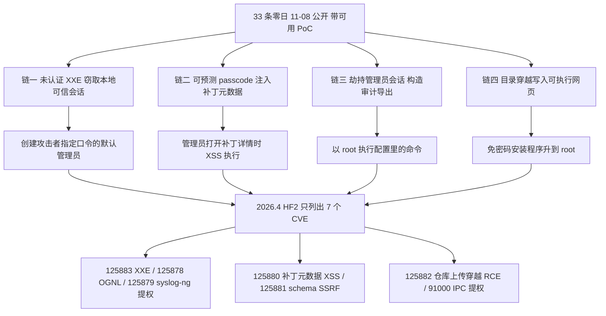
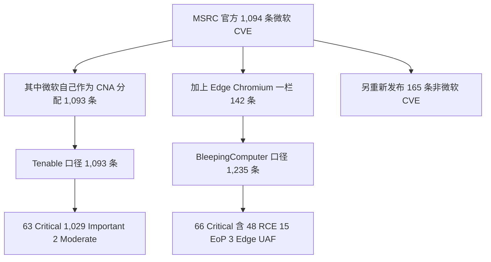
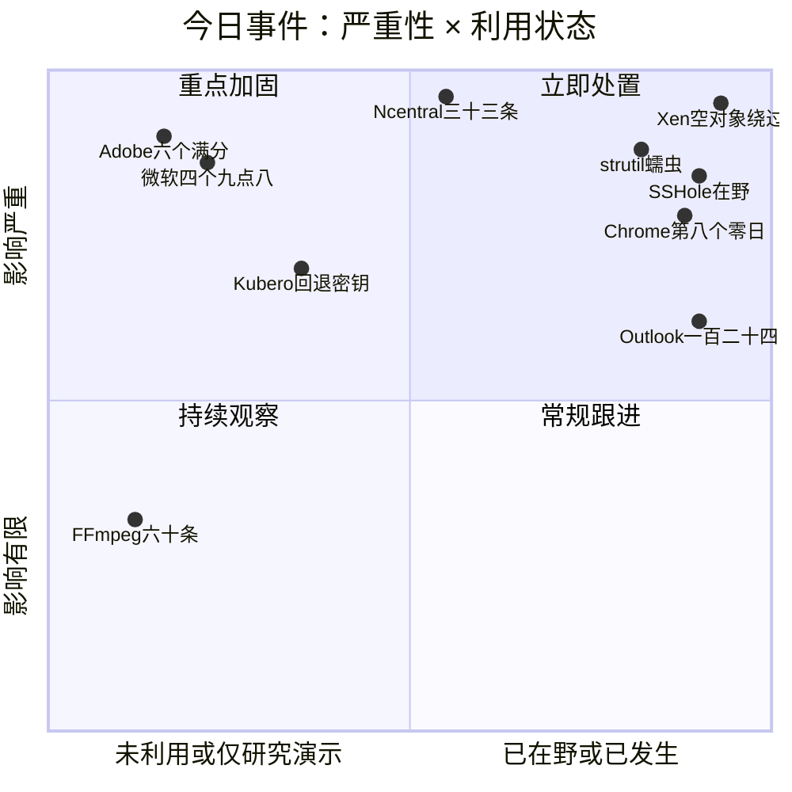
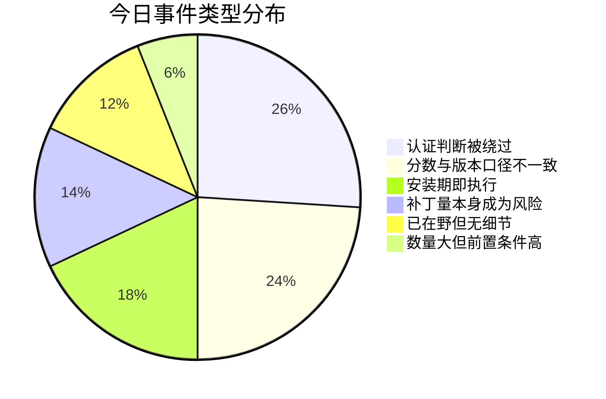
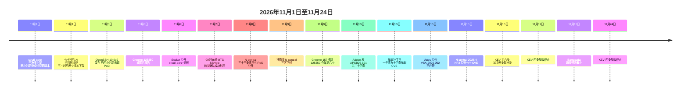

# 网安日报速递 · 2026年11月11日（第 214 期）

> **今日主线：看起来最干净的那一格**
>
> 一个人往请求里塞了个空对象——`{}`——就拿到了虚拟化管理平台的管理员会话，进而 root 掉整台 XCP-ng 节点，而这个洞到今天还没有 CVE 编号。一家 RMM 厂商在被公开 33 个零日之后能做的最安全的事，是让所有客户把自己的产品关掉。一个 Ruby gem 在安装时就已经跑完了，而事件响应手册里的第一步"先撤销被盗令牌"会触发它删掉你整个家目录。微软这个月修了一千多条，其中唯一被在野利用的那条评了 6.5 分、等级 Moderate。Adobe 同一份公告上写"不需要权限"，Adobe 自己提交的 CVE 记录上写"需要低权限"，三行都不一样。Chrome 今年第八个在野零日，已经写不进"重大"这个词里了。
>
> 每一个判断依据看起来都没问题。问题是它们指向的方向。

---

## 一、Xen Orchestra：一个空 JSON 对象，换一张管理员令牌

**关键数据**：VSA-2026-062 / 无 CVE 编号 / 无 CVSS 评分 / 影响 Xen Orchestra 与 XOA / 已在野利用 / 修复见 6.9.1–6.10.0 与 6.9.2–6.10.1 两种口径

2026 年 11 月 10 日，法国 Vates VMS 发布安全公告 VSA-2026-062，说 Xen Orchestra 里有一个严重的认证绕过，并且**已经在被利用**。这份公告最刺眼的地方不是严重性，是它没有 CVE 编号，也没有 CVSS 评分。

Xen Orchestra 是管 XCP-ng 虚拟化环境的 Web 控制台——虚拟机、主机、资源池都从这里管。这类东西一旦被拿管理员，结果不是"一个后台被登录"，是**整批宿主机**。

**缺陷本身只有一句话。** 公告原文是这么写的：REST 的 cookie 解析会把 `authenticationToken=j:%7B%7D` 变成 `{}`，REST 认证**不要求这个值必须是字符串**就把它交给 XO 的 token provider；token 集合把 `{}` 当成"没有过滤条件"的查询，返回它拿到的第一条令牌；如果这条令牌没过期，provider 就以它的所有者身份通过认证。进去之后，`/rest/v0/users/me/authentication_tokens` 这个已经认证过的路由会把"可复用的登录令牌 ID"一并交出来。

也就是说：**攻击者不需要密码、不需要劫持会话、不需要过 MFA。** 他只需要让服务端相信"我手上这个空对象，就是某个人的令牌"。


**Vates 自己的影响描述**：攻击者可以以 Admin 权限执行操作，Xen Orchestra 被攻陷可导致受管资源池上的任意代码执行，以及以 root 身份完全接管 XCP-ng 节点。发现者是 TDC NET Security 的 Filip Magic（@mad31k）和 Christoffer Olsen，修复提交是 PR #10748。

**版本号对不上，这件事要单独说。** BleepingComputer 与 The Hacker News 都写修复版本是 Xen Orchestra 6.9.1（stable）与 6.10.0（latest），对应 xo-server 包 5.211.2 与 5.213.1。但另有一份逐条读公告的分析指出，**Vates 现行公告列的是 6.9.2 与 6.10.1**，早期报道引的是上一版。这种情况下的正确做法是回厂商公告本身核当前版本，不是照着新闻里的数字验收——两个都是"官方说过"的数字，但只有一个是最新的。

**在野痕迹长这样**（Vates 一并给出）：

| 类别 | 指标 |
|---|---|
| 攻击方基础设施 | `91.211.251[.]112:8001`、`ustar3rqxgnskzgnwkgpofgtvxevm6cx3lxdbwt4mndtveqyaohid[.]onion:3333`（该 IP 在 VirusTotal 上被标为 RedLine Stealer 的 C2） |
| 可疑 cookie | 任何含 `authenticationToken=j:%7B%7D` 或 `authenticationToken=j:{}` 的 HTTP 请求 |
| 虚拟机 | 一台名叫 `pivot2` 的虚拟机 |
| VM 配置 | 配置了 `hvm_serial: file` 参数的虚拟机 |
| 落地文件 | `/etc/cron.d/zz-ustar`、`/etc/cron.d/zz-ustar2`、`/.ustar5`、`/.ustar6`，检查清单里还含 `/etc/ld.so.preload` |

宿主机上可以直接跑公告给的三条命令：

```
xe vm-list params=name-label,platform | grep -B1 'hvm_serial: file'
zgrep -- '-serial file:' /var/log/xensource.log*
ls -la /etc/ld.so.preload /.ustar* /etc/cron.d/zz-ustar*
```

**最难的部分是"发现了也没记录"。** Vates 明确说，这种利用**不会在日志里留下任何标识**——它就是一次带着怪 cookie 的正常 HTTP 请求，认证通过了，后面全是合法 API 调用。没有崩溃、没有告警、没有可用性抖动。所以只能靠 HTTP 层的流量监控（tcpdump、Wireshark、代理或 WAF 日志）去捞那串 `j:%7B%7D`。历史日志要往前翻，因为这种会话可以在里面躺几天到几周没人看。

**Vates 也给了个降风险的判断**：大多数 XO 部署并不对公网开放，暴露面有限。这句话既是安慰也是提醒——真正需要今天动手的，是那批把管理口开在公网上的。

**没有 CVE 编号的副作用**：所有按 CVE 匹配的扫描器都不会标出这台机器。核对版本只能手工对公告。这是这类"厂商自有编号"漏洞的固定成本，而它出现的位置——虚拟化管理面——恰好是扫不到就最危险的那种。

---

## 二、N-able N-central：33 个零日公开后，厂商让客户把产品关掉

**关键数据**：33 条零日（研究者口径 30+）/ 4 条利用链 / 11-08 公开带可用 PoC / 11-09 14:00 UTC 起托管版三区下线 / 11-10 发 2026.4 HF2，只列 7 个 CVE / Censys 记 1,728 台公网暴露

一家软件厂商让客户把自己的产品关机，这件事不常发生。**2026 年 11 月 10 日，N-able 这么做了。**

起因是 11 月 8 日（周日）晚，独立安全研究者 Sean Bales（GitHub 账号 Oracle-Security）公开了一个名叫 **Able2Shell** 的仓库，里面是 N-able N-central 的 30 多条零日漏洞和可用的利用代码——安全公司 Huntress 数的结果是 **33 条**。他测的是 N-central Appliance **2026.4.0.31**，一个预发布构建，并在仓库文档里说这些洞"大多数或全部"同样影响更早的版本，包括当前最新发布版。他自述挖掘过程用了 AI 辅助。

N-central 是 MSP 和 IT 团队用来远程监控、打补丁、支持终端的 RMM 平台。**一台 N-central 服务器上挂着这家 MSP 所有客户的机器**，所以它的失陷不是一家的事。

**33 条拼成四条链，最狠的那条不需要任何凭据**：

- **链路一（未认证 → 管理员）**：`service-import` 功能的**未认证 XXE** → 窃取本地可信会话 → 重置某个账号密码 → 以 `nable` 服务账户执行命令。同一条链还能直接创建一个**已启用、密码由攻击者指定**的 Default Administrator 账号。
- **链路二（可预测口令 → 存储型 XSS → root）**：设备有一套可预测的 passcode，匿名攻击者借此注入恶意补丁元数据；管理员查看补丁详情时，存储型 XSS 在管理员浏览器里执行，调用以 `nable` 身份运行命令的接口。
- **链路三（会话劫持 → 审计导出 → root）**：同一个 XSS 可以劫持管理员会话，提交一份构造好的审计导出配置，命令以 root 执行。
- **链路四（目录穿越 → root）**：软件仓库功能的目录穿越把一个可执行的网页写进服务器 Web 目录，再通过一个以"目录里可执行"为前提的免密码安装程序升到 root。

另有一条原生 **GenericTCP 栈溢出**，单独也能到 root。披露清单里还包括凭据泄露、任意文件写入、目录穿越、认证绕过，以及**审计日志篡改**——最后这条意味着：如果一台控制台在被关机之前就已经失陷，它自己的日志可能证明不了什么。



**时间线是这场事件里最值得记的部分**：

| 时间 | 事件 |
|---|---|
| 11-08 晚（周日） | Able2Shell 仓库公开，33 条零日带 PoC，无预警 |
| 11-09 14:00 UTC | Hosted N-central 在美洲、APAC、欧洲三区全部下线；本地部署客户被要求关机"直到另行通知" |
| 11-09 15:15 UTC | N-able 声明：未见任何客户环境被成功利用 |
| 11-09 夜间 | watchTowr 观测到针对 N-central 蜜罐的利用尝试；Previdian 记录单个 IP 在约 18 小时内 68 次尝试 |
| 11-10 | 发布 **N-central 2026.4 HF2**，公告列出 7 个 CVE；托管区开始逐区升级恢复 |
| 11-10 之后 | N-able 声明还会有一次后续 hotfix 补剩下的 |

HF2 列的七个 CVE 是：**CVE-2026-125883**（多条 XXE）、**CVE-2026-125878**（多条 OGNL 注入）、**CVE-2026-125879**（通过 `nable` 可写的 syslog-ng 配置本地提权到 root）、**CVE-2026-125880**（MMS3 补丁元数据存储型 XSS，管理员上下文）、**CVE-2026-125881**（service import schema 校验的 schema-hint SSRF）、**CVE-2026-125882**（文件仓库上传路径穿越导致 RCE，致谢 Nate Fair / Sprocket Security）、**CVE-2026-91000**（不安全 IPC 通道导致本地提权）。**33 条对 7 条**——厂商自己也没说这七个覆盖了多少。

**几个必须一起看的数字**：Censys 记到 **1,728 台**公网暴露的 N-central；Previdian 那个 68 次／单 IP／18 小时的数字说明扫描已经开始得很彻底；而 N-able 反复强调"没有证据表明客户环境被成功利用"。这三句话并不矛盾，但它们回答的是三个不同的问题——暴露多少、被戳多少、成了几个。**第三个问题的答案取决于你有没有日志能回答它，而审计篡改正好在攻击链里。**

**为什么是这时候爆的**：Bales 对 BleepingComputer 说，他之所以不预警直接公开，是因为 N-able 对他报在**另一个产品**里的漏洞拖了几个月没修；他的原话是这家公司"不把披露当回事"。他还说 N-able 的 CEO 和 CTO 请他删掉仓库，"但他们没有威胁我"。这是 15 个月里 N-able 第四次被迫紧急响应——2025 年 8 月它修 CVE-2025-8875 和 8876 时，那两个洞已经作为零日被打了。

**Huntress 的一个实操提醒值得单独抄下来**：补好的构建**可能不会带新的版本号**，别拿版本字符串当验收依据，按 N-able 的升级指引走。

---

## 三、strutil-core：装包那一刻就已经跑完了，而撤销令牌会删掉你的家目录

**关键数据**：RubyGems 上的 `strutil-core` 1.0.1 / 5.48 MB 载荷 / 上架到下架约 5 小时 / AI 扫描器在发布后 70 秒标记 / 读取 51 个凭据存储 / 令牌一旦返回 401 就 `rm -rf ~`

一个自称"轻量字符串处理助手"的 Ruby gem，在 11 月 1 日上架，两个小时后被换成带载荷的版本，五小时后被下架。**这五个小时里，任何人跑一次 `gem install` 或 `bundle install`，就已经完成了感染——不需要 require，不需要调用，不需要在应用里用到它。**

Socket 在 11 月 6 日公开了分析。时间戳精确到秒：

| 时间（UTC） | 事件 |
|---|---|
| 11-01 02:19:56 | 账号 `jamnajiea` 发布干净的 1.0.0；沙箱跑下来无恶意行为 |
| 11-01 04:05:04 | 同一账号发布 1.0.1，带 **5.48 MB** 载荷 |
| 11-01 04:06:14 | Socket 的 AI 扫描器标记为已知恶意代码——**发布后 70 秒** |
| 11-01 08:52–09:13 | RubyGems 下架两个版本，前后约 5 小时 |

**载荷为什么能"装的时候就跑"**：gem 声明了一个原生扩展，而 `ext/strutil-core/extconf.rb` **里面一行构建逻辑都没有**。在 Linux 和 macOS（x86-64 与 ARM64）上，它把 Bun 1.2.18 运行时从 Bun 官方 GitHub Release 下到临时目录，用 Bun 跑旁边的 `index.js`，清理现场，然后写一个目标为空的 Makefile——这样安装过程不会报错，看起来一切正常。


**最值得记的一点是：这个 gem 是蠕虫自己的注入器输出的产物。** 解码后的载荷里带一个 RubyGems 传播模块——拿到偷来的 API key 之后，逐个下载可发布的 gem，把载荷和安装器塞进去，改 gemspec 的版本号，用伪装成 gem 客户端的 User-Agent 推上去。把载荷里的安装器模板用自己的常量填满，能**逐字节复现**出这次发出去的 `extconf.rb`（SHA-256 `c5264f3b…9c749`）；安装器 36 行非空代码里，**33 行**与 2026 年 6 月那份为防御研究而公开的 Miasma 载荷逐字相同。

这也顺手解释了一个很蠢但很好用的追踪线索：**注入器只改 gemspec 的版本号，不改源码**，所以那个发布为 1.0.1 的 gem，里面仍然写着 `VERSION = '1.0.0'`。十一月这版与六月相比改了四处：Bun 从 1.3.13 换成 1.2.18、把下载 URL 拆开以打断针对 Bun Release 字符串的静态签名、换了新的客户端 UA、加了进度日志和 dry-run 开关。

**它偷什么**：先做一次 locale 检查，遇到俄语、白俄语、哈萨克语、乌兹别克语、吉尔吉斯语、塔吉克语、亚美尼亚语、阿塞拜疆语、乌克兰语、格鲁吉亚语、土库曼语、摩尔多瓦语的系统直接退出。然后收集云、包仓库、Git 托管、SSH、Docker、Kubernetes、Vault、密码管理器、系统钥匙串、钱包，以及 **AI 编码工具的凭据**——`.claude/.credentials.json` 和 `.codex/auth.json` 都在里面。Bitbison 的沙箱记录到它读了 **51 个凭据存储**。

拿到 AWS 凭据它会调 STS，在 **17 个区域**枚举 Secrets Manager 与 SSM 参数，在 **11 个区域**申请 ECR token。在 GitHub Actions runner 上它会去 `/proc` 里找 worker 进程，通过免密码 sudo 把一段内嵌 Python 管道过去抓进程内存里的密钥（这是 2025 年 3 月 `tj-actions/changed-files` 那次的手法），接着通过 docker socket 杀掉 StepSecurity 的 Harden-Runner 容器，再装一个特权 Alpine 容器给 runner 免密码 sudo。StepSecurity 说这部分尝试失败了。

数据用 AES-256-GCM 加密、密钥用 RSA-OAEP 包裹，POST 到 `paleasbest[.]top/v1/api`；失败就回退到公开 GitHub 仓库（描述写 `project-utils`，名字是"形容词-名词-数字"，commit 前缀 `AutoSyncComplete`）或 GitLab。

**AI 工具投毒是这轮最该看的部分**：它会在用户主目录里找 AI 编码工具的配置（`settings.json`、`mcp.json`、`.aider.conf.yml`），加一个叫 **`workspace-tools`** 的 MCP 服务器，用 node 把载荷再跑一遍；再加 **SessionStart 钩子**，会话一开就执行。有可用 Git 凭据的话，它把这套东西推进仓库：`.claude/settings.json`、`.cursor/mcp.json`、`CLAUDE.md`、`AGENTS.md`、`.vscode/tasks.json`。**生成的 `AGENTS.md` 会让编码代理在第一条命令之前先跑一个 setup 脚本**——也就是说，只要在带信任设置的 AI 工具里打开一个受影响的仓库，就可能重新触发它。

**持久化和那个陷阱**：它装一个 Python 后门 `sync.py`，注册成 systemd 用户服务 `pkg-runtime` 或 LaunchAgent，每小时去公开 GitHub commit 里搜标记 `msync-3f7a`，只执行 URL 上带有效 RSA-PSS 签名的脚本。另有一个叫 `net-health-checker` 的监视器，**每 45 秒**验一次偷来的 GitHub token；一旦返回 401 或 403，就执行删掉整个主目录的命令。

**这就是为什么处置顺序要反着写**：事件响应的第一反应是"立刻撤销被盗 token"，而在这套设计里，撤销就是引爆。正确顺序是先在隔离的主机上清掉 `net-health-checker` 和 `pkg-runtime`，再从**干净设备**上轮换全部凭据，最后重装机器。卸载 gem 不能解除感染，因为载荷活在 gem 目录之外。同一套基础设施还出现在 PyPI 包 `pystr-codec`（0.1.0–0.1.2）上，Kamil Mańkowski 记为 MAL-2026-18432。

Socket 没有找到公开的依赖者，也确认没有受害者——**这不等于没人中招**，它只等于下载计数不能告诉你谁中了。

---

## 四、微软十一月补丁日：三个数字，一条在野，六点五分

**关键数据**：MSRC 口径 1,094 条（其中微软自己分配 1,093 条）/ BleepingComputer 口径 1,235 条 / 66 或 63 条 Critical / 唯一在野 CVE-2026-124194，CVSS 6.5 Moderate / KEV 死线 11-24

十一月补丁日最大的新闻其实不是"又破纪录了"，而是一个月前刚破过——十月是 1,411（BleepingComputer）或 1,413（Tenable），十一月是 1,235 或 1,094，**连续两个月过千之后，"一千多条"从紧急状态变成了地板价**。

先把数字对齐，因为今天不同来源给的三个数都"对"：

- **MSRC 官方发布说明**：这次发布含 **1,094 条微软 CVE**（Windows 726、Office 174、SQL Server 59、开发者工具 53、SharePoint 27、Azure 20、Exchange Server 9、Defender 1、其他 25），另外**重新发布 165 条非微软 CVE**（不含 Chrome）。这 1,094 条里有 1,093 条是微软自己作为 CNA 分配的——Tenable 报的 1,093 就是这一栏。
- **BleepingComputer 报 1,235**：它比 MSRC 的 1,094 多出一百四十来条，而这个差额正好对应它单独列出的 Edge（Chromium）那一栏 142 条；它同时说明本月早些时候已修掉的 108 条（Entra 设备注册 1、Mariner 82、Edge 25）不计入。**两个数的边界不同，不是谁算错了。**



**分类也跟着口径漂**：BleepingComputer 的分布是 536 提权 / 296 RCE / 157 信息泄露 / 46 DoS / 27 安全功能绕过 / 22 欺骗 / 142 Edge；Tenable 的是 535 提权 / 296 RCE / 156 信息泄露 / 46 DoS / 27 绕过 / 22 欺骗 / 11 篡改。差异不大，但足够说明"这个月的严重漏洞有几个"这个问题没有唯一答案。

**唯一被在野利用的那条，是本月的低分**。

**CVE-2026-124194**，Microsoft Outlook 欺骗漏洞，CVSS 3.1 **6.5**（AV:N/AC:L/PR:N/UI:R/S:U/C:H/I:N/A:N），微软自己的等级是 **Moderate**。机制是：未认证攻击者发一个特制的邮件文件，说服用户用 Outlook 打开；打开后 Outlook 会去连一个攻击者控制的网络位置，**并且不显示平常那个"外部内容"警告**；连接过程里 Windows 自动尝试认证，把用户的 **NTLMv2 哈希**送出去。哈希可以离线爆破，也可以直接拿去做中继。预览窗格不够，必须真的打开文件。

受影响的不只是 Windows：Outlook 2016、Office 2021 LTSC、Office 2024 LTSC、Microsoft 365 Apps 企业版都在列表里，所以**只装 Windows 累积更新不够，得单独跑一次 Office 更新**，再重启 Outlook。CISA 已在 11-10 把它收进 KEV，联邦机构死线 **11 月 24 日**。

一个值得记的细节：Tenable 说这条是一位**与 Anthropic 的 Claude 模型合作**的安全研究者报的，但没有点名研究者，也没说是哪个模型版本。同一周里，Mozilla 那边也说 Firefox 160 修的洞里约四分之一由 OpenAI 的研究员提交——**两家浏览器的补丁量正在被 AI 一起推高**。

**同批的最高分反而是"Important"**：CVE-2026-**120002**（SharePoint 授权不当，9.9）和 CVE-2026-**109467**（Azure DevOps 认证不当，9.9）都评 Important。四个 9.8 是 **112967**（Xbox Live 网络服务堆溢出）、**116928**（Windows Search 组件越界写，可经 Exchange 附件索引零点击触达）、**119958**（Windows LDAP 越界写）、**119990**（Azure OpenAI 关键功能缺认证）。ZDI 把其中 30 条判为"可能蠕虫化"。

另外记一笔**不要被 feed 带偏**：CVE-2026-100223（Windows NTFS 提权，7.8）这一周被若干个情报源标成"已在野利用"，而 MSRC 自己的公告写的是未公开披露、未被利用、"利用可能性较低"、仅本地。它是常规补丁，不是零日。

---

## 五、Adobe Connect：同一家写的两份文件，权限要求对不上

**关键数据**：APSB26-191 / 24 条 CVE / 18 Critical / 6 条 10.0 / Priority 2（30 天）/ 三行公告与 CVE 记录的权限要求不一致 / Adobe 称无在野

11 月 10 日，Adobe 发布 **APSB26-191**，修 Adobe Connect（Windows 本地部署 12.12 及更早）的 **24 条**漏洞，定级 Priority 2。18 条 Critical、4 条 High、2 条 Medium。Adobe 明说：不知道有任何在野利用。

**六条 10.0**：CVE-2026-**121351** 与 **121354**（路径穿越，CWE-22）、**121352**（授权不当，CWE-863）、**121353**（CRLF 注入，CWE-93）、**121356** 与 **121889**（SSRF，CWE-918）。其中五条共用完全相同的向量 `CVSS:3.1/AV:N/AC:L/PR:N/UI:N/S:C/C:H/I:H/A:N`——**四种不同的弱点类，一个向量字符串**。

这不是今天的问题。**问题是另外三行。**

Adobe 是这 24 条全部记录的 CNA，也是唯一给它们打分的机构；每条记录只有一份 CVSS（来源 `psirt@adobe.com`，类型 Primary），`vulnStatus` 全是 `Received`，NVD 还没分析，所以记录里没有任何"第二种读法"。而在三行里，**Adobe 公告页上印的向量，和 Adobe 自己提交的 CVE 记录里的向量不一样，差的正是权限要求**：

| CVE | 弱点 | 公告 APSB26-191 | CVE 记录（Adobe 自己提交） |
|---|---|---|---|
| CVE-2026-121904 | 存储型 XSS（CWE-79） | **High 8.7**，`PR:N` | **Critical 9.6**，`PR:L` |
| CVE-2026-122102 | 存储型 XSS（CWE-79） | **Critical 9.3**，`PR:N/UI:R` | **High 8.7**，`PR:L/UI:R` |
| CVE-2026-121900 | SQL 注入（CWE-89） | **Critical 9.4**，`PR:N` | **High 8.3**，`PR:L` |

三次方向一致：**公告说不需要权限，记录说需要低权限**。Adobe 自己的评级页把 Critical 划在 9.0–10.0、High 划在 7.0–8.9，所以按公告读的人看到两个 Critical，按记录读只有 High；第三条方向相反——公告叫 High，记录把它抬成 Critical。第四行还能证明这不是统一规则：**CVE-2026-121902** 同样是 SQL 注入、公告上分数和向量与 121900 一字不差（9.4、`PR:N/UI:N/S:U/...`），但在记录里它保留了 `PR:N` 和 9.4 Critical，只有 121900 掉到了 8.3。

**这件事的影响不是学术性的**：`PR:N` 意味着"不用登录就能打"，`PR:L` 意味着"得先有一个低权限账号"。在补丁优先级排序里，这两个条件的差别经常就是"今晚加班"和"下周排期"的差别。而**两句话都出自同一家厂商的同一次发布**。

同月 Adobe 一共发了九份公告、约 110 条 CVE、22 条 Critical。另一个 Priority 2 是 **APSB26-189**（Experience Manager，14 条，含四条 9.9 代码执行）。其余七份是 After Effects（17 条）、Photoshop（13 条）、Content Credentials SDK（13 条）、Premiere（11 条）、Audition（11 条）、Media Encoder（6 条）、Dimension（1 条，仅 macOS），都评 Priority 3。**Photoshop 2025 不再更新**，用户得迁到 2026 或 2027。

---

## 六、Chrome：今年第八个在野零日，已经不算新闻

**关键数据**：CVE-2026-125350 / XML 组件 UAF / High / 11-06 匿名报告，11-09 修复 / Chrome 157.0.8103.50–.51 / 2026 第八个在野零日 / KEV 死线 11-24

11 月 9 日，Google 发 Chrome 稳定版更新，一共修 9 条（7 条 High、2 条 Medium 的 GPU 未初始化资源），其中 **CVE-2026-125350** 是 XML 组件的 use-after-free，Google 明说"已知该漏洞的利用代码存在于野外"。

它被匿名研究者在 **11 月 6 日**报告，**三天后**就发了补丁——这个节奏说明 Google 内部已经把它当紧急处理。修好的版本是 Windows/macOS 的 **157.0.8103.50 / .51**、Linux 的 **157.0.8103.50**；用扩展稳定通道的用户对应 **156.0.8078.96**。CISA 在 11-10 把它收进 KEV，死线 11-24。

**第八个**。今年的清单是：2 月 **CVE-2026-2441**（CSS 的 UAF）、3 月 **3909**（Skia 越界写）与 **3910**（V8）、4 月 **5281**（Dawn/WebGPU 的 UAF）、6 月 **11645**（V8 越界访问）、9 月 **85046**（V8 类型混淆）与 **87491**（V8 越界写）、11 月 **125350**。2025 年全年也是 8 个，而 2026 年还剩七周。**当"今年第八个"变成一句需要查表才能确认的话，这个词本身就已经失效了。**

**两个不该被忽略的技术限定**：

1. **沙箱逃逸没有被确认。** NVD 分析后的描述是"允许远程攻击者通过构造的 HTML 页面在沙箱内执行任意代码"，给 8.8（`AV:N/AC:L/PR:N/UI:R/S:U/C:H/I:H/A:H`），CISA 的 KEV 描述也写"inside the sandbox"。但 SANS Internet Storm Center 在 11-10 明确指出：Google 的公告没有说这是 RCE，没有公布确认的影响，也没有说攻击者能逃出 Chrome 的沙箱。浏览器被完整利用通常需要两条洞——一条在渲染进程里拿到代码执行，另一条出去。**目前没有任何公开材料证明这条链存在。**
2. **没有任何可用于防守的指标。** 没有 IOC、没有恶意域名、没有文件哈希、没有说受害者怎么碰到利用。Chromium 的 issue（582442907）仍然是受限状态，Google 按惯例要等大多数用户升完才公开细节。

所以这条的现实动作只有一个：**升级，然后重启**。下载了不重启，当前会话仍然没有保护。

---

## 速览

### 1. OpenSSH「SSHole」已在野：16 条成功链，一个跑不起来的后门

这条我们在 **11 月 6 日期**写过本体（CVE-2026-123158，musl 的 `crypt()` 出错返回星号，刚好等于 shadow 里那个星号）。今天的新增量是**它已经被打了**。

时间表极短：11 月 5 日 OpenSSH **10.6p2** 修复发布；约 **4 小时后**出现 PoC；Previdian 记录 **11 月 6 日**首次成功利用；GreyNoise 记录的首个确认成功是 **11 月 7 日 00:46 UTC**，距修复约 **40 小时**。GreyNoise 追踪的活动方被编号为 **GT10**，在其东南亚蜜罐上做了"成熟的入侵"：系统与容器侦察、查云元数据服务、读密码哈希与 root 的 SSH 密钥、改 `authorized_keys` 做持久化，共 **16 条成功利用链 / 6 个源 IP**。同期的背景噪声是 2750 万次 22 端口扫描与 2010 万次 SSH 会话尝试——GreyNoise 自己提醒，这些**不等于** SSHole 利用。

一次得手后装了 **TAC Agent**：一个 Python C2 代理，支持命令执行、系统侦察、文件上传下载、自更新，没有内置持久化（攻击者靠加开机服务补）。它的 C2 `tac.vpnla[.]org` 不可达，所以从未收到任务。**注释、日志、报错都是中文**，Ars Technica 说它看起来是 AI 生成的。Previdian 侧是 20 次尝试 / 13 个 IP / 9 个国家；watchTowr 在 11 月 6 日看到的活动与僵尸网络、挖矿相关；芬兰 Defused 的措辞最保守——"少数行为者"，未大范围扩散。KEV 已在 11-09 收录，死线 11-12。

### 2. KEV 11-10 加了六条，其中两条是十天前写过的

11 月 10 日 KEV 新增：**CVE-2026-124194**（Outlook，死线 11-24）、**CVE-2026-111793**（Openwave Webtop Media Transcoder，11-24）、**CVE-2026-20320**（Cisco BroadWorks XXE，11-24）、**CVE-2026-125350**（Chromium，11-24）、**CVE-2026-111560** 与 **CVE-2026-116606**（Barracuda 多个产品，死线 **11-13**，只有三天）。目录版本 2026.11.10，共 **1,779** 条。

Barracuda 那两条我们在 **11 月 6 日期**写过（Index.pm 密码修改失败分支写成 `return userrole`，一路走到 `fix_tz.pl` 被 sudo 拉起），当时它们不在 KEV，今天进去了，而且 Barracuda 更新公告承认**利用不再需要管理员权限，只要能访问管理界面**。Cisco BroadWorks 那条要留一个心眼：CISA 把它当"已被利用"收录，而 **Cisco PSIRT 的公告仍写着不知道有公开宣告或恶意使用**。两个说法可以同时成立（CISA 看得到厂商看不到的遥测），但排序时应该知道这是一个分歧，不是一个结论。

### 3. Ivanti 十一月：EPM 一条 9.8 未认证 SQL 注入

13 条 CVE 分布在五个产品。最重的是 **CVE-2026-121653**，Ivanti Endpoint Manager 的 Core 里一条**未认证 SQL 注入**，CVSS **9.8**，可直达 RCE，2024 SU8 修复。另外：EPMM 六条（12.11.0.0 / 12.10.0.1 / 12.9.0.3 修）、Sentry 四条（含 **CVE-2026-105425**，管理员认证后的 OS 命令注入，7.2，与 EPMM 共用同一个缺陷）、Cloud Services Application 的 **121683**、User Workspace Manager 的 **105813**。Ivanti 说披露时不知道有客户被这两组漏洞利用。同月它还修了 Connect Secure（ICS）两个洞，BleepingComputer 说这两个洞**至少从 10 月 1 日起就被串起来当零日用**。

### 4. Mozilla 一次 208 条：沙箱逃逸 9.6，四分之一由 OpenAI 研究员提交

11 月 10 日：Firefox **160** 修 **99** 条（57 High）、ESR **153.7** 修 **81** 条（51 High）、ESR **115.45** 修 **28** 条（全 High）。最显眼的是 **CVE-2026-124853**，Graphics: Text 组件的边界条件错误导致**沙箱逃逸**，CVSS **9.6**；另一位是 **CVE-2026-124907**，CanvasWebGL 的 UAF，同样可用于提权与沙箱逃逸。**约四分之一的 Firefox 160 修复由 OpenAI 的研究员署名**——延续 Firefox 159 的趋势。同时提醒：Mozilla 自己的评级比部分第三方跟踪站低（124941 与 124950 被它标为 Low），对外报数用 Mozilla 的口径。

### 5. FFmpeg 60 条：数量吓人，前提是"你得先让它读你的文件"

NVD 在 11-09 到 11-10 之间收录了 **60 条**描述以 "FFmpeg through 9.0.2" 开头的记录，覆盖 g726、Bink、Motion Pixels、C93、OpenEXR、VAAPI HEVC、libwebp 编码器等等。但看向量：**几乎全部是 `AV:L/AC:L/PR:N/UI:R`**，也就是本地触发、需要用户打开文件；最高分只有 **7.0**（`flicvideo.c` 的越界写、`liboapvenc` 与 VAAPI HEVC 的堆溢出等），大批是 3.3 的未初始化内存泄露和 5.5 的 NULL 解引用。**这是一次规模很大的低危批量，不是 60 个 RCE。** 真正该关心的是"有服务端在转码不可信媒体"的那类部署。

### 6. 硬编码回退密钥与一句话的 9.9

**CVE-2026-125370**（Kubero 3.0.0–3.1.1）：**没设 `JWT_SECRET` 的时候用硬编码的回退签名密钥**，攻击者可以伪造任意 `role`、`userGroups`、`permissions` 的管理员 JWT，而 `JwtStrategy.validate()` **信任这些声明且不回查数据库**。9.8（CVSS 3.1）/ 9.3（CVSS 4.0）。同一天还有 **CVE-2026-125383** 与 **125384**：INDOTALENT WHMS 在 `appsettings.json` 里硬编码 JWT 密钥与 issuer/audience，且 `UserAdminSeeder` 会创建一个 `admin@root.com` / `123456` 的账号。另有一条值得单独记一笔的：Axis 的 **CVE-2026-13312**，评分 **9.9**，NVD 上的描述全文是"一个可以让攻击者攻陷系统的漏洞"——**就这一句**，没有任何组件、版本、弱点类信息，唯一参考是 Axis 的一份 PDF。

---

## 风险分析







## 优先级建议

| 优先级 | 动作 | 对象 |
|---|---|---|
| 今天 | 核对 Xen Orchestra 版本并堵管理口，翻 HTTP 日志找 `j:%7B%7D` | 跑 XCP-ng 的环境 |
| 今天 | N-central 保持离线，按 N-able 指引升到 2026.4 HF2，别用版本号验收 | MSP 与自建 RMM |
| 今天 | 装 Office 更新（不只是 Windows 累积更新）修 124194，边界与主机禁出站 SMB / NTLM | Outlook 桌面端 |
| 今天 | Chrome 升到 157.0.8103.50 以上并**重启** | 全体桌面 |
| 本周 | 查 `Gemfile.lock` / `vendor/bundle` 里有没有 strutil-core；查 `workspace-tools` MCP | Ruby 与 AI 编码工具使用者 |
| 本周 | Adobe Connect 升到 12.12 之后；AEM 同步 APSB26-189 | 企业 Web 会议与内容平台 |
| 排期 | FFmpeg 更新，重点在服务端转码链路；Kubero 显式设置 `JWT_SECRET` | 媒体与 K8s 部署 |

## 相关出处

- **Vates MSP — VSA-2026-062 安全公告**（空 JSON 对象绕过、IOC 清单、宿主机检查命令、日志无痕迹说明）：<https://xen-orchestra.com/security>
- **The Hacker News — Hackers Exploit Critical Xen Orchestra Auth Bypass Flaw to Gain Admin Access**（公告原文引用、91.211.251.112 被 VT 标为 RedLine C2、TDC NET 两位研究者）：<https://thehackernews.com/2026/11/hackers-exploit-critical-xen-orchestra.html>
- **BleepingComputer — Critical Xen Orchestra auth bypass flaw exploited to hijack VM servers**（6.9.1/6.10.0 与 xo-server 5.211.2/5.213.1 口径、完整 IOC）：<https://www.bleepingcomputer.com/news/security/critical-xen-orchestra-auth-bypass-flaw-exploited-to-hijack-vm-servers/>
- **DEV Community — An Empty Cookie That Hands Attackers Admin**（指出通行公告列 6.9.2/6.10.1、PR #10748、补充阻断 IP 列表，补充 IP 部分为单一来源未采信）：<https://dev.to/sharz_ninesec/xen-orchestra-vsa-2026-062-an-empty-cookie-that-hands-attackers-admin-on-your-virtualization-plane-50fm>
- **N-able 状态页 — N-central Critical Security Incident（Release Available）**（2026.4 HF2 发布、七个 CVE 清单、后续 hotfix 说明、三区影响范围）：<https://uptime.n-able.com/>
- **The Hacker News — N-able Takes N-central Cloud Offline After Researcher Discloses 33 Zero-Days**（33 条、watchTowr 蜜罐观测、N-able 无成功利用声明）：<https://thehackernews.com/2026/11/n-able-takes-hosted-n-central-offline.html>
- **Security Intel Hub — N-able N-central gets emergency fix two days after 33 exploits published**（四条链细节、Censys 1,728 台、Previdian 单 IP 68 次、15 个月第四次、2025 年 8875/8876 前情）：<https://securityintelhub.com/article/n-able-n-central-gets-emergency-fix-two-days-after-33-exploits-published/>
- **TechCrunch — N-able takes its remote access service offline after researcher publishes dozens of zero-day bugs**（Bales 的披露动机、CEO/CTO 请求删仓库、无威胁）：<https://techcrunch.com/2026/11/10/n-able-takes-its-remote-access-service-offline-after-researcher-publishes-dozens-of-zero-day-bugs>
- **RedEye Security — Able2Shell**（审计篡改在链中、Huntress 33 条口径、处置建议）：<https://threat-intelligence.redeyesecurity.com/blog/n-able-n-central-able2shell-zero-days-2026>
- **AL-ICE — Install Was the Infection: strutil-core Brought a Shai-Hulud-Descendant Worm to RubyGems**（秒级时间戳、逐字节复现、33/36 行同源、locale 跳过清单、17 区 AWS 枚举）：<https://al-ice.ai/posts/2026/11/strutil-core-rubygems-shai-hulud-worm-ai-tool-poisoning-november-2026>
- **GBHackers — Shai-Hulud Descendant Hides in Malicious Ruby Gem**（51 个凭据存储、net-health-checker 45 秒与 401/403 触发删除、pystr-codec 同基础设施）：<https://gbhackers.com/ruby-gem-discovered/>
- **Cybersecurity News — Malicious Ruby Gem Steals 51 Types of Credentials**（MCP 与 SessionStart 钩子、AGENTS.md 让代理先跑 setup 脚本、Harden-Runner 被杀）：<https://cybersecuritynews.com/malicious-ruby-gem/>
- **Agentbeam — strutil-core 检测与处置**（lockfile 与 mcp.json 自查命令、撤销令牌触发删除的处置顺序）：<https://agentbeam.com/blog/strutil-core-rubygems-miasma-worm-ai-tool-poisoning>
- **MSRC — November 2026 Security Updates 发布说明**（1,094 条微软 CVE 与产品族分布、Windows 726、Office 174、重发布 165 条非微软 CVE、Outlook 124194 标 Exploitation Detected）：<https://msrc.microsoft.com/update-guide/releaseNote/2026-Nov>
- **BleepingComputer — Microsoft November 2026 Patch Tuesday fixes 1,235 flaws, Outlook zero-day**（1,235 口径与分类、48 RCE、142 Edge、排除的 108 条）：<https://www.bleepingcomputer.com/news/microsoft/microsoft-november-2026-patch-tuesday-fixes-1-235-flaws-outlook-zero-day/>
- **ThreatAft — Microsoft's Quiet Month: 1,093 CVEs**（1,093/1,094 口径、63 Critical、30 条可能蠕虫化、ZDI 与 Dustin Childs 观点）：<https://threataft.com/articles/microsoft-patch-tuesday-november-2026-1093-cves>
- **UGetFix — Microsoft patches Outlook zero-day in November updates**（三家口径差异解释、受影响 Office 版本、点名 Claude 协助发现、预览窗格不足以触发）：<https://ugetfix.com/news/windows-november-2026-patch-tuesday-outlook-zero-day>
- **Ivanti — November 2026 Patch Tuesday 汇总**（Adobe 九份公告 110 条、Connect 24 条六条 10.0、AEM 四条 9.9、Ivanti 自身 13 条、Firefox 与 Android 数据）：<https://www.ivanti.com/blog/november-2026-patch-tuesday>
- **Severity Daily — Adobe Connect APSB26-191 三行公告与 CVE 记录权限要求不一致**（121904 / 122102 / 121900 的分数与 PR 对照、121902 反向例证、vulnStatus 全为 Received）：<https://severitydaily.com/adobe-connect-apsb26-191-24-cves-six-10-0-three-rows-bulletin-pr-n-vs-filed-record-pr-l-cve-2026-121904-8-7-computes-to-10-0-cve-2026-121900-9-4-vs-8-3-cve-2026-122102-9-3-vs-8-7-priority-2-30-days>
- **The Register — Chrome zero-day whack-a-mole continues as 2026 tally hits 8**（第八个、11-06 匿名报告、157.0.8103.50/.51、2025 全年同为 8 个）：<https://www.theregister.com/security/2026/11/10/chrome-zero-day-whack-a-mole-continues-as-2026-tally-hits-8/5308732>
- **CyPro — Chrome Zero-Day CVE-2026-125350 Exploited**（SANS ISC 指出未确认沙箱逃逸、扩展稳定通道 156.0.8078.96、时间线）：<https://cypro.co.uk/insights/cyber-bulletins/chrome-zero-day-cve-2026-125350-exploited>
- **NVD — CVE-2026-125350**（分析后描述限定为沙箱内执行、CVSS 3.1 8.8、issue 582442907 引用）：<https://nvd.nist.gov/vuln/detail/CVE-2026-125350>
- **CISA — Known Exploited Vulnerabilities Catalog**（catalogVersion 2026.11.10 / 1,779 条；11-09 新增四条死线 11-12；11-10 新增六条，Barracuda 两条死线 11-13，其余 11-24）：<https://www.cisa.gov/known-exploited-vulnerabilities-catalog>
- **Ars Technica — Vulnerability that lets hackers SSH into Linux devices is under active exploitation**（GT10 编号、TAC Agent 疑似 AI 生成、五项前置条件、Red Hat 的措辞）：<https://arstechnica.com/security/2026/11/vulnerability-that-lets-hackers-ssh-into-linux-devices-is-under-active-exploitation>
- **BleepingComputer — Hackers exploit SSHole OpenSSH flaw to breach Linux systems**（16 条链 / 6 个 IP、2750 万次扫描、TAC Agent 的 C2 与功能）：<https://www.bleepingcomputer.com/news/security/hackers-exploit-sshole-openssh-flaw-to-breach-linux-systems/>
- **Zero Hunt — November 2026 Patch Tuesday and KEV surge**（Cisco BroadWorks 在 KEV 而 PSIRT 称不知恶意使用、CVE-2026-100223 被误标已在野、N-able 的"PoC 公开"不等于"已在野"）：<https://zerohunt.ai/blog/security-incidents-november-8-10-2026-tracker>
- **Threadlinqs — TL-2026-5681**（Barracuda 两条的时间线：10-15 与 10-22 收到报告、11-02 公告、11-05 更正为"无需认证"、11-09 承认小范围被利用、11-10 进 KEV）：<https://intel.threadlinqs.com/threat/TL-2026-5681>
- **NVD — CVE-2026-121653 / 105425 / 109467 / 120002 / 124194 / 125370 / 124853 / 13312**（本期的向量、分数、published 与 vulnStatus 逐一核对）：<https://nvd.nist.gov/vuln/detail/CVE-2026-121653>
- **NVD API 2.0 — 11-09 至 11-11 收录 2,629 条**（按 CVSS 降序筛出 Adobe Connect 24 条、FFmpeg 60 条、微软 9.8 与 9.9、Kubero、Axis 等，并逐条核对向量与发布日期）：<https://nvd.nist.gov/developers/vulnerabilities>
