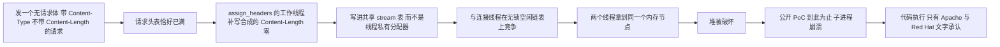
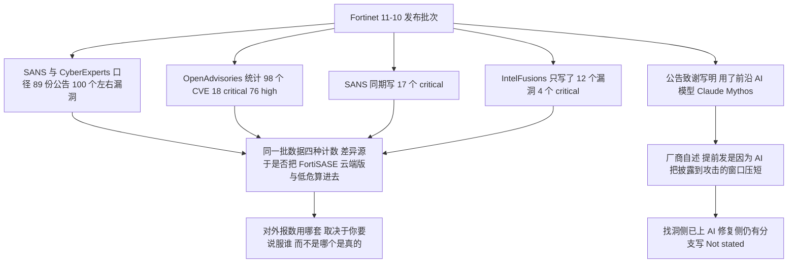
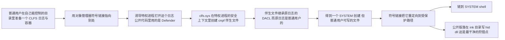
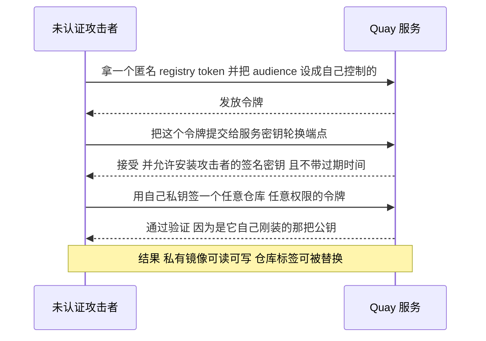
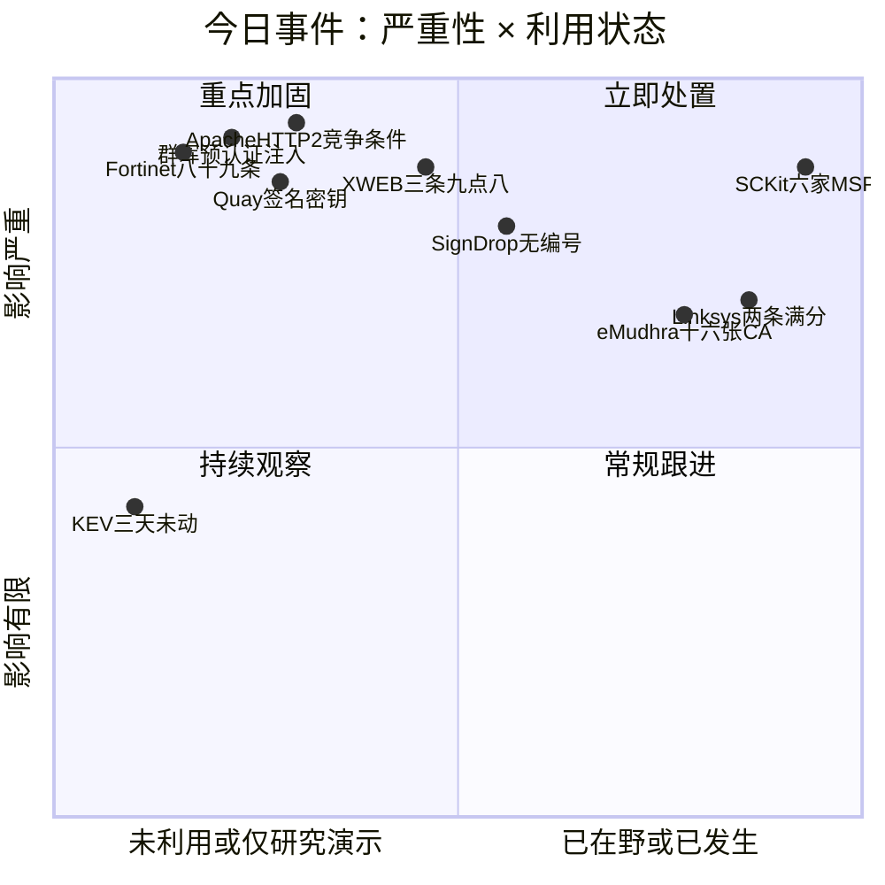
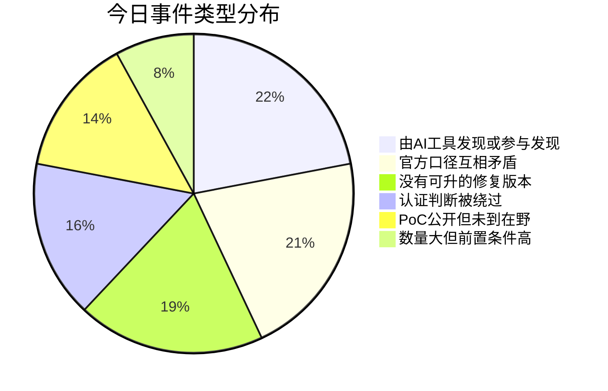
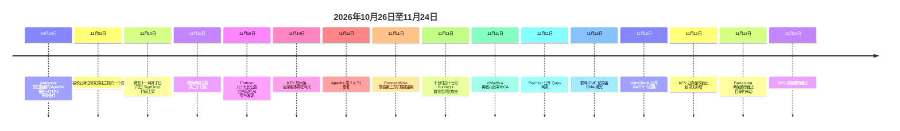

# 网安日报速递 · 2026年11月13日（第 215 期）

> **今日主线：AI 找出来的洞，修复那一栏是空的**
>
> Apache HTTP/2 那个 9.8，是 Anthropic 的扫描器在 10 月 26 日先报的，Google Cloud 的两位研究员在 11 月 3 日独立报了同一个问题——修复版 2.4.71 等到 11 月 11 日才发。Fortinet 一天发了 89 份公告、近 100 个漏洞，公告里自己写着"用了前沿 AI 模型"，同时说提前发是因为 AI 把披露到攻击的窗口压短了。群晖一次修 27 条，最高那条 9.8 是登录接口的预认证 SQL 注入，公告明说没有变通方案，只能升级；至于它到底是"读写任意文件"还是"零点击 RCE"，厂商和发现方各写一套。微软自己一年前给 CLFS 加的完整性校验，被一个没有 CVE 编号的 PoC 反过来用成了 SYSTEM 提权路径。有个产品三月份就停止服务了，今天公开的三条 9.8 永远不会修，其中一条是写在代码里的后门密码。Red Hat Quay 里，你只要在命名空间名字里放一个下划线，就能捞到别人租户的机器人账号令牌。
>
> 六条里有两条明确写着"发现者是 AI"，两条写着"修复版本不存在"，三条的两份官方说法互相打架。这些不是巧合，是同一件事的不同侧面。

---

## 一、Apache HTTP/2：没有请求体的那个请求，让两个线程拿到同一块内存

**关键数据**：CVE-2026-119618 / CVSS 3.1 **9.8**（Red Hat 评）/ CWE-362 竞争条件 / 影响 2.4.55–2.4.70 与独立 mod_h2 2.0.8–2.0.42 / 修复版 **2.4.71**（2026-11-11 发布）/ 无在野报告 / PoC 只到堆破坏和进程崩溃

2026 年 11 月 11 日，Apache 发布 HTTP Server **2.4.71**，修了三个漏洞。最重的那个是 `mod_http2` 里的竞争条件，Red Hat 给的向量是 `AV:N/AC:L/PR:N/UI:N/S:U/C:H/I:H/A:H`，9.8。

触发条件写得非常具体，具体到可以直接拿去写检测规则：**一个没有请求体、带 `Content-Type`、但没有 `Content-Length` 的请求，在请求头表已经写满的时候到达**。这种情况下，`assign_headers()` 里的工作线程会往**共享的 stream 表**里补写一个合成的 `Content-Length: 0`——而按 mod_http2 的设计，工作线程本来只用自己私有的分配器，连接线程才用共享的那个。这一笔写下去，就和连接线程在无锁空闲链表上撞了车，两个线程可能拿到同一个内存节点。

堆被破坏之后能走到哪一步，各家的说法分层得很清楚：Apache 与 Red Hat 承认"可导致远程代码执行"；Red Hat 的公告说已公开的研究在**标准的、启用了 mod_http2 的服务器配置**上演示了可靠的攻击手法，但公告里既没有细节也没有引用；GitHub 上有一份 PoC 复现了内存破坏和 Apache 子进程崩溃；**公开材料里还没有人演示任意代码执行**。Wiz 在 11 月 11 日写分析时也说自己没看到完整的公开利用。

| 事项 | 具体值 |
|---|---|
| 受影响 | Apache HTTP Server 2.4.55 – 2.4.70；独立 mod_h2 2.0.8 – 2.0.42，且 `Protocols` 里含 `h2` 或 `h2c` |
| 不受影响 | 只跑 HTTP/1.1 的服务器（Apache 默认就是 HTTP/1.1）；RHEL 6/7/8（不含该模块代码） |
| 同批修复 | CVE-2026-106023（mod_md，空指针解引用，导致子进程崩溃）、CVE-2026-109163（mod_vhost_alias，单字节栈溢出） |
| 已发补丁 | RHEL 9：`mod_http2-2.0.26-7.el9_9.1`（RHSA-2026:98981）；RHEL 10：`mod_http2-2.0.29-5.el10_3.1`（RHSA-2026:98978）；Debian sid 2.4.71-1 |
| 未修 | Debian bookworm / trixie / forky 仍无修复；Amazon Linux 全部"pending"；JBoss Core Services 与 Hardened Images 列出受影响但无修复 |
| 暴露面（Wiz） | 观察到的云环境里 **64%** 含受影响版本，**51%** 有对公网暴露的实例（不含"是否真的开了 HTTP/2"这一层） |

**发现过程本身是今天最值得记的一笔。** Apache 的致谢名单里，第一个报告方是 **Anthropic 的 OSS Scanner，10 月 26 日**；第二个是 Google Cloud 漏洞研究团队的 **Anthony Weems 与 Simon Scannell，11 月 3 日**，独立报同一个问题。两个机构、相隔八天、互相不知道，最后指向同一行函数。

**为什么 9.8 在 RHEL 上只有 Important。** 这条容易被误读成"Red Hat 在压分"。Red Hat 的说法是：RHEL 9 和 10 的 `mod_http2` 包给每个 HTTP/2 流单独分配内存，而这个漏洞依赖的是**线程间共享**的那块内存，所以利用难度实质变高——分数降到 Important 是结果，不是动机。判断这条对自家环境的风险，真正要回答的是三个问题：`mod_http2` 有没有加载、`Protocols` 里有没有 `h2`/`h2c`（包括每一个 VirtualHost）、以及**你前面那层 CDN 或负载均衡是不是把 HTTP/2 终结掉了**。第三种情况最容易被漏——浏览器走 HTTP/2，但回源是 HTTP/1.1，你的 Apache 根本不走那条代码路径。AWS ALB 默认就是 HTTP/1.1 回源。

还有一个坑：**已经为 CVE-2026-23918 升到 2.4.67 的服务器并不安全**，2.4.67–2.4.70 全在这条的影响范围里。11 月 11 日之前构建的容器镜像，全都带着有问题的版本。

---

## 二、Fortinet 十一月：公告里写着，这些洞是 AI 帮忙找的

**关键数据**：**89 份公告**（SANS / CyberExperts 口径）/ OpenAdvisories 统计 **98 个 CVE：18 critical + 76 high**（SANS 写 17 个 critical）/ 无在野 / FortiOS 126259 未认证超管 / FortiMail 八条 critical 七条免认证 / FortiClient 121529 被研究者叫 Fortinet2Shell

Fortinet 在 11 月 10 日一次性发了 **89 份安全公告**，覆盖 FortiOS、FortiMail、FortiAuthenticator、FortiManager、FortiAnalyzer、FortiClient 六个产品线。数量本身已经够上头条，但更值得看的是两句话。

第一句在公告的致谢里：多条 critical 由 Fortinet 产品安全团队**"with the use of the frontier AI model: Claude Mythos"** 发现。第二句来自 Fortinet 自己对媒体说的发布时间解释：**提前发，是因为 AI 缩短了从披露到被攻击之间的间隔**。这两句话放在一起看，就是今天这一期的主线——找洞这一侧已经上了 AI，修洞那一侧没有。

**先看最该动的三台。**

| CVE | 产品 | 分数 | 一句话 | 修在哪 |
|---|---|---|---|---|
| **CVE-2026-126259** | FortiOS | 9.8（NVD）/ 9.0（CyberExperts 引述） | 走 HA 的 **FGSP + standalone-config-sync** 或 autoscale 的部署，构造 HA 包即可**以 super admin 执行命令**，不需要认证 | 8.0.1 / 7.6.8 / 7.4.13 / 7.2.14；FortiManager FMWP 数据库 **26.082** 有虚拟补丁 |
| **CVE-2026-126147** | FortiMail | 9.8 | 路径穿越到代码执行，**不需要认证** | 8.0.2 / 7.6.7 / 7.4.9；**7.2 分支公告里没写修复版本** |
| **CVE-2026-121529** | FortiClient | 9.1 | 恶意网页与本地 FortiClient 服务通信即可执行代码，发现者给它起名 **Fortinet2Shell** | 7.4.8 / 7.2.15 |

FortiMail 这一批要单独点出来：八条 critical 里**七条不需要认证**（126147 路径穿越、126148 HA join-request 包里的 OS 命令注入、126164 与 126263 SQL 注入、126155/126156/126157 等），全部是网络可达、无需用户交互。FortiMail Cloud 在 10 月 5 日就已经在云端修完——但从公告日期反推，用户端的 7.2 分支到现在还挂着"Not stated"。这是邮件网关，位置在边界上，收信就是它的本职工作。

还有几条不在头部但值得注意：**CVE-2026-126253**（FortiOS / FortiSASE 的 OSPF，9.3，未认证攻击者可以广播 LSA 注入路由，修复在 8.0.2 / 7.6.8 / 7.4.13 / 7.2.14，7.0 用户必须跨分支迁移）、**CVE-2026-126257**（FortiAuthenticator 硬编码密码，9.0，未认证绕过凭据校验，但 Fortinet 自己加了一句"在攻击者控制之外的某些情况下"）、**CVE-2026-126229**（FortiManager/FortiAnalyzer 的 dmserver，9.1，已认证管理员可越 VDOM）。

**数字对不上这件事，这期有四套。** 89 份公告（SANS、CyberExperts 一致）；98 个 CVE、18 critical + 76 high（OpenAdvisories 逐条统计）；17 个 critical（SANS）；"twelve vulnerabilities、four rated critical"（IntelFusions）。差异不是谁抄错了——是"公告数"和"CVE 数"本来就是两个量（一份公告可以覆盖多个 CVE，也可以只覆盖一个），加上是否把 FortiSASE 云端版、FortiCloud 同源条目算进来。**对外报数时选哪套，取决于你要说服谁；判断要不要今天打补丁时，只用一套：厂商公告里的"Fixed in"。**

---

## 三、群晖 DSM：27 条，9.8 那条在登录接口上，而且没有变通方案

**关键数据**：Synology-SA-26:19（2 条）+ SA-26:18（25 条）= **27 个 CVE** / 1 critical、9 high、17 medium / **CVE-2026-76954 预认证 SQL 注入 9.8** / **官方明写无变通方案** / 无公开 PoC、无在野 / 四个分支各有补丁

群晖在 11 月 10 日 17:06（UTC+8）发了两份公告，一共 27 条。最重的是 **CVE-2026-76954**，CWE-89，位置在 **DSM 的 Auth API**——也就是登录那条路上，`CVSS:3.1/AV:N/AC:L/PR:N/UI:N/S:U/C:H/I:H/A:H`，**9.8**。

厂商原文的影响描述是：远程攻击者可以**读取或写入任意文件**，并造成拒绝服务。发现方是 Viettel Cyber Security 研究实验室的 Nguyễn Bá Nam Dũng（@greengrass19000）与 Hà Thế Long（@vcslab），他们对外把这条描述成**预认证、零点击的远程代码执行**。

**这两句话不矛盾，但也不是同一句话。** "读写任意文件"是可验证的行为，"零点击 RCE"是从这个行为推出来的结论——写文件写在能被执行的位置就是代码执行，写在别处就不是。NVD 记录里只有前者，后者是研究者的定性。写文案、做通报的时候要分清哪句有出处。

| 类别 | 内容 |
|---|---|
| 仅有的 critical | **CVE-2026-76954**（Auth API，SQL 注入，9.8，预认证，读写任意文件 + DoS） |
| 第二个值得单独看 | **CVE-2026-85101**（rsync 认证绕过，8.6，`CWE-288` 备用路径，读特定文件、写任意文件、有限 DoS） |
| 三个 8.8 | CVE-2026-13672（SSOAuth 授权绕过）、CVE-2026-18792（Sharing API 路径穿越）、CVE-2026-74857（Auth API 缺认证步骤） |
| 绕过二次验证的那条 | **CVE-2026-18596**（OTP 绕过，8.1）—— 专打"我给密码加了动态码"这个补救措施 |
| 7.2 的 | CVE-2026-75785（VPN API 命令注入） |
| 修复构建号 | 7.2.1-**69057-13** / 7.2.2-**72806-10** / 7.3.2-**86009-5** / 7.4.1-**90080-1** |
| 变通方案 | **无**。群晖公告的 mitigation 一栏写的是 None |
| 时间细节 | 公告 11-10 17:06:42（+8）首发；CVE 记录由群晖作为 CNA 在 **11-12 03:40 与 03:41 UTC** 才填完 |

**要注意"升了不等于升对"。** DSM 的更新通知和实际构建号是两件事，公告里给的是**构建号**（`7.4.1-90080-1` 而不是 `7.4.1`）。核对更新是否生效，看控制面板里的完整构建号，不要看那条"已是最新版本"的提示。

**前情不能省。** 这次不是孤立事件。11 月上旬群晖刚发过紧急警告：部分 NAS 被 **C3RB3R** 勒索软件加密，攻击者用的是 **2024 年 12 月就已修复**的漏洞，受害机器全是没升级的旧版 DSM。十几天后又是 27 条，其中一条在登录接口上。这两批是不同的漏洞，但指向同一个事实：**NAS 的价值不在它能存多少，在于它往往是某些小团队唯一那份备份。**

---

## 四、SignDrop：微软自己加的那道校验，成了提权的入口

**关键数据**：**无 CVE 编号 / 无厂商公告 / 无补丁**（截至 11-12）/ PoC 于 **11-10 19:20 UTC** 上架 GitHub（`MSNightmare/SignDrop`）/ 影响 Win11 26H2、Win11 26H2 Experimental、Server 2025 Experimental / 本地提权到 SYSTEM / 独立测试：能跑，但不够稳到能实战

11 月 10 日，微软发十一月补丁的那一天，研究者 Nightmare Eclipse（GitHub 账号 **MSNightmare**）在 19:20 UTC 建了个仓库，四个半小时后最后一次改动，23:53 UTC。仓库里是一个叫 **SignDrop** 的本地提权 PoC，和一个写得很细的说明。

它打的东西很有意思：**不是漏洞，是微软一年前为了防漏洞加的那道校验。**

2025 年 10 月的更新里，微软给 CLFS（通用日志文件系统）的日志文件加了**HMAC 认证**——用日志数据和每台机器独有的密钥算一个校验码，驱动只解析自己写过校验码的日志。实现方式是：每条日志旁边多一个 `.cnpf` 伴生文件，存恢复数据，创建时**继承原日志文件的安全属性**。

SignDrop 打的就是这个"创建伴生文件"的动作：

研究者的自我评价是那句最值得抄下来的话：**"微软这里每一步都做对了，是逻辑本身可以被滥用。"** 校验是真的、HMAC 是真的、继承 DACL 也是设计如此——问题在于"继承谁的 DACL"这件事，在一个由普通用户准备好、由 SYSTEM 打开的日志上，结论是可被利用的。

**边界说清楚，不夸大。**

- 这是**本地提权**，攻击者必须先在那台机器上跑代码。它不能从外网打进来。
- 生效范围是注册表 `HKLM\SYSTEM\CurrentControlSet\Services\CLFS\Authentication` 下 `Mode` 值为 **0（强制）或 1（学习）**。新系统从学习模式开始，**90 天后自动转强制**——所以"装了很久的机器"默认就在范围内。
- **不要为了躲它把缓解关掉。** `Mode` 改成 2 或 3 会让 CLFS 重新解析任意日志文件，把这道校验本来要防的那批内存破坏漏洞全部放回来。研究者和微软文档在这点上说的是同一句话。
- 独立测试只有一份：韩国 78researchlab 的 Heewon Song（PurpleHound 攻防内容团队）确认能跑通，但判断**可靠性不足以实战**。跑起来之后每个 UAC 弹窗都会同时开出普通用户 shell 和 SYSTEM shell，机器前坐着人就会看出来。
- 那个"**80% 的 Windows 安装受影响**"是研究者自己的猜测，没有样本、没有方法。别当数据用。
- 微软**没有确认**这个漏洞、**没有分配 CVE**、**没有在十一月更新里修**；CISA KEV（目录版本 2026.11.10 / 1,779 条）里也没有它。

**今天能做的两件事**，都不需要等补丁：查上面那个注册表值确认 `Mode` 是不是 0 或 1；然后给"**`MsMpEng.exe` 在 `C:\Program Files\Common Files\microsoft shared\ink` 下创建 `hid.dll`**"这条加告警——这是公开 PoC 里普通用户变 SYSTEM 的那一步，也是目前最干净的检测点。顺带留意异常的 CLFS 错误码，比如 `ERROR_LOG_METADATA_CORRUPT`。

同一位研究者今年已经交过一串：4 月的 RoguePlanet（微软 6 月确认为 **CVE-2026-50656**，7 月修）、8 月的 ShieldBreak（**CVE-2026-69414**），其中三个 Defender 漏洞被实际利用过。他交的东西历来先在 GitHub 上放代码，再等厂商追认。

---

## 五、XWEB EVO：后门密码写在产品里，而这条产品线三月就停止服务了

**关键数据**：VulnCheck 作为 CNA 一次性公开 **14 条** / 三条 9.8（CVSS 3.1）/ 同一批 CVSS 4.0 只给 9.3 / **产品线 2026 年 3 月已 EOL** / vulnStatus 全部 `Deferred` / 无修复版本

11 月 12 日，VulnCheck 把一批 XWEB EVO 的漏洞填进了 NVD，一共 14 条，其中最刺眼的三条都是 9.8，而且都是**不需要认证、直接拿到 root 或管理员**：

| CVE | 弱点 | 内容 | 分数 |
|---|---|---|---|
| **CVE-2026-124004** | CWE-798 硬编码凭据 | 内置 Administrator 账号有一个**写在产品里的密码 `xwebevonewgeneration`**，一个请求就能拿到完整管理员会话 | 9.8 / 9.3 |
| **CVE-2026-124002** | CWE-78 + CWE-306 | `login.lua`、`cleanout.lua`、`api.lua` 的**用户名字段**在密码校验之前就进了 shell；配合 **setuid-root 的 wlua 解释器**直接是 root | 9.8 / 9.3 |
| **CVE-2026-124010** | CWE-78 + CWE-250 | setuid-root 的 `xwconsole.cgi`，`sh` 参数未净化就进了 `popen()` | 9.8 / 9.3 |

三条的影响版本分别是"5.7.0 之前"和"5.6.2 之前"，而 VulnCheck 在每一条的描述末尾都补了同一句话：**"This product line reached its end of service date in March 2026."**

**这句话就是今天最锋利的地方。** 常规漏洞通告的结尾是"升级到 X 版本"；这一批的结尾是"升级到不存在"。你把资产清单翻三遍，能找到的答案只有两个：换产品，或者把设备从网络上摘下来。

CWE-798 那条更值得单独说。它不是实现失误，是一个**刻意的产品设计残留**——为了售后能给客户开进去，在代码里留了一个万能口令。这类东西在工控、在带外管理、在各种"智能"设备的管理后台里出现过太多次，每次被发现时的措辞都差不多："用于维护的诊断账号"。

分数也确实两套：**CVSS 3.1 给 9.8，CVSS 4.0 给 9.3**。差的不是严重性判断，是 4.0 把"后续影响"（`SC/SI/SA`）拆开单独评估，而这一批只填了 `N`。三个 CVE 的 4.0 向量里 `E`（可利用性）全是 `X`（未评估）——**厂商没评，不是"不容易利用"**。vulnStatus 全部是 `Deferred`，意思是 NVD 明确表示不会再去分析这一批。

---

## 六、Red Hat Quay：一个下划线，捞到别的租户的令牌

**关键数据**：CVE-2026-110697 **9.9**（`PR:L` / `S:C`）/ CVE-2026-123710 **9.8**（`PR:N`）/ 两条都在 `Awaiting Analysis` / CNA 为 `secalert@redhat.com` / 均无在野报告

同一天（11-11）Red Hat 放出两条 Quay 的，性质完全不同，但都能把镜像仓库翻个底朝天。

**第一条：CVE-2026-110697，9.9。** 机器人账号（robot account）的**列表函数**把用户控制的命名空间名字直接拼进 SQL 的 `LIKE` 模式里，**没有转义通配符**。SQL 的 `LIKE` 里 `_` 匹配任意单个字符，`%` 匹配任意串。攻击者只要**把自己命名空间的名字里放一个下划线**，那条查询就会匹配到别人租户的命名空间，把对方的机器人账号**以及解密后的认证令牌**一起返回。向量是 `PR:L` 但 `S:C`——低权限进来，影响跨出安全边界，所以分比 9.8 还高。

**第二条：CVE-2026-123710，9.8，`PR:N`。** 这条不需要任何账号：

**为什么这条比 9.9 那条更该紧张。** 9.9 那条要一个账号；9.8 这条什么都不需要，而且拿到的是**签发权**——不是某一张令牌，是所有令牌的伪造能力。装进去的那把签名密钥**没有过期时间**，也就意味着"改完密码、吊销令牌"这套常规处置动作对它无效。供应链场景下这最要命：你能换 tag，就能把别人 CI 里拉的那个镜像换成一个长得一样的东西。

Red Hat 的处置建议很短：**把可能暴露过的机器人账号凭据、registry 凭据、签名密钥全部当成已泄露**，然后核对 tag 与 digest 是否对得上、翻 token 签发记录里有没有陌生 IP 或 UA、看签名密钥轮换事件有没有不是自己做的。

---

## 速览

**7. ScreenConnect 六个 MSP 被打穿，恶意客户端反手劫持技术员工位。** Huntress 在 11 月 11 日 **17:47 UTC** 首次检测到。入口是第三方扩展 **RMM+ 1.0.31 / 1.0.32 的共享访问密钥为空时会被直接放行**，绕过 ScreenConnect 自己的账号、角色和 MFA。进来之后用 Run Command 给客户终端批量装未授权客户端，再投一套叫 **SCKit** 的工具包，其中 **RelayTrap** 会在技术员连上去的一瞬间劫持他的工位、偷浏览器与 ScreenConnect 的会话 cookie，然后顺着他的管理面横到所有他管的客户。数一下口径：**6 家 MSP、47 家下游机构、286 个端点**（另一份写 48 家 / 288 个 / 90 分钟内）。ConnectWise 已经停用五个第三方扩展（Labtech Plus、RMM Plus、RMM+、RMM Plus Password Link、RMM+ Password Link），**本地部署的客户要自己手动关**。IOC：`185.99.255.28`（中继）、`155.94.150.39`、`ns[.]mo7sen[.]dev`。最实用的一条建议是反直觉的：**别用 ScreenConnect 去连疑似中招的机器**，因为它的传播路径就是会话本身。

**8. KEV 三天没动，而这三天正好堆着六条死线。** 今天拉下来核对：`catalogVersion` 还是 **2026.11.10**，总数 **1,779** 条，**11-11、11-12 都没有新增**。上一次更新是 11-10 加的六条（Outlook 124194、Openwave 111793、Cisco BroadWorks 20320、Chromium 125350、Barracuda 111560 与 116606）。而按已公布的整改截止日：11-12 是 GPUStack 102895、OpenSSH 123158、FreeSWITCH 116779、Aspera 123218 四条；**11-13 是 Barracuda 那两条**。目录不动，不代表这两天没有新披露——只代表"被确认在野"这个判断没更新。**把 KEV 当成"今天有没有事"的仪表盘，会持续漏报。**

**9. eMudhra 再撤 8 张中间 CA，总数 16 张，根因是一段自己写的 Python 脚本。** 11 月 11 日，这家证书机构公布调查结果：2025 年 4 月 30 日做 HSM 之间密钥迁移时，用脚本处理私钥。先披露的那 8 张 ECDSA 证书，**私钥被脚本错误截断到只剩 1 字节**——恢复成本几乎为零。这次新增撤销的 8 张 RSA 证书没有同样的弱化，但私钥**曾被导入普通主机进程内存**，无法证明符合 CA 密钥管理规范。8 张里 6 张用于 TLS 网站证书签发、2 张用于代码签名。这条的意义不在数量，在于它说明：**HSM 保得住存储，保不住流程。**

**10. rubygem-safemode 9.6：沙箱白名单被"复合赋值"绕过。** CVE-2026-107360，`CWE-183`（允许输入的白名单过于宽松），`AV:N/AC:L/PR:L/UI:N/S:C/C:H/I:H/A:N`。safemode 是 Ruby 的模板沙箱，靠 Jail 白名单拦截方法调用；**复合赋值表达式在求值时没有经过 Jail 中介**，于是能对暴露给模板渲染器的对象调用任意无参方法——包括删主机、读出不在白名单里的对象状态。Red Hat Satellite 6.16.15 / 6.17.13 / 6.18.11 已修（RHSA-2026:99949 / 99950 / 99952）。补丁前后的临时办法只有一个：**只让可信管理员编辑模板**。

**11. Citrix NetScaler 9.5，但 nobody 说得清它是什么。** CVE-2026-107412，CVSS 4.0 **9.5**，描述全文两句话："NetScaler ADC 与 NetScaler Gateway 存在多个内存溢出漏洞，可导致不可预测或错误的行为以及拒绝服务。"**没有 CWE、没有版本范围、没有修复版本、没有向量明细**（`AT:P` 攻击前提为"存在"）。vulnStatus 是 `Received`，CNA 是一串 UUID 而不是机构名。NetScaler 是边界设备，历史上出过 CitrixBleed 那种级别的东西，所以"9.5 但没细节"这件事本身要跟进——**分数先到了，信息还没到**。

**12. Linksys EA8100 两条 10.0：公开利用已发布，厂商没回。** CVE-2026-127275（JNAP API 的 `SetRemoteSetting` / `SetUnsecuredWiFiWarning`，参数 `isEnabled` 缺认证，`CWE-287`+`CWE-306`）与 CVE-2026-127277（`etc/init.d/service_smbd.sh` 的 `ANON_ACCESS` 参数，`CWE-665`），CVSS 3.1 **10.0**（`S:C`）、4.0 9.3（`E:P`）。两条描述都有同一句：**"exploit has been publicly disclosed"**，以及**"厂商被提前联系过，完全没有回应"**。这是 VulDB 作为 CNA 的典型批次——分给到满分，是因为它真的什么都不需要，而不是因为评估严谨。家用路由器，能刷就刷，不能刷就换。

---

## 风险分析

---

## 优先级建议

| 顺位 | 动作 | 为什么排这里 |
|---|---|---|
| 1 | **Apache：确认 `Protocols` 里有没有 `h2`/`h2c`，有就升 2.4.71** | 无认证、网络可达、暴露面按 Wiz 的观察是六成云环境；现在补是"公开 PoC 只到崩溃"这个便宜窗口 |
| 2 | **FortiMail / FortiOS：按公告的 Fixed in 逐台核，7.2 分支必须跨分支** | 八条 critical 里七条免认证，且 7.2 分支公告写的是"Not stated" |
| 3 | **群晖：看构建号，不看"已是最新"提示** | 登录接口上的预认证注入，官方明说没有变通方案 |
| 4 | **Red Hat Quay：把机器人账号凭据、registry 凭据、签名密钥全部当作已泄露** | 第二条给的是签发权而不是一张令牌，装进去的密钥没有过期时间 |
| 5 | **ScreenConnect：清点五个被停用的第三方扩展，本地部署手动关** | 攻击正在发生，且传播路径是会话本身——别用 ScreenConnect 去救 |
| 6 | **查 CLFS 的 `Mode` 是不是 0 或 1，并给 Defender 写 `hid.dll` 到 ink 目录加告警** | 无 CVE 无补丁，但检测点已经有了；不要用关缓解的办法躲 |
| 7 | **XWEB EVO / Linksys EA8100：找出来，下架或隔离** | 一个 EOL 无补丁、一个厂商不回应，剩下能做的只有不暴露 |
| 8 | **别再拿 KEV 当"今天有没有事"的仪表盘** | 三天没动，六条死线照旧 |

---

## 相关出处

- **Apache HTTP Server 官方安全页 — 2.4.71 与 CVE-2026-119618**（受影响 2.4.55–2.4.70、mod_h2 2.0.8–2.0.42、`assign_headers()` 竞争条件、同批 mod_md 与 mod_vhost_alias 两条）：<https://httpd.apache.org/security/vulnerabilities_24.html>
- **CovertSwarm — CVE-2026-119618 mod_http2 RCE**（触发条件的精确描述：无请求体 + `Content-Type` + 无 `Content-Length` + 请求头表已满 → 补写 `Content-Length: 0` 到共享 stream 表、lock-free free list 撞车、RHEL 9/10 各分支 RHSA 号、Debian 与 AL 现状）：<https://www.covertswarm.com/post/cve-2026-119618-apache-http2-rce>
- **NetSPI — Apache HTTP Server Critical RCE**（Red Hat 9.8 向量、CWE-362、RHEL 9/10 在范围内、检测命令 `apachectl -M | grep http2` 与 `grep -rniE "Protocols.*h2c?"`、发行版包可能"版本号旧但已修复"）：<https://www.netspi.com/blog/executive-blog/critical-vulnerability/apache-http-server-critical-rce-vulnerability-cve-2026-119618>
- **IntelFusions — Critical Apache HTTP/2 bug**（**Anthropic OSS Scanner 10-26 先报、Google Cloud 的 Anthony Weems 与 Simon Scannell 11-03 独立报**、Wiz 的 64%/51%、Wordfence 关于"Docker 镜像要重建"与"ALB 默认回源 HTTP/1.1"）：<https://www.intelfusions.com/news/apache-http2-rce-flaw-2-4-71>
- **灯台 — CVE-2026-119618 的阶段核对**（把"确认漏洞 / 复现内存破坏 / 演示攻击手法 / 演示 RCE / 在野利用"五个阶段分开列，明确后两个在 11-11 时未确认；RHEL 降为 Important 的原因）：<https://joho-todai.com/en/apache-http-server-cve-2026-119618-remote-code-execution>
- **CyberExperts — Fortinet fixes 18 critical bugs**（89 份公告、近 100 个漏洞、18 critical、126259 的 FGSP + standalone-config-sync 前提、FortiManager FMWP 26.082 虚拟补丁、121529 被命名 Fortinet2Shell、"AI 缩短披露到攻击间隔"的厂商解释）：<https://cyberexperts.com/2026-11-12-fortinet-november-fortios-fortimail-fixes>
- **IntelFusions — Fortinet patches critical FortiOS and FortiMail flaws**（"twelve vulnerabilities、four critical"这一套口径、**公告致谢原文 "with the use of the frontier AI model: Claude Mythos"**、126253 OSPF 9.3、126257 硬编码密码 9.0、"在攻击者控制之外的某些情况下"这句原话、126229 dmserver 9.1）：<https://www.intelfusions.com/news/fortinet-november-2026-fortios-fortimail-critical>
- **InfraRunBook — FortiMail 八个 critical 逐条**（126147/126148/126164/126263/126155/126156/126157/126150、七条免认证、7.2 分支"Not stated"、修复 8.0.2 / 7.6.7 / 7.4.9）：<https://infrarunbook.com/article/cve-2026-126147-fortinet-fortimail-multiple-critical-vulnerabilities>
- **SANS Stormcast 11-12 期**（本期时间锚点：Apache mod_http2、Fortinet 17 critical、Ivanti EPM 121653 与 CSA 121683、Windows SignDrop、N-central HF2 三 CVE、Shadowserver 看到的 N-central 暴露数从 1,338 降到 148）：<https://www.invisibleciso.com/146987534/sans-stormcast-thursday-november-12th-2026-apache-modhttp2-rce-cve-2026-119618-fortinet-fortimail-criticals-ivanti-epm-sqli-cve-2026-121653-windows-signdrop-clfs-n-able-n-central-hf2>
- **Rescana — Synology DSM CVE-2026-76954**（SA-26:19 首发时间 11-10 17:06:42 +8、CVE 记录由 CNA 在 11-12 03:40/03:41 UTC 填写、两位发现者署名、85101 的 `CWE-288` 与向量、mitigation "None" 原文）：<https://www.rescana.com/post/synology-dsm-cve-2026-76954-sql-injection-patch-now>
- **ThreatAft — Synology DSM 27 CVEs**（SA-26:19 两条 + SA-26:18 二十五条的拆分、三个 8.8 与 18596 OTP 绕过、75785 VPN API、**Viettel 把 76954 描述成预认证零点击 RCE 而厂商只写读写文件**）：<https://threataft.com/articles/synology-dsm-mass-disclosure-27-cves-november-2026>
- **Daily Security Review — Synology patches 27 DSM flaws**（1 critical / 9 high / 17 medium 的分布、四个修复构建号、无公开利用）：<https://dailysecurityreview.com/resources/synology-patches-27-dsm-flaws-including-cvss-9-8-sql-injection>
- **小众软件 — 群晖 27 个 DSM 漏洞**（**C3RB3R 勒索前情**：11 月上旬群晖紧急警告、攻击者利用的是 2024 年 12 月已修复的漏洞、受害设备均未更新；以及 CERT-FR 与 HKCERT 的跟进）：<https://www.appinn.com/synology-dsm-27-security-vulnerabilities-2026/>
- **The Hacker News — New SignDrop zero-day exploit**（仓库创建时间、CLFS 认证机制的 90 天学习期、Mode 0/1 的范围、微软未确认未分配 CVE、"80%"是研究者猜测）：<https://thehackernews.com/2026/11/new-signdrop-zero-day-exploit-turns.html>
- **DugganUSA — SignDrop 狩猎指南**（GitHub API 看到的建仓与改动时间、`ServerMpUpdateEngineSignature`、**`MsMpEng.exe` 往 `Common Files\microsoft shared\ink` 写 `hid.dll` 这个检测点**、明确反对关闭缓解的理由）：<https://www.dugganusa.com/post/signdrop-clfs-zero-day-hunt-defender-writing-hid-dll>
- **Cyber Security News — Windows SignDrop 0-Day**（同一研究者前史：RoguePlanet 被确认 CVE-2026-50656、ShieldBreak CVE-2026-69414、其中三个 Defender 漏洞被在野利用；CLFS 历史：10 条在 KEV 里、CVE-2025-29824 被 Storm-2460 用于投放勒索）：<https://cybersecuritynews.com/windows-signdrop-zero-day-exploit/>
- **NVD — CVE-2026-124004 / 124002 / 124010 / 127275 / 127277 / 107412 / 107360 / 110697 / 123710 / 126259 / 76954**（本期的向量、CVSS 4.0 与 3.1 双分数、`vulnStatus`、CNA 与 CWE 逐一核对；XWEB 三条描述末尾的 EOL 原句）：<https://nvd.nist.gov/vuln/detail/CVE-2026-124004>
- **NVD API 2.0 — 11-11 至 11-13 收录 1,092 条**（按 CVSS 降序与描述前缀聚类：Fortinet 93、Chromium 85、WordPress 110、PostgreSQL 63、Synology 27、XWEB 14、Citrix 13、ManageEngine 10）：<https://nvd.nist.gov/developers/vulnerabilities>
- **CISA — Known Exploited Vulnerabilities Catalog**（今日核对：`catalogVersion` **2026.11.10**、总数 **1,779**、11-11 与 11-12 均无新增；11-10 六条与各自死线；11-12 与 11-13 是六条整改截止日）：<https://www.cisa.gov/known-exploited-vulnerabilities-catalog>
- **eSentire — Ongoing Attacks Targeting ScreenConnect Extensions**（ConnectWise 11-11 公告、**五个被停用的第三方扩展点名**、RMM+ 1.0.31/1.0.32 空访问密钥、本地部署需手动关、IOC 与处置清单、明确说"别用 ScreenConnect 连疑似中招的设备"）：<https://www.esentire.com/security-advisories/ongoing-attacks-targeting-screenconnect-extensions>
- **Aviatrix — ScreenConnect MSP 攻击路径**（17:47 UTC 首检、6 MSP / 47 组织 / 286 端点、RelayTrap 反打技术员工位、7 月起的钓鱼前情、T1078/T1219/T1562.001 映射）：<https://aviatrix.ai/threat-research-center/active-screenconnect-attacks-breach-msps-impact-dozens-of-organizations/>
- **蚁景网安实验室 — 网络安全日报 2026年11月12日**（中文侧交叉核对：ScreenConnect 6 家 MSP / 47 机构 / 286 台；**eMudhra 再撤 8 张中间 CA 的完整叙述**——HSM 迁移、自写 Python 脚本、ECDSA 私钥被截断到 1 字节、新增 8 张 RSA 中 6 张 TLS 2 张代码签名）：<https://www.yijinglab.com/industry/20261112094605>
- **SmartScope — Red Hat Satellite 6.16.15 / 6.17.13 / 6.18.11**（CVE-2026-107360 的 9.6 向量、`CWE-183`、RHSA-2026:99949 / 99950 / 99952、两条临时缓解：限制模板编辑权限、不要把高权限 ActiveRecord 对象暴露给不可信模板作者）：<https://smartscope.blog/en/blog/red-hat-satellite-6-16-15-6-17-2026>
- **East Bay Cyber — 11-12 威胁摘要**（Quay 两条的处置清单与日志三元组：robot 枚举、异常 IP 的令牌签发、签名密钥轮换事件；GSocket 在 Linux 上的持久化排查项；eMudhra 与 Qilin 的旁证）：<https://eastbaycyber.com/content/2026-11-12-digest-red-hat-quay-screenconnect-linux-persistence>
