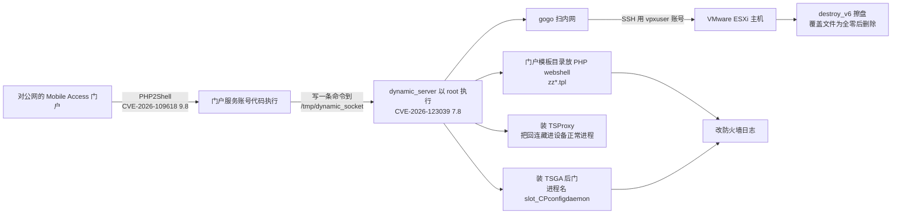
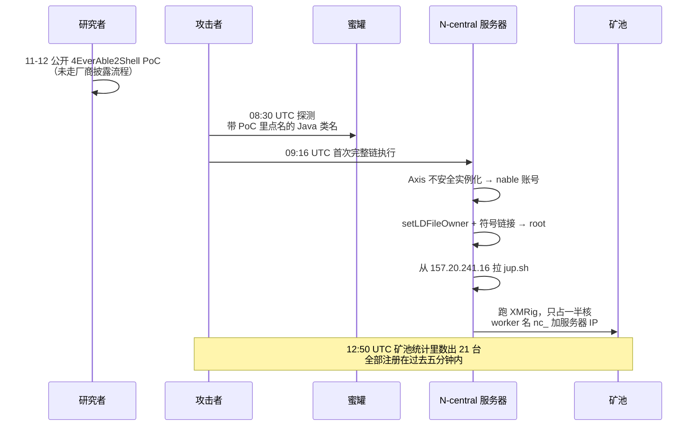
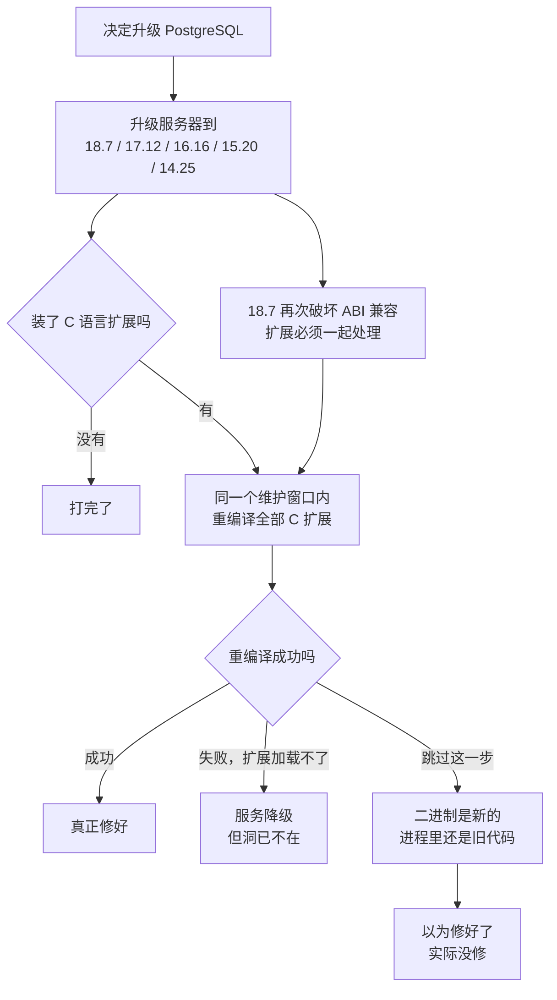
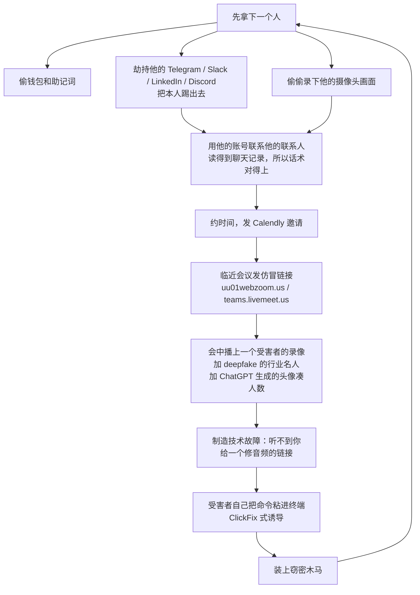
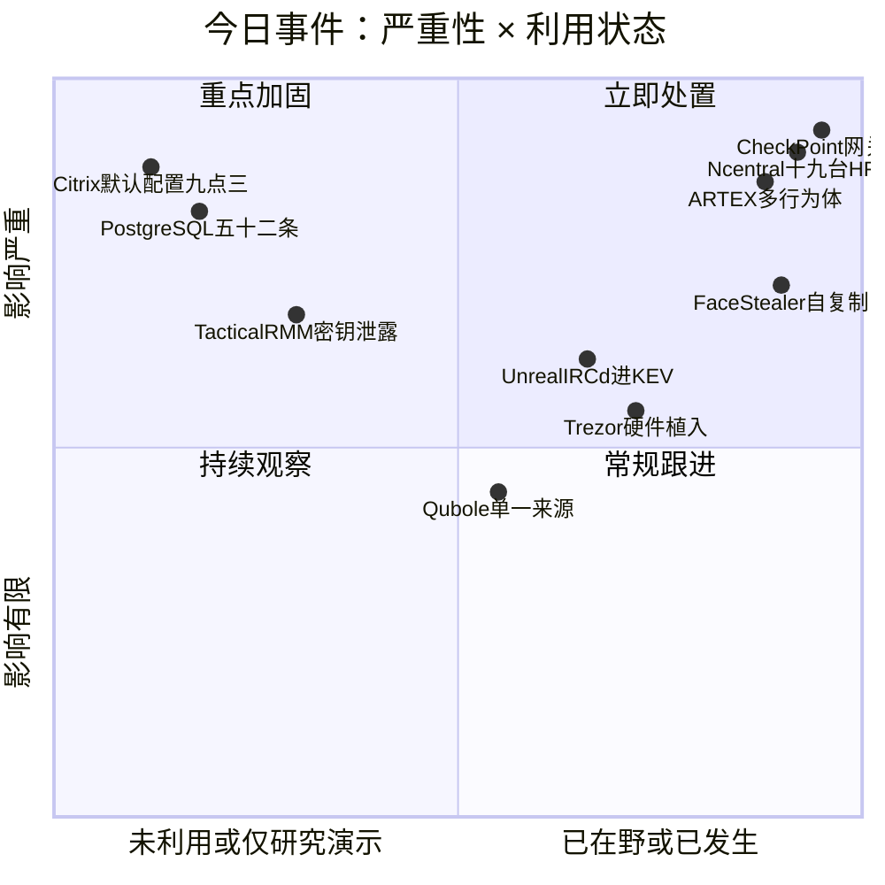
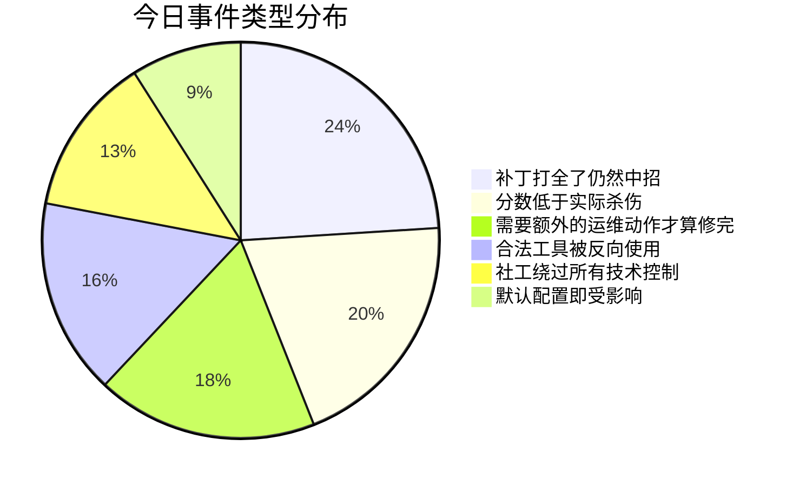
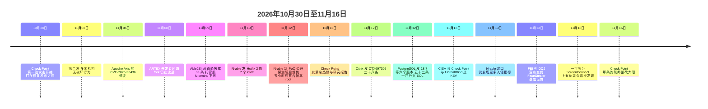

# 网安日报速递 · 2026年11月14日（第216期）

> 今日主线：**分数是给单个漏洞的，杀伤是给整条链的。**
> Check Point 那条只有 7.8，因为它写着"本地"。而"本地"这个前提，前一步的 9.8 免费送上来了。
> N-central 那 21 台里，19 台已经装了本周最新的热修。
> PostgreSQL 那个 8.8，装完补丁还得把扩展重编译一遍才算修。

---

## 零、快速索引

| # | 事件 | 关键编号 | 状态 | 一句话 |
|---|---|---|---|---|
| 1 | Check Point 网关被反过来打客户 | CVE-2026-123039（7.8）+ 109618（9.8） | **已在野，进 KEV** | root 之后擦掉了 ESXi |
| 2 | N-able N-central 零日 | CVE-2026-90436（9.8）+ 内部提权 | **已在野，PoC 后 5 小时** | 19 台是打全了补丁的 |
| 3 | PostgreSQL 一次性修 52 条 | CVE-2026-6460 / 120144（均 8.8） | 未在野 | 装完要重编 C 扩展 |
| 4 | ARTEX 渗透框架被当武器 | 无 CVE，工具本身是合法的 | **已在野，多行为体** | 2,250 个租户被撞登录 |
| 5 | FBI 打掉 FaceStealer | 无 CVE，纯社工 | 基础设施被查封 | 缴获 900 多段摄像头录像 |
| 6 | Citrix NetScaler 28 条 | CVE-2026-120868（9.3） | 未在野 | 默认配置就是受影响配置 |

---

## 一、七点八分的那一条，把一台机器变成了废铁

**Check Point CVE-2026-123039 · CVSS 3.1 7.8 · 本地权限提升 · CISA KEV 11-13 收录，整改大限 11-16**

11 月 12 日，Check Point 一次性放出了三样东西：一份安全公告（sk1000362）、一份研究博客、一批紧急热修。11 月 13 日，CISA 把 CVE-2026-123039 收进了 KEV，标注"用于取证排查"，截止日 11 月 16 日。

漏洞本身简单得不像话。Gaia OS 里有个叫 `dynamic_server` 的守护进程，以 root 跑，监听本地套接字 `/tmp/dynamic_socket`。这个套接字**全局可写**，而且**不校验连上来的是谁**。任何能在这台机器上执行代码的本地用户，往那个 socket 写一条命令，就以 root 执行了。

厂商给它打 7.8，理由是 `AV:L`（本地）。这个评分在孤立看一个漏洞时是合理的。问题在于攻击现场从来不是孤立的。

**前面那一步是免费的。** Check Point 的研究报告里，攻击者先用 PHP2Shell 打对公网开放的 Mobile Access 门户：CVE-2026-109618（9.8）和 CVE-2026-109619（8.1），拿到门户服务账号的代码执行。这个服务账号就是"本地用户"。于是 7.8 那条的前置条件，被 9.8 那条直接填满了。

拿到 root 之后做了什么，这部分比漏洞本身更值得记：

- 在门户登录页的模板目录里放 PHP webshell，文件名模式 `zz*.tpl`
- 装一个叫 **TSGA** 的后门，进程名伪装成 `slot_CPconfigdaemon`，功能是偷网关配置、通过备份和快照持久化、篡改防火墙日志
- 装 **TSProxy** 组件，把攻击者的回连藏进设备本身的正常进程里
- 用 gogo 扫内网，再用 `vpxuser` 这个服务账号 SSH 到 VMware ESXi
- 在 ESXi 上跑一个叫 `destroy_v6` 的擦除程序，把文件覆盖成全零再删掉，然后留下一份拒绝谈判的文本

**时间线值得单独看一遍。**

| 时间 | 事件 |
|---|---|
| 修复发布后约一周 | 10 月 30 日，第一波攻击开始 |
| 11 月 02 日 | 第二波，多国机构受影响，这一波没有破坏行为 |
| 11 月 12 日 | Check Point 发公告、研究报告、紧急热修 |
| 11 月 13 日 | CISA 收进 KEV，整改截止 11 月 16 日 |

也就是说，**补丁早就在了，攻击是在补丁发布之后才开始的**。打的是没打补丁的那批。厂商自己的说法是被打穿了"几十家客户"（原文 a couple of dozen customers）。

**分数的另一面。** 同一个 CVE 的 CVSS 4.0 向量里 `AT:P`（攻击前提为"存在"），这就是为什么 4.0 体系下这条的分数会比 3.1 的更贴近现实。用哪个版本的分数做排序，会直接影响你把哪台机器排在第一。

**修复版本，逐个列出来。**

| 分支 | 修复构建 | 备注 |
|---|---|---|
| R82.20 | Take 14 | |
| R82.10 | Take 52 | |
| R82 | Take 132 | |
| R81.20 | Take 174 | |
| R81 / R81.10 | **无** | 已 EOS，厂商不修 |

R81 和 R81.10 的用户没有补丁可打。官方给的唯一变通是**停掉 `dynamic_server` 进程并阻止它重启**，代价是 Dynamic CLI 命令全部不可用。这个变通在生产环境里能不能接受，取决于你有没有在用 Gaia 的 CLI 自动化。

**排查清单**（都是公告原文给的）：

- `/var/log/dynamicCli.log` 里有没有异常命令
- 门户模板目录里有没有 `zz*.tpl`
- 有没有 `slot_CPconfigdaemon` 进程
- 有没有到 `130.94.19[.]204` / `130.94.19[.]168` 的连接
- 有没有绕过 Clish 包装层、直接用 `system()` 落地的命令（正常流量里几乎不会出现）

**受影响范围要分清两条线。** Spark 防火墙和 Smart-1 Cloud 不受 123039 影响，但 Spark 在 PHP2Shell 的受影响列表里。这两条是不同的洞，别混。

**归因，厂商自己没给结论。** Check Point 说工具链和基础设施与某个已知工具包有重合，但同时明确写证据不支持高置信归因，并把"初始访问中介"和"假旗"都列为可能选项。原文还提到破坏性载荷与政治文本跟已知行动风格不符。这种时候照抄"某国干的"是最省事也最不负责任的写法，本期按厂商原话处理。

**背景补一句**：9 月 Check Point 还披露过 CVE-2026-93616（Security Management Server）和 CVE-2026-85102（Security Gateway），两条都是无需权限的 RCE。两年内 CISA 收了 5 条 Check Point 的洞，其中 2 条被勒索团伙用过。边界设备被当成目标，不是这一周才开始的。

---

## 二、十九台已经打上最新热修，还是被挖了矿

**N-able N-central · CVE-2026-90436（9.8）+ 内部提权 · PoC 公开 5 小时后首台被拿 root**

这条是今天最刺眼的一条，原因不在漏洞，在数字：**21 台被拿 root 的服务器里，19 台跑的是 11 月 10 日刚发的 Hotfix 2（2026.4.1.26）**。

链条分两段。

第一段是 Apache Axis。N-central 打包了这个老组件，它的 SOAP fault 处理里存在**不安全的类实例化**：构造一个畸形请求，就能让攻击者指定的 JLine 类去处理恶意输入，命令以 `nable` 服务账号执行。这一段是 **CVE-2026-90436，9.8，11 月 6 日已修**。

第二段是 N-central 自己的提权。Previdian 记作 VULN-2026-0009：滥用 N-central 里一个叫 `setLDFileOwner` 的特权辅助函数，配一个符号链接，把一个本来属 root 的脚本变成可写，改写它，再调用 `serverControl` 让 root 执行，最后尝试把改过的文件还原回去。**还原这一步很说明问题，它是在抹痕迹，不是在利用。**

**关键的时间点是 5 小时。** Previdian 08:30 UTC 看到探测，Huntback 09:16 UTC 记录到第一次完整链执行。研究者 Bales 公开 PoC 到第一台被打穿，中间没有任何缓冲。这件事对防守方的直接含义是：**PoC 公开的那一刻，"先测试再上补丁"这个流程就已经过期了**。

**矿池那边漏了自己的受害者名单。** XMRig 的 worker 名被设成 `nc_` 加服务器 IP，Huntback 直接从矿池统计里把全部 21 台数了出来。分布是：美国 9 台，南非 4 台，加拿大 4 台，另有英国、德国、法国、瑞典各若干。全部是托管型部署。

**agent 那一侧更麻烦。** 配套公开的 Agent2Shell 用十几个零日，能在被管的 Windows 端点以 `NT AUTHORITY\SYSTEM` 执行命令。前提是要知道 appliance ID。这条目前还没有在野报告，但它的意义在于：N-central 会把任务推送给它管的每一台端点，所以**服务器这一层的 root 不是终点，是入口**。

**厂商口径在 24 小时内变过一次。** 11 月 12 日的公告说"没有看到通过这些新漏洞入侵的迹象"。11 月 13 日更新为"已识别到更多入侵指标，正在与受影响客户逐家处理"。这个改口本身不算问题，问题在于它发生在蜜罐数据出来**之后**。

**处置只有一条是真的有效：关掉 Legacy API。** 攻击链要求 Legacy API 开着并且对公网可达。N-able 在托管环境里把它默认关了，本地部署要自己确认。另外 Agent 和 Probe 必须**两边都**升到 2026.4 HF1 以上，因为新版改了这两者之间的通信方式，只升一边会留通信缺口。厂商还顺手关了 Intune 集成。

**IOC：**

- `POST /dms/services/ServerUI` 带 SOAP fault 的请求
- User-Agent `python-requests/2.31.0`
- `/tmp/.xvd` 或 `/var/tmp/.xvd` 下的文件
- systemd 服务 `xvd.service`（或 cron 里的 `jup.sh`）
- 到 `157.20.241[.]16` 的连接

命中任何一条，按"这台机器已经完全被控"处理，不要当清理任务。

**这一条还有前情。** 11 月 9 日 Bales 公开第一轮 Able2Shell，列了 33 条，N-able 当天把托管版 N-central 下线。11 月 10 日 Hotfix 2 修了其中 7 个 CVE。**两天后，新的 PoC 证明那些修复没有动到底层的攻击面。**

**同一天第二个战场。** ScreenConnect 那边，11 月 12 日一家 MSP 问"这些陌生会话是什么"，顺着查出一百多台 ScreenConnect 服务器上挂着未授权会话，会话名用的是加密货币交易所的名字当伪装。RMM 这条线今天有两处在响。

---

## 三、五十二个洞一次发完，然后你还得重编译一遍

**PostgreSQL 11-12 发布 18.7 / 17.12 / 16.16 / 15.20 / 14.25 / 19 RC2 · 共 52 条 CVE**

这是 PostgreSQL 少见的大批量：一次 minor release 修 52 个安全问题。

两条 8.8 最容易搞混，先分清：

| 编号 | 描述原文 | 影响版本 | 修复版本 |
|---|---|---|---|
| **CVE-2026-6460** | type confusion after `ALTER ... SET DATA TYPE` executes arbitrary code | 18、17、16、15、14 | 18.7 / 17.12 / 16.16 / 15.20 / 14.25 |
| **CVE-2026-120144** | type-cache invalidation gap executes arbitrary code | **仅 18** | **仅 18.7** |

两条向量完全相同：`AV:N/AC:L/PR:L/UI:N/S:U/C:H/I:H/A:H`，都是"类型混淆导致以数据库进程的操作系统用户身份执行任意代码"。区别在触发条件：6460 是 `ALTER ... SET DATA TYPE` 之后，120144 是复合类型变更时缓存条目正在填充的过程中缓存失效不完整。**看到"PostgreSQL 类型混淆 8.8"就以为是同一个洞，会把 17/16/15 的升级排错优先级。**

**"22 年"这个数字要标出处。** 媒体（The Hacker News 一线）普遍写"潜伏约 22 年"，但 PostgreSQL 官方安全页只写行为、受影响版本、修复版本和向量，**不写这个洞存在了多久**。要引用年龄就注明来源是媒体口径，不要写成项目自己的说法。

**真正会让人以为自己修好了的地方，是 C 扩展。**

C 语言写的扩展（PostGIS 这类）在编译时链的是服务器的内部头文件。你把服务器二进制换成 18.7，旧扩展还按旧假设在同一个进程里跑。**洞还在进程里，只是你看不到。** 所以完整的处置是两步，不是一步：

顺带一个坑：**18.7 这个 minor 又一次破坏了 ABI 兼容性**（Jeremy Schneider 11 月 12 日的帖子标题就是"again"）。这对只换二进制不重编扩展的团队是一个硬性拦截，反而帮了忙。对自动化流水线是麻烦，得确保扩展编译和服务器升级在同一个步骤里。

**还有两个运维事实：**

- **14 分支在 11 月 12 日停止支持。** 14.25 是这条线的最后一个版本。生产上还跑 14 的，这次不是升级，是迁移。
- **52 条没有单 CVE 热修。** 官方不发 cherry-pick，只能整包升。

**"Authenticated" 不等于低风险。** `PR:L` 要求有建对象权限。真正的生产环境里，应用服务账号、集成账号、迁移工具、开发账号几乎都有这个权限。**一个被拿下的应用账号，从这里可以直接升到主机层。** 所以这条的处置不只是打补丁，还要顺手审一遍谁有 CREATE 权限。

---

## 四、渗透测试框架被当成武器用，一个月撞了两千多个租户

**ARTEX · 开源 AI 渗透框架 · 至少 5 个行为体在用 · 无 CVE（工具本身合法）**

这条的性质和前三条都不一样：它不是漏洞，是**一个合法的安全工具被拿去当了攻击平台**。

ARTEX 是一个开源的 AI 自动化渗透框架，会自己规划任务、并行侦查、执行利用。SentinelOne、CrowdStrike、Microsoft、Check Point、Cisco Talos、Datadog、CERT-EU 在这一周里各自出了一份材料，拼起来是这样：

- **至少 5 个动机不同的行为体**在用它，最早的活动可追到 8 月初
- 开发者 10 月 8 日闭源，**fork 和维护副本仍然公开可得**
- 一次行动的模型成本在 **145 到 1,500 美元**之间
- 运营者普遍用**默认配置**，不做定制

**看战果，不看热闹。**

| 行为体 | 归属判断方 | 规模 | 结果 |
|---|---|---|---|
| VAPOR PANDA | CrowdStrike | 200+ 组织，至少 14 国 | 9 家确认后渗透，另 12+ 家被扫凭据和撞库 |
| Storm-0940 | Microsoft | 2,250+ 个下游 M365 租户 | 通过被窃的 ConnectWise 应用凭据撞登录，后续动 Graph 和权限 |
| Storm-3358 | Microsoft | 东南亚金融机构 | 打公网系统，投 RAT |
| 未具名犯罪团伙 | Check Point | 未统计 | 偷代码签名证书、游戏账号、加密货币 |

**两个数字最该记。**

第一个是 **5 分钟**：Microsoft 记录到一次从"在公开 GitHub 仓库里搜到泄露凭据"到"从 Azure Key Vault 拉走数据"，中间 5 分钟。这单目前只标"疑似 ARTEX 使用"，不是确认。

第二个是 **3 小时**：FBI 的 FLASH 通告写的是"部分入侵从初始目标到拿到特权访问不到 3 小时"，同时描述了它的选择偏好：优先找没装 EDR 传感器的 Windows 主机，以及通过组织间的信任关系去找防护最弱的第三方供应商。有运营者直接在指令里写"找没有 EDR 的机器"。

**护栏这一节，是整份报告里最该读的一段。**

分析样本里 10 个实例中有 3 个配置的是美国厂商的模型。**护栏只在 Opus 5.5 上触发过一次**，触发之后操作者没有放弃，而是换成了限制更宽松的模型继续跑。SentinelOne 的结论是"护栏起的作用有限"。

这个观察的意义超过任何一个 CVE：**模型侧的对齐，在"操作者可以自由换模型"这个前提下，不构成一道安全边界。** 它是一道摩擦，不是一堵墙。

**规模有多散。** Check Point 统计到 2,557 台托管 ARTEX 的系统，其中 10 个配置错误的实例把完整数据库暴露在外。Censys 在 11 月 4 日的数据是 1,465 台暴露的控制台，多数在美国、日本、新加坡、韩国等地。这些实例不全是恶意的，渗透测试团队也在用同一个工具，这正是检测难点：**行为是合法的，只有意图不合法。**

**一个具体的战果值得单说。** 在针对苹果代码签名证书的行动里，ARTEX 智能体在被控系统上找证书数据库，然后逐项验证：密码对不对、私钥在不在、苹果那边撤销了没有、有没有过期、关联的描述文件是否有效。最后捞到 300 多份证书及其密码，其中 3 份通过了完整验证流程，**可以用来签任意 iOS 应用**。这个环节人工做要几天，智能体做是并行的。

**防御建议里唯一可执行的一条**：把 RMM 控制台、CI 凭据、云上的长期访问密钥当成 tier-0 资产。因为 ARTEX 打的就是这些，而且它撞的是"低复杂度配置错误"，不是零日。

---

## 五、九百多段摄像头录像，是这次行动真正的资产

**FBI / DOJ 11-13 宣布 · FaceStealer · 18 个月盗走 4 亿美元以上**

11 月 13 日，美国司法部和 FBI 同时发了两份东西：一份是查封 FaceStealer 所用云基础设施的公告，一份是起诉材料。缴获清单里最扎眼的一项不是钱，是 **900 多段受害者摄像头录像**。

**这条链没有一个漏洞。** 全程是社工，而且是自复制的社工。

**自复制是设计的核心，不是副作用。** 每拿下一个受害者，就多一个可信的账号和一截可信的脸。下一个目标的屏幕上出现的，是他认识的人，说的是他知道的说话方式，链接是从真实会话里发来的。JUMPSEC 在 7 月的报告里把这个叫做"受害者获取平台"，用词很准。

**目标已经变了。** 早期是加密货币和 Web3 从业者。现在明确加上了**开源软件的开发者和维护者**。FBI 的原话是：目标是软件供应链，进了可信开发者的账号，就能通过被广泛使用的软件影响几百万下游用户。

**这里的数字有一处必须纠正。** 有一家日报摘要把"冻结超过 270 万美元"写成了 **27 亿美元**。原始表述是：执法部门与业界合作冻结了超过 **270 万美元**，并取得法院批准对 **12 亿美元** 的被盗资产实施查封或限制访问。两个数字相差三个数量级，而且来自同一段话。抄摘要的时候要注意单位。

**平行的另一条线。** 朝鲜的 TraderTraitor 在 10 月 29 日从 Binance 盗走 60 亿美元以上。Binance 已经用自有资金补上了客户资产，钱没有追回。这是两件独立的事，不要在传播时混成一件。

**个人侧的处置，只有一条是真的有用**：任何未经事先文字沟通就发来的视频会议邀请，先挂掉，用另一个渠道（打个电话给本人）确认。会中让你"粘一条命令修音频"的，100% 是攻击。

---

## 六、这条不需要你开任何功能，装完就是那个状态

**Citrix NetScaler CTX697305 + CTX697320 · 11-12 发布 · 共 28 条 + Console 1 条**

11 月 12 日 Citrix 发了两个公告。CTX697305 覆盖 NetScaler ADC 和 Gateway 的 28 个漏洞，CTX697320 单独修 NetScaler Console 的一条认证绕过。

**要单独拎出来的是 CVE-2026-120868，CVSS 4.0 9.3。**

绝大部分 NetScaler 公告都带一个前置条件从句：只有开了 SMPP 才受影响，只有开了 DoH 才受影响，只有配了 Email OTP 才受影响。运维的常规做法就是先看这一列，把没用那个功能的设备排到后面。

**120868 这一行的前置条件写的是：所有 NetScaler ADC 与 NetScaler Gateway 部署，默认配置，无需额外功能。** 不需要认证，不需要用户交互。没有变通方案，因为没有可以关掉的开关，出问题的路径就是核心包处理。

厂商对影响的描述只到"不可预测或错误的行为，以及拒绝服务"，**没有说代码执行**。但公告里十条向量的 C / I / A 全是 H。这两句放在一起读，尺度要自己把握：厂商没承诺 RCE，也没排除。

**最高分 9.5 是另一条。** CVE-2026-107412，影响被配置成 Gateway（SSL VPN / ICA Proxy / CVPN / RDP Proxy）或 AAA 虚拟服务器的设备。这条 11-13 期在速览里提过，当时的处境是"分数先到了，信息还没到"：只有两句描述，没有 CWE，没有版本范围，没有修复版本。**现在补上了**，这也说明当时的判断是对的，值得跟。

| 编号 | 分数 | 前置条件 | 影响面 |
|---|---|---|---|
| CVE-2026-120868 | 9.3（v4.0） | **无。默认配置即可** | 所有部署 |
| CVE-2026-107412 | 9.5（v4.0） | Gateway 或 AAA 虚拟服务器 | SSL VPN / ICA / CVPN / RDP Proxy |
| CVE-2026-120863 | 高 | 只要求能从不可信网络访问 NSIP | 管理地址 |
| CVE-2026-111338 | 6.9 | | 把登录数据写进 `/var/log/httperror.log` |
| CVE-2026-120869 | 9.4（公告）/ 9.3（ENISA） | Console，无需认证 | 认证绕过 |

**修复构建，注意一个坑。**

| 分支 | 修复构建 |
|---|---|
| 14.1 | 14.1-73.57 起 |
| 13.1 | 13.1-64.39 起 |
| 14.1 FIPS | 14.1-73.58 FIPS 起 |
| 13.1 FIPS / NDcPP | 13.1-37.293 起 |
| NetScaler Console | 14.1-74.34 起 |

**坑在 14.1：公告写的第一修复构建是 73.57，Citrix 实际挂出来供下载的是 73.58。** 以公告为准去核对版本号，会对不上。

**另一个容易漏的点**：10 月为了修那两个在野零日升到 14.1-73.49 或 13.1-64.32 的设备，**现在重新回到受影响状态**。补丁不是一次性的。

NetScaler 12.1 和 13.0 已 EOS，不修。

**截至 11 月 13 日，这条没有在野利用，没有确认的公开 PoC，28 条也没一条进 KEV。** 这个状态不等于可以放着：NetScaler 今年秋天的几次公告，被利用的间隔是以天计的，攻击者会拿修补前后两个构建做二进制比对。另外 10 月刚修过两个已被在野利用的零日，其中一个进了 KEV。

**和第一条对着看，很有意思。** Check Point 那条要前置条件（本地账号），已经在擦盘了。Citrix 这条什么前置条件都不要，还没人用。**评分、紧迫度、现实威胁，是三个不同的量。**

---

## 七、速览

**7. Trezor Safe 5 被查出硬件层植入，不是固件问题**

Trezor 确认三台 Safe 5 硬件钱包被植入恶意电路板，全部购自东南亚经销商 CryptoBilis，购买时间集中在 2026 年 8 月 20 日到 9 月 23 日。植入物是**夹在主板上方和显示屏之间的一块额外电路板**，不改固件，也不碰 Secure Element。它做的事很单一：等屏幕上出现助记词（新建钱包备份或恢复旧钱包时都会出现），就抄下来，连 passphrase 一起加密，通过**蜂窝网络**发到攻击者服务器。没有信号就存着，反复重试直到发出去为止。Trezor 在实验室拆了一台，另外两台是通过客户提交的照片确认的。10 月发出警告后有 48 位 CryptoBilis 客户联系了厂商。固件缓解已发布，但**固件管不了夹在屏幕前的电路板**，这个案例最该记的是这一点：供应链的物理层，软件侧的所有校验都看不见。

**8. 今天新增 80 个 critical，抽四个看看都是什么形状**

`critical.is` 在 11 月 14 日 06:05 UTC 的统计是 80 个新 critical，其中 6 条建议当天打。抽样四条：**CVE-2026-27175**（MajorDoMo，9.8，`rc/index.php` 把用户输入的 `$param` 直接插进双引号命令串里，**没用 `escapeshellarg()`**，未认证命令注入，EPSS 24%，公开利用已有）；**CVE-2026-127080**（OpsTree BuildPiper < 2.7.0，9.9，已认证的部署用户能定义任意 Kubernetes hostPath 卷，没有白名单也没有策略检查，把 host path 设成 `/` 就是节点 root 文件系统）；**CVE-2026-126380**（Vvveb < 1.0.9.0，9.4，`.phar` 在拒绝名单里被写成了带前导点的形式，等于没拦，配合 GIF magic byte 合成多语言 webshell 绕二进制检查）；**CVE-2026-126473**（OpenEMR < 8.4.0，9.3，OAuth scope 规范化缺陷，注册一个冒号形式的 `system:Patient.read` 客户端就能绕过审批拿系统级 FHIR 权限）。四条都不是零日，都是"少写了一个函数""名单写错一个字符"这类。

**9. Tactical RMM 任意文件读，直接暴露 Django SECRET_KEY**

CVE-2026-129165。这条单看分数不高，位置要命：Tactical RMM 是另一套开源远程管理工具，和第二条的 N-central 是同一类资产。任意文件读拿到 `SECRET_KEY` 之后，Django 的签名体系基本等于开了后门，会话伪造、密码重置令牌伪造都能做。**今天 RMM 这条线上有两处在响，一处已经在挖矿，一处刚公开。**

**10. UnrealIRCd 一条分隔符问题进了 KEV**

CVE-2026-114713，进 KEV 的时间和 Check Point 那条同一天（11 月 13 日）。UnrealIRCd 在 IRC 网络里常被当成基础组件用，分隔符处理缺陷这类问题的特点是利用门槛低、影响面取决于上游怎么拼字符串。这条目前公开细节还少，NVD 富化未完成，本期只记编号和状态，等有完整描述再展开。

**11. Qubole 凭据被打，跨账号 AssumeRole 到客户 AWS 环境**

被泄露的 Qubole 凭据被用来跨账号 assume 客户环境里的 AWS 角色，之后是偷 secrets 和数据，攻击者用了 TruffleHog 做凭据收割。**这条只有一个来源，本期标为未一手核实**，写出来是因为它和第四条是同一个模式：拿一个合法的集成凭据，顺着信任关系横着走。自查动作很具体：把长期不用和遗留的 trust relationship 全撤，审 AssumeRole 事件，强制轮换所有 secrets 和会话。

---

## 八、风险分析

---

## 九、相关出处

| # | 来源 | 用途 |
|---|---|---|
| 1 | [Check Point sk1000362](https://support.checkpoint.com/results/sk/sk1000362) | CVE-2026-123039 原始公告：7.8、影响产品与版本、修复 Take 号、停 dynamic_server 的变通 |
| 2 | [Check Point Research · PHP2Shell Exploitation on Check Point Gateway](https://research.checkpoint.com/2026/php2shell-exploitation-on-check-point-gateway/) | 攻击链、TSGA/TSProxy、ESXi 擦盘、IOC |
| 3 | [Check Point Blog · Security Advisory](https://blog.checkpoint.com/security/security-advisory-active-exploitation-of-php2shell-and-local-privilege-escalation/) | "a couple of dozen customers" 原话、两波时间 |
| 4 | [CISA KEV](https://www.cisa.gov/known-exploited-vulnerabilities-catalog) | 11-13 收录、11-16 整改截止、取证排查标注 |
| 5 | [OneSignalDesk · Check Point Gaia flaw](https://onesignaldesk.com/news/check-point-gaia-cve-2026-123039-exploited-cisa-kev) | 修复构建对照表、Spark 与 Smart-1 Cloud 的例外、R81/R81.10 EOS |
| 6 | [Cyber Kendra · CVE-2026-123039](https://www.cyberkendra.com/2026/11/cve-2026-123039-check-point-gateway-php2shell-wiper.html) | destroy_v6 行为、zz*.tpl、slot_CPconfigdaemon、130.94.19.x |
| 7 | [Five Nines · CISA 收录](https://www.thefivenines.com/security/cisa-adds-check-point-zero-day-vulnerability-to-exploited-list) | KEV 日期与 BOD 26-04、第二波范围、厂商归因表态 |
| 8 | [SECBORN · Check Point 热修](https://secborn.com/check-point-patches-zero-day-root-escalation-flaw-exploited-against-customers) | 9 月两条前情 93616 / 85102、两年五条 KEV |
| 9 | [The Hacker News · N-central 21 台](https://thehackernews.com/2026/11/hackers-exploit-n-central-flaws-to.html) | 厂商 11-13 改口原话、jup.sh 命令、Intune 与 Legacy API 处置 |
| 10 | [Daily Security Review · N-central 零日](https://dailysecurityreview.com/resources/n-able-n-central-zero-days-exploited-hours-after-poc-release) | 11-09 到 11-12 的完整前一幕、Agent2Shell 需要 appliance ID、受害国别分布 |
| 11 | [Random Chaos · Hotfix 2 上挖矿](https://randomchaos.us/articles/attackers-mine-monero-on-n-central-hotfix-2-servers) | setLDFileOwner 与符号链接细节、09:16 / 12:50 UTC、矿池 worker 命名 |
| 12 | [Shield53 · 4EverAble2Shell 分析](https://news.shield53.com/4everable2shell-critical-n-central-rce-chain-cve-2026-90436-actively-exploited-for-crypto-mining) | CVSS 9.8 与受影响版本、Axis 组件性质、RMM 作为 tier-0 的论证 |
| 13 | [PostgreSQL 安全公告页](https://www.postgresql.org/support/security/) | 6460 与 120144 的标题、向量、受影响与修复版本对照 |
| 14 | [PostgreSQL · CVE-2026-120144](https://www.postgresql.org/support/security/CVE-2026-120144) | 仅 18.x 受影响、复合类型缓存填充场景、CVSS 3.0 8.8 |
| 15 | [PostgreSQL 18.7 / 17.12 / 16.16 / 15.20 / 14.25 发布公告](https://www.postgresql.org/about/news/postgresql-187-1712-1616-1520-1425-and-19-rc-2-released-3442/) | 52 条、14 分支 11-12 停止支持 |
| 16 | [RedSide Security · PostgreSQL 52 条](https://blog.redsidesecurity.com/post/postgresql-patches-52-flaws-including-22-year-old-bug-allowing-authenticated-rce) | "22 年"媒体口径来源、扩展重编要求、PR:L 的实际含义 |
| 17 | [香港 Linux 用家协会 · 中文侧核对](https://www.linux.org.hk/archive/20261113-9619-postgresql-urges-immediate-upgrades-afte.html) | 无单 CVE 热修、扩展必须在同一维护窗口重编、CREATEDB 权限审计 |
| 18 | [SentinelOne · ARTEX 分析与 IOC](https://www.nsi-ca.com/network-security/artex-unmasked-the-rise-of-ai-powered-artex-in-cybercrime-espionage) | 2,250 租户、护栏只在 Opus 5.5 触发、IOC 全表、8 月 1 日起查 |
| 19 | [Cisco Talos 转载 · ARTEX and beyond](https://wpnews.pro/news/artex-and-beyond-ai-enabled-penetration-testing-platforms) | 五个行为体对照、VAPOR PANDA 200+/14 国/9 家确认、3 小时到特权访问 |
| 20 | [Malware Must Die · ARTEX 检测签包](https://blog.malwaremustdie.org/2026) | 2,557 台与 1,465 台口径、FBI FLASH 编号、45 个同类框架 |
| 21 | [美国司法部 · FaceStealer 公告](https://www.justice.gov/usao-cdca/pr/justice-department-announces-actions-disrupt-north-koreas-massive-theft-cryptocurrency) | 4 亿美元 / 18 个月、八个别名、作案手法原文 |
| 22 | [洛杉矶时报 · FBI  disrupted](https://www.latimes.com/california/story/2026-11-13/fbi-disrupts-crypto-theft-scheme-by-north-korean-hacking-group-billions-stolen-so-far) | 900 多段录像、270 万美元冻结与 12 亿美元查封的原始表述 |
| 23 | [Enigma Global · FaceStealer 时间线](https://www.enigma-global.com/blog/facestealer-north-korea-deepfake-video-call-crypto-theft) | GhostCall / Arctic Wolf / JUMPSEC 三次前情、仿冒域名 |
| 24 | [RedEye · FaceStealer 拆解](https://threat-intelligence.redeyesecurity.com/blog/facestealer-north-korea-deepfake-video-calls-400-million-2026) | Calendly 约时间、ClickFix 式诱导、账号劫持范围 |
| 25 | [Citrix 公告 CTX697305 解读 · ThreatsEye](https://threatseye.io/blog/citrix-ships-28-netscaler-fixes-and-one-critical-bug-needs-no-configuration-at-a) | 120868 无前置条件、10 月两个在野零日、研究者致谢名单 |
| 26 | [ThreatAft · CTX697305 版本矩阵](https://threataft.com/articles/citrix-netscaler-ctx697305-28-cves-november-2026) | 公告 73.57 与实际发布 73.58 的差异、12.1/13.0 EOS、无在野 |
| 27 | [ctipilot · CTX697305 与 CTX697320](https://ctipilot.ch/entries/2026-11-13/citrix-netscaler-adc-gateway-ctx697305-28-memory-flaws) | 120869 两个分数口径、Console 修复构建、厂商只写到 DoS |
| 28 | [ITSEC Asia · Citrix 28 条](https://itsec.asia/blog/citrix-netscaler-28-memory-flaws-put-exposure-management-to-the-test) | CERT-EU 2026-020、无 PoC 的表述、升级会断 ICA 会话 |
| 29 | [defend.network · 11-14 简报](https://defend.network/briefings/check-point-vmware-ransomware-north-korea-crypto-2026-11-14.html) | Trezor 三台与 48 位客户、CryptoBilis 购买窗口、植入物位置 |
| 30 | [critical.is · 11-14 每日简报](https://critical.is/) | 80 个新 critical 的统计口径、四条抽样 CVE 的完整描述与 EPSS |
| 31 | [The Cyberfeed · 11-14 摘要](https://cloud.thecyberfeed.com/daily-summary/2026-11-14) | Tactical RMM 129165、Qubole 跨账号 AssumeRole、Trezor 固件缓解 |
| 32 | [CyberSecBrief · 11-14](https://www.cybersecbrief.com/news/cybersec/cybersec-2026-11-14) | 五条主线交叉核对、2,250 租户与 200+/14 国的第二来源 |
| 33 | [Enigma Global · 11-14 摘要](https://www.enigma-global.com/blog/daily-digest-2026-11-14) | 一百多台伪装会话的 ScreenConnect、UnrealIRCd 进 KEV |
| 34 | [网易 · 开源 AI 渗透工具与 AWS 密钥](https://www.163.com/dy/article/LBGAI66T05561FZP_pdya11y.html) | 中文侧核对：1,465 台暴露控制台、300+ 证书捞取 3 份可用 |

---

**免责声明**

本报告基于公开信息整理。CVE 编号、CVSS 评分、受影响与修复版本以 NVD、厂商公告、CISA KEV 的原始记录为准。

同一事实在不同来源出现分歧时，正文已标注两边口径或直接指出差异：

1. CVE-2026-123039 的分数与版本，3.1 体系是 7.8，4.0 向量里 `AT:P`，两者含义不同
2. Check Point 被打穿的客户数，厂商原文是 "a couple of dozen customers"，中文转述的"几十家"是同一句的意译
3. PostgreSQL 的"22 年"是媒体口径，官方安全页不写漏洞年龄
4. Citrix 的 CVE-2026-120869，公告 9.4、ENISA 记 9.3
5. Citrix 14.1 分支，公告写第一修复构建 73.57，实际挂出下载的是 73.58
6. FaceStealer 相关金额，冻结 270 万美元与查封 12 亿美元是两个不同动作，有摘要把前者写成 27 亿美元
7. ARTEX 的托管实例数，Check Point 记 2,557，Censys 记 1,465，统计时点与口径不同
8. N-central 的"no signs of compromise"是 11-12 的表述，11-13 已改为"发现更多入侵指标"

ARTEX 一章涉及的行为体归属，一律照各报告方的原始判断转述（CrowdStrike、Microsoft 各自的评估），并标明是"评估"而非"确认"；CVE-2026-123039 的归因，厂商明确写证据不足以高置信结论。**涉华涉台归因类内容不予收录。**

Trezor 植入物与 XWEB 类硬编码凭据的细节，仅用于自查与识别，不要用于未授权环境。

---

*每日精选 · 值得关注 | 2026年11月14日 · 第216期*
