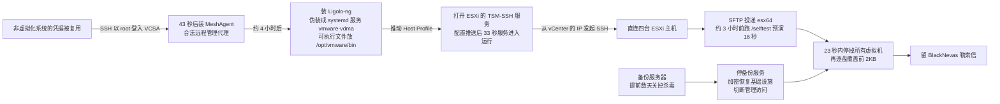
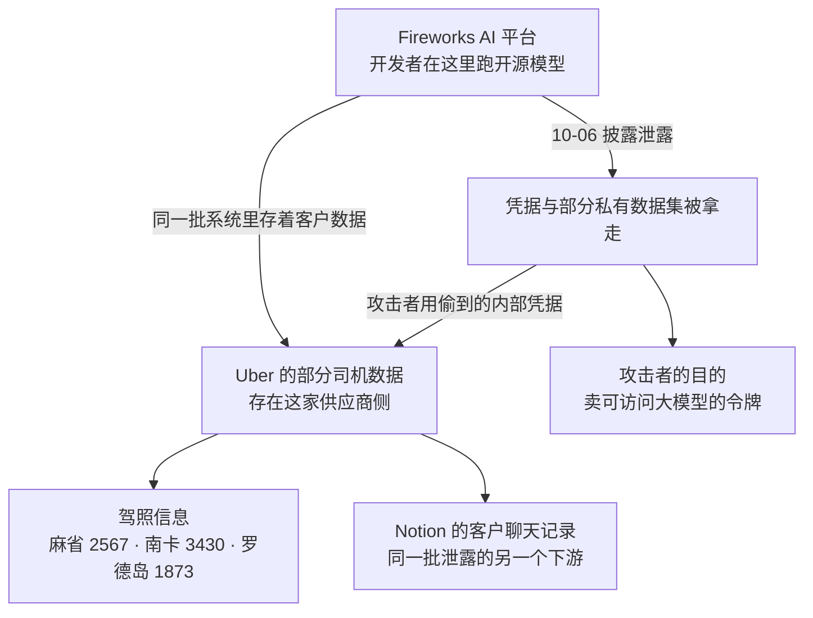
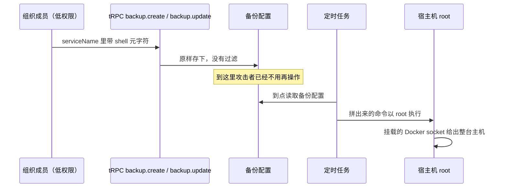
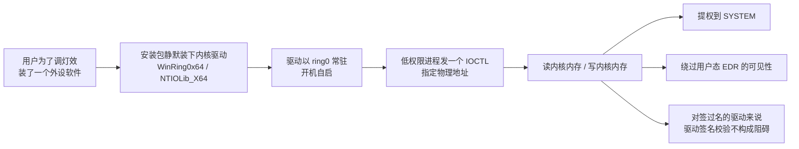
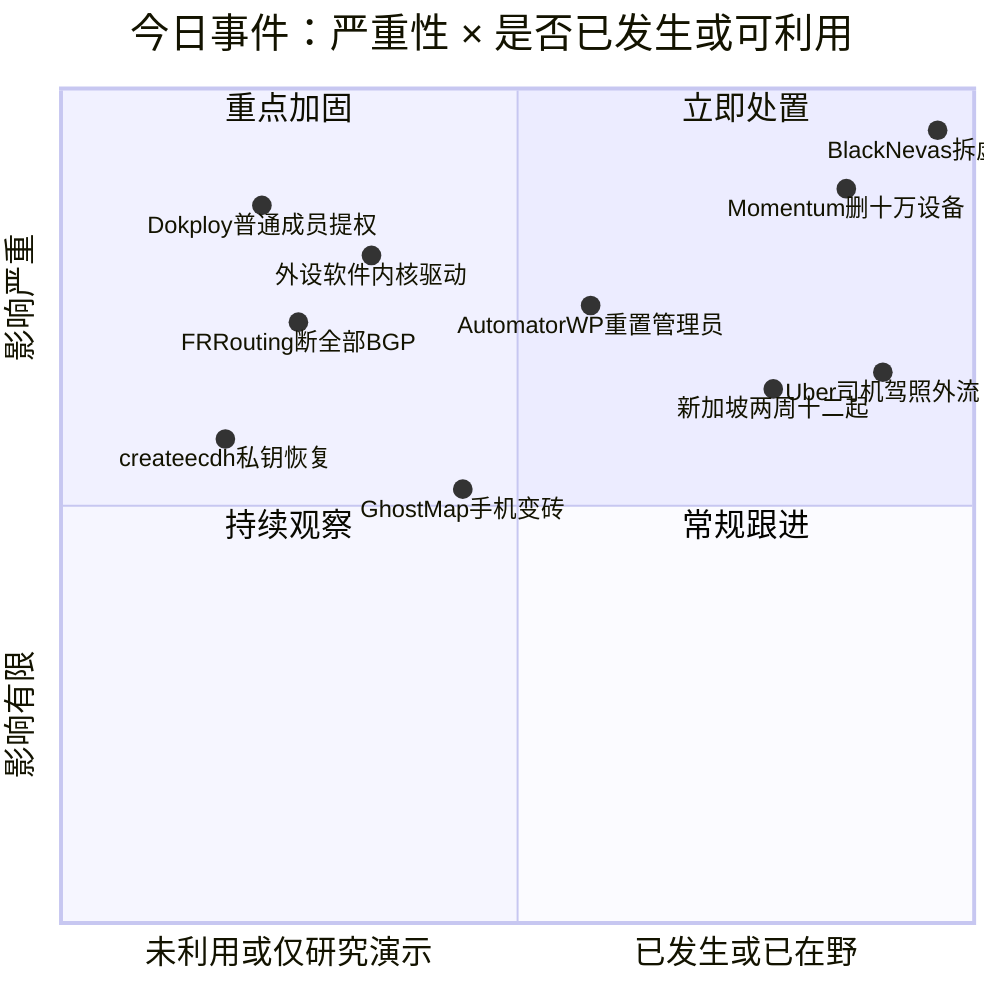
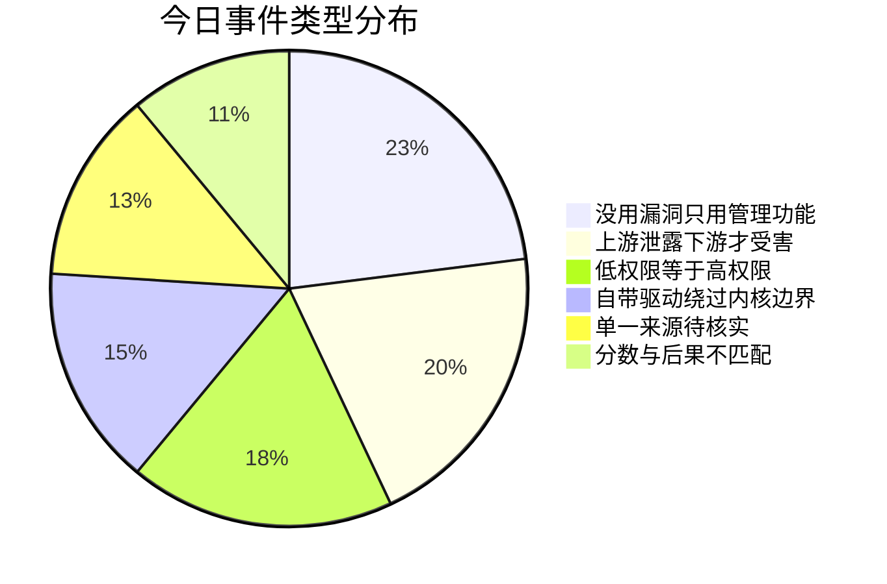
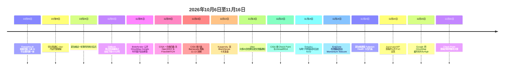

# 网安日报速递 · 2026年11月15日（第217期）

> 今日主线：**这一轮的破坏，几乎没有一条是靠漏洞完成的。**
> 十天里四台 ESXi、两套 vCenter、一整套备份全部消失，攻击者没打任何一个虚拟化漏洞，用的是管理员每天在用的那几个功能。
> 上游十月初丢的钥匙，下游十一月中才开始疼，中间隔了五周。
> 一个"组织成员"权限，写一句话进备份配置，剩下的交给定时任务。
> 装个调灯光的软件，内核里就多出一个能读写物理内存的驱动。

---

## 零、快速索引

| # | 事件 | 关键编号 | 状态 | 一句话 |
|---|---|---|---|---|
| 1 | BlackNevas 拆掉整套虚拟化 | 无 CVE，全程合法管理接口 | **已发生，复盘 11-13 公开** | 4 台 ESXi + 2 套 vCenter + 备份全没 |
| 2 | Uber 司机驾照从 AI 供应商流出 | 无 CVE | 已确认，多州总检察长备案 | 上游 10-06 就披露了 |
| 3 | Dokploy 命令注入 | CVE-2026-129433（9.9 / 4.0 记 9.4） | 已修，无 KEV | 载荷住在备份配置里，每天执行一次 |
| 4 | 外设软件自带内核驱动 | CVE-2026-129255（8.8/9.3）· 129261（8.2/9.3） | 未修，厂商不回 | 两家同一天，两个不同的驱动 |
| 5 | Momentum Telecom 被打 | 无 CVE，泄露站声明 | **未独立核实** | 声称 750 万用户数据 + 删掉十万台设备 |
| 6 | 新加坡两周内连环泄露 | 无 CVE | 已确认，官方通报 | 12 起里 6 起在医疗，月均三倍 |

---

## 一、十天，四台 ESXi，两套 vCenter，一整套备份，没有用一个漏洞

**Kaspersky GERT · 2026-11-13 发布于 Securelist · 勒索家族 BlackNevas · 无 CVE**

这份复盘最该被记住的地方，是它没有的东西：**没有零日，没有虚拟机逃逸，没有内核内存破坏，没有一个可以打分的漏洞。**

攻击者做的事，全部是 vCenter 自己提供的功能。

先看范围。十天的驻留时间里，被毁掉的是四台 ESXi 主机和上面全部虚拟机、两套 vCenter Server Appliance，以及与之相连的整套备份基础设施。Kaspersky 在勒索信里读到的是 BlackNevas 这个名字，这个家族最早出现在 2024 年 11 月；SentinelOne 把它归为 Trigona 的衍生物，Kaspersky 说本次命令行特征与这个判断吻合。**这个案子不能确认是一轮正在扩散的 campaign，只能确认是一次具体的处置记录。**

入场券来自虚拟化之外。凭据是从非虚拟化系统上拿到的，用来登进 vCenter；备份基础设施上的管理权限又暴露了另一批存储的凭据。**一套用来恢复生产的系统，同时是一条通往生产的通道**，这是整条链里最反直觉的一环。

时间颗粒度细到可以当检测规则用。SSH 登入 VCSA 之后 **43 秒**就装好了 MeshAgent。约四小时后出现那条反向隧道，服务名起成 `vmware-vdma`，可执行文件放在 `/opt/vmware/bin/` 下面，看起来像 VMware 自己的东西。之后是关键一步：攻击者从 vCenter 推了一个 **Host Profile**，把 ESXi 的 SSH 服务（TSM-SSH）打开。日志显示配置推送后 **33 秒**服务进入运行状态，随后的 SSH 连接来自 vCenter 自己的 IP。从第一次读配置到拿到主机直连，Kaspersky 记的是 **11 分钟**。

**这一段是给防守方看的重点：**如果你只检查"我的 ESXi 是不是关了 SSH"，这个检查是无效的。关掉的是期望状态，能改期望状态的那个账号一旦被控，SSH 会以完全合规的方式被打开。要抓的是**未经审批的 Host Profile 变更 + 紧随其后的、来自 vCenter 的 SSH**，两件事单独看都像日常运维。

真正动手之前还有一次预演。载荷 `esx64` 通过 SFTP 送进去，毁灭前三小时左右跑了一次 `/selftest`，持续约 16 秒。这 16 秒是留给防守方的时间窗口——它出现在主机日志里。

毁灭阶段：23 秒内停掉灾备主机上的全部虚拟机，然后执行 `./tmp/esx64 /p /vmfs/ /depth 5 /wipe /allsys /detach /-showvolumes`。做法不是传统加密，而是**每块 VMDK 覆盖前 2KB**——够让磁盘认不出来，不够等于写入随机数据。Kaspersky 自己也说，2KB 覆盖本身不代表数据不可恢复（它指向 GPT 备份头）。所以"销毁"这个说法要打个折，但勒索信上写的是 BlackNevas。

| 事项 | 具体值 |
|---|---|
| 驻留 | 10 天 |
| 损失范围 | 4 台 ESXi + 全部虚拟机 · 2 套 VCSA · 全套备份 |
| 用到的功能 | SSH 登入 · MeshAgent · Ligolo-ng（systemd 服务）· Host Profile · TSM-SSH · SFTP · esxcli |
| 没用到 | 任何虚拟化层漏洞、任何零日 |
| 备份侧的处置 | 提前数天关掉备份服务器上的杀毒，再停服务、加密恢复设施、切断管理访问 |
| IOC | `api.cloudvflare[.]com` · `45.149.154[.]135` · `91.92.242[.]121` · `31.41.33[.]212` · `188.240.57[.]94`；**没有 ESXi 加密器的哈希** |
| 日志取证点 | vCenter Events 与 Tasks（发起账号）· vpxa.log 与 vobd.log（主机配置与服务状态）· auth.log 与 shell.log（后续命令） |

还有第二个案例，性质和上面不同，别混。另一份处置记录里，攻击者先用 AnyDesk 和 GMER 二进制进了虚拟化域控所在网段的一台 Windows，环境里跑着 PRTG 网络监控，而 PRTG 存了能连所有 ESXi 的凭据、而且这些凭据在多个节点上复用。攻击者直接用这些凭据 SSH 上主机，用 `esxcli` 把 `execInstalledOnly` 关掉，这样 `/tmp` 下未签名的加密器才能跑，最后删日志做反取证。**监控平台持有它监视的系统的凭据，那它就是特权基础设施**，这个逻辑在 Kaspersky 的报告里只是一段，但对大多数中小环境来说，PRTG 这类服务器压根没被当 Tier 0 管过。

**为什么值得关注：**

第一，这是"打补丁"这个动作的边界案。受害者跑的是不受支持的 ESXi 版本，厂商的建议里也有补丁，但这次攻击完全绕开了补丁这个维度——**你补到最新，也一样会被这么打。**

第二，ESXi 上跑不了常规 EDR。Broadcom 自己的说法是第三方 agent 不能直接装在 ESXi 或 VCSA 上。虚拟机里的 EDR 能看到结果（I/O 卡死、突然关机），看不到动手的那个进程，因为执行发生在客户机边界之外。**这类事件只能靠管理面遥测和主机原生日志重建**，而 ESXi 的日志在内存盘上——Kaspersky 明确建议处置期间不要重启主机，重启就把日志丢了。

第三，四个预警信号全部早于加密数小时到数天：VCSA 上多了一个 systemd 服务、Host Profile 被改、SSH 被打开、备份服务器的杀毒被关。这四条告警很便宜，和结果比起来便宜得离谱。

---

## 二、上游十月初被偷的钥匙，下游十一月中才开始疼

**Uber × Fireworks AI · 2026-10-09 事发 · 11-13 向多州总检察长备案 · 11-14 中文侧扩散 · 无 CVE**

Uber 这周开始通知数千名司机：他们的个人信息和驾照信息在一次数据泄露里被拿走了。事发不在 Uber，在它的一家技术供应商——10 月 9 日，供应商通知 Uber，说有人闯进来偷了内部凭据，然后用这些凭据访问了 Uber 存放在那里的数据。

TechCrunch 确认这家供应商是 **Fireworks AI**，一家让开发者跑、微调和扩展开源模型的平台。Uber 的发言人给的原话是：通知司机是因为"一起影响我们第三方供应商 Fireworks.ai 的安全事件，该供应商能够访问部分 Uber 数据"。Fireworks 承认自己系统被未授权访问、客户数据受影响，但没有回答关于这次事件细节的问题。

按已经提交的泄露通知统计，驾照信息涉及**马萨诸塞 2,567 人、南卡罗来纳 3,430 人、罗得岛 1,873 人**，伊利诺伊州那份写的是"人数待定"，加州也发了通知但没给数字。两家公司都没公布总数，**随着更多州的备案进来，这个数字还会涨。**

这条要连着两周前的背景看。本刊 11-02 期写过 Wiz 的一份研究：10 月里有**九家 AI 开发平台**接连披露安全事件，按披露顺序是 Fireworks AI（10-06）、Andromeda（10-09）、Zeabur（10-14）、Lightning AI（10-15）、OpenCode（10-16 至 17）、Railway（10-20）、Warp（10-23）、CommandCode（10-28）、Northflank（10-30）。当时能看到的下游影响是账单：两把密钥烧掉约 250 万次调用，账单超过 10 万美元。

**今天补上的那一半是：数据侧的账要晚五周才到。**AI 平台不是只存 API key，它还存着客户为了跑推理而上传的东西。Fireworks 那边的说法是把事件归给一个以经济动机为主的团伙，目标是倒卖访问大模型的令牌——也就是它盯的是钥匙。但同一套系统里放着 Uber 的司机驾照，钥匙被拿走的时候，数据也一起在门里面。

Uber 今年这是第二次。8 月，勒索组织 Helix 通过社工手段从 Uber Freight 货运部门拿走数据。

**为什么值得关注：**

第一，这是"把数据交给 AI 供应商"这个决定的实际代价，第一次以具体人数出现。法规上你是数据控制者，物理上数据的防线是对方那套凭据。

第二，注意时间差：10-06 上游披露，10-09 通知下游，11-13 才开始逐个州备案、逐个司机通知。**安全团队看到的是"供应商事件已处置"，法务和用户看到的是五周之后。**如果你只盯供应商的公告页，中间这五周你是空白的。

第三，自查动作很具体：把所有能访问你数据集的第三方 AI 平台列出来，看它们的凭据是不是长期有效、是不是共享、有没有轮换记录；再看那份数据里到底有什么，很多团队答不上来第二条。

---

## 三、组织里的普通成员，写一句话，然后等 root 自己送上门

**Dokploy CVE-2026-129433 · CVSS 3.1 9.9（PR:L / S:C）· CVSS 4.0 9.4 · 11-14 进 NVD · 无 KEV**

Dokploy 是一套开源的 self-hosted 部署平台，定位类似自建的 Vercel：你把它装在自己的服务器上，它替你把容器编排起来。它的权限模型里有个基本假设——**组织成员不是管理员，不该碰到宿主机。**

这个假设在 0.31.1 之前是假的。

问题在 `getComposeContainerCommand()` 这个函数：拼 compose 备份命令的时候，`serviceName` 参数没有做过滤。攻击路径不需要任何技巧：一个组织成员调用 `backup.create` 或 `backup.update` 这两个 tRPC 接口，把 `serviceName` 填成带 shell 元字符的字符串，**这个值会被存进备份配置**。然后什么都不用做。定时备份到点，拼接出来的命令以 **root** 执行。容器里挂着 Docker socket，从这一步到接管宿主机是常规操作。

这个洞的性质不是"少转义一个字符"，是**持久化被做成了产品功能**。载荷不是内存里的利用链，是一条合法的定时任务配置；重启容器不会清掉它，改密码不会清掉它，日志里看到的是一次正常的备份执行。

CVSS 3.1 给 9.9，向量里 `PR:L` 加 `S:C`——低权限、但影响范围跳出组件本身。CVSS 4.0 给 9.4。修复在 0.31.1，对应 commit `b24006e` 和 PR #5908，GitHub 安全公告是 GHSA-j329-jw7j-rxjm，CNA 是 VulnCheck。

有一条口径要标出来：NVD 这条记录的 `vulnStatus` 是 **Deferred**，CISA 没收录，**没有任何一手证据显示已在野利用**。有聚合站在公告里写"confirmed exploitable in the wild"，那是模板措辞，别当事实转。

| 事项 | 具体值 |
|---|---|
| 受影响 | Dokploy < 0.31.1 |
| 类型 | CWE-78 OS 命令注入 |
| 前置 | 一个组织成员账号；不需要管理员 |
| 触发 | 定时备份执行时，不需要攻击者在线 |
| 后果 | root + 挂载的 Docker socket = 宿主机 |
| 修复 | 0.31.1（commit b24006e / PR #5908） |
| 修复后必做 | 检查已有备份配置里 `serviceName` 是否带元字符——**存进去的载荷不会因为升级而消失** |

**为什么值得关注：**

这条是本期的主题在代码层的版本。前一条讲的是"用管理功能达成破坏"，这一条讲的是"**用低权限写一条配置，等系统自己执行**"。两者的共同点是：攻击面不在漏洞库里，在你为了效率而设计的那套自动化上，备份、定时任务、CI、webhook——凡是"配一次，以后自动跑"的东西，都是把一次输入变成永久执行。

最后那句"升级不会清掉已存的载荷"值得单独抄下来。这类洞的处置动作是两步，第二步经常被漏。

---

## 四、装个调灯光的软件，内核里多出一个能读写物理内存的驱动

**CVE-2026-129255（CoolerMaster MASTERPLUS+ 1.9.6）· CVE-2026-129261（Kingston FURY CTRL ≤ 2.0.66.0）· 同日进 NVD**

今天两条来自同一个位置，但是两个不同的驱动、两个不同的厂商、两套不同的实现。

CoolerMaster 那条在 `MASTERPLUS+ 1.9.6` 里，问题出在 `WinRing0x64.sys`——这是第三方硬件访问驱动里最有名的一个，被无数灯控、风扇、超频软件打包过。缺陷在 `sub_11504` 处理 `PhysicalAddress` 参数时权限判断不对，本地用户就能读写物理内存。CVSS 3.1 给 8.8（`AV:L` / `PR:L` / `S:C`），CVSS 4.0 给 9.3。**厂商被提前联系过，没有回应。**

Kingston 那条在 `FURY CTRL RGB Control Software` 2.0.66.0 及以下，驱动是 `NTIOLib_X64.sys`，缺陷在 IOCTL 处理函数上，暴露了访问控制不足的 ioctl。CVSS 3.1 只给 8.2（`PR:H`，需要较高权限），CVSS 4.0 给 9.3。同样只能本地触发。

**为什么值得关注：**

第一，这是 BYOVD（自带脆弱驱动）在消费级外设上的复现。过去这类洞集中在游戏反作弊、主板厂商工具、安全软件自带驱动上，现在轮到了 RGB 灯控。设备的用户群不需要是攻击目标，**只要装机量够大，驱动就会变成现成的提权零件**。

第二，这条对 EDR 的实际影响比分数写的大。拿到内核读写之后，最省事的用法不是提权自己，是把正在跑的 EDR 从内核里摘掉，然后再做后面的事。`S:C` 那个 scope change 就在这里。

第三，处置比补丁难。厂商没回应的那条没有修复版本；另一条即使修了，**用户机器上那份旧驱动还在**——这类软件的更新意愿极低，很多机器上跑的是三四年前的安装包。要么按驱动黑名单拦，要么承认这类软件在受管终端上就不该存在。

顺带一句对照：10 月 11 日那期写过攻击者用 `certutil.exe` 投放 `WinRing0x64.sys` 来给矿机拿内核级硬件访问。**同一个驱动，一边是攻击者主动投放，一边是厂商主动安装**，落点是一样的。

---

## 五、不加密了，直接把你十万个调制解调器删掉

**EndZone 勒索团伙 · 2026-11-14 在泄露站挂出 Momentum Telecom · 单一来源，未独立核实**

这一条先标明性质：**全部内容来自勒索团伙自己在泄露站上的声明**，受害方没有确认，也没有第三方验证过。写出来是因为它描述的那种打法值得提前想一遍，而不是因为事实已经坐实。

按声明，EndZone 通过一家被攻破的 MSO（多业务运营商）拿到了 Momentum Telecom 用来做诊断和开通的工具。这个工具的作用是控制终端设备——也就是用户家里的调制解调器。他们声称访问到了每一家 MSO 的用户数据，涉及 **750 万以上用户的个人信息**；然后开始删设备，声称已经删掉**超过 10 万台**，直接造成用户断网。原文还写了一句很具体的话：他们一开始删调制解调器，对方才注意到长时间存在的访问和已经拖走的数据；对方每次都把访问切断，他们每次都能重新拿回来。

Momentum 是一家做云语音、托管网络、SD-WAN 和 Teams Phone 集成的运营商，营收约 2.217 亿美元。当地媒体确实报道过 Eagle Mountain 一带的互联网中断与网络攻击有关，这一部分能对上。

**为什么值得关注：**

第一，勒索的杠杆从"加密你的文件"换成了"**删你的终端设备**"。加密要写数据、要留密钥、要谈判；删设备只要一条命令，而且恢复动作也在攻击者手里——那句话说得很清楚，"这个服务在我们工具上点一下就能恢复，但你得联系我们"。

第二，被拿下的不是运营商自己的核心网，是**给运营商做诊断的那个工具**。MSO 型业务里，一个工具服务多家运营商、管着几百万台设备、权限是批量下发，这个结构本身就是单点。供应链这个词在这里不是比喻。

第三，如果这条最后被证实，它会是"运营技术侧停机"比"数据泄露"更值钱的一个样本。断网对用户的体感、对运营商的口碑、对 SLA 的冲击，都比丢一份客户表更直接。

---

## 六、两周十二起，六起在医疗，官方说不是同一拨人

**新加坡 CSA 与 PDPC · Fullerton Health 与人力部 11-14 联合通报 · 无 CVE**

新加坡这半个月的节奏值得单独看一眼，因为它呈现的是"**通用漏洞 + 集中目标**"的形态，不是一次协同攻击。

11 月 14 日，Fullerton Health 和人力部联合通报：**约 14 万份工作准证持有者记录**被泄露，入口是一台独立服务器，挂在 Migrant Worker Primary Care Plan 门户后面。其中约 **4.3 万份属于已经失效的准证**。可能暴露的字段是姓名、外籍身份证号、出生日期、联系方式、地址；公司说健康、医疗、财务数据没有受影响。

同一天，新加坡 CSA 给了统计口径：**10 月 24 日到 11 月 13 日之间，至少 12 起事件**打到本地机构或它们的服务商，其中 **6 起在医疗与社区护理**；9 月以来每月的通报量是 1 到 8 月平均值的**三倍**。CSA 和 PDPC 的判断是这些事件看起来不像针对新加坡的协同行动，PDPC 的说法是攻击者利用的是**常见 IT 漏洞**。CSA 已经向所有 CII  sector 做了通报。

| 事项 | 具体值 |
|---|---|
| 单起最大 | Fullerton Health 约 140,000 条（其中约 43,000 条为准证已失效） |
| 入口形态 | 一台独立服务器，挂在业务门户后面 |
| 两周内事件数 | 至少 12 起 |
| 行业分布 | 医疗与社区护理 6 起 |
| 月度对比 | 9 月以来为 1 至 8 月均值的 3 倍 |
| 官方定性 | 非协同攻击，利用常见未修补漏洞 |

**为什么值得关注：**

第一，"独立服务器"这四个字是重点。它不是主业务系统，是被挂在外面的一个旁路服务，通常由外包做、不在主资产的补丁清单里、也不在渗透测试范围里。**攻击面长在这些地方，不在架构图上。**

第二，医疗与社区护理占了一半。这类机构的特点是一致的：系统老、外包多、数据敏感度高、安全预算低。漏洞是通用的，目标选择是有偏好的，合起来就是 CSA 说的那个形态——不需要协同，只需要扫描器。

第三，这条和第二条是同一个结构的两端。Uber 那边是数据放在供应商那里、防线由供应商的凭据把守；这边是数据放在自己的旁路服务器上、防线由没人管的补丁状态把守。**结论一样：你以为的边界和你实际的边界不是同一条线。**

---

## 七、速览

**7. 九点八分，但需要管理员先配一个"官方支持的配置"**

CVE-2026-126173，AutomatorWP Pro 的 webhook 插件，1.4.4 及以下，未认证攻击者可以把**任意 WordPress 账号（含管理员）的密码重置掉**，直接接管站点。但触发条件写得很细：需要管理员已经建过一条自动化，用 `Receive Webhook` 触发器、带 `Is the user ID` 字段，接到一个 `Update-User` 动作上、且 User ID 那栏**留空**、Password 那栏映射到 webhook 的 password 标签。NVD 的描述里专门补了一句——**这是插件文档里支持的配置方式**，不是畸形用法。公开 PoC 已有。这条的看点是"9.8 分对应的是一个正常配置"，不是"9.8 分对应所有安装"。

**8. GhostMap：收了两个多月，Google 这周改口重开**

本刊 11-09 期报过这条：装一个不含代码、不要权限、永远不用打开的 APK，手机就进入崩溃循环，重启和安全模式都无效，只能恢复出厂设置，Android 10 及以上都受影响。当时 Google 的第二次回复是"不属于安全更新的修复范围"，转给功能团队评估未来版本。**这周 Google 重开了这个 issue，并把严重性提到 High**——但这次更新里没有补丁，也没有发布日期。触发点是 Bitdefender 在 8 月 20 日和 8 月 25 日提交的两份报告，复现环境是 Pixel 10 / Android 17 / 2026 年 8 月 5 日补丁。**降级和升档都不是修复**，这条仍然只能靠不装来路不明的 APK。

**9. macOS 上的假验证码：往终端粘一条命令**

Huntress 分析的 Macfinger 活动，页面伪装成验证码，提示用户"按这三个键、把这段粘贴到终端里"。粘进去的是一条从远端拉脚本的命令，脚本装的是 **DownTheDRAIN** 信息窃取器，能把加密货币钱包里的内容改道到攻击者地址。IOC：域名 `quill-kraee-um2gf[.]pro`，IP `45.150.32[.]130`、`171.22.131[.]24`。ClickFix 这套话术在 Windows 上跑了一年多，现在把同样的交互搬到了 macOS——**它利用的不是系统漏洞，是"用户相信网页让自己做的事"**。

**10. 一个长度对不上的属性，能把整台路由器的 BGP 全断掉**

CVE-2026-129456，FRRouting 的 `bgpd` 接受隧道封装属性（type 23）时，只在外层 TLV 长度和属性长度不一致时**记一条日志，然后照常处理**。后果是引用计数失衡：BGP 邻居发一条带这种属性的 UPDATE，就能让子 TLV 链被提前释放，而 Adj-RIB-In 和 RIB 里的路由还指着它；等这些路由被替换、撤销或清除（比如会话中断）时，`bgpd` 读到已释放内存、减一次引用计数、再释放一次。报告者的构建里（没开 AddressSanitizer）表现为内存记账断言失败，**bgpd 直接 abort，路由器上所有 BGP 会话一起掉**，而且邻居每次都能重来。需要已建立的 BGP 会话，报告者是在配了 `soft-reconfiguration inbound` 的邻居上复现的，且不是每次都崩。还有一句要注意：RFC 9012 要求 eBGP 会话默认过滤这个属性，但 `bgpd` 对**包括 eBGP 在内的每个邻居**都处理它。CVSS 4.0 记 7.7，没有 3.1 分数。

**11. 同一个洞，3.1 给 5.9，4.0 给 8.2**

`create-ecdh` 4.0.4 及以下，这个包是 Node.js `crypto.createECDH` 的可打包版本，被浏览器打包器和没有原生实现的 Node 版本用。`computeSecret` 和 `setPublicKey` **没有校验对端公钥**——不检查点是否在配置的曲线上、是否在素数阶子群里。攻击者只要能提交公钥给一个复用静态私钥的一方，就能做无效曲线或小子群攻击，恢复私钥对小因子的模，再用中国剩余定理拼出完整私钥；对 ed25519 和 curve25519 还接受低阶点，可以强制出一个可预测的共享密钥。修在 4.0.5。现代 Node 上这个包直接转发原生实现，不受影响。**两个分数差 2.3，因为 3.1 的 `AC:H` 和 4.0 的 `AT:P` 对"需要攻击者能反复提交公钥"这件事的计法不同**——按哪个分数排期，结论会不一样。

**12. 今天 12 个 critical 里，两条 10.0 来自 15 年前就停产的设备**

11 月 14 日到 15 日上午这个窗口，NVD 只有 77 条新记录，其中 12 条 9.0 以上，周末的量本来就是平时的零头。抽样三条：**CVE-2026-129351**（TRENDnet TEW-657BRM 1.00.1，10.0，`/setup.cgi` 里 `sprintf` 越界写，远程可打，公开利用已有，**厂商原话是"该产品停产已超过 15 年，无法确认漏洞是否存在，我们会发个公告告知客户"**）；**CVE-2026-129353 / 129354**（D-Link DIR-600L 2.17b02，均 10.0，`authenticationcgi_main` 与 `hnap_main` 两个入口，同为 VulDB 出品）；**CVE-2026-129250**（Edimax BR6478ACV2 1.23，9.9，`formPPTPSetup`）。这类记录的共同点是分数很高、可利用性成立、但没有修复版本——**它们该进的是资产清退名单，不是补丁排期表。**

---

## 八、风险分析

---

## 九、相关出处

| # | 来源 | 用途 |
|---|---|---|
| 1 | [Securelist · Ransomware at the hypervisor layer](https://securelist.com/) | BlackNevas 十天复盘原始出处：43 秒、11 分钟、33 秒、/selftest 16 秒、2KB 覆盖、IOC 清单 |
| 2 | [RansomwareWire · BlackNevas ESXi attack anatomy](https://ransomwarewire.com/articles/blacknevas-esxi-vcenter-destruction-kaspersky-gert-case-2026) | 完整攻击链与时间点、Trigona 衍生的归属说明、单来源提示 |
| 3 | [ThreatsEye · Ransomware at the hypervisor layer](https://threatseye.io/blog/ransomware-at-the-hypervisor-layer-how-attackers-weaponize-esxi-and-vcenter-with) | ESXi 上无法运行常规 EDR 的结构性原因、Babuk 源码泄露与十个家族的关系 |
| 4 | [GridinSoft · BlackNevas turned vCenter into a key](https://blog.gridinsoft.com/blacknevas-vcenter-host-profiles-esxi-backups) | Host Profile 打开 TSM-SSH 的机制、四个取证日志点、与 PRTG 那个案子是两次不同事件 |
| 5 | [QPulse · BlackNevas 用 PRTG 与凭据复用](https://qpulse.quasarcybertech.com/news/7940/blacknevas-ransomware-leverages-prtg-monitoring-platform-and-credential-reuse-to-compromise-esxi-environments) | 第二个案例：PRTG 存凭据、esxcli 关 execInstalledOnly、反取证删日志 |
| 6 | [Brandefense · How vCenter and backups failed](https://brandefense.io/security-news/esxi-vcenter-ransomware-backup-attack) | 备份先被攻破的顺序、T1021.004 / T1543.002 / T1572 映射、黑市帖子计数的口径提醒 |
| 7 | [TechCrunch · Uber 确认司机驾照泄露](https://techcrunch.com/2026/11/13/uber-confirms-hackers-stole-thousands-of-drivers-license-information-in-data-breach/) | 供应商为 Fireworks AI、10-09 通知、三州人数、Uber 今年第二起 |
| 8 | [Engadget · Uber drivers information stolen](https://www.engadget.com/2316881/uber-drivers-information-stolen-in-a-third-party-hack/) | 第二来源交叉核对、Fireworks 的归因表述（卖 LLM 访问令牌的经济动机团伙） |
| 9 | [网易 · 优步司机信息经第三方泄露](https://www.163.com/dy/article/LBO4UGLA05561FZQ_pdya11y.html) | 中文侧核对：三州人数与"数据放在合作方、防线由对方凭据把守"的定位 |
| 10 | [腾讯新闻 · Uber 遭黑客攻击致多州驾照外泄](https://news.qq.com/rain/a/20261114A0D25200) | 中文侧时间点（11-14）、涉及四个州、Uber Freight 与 Helix 的前情 |
| 11 | [Tenable · CVE-2026-129433](https://www.tenable.com/cve/CVE-2026-129433) | Dokploy 三个版本的分数（CVSS2 9.0 / 3.1 9.9 / 4.0 9.4）、发布与更新日期 |
| 12 | [GitHub Advisory GHSA-gfc5-hfj7-fjwc](https://github.com/advisories/GHSA-gfc5-hfj7-fjwc) | Dokploy 公告原文、受影响范围、修复引用（GHSA-j329-jw7j-rxjm / PR 5908 / commit b24006e） |
| 13 | [Wasteland · Dokploy 命令注入分析](https://wasteland.me/intel/CVE-2026-129433) | `PR:L`、`S:C` 的实际含义、载荷持久化在备份配置、NVD 状态为 Deferred、无 KEV |
| 14 | [NVD · CVE-2026-129255](https://nvd.nist.gov/vuln/detail/CVE-2026-129255) | CoolerMaster MASTERPLUS+ 1.9.6 的 `WinRing0x64.sys` 与 `sub_11504`、厂商未回应的原文、8.8 与 9.3 两个分数 |
| 15 | [NVD · CVE-2026-129261](https://nvd.nist.gov/vuln/detail/CVE-2026-129261) | Kingston FURY CTRL 的 `NTIOLib_X64.sys`、暴露的 ioctl、`PR:H` 与 8.2 分 |
| 16 | [NVD · CVE-2026-126173](https://nvd.nist.gov/vuln/detail/CVE-2026-126173) | AutomatorWP webhook 插件的完整触发条件原文（含"这是文档支持的配置"那句） |
| 17 | [Aretiq · 2026-11-14 漏洞简报](https://aretiq.ai/bulletins/2026-11-14) | AutomatorWP 与 Dokploy 的当日评级、PoC 状态；该站把 Dokploy 写成已在野，本期已标为模板措辞 |
| 18 | [NVD · CVE-2026-129456](https://nvd.nist.gov/vuln/detail/CVE-2026-129456) | FRRouting bgpd 的引用计数失衡、double free、断言失败与"eBGP 也处理该属性"的说明 |
| 19 | [NVD · CVE-2026-129319](https://nvd.nist.gov/vuln/detail/CVE-2026-129319) | create-ecdh 的无效曲线与小子群攻击、CRT 恢复私钥、5.9 与 8.2 两个分数 |
| 20 | [NVD · CVE-2026-129351](https://nvd.nist.gov/vuln/detail/CVE-2026-129351) | TRENDnet 的 10.0 分与厂商"停产超过 15 年"原话 |
| 21 | [NVD · CVE-2026-129353](https://nvd.nist.gov/vuln/detail/CVE-2026-129353) | D-Link DIR-600L 的 `authenticationcgi_main` 入口 |
| 22 | [Bitdefender · Google reopens GhostMap](https://www.bitdefender.com/en-au/blog/hotforsecurity/google-reopens-ghostmap-investigation) | 重开与升为 High 的原始表述、没有补丁与日期、两次提交的时间 |
| 23 | [ThreatCluster · GhostMap 技术细节](https://threatcluster.io/article/ghostmap-the-android-flaw-that-crashes-your-phone--90c15c7d) | ZIP 条目两个字段、libziparchive 与 libandroidfw 的不一致、system_server 崩溃循环 |
| 24 | [cvetodo · 11-14 亚太简报](https://cvetodo.com/threat-report/au) | BlackNevas 与 Macfinger 的当日条目、DownTheDRAIN 的描述与 IOC 清单 |
| 25 | [Hacker Feeds · EndZone 挂出 Momentum Telecom](https://hackerfeeds.com/ransomware/momentum-telecom-by-endzone-evfgf) | 泄露站声明原文：750 万用户、十万台设备、MSO 工具、"点一下就能恢复" |
| 26 | [cvetodo · 11-14 新加坡简报](https://cvetodo.com/threat-report/sg) | Fullerton Health 与人力部联合通报的字段与人数、CSA 的 12 起与三倍口径、PDPC 对"常见漏洞"的定性 |
| 27 | [Axis Intelligence · 数据泄露追踪](https://axis-intelligence.com/data-breach-tracker/) | 11-14 单日新增的多起区域性泄露（新加坡、韩国）作为背景密度 |
| 28 | [Cyber-Defence · CVE Explorer](https://www.cyber-defence.io/tools/cve) | 11-15 的全局计数：KEV 1,781 条、公开利用 25,058 条，用于判断今日 critical 数量的相对位置 |
| 29 | [The Cyberfeed · 11-15 摘要](https://cloud.thecyberfeed.com/daily-summary/2026-11-15) | 当日主线归纳与"披露到利用以小时计"的表述；该摘要含涉华归因段，本期未采用 |
| 30 | [WorldProgramming · This Week In Security](https://www.worldprogramming.org/posts/this-week-in-security-four-digit-patch-tuesday-ssh-exploited-gitbook-breach-android-ghostmap-v8nzte) | GitBook 事件的四步链与客户处置清单、GhostMap 与 2013/2017 两次解析差异漏洞的类比 |

---

## 十、口径说明

- **BlackNevas 一案的时间点**：Kaspersky 的报告发布于 11 月 13 日，但报告**没有把攻击日期定在这一周**。本期把它作为"新公开的复盘"收录，不当作"本周新发生的攻击"。
- **PRTG 那个案子与 Host Profile 那个案子是两次不同事件**，攻击者路径不同（一次靠监控平台存的凭据 + 关执行限制，一次靠 vCenter 的管理功能 + Host Profile）。不要合并成一条时间线。
- **2KB 覆盖的后果**：Kaspersky 自己指出 2KB 覆盖不足以断定磁盘不可恢复（GPT 备份头），"销毁"是转述方给的标签，不是报告结论。
- **Momentum Telecom 一条全部来自泄露站声明**，受害方未确认，本期标为未独立核实。可对上的是当地媒体对 Eagle Mountain 一带断网的报道。
- **Dokploy 的利用状态**：NVD 记 `Deferred`，无 KEV，无一手的在野利用证据。有聚合站写"confirmed exploitable in the wild"，本期按模板措辞处理。
- **CoolerMaster 那条厂商没有回应**，这属于厂商行为记录，不等于默认否认。
- **Uber 受影响总人数未知**，三州数字来自已公开的检察长备案，会随更多州备案上升。
- **TRENDnet 的 10.0 分**来自 VulDB 口径（`S:C`），和 NVD 自行重算的结果可能不同。
- 涉及国家与地区的归因类内容本期不予收录；技术事实按各报告方原文转述。
