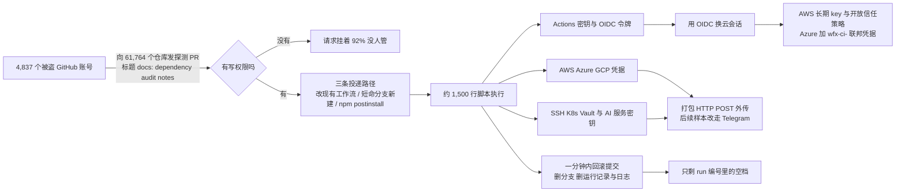
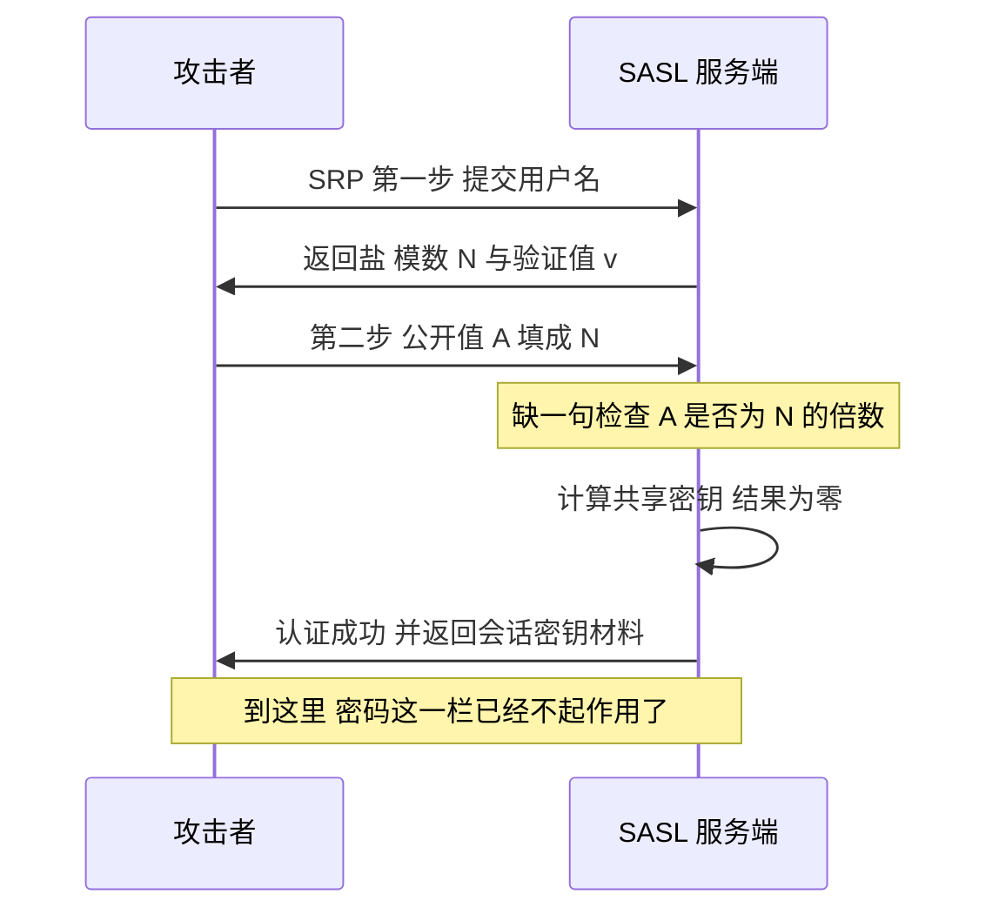
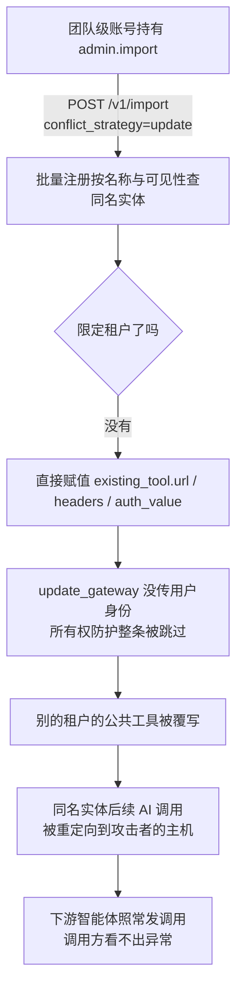
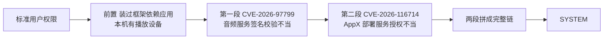
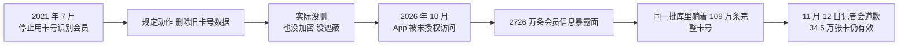
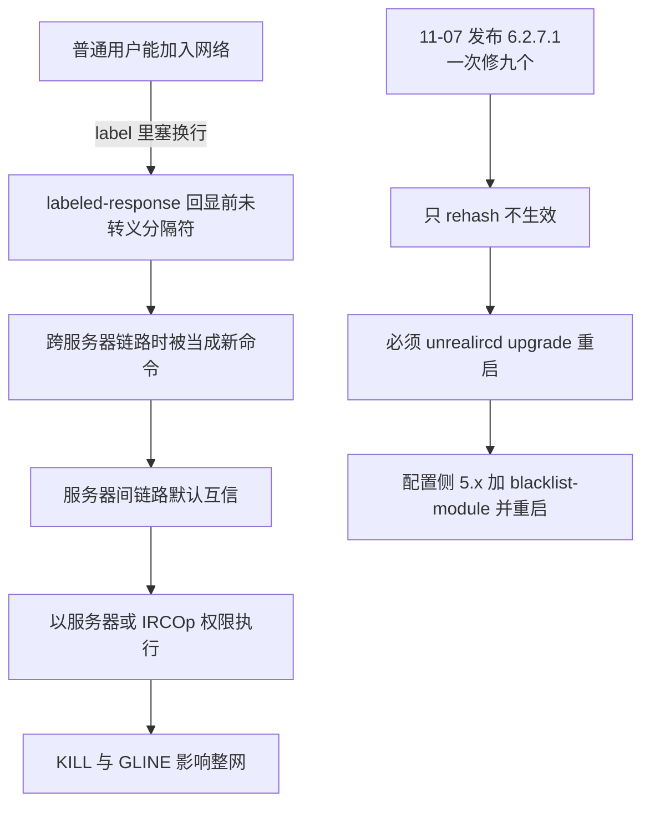
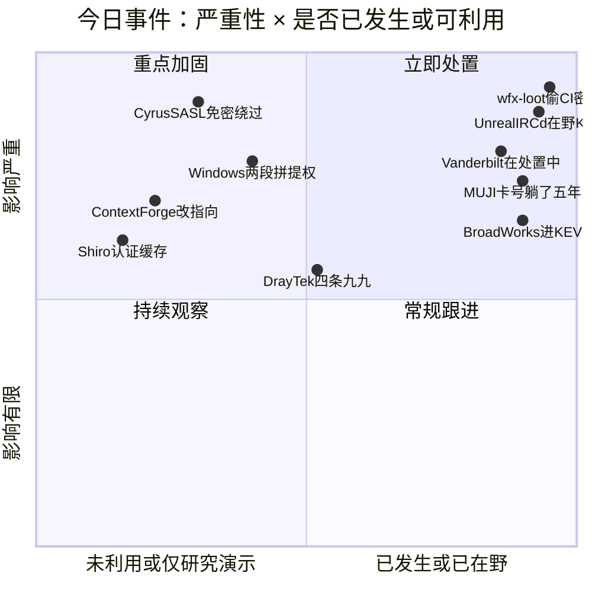
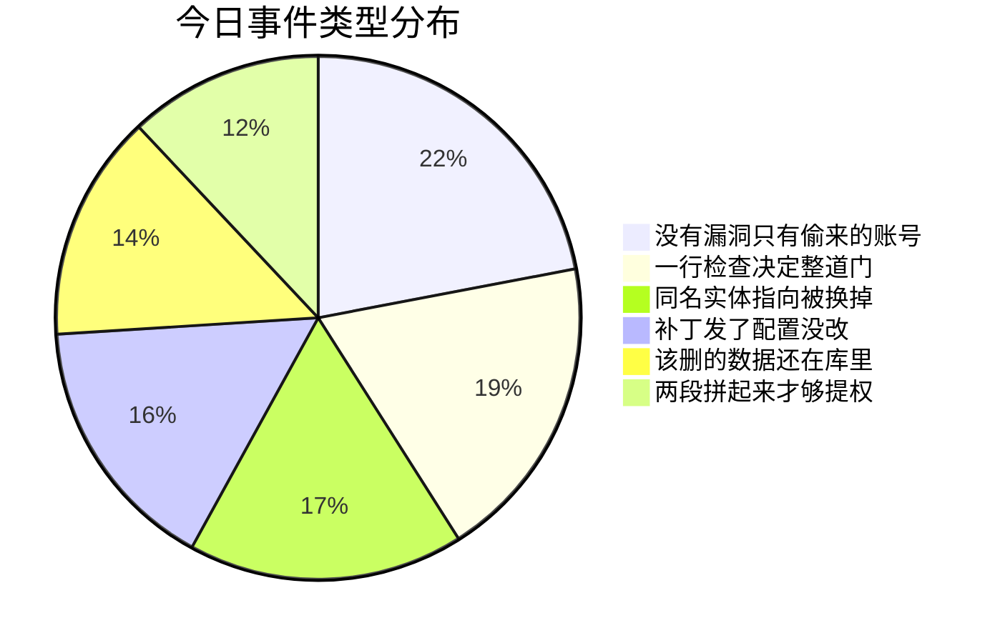
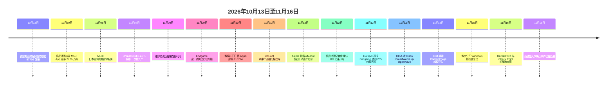

# 网安日报速递 · 2026年11月16日（第218期）

> 今日主线：**补丁发出去的那天，活才开始。**
> 一个偷来的账号就能顶住四千八百次登录，六十一个仓库的门是自己开的，攻击者一分钟内把痕迹擦干净，留下的只有编号里的空档。
> 一行本该写却没写的判断，让 SRP 服务器相信一个共享密钥为零的客户端，密码形同虚设。
> 有一条洞的分数只有 4.1，被覆写的是同名工具的端点、请求头和凭据，名字没变，指向换了主人。
> 该在 2021 年就删掉的卡号，在库里躺了五年，没加密也没遮蔽。
> 今天有两条 KEV 的联邦整改大限到期，其中一条的修复版发了九天，配置没改的机器仍然是别人的。

---

## 零、快速索引

| # | 事件 | 关键编号 | 状态 | 一句话 |
|---|---|---|---|---|
| 1 | 4,837 个 GitHub 账号被用来偷 CI 密钥 | 无 CVE（wfx-loot） | **已发生，11-12 披露** | 61,764 个仓库收到探测，一分钟擦干净 |
| 2 | Cyrus SASL SRP 认证绕过 | CVE-2026-129483（4.0 记 9.3） | 已修，无 KEV | 共享密钥算成零，任意用户免密登录 |
| 3 | IBM ContextForge MCP 网关跨租户覆写 | CVE-2026-110178（3.1 记 4.1） | 已修 1.1.0 | 工具名没变，端点与凭据被换掉 |
| 4 | Windows 提权链两条洞串起来 | CVE-2026-97799 + CVE-2026-116714（均 7.8） | 已修，PoC 已公开 | 标准用户提权到 SYSTEM 已复现 |
| 5 | 无印良品 109 万条卡号 | 无 CVE | 已确认，11-12 记者会 | 该删的数据五年没删，也没遮蔽 |
| 6 | UnrealIRCd 在野利用，整改大限今天 | CVE-2026-114713（3.1 记 8.6） | 已修 6.2.7.1，已进 KEV | AI 辅助内审挖出来的十五年最严重 |

---

## 一、四千八百个账号，六万一千个仓库，一分钟把痕迹擦干净

**Aikido Security 命名 wfx-loot · 2026-11-10 起 · 2026-11-12 披露 · 无 CVE**

这条要放在最前面，因为它连一个漏洞编号都没有。

11 月 10 日中午开始，有人拿着 **4,837 个被盗的 GitHub 账号**，向 **61,764 个仓库**发起拉取请求。请求标题是 `docs: dependency audit notes`，来源分支叫 `wfx-docs`。内容看起来就是一份依赖审计笔记。**这些请求的作用不是提交代码，是测权限**：能建成功，就说明这个被盗账号对那个仓库有写权限。Aikido 报告发布时，**92% 的探测请求还开着**，说明绝大多数仓库主人根本没注意到。

写权限确认之后，投递只有三条路，都很普通：改一个已有的 GitHub Actions 工作流、在一个短命分支上新建一个工作流、或者在 `package.json` 的 postinstall 钩子里加一步。真正干的活是一个约 **1,500 行**的 shell 脚本。

它拿的东西按类别列出来，基本覆盖了一家公司的全部钥匙：

| 类别 | 具体内容 |
|---|---|
| CI 平台 | Actions 的 secrets 与变量、`GITHUB_TOKEN`、OIDC 与运行时令牌 |
| 云 | AWS、Azure、GCP 凭据，含自托管 runner 通过实例元数据能读到的那些 |
| 开发与基础设施 | Git、SSH、GPG、Docker、Kubernetes、npm、PyPI、Vault、Terraform |
| AI 服务 | OpenAI、Anthropic、Gemini、Hugging Face、Cursor、GitHub Copilot |
| 本地物料 | `.env`、私钥与密钥库、shell 历史、构建进程内存、仓库内容与近期提交 |

**它不止偷，还留后门。**脚本会用 GitHub 的 OIDC 令牌去换云上的短期会话，然后在权限允许的地方做两件事：在 AWS 建长期 access key，并把某个 IAM 角色的信任策略改成任何 AWS 账号都能扮演；在 Azure 给应用加一个以 `wfx-ci-` 开头的联邦凭据。**这两类东西改密码改不掉**，它们不是密码。

外传走 HTTP POST，打包成 tarball 送到两个攻击者控制的端点；后续样本改成走 Telegram。送完之后，它在**一分钟内**把提交回滚、把临时分支删掉、把工作流运行记录连同日志一起删掉。查的人打开仓库，看到的是干净的代码和一个编号没有断的提交历史。

**编号会断。**工作流的 run 编号是递增的，删掉一条就留下一个空档。这是这批攻击唯一稳定留下、且攻击者没打算留的痕迹。

数量上要分清口径，几个来源数的是不同的东西：

| 指标 | 数字 | 来源 |
|---|---|---|
| 被盗账号 | 4,837 | Aikido |
| 收到探测 PR 的仓库 | 61,764 | Aikido |
| 探测请求总量 | 超过 63,000 | StepSecurity（11-12 上午） |
| 脚本确实跑起来的仓库 | 至少 1,806（另一处写 1,835） | Aikido / BleepingComputer |
| 收到恶意提交的仓库 | 8,093 | SafeDep（只查公开默认分支，偏低估） |

**这几个数不能互相替代。**收到探测 PR 不等于被攻陷，收到恶意提交也不等于脚本执行成功。真正坐实的是那一千八百多个跑起来并外传成功的。

被波及的账号里，有财富 100 强企业的员工、美国总务管理局、法国政府，还有 Nextcloud 的 `nextcloud/docker` 与 WebdriverIO。Aikido 说约 **50 个账号**看起来在 npm、PyPI、Go、crates 或 Packagist 上有发布权限，这件事的性质就变了：**从偷密钥变成能往供应链里塞东西**。

已经确认被自动发布带出去的包有两个：Packagist 的 `digitalelvis/neuronai-studio` **3.14.3**，Go 模块 `github.com/onuragtas/docker-env` 的 **v1.0.278** 和 **v1.0.280**。

**口径要划清两处。**第一，Aikido 明确说这次**没有用到 GitHub Actions 自身的漏洞**，StepSecurity 也是同样的判断，被盗的是账号，不是平台。第二，它和 2025 年的 GhostAction 有重叠，但 Aikido 的原话是 "we don't attribute November to the same actor at this stage"，本期不合并成同一拨人。

**为什么值得关注：**这是"账号即边界"的最干净样本。全程没有一个 CVE，没有一个补丁能打，防守方要做的三件事都不在漏洞管理流程里：查 run 编号的空档、给 `.github/workflows` 设强制 code owner 复核、把 `GITHUB_TOKEN` 设成只读、CI 里用 `npm ci --ignore-scripts`。**前两件是流程，后两件是配置，一件都不需要等厂商发版。**

还有一句要记住：**回滚提交不会把已经外传的密钥要回来**，删日志只会让事后判断变得更难。看到探测 PR 而没法排除工作流跑过，就按已泄露处理，把工作流能碰到的每一样东西都轮换掉，再去翻 CloudTrail 和 Entra 的日志找新建的 key 和被改的信任策略。

---

## 二、少了一行判断，密码这一栏就不起作用了

**CVE-2026-129483 · Cyrus SASL ≤ 2.1.28 · CVSS 4.0 记 9.3（3.1 记 9.1）**

这条的技术含量不在利用难度，在于它错得极其具体。

Cyrus SASL 是认证的底座。它不是某个应用，是 IMAP、SMTP AUTH、LDAP 这些协议做认证时调用的那层库。SRP 是它支持的机制之一，特点是不用把密码传出去，双方各算一个共享密钥，对上了就算通过。

`srp_server_mech_step2` 里缺了一句判断：**客户端发来的公开值 A，如果是模数 N 的整数倍，必须拒绝。**

数学上这件事很直白。SRP 里共享密钥大致是 `(A · v^u)^b mod N` 那一类的形式，A 一旦取成 N 的倍数，取模之后整个式子归零。**共享密钥变成 0，双方"对上"了。**服务端不知道对面没有密码，它只知道算出来的密钥和自己算的一样。

后果是三个：冒充任意已存在的用户、不需要知道密码、还能顺带拿到会话密钥（因为密钥是 0，攻击者自己知道）。

| 事项 | 具体值 |
|---|---|
| 受影响 | Cyrus SASL 至 2.1.28（含） |
| 机制 | SRP server mech，`srp_server_mech_step2` |
| 缺失的判断 | 未拒绝为 N 的倍数的客户端公开值 A |
| 效果 | 发送 A 等于 N，强制共享密钥为零 |
| 后果 | 免密认证为任意已存在用户，并获知会话密钥 |
| 分数 | CVSS 4.0 **9.3**（`E:X`）· CVSS 3.1 **9.1**（`AV:N/AC:L/PR:N/UI:N/S:U/C:H/I:H/A:N`） |
| 修复 | commit `fb3724f`，issue #896，oss-security 2026/q4/122 有讨论 |
| 状态 | NVD 记录 `Received`，无 KEV，无公开在野证据 |

**为什么值得关注：**第一，这是密码学实现里的经典失效模式，**数学上不可能成立的输入没有被拒绝**。同类问题在 2024 年也有过，凡是自己实现大数运算的协议库都该拿这个当检查项。

第二，SRP 部署得少，但一旦部署就是"唯一的门"。这类组件的特点是：上线之后没人再碰，不在资产清单前排，出问题时才发现它管着所有人的登录。

第三，这条的处置很干脆，**没有配置能绕**，只能升级。而 CVSS 4.0 的 `E:X`（利用成熟度未评估）说明厂商自己也还没看到公开利用，这给了修复窗口，但不该用来排期延后。

---

## 三、工具的名字没变，变的是它指向哪里

**CVE-2026-110178 · IBM ContextForge MCP Gateway 1.0.0–1.0.11 · CVSS 3.1 记 4.1（`S:C`）**

分数只有 4.1，MCP 网关是 AI 基础设施里最容易被当成"中立管道"的那一层。

ContextForge 是 IBM 开源的 MCP 网关，在 GitHub 上叫 `IBM/mcp-context-forge`，Apache-2.0。它的作用是在多租户环境里统一注册、管理、代理工具、资源、提示词和上游 MCP 服务器。**多租户是关键词**：一个网关后面挂着多个团队的智能体。

问题在配置导入。`/v1/import` 支持 `conflict_strategy=update`，用来"同名就更新"。更新的时候，代码按名称和可见性去查已存在的公共实体，**没限定租户，也没校验调用者是不是它的主人**。批量注册里 `_process_single_tool_for_bulk` 的 update 分支直接赋值 `existing_tool.url`、`existing_tool.headers`、`existing_tool.auth_value`。更关键的一处是导入流程调 `update_gateway()` 时**没有把用户身份传进去**，于是网关更新路径上那道所有权防护被整条跳过。

于是持有**团队级** `admin.import` 权限的账号，一个 POST 就能覆写别的租户的公共工具、资源、提示词和网关的端点地址、请求头、认证凭据。

**这个洞的性质不是"多了一段代码"，是"同名实体被换了指向"。**

| 事项 | 具体值 |
|---|---|
| 受影响 | 1.0.0 至 1.0.11 |
| 修复 | 1.1.0 |
| 类型 | CWE-284 访问控制不当 |
| 分数 | CVSS 3.1 **4.1**（`AV:N/AC:L/PR:H/UI:N/S:C/C:N/I:L/A:N`） |
| 前置 | 一个团队级 `admin.import` 权限，不需要全局管理员 |
| 后果 | 端点、请求头、凭据三样一起被换，AI 调用改道 |
| 修复内容 | 校验 `check_resource_ownership()`、批量注册与网关更新传入调用者身份、`admin.import` 改为全局权限、冲突查询收敛并拒绝授权后新出现的同名记录 |
| 临时缓解 | 不给团队级角色 `admin.import`，导入只留给平台管理员 |

**为什么值得关注：**第一，**巡检看不见这件事**。名字没变，列表没变，权限没变，变的只是它指向哪个主机、带哪个请求头、用哪把凭据。人工核对名单是核不出来的。

第二，被换掉的是凭据，不只是地址。下游智能体把数据送到攻击者主机的同时，也把那把凭据交了出去，而这个凭据原本是网关自己持有的。

第三，`S:C` 那个 scope change 就写在这里：**影响范围越过了攻击者自己所在的租户**。4.1 分是按 `PR:H` 算的，可它要求的是"团队级"，而在真实部署里团队级权限往往是最容易拿到的那一档。

处置建议只有一句：**MCP 网关这类组件，现在大多不在安全评审清单里，先把它加进去。**

---

## 四、两条 7.8 分的洞串起来，标准用户变 SYSTEM，PoC 已经公开

**CVE-2026-97799 · CVE-2026-116714 · 均为 CVSS 3.1 7.8（`AV:L/AC:L/PR:L/UI:N`）**

单看每一条都是 7.8，本地、低权限、不需要用户配合，属于"每周都有几十条"的那一档。串起来就不是了。

**CVE-2026-97799**，10 月 13 日发布，NVD 的描述是 Windows Audio Service 里**加密签名验证不当**。**CVE-2026-116714**，11 月 10 日发布（这个月的补丁日），描述是 Windows AppX Deployment Service **授权不当**。两条都是本地提权，都是 7.8。

微步 11 月 15 日把这条件链的复现过程发出来了，编号 XVE-2026-94643 与 XVE-2026-78811，环境是 **Windows 11 26H2（10.0.26300.9457）**，以本机标准用户运行完整链，**提权到 SYSTEM**。

前置条件写得很具体，也很有意思：**本机需要装过或启动过依赖系统框架的应用**（比如 Microsoft Store 应用、winget），**并且存在播放设备**。不需要受害者配合。

影响版本按微步给出的区间：

| 编号 | 受影响版本上限 |
|---|---|
| CVE-2026-116714 | Win10 21H2 < 10.0.19044.7846 · 22H2 < 10.0.19045.7846 · Win11 23H2 < 10.0.22631.7711 · Server 2022 含 Core < 10.0.20348.5870 |
| CVE-2026-97799 | Win11 24H2 < 10.0.26100.9711 · 25H2 < 10.0.26200.9711 · 26H2 < 10.0.26300.9711 · 26H1 < 10.0.28000.3231 |

**有一处口径不一致，要说清楚。**微步把这条件链叫"Windows 音频服务本地提权漏洞利用链"，而 NVD 对 116714 的标题是 AppX Deployment Service 的授权问题。两个服务在这条链里都出现了，具体哪一段对应哪个组件，以微步的复现记录和 MSRC 的更新指南为准，本刊不替任何一方下结论。

**为什么值得关注：**第一，"两段拼起来"是这个月 Windows 侧的常态。单条 7.8 分排不进任何人的补丁优先级前排，两条接上就是 SYSTEM，而 SYSTEM 在手之后的第一步通常是处理掉 EDR。

第二，**"已知利用行为：暂无"不等于安全**。PoC 已经公开且被第三方复现，这条件链的门槛从"要会挖"降到"会跑脚本"。

第三，前置条件里的"装过框架依赖的应用"和"有播放设备"，几乎对所有桌面都成立。这两个条件不构成任何实质门槛，**只是说明了这条链在哪一层断过**。

---

## 五、该在 2021 年删掉的卡号，在库里躺了五年

**良品计画（MUJI 母公司）· 2026-11-12 记者会 · 无 CVE**

这起事件的分量不在攻击，在留存。

时间线是这样的：10 月 30 日，良品计画披露 MUJI App 遭未授权访问，最多约 **2726 万条**客户信息可能泄露。两周后的 11 月 12 日，社长清水智在东京开记者会道歉，说后续调查发现另有约 **109 万条** MUJI Card 会员数据可能被访问，涉及约 **44 万名会员**的**完整信用卡号**、会员识别码与出生日期。

《读卖新闻》等日本媒体点出的那个问题，比数字更值得抄下来：**公司没有对客户信用卡号做屏蔽保护**。而按规定，这批数据本应在 **2021 年 7 月**系统升级、停止用卡号识别会员之后就删掉，**没有落实**。

也就是说，从 2021 年 7 月到 2026 年 11 月，**这批卡号在库里躺了五年多，没删、没加密、没遮蔽**。

| 事项 | 具体值 |
|---|---|
| 首次披露 | 10-30，MUJI App 最多约 2726 万条 |
| 追加披露 | 11-12，约 109 万条，涉约 44 万名会员 |
| 字段 | 完整信用卡号、会员识别码、出生日期 |
| 仍有效的卡 | 约 **34.5 万张**（发卡方 Credit Saison 口径） |
| 该删的时间 | 2021 年 7 月停止用卡号识别会员之后 |
| 为什么没删 | 公司承认未落实删除，且未做加密或遮蔽 |
| 业务影响 | 日本官网商城 11-06 起暂停，恢复时间未定 |
| 中国市场 | 官方称不涉及，已开展排查加固 |

**为什么值得关注：**第一，这条把"泄露规模由谁决定"讲清楚了。**规模不只由攻击者决定，还由企业手里还留着什么决定。**同一次入侵之所以变成一起信用卡事件，是因为五年前该删的字段还在，而且没遮蔽。

第二，日本这一轮的密度值得单独看。日本个人信息保护委员会统计，本财年（2026 年 4 月起）泄露约 **2.6 亿人次**，接近全国人口两倍；MM 综研的统计到 10 月底是 **3.76 亿条**，是去年同期的 **7 倍以上**，仅 10 月就约 1.85 亿条。**这是一个系统性问题的密度，不是单家公司的失误。**

第三，处置动作里最便宜的一条，恰好是这次没做的那条：**做一次数据留存盘点，把"业务已经不用了但还在库里"的字段列出来，先删，再谈加密。**加密要改系统，删字段只要一次评审。

---

## 六、修复版发了九天，今天是大限，配置没改的机器还是别人的

**CVE-2026-114713 · UnrealIRCd 6.0.0–6.2.7 · 修 6.2.7.1 · CVSS 3.1 记 8.6**

这条本刊 11-14 期在速览里带过一句，今天补全，因为**联邦整改期限就是今天**，而它同时是本轮"AI 挖洞"叙事里最实的一条。

问题在 `labeled-response` 模块。IRCv3 的 label 是客户端给请求打的标记，服务端要在回复里原样回显。这个模块在回显前**没有转义 IRC 协议的分隔符**（CWE-140，红帽的跟踪条目归成 CWE-93 CRLF 注入）。攻击者在 label 里塞进换行，这段内容跨服务器链路时被对端当成一条新的服务器间命令执行。

服务器间链路默认互信。**于是"能加入这个网络的普通用户"，直接变成了"服务器"。**

触发条件是**两台及以上互联服务器**。单机不成立，但生产 IRC 网络基本都是互联的。

| 事项 | 具体值 |
|---|---|
| 受影响 | UnrealIRCd 6.0.0 至 6.2.7 |
| 修复版 | 6.2.7.1（11-07 发布，一次修 **九个**安全问题，这条是唯一 CRITICAL） |
| 5.x | 已 EOL，同样受影响，**不会有官方修复版** |
| 分数 | CVSS 3.1 **8.6**（`AV:N/AC:L/PR:N/UI:N/S:C/C:N/I:H/A:N`） |
| 分数要读的地方 | `C:N` 与 `A:N`，字面只折算完整性，KILL、GLINE 这类动作被算作对服务状态的破坏 |
| KEV | 11-13 收录，**整改期限 11-16**，`forensicTriage: Yes` |
| 维护者原话 | 11-09 "We are seeing bad guys exploiting this issue on the internet right now." |
| 定性 | 项目负责人 Bram Matthys（Syzop）称这是 15 年来最严重的一个 |

**发现过程值得单列。**公告原话是 "During an internal audit, with the help of AI, several important security issues were found"。这批洞是一次**AI 辅助的内部审计**挖出来的，一次九个。这跟"AI 找出来的洞没人修"是两件事：**这一次修复当天就到了，第二天就被利用了。**

处置有三步，顺序不能反：

1. **升到 6.2.7.1。**不能立刻重启的，先上 hot-patch：`./unrealircd hot-patch bundle-20261107`（适用 6.0.0 至 6.2.7，不停机），再用 `./unrealircd module-status | grep labeled-response` 确认。
2. **只 rehash 不够。**要 `./unrealircd upgrade` 真正重启，才会用上打过补丁的模块。这一步是这类"热补丁"最常见的失效点。
3. **5.x 加 `blacklist-module "labeled-response"` 并重启**（不是 rehash），同时排迁移。作为临时护栏，IRCOp 可以加一条 SPAMFILTER 正则拦非法 label，但**它只在所有互联服务器都是 6.0.4 及以上时才保护整个网络**。

**为什么值得关注：**第一，**这是"补丁发了但机器没变"的标准案例**。修复版 11-07 就发了，KEV 11-13 才收，今天到期。中间这九天里，装了就完事的和装了但没重启的，处境完全不同。

第二，`C:N` 这个分数读法要留意。字面上"机密性无影响"，但一个能拿到服务器级命令的人，**后面的窃听与横移只是他愿不愿意的问题**，不是能不能的问题。按分数排期会把它排到队尾。

第三，这条同时给了两个信号：AI 参与内审确实能挖出十五年没被发现的问题；而挖出来之后，**从披露到在野利用是两天**。

---

## 七、速览

**7. Cisco BroadWorks 那条 XXE 进了 KEV，同一天还有两条 Cisco 在被利用**

`CVE-2026-20320`（CVSS 7.5，`AV:N/AC:L/PR:N/UI:N/S:U/C:H/I:N/A:N`）是 BroadWorks 的 Open Client Interface（OCI）XML 解析器**默认允许外部实体解析**，未认证的远程攻击者给 OCI-P 服务发一条构造好的 XML，就能以 BroadWorks 用户的权限读服务器上的敏感文件。8 月就发了修复，11 月才进 KEV。同批还有 `CVE-2026-111793`（Openwave Messaging Webtop，4.3，认证后，来源是 JVN 转述开发者"已观察到利用"）。Cisco 另有两起在野：`CVE-2026-20127`（Catalyst SD-WAN，**10.0**）与 `CVE-2026-76418`（ASA/FTD，8.6）。联邦整改期限 11-24。**归因与活动命名部分本期不转述，只记 CVE 事实与 KEV 状态。**

**8. Apache Shiro 的 LDAP 认证缓存，开着就等于任何密码都能过**

`CVE-2026-129349`，CVSS 4.0 记 **9.1**，影响**所有版本至 3.0.0**。条件是 `DefaultLdapRealm`（或 `JndiLdapRealm`）开了 `authenticationCachingEnabled=true`，**这不是默认值**。开了之后，一个用户成功登录过一次，之后他用**任意密码**都能再登进来：缓存命中会跳过 LDAP bind，而 `DefaultLdapRealm` 默认装的是 `AllowAllCredentialsMatcher`，它接受任何凭据。修在 3.0.1（不再默认装这个 matcher）。临时办法是关掉认证缓存，或配一个真的会校验的 matcher。**这类洞的危险在于它只在"为了性能打开的那个开关"之后存在，而那个开关常常是某次性能优化时开的，没人记得。**

**9. 范德堡大学周一确认在处置中，学生和教职工被要求关设备断网**

勒索团伙 **BYOD** 声称对此负责。校方在社交媒体的声明里说这是"一起正在进行的网络安全事件"，要求教职员工**关闭学校设备、断开校园 Wi-Fi**，并提示可能影响设备、系统和云服务。一名员工对当地媒体描述的过程是：开机后先看到"系统更新"，再看到"正在删除旧文件"，然后是勒索提示加一个链接，之后所有文件后缀变成 `.byod`。校方 IT 帮助热线被打爆。**医院与临床设施确认未受影响。**同一团伙此前声称打过密歇根州立大学与新墨西哥大学医疗系统。目前校方未确认数据是否外泄，本期按"事件进行中"记录，不写后果。

**10. OpenAI 发布两款 AI 安全工具，补丁的审批权留在工程师手里**

11 月 12 日 Cyber at the Frontier 活动上发的 **Daybreak Red Team** 与 **Daybreak Defense Factory**。前者用智能体对 Web 应用做渗透验证，也用来复测扫描器与赏金报告给出的发现，智能体跑在隔离环境里，可访问的应用与端点由一套叫 **Guardian** 的机制限定。后者基于网络安全专用模型（GPT-6 Cyber）生成**带有效性测试的补丁草案**，接 GitHub 仓库，能导入 Snyk、Endor Labs、Wiz 的漏洞数据，产出是**拉取请求草稿**。两款工具的所有代码变更都要工程师审核批准才能进生产。Daybreak 本身分 Blue（降拒绝率的通用模型做防御工作流）与 Red（专门训练的模型做攻防测试）两档，配套 10 亿美元用于补贴访问、培训与支持。**这条的价值不在工具本身，在于它把"AI 出补丁"这件事的责任边界写清楚了：AI 出草案，人签字。**

**11. Endgame 新一波：235 台服务器、257 个域名、640 万条失窃凭据**

11 月 9 日至 11 日，9 国执法机构（保加利亚、加拿大、丹麦、德国、摩尔多瓦、荷兰、波兰、英国、美国）在 Europol 与 Eurojust 协调下动手，11 月 12 日通报。三个工具族按攻击阶段分工：**Gootloader**（SEO 投毒做入口，14 台服务器 + 218 个域名，另清理 681 个被入侵的 WordPress 站点）、**CastleRAT**（远程控制，120 台 + 39 个域名）、**StealC**（信息窃取，102 台）。约 **640 万条**受害者凭据移交 HIBP 等通知平台；HIBP 单独说从 CastleRAT 的库里恢复出 **18 万个邮箱与 89.3 万个唯一密码**。DOJ 的口径是 Gootloader 自 2018 年起感染超过 **2.5 万台**机器、造成约 **2880 万美元**损失。对照今年 6 月那波：326 台服务器、142 个域名、约 2700 万条凭据。**查这里：企业域名在 HIBP 的 stealer 通知里出现，只改密码不够，会话令牌和 OAuth 刷新令牌要一起吊销。**

**12. 同一批里四条 9.9，都来自一台停产边缘的路由器**

`CVE-2026-129449 / 129450 / 129451 / 129453`，DrayTek **Vigor2960** 至 1.5.1.6，`/cgi-bin/mainfunction.cgi` 里多个处理函数（`swmconfigupload`、`app_guest` 等）存在命令注入，CVSS 3.1 均 **9.9**（`PR:L` / `S:C`），CVSS 4.0 记 8.6 且 `E:P`（**公开利用已有**）。修在 1.5.1.7。厂商回复的原话是 "1.5.1.6 isn't the latest version of 2960, the latest version fixes many security issues"，**意思是不打算为这个版本单独出补丁**。同一天 NVD 窗口（11-15 至 11-16 上午）共 **123 条**新记录，9.0 以上 57 条，其中 IoT 与 WordPress 插件占了绝大多数。这类记录该进的是**资产清退表**，不是补丁排期表。

---

## 八、风险分析

---

## 九、相关出处

| # | 来源 | 用途 |
|---|---|---|
| 1 | [System.Exposed · wfx-loot 全量拆解](https://system.exposed/posts/wfx-loot-campaign-used-4-837-hijacked-github-accounts-to) | 4,837 账号 / 61,764 仓库 / 92% 探测请求仍开着 / 三条投递路径 / 各来源数字为何不一致 |
| 2 | [UGetFix · 一步步说清 wfx-loot](https://ugetfix.com/news/github-wfx-loot-hijacked-accounts-steal-ci-secrets) | 起点 12:45 UTC、约 1,500 行脚本、被投毒的两个包与版本号、受害组织名单 |
| 3 | [NeuraCyb · wfx-loot 影响评估](https://www.neuracybintel.com/articles/wfx-loot-cyberattack-compromises-4837-github-accounts-exposing-cicd-secrets-across-thousands-of-repositories) | AWS 建长期 key 与改信任策略、Azure 加 wfx-ci- 联邦凭据、删日志的反取证、各口径对比 |
| 4 | [BleepingComputer · 4,800 个账号被用来偷云凭据](https://www.bleepingcomputer.com/news/security/hackers-compromise-4-800-github-accounts-to-steal-cloud-credentials/) | 最早的媒体口径，1,835 这个数字的来源 |
| 5 | [Coresoft · 它会自己收拾干净](https://coresoft.az/en/blog/49) | 提交名 `ci: refresh build cache` 等可检索特征、自查清单 |
| 6 | [NVD · CVE-2026-129483](https://nvd.nist.gov/vuln/detail/CVE-2026-129483) | Cyrus SASL SRP 的描述原文、4.0 9.3 与 3.1 9.1 两套向量 |
| 7 | [cyrus-sasl issue #896](https://github.com/cyrusimap/cyrus-sasl/issues/896) | 缺陷讨论与影响版本确认 |
| 8 | [cyrus-sasl commit fb3724f](https://github.com/cyrusimap/cyrus-sasl/commit/fb3724f43dc50247ff2bf02135457d6d77031654) | 修复内容：补上对 A 是否为 N 的倍数的拒绝 |
| 9 | [oss-security 2026/q4/122](https://seclists.org/oss-sec/2026/q4/122) | 公开披露邮件，含利用原理 |
| 10 | [VulnCheck 公告 · Cyrus SASL](https://www.vulncheck.com/advisories/cyrus-sasl-through-2.1.28-srp-authentication-bypass-via-plugins-srp-c) | CNA 口径与受影响版本 |
| 11 | [IBM 安全公告 node/7296701](https://www.ibm.com/support/pages/node/7296701) | ContextForge 110178 的官方公告与修复版本 |
| 12 | [NVD · CVE-2026-110178](https://nvd.nist.gov/vuln/detail/CVE-2026-110178) | 4.1 分向量与 `S:C` 的原文描述 |
| 13 | [阿里云漏洞库 AVD-2026-110178](https://avd.aliyun.com/detail?id=AVD-2026-110178) | 代码级细节：`_process_single_tool_for_bulk` 的赋值、`update_gateway()` 未传 `user_email`、四项修复内容 |
| 14 | [i10X · ContextForge 分析](https://i10x.ai/news/cve-2026-110178-ibm-contextforge-mcp-gateway-access-control) | 受影响版本区间、升级到 1.1.0 与临时缓解建议 |
| 15 | [MSRC · CVE-2026-116714](https://msrc.microsoft.com/update-guide/vulnerability/CVE-2026-116714) | AppX Deployment Service 授权不当的官方记录 |
| 16 | [MSRC · CVE-2026-97799](https://msrc.microsoft.com/update-guide/vulnerability/CVE-2026-97799) | 音频服务签名校验不当的官方记录 |
| 17 | [CN-SEC · Windows 音频服务提权链已复现](https://cn-sec.com/archives/5582737.html) | 复现环境 26H2（10.0.26300.9457）、前置条件、受影响版本区间、微步收录日期 |
| 18 | [微步 XVE-2026-94643](https://x.threatbook.com/v5/vul/XVE-2026-94643) | 该链对应的漏洞情报条目 |
| 19 | [微步 XVE-2026-78811](https://x.threatbook.com/v5/vul/XVE-2026-78811) | 同上，第二条洞的情报条目 |
| 20 | [腾讯新闻 · 日本无印良品道歉](https://news.qq.com/rain/a/20261114A08EYU00) | 109 万条、44 万会员、2726 万条、2021 年系统升级该删未删、本财年 2.6 亿人次 |
| 21 | [疯先生 · MUJI 卡号未加密裸奔五年](https://mrmad.com.tw/muji-japan-data-breach-credit-cards) | 34.5 万张仍有效、Credit Saison 口径、2021 年 7 月停止用卡号识别的时间点 |
| 22 | [环球时报 · 日本泄露量是去年七倍](https://www.163.com/dy/article/LBRB44SF0514R9OJ.html) | MM 综研 3.76 亿条、10 月单月 1.85 亿条、百万级事件 45 件、民调 59% 认为政府应对太迟 |
| 23 | [NVD · CVE-2026-114713](https://nvd.nist.gov/vuln/detail/CVE-2026-114713) | UnrealIRCd 的 8.6 向量与 `C:N` `A:N` 的读法 |
| 24 | [CISA KEV 目录（按 CVE 过滤）](https://www.cisa.gov/known-exploited-vulnerabilities-catalog?field_cve=CVE-2026-20320) | KEV 收录状态与整改期限，本期的日期锚点 |
| 25 | [Cisco 公告 · BroadWorks OCI XXE](https://sec.cloudapps.cisco.com/security/center/content/CiscoSecurityAdvisory/cisco-sa-bworks-xxe-uwUd7CEt) | 20320 的技术描述与修复时间 |
| 26 | [Malbear Labs · Operation Snowball](https://malbearlabs.com/posts/operation-snowball-inside-an-autonomous-ai-intrusion-campaign) | 该活动的原始报告。归因段本期不转述，仅作背景 |
| 27 | [secnews.in · CISA 收录两条与 Cisco 集群](https://secnews.in/article/article-cisa-kev-cve-2026-20320-cve-2026-111793-operation-snowball) | 20320 与 111793 同日进 KEV、Cisco 三条在野、11-24 期限 |
| 28 | [Apache Shiro 公告（lists.apache.org）](https://lists.apache.org/thread.html/1whn52ht402lhc782c3s843c9hho8b4y) | 129349 的触发条件、影响版本区间与 3.0.1 修复 |
| 29 | [oss-security 2026/11/14/8](http://www.openwall.com/lists/oss-security/2026/11/14/8) | Shiro 该条的公开披露邮件 |
| 30 | [CSIDB · 范德堡大学事件](https://www.csidb.net/csidb/incidents/9a634f5f-e3ee-411b-92d5-e05ae1f64231) | 校方声明原文、员工描述的 .byod 过程、同团伙此前两起 |
| 31 | [OpenAI · 网络安全解决方案](https://www.openai.com/zh-Hans-CN/business/solutions/cybersecurity) | Daybreak Red Team 与 Defense Factory 的能力边界与人工审批设计 |
| 32 | [HealthAI Central · GPT-6 Cyber 与两款工具](https://healthaicentral.com/news/openai-s-gpt-6-cyber-model-powers-new-automated-security-tools-that-could-transf) | 11-12/11-13 发布、接 Snyk/Endor Labs/Wiz、Guardian、工程师最终审批权 |
| 33 | [TheNextGenTechInsider · Daybreak 两档与 Patch the Planet](https://www.thenextgentechinsider.com/pulse/openai-unveils-daybreak-program-for-specialized-cybersecurity-workflows) | Blue/Red 分层、10 亿美元承诺、早期用户反馈的拒绝率问题 |
| 34 | [Europol · 640 万条凭据移交](https://www.europol.europa.eu/media-press/newsroom/news/64-million-victim-datasets-secured-in-international-operation-against-malware-networks) | 官方通报：9 国、11-09 至 11-11、235 台服务器、257 个域名 |
| 35 | [The Trust Observatory · Endgame 拆解](https://thetrustobservatory.com/bulletins/tto-2026-1114-383.html) | Gootloader 14/218 与 681 个站点、CastleRAT 120/39、StealC 102、6 月那波对照 |
| 36 | [Sh3llc0d3 · 处置清单](https://sh3llc0d3.com/blog/operation-endgame-seizes-235-servers-and-257-domains-across-gootloader-castlerat-and-stealc) | HIBP 18 万邮箱与 89.3 万密码、会话令牌与 OAuth 刷新令牌必须吊销、.js 关联的组策略做法 |
| 37 | [VulDB · CVE-2026-129449](https://vuldb.com/cve/CVE-2026-129449) | DrayTek 四条的 9.9 与 8.6 两套分数、`E:P`、厂商回复原文 |
| 38 | [DrayTek Vigor2960 1.5.1.7 固件](https://fw.draytek.com.tw/Vigor2960/Firmware/v1.5.1.7/Vigor2960_v1.5.1.7.zip) | 修复版本下载入口 |
| 39 | [yikesoftware · Vigor2960 安全分析](https://github.com/yikesoftware/DrayTek_Vigor2960_Security_Analysis/blob/main/cases/DRV2960-0015-authenticated-swmconfigupload-fieldname-command-injection) | 命令注入的具体字段与复现记录 |
| 40 | [安全牛 · 11-16 牛览](https://www.163.com/dy/article/LBRQFMRP0511ALHJ.html) | 当日聚合口径：良品计画、Fireworks/Uber 追加、Endgame、Daybreak、Check Point 到期 |
| 41 | [Fnet 云网安 · 11-16](https://www.163.com/dy/article/LBRMHPT105384JSS_pdya11y.html) | ContextForge 与 UnrealIRCd 的中文技术拆解，含"同名工具改道"的分析角度 |
| 42 | [Junglewise · 11-10 至 11-16 技术面统计](https://junglewise.ai/threats/technologies) | 本周 4,193 条新洞、170 条 critical、3 条在野，用于判断今日量级 |
| 43 | [NVD API 2.0（本次查询）](https://services.nvd.nist.gov/rest/json/cves/2.0) | 11-15 00:00 至 11-16 06:00 共 123 条新记录、9.0 以上 57 条，为本刊一手统计 |

---

## 十、口径说明

- **wfx-loot 的几个数字不能互换**：4,837 是被盗账号，61,764 是收到探测 PR 的仓库，1,806/1,835 是脚本跑起来并外传的仓库，8,093 是 SafeDep 统计的收到恶意提交的仓库（仅查公开默认分支）。Aikido 自己的报告里也同时出现 1,806 与 1,835 两个数，未解释差异。
- **wfx-loot 与 2025 年 GhostAction 的重叠**：Aikido 的原话是不在此阶段归因到同一行为体，本期不合并。
- **本次没有 GitHub Actions 平台的漏洞**：Aikido 与 StepSecurity 都是这个判断，被盗的是开发者账号。
- **CVE-2026-129483 的状态**：NVD 记 `Received`，CVSS 4.0 的 `E:X` 表示利用成熟度未评估，无 KEV，无一手在野证据。
- **CVE-2026-110178 的 4.1 分**：`PR:H` 指需要较高权限，但实际要求只是团队级 `admin.import`；`S:C` 是指影响越出攻击者所在租户。按 4.1 排期会低估，按"跨租户"排期更合理。
- **Windows 这条的叫法**：微步把这条件链称作"Windows 音频服务本地提权漏洞利用链"，NVD 对 116714 的标题是 AppX Deployment Service 授权不当，97799 才是音频服务的签名校验问题。两个服务都在链里，具体分工以微步的复现记录与 MSRC 更新指南为准，本刊不替任何一方下结论。
- **"已复现"与"已在野"是两件事**：116714 与 97799 的 PoC 已公开并能提权到 SYSTEM，但微步记录的"已知利用行为"是暂无。
- **良品计画的数字分层**：2726 万条是 App 会员信息的暴露上限，109 万条是 MUJI Card 相关数据，44 万是涉及完整卡号的会员数，34.5 万是其中仍有效的卡。四个数不是同一批。
- **范德堡大学一条**：校方确认事件正在进行，未确认数据外泄；团伙声称负责，勒索声明本身不是事实认定。
- **Cisco 那组**：本期只采用 CVE 事实、修复版本与 KEV 状态，该活动的归因与命名段落不转述。
- **DrayTek 的 9.9 与 8.6**：分别来自 CVSS 3.1 与 4.0，不是版本差异；厂商"1.5.1.6 不是最新版"的回复意味着不会为该版本单独出补丁。
- 涉及国家与地区的归因类内容本期不予收录；技术事实按各报告方原文转述。文中涉及的 PoC、IOC 与复现细节仅用于自查与识别，不要用于未授权环境。
