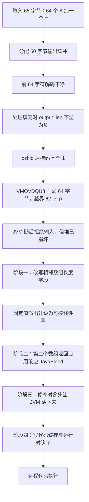
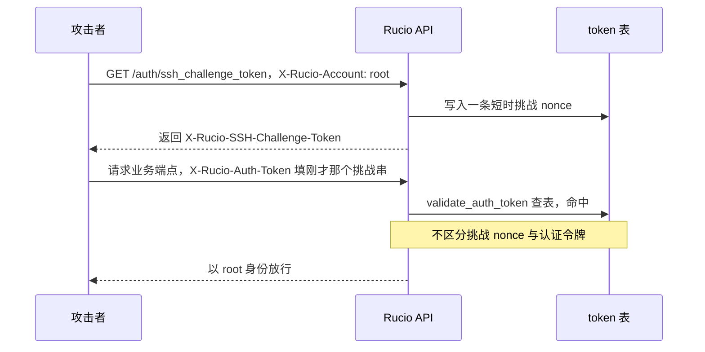
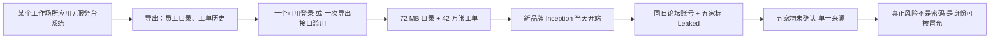
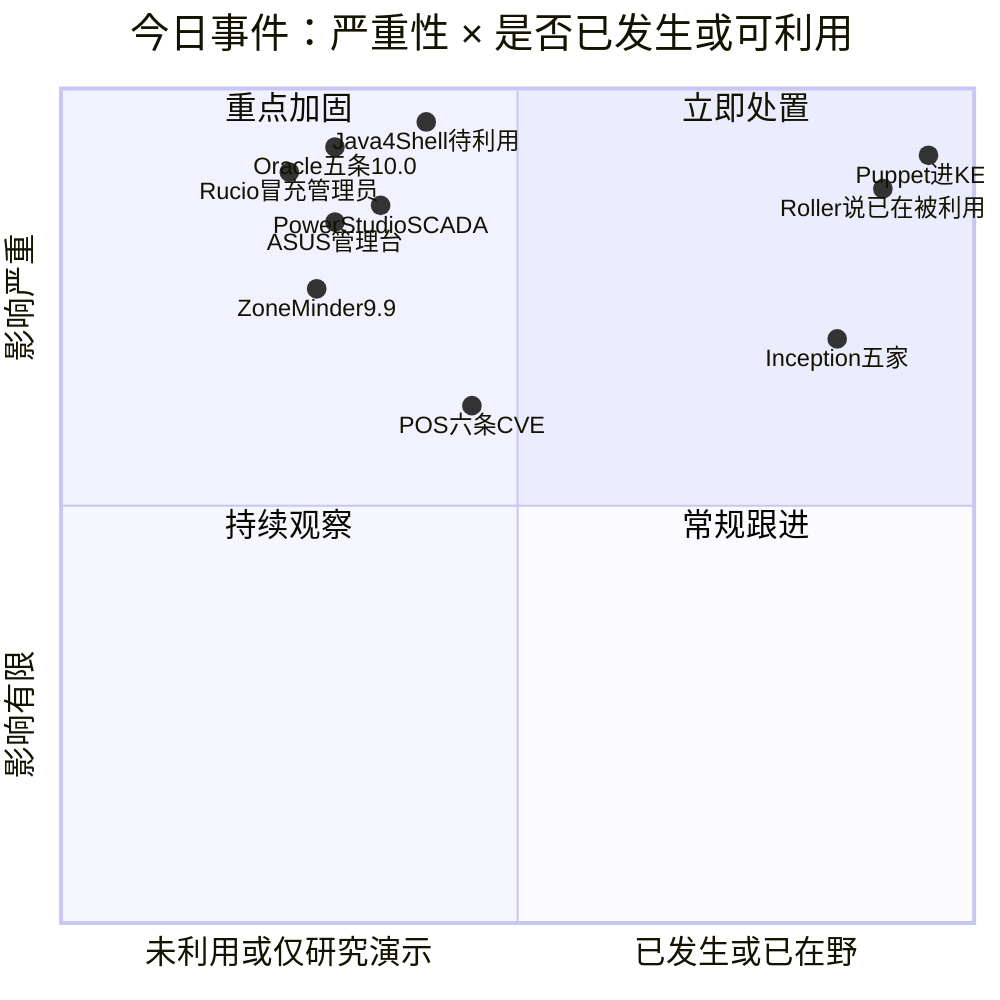
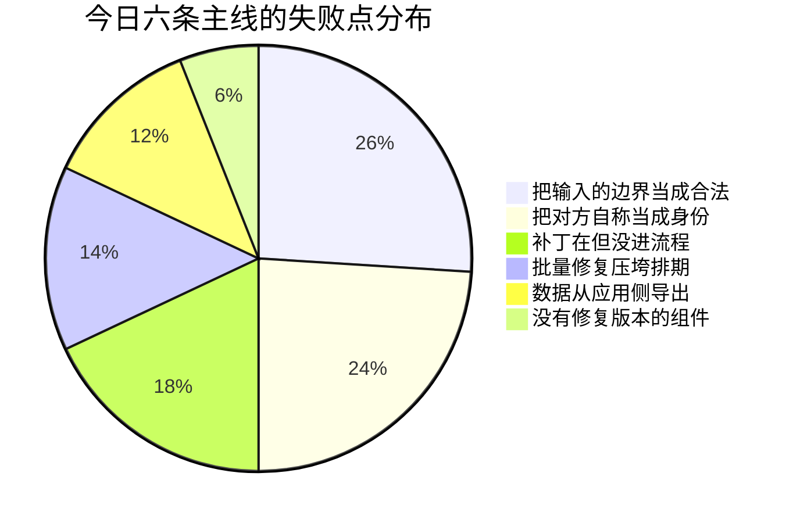
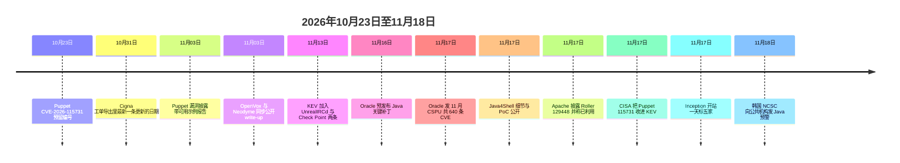

# 网安日报速递 · 2026年11月18日（第 220 期）

> 今日关键词：六十五个字节就足够写坏一块堆 · 挑战串和令牌躺在同一张表里 · 对方说是谁系统就当成是谁 · 补丁两周前就发了还在等排期 · 数据是别人家应用导出的 · 六百四十条里只有一条上头条

今天 NVD 在 11-17 00:00 到 11-18 06:00 这个窗口里收了 1,308 条新 CVE，其中 107 条在 9.0 以上，绝大部分来自 Oracle 的同一次批量发布。真正值得写下来的东西反而不在分数最高的那几条里：一条是 65 个字节的 Base64 输入，一条是"这个字符串是用来做挑战的，不是用来做凭据的"这句本该存在的判断，还有两条 10.0 分分别输在 `alg: none` 和一个全宇宙共用的密钥上。它们不是新的漏洞类型，是同一个老毛病换了层。

---

## 一、头条：六十四个 A 加一个等号，堆就写坏了

**CVE-2026-114938 · Java4Shell · CVSS 4.0 记 9.2（Calif）· Oracle 自己在 CSPU 里记 CVSS 3.1 8.1 · 远程未认证代码执行**

研究机构 Calif 于 11 月 17 日公开这个漏洞，取名 Java4Shell。它是这家机构在 PHP2Shell 之后的第二个作品，公告开头那句话倒是老实："在我们披露 PHP2Shell 之后，发现很多人不知道 PHP 是什么，所以我们选了个更眼熟的东西：Java。"

缺陷在 OpenJDK 的 Base64 解码器里，具体在 x86-64 上那条手写的 AVX-512 VBMI 加速路径。这段代码由 JDK-8268276 引入，2023 年 1 月随 17.0.6 进入 Java 17 线（backport 号 JDK-8296735）。它处理字符串结尾的填充时算错了输出长度：输入 64 个 `A` 加一个 `=`（共 65 字节），解码器给输出分配 50 字节，先干净地解完 64 个字符，再处理那个孤零零的 `=` 时，`output_len` 下溢成负数。负数传给掩码计算没有任何拦截（`bzhiq` 之后掩码变成全 1），随后一条 `VMOVDQU8` 把整个 64 字节向量寄存器一次性写下去，比 50 字节的缓冲区多写了 62 字节。

Java 在下一毫秒就拒绝了这段畸形输入。但内存已经坏了。

Calif 给的利用链分四段，前两段已经把危害说完了：第一段用堆排布把溢出打到相邻数组的长度字段上，让那个数组"以为自己很大"，于是固定值写变成可控写；第二段对另一个数组做同样的事，再把内容回显到应用响应里，得到一个堆泄露原语，他们叫它 JavaBleed，走的是 Heartbleed 那条路。堆里有会话令牌、凭据、密钥。第三段用泄露出来的原始字节把被改坏的对象头修回去，让 JVM 不崩、可以重试；第四段才是把可控写打到 JVM 内部，摸到代码缓存拿下执行。跨网络的堆排布靠两招：把成对的对象喷到 G1 的不同 region 里，以及用 TCP ACK 节奏去控分块发送的 HTTP 请求体，让分配顺序可控。失败的尝试通常直接把 JVM 打崩，很吵，但可以重试。

它之所以能叫"Shell"，是因为打中的位置太普遍。Calif 在默认配置下验证了预认证 RCE：**Keycloak、Atlassian Jira、Atlassian Confluence、JFrog Artifactory、Jenkins、PingFederate**；认证后 RCE：Apache Kafka、Apache Solr、Elasticsearch、Gerrit、Netflix Spinnaker；Spring Boot 与 Apache Struts 的样例应用也复现了。名单明确写了"不穷尽"，任何把攻击者可控字节送进 Base64 解码的端点，都是候选。samczsun 还补了一个反向场景：一个 Java 程序只要主动去连一个恶意 TLS 服务器，自己一个端口都不开，照样被打。出站连接是攻击面。

| 事项 | 具体值 |
|---|---|
| 触发串 | `AAAAAAAA…（64 个）=`；OpenJDK 17 的块阈值不同，是 128 个 A 加 `=` |
| 变体 | `=`、`==`、`X=`、`X==`、`XY=`、`===` 都能触发 |
| 受影响版本 | OpenJDK 17.0.6 及以上；Corretto、Temurin、Microsoft Build of OpenJDK、Zulu、Liberica、SapMachine、Red Hat OpenJDK、Oracle Java SE、GraalVM 全线 |
| 修复版本 | 8u513、11.0.33.1、17.0.21.1、21.0.13.1、25.0.5.1、27.0.1.1（GraalVM 未在 Oracle 表里列修复版） |
| 硬件边界 | 只影响支持 AVX-512 VBMI 的 x86-64：Intel Xeon Ice Lake / Sapphire Rapids / Emerald Rapids / Granite Rapids，AMD Zen 4 及以后；ARM64 不受影响 |
| 自查 | `grep -m1 '^flags' /proc/cpuinfo` 后查 `avx512f`、`avx512bw`、`avx512vbmi`、`bmi2` 四个 flag 是否齐全 |
| 缓解 | `-XX:-UseBASE64Intrinsics` 或 `-XX:UseAVX=2`；后者在 ARM 上会让 JVM 起不来 |
| 在野 | 截至发稿无确认在野；未进 KEV |

**为什么值得关注：**

第一，**修的是 JDK，不是你那个应用**。Jira 出了新版本、Confluence 出了新版本，都不解决问题，因为洞在运行时里。运维清单上要查的是"这台机器上的 `java -version` 是什么"，不是"我们的 Jira 是不是最新的"。这条对打包型产品尤其致命：Jenkins、Jira 这类东西在几千个部署里构建方式和内存布局高度重复，Calif 说的"没有通用利用、每个目标都要单独做链"在它们身上会打折扣。

第二，**两个官方分数差得有点远**。Calif 按 CVSS 4.0 记 9.2，Oracle 在自己的 CSPU 记录里按 CVSS 3.1 记 8.1，两份都是"官方"数据。评级打架的时候，按能不能预认证、能不能打到公网来排，比按小数点排更有用。

第三，**这次披露里最该被记住的数字不是 9.2**。Calif 说他们的一名研究员**一小时找到这个 bug，两小时后有了可用的利用，AI token 成本不到 200 美元**，靠的是他们预先搭好的智能体流水线。同一件事 Wiz 也做了一遍：他们的 AI 研究装置在细节公开后两小时内产出可用 PoC，并对 Jenkins、Confluence、Tomcat 验证了远程执行。这条接在昨天 GTIG 那份"全自动补丁到利用"后面：漏洞发现这件事的边际成本正在以肉眼可见的速度往下掉。厂商公告里那句"AI 辅助代码审计发现"，以后会越来越常见。

第四，**暴露面要先盘硬件再盘软件**。AVX-512 VBMI 是 2021 年之后的服务器 CPU 才有的东西，很多"老机器"天然免疫，而新建的云主机几乎全中。这类"看 CPU 才知道自己有没有事"的漏洞，资产库里通常没有对应字段。

---

## 二、挑战串本来是一次性的，没人说它只能用来做挑战

**CVE-2026-100397 · Rucio · CVSS 3.1 记 10.0（S:C）· 未认证冒充任意账号，含管理员**

Rucio 是欧洲核子研究中心（CERN）主导的科学数据管理框架，管的是 PB 级的实验数据，ATLAS、CMS 这些大科学装置都在用。它在 `lib/rucio/core/authentication.py` 里的 `validate_auth_token` 犯了同一个错误：**短期有效的 SSH 挑战 nonce 和真正的认证令牌存在同一张表里，校验函数不区分这两者。**

利用只有两步。先拿 `X-Rucio-Account` 头指定任意账号（包括管理员），请求 `/auth/ssh_challenge_token`，服务端正常返回一个挑战串；然后把这个挑战串当成 `X-Rucio-Auth-Token` 去请求别的 API 端点，就通过了。

修复版本是 35.9.1、38.6.1、40.4.2、41.1.1（对应四条维护线）。**为什么值得关注：**这类"用了同一个存储层，忘了区分用途"的缺陷在自研认证系统里极常见，而且几乎不可能靠扫描发现，它没有畸形输入、没有异常报错，请求看起来完全合法。审查认证代码时该问的问题是"这张表里躺了几种东西，校验函数怎么知道它拿到的是哪一种"，而不是"令牌有没有签名"。10.0 分给在这里不算夸张：S:C 是因为下游所有接了 Rucio 令牌的服务一起被穿透。

---

## 三、两个 10.0 分，都没验那个签名

**CVE-2026-120387 · CIRCUTOR PowerStudio SCADA WAVE · CVSS 4.0 记 10.0**
**CVE-2026-114202 · ASUS Control Center Express · CVSS 4.0 记 10.0**

这两条放一起，因为它们的失败点是同一句话：**"他说他是谁"被当成了"他是谁"。**

CIRCUTOR 那条更赤裸。PowerStudio SCADA WAVE 桌面版（Windows 64 位，24.8.0 到 24.11.16.x）的共享 JWT 校验组件接受 `alg` 设为 `none` 的未签名令牌，不验证任何密码学签名，于是提交一个自己编的 JWT 就能以别人的身份进系统。CWE-347，CAPEC-39，教科书级。CVE 记录引用了一个 PoC 仓库，研究者未独立验证其内容。修复版 24.11.17.0 及以上，厂商没有给临时缓解。这条落在 SCADA 上。CIRCUTOR 做的是配电与能耗监测，这类软件的部署位置通常在工业网络里，但"藏在工业网络里所以不用管"这句话在远程维保普及之后就不成立了。

ASUS 那条是硬编码密钥（CWE-321），在 ASUS Control Center Express 里，远程用户可以用伪造的认证令牌拿到管理员权限。同批还有 CVE-2026-126574（CVSS 4.0 9.4）：Control Center Datacenter 与 Enterprise 里，低权限 Viewer 角色能通过一个构造的改密请求把管理员账号的密码改掉。两件事叠起来的意思是：**这套"管理所有终端的管理台"的鉴权层，从密钥到权限判断都不太结实**。Control Center 这种东西管的是整批商用终端的软件分发与远程控制，拿下它就等于拿下那些终端。

**为什么值得关注：**`alg: none` 是 2015 年就被写进 JWT 库默认黑名单的东西，2026 年还能在出货软件里出现，说明"用了 JWT 库"和"用对了 JWT 库"是两件事。硬编码密钥同理：密钥进了二进制，就等于发给了所有拿到二进制的人，换密钥只能靠发新版本。审自家代码时，这两条都是十分钟能查完的：搜 `alg`、搜 `verify` 的调用点、搜代码里的长字符串常量。

---

## 四、补丁两周前就发了，今天才进 KEV

**CVE-2026-115731 · Perforce Puppet Enterprise · CVSS 4.0 记 9.4 · 已确认在野 · 整改期限 12-01**

11 月 17 日，CISA 把这条收进 KEV，目录版本 2026.11.17，第 1,782 条。而在两周前的 11 月 3 日，OpenVox 的 GHSA-ffr6-rwpm-p5wq 与 Neodyme 的 write-up 就已经带着**可用的示例报告**公开了。

机制值得完整看一遍，因为它是"客户端给的元数据被当成代码"的标准样本。Puppet agent 每次跑完会往 `PUT /puppet/v3/report` 发一份 JSON 报告，里面列这次运行的事件。服务端为了让时间戳、二进制、资源引用这些原生类型能往返，会走一层 rich-data 转换，而这层**信任客户端给的类型名**：事件体进 `FromDataConverter.convert(data, {:allow_unresolved => true, ...})`，攻击者可控的 `__ptype` 字段被 `Types::TypeParser` 解析，然后对解析出的类型调 `.create(value)`。如果没有为这个类型注册实现类，Puppet 会**自己生成一个**：`RubyGenerator.new.create_class(self)` 用类型声明的函数拼出一段 Ruby 类定义，再交给 `cls.class_eval(class_def)`。反引号在类定义时就会执行，对象根本不需要被实例化，命令就跑了。

```mermaid
flowchart LR
    A["攻击者：一份构造的 agent 报告"] --> B["PUT /puppet/v3/report"]
    B --> C["rich-data 转换，信任 __ptype"]
    C --> D["Types::TypeParser 解析类型名"]
    D --> E["无实现类 → RubyGenerator 现场生成类"]
    E --> F["class_eval 执行类体"]
    F --> G["RubyMethod body 里的反引号先跑"]
    G --> H["以 puppet 用户执行命令"]
    H --> I["puppet 用户持有 CA 签名密钥"]
    I --> J["可签发任意节点证书，冒充整批受管节点"]
```

前置条件是"持有一张由该 CA 签发的证书"。听起来像门槛，实际不是：很多环境开了 autosign，`autosign.conf` 还写着宽泛的名字匹配，这时候未认证的网络攻击者先去要一张证书，再拿它打这个端点，两步就到。受影响的是 Puppet Enterprise 2023.8.13 / 2025.12.1 / 2026.0.1 之前的版本，以及 OpenVox Server ≤ 9.1.0 和 ≤ 8.17.0；开源版 Puppet 已不维护，没有修复。修完要**重启 Puppet Server 服务**，否则加载的还是旧代码。

**为什么值得关注：**第一，**这是配置管理服务器**。它给全网发证书、推配置、在每台节点上跑代码，被打穿等于整片受管机群失守，而且是"用你信任的通道"。第二，**打完补丁还有第二件事**。代码执行发生在 `puppet` 用户下，这个用户握着 CA 签名密钥。发现中招就要按"CA 私钥已泄露"处理：重建 CA、重新注册 agent，光打补丁不够。第三，**KEV 的通知节奏再次落后于公开 PoC**。11 月 3 日有 PoC，11 月 17 日才进 KEV，中间这两周，等 KEV 才动的组织什么都没做，而攻击者手上已经有能直接发的东西。第四，CISA 是"在野"的唯一信源，KEV 条目没说用的是 autosign 证书、偷来的 agent 证书还是已经被拿下的节点。三种路径打到同一个端点，处置时都要查。

---

## 五、同一天，安静的 640 条

**Oracle 2026 年 11 月 CSPU · 640 个 CVE / 655 个补丁 / 62 个 critical · 11-17 发布**

媒体今天都在写 Java4Shell，但 Oracle 同一天发的这份 CSPU（Critical Security Patch Update，2026 年 5 月起在季度 CPU 之外加的月度高风险补丁通道）才是数量上的主体：**640 个唯一 CVE，655 个安全更新，62 个 critical，21 个产品族**。Oracle Hyperion 一家占 267 个（40.8%），Supply Chain 74 个，E-Business Suite 71 个，Fusion Middleware 71 个，其中 **53 个是"网络可达且无需认证"**。

CVSS 3.1 满分的有五条，全在 Fusion Middleware 与 Analytics 里：

| CVE | 组件 | 说明 |
|---|---|---|
| CVE-2026-91569 | WebLogic Server · TopLink Integration | 未认证 HTTP 接管 WebLogic，S:C，12.2.1.4.0 / 14.1.1.0.0 / 14.1.2.0.0 / 15.1.1.0.0 |
| CVE-2026-91510 | Access Manager · Authentication Engine | 未认证 HTTP 绕过，12.2.1.4.0 与 14.1.2.1.0 |
| CVE-2026-91500 | Access Manager · Authentication Engine | 同上，另一条独立缺陷 |
| CVE-2026-114835 | Access Manager · Admin Console | 未认证接管管理台 |
| CVE-2026-114784 | BI Enterprise Edition · Platform Security | 未认证 HTTP 接管 |

同一批里 WebLogic 还有三条 9.8（91585 / 91583 / 91570，都在 TopLink Integration），Database Server 四条 9.9（114848、114819 Oracle Text，114822 RDBMS，均"低权限即可"）。Java SE 这一族 11 个补丁，**11 个全是网络可达且无需认证**，Java4Shell 就在这 11 个里，被 Tenable 标为 Compiler 组件、CVSS 3.1 8.1。

**为什么值得关注：**第一，**真正决定暴露面的是"免认证远程"这一列，不是总分**。71 个 Fusion Middleware 补丁里 53 个不需要凭据，这才是该先排的队列。第二，**Hyperion 占 40.8% 这件事本身是信号**：一个财务合并与规划产品拿到 267 个补丁，说明这一族的代码欠账在集中爆，用它的组织最好确认一下版本停在哪儿。第三，**CSPU 是月度节奏**，也就是说这种量级的补丁包以后每月来一次，靠"季度打一次"的流程会持续落后一个季度。第四，媒体口径有出入：韩媒写"652 个补丁"，Tenable 统计 655 个，Oracle 官方 advisory 才是准数。引用时别拿二手数字当结论。

---

## 六、一天挂五家，没有一家确认

**Inception（新品牌）· 11-17 · AMD / Cigna Healthcare / Henry Schein / Paychex / PepsiCo · 全部未验证**

一个此前没有任何记录的勒索品牌，11 月 17 日上线了一个叫 "Inception, Chapter 1" 的泄露站，一天之内把五家美国大公司标成 "Leaked"：AMD、Cigna Healthcare、Henry Schein、Paychex、PepsiCo。同日，一个叫 InceptionGroup 的账号在俄语犯罪论坛 Exploit 上挂出数据，账号注册日期就是当天，五条帖子，零托管交易记录。Ransomnews 与 ransomware.live 都找不到这个牌子更早的活动。

两家媒体实际下载并检查了两份文件：

- **PepsiCo**：一个 72 MB 的文件，**500,817 行**员工目录，几乎每行有全名、工作邮箱、头像引用，多数带职位，约二十分之一带部门。没有密码、没有电话、没有家庭住址、没有生日、没有工号、没有薪资。行结构里出现 `checkedInCampus`、`skills` 这类字段，看起来是某个"办公位预约 / 同事查找"类工作场所应用的导出格式。
- **Cigna**：**421,661 张** IT 服务台工单，来自 Cigna 的 ServiceNow，内部链接指向 `cigna.service-now.com`，最新一张更新到 10 月 31 日，这个日期排除了"翻出旧泄露充数"的可能。里面 31,593 个去重邮箱、84,398 个报障人、306,089 张带回调电话、7,791 个内网 IP 与设备名、5,120 张提到会员或投保人编号、2,552 张带理赔号、156 万条评论与处理记录。还有一条要单独说：**40,837 张工单里出现了 "password" 这个词，2,808 张里的文本形状像是一个被明文写出来的密码。**

AMD、Henry Schein、Paychex 的样本没被检查。Inception 自己对 AMD 的描述是：特权访问地图（SAP 角色、admin/root、Unix、VPN）、1,665 个内网主机名与 TLS 信息、约 53,000 封挂在工单上的内部邮件、58,678 条员工身份（姓名、用户名、NT ID、工牌号）。这些全是卖方自述。

**为什么值得关注：**第一，**这批数据的价值不在"密码"上，在"可信度"上**。一个能报出你的工单号、你的部门代码、你的主管是谁、你上次找 IT 是为什么的人，在电话里几乎无法被识破。Cigna 那 30 多万个回调电话加上 8 万多个报障人，是一份现成的社会工程剧本。第二，**泄露源看起来不是"打进内网"，而是"从应用里导出"**。两份文件的形态都指向业务应用的导出能力，而不是数据库被拖，这意味着传统的边界防护和 EDR 可能全程没有信号。第三，**新品牌第一天上五家，本身就该被当成营销行为看**。注册当天开站、零托管记录、五家一起标 Leaked，这套打法更像是拿"半成品数据 + 大品牌名字"抬价，而不是五起独立入侵。ransomware.live 自己也标了"应谨慎对待，直到被独立验证"。第四，**处置动作不受"是否真实"影响**：员工目录与工单历史本来就该按敏感数据管，导出权限、导出审计、工单里不写明文密码，这三件事今天就能做。

---

## 速览

**1. Apache Roller：9.8 未认证反序列化，Apache 说已经在被利用**

CVE-2026-129448，CVSS 3.1 **9.8**，Apache Roller 4.0.0 到 6.1.4。XML-RPC 端点接受"厂商扩展类型"，并且**在认证请求方之前就完成反序列化**，所以是未认证 RCE。Apache 公告的原话是"This issue is being actively exploited"，修复版本 6.1.6（禁掉扩展类型，XML-RPC 功能关闭时直接拒请求）。临时缓解只能改 `WEB-INF/web.xml` 里的 `enabledForExtensions` 为 `false`，或删掉 `/roller-services/xmlrpc` 的 servlet 映射再重启；**在管理界面里关 XML-RPC 不够**，老版本是先反序列化再读这个开关。顺带一条口径冲突：Apache 说已在被利用，CISA 的 SSVC 记录却写 "Exploitation: none"，截至 11-18 也没进 KEV。同一漏洞还有个旧编号 CVE-2026-82384，当时只列了 6.1.5 受影响。

**2. ZoneMinder：任何一个登录用户都能把监控服务器变成执行点**

CVE-2026-28273，CVSS 3.1 **9.9**（S:C），1.38.4 之前。`/api/configs/edit/{name}.json` 背后 `ConfigsController::edit()` 没有执行 `System=Edit` 授权检查，所谓"系统变量保护"也无效。攻击者把 `ZM_PATH_FFMPEG` 改成带命令的值，再请求一次抽帧，`web/views/image.php` 或 `web/includes/Event.php` 里的 `exec()` 就执行了。摄像头画面、录像、数据库一并暴露。开源监控系统常年放在"内网所以不管"的位置，但它往往同时接着摄像头网段和办公网。

**3. 一家餐饮 POS，六条 CVE，全是同一次审计的产物**

ICRTouch 的 PocketTouch 1.700 build 2025.3726 一天出了六条：**CVE-2026-122055**（9.8）套接字默认密码就是字面量 `password`；**CVE-2026-122147**（9.8）套接字、配置、关机三个密码全是硬编码默认值；**CVE-2026-122149**（9.1）`SAVECONFIG` 命令能远程覆盖收银机配置文件；**CVE-2026-122150** `CHECKPAYMENT` 流程接受调用方自报的收银员编号，不校验他是否有权代表这个收银员；**CVE-2026-122142**（9.8）管理登录无失败次数限制，且不同 `siteID` 返回不同响应；**CVE-2026-122122** 订单跟踪不校验归属，改个订单号就能看别人的单。POS 的价值不在数据量，在"它连着钱"。

**4. 两个国产 AI 平台，同一天两个 9.3，都是"默认密钥"和"没关的初始化接口"**

**CVE-2026-130840**（BISHENG 3.0.0 之前，CVSS 4.0 9.3）：`AuthJwt` 用了硬编码的默认 `jwt_secret`，离线伪造一个 `user_id: 1` + admin 角色的 HS256 令牌，塞进 `access_token_cookie`，直接拿到用户、工作空间、知识库、工作流的全部管理权限。**CVE-2026-130856**（53AIHub 0.5.5 之前，9.3）：公开的 `POST /api/init` 端点没有鉴权，任何人可以"重新初始化"已安装实例，重置已有账号密码、给自己最高 creator 角色、拿 token。这类平台通常由业务部门自己 trial 部署，不在运维的资产表里，这也是它们最危险的地方。

**5. Zyxel 两条 9.8：固件里的越界写，默认关着 WAN 也挡不住内网**

**CVE-2026-79614**，CVSS 3.1 **9.8**，DX3301-T0 / EX3301-T0 固件 5.50(ABVY.8.3)C0 及更早，`libclinkc.so` 的越界写，未认证攻击者发一个构造的 HTTP 请求就能提权并执行命令。NVD 描述里那句"WAN 访问默认关闭"是厂商给的分级理由，但它只说明"从公网直接打不到"，不说明"内网安全"，这类设备的典型位置就是内网边界，同一个二层里还有办公终端。

**6. Atomic Server：9.8 分，但没有完整修复版本**

CVE-2026-69157，CVSS 3.1 **9.8**，0.29.0 到 0.40.2。服务首次启动会创建一个 `/setup` 邀请，写权限、目标是 Drive 根、`usagesLeft` 为 1；而 `server/src/plugins/invite.rs` 里的 `construct_invite_redirect` **丢弃了兑换者身份**。结果是一个未认证请求带上攻击者自己的公钥，就能创建一个新 Agent 并授予整个 Drive 的写权限。在没有被认领的新部署上，等于把整个库交出去。CVE 记录明确写了"截至审查未确认完整修复版本"。这类"自托管 headless CMS"的部署量不小，且常常由非安全岗的人一键起。

---

## 风险分析

## 事件时间线

## 相关出处

| 内容 | 出处 |
|---|---|
| Java4Shell 官方公告（Calif，含 PoC、利用四阶段、受影响 CPU 清单） | https://calif.io/java4shell/ |
| OpenJDK 漏洞公告 2026/11/17 | https://openjdk.org/groups/vulnerability/advisories/2026-11-17 |
| Oracle 11 月 CSPU 公告（官方补丁清单） | https://www.oracle.com/security-alerts/cspunov2026.html |
| Oracle 安全博客：11 月 CSPU 发布说明 | https://blogs.oracle.com/security/november-2026-critical-security-patch-update-released |
| Tenable：640 个 CVE / 655 补丁 / 62 critical 的逐产品统计 | https://ar.tenable.com/blog/oracle-november-2026-critical-security-patch-update-addresses-640-cves-cve-2026-114938 |
| oss-security 2026/q4/757（Jan Schaumann 的评论与分发版清单） | https://seclists.org/oss-sec/2026/q4/757 |
| IKZERO：Java4Shell 技术拆解（JDK 编号、四阶段链、JavaBleed） | https://www.ikzero.com/blog/cve-2026-114938-java4shell-openjdk-rce |
| IronMonkey：CVE-2026-114938 检测与缓解汇总（Wiz 两小时 PoC） | https://imtr.net/article/cve-2026-114938-rce-in-openjdk-everything-you-need-to-know-f659 |
| NVD：CVE-2026-100397（Rucio 认证绕过） | https://nvd.nist.gov/vuln/detail/CVE-2026-100397 |
| Rucio 修复 commit 与 release（4d4a585 / 35.9.1 等） | https://github.com/rucio/rucio/releases/tag/35.9.1 |
| NVD：CVE-2026-120387（CIRCUTOR PowerStudio SCADA） | https://nvd.nist.gov/vuln/detail/CVE-2026-120387 |
| IONIX：CVE-2026-120387 受影响与修复版本说明 | https://www.ionix.io/threat-center/cve-2026-120387 |
| NVD：CVE-2026-114202（ASUS Control Center Express 硬编码密钥） | https://nvd.nist.gov/vuln/detail/CVE-2026-114202 |
| NVD：CVE-2026-126574（ASUS Control Center 权限提升） | https://nvd.nist.gov/vuln/detail/CVE-2026-126574 |
| CISA KEV 目录（2026.11.17 版，第 1,782 条） | https://www.cisa.gov/known-exploited-vulnerabilities-catalog |
| Zero Hunt：Puppet CVE-2026-115731 反序列化链与版本表 | https://zerohunt.ai/blog/puppet-enterprise-cve-2026-115731-deserialization-rce |
| DugganUSA：KEV 收录时间线与"CA 密钥已泄露"的处置建议 | https://www.dugganusa.com/post/puppet-enterprise-cve-2026-115731-exploited-kev |
| OpenVox 安全公告 GHSA-ffr6-rwpm-p5wq（含可用示例报告） | https://github.com/openvoxproject/openvox/security/advisories |
| Apache 官方公告：CVE-2026-129448（apache-announce，11-17） | https://marc.info/?m=179491843816391 |
| NVD：CVE-2026-129448（Apache Roller 反序列化） | https://nvd.nist.gov/vuln/detail/CVE-2026-129448 |
| Ransomnews：Inception 泄露站与两份文件的逐项统计 | https://ransomnews.com/inception-leak-site-pepsico-amd-cigna-2026 |
| DataBreach.com：PepsiCo 条目（42 万行目录的口径） | https://databreach.com/breach/pepsico-2026 |
| DataBreach.com：Cigna 条目（工单、邮箱、内网 IP 统计） | https://databreach.com/breach/cigna-healthcare-2026 |
| HackFeeds：11 月勒索受害统计（本月 731 起口径） | https://hackerfeeds.com/ransomware/reports/2026-11 |
| NVD：CVE-2026-28273（ZoneMinder 配置越权到命令执行） | https://nvd.nist.gov/vuln/detail/CVE-2026-28273 |
| NVD：CVE-2026-122055 / 122147 / 122149（ICRTouch POS 默认凭据与远程改配置） | https://nvd.nist.gov/vuln/detail/CVE-2026-122055 |
| NVD：CVE-2026-130840（BISHENG 硬编码 jwt_secret） | https://nvd.nist.gov/vuln/detail/CVE-2026-130840 |
| NVD：CVE-2026-130856（53AIHub 初始化接口未鉴权） | https://nvd.nist.gov/vuln/detail/CVE-2026-130856 |
| NVD：CVE-2026-79614（Zyxel libclinkc.so 越界写） | https://nvd.nist.gov/vuln/detail/CVE-2026-79614 |
| NVD：CVE-2026-69157（Atomic Server 邀请接口丢身份） | https://nvd.nist.gov/vuln/detail/CVE-2026-69157 |
| 首尔经济日报：韩国 NCSC 就 Java 漏洞向公共机构发预警 | https://en.sedaily.com/business/2026/11/17/critical-java-flaw-found-after-php-putting-korean-systems |
| Junglewise：11-11 至 11-17 供应商缺陷量（Oracle 512 条 / 49 critical） | https://junglewise.ai/threats/technologies |

---

**免责声明：** 本报告基于公开信息整理，CVE 编号、CVSS 评分、受影响与修复版本以 NVD / 厂商公告 / CISA KEV 原始记录为准。同一事实在不同来源出现分歧时，正文已标注口径或直接指出差异：CVE-2026-114938 的 9.2 来自 Calif 的 CVSS 4.0 评分，Oracle CSPU 记录按 CVSS 3.1 记 8.1，Tenable 统计为 655 个补丁而部分媒体写 652，两者统计口径不同；Java4Shell 的"无在野"截至 11-18 成立，之后可能变化；Apache Roller 公告称"已在被利用"，而 CISA 的 SSVC 记录写"未观测到利用"，且未进 KEV，两个说法都不算错，只是各自的信息边界不同；Inception 五家的数据规模除 PepsiCo 与 Cigna 两份被媒体实际检查外，其余均为卖方自述，五家均未确认；Rucio 的 10.0 是 CVSS 3.1 分数且 S:C，与 CVSS 4.0 体系不可直接横比。涉华涉台的归因类内容本期不予收录，技术事实按各报告方原文转述。文中涉及的 PoC、IOC 与复现细节仅用于自查与识别，不要用于未授权环境。
