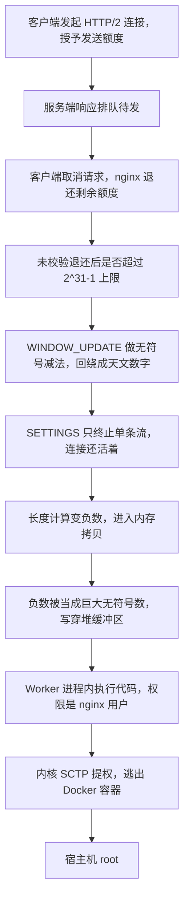
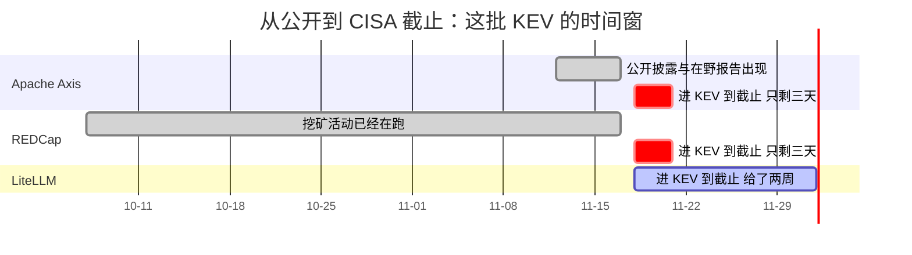
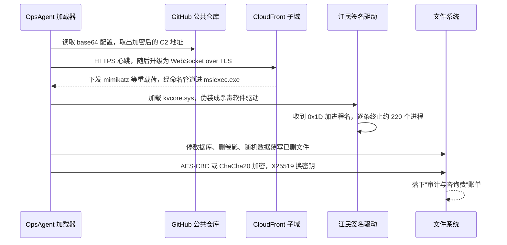
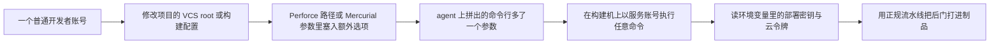
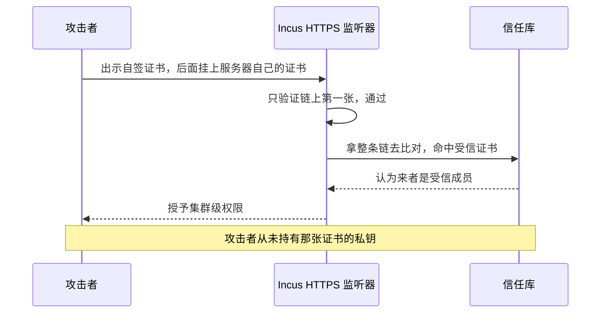
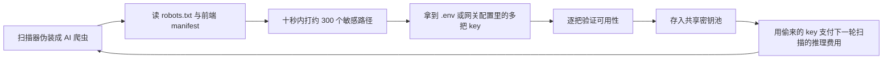
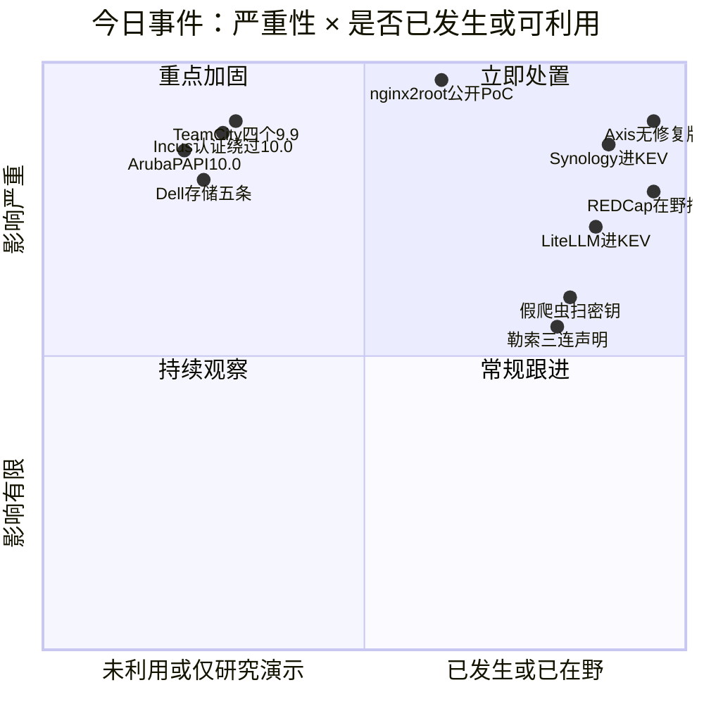
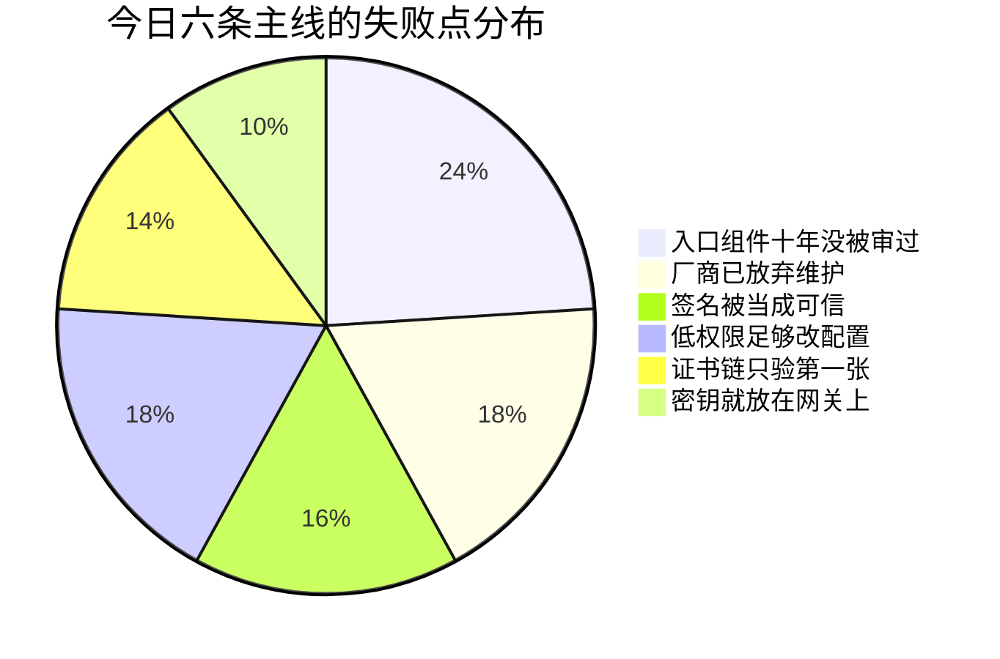
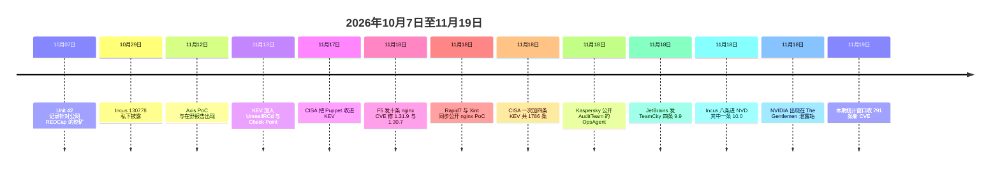

# 网安日报速递 · 2026年11月19日（第 221 期）

> 今日关键词：十年没人碰过的流量控制账本 · 厂商明说不会有修复版了 · 签名驱动一边杀软件一边写报告 · 构建服务器上一个参数就执行 · 别人的证书挂在链上就算通过 · 偷来的密钥付下一次扫描费用

NVD 在 11-18 00:00 到 11-19 06:00 这个窗口里收了 791 条新 CVE，其中 112 条在 9.0 以上。数字比昨天小，但今天这批东西有一个共同点：**它们全都站在入口上**。nginx 是网站的第一跳，Apache Axis 是十几年前 SOAP 集成留下的那扇门，NAS 是中小企业唯一的存储入口，TeamCity 是代码变成制品的入口，Incus 是容器的入口，LiteLLM 是模型的入口。今天没有一条是"某个业务应用里的逻辑漏洞"，全是那种一旦装上去就再也没人回头看第二眼的基础件。

---

## 一、头条：十年前的账本算错一次，nginx 就把 root 交出去了

**CVE-2026-123007（nginx2root）· CVSS 4.0 记 9.2 · 未认证远程代码执行 · 公开 PoC · 无在野报告**

11 月 18 日，F5 一次性发了十个 nginx 的 CVE，修在 1.31.9（mainline）和 1.30.7（stable）。其中最重的一条叫 CVE-2026-123007，Xint 给它起的整套名字是 nginx2root：五个 nginx 的 RCE，加一个 Linux 内核 SCTP 子系统的提权，六个洞拼起来能从公网直接拿到宿主机的 root。

先说这条洞本身。HTTP/2 用一套信用额度控制发送节奏：客户端告诉 nginx"你可以给我发这么多字节"，nginx 分两个计数器记账，一条流一个，整个连接再共用一个。客户端取消一个响应时，nginx 把还没发出去的额度退回去，**但没有检查退完之后有没有超过 2³¹-1 这个协议上限**。超了之后，下一次 `WINDOW_UPDATE` 做减法时无符号回绕，得到一个天文数字，再往后某个长度计算变成负数，负数到了内存拷贝那里就成了巨大的无符号计数，一次写穿缓冲区。CWE-191，整数下溢。

这段代码从 2015 年 nginx 引入 HTTP/2 起就在里面（1.9.5），一直到 1.31.8，包括 11 月 10 日的 master 分支。**十年，每一个官方发行版都带着它。**

Xint 的演示分两段。第一段用 123007 在容器里以 worker 权限执行命令，第二段用一个 Linux 内核 SCTP 的提权洞打到宿主机 root，测试覆盖 AWS、GCP、Azure 和裸机，其中 AWS 那一场是从公网 IP 直接打进去的。那个内核洞从 Linux 4.15（2018 年）就在，**目前没有 CVE、没有补丁**，Xint 说等各发行版能出修复再公开细节，现在只给结论。

工程上的门槛要说清楚，不然容易被标题带偏。Rapid7 的 Stephen Fewer 算过：跑通一次需要往目标灌大约 128 GB 的 HTTP/2 数据，10 Gbit/s 下两分钟，1 Gbit/s 下十七分钟，而 nginx 默认连接一小时就断，所以**带宽低于 300 Mbit/s 的攻击者根本来不及做完**。整条利用还依赖 x86-64 上 glibc 那个被 AVX-512 选中的 memcpy 实现（要求 avx512f 与 avx512vl）。前面套了 HTTP/2 终结代理的话，攻击者控制的帧不会被原样转发，大概率也打不通。这些限制说明"打崩一个 worker"很容易，"拿到 shell"没那么容易。但打崩是免费的，公开 PoC 已经在 GitHub 上（sfewer-r7/CVE-2026-123007），一条命令就能让 worker 反复重启。

| 事项 | 具体值 |
|---|---|
| 五个洞各自的触发条件 | 123007 只要开 HTTP/2；123633 要 HTTP/2 转发到后端且 worker_connections 紧张；123634 要变量拼出的 proxy_pass 目标加 SSI 或 mirror 子请求；121810 要 HTTP/3 转发到后端；113425 要 mail proxy |
| 影响区间 | 123007 从 1.9.5 起；123633 从 1.19.7 起；123634 从 1.13.4 起；121810 从 1.25.0 起；113425 从 0.5.15 起，全部到 1.31.8 |
| 修复版本 | Open Source 1.31.9 / 1.30.7；Plus 37.3.0.1 / 37.0.8.1；**Plus R33 到 R36 没有修复版** |
| 升级后必须做的事 | `nginx -s reload` 不够，要重启进程，reload 不换正在跑的二进制 |
| 临时缓解 | 关 HTTP/2 只能挡 123007 和 123633，另外三条照旧 |
| 自查 | `nginx -v` 看版本，`grep -rnE 'http2' /etc/nginx/` 看有没有真开；`openssl s_client -alpn h2` 看对端是否接受 h2 |
| 版本号会骗人 | 发行版会回移补丁不改版本号，Ubuntu 上显示 1.18.0 的可能已经修了，要查发行版自己的公告 |
| 暴露面 | Shodan 上 5,670 万台 nginx；Xint 抽样 1,194 万台能读出具体版本的，98.9% 落在受影响区间（只算版本，不算是否真开了 HTTP/2） |
| 在野 | 截至发稿无确认在野，未进 KEV |

另外几条也值得单独记一下。CVE-2026-123633 有个外号叫 Drainbreak，是 worker_connections 快耗尽时的 use-after-free，Metnir 在开着 ASLR 的情况下十分钟打穿，并且复现了 OpenResty、Kong、Apache APISIX、NGINX Gateway Fabric 和社区版 ingress-nginx 的崩溃，这几个默认都开 HTTP/2。CVE-2026-123634 需要 resolver 加变量拼出来的 proxy_pass 再加一个子请求，Xint 明确说 SSI 也可能走到同一个 bug，所以"把 mirror 关掉"不等于安全。

**为什么值得关注：**

第一，**这次是 AI 找到的，而且是流水线找到的**。CVE-2026-123007 是一名研究员在做 ZeroDay Cloud 2026 准备时挖到的，剩下四条是 Xint 的自动化装置在没有人工干预的情况下扫出来的：指到 5 万行 nginx 代码上，90 分钟出高严重度结论，再过 10 分钟有可用利用。同一天独立撞上同一批洞的还有 Rapid7、Wiz、Ikotas Labs、Metnir 四家。当五支队伍用同一类工具在同一块代码上撞车，说明"这个洞以前没人看见"这句话正在失效。

第二，**容器不是边界，这个结论今天又被演示了一遍**。nginx 跑在 Docker 里，worker 权限被打穿，再用一个 2018 年就存在的内核洞提权，宿主机的 root 就到手了。所有把"我们跑在容器里"当成一层防护的架构，在拿到内核洞的攻击链面前都只是换了个进程树。

第三，**修完之后的责任边界比补丁本身更难**。自建 nginx、K8s Ingress 控制器、API 网关、托管负载均衡、CDN 边缘节点，这五样东西的补丁责任人不是同一个，而它们对外的表现都是"前面有个 nginx"。今天该做的第一件事不是升级，是先列出这张表：谁在替我们跑 nginx，他什么时候升。

第四，**`reload` 这个习惯要改**。Xint 在公告里专门提了一句，reload 只换配置不换可执行文件，升级完必须 `systemctl restart nginx`。这类"升了但没生效"的情况在事故复盘里出现频率极高。

---

## 二、一次更新四条 KEV，其中一条厂商明说不修

**CVE-2026-90436（Apache Axis）· 9.8 · 无修复版本 · CISA 期限 11-21**

CISA 在 11 月 18 日一次往 KEV 里加了四条：Synology DSM 的 CVE-2024-10441、LiteLLM 的 CVE-2026-40217、REDCap 的 CVE-2026-90817、Apache Axis 的 CVE-2026-90436。目录版本 2026.11.18，总数 1,786 条，其中 361 条标注了已知勒索利用。

最该看的是 Axis 那条，因为它是**唯一一条"没有修复版会来"的**。

漏洞在 Axis 1.x 处理 SOAP fault 的时候。fault 里带一个 `exceptionName` 字段，Axis 会去加载这个字段点名的类，如果同时还带了 string 元素，还会用字符串构造函数把它实例化，**全程没有先确认这个类是不是 AxisFault 的子类**。光是把类加载进来，静态初始化块就跑了，classpath 上只要有一个可用的 gadget，代码就执行了。不需要凭据，不需要交互，不需要事先落脚。

真正要命的是时机。这段解析发生在 Axis **还在判断这条消息该投给哪个服务**的阶段，而认证是在后面的 handler 链里做的。也就是说，一个"必须登录才能用"的 SOAP 端点，在这条洞面前和裸奔没有区别，攻击代码跑在认证之前。任何"我们有 API key 校验"的自我安慰在这里都不成立。

Apache 的话说得很直白：**这个项目不打算为 Axis 1.x 出一个修复这个问题的版本**。唯一的官方路径是一个源码 commit（41f3b4e），改的是 fault 反序列化的两头：加载类时不跑静态初始化，构造对象前先确认它确实是 AxisFault 子类。要修，自己编译自己部署。想省事就迁到 Axis2，那是另一套代码，没有平替升级路径。

剩下三条各有各的形状。Synology 那条是 2024 年的 CVE（CVE-2024-10441，9.8，Pwn2Own 2024 的产物，system plugin daemon 的输出编码问题），补丁当年就发了，DSM 修到 7.2.2-72806-1，BeeStation OS 修到 1.1-65374，**两年半之后才进 KEV**，说明这两年半里一直有人在打没升的机器。REDCap 那条是 9.8 的代码注入，需要知道一个有效的公开调查问卷 hash 就能从问卷页面走到一个不该走到的控制器路由，Unit 42 在 10 月 7 日就记录了针对公网 REDCap 的 XMRig 挖矿，无文件执行、crontab 持久化、往里塞 SSH 公钥。LiteLLM 那条最"新派"：`/guardrails/test_custom_code` 这个 URI 允许对字节码做重写，等于把"执行任意代码"做成了一个功能，CISA 给的期限是 12-02。

| 条目 | 产品 | 分数 | 期限 | 修得掉吗 |
|---|---|---|---|---|
| CVE-2026-90436 | Apache Axis 1.x | 9.8 | 11-21 | 只有 commit，需要自己编译；官方建议迁 Axis2 |
| CVE-2024-10441 | Synology DSM / BeeStation OS | 9.8 | 11-21 | 有，7.2.2-72806-1 等一串 |
| CVE-2026-90817 | Vanderbilt REDCap | 9.8 | 11-21 | 有，升级到当前版本即可 |
| CVE-2026-40217 | BerriAI LiteLLM | 未公开 | 12-02 | 有 |

**为什么值得关注：**

第一，**"EOL 组件"不是历史问题，是当下资产表里的空白**。2026 年没人会主动装 Axis 1，但它被打包在中间件、集成平台、老 ERP 连接器、设备固件里卖了十几年，且厂商通常不会在文档里写。一个安全团队完全可能真诚地认为自己没有 Axis 暴露，实际上某台 SOAP 网关底下跑着它。

第二，**认证跑在漏洞后面，这类情况比想象的多**。判断一个端点安不安全，不能只问"要不要登录"，要问"这段解析发生在认证之前还是之后"。Axis、Puppet 昨天那条、前几天的各种反序列化，全是同一个顺序问题。

第三，**KEV 的期限正在从"两周"往"三天"压**。四条里有三条是 11-21，从加进去到截止只有 72 小时，而且 Synology 与 REDCap 两条都带强制取证要求。等 KEV 再动的人，现在连排期都排不出来。

第四，**Axis 这条的最后手段是断网**。如果三天内编不出补丁，就把 SOAP 端点从网络上摘掉，或者在入口把带 `exceptionName` 的 fault 报文拦掉。这不是修复，但能把窗口从"敞开"变成"窄缝"。

---

## 三、签名是真的，杀毒软件也是真的被杀掉了

**AuditTeam / OpsAgent · Kaspersky 11-18 公开 · CVE-2026-19193（BYOVD）· 无 CVE 的主体**

Kaspersky 在 11 月 18 日把这条讲完了：一个叫 AuditTeam 的勒索团伙，用自己写的框架 OpsAgent 打了一整年，受害者分布在俄罗斯、意大利、菲律宾、中国香港、塞内加尔、芬兰、中国等地，时间跨度从 1 月 5 日（GitHub 上第一次提交）一直到至少 10 月。

这伙人有两个地方值得单独拿出来讲。

**第一个是那个签名驱动。** OpsAgent 带一个"杀软杀手"模块，装的是一个**有正规数字签名的、伪装成江民杀毒（Jiangmin KV 系列）的驱动**，通过 `\KvCorePortX0` 这个 minifilter 端口通信，收到 `0x1D` 命令加一个进程名，就把那个进程干掉。杀名单大约 220 条：Microsoft Defender、Sysmon、Splunk、Wazuh agent、TeamViewer、Veeam、Acronis，以及 SQL Server、MySQL、MongoDB、Redis 这些数据库进程。**驱动签名是真的，所以 Windows 会信它**，除非开了易受攻击驱动黑名单、HVCI，或者干脆用应用控制策略禁掉。这个驱动本身的问题被追为 CVE-2026-19193，公开 PoC 已经存在，教科书式的 BYOVD。

**第二个是那份"审计报告"。** 加密完成之后落下的勒索信，不说自己被加密了，说的是"我们为你做了一次安全审计，请支付 Audit and Consulting fee，付了我们给你一份漏洞报告，不付就把数据公开"。这封信是加密模块自己落的，也就是说，**读到这封信的时候文件已经加密完了**。把勒索包装成专业服务，是今年明显的一个话术趋势：它降低受害者第一时间报警的意愿，也让内部沟通多绕一圈。

工具本身的成熟度也不像小团伙。OpsAgent 5.2.8 的功能被 Kaspersky 形容为"接近 Cobalt Strike"：文件与进程管理、提权、窃取与伪造令牌、键盘记录、截屏、经 SMB 和 HTTP 把受害机器串成链做横向。加载器一年换了三代，4 月的 C 加载器（OLLVM 控制流平坦化）、6 月的 .NET 加载器（`NtQueueApcThread`）、9 月的 Rust 加载器（在自己进程里解密执行，不再注入）。C2 走 CloudFront 子域，配置放在公开 GitHub 仓库里，**按 IP 封堵没有意义，因为 CloudFront 的地址是共用的大众 CDN**。研究者还注意到代码里有明显的大模型痕迹，比如几个注入例程几乎一模一样，只有参数不同。

| 排查项 | 具体位置 |
|---|---|
| 驱动文件 | `C:\Windows\System32\drivers\kvcore.sys`，机器上没装江民却出现这个文件就是信号 |
| 调试日志 | `C:\Users\Public\kv_dbg.log` |
| 载荷残留 | ProgramData 与用户 AppData 缓存目录里的 `syscache.dat` |
| 进程行为 | `msiexec.exe`、`notepad.exe` 出现异常子进程，或从命名管道收数据 |
| 网络 | `d19v1tntmz2i98.cloudfront.net`、`d35htktbyt7nxc.cloudfront.net`、`157.20.104.111` |
| 加固 | 打开微软易受攻击驱动黑名单、HVCI、App Control，把 kvcore.sys 挡在加载之前 |

**为什么值得关注：**

第一，**"签名"这两个字已经不是信任的依据了**。过去十年我们教用户看签名，现在攻击者直接买、借、偷一个签名来用。防线必须从"有没有签名"挪到"这个签名的主体应不应该出现在这台机器上"。

第二，**杀软被杀死的那 30 秒是最关键的检测窗口**。220 个进程被成批终止，这个行为本身噪音极大，但前提是你的日志不在被杀的那批里。把 EDR 日志实时外发、给安全代理加防篡改保护，比事后找 IOC 有用得多。

第三，**AI 让"小团伙做出国家队工具"变成了常态**。Kaspersky 的判断是，代码里那种高度重复的注入例程指向大模型辅助开发。这条和昨天 GTIG 那份自动化利用流水线、今天 nginx 那五个 AI 找出来的洞，是同一件事的三张脸。

第四，**勒索话术在变，处置流程不能跟着变**。不管信上写的是"审计费"还是"解密费"，读到它就意味着加密已经发生，第一步永远是隔离与取证，不是谈判。

---

## 四、构建服务器上一个参数，CI 里的密钥就全归别人

**CVE-2026-132231 / 132232 / 132233 / 132234 · JetBrains TeamCity · 四条都是 9.9**

JetBrains 在 11 月 18 日发了 TeamCity 的四个高危：2026.1.3 与 2025.11.7 之前的版本里，四条独立的远程代码执行，CVSS 3.1 全部 9.9，向量是 `AV:N/AC:L/PR:L/UI:N/S:C/C:H/I:H/A:H`。翻译一下：只要能登录，就能在构建服务器上执行代码，而且影响范围跨出 TeamCity 本身（S:C），因为构建服务器上挂着部署凭据、制品仓库密钥、云平台令牌。

四条分别是：Perforce 设置里的 best-fit 字符映射（132231）、Perforce 设置里的参数注入（132232）、构建属性注入（132233，CWE-23）、Mercurial VCS root 设置里的参数注入（132234）。**四条全在"版本控制连接配置"这一块**，这不是巧合，这是同一个设计缺陷的四种表现：把用户填的仓库地址、用户名、分支名拼进命令行，而没有把它当成数据。

**为什么值得关注：**

第一，**CI 服务器是供应链里最划算的目标**。打一个开发者的笔记本，得到一个人的权限；打构建服务器，得到的是"所有经过这条流水线的东西"。签名、制品、发布通道全在这一层，而这一层通常放在内网，被默认为"安全"。

第二，**PR:L 不代表门槛高**。TeamCity 在很多公司是全员可登录的，任何能提 PR 的人大概率也能建分支、改自己的构建配置。9.9 分里那个 L 是"低权限"，不是"需要管理员"。

第三，**参数注入这类洞扫不出来**。没有畸形输入、没有异常日志、没有越界，请求在审计记录里长得完全正常。审查这类代码该问的问题是：这个字符串最终会进 `exec` 吗，进去的时候有没有被当成一个整体参数。

第四，**修完之后要轮换**。如果构建服务器被登录过，第一件该做的事不是升级，是假设环境变量里的所有令牌都已泄露，全部换掉，再看流水线里有没有多出来的步骤。

---

## 五、把别人的证书挂在自己链上，就算通过了

**CVE-2026-130778 · Incus 7.6.0 之前 · CVSS 10.0 · 未认证冒充任意受信证书**

11 月 18 日一天，NVD 里多了至少八条 Incus 的记录：一条 10.0、五条 9.9、两条 9.6。Incus 是 LXD 分家出来的容器与虚拟机管理平台，管的是集群、存储池、虚拟机的生命周期，通常直接挂在运维网段上。

10.0 那条的机制简单到有点荒谬。Incus 的 HTTPS 监听器会向客户端要证书，**但只验证客户端送来的证书链里的第一张**，而认证逻辑又拿链上所有的证书去和信任库比对。于是攻击者只要把自己那张自签证书和一张受信证书（比如服务器自己的证书，或者某个集群成员的证书）拼成一条链送过去，就会通过认证，**而他并不持有那张受信证书的私钥**。过了这一步，就能拿到集群级权限、改信任库、影响基于脚本的授权判断。

配套那几条也都指向"授权判断写得太松"：130786、130784、130773 是项目隔离被绕，130780、130771、130779 是路径穿越（迁移、备份、自定义卷的元数据里塞快照名），130783 是事件流把证书和集群加入令牌给泄了，130774 是命名空间映射提权。官方给的缓解只有一句：**没有配置层的绕过办法，把 HTTPS 监听器限制在受信主机**，升级到 7.6.0。

**为什么值得关注：**

第一，**mTLS 不是"开了就安全"，关键在于验到第几张**。证书链验证是那种写错一个循环边界就完全失效的代码，而它的失效方式是静默的：服务照常工作，日志里全是 200。

第二，**这类平台的爆炸半径是整片集群**。Incus 管着宿主机、存储、网络和虚拟机的创建权限，拿到集群级权限等于拿到"再造一台机器"的能力，而这通常是横向移动最省事的一步。

第三，**同一天八条这件事本身是信号**。这不是八个互不相关的人各自发现的，更像是有人系统性地审了一遍 Incus 的授权模型，然后一次性交出来。审计过一轮的项目，短期之内最好别再假设"上次看过了"。

---

## 六、AI 网关成了提款机，一群假爬虫在敲 .env

**CVE-2026-40217（LiteLLM 进 KEV）· Octopus 与 Gecko 扫描活动（11-18 公开）**

今天这两件事要放一起看，因为它们说的是同一个位置：**存着模型密钥的那台机器**。

第一件，LiteLLM 进了 KEV。CVE-2026-40217，`/guardrails/test_custom_code` 允许对字节码做重写，等于远程执行代码，CISA 给到 12-02。LiteLLM 是这两年被大量自建的 LLM 网关，一个界面后面挂着 OpenAI、Anthropic、DeepSeek、通义、Kimi 的 key，谁能碰到它，谁就同时碰到好几家云的钱包。

第二件，安全公司 Tin Computer 在 11 月 18 日公开了两组扫描器，代号 Octopus 和 Gecko。它们伪装成 GPTBot、ClaudeBot、PerplexityBot，还有一堆没在任何官方名单里出现过的名字（DeepSeekBot、GrokBot、ChatGLM-Spider）。手法很直接：先用真浏览器头访问首页、读 robots.txt 和 sitemap.xml、看 Next.js 和 Vite 的 manifest，然后**在十秒内打大约 300 个敏感路径，每请求换一个 UA**。目标包括 `/.env`、`/.git/config`、LiteLLM 的管理路径，以及这一批新出现的智能体凭据：`/.claude/.credentials.json`、`/.cursor/mcp.json`、`/.codex/auth.json`、`/.gemini/settings.json`。

Gecko 那边更专注，它是个 .NET 客户端，UA 有个 60 字符截断的毛病（`(KHTML, like Gecko)` 那一段被截掉），9 月 30 日开始专门问 Claude Code 的配置，10 月到 11 月扩展到 MCP JSON、Codex 的 auth.json、Gemini 的 settings.json 和 LiteLLM 的 config。**AI 工具相关路径从它扫的 4% 涨到了 10%**，涨的速度正好等于这些工具新增配置文件的频率。

**为什么值得关注：**

第一，**"给 AI 爬虫放行"这个习惯正在变成漏洞**。很多站为了 SEO 或训练透明度，按 UA 白名单放行 GPTBot 一类，Octopus 就是吃这一口：32 个轮换名字，一台 Google Cloud 主机，几百个路径。**按名字放行等于没放行**，要按官方公布的 IP 段校验。

第二，**这一批新目标文件是 IDE 自己写出来的**。`.claude/.credentials.json`、`.cursor/mcp.json`、`.codex/auth.json` 这些文件很多人根本没意识到它们存在，而 CI 只要把仓库（包括被 gitignore 的智能体配置）拷进 `public/` 或 `dist/`，扫描器就能拿到，不需要利用你应用的任何逻辑。

第三，**AI 网关的风险是"一把钥匙开很多扇门"**。一个管理界面弱，后面几家的账号一起完。默认管理员用 `admin` 加主密钥就能登（LiteLLM 自己叫它 bootstrap 机制，有 `disable_env_credential_login` 可以关），Ollama 默认只监听 127.0.0.1 且不鉴权，一旦有人为了"让同事也能用"把端口开出去，等于把模型和账单一起挂到公网。

第四，**自查很便宜**。把自己的站按扫描器的路径清单打一遍，`/.env`、`/.git/config`、`/.claude/settings.local.json` 这些应该返回 404，而不是把首页吐回来。返回了真内容的，那把 key 就该换了。

---

## 速览

**7. 路由器固件里的九条 critical，DrayTek Vigor2960 一次全交出来**

11-18 进 NVD 的一批里，DrayTek Vigor2960（1.5.1.6 及之前）至少有九条 critical、三条 9.9：**CVE-2026-132143** 在 `/cgi-bin/mainfunction.cgi` 的 `doWebBackup` 里，参数处理不当；**CVE-2026-132141** 是同一文件 `json_load_lock` 的参数问题；**CVE-2026-132139** 是 `setSWMProfile` 里 `filename` 参数导致的栈溢出。这类"功能函数直接吃表单字段"的洞在老固件里是常态，位置又在内网边界，同一个二层里还坐着办公终端。

**8. Dell PowerStore SDNAS 五条：未认证就能把存储打崩**

**CVE-2026-116446**（9.8）是 NFS 服务里的越界内存访问，未认证远程即可触发；**CVE-2026-116443**（9.8）是 TFTP 服务的栈溢出；**CVE-2026-116448 / 116449**（均 9.8）是两处 OS 命令注入，需要内网访问；**CVE-2026-116441**（9.6）是存储处理器互联驱动的越界写，需要恶意对端。存储设备的特殊性在于：它坏了不是一台机器的事，是挂在上面的所有业务一起停。

**9. UniFi Access 四条 9.9，都是"低权限"起步**

**CVE-2026-132802**（不当链接解析，9.9）、**132803**（SQL 注入，9.9）、**132804**（SSRF，9.9）、**132808**（授权判断错误，9.9），攻击前提统一是"能访问网络且有一个低权限账号"。门禁系统管的是"谁能进哪扇门"，权限判断出错的后果比分数写得更具体。

**10. 自托管 PaaS 的五个 9.9，Dokploy 一天被翻了个底朝天**

**CVE-2026-129987**（数据库密码校验，9.9）、**129316**（终端、容器日志、监控的 WebSocket，9.9）、**129986**（`mount.deleteFileMount` 路径未过滤，9.9）、**129989**（Nixpacks 的 `publishDirectory` 吃 shell 元字符，9.9）、**129991**（备份前缀只查非空，9.9），全部修在 0.31.1。这类工具往往是业务团队自己为了"少找运维"装的，装着生产数据库的密码，却不在运维的资产表里。

**11. HPE Aruba AOS-10：PAPI 协议 10.0，未认证绕过认证**

**CVE-2026-95787**，CVSS 3.1 **10.0**（`S:C`，可用性不受影响但机密性与完整性全失），AOS-10.8.1.1、10.7.2.6、10.4.1.13 及以下。公告编号 HPESBNW05162（rev.2），修复版 10.8.1.2 / 10.7.2.7 / 10.4.1.14。同批还有 95788（相邻网络缓冲区溢出，7.1）与 95789（认证后命令注入，7.2）。无线控制器是"全公司 Wi-Fi 的那台机器"，管理面通常和 AP 管理网段在一起，很多人以为它不可达。

**12. 一天三起大牌勒索声明，没有一家确认**

**NVIDIA** 在 11 月 18 日 08:48 UTC 出现在 The Gentlemen 的泄露站上，没有样本、没有文件列表、没有数据量，只有一个倒计时（约 232 小时后，即 11 月 28 日）。同一个站点上还挂着它的散热供应商 Jentech（10-06，声称 9TB）与 IT 服务商 FPT Software（10-27）。**Visa 与 JPMorgan** 被一个 9 月才出现的团伙 n0n 挂上泄露站，给了 48 小时，没有样本；Visa 的回应是"涉及第三方服务商，自身系统未受影响"，JPMorgan 说是一次本地硬件系统的软件缺陷。**Veritiv** 被 Helix 挂出，卖方声称 9,484 万行、68.65 GB。三条的共同点是：**声明先到，证据没到**。

---

## 风险分析

## 事件时间线

## 相关出处

| 内容 | 出处 |
|---|---|
| Xint 官方技术报告 nginx2root（五个洞的配置条件、内核链、缓解措施） | https://xint.io/blog/nginx2root-remote-code-execution |
| Rapid7 CVE-2026-123007 分析（128GB 流量测算、glibc 依赖、PoC 仓库） | https://www.rapid7.com/blog/post/ve-cve-2026-123007-critical-nginx-http-2-integer-underflow-leads-to-rce-fixed/ |
| Rapid7 公开 PoC 仓库（sfewer-r7/CVE-2026-123007） | https://github.com/sfewer-r7/CVE-2026-123007 |
| nginx 官方安全公告目录（1.31.9 / 1.30.7 修复清单） | https://nginx.org/en/security_advisories.html |
| CyberScoop：五条 nginx 漏洞与 Xint 自动化装置 90 分钟出结论 | https://cyberscoop.com/nginx-critical-vulnerabilities-exploits/ |
| Security Boulevard：nginx2root 常见问题（五个 CVE 与 Plus 版本矩阵） | https://securityboulevard.com/2026/11/nginx2root-cve-2026-123007-frequently-asked-questions-about-five-critical-nginx-vulnerabilities |
| Zero Hunt：nginx HTTP/2 漏洞机制与自查命令（含版本回移提醒） | https://zerohunt.ai/blog/nginx-http2-cve-2026-123007-rce |
| CISA KEV 目录（2026.11.18 版，1,786 条） | https://www.cisa.gov/known-exploited-vulnerabilities-catalog |
| East Bay Cyber：11-18 新增四条 KEV 的逐条字段 | https://eastbaycyber.com/kev/added/2026-11-18 |
| CISOBrief：四款产品同日进 KEV 的行业影响分析 | https://cisobrief.com/cisa-adds-four-actively-exploited-vulnerabilities-to-kev-catalog |
| Infosec Intelligence：Apache Axis 不打算出修复版，只给 commit 41f3b4e | https://www.infosec.mn/blog/post.html?slug=cve-2026-90436-cisa-gives-apache-axis-users-until-november-21-to-patch-a-bug-the-vendor-isnt-fixing |
| NVD：CVE-2026-90436（Apache Axis 不安全反射） | https://nvd.nist.gov/vuln/detail/CVE-2026-90436 |
| NVD：CVE-2026-90817（REDCap 代码注入） | https://nvd.nist.gov/vuln/detail/CVE-2026-90817 |
| NVD：CVE-2026-40217（LiteLLM 未受保护替代通道） | https://nvd.nist.gov/vuln/detail/CVE-2026-40217 |
| NVD：CVE-2024-10441（Synology DSM 输出编码） | https://nvd.nist.gov/vuln/detail/CVE-2024-10441 |
| Synology 安全公告 SA-24:20（受影响版本与各分支修复版） | https://www.synology.com/en-global/security/advisory/Synology_SA_24_20 |
| Cybair：Synology 修复版本对照表与 BeeStation 覆盖范围 | https://cybair.sk/en/news/critical-synology-dsm-vulnerability-cve-2024-10441 |
| Kaspersky 报告转述：AuditTeam 用签名驱动杀 EDR，把勒索写成审计费 | https://cypro.co.uk/insights/cyber-bulletins/auditteam-ransomware-masks-extortion-as-audits |
| IntelFusions：OpsAgent 的加载器三代、220 条杀名单与 IOC | https://www.intelfusions.com/news/auditteam-opsagent-ransomware-consulting-fee |
| Cyfar：OpsAgent 检测工程假设与所需日志源 | https://cyfar.ca/posts/the-forced-audit-how-auditteams-opsagent-framework-masks-ransomware-as-consulting |
| Threatlinqs：AuditTeam 与 OpsAgent 的归因与覆盖缺口 | https://intel.threadlinqs.com/threat/TL-2026-6308 |
| JetBrains 已修问题清单（TeamCity 四条 9.9） | https://www.jetbrains.com/privacy-security/issues-fixed/ |
| NVD：CVE-2026-132232（TeamCity Perforce 参数注入） | https://nvd.nist.gov/vuln/detail/CVE-2026-132232 |
| NVD：CVE-2026-132233（TeamCity 构建属性注入） | https://nvd.nist.gov/vuln/detail/CVE-2026-132233 |
| NVD：CVE-2026-130778（Incus 证书链认证绕过，10.0） | https://nvd.nist.gov/vuln/detail/CVE-2026-130778 |
| Junglewise：Incus 同批漏洞清单与修复版本 | https://junglewise.ai/threats/technologies/lxc-incus |
| Tin Computer：Octopus 与 Gecko 伪 AI 爬虫报告 | https://www.explainx.ai/blog/octopus-gecko-fake-ai-crawler-api-key-scanners-november-2026 |
| 云安全联盟：AI 网关密钥被智能体收割的机制与影响面 | https://labs.cloudsecurityalliance.org/research/csa-research-note-self-funding-agents-ai-gateway-key-harvest |
| HPE Aruba 公告 HPESBNW05162（AOS-10 与 AOS-8 多个漏洞） | https://support.hpe.com/hpesc/public/docDisplay?docId=hpesbnw05162en_us&docLocale=en_US |
| NVD：CVE-2026-95787（AOS-10 PAPI 认证绕过，10.0） | https://nvd.nist.gov/vuln/detail/CVE-2026-95787 |
| NVD：CVE-2026-116446（Dell PowerStore SDNAS NFS 越界访问） | https://nvd.nist.gov/vuln/detail/CVE-2026-116446 |
| NVD：CVE-2026-132802（UniFi Access 不当链接解析） | https://nvd.nist.gov/vuln/detail/CVE-2026-132802 |
| NVD：CVE-2026-129987（Dokploy 数据库密码校验） | https://nvd.nist.gov/vuln/detail/CVE-2026-129987 |
| NVD：CVE-2026-132139（DrayTek Vigor2960 setSWMProfile 栈溢出） | https://nvd.nist.gov/vuln/detail/CVE-2026-132139 |
| Ransomnews：NVIDIA 出现在 The Gentlemen 泄露站（无样本，倒计时至 11-28） | https://ransomnews.com/nvidia-the-gentlemen-ransomware-claim-2026 |
| Wisevoter：n0n 声称掌握 Visa 与 JPMorgan 数据，48 小时期限 | https://wisevoter.com/world/2026/11/18/n0n-ransomware-claims-visa-jpmorgan-data |
| HackerFeeds：Veritiv 被 Helix 挂出（卖方自述规模） | https://hackerfeeds.com/ransomware/veritiv-by-helix-1fya2 |
| NVD API 2.0（本期窗口 791 条、9.0 以上 112 条，本刊一手统计） | https://services.nvd.nist.gov/rest/json/cves/2.0 |
| Junglewise：11-13 至 11-19 供应商缺陷量（Chrome 203 条、TeamCity 19 条等） | https://junglewise.ai/threats/technologies |

---

**免责声明：** 本报告基于公开信息整理，CVE 编号、CVSS 评分、受影响与修复版本以 NVD / 厂商公告 / CISA KEV 原始记录为准。同一事实在不同来源出现分歧时，正文已标注口径或直接指出差异：CVE-2026-123007 的 9.2 是 F5 按 CVSS 4.0 给出的评分，CVE-2026-123634 与 113425 在 NVD 侧按 CVSS 3.1 记 8.1，两套体系不可直接横比；"128 GB HTTP/2 流量"是 Rapid7 按其 PoC 实测的估算值，另有来源写 119 GiB，属同一测试的不同计量口径；Shodan 的 5,670 万台与 98.9% 来自 Xint 的抽样快照，只统计能读出具体版本的机器，不代表真实可攻击面；nginx 在野状态截至 11-19 为"无确认在野、未进 KEV"，之后可能变化；Apache Axis 的修复只能通过上游 commit 41f3b4e 自行构建，Apache 明确表示不会为 Axis 1.x 发布修复版本；REDCap 的在野证据来自 Unit 42 于 10-07 记录的 XMRig 挖矿活动，CISA 未公开具体受害方与 IOC；AuditTeam 的受害者分布按 Kaspersky 报告转述，本刊不做任何归因判断；NVIDIA、Visa、JPMorgan、Veritiv 四起均为勒索站点单方面声明，仅有 Visa 与 JPMorgan 给出有限回应，均无样本可核；Incus 的"至少八条"为本刊按 11-18 当日 NVD 新增记录统计，第三方周统计口径为 16 条；本期 791 条与 112 条为本刊按 NVD API 2.0 时间窗自行统计。涉华涉台的归因类内容本期不予收录，技术事实按各报告方原文转述。文中涉及的 PoC、IOC 与复现细节仅用于自查与识别，不要用于未授权环境。
