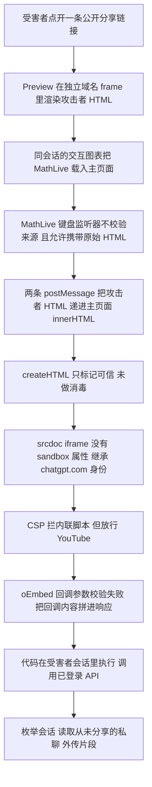
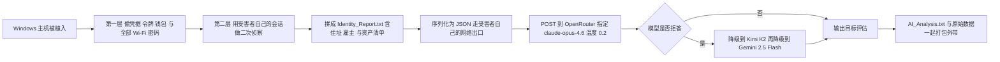
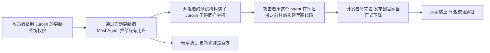
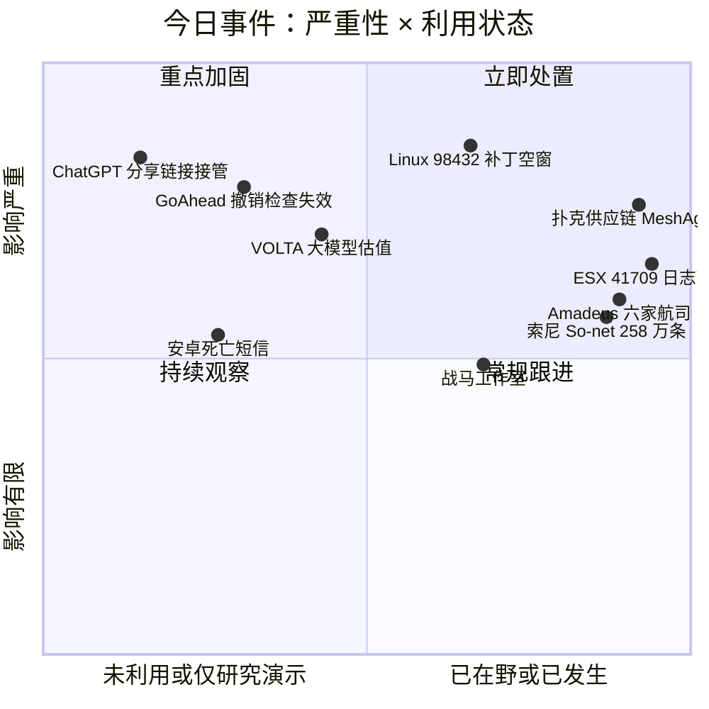
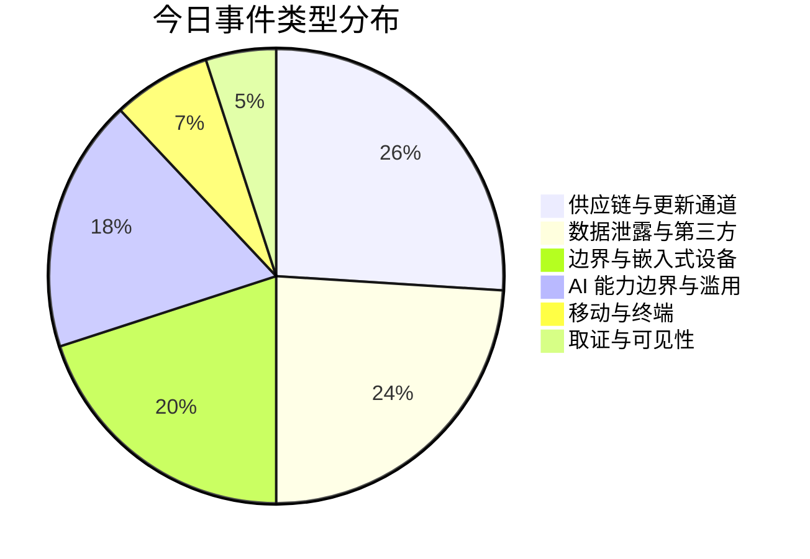
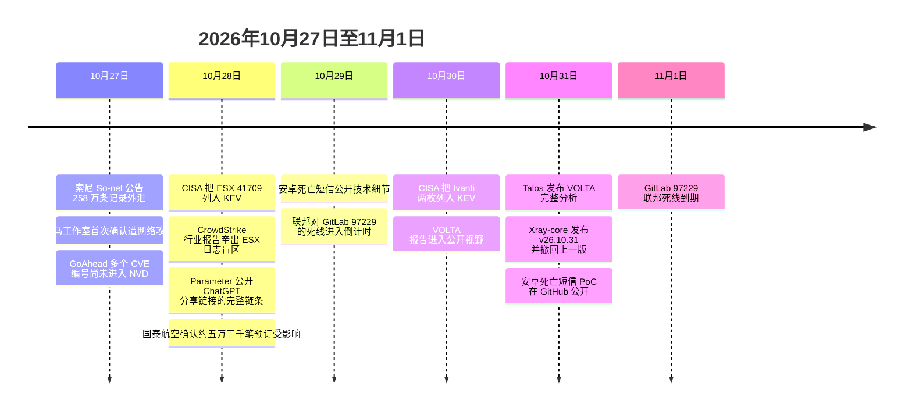

# 网安日报速递 · 2026年11月1日（第 204 期）

> 今日主线：**每一道防护都装了，每一道都没生效。**
> 一条普通的 ChatGPT 分享链接，能把攻击者代码送进你已经登录的会话，而沙箱从头到尾是好的；一个跑在数亿台设备里的嵌入式 Web 服务器，启动时把证书吊销列表读进来了，却从没打开吊销检查，被撤销的设备证书照样登录；一个 CVSS 只有 2.7 的漏洞进了在野清单，因为它专治"让别人看不见"；一个信息窃取器把赃物打包发给大模型问"这人值多少钱"，杀软一条都没报，因为那是合法的 API 调用；两台扑克辅助软件的更新是真的、签名是真的，可签名那台机器早就被人控着；一个安卓短信洞的补丁确实发了，只发给 Android 14 到 17。
> 六件事，共同点不是"洞有多深"，是**"这道防护在，所以我不用管"这句话本身失效了**。

---

## 一、一条 ChatGPT 分享链接，就能在你登录着的会话里跑代码

**严重程度：严重（Web 应用 / 会话劫持）｜时间：10-18 报送，10-26 修复，10-28 公开｜赏金 5,000 美元，评级 P1**

这条最反直觉的地方是：**沙箱从头到尾没有问题。**ChatGPT 把聊天里的 HTML 块渲染成一个小页面（Preview），确实把它关在一个独立域名的锁定 frame 里，读不到主页面。攻击者没有砸开它，是从旁边一个"为了好用而开的功能"走过去的。

**能做什么。**安全公司 Parameter 的验证里，攻击者的代码在受害者的登录会话里、以 chatgpt.com 的同等权限运行。它**直接调用了 ChatGPT 自己的已登录 API**，而不是去抄屏幕上有什么：`GET /backend-api/conversations` 列出受害者最近的会话，再按会话 ID 打开一个**从来没有被分享过**的私聊，把其中一小段发到研究者自己的服务器。研究者的原话是"本质上，我们可以代表受害者的 ChatGPT 账号执行任何操作"。

**受害者的动作，比想象的少。**不用装任何东西，不用加入工作区，不用在攻击者的页面上登录。最可靠的版本是打开链接、点一次 Preview 按钮；后来的版本被设成自动预览，**点开链接就够了，实测约 4.5 秒后触发**。

**越界链条分三步，每一步单独看都不像漏洞：**

| 步骤 | 发生了什么 | 为什么能成立 |
|---|---|---|
| 一 | 同一段会话里的交互图表把数学排版库 MathLive 加载进了主页面 | MathLive 的屏幕键盘监听器**不校验消息来自哪个 frame**，而且允许键盘布局数据携带原始 HTML |
| 二 | Preview 通过两条 postMessage 把攻击者 HTML 递给主页面，写进 innerHTML | 配套的 `createHTML` 辅助函数本该做消毒，实际只是把字符串标记成可信 |
| 三 | innerHTML 里的 script 不执行，但里面那个 srcdoc iframe 没有 sandbox 属性 | frame 由主页面创建，浏览器因此把 `https://chatgpt.com` 的源给了它 |

**最后一步绕的是内容安全策略。**CSP 正确拦住了内联脚本，但放行了 YouTube 域。YouTube 的 oEmbed 端点在校验回调参数失败时，会**先把回调内容拼进响应再返回错误**；这段以 `// API callback` 开头的响应被浏览器当成脚本执行，攻击代码就此落在主站上下文里。

**时间线很清楚：**10 月 18 日报送，8 天后修复；OpenAI 复现了代码执行与私聊读取两项，把评级从 P2 提到 P1（最高档）；**10 月 26 日，两个前端版本都开始拒绝这条链依赖的消息**；10 月 28 日研究者公开细节；总共支付 **5,000 美元**。

**边界必须写清楚，否则容易被读成"能偷别人账号"。**这不是在野攻击：Parameter 明确说没有发现任何真实使用；私聊那一段是在**同一个研究账号的两个会话之间**做的验证，没有碰真实用户；完整武器化代码没有公开。另外链条依赖"图表先把 MathLive 加载进来"这个前提，研究者是用限时重试处理资源加载竞态的。

**修复的关键在哪里。**研究者把根因归给**三条设计选择同时成立**：MathLive 会执行一条修改自身设置的跨 frame 消息而不校验发送方；这条消息被允许携带原始 HTML 作为键盘布局数据；这段 HTML 可以创建不带 sandbox 的 frame 并继承主站身份。所以**只堵 YouTube 那一步不够**——拦住它之后，一个不受信任的 Preview 仍然能把 HTML 推进主站。

**值得关注的原因：**

第一，**这类 AI 产品把"渲染用户内容"和"信任主站身份"混在了一起**。Preview 的设计前提是"这里面是数据"，但数据能创建 frame、frame 能继承身份，数据就变成了代码。

第二，**受害者不需要做错任何事**。分享链接是 ChatGPT 的正常功能，任何人都会点。这一条比钓鱼更难防，因为它连"可疑的域名"都没有。

第三，**对企业来说，"分享出去的东西"已经是攻击面**。任何带 Markdown / HTML 渲染、带图表、带嵌入内容的协作产品，都值得问一句：我渲染用户内容的那一层，是把它当数据还是当代码？

---

## 二、GoAhead：撤销列表加载了，撤销检查从来没打开

**严重程度：高（嵌入式 Web 服务器）｜CVE-2026-115881，厂商评 9.1｜6.1.1 于 8-02 交设备商、10-12 公开；10-26 细节公开**

GoAhead 是个小 Web 服务器，被设备厂商编进固件，用来跑路由器、打印机、网关、工业控制器上的管理页面。它的东家 EmbedThis 说它**跑在数亿台设备里**。

**问题只有一句话：证书吊销列表被读进来了，吊销检查从来没有启用。**在使用 OpenSSL 后端、要求客户端证书（双向 TLS）、并且配置了吊销列表的构型下，服务器启动时会把 CRL 文件加载进来，**不报任何错**——配置了它的运维者有充分理由认为吊销在生效。它没有。

结果就是：一张已经被撤销的客户端证书，比如一台被偷的、或者已经退役的设备，**照常完成握手**，拿到那个身份本来能有的一切。

**FoxIO 的 Sébastien Féry 在 GoAhead 6.1.0 + OpenSSL 3.6.2 上验证过：把 issuer checking 打开，被撤销的证书依然被接受。**OpenSSL 侧的安全公告把这件事描述成"被撤销的客户端证书被静默接受"。

**触发条件必须原样写出来，否则会被误读成"默认就中"：**

1. 构型使用 **OpenSSL 后端**；
2. **要求客户端证书**；
3. 配了可信的 CA 证书包；
4. **打开了 issuer 校验**；
5. 配了吊销列表。

这是运维者主动打开的一套设置，不是一个默认构型。攻击者还得手里有一张由可信 CA 签发、并且已被列入吊销的证书。

| CVE | 厂商评分 | 受影响后端 | 成立条件 | 后果 |
|---|---|---|---|---|
| CVE-2026-115881 | 9.1 | OpenSSL | 上述五项同时成立 | 被撤销的客户端证书仍被当作有效身份 |
| 第二枚（Mbed TLS 侧） | 未单列 | Mbed TLS | 客户端未做密钥交换值的最小长度校验 | 会接受过短或过弱的密钥交换值，削弱 TLS 1.2 连接 |
| CVE-2026-115884 | 未单列 | 旧 LibreSSL | 要求客户端证书、且关闭 issuer 校验 | 超过 10 张的证书链仍能以已认证客户端完成握手 |

**Mbed TLS 后端不受第一枚影响**，它的吊销检查走另一条代码路径。第二枚的影响面也有限：**只有没做最小长度检查的客户端会接受**，TLS 1.3 与 ECDHE 会话不受影响，Mbed TLS 4.x 已经把这个密钥交换整个移除了。

**同一份 6.1.1 修了 11 个公告，其中 3 个严重。**另外值得一提的一个是登录绕过：如果存储的密码用的是 6.1.0 新加的 **Blowfish 格式**，那么**用户名对、密码随便填就能进**——而内置管理页默认走的就是表单登录。

**这条最难办的地方在信息不对称。**TLS 后端和各项设置都是**固件编译期定死的**，设备主人从外面判断不了自己有没有中，也判断不了厂商用的是哪个后端。唯一的修复路径是厂商重新出一版 6.1.1 固件。到 10 月 27 日为止，这几枚都没有在野利用的报告，CVE 编号当时也还没进公开的 CVE / NVD 库；FoxIO 公开了 PoC，并给出 **JA4Scan 指纹**用于从外部识别 GoAhead 服务器及其后端。

**值得关注的原因：**

第一，**"配置了就等于生效了"是个常见幻觉**。CRL 加载成功、无报错、日志干净，三件事加在一起很容易被当成"吊销在工作"。真正该验的是：拿一张确实被撤销的测试证书去连一次。

第二，**这是嵌入式设备供应链的典型形状**。上游修了，中间隔着一层层厂商，用户什么都做不了，只能等。

第三，**分数 9.1 和真实风险要分开看**。9.1 是在"条件全部满足"前提下算的，而条件全部满足的构型是少数；反过来，那些构型恰恰是安全要求最高的场景——双向 TLS 加 CRL，本来就是给高敏感设备用的。

---

## 三、VMware ESX：进在野清单的那个洞，CVSS 只有 2.7

**严重程度：高（虚拟化基础设施 / 取证可见性）｜CVE-2026-41709｜VMSA-2026-0006 于 7-29 发布、8-19 更新｜10-28 进 KEV，联邦期限 11-11**

Broadcom 对这个洞的描述只有一句：**"恶意管理员可以利用这个问题执行某些操作，而这些操作不会被记录。"**它没说哪些操作。CVE 记录把弱点类型标成 **CWE-778，日志记录不足**。

CVSS 3.1 向量是 `AV:N/AC:L/PR:H/UI:N/S:U/C:N/I:L/A:N`，**2.7**，Low。理由很直白：它需要高权限，自身不泄露数据、不中断服务、不给代码执行。

**它给的只有一样东西：看不见。**

**为什么 2.7 能进 KEV。**一个按分数排队的补丁队列，会把这个洞排到最后。但对一个已经拿到 ESX 管理员的人来说，"操作不被记录"就是全部价值——他要的是时间，不是权限。10 月 28 日 CISA 把它加进 KEV，联邦民事机构 11 月 11 日前修完；条目里勒索软件使用情况标"未知"，取证排查标记为"否"。

**披露与利用的时间差值得单独说。**Broadcom 7 月就发了公告，8 月 19 日更新补了一轮产品线；而 CrowdStrike 在 10 月 28 日发布的行业威胁报告里说，这个洞**在被公开披露之前就已经作为零日被用过**，攻击者在受害者的 vCenter 环境里部署了多种恶意软件。CISA 与 Broadcom 都没有点名任何行为体。

**补丁与检测：**

| 产品线 | 受影响 | 修复构建 |
|---|---|---|
| Cloud Foundation / vSphere Foundation（ESX 9.1） | 9.1.x.x | ESXi-9.1.0.0-25370933 |
| Cloud Foundation / vSphere Foundation（ESX 9.0） | 9.0.x.x | ESXi-9.0.2.0100-25595025 |
| VMware ESX 8.0 | 8.0 | ESXi80U3j-25429389 |
| Cloud Foundation（ESX 5.x） | 5.x | 5.2.4（KB88287） |
| Telco Cloud Platform（ESX） | 5.0.x / 5.1.x | KB449886 |

这条 CVE 的矩阵里**没有 ESX 7.0 的条目**；Broadcom **没有给任何 workaround**，补丁就是唯一办法。自查只要两条命令：`esxcli system version get` 或 `vmware -vl`，把构建号跟上面比；vCenter 托管的环境也可以在每台主机的 Summary 页看构建号，不用逐台登。

**但打补丁不解决这条的真正问题。**它讲的是"什么没有被写进去"，所以没法对"一次没被记录的操作"告警。可行的检测只有三条，全是间接的：

1. **把 ESX 日志送出去。**`esxcli system syslog config get` 看一眼 `Syslog.global.logHost`，为空就意味着日志留在本地，可以被轮转掉、也可以丢。
2. **对"日志配置被改"告警。**syslog 目标被清空、被禁用、远程日志被关掉，这些都是动作。
3. **对"日志流突然停了"告警。**一台平时稳定往外发事件的主机突然安静，本身就是信号。

**值得关注的原因：**

第一，**这是"评分体系"和"实际价值"脱节的教科书案例**。2.7 分的东西成了长期驻留行动的钥匙，说明用 CVSS 单一维度排优先级会漏掉一整类"掩护型"漏洞。

第二，**虚拟化层是共享控制点**。一台 ESX 上跑着几十台虚拟机，管理员权限的影响可以横跨看起来毫无关系的业务系统。这一层的日志断了，事后重建入侵路径就少了一整块。

第三，**已经打过 7 月补丁的也要回头查**。今天的补丁关的是未来的窗口，历史上那些没被记录的操作已经发生了，缺的记录补不回来。

---

## 四、VOLTA-AUTODOXER：把赃物打包，发给大模型问"这人值多少钱"

**严重程度：高（犯罪软件 / AI 滥用）｜Cisco Talos 10-31 发布｜样本首见 10-11，PE 时间戳 8-17｜由 CAIRN 框架发现**

先说这条最扎眼的一句，来自 Talos 研究者 Ryan Fetterman：**"它的提示词写得很小心，没有明说任何恶意的东西。"**

VOLTA-AUTODOXER 是一个会自删除的 Windows 信息窃取器。窃取部分本身很成熟，不新鲜；新鲜的是它偷完之后干的第二件事——**把受害者的档案打包，通过 OpenRouter 发给商业大模型，让对方出一份"目标评估报告"**。

**第一层：偷。**浏览器里存的密码、cookie、支付卡（覆盖 Chromium 系、Firefox、Thunderbird）；Outlook 配置；Slack 工作区；Steam 与 Battle.net 会话；Discord 与 Telegram 会话；Roblox 账号；Microsoft OAuth 令牌；SSH 与云服务配置（`gcloud`、OpenVPN、Hide.me）。它还会**直接调 `WlanGetProfileList` 把所有保存过的 Wi-Fi 密码倒成明文**，并用内嵌的破解器去打加密货币钱包库，结果写成一行 `WALLET VAULTS CRACKED`。Talos 说明，其中 cookie 与令牌那部分依赖绕过 Chrome 的 **App-Bound Encryption** 的手法。

**第二层：用受害者自己的会话做二次侦察。**这一步才是它跟大路货的分界线：

- 翻受害者的 Gmail，找 Amazon、DoorDash、Uber Eats、Grubhub、Walmart、PayPal 的收据，**用来确认家庭住址**；
- 调偷到的 Uber Eats 与 DoorDash 会话，拉订单历史；
- 用 Discord 令牌补全账号资料；
- 拿公开的交易数据站点给 Roblox 库存估值。

Talos 那句话写得很冷静：**你的外卖订单历史现在是一项负债。**

**第三层：交给大模型。**所有东西拼成一份 `Identity_Report.txt`——地理位置与住址、雇主与雇主域名、推断出的出生年、卡号后四位、Slack 工作区、文档作者元数据、iPhone 备份迹象、Roblox 账户现值——序列化成 JSON，POST 到 `openrouter.ai/api/v1/chat/completions`。system prompt 要求模型扮演**"取证情报分析员，根据结构化证据包起草一份目标评估"**，约 240 词，带项目符号和编号列表。

输出是硬性要求的结构：执行摘要、这个人是谁、主体标识、可佐证事实、他做什么、**"WHAT THEY'RE WORTH"**（把财物按低/中/高分档）、**"THEIR OPSEC"**、最佳猜测、证据注记、未确立项。结果存成 `AI_Analysis.txt`，和原始数据一起打进 `volta_dox.zip` 外带。

**模型侧的工程设计得很直白。**默认 `anthropic/claude-opus-4.6`，温度硬编码 **0.2**（要稳定、可复现的结构化输出）；一条**拒答检测 + 级联降级**链：一旦返回里出现拒答措辞，就自动降到 **Moonshot AI 的 Kimi K2**，再不行降到 **Google 的 Gemini 2.5 Flash**。Fetterman 的判断是，攻击者**预期第一次请求会被拦**，所以按"逐级往更宽松的模型退"设计。

**没有自有基础设施，这一点最重要。**Talos 观察到的所有端点都在第三方手里。对防守方意味着：**杀软不会因为"某个进程向 OpenRouter 发了一个 HTTPS 请求"而报警**，那是一条完全正常的 API 调用。

**边界要写清楚：**Talos **没有追踪这个变种在野的实际使用**；AI 那一步是**可选的**，去掉它木马照样偷、照样外带（Fetterman 原话是"AI 调用属于额外加成"）；PE 时间戳 8 月 17 日，样本首见于 10 月 11 日。

**值得关注的原因：**

第一，**这是 LLM 第一次在犯罪链条里当"分析员"，而不是写代码或者写钓鱼邮件的助手**。偷数据这件事早就是白菜价，贵的是判断哪个受害者值得投入——现在这一步被自动化了。

第二，**"模型拒答"被当成工程问题解决了**。降级链的存在说明攻击者已经在按产品思维做容错，模型侧的安全对齐被当成一个需要绕过的可用性缺陷。

第三，**数据外流的形态变了**。以前是"把 500MB 压缩包传到网盘，运营商和 DLP 看流量"，现在是"先在你机器上把 500MB 分析成 5KB 结论，再只带走结论"。只在出口做大流量检测的思路，对这一步是无效的。

---

## 五、扑克辅助软件：签名是真的，签名那台机器早被人控着

**严重程度：高（软件供应链 / 定向金融犯罪）｜WolfSec 9-29 公开｜WIRED 10-28 报道｜指控损失 150 万至 400 万美元**

这条的思路跟大多数供应链攻击反过来：**它不打扑克平台的服务器，它打玩家自己的电脑。**

**两条分发路径，都走了"正常渠道"：**

第一条是 **Jurojin 的更新系统被控**：攻击者通过正常的自动更新，把远控组件 **MeshAgent** 送给既有用户。Jurojin 自己的安全公告承认，**2025 年 6 月到 2026 年 1 月**之间它间歇性替换了发给特定用户群的更新包，其中一些带远控工具，2026-01-28 之后没有再往服务器上传东西。

第二条更绕：**IntuitiveTables 的开发者测试机上装着 Jurojin**，那台机器先被这条更新感染；攻击者用这个 agent，在开发者**签代码签名证书之前**，往新构建里加了恶意代码。签完名的版本被发到官网当正式下载，**每个装它的人都装了个后门，而且签名校验一定通过**。

**两家都是"标准更新通道 / 官方发布"，所以用户和杀软都没发现异常。**

**选择性执行让它更难被抓。**改过的 IntuitiveTables 行为跟原版一模一样，只多做一件事：读玩家文件里的用户名，跟从攻击者基础设施下载的硬编码名单比对。**在名单上，就下载后续恶意文件；不在，就完全正常。**这也意味着：随便找一台机器测一下，看不出问题。

**发现过程很讽刺。**玩家 Alex 让一个 **Claude agent** 帮他分析牌局统计，agent 发现 **MeshAgent 正在后台跑**，安装时间是 4 月 24 日、安装者不是他本人，而且这个程序能看屏幕、能控机器。agent 还从图形异常里标出了 **11 次带时间戳的截屏事件**，全都在他打 Americas Cardroom 的时候，其中 **10 次同桌有同一个账号**。

**数字必须分清三个层次：**

| 口径 | 数字 | 含义 |
|---|---|---|
| 分发暴露面 | 估计 1,000 名以上用户 | 装到了受影响的版本，不等于被定向 |
| 定向感染 | 名单上的人 | 才会下载后续载荷 |
| 已证实的赌资损失 | 无 | 目前全部是玩家的指控与估算 |

损失估算在 **150 万到 400 万美元**之间，涉及 GGPoker、ACR、CoinPoker、ClubWPT Gold 等平台，这些数字**都是指控，未经法庭认定**。三家平台的反应差得很远：**CoinPoker** 2025 年就调查、封号，并退了 10 万多美元；**GGPoker** 禁了第三方工具、加了胜率异常检测；**ACR** 说调查**没有发现比赛结果被操纵**，不退款，但从 9 月 29 日起上线了 ScreenShield 屏幕保护。Jurojin 自己的口径则窄得多：高度定向、只针对少数高额桌玩家、目的是远程看对手底牌，不是大规模攻击。

**值得关注的原因：**

第一，**代码签名证明的是"这台机器上编出来的东西没被改过"，它不证明"这台机器是干净的"**。签名发生在构建链的末端，而攻击者在签名之前就进去了。这一条对任何做代码签名合规的团队都成立。

第二，**"官方更新"这条信任链，前提是发布者的终端也干净**。MSP、独立开发者、小团队往往把开发机和测试机混在一起，一台机器同时握有源码、签名证书和更新服务器权限。

第三，**这次是人类半年没看出来、一个 AI agent 看出来的**。它不是在找漏洞，是在对着数据找异常——这类"用模型做日常巡检"的用法，比"用模型打漏洞"更早落地。

---

## 六、安卓"死亡短信"：补丁发了，只发给 Android 14 到 17

**严重程度：中高（移动端可用性 / 紧急呼叫）｜CVE-2026-58882｜5-05 报送，10-29 技术披露，10-31 PoC 公开**

零点击的拒绝服务，一条短信就够。研究者 Mark B 走的是 Google 的 Android and Devices VRP，**5 月 5 日报送，10 月 29 日公开技术细节**，随后放出了能在另一台安卓手机上直接发这条消息的 PoC 工具。

**机制只有一次类型转换。**恶意载荷是一条发到 **2948 端口**的数据短信（WAP-Push），字节是 `01 06 88 80 80 80 00 BE`。其中 `88 80 80 80 00` 是 5 字节的 uintvar，解出来是 `0x80000000`；Android 把它直接转成有符号 32 位整数，**变成 -2147483648**；接着拿这个负数去申请字节数组，抛出 `NegativeArraySizeException`，**电话主线程 `com.android.phone` 当场死掉**。

**为什么受害者完全察觉不到。**走的是 data SMS，**不进收件箱、不显示发件号码、没有通知**。每崩一次掉 1 到 2 秒的手机功能，正在进行的通话直接断（断因 `DisconnectCause CS_DEATH`）。

**为什么会从"崩一下"变成"设备不可用"。**未确认的消息会被运营商重发，重发再崩；畸形消息还会留在待处理入站表里，**每次开机重试，开机就崩**。20 条左右足以让设备长时间报废；在 Android 12 上，系统的 RescueParty 大约**每 90 秒**把机器重启进恢复模式，而恢复菜单里那个"清除数据"选项，普通用户多半会点下去。

**真正的问题在紧急呼叫。**受影响期间和重启循环里，机器打不出急救电话。这不是"手机卡了"，在澳大利亚 ACMA 的规则下，运营商**有义务封禁无法拨打 000 的手机**——Telstra 的说法是通知后 28 天封禁。也就是说，攻击者可以让受害者的手机被运营商停服，直到它被修好。

**谷歌的修法跟报告人提的不是一个。**报告人当天就交了补丁：在类型转换前校验长度，负数或超过 PDU 直接拒绝。**谷歌 6 月 15 日的 commit 735d967「Fix remote DoS in decodeWapPdu」换了路线**——把捕获的异常从 `ArrayIndexOutOfBoundsException` 放宽到 `RuntimeException`，把崩溃吞掉；同时让解码失败时**删掉那条触发消息**，避免重投递或开机再崩。两种做法都能止血，但一个是拦住坏输入，一个是承受坏输入并清理现场。

**覆盖范围是这条的关键：**

| 项目 | 状态 |
|---|---|
| 修复版本 | 随 2026 年 10 月 Android 安全更新，覆盖 Android 14 至 17 |
| 是否列入公开公告 | **没有**，10 月公开安全公告里查不到这一条 |
| Android 12 / 13 | **至今没有补丁**，厂商与运营商都没有推送 |
| 已复现设备 | Pixel 9（2026 年 4 月固件）、多台三星 Galaxy；Android 12 上出现重启循环 |

**自救办法（需要一台电脑）。**在 `sys.boot_completed` 变成 1 之后的那个短窗口里，用 ADB 查 `content://sms/raw` 里 `destination_port=134020` 的行，临时给 shell 加 `WRITE_SMS` 权限，**只删这几行**，再把权限改回去。这招由 GitHub 贡献者 @sakisdog 给出。清 `com.android.providers.telephony` 是最后手段，会连所有短信、MMS 和 APN 设置一起没。

**批量检测的信号很明确：**`com.android.phone` 的崩溃日志里出现 `WapPushOverSms.decodeWapPdu` 的 `NegativeArraySizeException`，同时 `content://sms/raw` 里存在 `destination_port=134020` 的行。

**值得关注的原因：**

第一，**这是 2011 年那波"死亡短信"的现代版**。当年 Android 2.3 上一个 4 字节短信就能让手机重启，十几年过去，同一个解析器上少一次边界检查，效果一样。

第二，**"补丁存在"和"设备有补丁"是两件事**。这一条连公告都没进，很多企业资产管理平台根本不会把它算进"待修漏洞"，因为它压根没出现在可扫描的清单里。

第三，**PoC 已经开源**（GitHub，Apache 2.0，声明仅限授权测试）。零点击、不需要交互、能打急救呼叫，这三条叠加起来，它的实际风险不该被"只是 DoS"这个说法压低。

---

## 速览

**7. Amadeus：一个系统账号，六家航司，三年窗口**

日本航空（JAL）10 月 23 日收到 Amadeus 通知，10 月 28 日披露：其旅客服务系统（PSS）遭到未授权访问，**访问区间是 2023 年 8 月 10 日至 2026 年 9 月 23 日**。按各家公告汇总：JAL 与日本越洋航空约 **92,000 人**（其中约 2,000 人还含邮箱、电话、护照号、国籍、常旅客号、机票与座位号）；全日空约 **37,800 人**（约 36,100 基础 + 约 1,700 扩展）；国泰航空约 **53,000 笔**预订（10 月 28 日收到通知）；Star Flyer 经全日空渠道；大韩航空与韩亚航空确认受影响，未公布最终数字。合计已超 **18 万条**。

机制不是攻破航司：**用的是分配给各家航司系统账号的登录凭据**去查订座数据，国泰的说法是 Amadeus 已重置该密码并加强监控，两家韩国航司都强调自己的系统没被入侵。Amadeus 曾在 10 月 1 日说明，9 月 21 日发现"旅行预订展示环境"里的一处漏洞，当时称不涉及支付数据、没有勒索软件迹象——事后看，JAL 的确认说明它被恶意利用了。

**必须分清的一点**：那个三年区间是"检测到的访问痕迹所在的时间范围"，**不等于攻击者连续控制了这套系统三年**，JAL 的公告没有说各时段的活跃程度。

**8. 索尼 So-net：258 万条会员记录，5.4 万个邮箱密码**

Sony Network Communications 的披露时间线很干净：**10 月 19 日被入侵，10 月 23 日确认并下线服务器、切断攻击源，10 月 24 日查清外泄字段与数量，10 月 27 日公告、重置密码、报日本个人信息保护委员会**。

**2,585,481 条** = So-net 的 2,141,986 条（1,869,771 现役 + 272,215 于 2026 年 3 月之后退订）+ plala（S Course，为原 So-net 光纤用户转网后保留账号）的 443,495 条。字段是姓名、电话、邮箱、用户 ID、出生日期、性别、上网连接标识。另外**54,401 个邮箱账号的地址与密码同时泄露**（Mail Service (G) 24,655 / A-Box 17,672 / So-net VAIO Mail 7,005 / PostPet Mail 5,069，已强制重置），**16 条银行账户记录**，7 条密码重置通知。主账号密码与信用卡不在其中，NURO 未受影响，2026 年 2 月底前退订的人不在范围内。

**9. 战马工作室：官方只说"未授权访问"，勒索是内幕爆料**

《天国：拯救》系列与一款《指环王》新作的开发商 Warhorse Studios，10 月 27 日首次确认遭网络攻击，措辞是"未授权访问公司系统以及公司数据"，CEO Martin Frývaldský 称这是"一起严重事件"，捷克警方已介入。10 月 31 日的更新更进一步：确认遭到未授权访问，**影响了部分内部系统与服务的访问**，"调查进行中，直接受影响的人会被逐一通知"。

**官方没有说被拿走什么、有没有涉及玩家数据、有没有影响开发排期。**论坛与社区传出的内幕说法是勒索软件、所有电脑与内部系统停用以防扩散、开发基本停摆、正在被索要赎金——**这些全部未经证实**，工作室明确表示现阶段不接受采访。放进速览只为观察节奏，不当事实。

**10. Linux 内核 98432 的补丁空窗，与 Xray 的应急动作**

`CVE-2026-98432`（本刊 10-29 已详写）。到 10 月 31 日，情况没有实质变化：**Ubuntu 22.04 / 24.04 / 26.04 / 26.10 全部仍是处理中，旧 LTS 直接标 vulnerable；RHEL 8、9、10 与 OpenShift 4 标"受影响，延期到后续更新"**。已修复的是 Debian、Oracle UEK、Amazon Linux、SUSE 的对应内核，以及自行编译时的 5.10.272 / 5.15.223 / 6.1.190 / 6.6.159 / 6.12.113 / 6.18.56 / 7.2.10 / 7.3。

应用侧能做的只有"别走那条路径"。**Xray-core 在 10 月 31 日发布 v26.10.31，默认关闭 MPTCP，同时撤回上一版 v26.10.29**；发布说明把"升级 Xray"和"升级内核"写成两件独立的事。这件事的分量在这里：Go 1.24 起在支持的 Linux 上**默认对监听 socket 启用 MPTCP**，所以 Go 写的服务风险最高，而应用层唯一能做的是把这条路关掉，真正的修复还得等内核。

---

## 风险分析

## 事件时间线

---

## 相关出处

**ChatGPT 分享链接**

- **The Hacker News（10-31）** — 三步越界、MathLive 监听器、srcdoc frame 继承身份、YouTube 放行、10-18 报送 / 8 天后修复 / P2 升 P1 / 10-26 两个前端版本拒绝 / 10-28 公开 / 5,000 美元赏金、无在野使用。
  <https://thehackernews.com/2026/10/a-shared-chatgpt-link-could-run.html>
- **Parameter Labs（10-28）** — 原始研究说明，含"可以代表受害者执行任何操作"的表述与两条 postMessage 的具体作用。
  <https://www.parameter.ai/labs/we-found-a-gap-at-openai>
- **博客园 AI 前线（10-31）** — 中文全链路复盘：`createHTML` 只标记可信未消毒、`// API callback` 的 JSONP 拼接、自动预览约 4.5 秒触发、限时重试处理 MathLive 加载竞态。
  <https://www.cnblogs.com/aifrontline/p/23510919>

**GoAhead TLS**

- **secnews.in（10-27）** — CVE-2026-115881 的五项成立条件、FoxIO 在 6.1.0 + OpenSSL 3.6.2 上的验证、Mbed TLS 后端不受影响、第二枚弱密钥交换值与 CVE-2026-115884、6.1.1 共修 11 个公告含 3 个严重、Blowfish 格式登录绕过、固件编译期定死后端、JA4Scan 指纹。
  <https://secnews.in/article/article-goahead-tls-revocation-not-enforced-cve-2026-115881>
- **SecurityWeek（10-28）** — GoAhead 部署规模（数亿台设备）与三项 TLS 问题的横向对照。
  <https://www.securityweek.com/tls-flaws-found-in-goahead-web-server-used-in-hundreds-of-millions-of-devices/>

**VMware ESX 日志盲区**

- **CISA KEV 清单（catalogVersion 2026.10.30）** — CVE-2026-41709 的加录日期 10-28、联邦期限 11-11、勒索使用情况未知、取证排查标记为否。
  <https://www.cisa.gov/sites/default/files/feeds/known_exploited_vulnerabilities.json>
- **Brandefense** — CWE-778 判定、CVSS 向量 `AV:N/AC:L/PR:H/UI:N/S:U/C:N/I:L/A:N`、VMSA-2026-0006 的 7-29 发布与 8-19 更新、CrowdStrike 报告对零日使用的描述、无 workaround。
  <https://brandefense.io/knowledge-hub/vulnerabilities/cve-2026-41709>
- **Ciphers Security** — 完整修复构建矩阵、`esxcli system version get` 与 `vmware -vl` 自查、日志旁路的三条检测思路（logHost 为空、配置被改、日志流骤停）、ESX 7.0 在该 CVE 矩阵中无条目。
  <https://cipherssecurity.com/vmware-esx-cve-2026-41709-logging>
- **Rescana** — 与 vCenter 记录、外部 syslog、网络数据交叉验证的建议，以及"打补丁不会让已被入侵主机上的本地日志变可信"的判断。
  <https://www.rescana.com/post/vmware-esx-cve-2026-41709-insufficient-logging-kev>

**VOLTA-AUTODOXER**

- **Cisco Talos（10-31）** — 原始报告：三层结构、`WlanGetProfileList` 明文导出、App-Bound Encryption 绕过、二次侦察的五个数据源、`Identity_Report.txt` 字段清单、OpenRouter 端点与温度 0.2、三级模型降级、输出结构要求、无自有基础设施。
- **explainx.ai（10-31）** — 报告要点整理：默认模型 `anthropic/claude-opus-4.6`、降级链 `moonshotai/kimi-k2` → `google/gemini-2.5-flash`、`volta_dox.zip` 打包方式、样本首见 10-11 与 PE 时间戳 8-17。
  <https://explainx.ai/blog/volta-infostealer-llm-ranks-victims-worth-talos-openrouter-what-to-do-2026>
- **WIRED / Kernel Panic（10-31）** — Ryan Fetterman 两句原话（"提示词写得很小心"、"AI 调用属于额外加成"）、CAIRN 框架的用途、Talos 未追踪在野使用。
  <https://nowletus.com/news/spooky-new-infostealer-malware-uses-ai-to-autodox-victims-now10754.html>

**扑克辅助软件供应链**

- **F5 Poker（10-29）** — Claude agent 发现 MeshAgent 的经过、11 次截屏事件与 10 次同桌同一账号、Jurojin 公告里 2025-06 至 2026-01 的替换窗口、两家给出的清理工具（Jurojin Mesh Check）、WPN 的 ScreenShield。
  <https://f5poker.com/poker-news/2026/10/29/claude-finds-meshagent-on-acr-player-pc>
- **WIRED（10-28）** — 两条分发路径的完整叙述、"签证书之前塞代码"这一步、硬编码名单的选择性执行、估计 1,000 名以上用户收到被改版本。
- **Gadget Review（10-30）** — 三家平台的不同处置：CoinPoker 退款 10 万多美元、GGPoker 禁第三方工具并做胜率异常检测、ACR 称未发现比赛结果被操纵且不退款；150 万至 400 万美元为指控口径。
  <https://www.gadgetreview.com/a-hacker-allegedly-stole-up-to-4-million-from-poker-players-by-secretly-watching-their-cards>
- **MezoSoft** — 三个数字层次（分发暴露 / 定向感染 / 已证实损失）的区分，以及 Jurojin 自述的"高度定向、仅少数高额桌玩家"窄口径。
  <https://www.mezosoft.net/2026/10/blog-post.html>

**安卓死亡短信**

- **Random Chaos（10-29）** — 字节级细节：`88 80 80 80 00` 解出的 `0x80000000`、端口 2948、`destination_port=134020`、RescueParty 90 秒、`DisconnectCause CS_DEATH`、ADB 清除步骤、ACMA 与 Telstra 的 000 封禁规则、谷歌 commit 735d967 的两个改动。
  <https://randomchaos.us/articles/one-wap-push-sms-crashes-android-below-the-october-2026-patch>
- **GBHackers（10-31）** — 5-05 报送、10-29 披露、Pixel 9 与三星机型的复现范围、修复未进 10 月公开公告。
  <https://gbhackers.com/new-zero-click-android-vulnerability/>
- **BleepingComputer（10-31）** — PoC 公开与"强烈建议安装最新安全更新"的处置建议。
  <https://www.bleepingcomputer.com/news/security/new-android-sms-of-death-exploit-can-remotely-crash-unpatched-phones/>

**速览部分**

- **BleepingComputer（10-28）** — JAL 约 9.2 万人、Amadeus 10-23 通知、2023-08-10 至 2026-09-23 区间、字段分层、全日空与两家韩国航司的确认。
  <https://www.bleepingcomputer.com/news/security/japan-airlines-suffers-third-party-data-breach-exposing-passenger-info/>
- **BreachNews** — 国泰航空约 53,000 笔、系统账号凭据被使用、Amadeus 重置密码并加监控、各家数字汇总。
  <https://breachnews.com/breaches/amadeus-breach-exposes-booking-data-of-jal-ana-and-cathay-pacific-passengers>
- **iThome（10-28）** — So-net 与 plala 的分项数字、Sony 生命保险另一起 38.5 万笔（与本次为独立事件）。
  <https://ithome.com.tw/news/180057>
- **PrivacyOn（10-27）** — So-net 时间线四步、2,585,481 条的构成、54,401 个邮箱密码的四项服务拆分、16 条银行记录、退订用户的时间边界。
  <https://www.privacyon.com/blog/what-to-do-after-the-sony-so-net-data-breach-2026>
- **GameRiv（10-31）** — 战马工作室 10-27 首次公告与 10-31 更新的原话、"直接受影响的人会被逐一通知"。
  <https://gameriv.com/anyone-affected-directly-will-be-notified-warhorse-says-after-cyberattack>
- **iXBT.games（10-31）** — 内幕说法的来源与边界（勒索软件、全员停用电脑、开发停摆、被索赎金，均未经证实）。
  <https://ixbt.games/en/news/2026/10/31/razrabotka-novoi-kingdom-come-ostanovlena-posle-xakerskoi-ataki-i-warhorse-santaziruiut-insaid.html>
- **AI IDE List（11-01）** — Xray-core v26.10.31 默认关闭 MPTCP、撤回 v26.10.29、Go 1.24 起默认启用 MPTCP 的解释、各发行版补丁状态与"厂商评分不一致"的横向对照。
  <https://aiidelist.com/blog/cve-2026-98432-xray-go-mptcp-linux-fix>

---

> **口径声明**：本报告中所有 CVE 编号、CVSS 分数、版本号与时间点均以文中列出的原始来源为准。同一事实出现分歧或需要限定条件的地方（GoAhead 三个问题里只有第一枚有独立 CVE 编号、安卓补丁未列入公开安全公告、Amadeus 的三年区间是"访问痕迹范围"而非持续控制、扑克事件的三个数字层次），正文已分别写明，未做合并。勒索团伙与社区内幕的声称、厂商对受害数量的自述、以及"未发现某类访问"的表述，都属于**未被独立验证的单方说法**。
