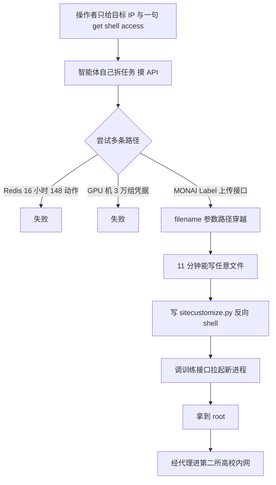
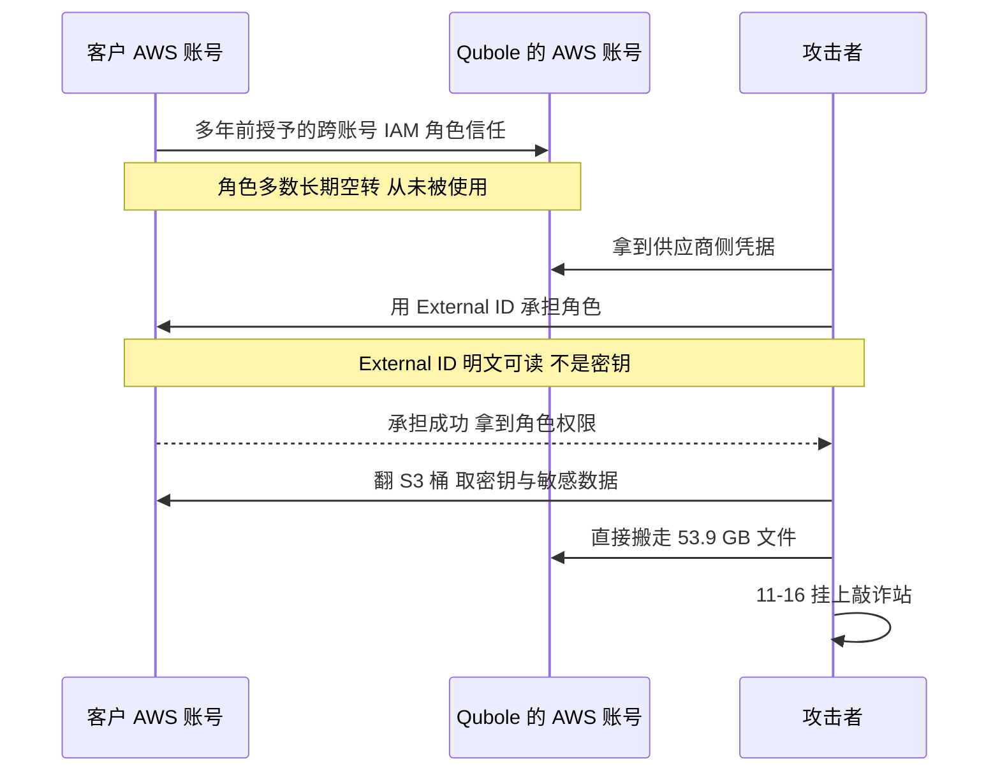
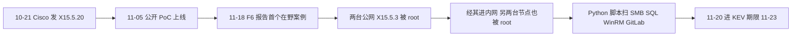
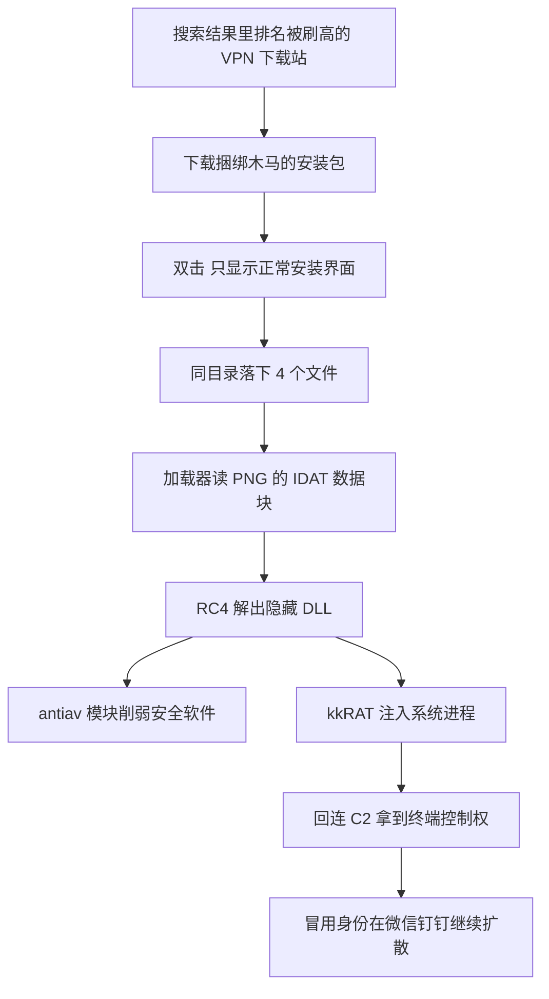
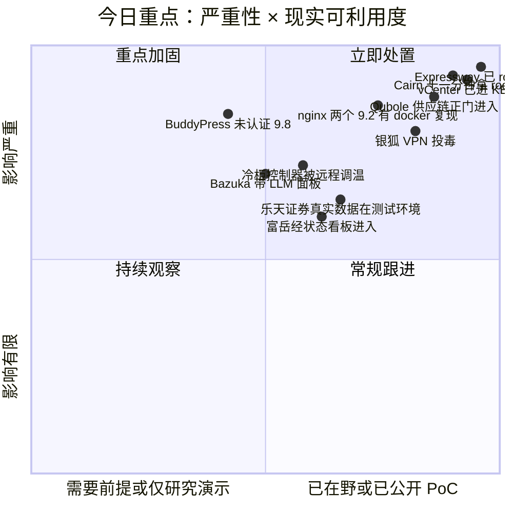
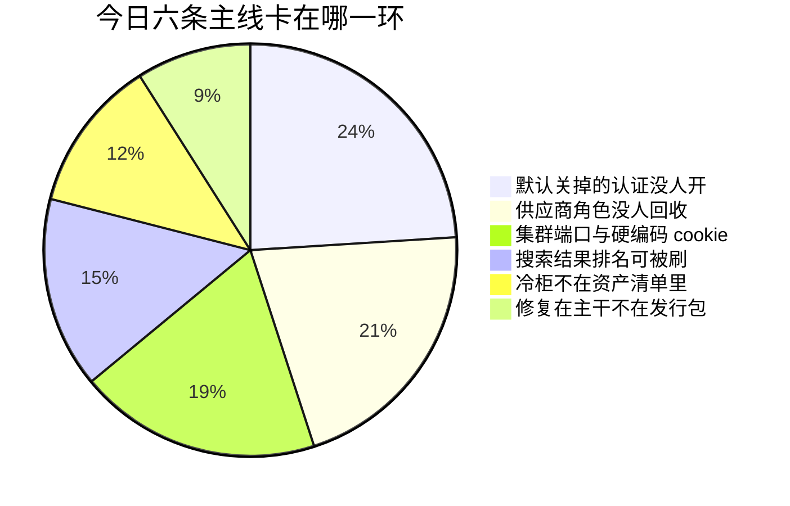
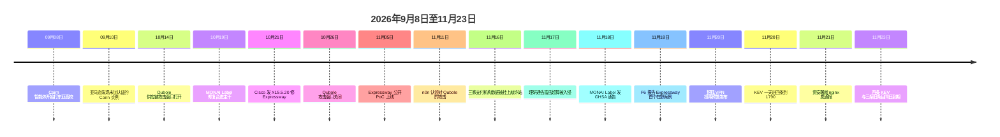

# 网安日报速递 · 2026年11月21日（第 223 期 · 午间更新）

> 今日关键词：一个智能体十一分钟摸到一个零日 · 供应商的钥匙一直挂在门上 · 补丁发了一个月只在等一件事 · 安装包是别人递过来的 · 冰柜温度能被远程调高 · 能复现的门槛已经降到 docker

凌晨那版已经报过六条（vCenter 的 9.8 在野两个半月、PHP 一次交七个 9.2、Ruby 的一个字节、Drupal 的安装脚本、欧盟委员会停摆十天、FastUnlock 锁屏绕过），本期是白天这一段的增量。

NVD 在 11-20 16:30 到 11-21 15:00 这个窗口里收了 532 条新 CVE，按 CVSS 3.1 口径 critical 3 条、high 9 条。数字本身没多大意思，有意思的是这六件事没一件是靠"打穿一道墙"进去的：一台开源智能体自己找到了没人知道的洞，一个供应商的 IAM 角色三年没人收回，一台边缘网关的集群端口对着公网开着、cookie 是编译时写死的，一个安装包是从搜索结果里点来的，一台冷柜控制器从来没被当成安全资产。

**洞正在变便宜，门还是原来那几扇。** 亚马逊那起案子里，智能体从摸 API 到写出 root 权限的反向 shell 用了十一分钟；而同一周被打穿的机构，防护层没坏在任何一处，只是没人去删一条早就该删的信任关系。

---

## 一、一个智能体自己摸到一个零日，十一分钟拿到 root

11 月 20 日到 21 日，亚马逊威胁情报团队的一篇复盘在多个信源上扩散开：一台公网可达、没加认证的开源智能体框架 Cairn 实例被人放在那里跑渗透，运营历史、历史提示词、输出全部可见，调查因此得以还原完整链条。亚马逊公开的日期是九月八日到十日，之后把细节报给了受影响的开源项目方。

链条是这样的。操作者只给两样东西：一批目标 IP，和一句自然语言目标"obtain shell access"。之后智能体自己规划、执行、按结果调整，人不逐步下指令。大部分尝试是失败的：对一台开放 Redis 的服务器跑了十六小时、一百四十八个动作，包括一次 Log4Shell，没成；对一台高校 GPU 服务器用六小时撞了三万多个凭据组合、八十个真实用户名，也没成。唯一成功的是 MONAI Label，一个医学影像标注工具。

智能体摸完 API，找到一个上传接口的 filename 参数可以穿越路径，十一分钟内就能往服务器的任意位置写文件。后续一次会话里，它把 Python 反向 shell 写进 sitecustomize.py，再调训练接口拉起一个新的 Python 进程，拿到了 root。再往后，操作者给它一个代理，进了第二所跑同样软件的高校内网。

漏洞本身在 11 月 18 日有了 GitHub 安全通告 **GHSA-qc22-rmgc-vg94**（Critical，CWE-22，没有分配 CVE），影响 monailabel 包 0.8.5 及以前，点名 `PUT /datastore/image` 与 `PUT /datastore/label` 两个端点。真正的坑在默认值：`MONAI_LABEL_AUTH_ENABLE=False`，认证默认关着，任何能连上服务的人都能写文件；即使开了认证，ANNOTATOR 角色也够用。修复提交是 PR #1915（commit `113527bf6`，把写入路径限制在 datastore 目录），但通告写的是"Patched versions: None"——补丁在主干上，还没有对应版本的发行包。

**值得关注的原因：**

- **十一分钟这个数字，比"AI 会找洞"更要紧。** 它意味着"披露到被利用"的窗口不再是天，而是小时。防守方所有按人速设计的阈值——多少次登录失败算可疑、多长窗口算扫描——在十六小时一百四十八个动作的节奏面前需要重标。
- **能被打穿的原因是默认关闭认证。** 这不是零日才有的问题，MONAI Label 的设计定位是局域网内科研工具，维护方在通告里也是这么说的：它不该直接暴露在公网。国内医疗影像 AI、科研标注平台大量部署这套栈，资产清单里通常没有这一行。
- **修复状态要自己确认。** 通告写"暂无修复版本"，BleepingComputer 写"已发布安全更新"，两种说法冲突。实际是修复合并进主干、尚无带修复的发行包，所以"升级到最新版"这句话今天还不成立，只能先开认证、收掉公网暴露、把服务账号的写权限压到 datastore 目录。
- **sitecustomize.py 这个落点值得记住。** 它不是 web shell，不落在 web 目录，靠 Python 解释器启动时自动加载 user site 生效。查 webshell 的规则看不见它，查 Python 进程启动参数也看不见它，只能靠文件完整性监控盯住解释器环境目录。

---

## 二、供应商的 IAM 角色没人收回，三家支付机构的客户数据被挂上敲诈站

n0n 这个团伙 11 月 11 日认领了对 Qubole 的攻击（一家被 Idera 收购的云数据分析公司），11 月 16 日把标着 Chase、Visa、万事达的数据挂上泄露站。三家公司在 11 月 19 日先后确认：问题出在第三方服务商，自己的支付网络没有被碰。

真正的技术细节在 Wiz 与 Sentra、Mandiant 合作的那份分析里，而且它比新闻稿难看得多。攻击窗口是 10 月 14 日到 26 日，手法是拿 Qubole 的 AWS 账号身份，去承担客户当年为方便它跨账号访问而建的那些 IAM 角色。Wiz 记了两个细节：**大多数被承担的角色平时根本没被用过**——在很多环境里，攻击者的调用是那个十月唯一一次来自该供应商账号的角色承担；**每一次承担请求都带了正确的 External ID，每一次都成功了**。也就是说 External ID 从来不是密钥，它明文出现在日志里、常常还写进 IaC 代码里，把它当验证手段是错的。

数据层面，各家的口径必须分开看。Chase 说自己这边是"营销数据，可能包含部分客户姓名和邮箱"，并说明与本周那次服务中断无关；Visa 说涉事的是亚太地区一家第三方服务商，卡号等支付数据未受影响；万事达说泄露的是某个权益项目一小部分持卡人的邮箱，非支付信息。n0n 自称从 Qubole 直接拿走 53.9 GB、30,743 个文件（客户合同、报价记录、员工与试用用户信息、生产数据），另有接近 1 PB 来自客户网络的数据——这部分未经证实。

SOCRadar 把 n0n 公开的 14 个 Visa 与万事达压缩包全量解了，结论值得抄下来：**里面没有卡号、没有有效期、没有 CVV、没有密码、没有出生日期、没有家庭住址**；有的是手机号、BIN 前缀、以及带日期的机票酒店餐厅订单。这不能直接刷卡，但足够撑起一条高精度钓鱼和账户接管流水线——冒充礼宾台或银行客服时，能说出你上周在哪座城市吃过饭，比说出你的卡号更有说服力。这批文件只是 n0n 声称总量的一小部分（约 4.3 GB、190 万条营销事件），后续大概率还有第二轮。

**值得关注的原因：**

- **这不是被打穿，是从正门走进去的。** 攻击者拿的是供应商的合法凭据，用的是客户自己配置的权限。任何"只拦异常流量"的检测都拦不住一次合法的 AssumeRole。
- **供应商下线了，角色还在。** 这是这类事件最常见的残留：合同结束、集成废弃、账号停用，但客户账号里的信任策略没人删。国内同构的场景是外包驻场账号、第三方运维通道、SaaS 数据同步角色。
- **External ID 的定位要改。** 它是防混淆代理（confused deputy）的设计，不是认证手段。把它当秘密写进流程文档的团队，实际上没有任何验证。
- **支付数据没泄露，不代表损失为零。** 泄露字段里最贵的是"手机号 + 消费轨迹 + 机构关系"这个组合，它服务的正是社工与账户接管。

---

## 三、补丁发了一个月，只等来一条公开利用

Cisco Expressway 的 **CVE-2026-76466**（CVSS 9.8，CWE-798）在 10 月 21 日就修了，公告编号 `cisco-sa-vcs-static-cred-hr7EWZ8t`。11 月 20 日，CISA 把它收进 KEV，整改期限 11 月 23 日。

漏洞在集群用的数据库服务里。两个问题叠加：服务用的是持久化 cookie，而且开了 TLS Verify Mode 之后仍然不校验客户端证书。拿着 cookie、网络能到服务的人，就能调用特定的 RPC 命令，以 root 执行任意系统命令。Cisco 自己把它归类成"使用硬编码凭据"，因为它们编译在 Erlang 模块里，**每套装置都一样**。

公开利用在 11 月 5 日出现在 GitHub（`dinosn/cve-2026-76466`），作者写清了打法：集群管理端接受一个固定的维护节点身份 `wombat@127.0.0.1`，配一个在所有受影响版本上完全相同的 cookie，走 TCP 4372 的 Erlang 分布端口。作者说自己只在 Expressway-C X15.3.2 的两节点集群、TLS Permissive 模式下验证过。

11 月 18 日，俄罗斯事件响应公司 F6 发布报告，称调查了这起漏洞的首个在野利用案例：攻击者先拿下两台对公网开放的 X15.5.3，再经其中一台进入内网的两台同集群节点，四台全部 root。之后用自己写的 Python 脚本扫内网、找 SMB 共享、连 SQL Server 与 WinRM、翻 GitLab 仓库找凭据，脚本在入侵过程中还在改，代码注释带着 AI 编程助手的痕迹。F6 没有把活动归给任何已知组织，也没说有没有数据被拿走。

修复与处置：X15.5.3 及以前的 X15 线升 **X15.5.20**（同版本还带了十月那批八个 Expressway 洞的加固）；X14 及更早没有该分支的修复，只能迁移；Cisco 明确说没有 workaround。判断自己在不在范围内只看一页：System > Clustering 里 peer 地址字段是否非空，非空就是集群、就受影响，单机不在公告范围内。

**值得关注的原因：**

- **从 PoC 到被打穿只隔了十三天。** 而这十三天里，补丁已经发布一个月了。信息不缺，缺的是变更窗口。
- **它不是单机问题，是入口问题。** Expressway 是给外部人员接视频会议、语音、消息的网关，天生公网可达；打进一台等于站在内网里。X14 那批升不上去的设备，处置方式只剩网络层收敛：TCP 4371 与 4372 只允许集群内的对端访问。
- **厂商公告比事实慢。** 截至 11 月 20 日，Cisco 公告仍是 10 月 21 日的 1.0 版，还写着"PSIRT 不知道该漏洞的公开公告或恶意利用"。CISA 的收录比厂商页面新，这类情况下等厂商确认等于等排期。
- **KEV 同日进了四条，全都 11-23 到期。** 除 Expressway，还有 vCenter 的 CVE-2026-123890（凌晨那版说它没进 KEV，今天进了）、Apache Roller 的 CVE-2026-129448（反序列化）、SAP NetWeaver 的 CVE-2025-42884（查询逻辑里的特殊元素未中和）。

---

## 四、银狐把木马塞进 VPN 安装包，走的是搜索排名

11 月 20 日，国家计算机病毒应急处理中心与计算机病毒防治技术国家工程实验室发了一份预警：境内连续发现多个捆绑木马的 VPN 客户端安装包，主要针对 Windows 用户，样本与长期针对我国的"银狐"（又名游蛇、谷堕大盗、UTG-Q-1000、Silver Fox）活动相关。报告给了明确手法——**搜索引擎结果投毒**：把提供"VPN 软件下载"的钓鱼站排名刷上去，等人自己点。

样本的技术结构比投毒手法更值得看。以 `winx64-Letsvpnkaulian.x189.exe` 为例（105.30 MB，MD5 `76fde3d9e22459c5ff81ea824796a6d3`），外壳是 Inno Setup 自解压、内层 Delphi 编译。用户双击之后只看到正常的 letsvpn 安装界面，同目录里同时落下四个文件：真的 VPN 客户端、加载器 `wmtk.exe`、一个 `.NB` 后缀的伪装 PE、一个 `.CIZ` 的 PNG 图片。加载器读 PNG 的 IDAT 数据块，把里面 RC4 加密的 DLL 解出来（`1_stage2.dll`），再展开成两段——`1_stage3-antiav` 负责削弱安全软件，`1_stage3-rat` 是 kkRAT（Gh0st 的变种），回连 `dabaitt3.com`，注入系统进程。用图片格式当载荷容器，是为了让静态扫描看到一堆像素。

**值得关注的原因：**

- **它打的是"下载软件"这个动作本身。** 不需要漏洞、不需要钓鱼邮件里的附件、不需要用户点开奇怪的链接，只要在搜索框里搜"VPN 下载"然后点第一个结果。
- **对抗能力写在官方通报里。** 报告原话是"滥用人工智能技术不断增强传播能力和对抗能力""对抗安全软件的能力较强"。这不是推测，是分析结论。
- **第二波传播靠受害者的社交关系。** 通报点明会冒用身份通过微信、钉钉向亲友同事扩散，甚至投送勒索软件。企业里一个人中招，下一跳是他的工作群。
- **处置成本极低、排查成本极高。** 卸载重装、改密码、查启动项与实际外联即可；但要在几千台终端里判断"哪个 letsvpn 是真的"很难，因为真客户端确实存在，捆绑包里的客户端也能正常用。

---

## 五、英国给几万台冰箱控制器打补丁，因为有人把冷柜调到 50 度

11 月 21 日披露的一起事件，主体不是 IT 系统而是冷柜：英国在一次未公开的行动中，为数千台控制冷柜运行的设备修补了安全漏洞，作为预防措施，控制着数万台冰箱的这些设备被切断互联网访问，部分超市的 IT 人员直接拔了网线做物理隔离。

起因是欧洲的攻击。10 月先波及法国，随后扩散到比利时等国的超市，冷柜被远程调温到 50 摄氏度；受影响的不止零售，还有血液机构和一处美军基地的冰箱。最先识别问题的是制冷行业咨询机构 Omega Solutions，之后英国国家网络安全中心、环境食品和农村事务部、食品标准局相继介入。

问题出在英国使用最广的一批制冷控制器上，厂商是 Resource Data Management，缺陷类型与欧洲被攻击设备类似，属于认证方面的不足。厂商强调入侵需要借助特定硬件，但这类硬件在市面上能自由买到；同时确认在自己的控制器上没有发现恶意活动迹象。

**值得关注的原因：**

- **这是"可用性攻击"的物理版本。** 不偷数据、不加密文件，只是把温度调高。仓库里数百万英镑的食品会在几小时内变质，营业中断与供应链中断同时发生，损失不需要窃取任何数据就能造成。
- **OT 资产清单里没有"冷柜"。** 冷链控制器通常归设施部门管，不归 IT，不在漏洞扫描范围，不打补丁，默认密码没人改。它联网只是为了远程监控温度。
- **隔离是最现实的缓解。** 这次英国的做法是断网加物理拔线，不是等补丁。对国内连锁零售与冷链物流，可迁移的动作是：把制冷控制器从可路由网段挪出去、只允许单向数据上报、把默认凭据改掉。
- **同一天还有一起可对照的。** 日本理研 11 月 17 日通告，攻击者经由公开的运行状态看板进入内部运维网并篡改多台服务器，最高 4,597 名用户的姓名、邮箱、ID 可能泄露，超级计算机已断外网运行。运维状态页也是攻击面。

---

## 六、nginx 那两个洞，能复现的门槛降到了 docker 级

这一条是补充第 221 期的。当时写的是本体：CVE-2026-123007 与 CVE-2026-123633，HTTP/2 流控记账缺陷，影响 1.9.5 到 1.31.8，修在 1.31.9 与 1.30.7，代码可以追到 2015 年 HTTP/2 支持初版。今天的变化在生态侧。

11 月 21 日，台湾数位发展部资安署发新闻稿提醒政府机关与企业尽快升级，按 CVSS 4.0 两个洞都记 9.2，并给了临时缓解：暂时关掉 HTTP/2。这个动作的意义是国家级通报落地——它会把一批原本排在季度维护里的资产拉进本周变更窗口。

社区侧的数据更直接。以 CVE 命名的 GitHub 仓库从 8 个涨到 10 个，头部项目 272 星；新出现的不再只是检测脚本，而是两个中英文的 Docker 复现实验室、一个给各发行版自己打包全套补丁构建的项目（覆盖 Debian 8 到 13、CentOS 7 到 8、RHEL 8 到 10）、以及一个 RCE 复现加版本标定工具。完整武器化还没到（公开的仍是用 pcap 确认"记账错误"的脚本，完整 RCE 链没有公开），但"能不能搭个环境复现"这个问题已经不存在了。

**值得关注的原因：**

- **窗口期按周算，不按季度算。** 从 PoC 出现到 Docker 一键复现，这中间的时间就是防守方真正拥有的时间。
- **发行版包要按版本字符串判断，别按 `nginx -V`。** 发行版会把补丁 backport 进旧版本号，编译参数看不出来是否已修。
- **它和今天的 KEV 条目形成一次对照。** nginx 没有在野确认，EPSS 却到 6.03%（93.5 分位）；Expressway 与 vCenter 都确认在野，EPSS 只有 0.42% 与 0.84%。原因是 EPSS 吃历史特征，11 月 20 日刚进 KEV 的条目它还没来得及学习。**按分数派单的团队，今天会把两个正在挨打的系统排到周四。**

---

## 速览

**7. KEV 一天进四条，1,790 条，11-23 三条同日到期**

CISA 目录更新到 2026.11.20 版，1,790 条（此前 1,786）。11-20 一次进四条，整改期限全是 11-23：Cisco Expressway **CVE-2026-76466**（9.8，硬编码凭据）、VMware vCenter **CVE-2026-123890**（9.8，目录服务认证绕过）、Apache Roller **CVE-2026-129448**（反序列化）、SAP NetWeaver **CVE-2025-42884**（查询逻辑特殊元素未中和）。同时 11-18 那批里 Synology DSM **CVE-2024-10441**、REDCap **CVE-2026-90817**、Apache Axis **CVE-2026-90436** 的期限就是今天，Axis 那条厂商已明说不提供修复版。

**8. 乐天证券测试环境被入侵，最高 1,125 万账户信息受影响**

11 月 11 日侵入，测试环境里用的是真实数据——这个教训重复了很多年还在重复。可能泄露的是最高 1,125 万账户的登录 ID 与分行代码，以及 447 万账户的身份信息与出金银行账户。测试环境通常不在生产监控、脱敏、访问审计的覆盖范围内，但它和生产共用同一套真实客户数据。

**9. 富岳超算断网，4,597 名用户信息可能泄露**

理研 11 月 17 日通告：外部人员经公开的运行状态看板进入内部运维网，篡改多台服务器，最高 4,597 名用户的姓名、邮箱、ID 可能泄露，超算已切断外网运行。监控看板为了"让人看得见"而生，它往往没有认证、没有速率限制、还直接连着内部采集端。

**10. Bazuka 把大模型接进了诈骗后台**

荷兰 ThreatFabric 在追踪另一款 NFC 中继木马时顺出来的 Android 诈骗框架：dropper 加核心加 23 个模块，覆盖浮层、键盘记录、2FA 与短信拦截、远程控制、加密货币地址替换。三个新东西：先截屏再把静态画面盖在真界面上（受害者盯着照片看，后台在跑转账）；控制面板内置 LLM 集成（本地模型或 API 两种接法），运营方可以让模型给受害者打分、判断值不值得继续投入；自带引流下线账号体系，能定制 manifest 权限组合绕 Google Play 审核。样本伪装成"TikTok 高级版"（`com.tiktok.premium`）。

**11. WordPress 插件一条 9.8，一个 GET 请求就是代码执行**

BuddyPress 的 Restrictions 插件（1.5.4 及以前）**CVE-2026-120539**，CVSS 3.1 记 9.8，CWE-95。插件把攻击者可控的请求 URI 拼进双引号字符串里的 PHP 表达式再 `eval()`，因为 PHP 会在双引号里做变量插值，路径里写 `{${...}}` 就能直接执行，不需要闭合引号，WordPress 的转义也拦不住。需要同时启用 BuddyPress 与 Paid Memberships Pro，但相关判断在任何登录校验之前执行、默认开启，所以未认证即可打。

**12. 补丁在主干上，发行包里没有**

MONAI Label 那条的修复状态值得单独记一笔：PR #1915 在 10 月 19 日就合进主干了，11 月 18 日的通告却写着"暂无修复版本"。也就是说从 10-19 到今天，凡是按"有补丁就升级"逻辑处理的团队，升级完仍然暴露。同理适用于今天很多 AI 生态项目：发版节奏慢于修复节奏，通告里的"fixed in next release"要当成"现在没有修复"来读。

---

## 风险分析

## 事件时间线

## 相关出处

- 亚马逊安全博客：Cairn AI 智能体自行发现零日 — https://aws.amazon.com/blogs/security/chinese-nexus-actors-cairn-ai-agents-found-a-zero-day-on-their-own/
- GitHub 安全通告 GHSA-qc22-rmgc-vg94（MONAI Label 路径穿越） — https://github.com/Project-MONAI/MONAILabel/security/advisories/GHSA-qc22-rmgc-vg94
- BleepingComputer：攻击者用 Cairn 找到零日并接管服务器 — https://www.bleepingcomputer.com/news/security/hackers-use-autonomous-ai-tool-cairn-to-find-zero-day-take-over-server/
- The Record：亚马逊称 Cairn 被用于攻击高校 — https://therecord.media/
- 独立复核（含受影响版本与 workaround 细节） — https://protect.computer/news/2026-11-20-cairn-ai-agents-zero-day-monai-label
- BleepingComputer：第三方泄露波及 Chase、Visa、万事达 — https://www.bleepingcomputer.com/news/security/vendor-data-breach-exposes-chase-visa-mastercard-customer-info/
- The Register：SOCRadar 解析 14 个文件，无卡号但有手机号与订单 — https://www.theregister.com/cyber-crime/2026/11/20/visa-mastercard-theft-included-info-useful-for-phishing-but-not-draining-bank-accounts-say-researchers/
- Wiz：Qubole 跨账号访问被滥用（External ID 与角色承担细节） — https://www.wiz.io/blog/
- Cisco 安全公告 cisco-sa-vcs-static-cred-hr7EWZ8t — https://sec.cloudapps.cisco.com/security/center/content/CiscoSecurityAdvisory/cisco-sa-vcs-static-cred-hr7EWZ8t
- F6 事件响应报告（Expressway 首个在野案例） — https://f6.security/media-center/press-releases/cisco-vulnerability-exploitation/
- 公开 PoC 仓库 dinosn/cve-2026-76466 — https://github.com/dinosn/cve-2026-76466
- CISA KEV 目录（2026.11.20 版，1,790 条） — https://www.cisa.gov/known-exploited-vulnerabilities-catalog
- 国家计算机病毒应急处理中心：银狐利用 VPN 安装包传播木马预警 — https://www.cverc.org.cn/head/zhaiyao/news20261120-VPN.htm
- 国家计算机病毒协同分析平台（样本查询） — https://virus.cverc.org.cn
- 中央社：资安署就 nginx 两个 9.2 发通报 — https://www.cna.com.tw/news/ait/202611210071.aspx
- 英国冷柜控制器批量打补丁（NCSC 与 FSA 介入） — https://news.qq.com/rain/a/20261121A035AW00
- ThreatFabric：Bazuka 安卓诈骗框架（LLM 面板） — https://threatfabric.com/blogs
- NVD CVE API 2.0（本期窗口 532 条，CVSS 3.1 critical 3 条、high 9 条，本刊一手统计） — https://services.nvd.nist.gov/rest/json/cves/2.0
- Wordfence：BuddyPress Restrictions 插件 CVE-2026-120539 — https://www.wordfence.com/threat-intel/vulnerabilities/
