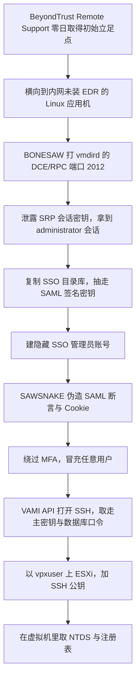
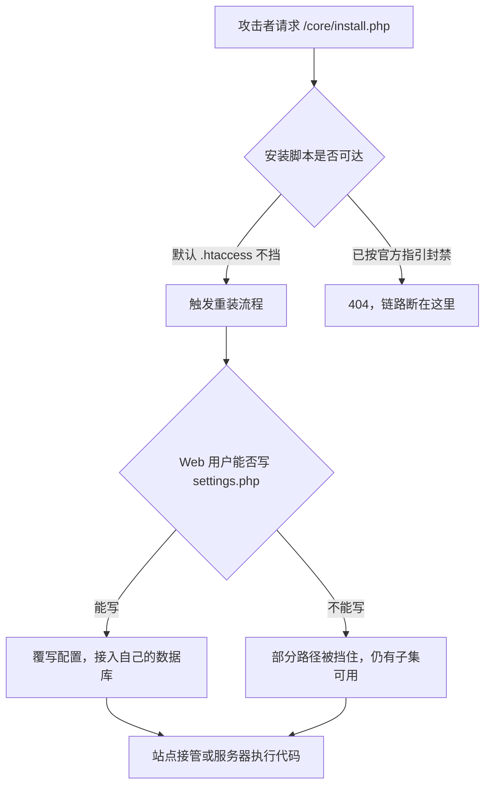
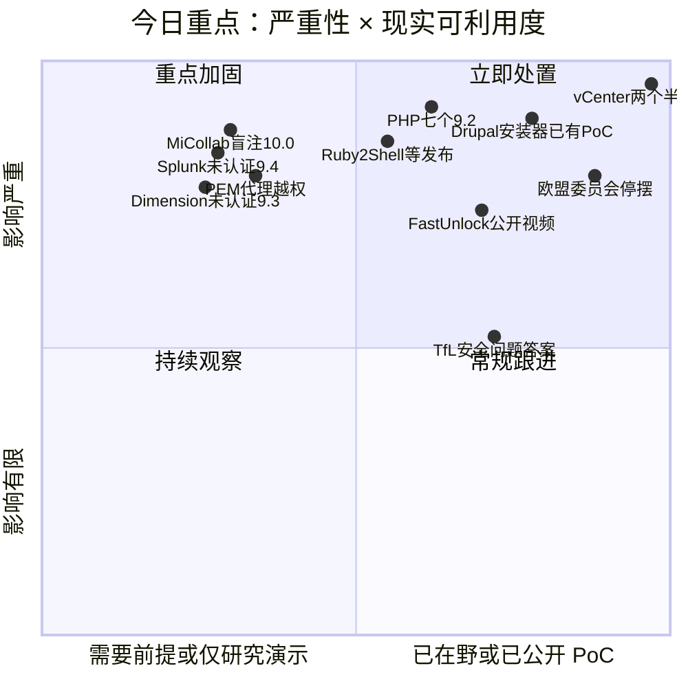
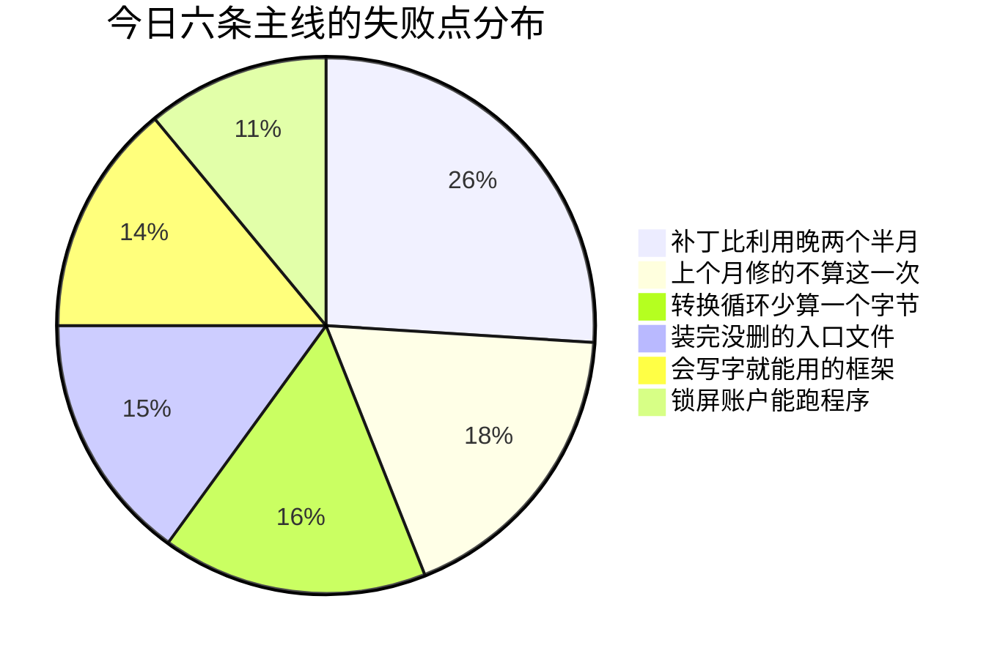
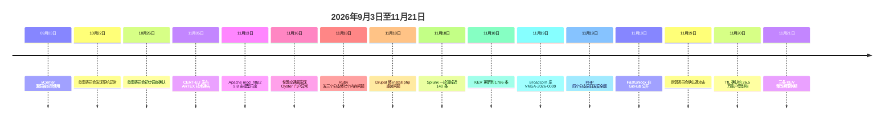

# 网安日报速递 · 2026年11月21日（第 222 期）

> 今日关键词：洞是模型先找到的补丁还得人来打 · 两个半月的窗口里没有一条告警 · 上个月补过的洞这次不算数 · 一个字节写出了缓冲区边界 · 装完就该删的安装文件还挂着 · 系统停了十天没查到入口

NVD 在 11-19 06:00 到 11-21 00:30 这个窗口里收了 1,578 条新 CVE，其中 75 条在 9.0 以上、4 条顶到 10.0。数量比周三翻了一倍，但今天这批东西的共同点不在分数上，而在**它们是怎么被发现的**。

PHP 那个让会话文件写坏的洞，是一家研究机构用专门做安全的模型扫出来的；Drupal 那个安装脚本的洞，报告里直接写着 Anthropic OSS Scanner 的名字和一个 ANT- 开头的内部编号；欧盟委员会那十天停摆，攻击方用的是一套开源智能体框架，给它一句人话它就自己拆任务。三件事指向同一个方向：找洞的速度正在被机器接管。

另一头没变。vCenter 那个 9.8 从九月初被用到十一月十九日，两个半月，中间没有任何人从日志里看出来；Ruby 的 PoC 定在 11-25 发布，留给运维的时间是七天；PHP 十月的紧急补丁被这次证明不覆盖新洞，上个月打过补丁的人今天还得再打一遍。**找到洞的换成了模型，承担时间压力的还是人。**

---

## 一、头条：补丁发出去那天，洞已经被用掉两个半月

**CVE-2026-123890 · VMware vCenter Server · CVSS 3.1 记 9.8 · 未认证认证绕过 · 在野利用自 9 月初 · 未进 KEV**

11 月 19 日，Broadcom 发了 VMSA-2026-0009，修 vCenter Server 目录服务（vmdird）里的一个认证绕过。按 NVD 记录，网络可达的攻击者不需要任何凭据，就能拿到一个管理员会话。同一天，Google 威胁情报组与 Mandiant 说这个洞在**九月初就已经被用了**，比补丁早了两个半月。

技术路径写得很具体：vmdird 的 DCE/RPC 接口在 TCP 2012 上泄露 SRP 会话密钥，外面的人拿到密钥就等于拿到一个 `administrator@vsphere.local` 的已认证会话，不用密码。工具链是成套的：BONESAW 走这个洞复制 SSO 目录库、抽走 SAML 签名密钥、建一个隐藏的 SSO 管理员；SAWSNAKE 拿签名密钥伪造 SAML 断言与 session cookie，也就是常说的 Golden SAML，**伪造出来的令牌在改密码之后依然有效，MFA 也拦不住**；BEARBONES 是一个改过的 Dropbear SSH，挂在 TCP 33992 上；LAZYBONES 用 Slack 当 C2。除此之外还有五个新命名的恶意家族。

进入点不是 vCenter 本身。Mandiant 的描述是从一台 BeyondTrust Remote Support 设备的零日（CVE-2026-102764）进来，横向到一台没有装 EDR 的内网 Linux 应用机，再从那里打 vCenter。**vCenter 从头到尾没有暴露在公网上，它是被别人家管理平面带进来的。**

补丁的版本要写清楚：9.1.x 到 9.1.1.0200，9.0.x 到 9.0.2.0200，8.0 到 8.0 U3m，VCF 5.x 走 KB88287 到 5.2.5，Telco Cloud 走 KB463116。**vCenter 7.0 确认受影响，但没有公开修复版**，只能靠延长支持期过渡。Broadcom 的公告本身没有提在野，把发现的功劳记在 Mandiant 名下；截至 11-18 版的 KEV 目录（1,786 条）里也没有这一条。

还有两个容易踩的坑。第一，Broadcom 的 FAQ 明确说这个洞与七月的 CVE-2026-59309 **不是同一个**，七月的补丁不覆盖它。第二，公告写"无缓解措施"，能做的只有网络侧：把 2012、389/636、443、5480、22 这几个端口收到管理网段，然后按 Mandiant 的清单查——未知的 SSO 管理员、`sps-` 开头的本地账号、日志里 `PUT /rest/appliance/access/ssh` 的调用、ESXi 上 root 的 `authorized_keys`。查到任何一条，要做的不是重启，是轮换 SAML 签名证书并重置 `administrator@vsphere.local` 与 `vpxuser`。

这张表的数字值得单独看：两个半月等于大约 75 天，一个中型企业的日志留存常见配置是 30 到 90 天。**如果入侵发生在上限之外，等你今天去打补丁的时候，能查的证据已经滚出保留期了。**

| 事项 | 具体值 |
|---|---|
| 漏洞位置 | vCenter Server 的 VMware Directory Service（vmdird），DCE/RPC，TCP 2012 |
| 评分 | NVD 按 CVSS 3.1 记 9.8（AV:N/AC:L/PR:N/UI:N/S:U/C:H/I:H/A:H）；Broadcom 同判 critical |
| 修复版本 | 9.1.1.0200 / 9.0.2.0200 / 8.0 U3m / VCF 5.2.5；7.0 无公开修复 |
| 利用起始 | 2026 年 9 月初，公开披露 11-19，间隔约两个半月 |
| KEV 状态 | 截至 2026.11.18 版（1,786 条）未收录 |
| 与旧洞关系 | 与七月 CVE-2026-59309 无关，旧补丁不算数 |
| 自查重点 | 未知 SSO 管理员、`sps-` 前缀账号、VAMI 开 SSH 的 PUT 请求、ESXi root 的授权密钥 |

---

## 二、PHP 一次交七个 9.2，其中一个是用模型扫出来的

**CVE-2026-126714（PHPAfterShell）等 · PHP 8.5.13 / 8.4.28 / 8.3.37 / 8.2.36 · 七个 CVSS 4.0 记 9.2 · 无在野报告**

11 月 18 日 PHP 团队提前一天预告"最高级别为 critical"，19 日 14:00 UTC 后放出四个分支的更新。数字有两套口径：PHP 自己的公告覆盖 17 个 CVE，Aikido 与 BleepingComputer 按 18 个算（多出来的是打包的 uriparser 库漏洞，PHP 侧没有对应公告）。七个 critical 在 CVSS 4.0 下全是 9.2。

最受关注的是 CVE-2026-126714，代号 PHPAfterShell。它落在**默认的文件会话处理器**上，也就是绝大多数 PHP 站点实际在用的那一套：`session.save_handler = files`。会话记录是"键 + 序列化数据 + 长度字段"，但没有"写完了"的标记。如果 worker 在一次写入中途死掉，文件里会留下新记录的开头拼着旧记录的尾巴。研究方 Depthfirst 证明，只要长度凑得巧，残留的字节在下一次会话启动时会被当成另一个对象反序列化。**再往下要代码执行，还需要应用里存在一条 gadget 链，或者像他们演示的那样串第二个 PHP 洞。** 但即使不执行代码，这个原语也能改登录状态、改 CSRF token、读别人的会话。

进门的路径是上传进度：`session.upload_progress` 在这版之前**默认开着**，一个带进度字段的 multipart 请求会在任何应用代码跑之前触发一次会话写入，所以不需要有上传表单，只要有一个之后会开 session 的页面。

另一条同等重要的 CVE-2026-129289 是 PHP-FPM 的请求走私。PHP 在请求结束时**不丢弃没读完的请求体**，当前端复用后端连接——nginx 开 `fastcgi_keep_conn`、Apache 用 `mod_proxy_fcgi` 且 `enablereuse=on`、部分 HAProxy 与 LSAPI 配置——而应用打开了 `php://input` 又没读完，未认证的攻击者就能让**自己的 PHP 代码**在别人的请求上下文里跑。标准配置每条请求关连接的不受影响，这一点必须说清楚，不然容易被标题带成"所有 PHP 都完了"。

剩下五个 9.2 里有四个是 use-after-free：CVE-2026-129496 时区缓存、CVE-2026-129474 魔术方法回溯、CVE-2026-129481 会话关闭被中断、CVE-2026-129182 致命错误后回溯被重新填充。其中 129481 的公告直接写"是对此前一个洞的不完整修复"，这句话对应十月那轮 PHP2Shell。**所以十月的紧急补丁打过了，今天这一个还得打。** 另有 CVE-2026-129291（8.8）是 epoll 的 UAF，被攻陷的 FPM worker 可打 master，而 master 通常以 root 跑；CVE-2026-128090 是 PHAR 的 OpenSSL 签名算法降级绕过。

值得单独记一笔的是发现方式。PHPAfterShell 是 Depthfirst 用**专门面向安全任务的模型**找出来的，另一家媒体在报道里写的是"用前沿模型"。这和 11 月 13 日那个 Apache mod_http2 的 9.8、以及下面 Drupal 那条，构成同一条线：模型在开源项目里扫洞，已经不是演示。

Cloudflare 的记录里，至少有一次针对某个州选举网站的利用尝试打在一个刚披露的 critical PHP 洞上——**不是这七个里的任何一个，但足以说明这类洞公开之后多久会有人来试。** 临时缓解只有两条：`session.upload_progress.enabled=0` 然后重启 worker；以及关掉前端到 FPM 的持久连接。两条都不覆盖全部 18 个洞，官方口径是"尽快升级"。旧分支没有官方包，第三方维护者 Ondrej Surý 的 PPA 回溯到了 5.6，Aikido 也放了带回溯补丁的容器镜像。

---

## 三、Ruby 的一个字节：ß 变成 SS，缓冲区边界差一位

**CVE-2026-132825（Ruby2Shell）· Ruby 3.3.14 / 3.4.13 / 4.0.10 · Ruby 官方判 critical · NVD 记 7.4**

11 月 18 日 Ruby 发了三个分支的修复版，一次修七个内存安全问题，CVE-2026-132825 是其中最重的一个，研究方 Veria Labs 给它起名 Ruby2Shell。

机理短到能一句话讲完。Ruby 的几个单字节编码（ISO-8859 系列、Windows-125x）里没有大写 ß，转大写时它要变成两个字符 SS。转换循环只检查了缓冲区里够不够放**一个**字节，写第一个 S 之后，第二个 S 直接落在边界外面——**一个字节的堆溢出**。输入长度决定溢出落在哪里，所以攻击者对位置有控制权，21 个 ß 就够跨过分配边界。触发路径是 `upcase`、`swapcase`、`downcase(:fold)`、`casecmp?`；UTF-8 走另一条代码路径，不受影响。这段代码从 Ruby 2.4.0 就在里面。

两个口径必须并列写，不然会误判风险等级。Ruby 官方安全公告判 critical，并说"已知有 PoC 在某些场景下能达成远程代码执行"；NVD 现在给的是 **7.4，向量 AV:L**（本地）。Veria Labs 的说法是默认配置的 Rails 与老式 Sinatra **未认证可达**，但他们没有公开请求路径，PoC 定在 **11-25 08:00 UTC** 发布，如果主要厂商届时还没出包就再往后推。**也就是说今天是 11-21，留给运维的时间是四天。**

真正的麻烦在"绑定了自己解释器的产品"上。系统包管理器升级对它们无效：披露时 GitLab 19.6.0、GitHub Enterprise Server 3.22.5、Chatwoot 4.20.0 仍然带着受影响的 Ruby，Mastodon、Discourse、OpenProject 已出修复版。旧分支没有修复——3.2 及更早全部 EOL，而按研究方的说法，2.4.0 起的每一版都有这段代码。

| 项 | 内容 |
|---|---|
| 位置 | 字符串大小写转换，单字节编码路径（ISO-8859、Windows-125x） |
| 原语 | 一个字节的堆溢出，位置由输入长度决定 |
| 触发 | `upcase` / `swapcase` / `downcase(:fold)` / `casecmp?` |
| 修复 | 3.3.14 / 3.4.13 / 4.0.10，11-18 发布 |
| 评级分歧 | Ruby 判 critical 且称未认证可达；NVD 记 7.4（AV:L） |
| PoC | Veria Labs 计划 11-25 08:00 UTC 公开 |
| 易漏点 | GitLab、GHES、Chatwoot 自带解释器，升级系统 Ruby 无效 |

同批另外六条在正则引擎与转换逻辑上：编译恶意正则触发 double free、大小写转换的整数溢出加堆溢出、正则匹配的越界读、`Regexp#to_s` 的堆溢出、大小写不敏感反向引用的越界读。其中几条只有"应用编译攻击者可控的正则"才成立，但 Rails 应用里 `Regexp.new(params[:q])` 这种写法并不罕见。

---

## 四、Drupal 装完就该删的文件还在，模型替人看见了

**CVE-2026-132165 · Drupal core /core/install.php · Drupal 自评 18/25（critical）· PoC 已有 · 无在野报告**

11 月 18 日，Drupal 安全团队发 SA-CORE-2026-017，修 core 里 `install.php` 的一个洞。Drupal 每个发行包里都带这个安装脚本，**默认的 .htaccess 规则不会挡它**，装完之后它是否可达完全取决于站点自己的配置。在特定条件下，未认证的攻击者可以让它重跑安装流程，结果是站点被接管或者服务器上执行任意代码。有几条利用路径在 Web 服务器**不能写、不能改 `settings.php` 权限**时会被挡住，这是最直接的一道闸。

修在 10.6.22、11.3.22、11.4.13。10.5.x 及更早、11.2.x 及更早、Drupal 8 与 9 全部 EOL，没有包可打。同一天还修了 CVE-2026-132166（7.2），一条管理员配合反序列化才能走通的 gadget 链。

发现者这一栏写的是 **Anthropic OSS Scanner**，内部编号 ANT-2026-GMRPK0BU，报告里带了复现与候选补丁。这个扫描器十月才上线，这是它一个月内送出的第二个公开 critical——11 月 13 日那个 Apache mod_http2 的 9.8 也是它报的。Drupal 安全团队自己提到，近期的安全报告里 AI 生成的比例在明显上升。

处置三步别搞反顺序。先升级到对应分支的修复版；再**无论如何都去封 `/core/install.php`**，因为封了之后这个洞以及未来所有安装器相关的洞一起消失（nginx 加 `location ^~ /core/install.php { return 404; }`，Apache 的 `Require all denied` 必须写在 server 或 vhost 配置里，写进 .htaccess 会让整站 500）；最后确认 `sites/default/settings.php` 对 Web 用户不可写。封安装器不影响 `update.php`，多站点要建新站时临时放开或用 drush 装。

---

## 五、欧盟委员会：十天停摆，工具是开源的智能体框架

**无 CVE · 10-22 发现 · Sysper 与 MyPMO 停摆十余天 · CERT-EU 指认 ARTEX · 未归因 · 无数据泄露结论**

11 月 19 日 Politico 报道后，欧盟委员会确认了这起事件：10 月 22 日发现异常，10 月 26 日初步调查确认，随后把多个应用下线。受影响的是 Sysper（人事平台，工资单、工时、休假）与 MyPMO（医疗费用报销），翻译服务在 11 月 17 日也停过；Sysper 在 11 月 18 日恢复后又短暂崩了一次。工资按时发了，但一部分员工有十来天没法填工时、没法请假。

CERT-EU 在 11 月初识别出攻击方使用了 ARTEX——一套开源的人工智能渗透框架。它的工作方式在 CERT-EU 11 月 5 日的技术通告里写得很清楚：操作者用自然语言给一个目标，框架把它拆成子任务，交给多个智能体去调真实的攻击工具。它自己不训练模型，接的是操作者选的外部模型。原作者的仓库在十月因为被滥用而下架，**但独立副本还在流通，下架原仓库不解决问题**。

必须分开写清楚的三件事：委员会自己**没有**点名 ARTEX，是 CERT-EU 识别、Politico 报道；没有公开信息说明攻击者是怎么进来的，ARTEX 究竟用于打进去还是只用于扫弱点，官方没说；**没有证据表明员工数据整体泄露，也没有收到勒索要求**，但调查没有结束，按欧盟 2018/1725 条例，确认个人数据泄露后要在 72 小时内报 EDPS，这个时钟只有在"确认"之后才开始走。

这件事的分量不在规模，在它把 11 月 14 日那期写过的东西落到了一个具体机构头上：ARTEX 那类框架的门槛是"会写字"，不是"会打洞"。委员会的处理序列也值得记：先下线，再调查，服务分批恢复，而"到底有没有丢数据"这个问题到 11 月 20 日仍然没有答案。**系统恢复运行只证明它能用，不证明数据没被复制。**

---

## 六、锁屏不是墙：Narrator 把 Windows 11 的门打开了一条缝

**FastUnlock · 无 CVE · 无补丁 · 物理接触 + 微软账户 · ThreatLocker 当日复现**

11 月 19 日，研究者 Chaotic Eclipse（多个别名，媒体指认为 Abdelhamid Naceri）在 GitHub 放出 FastUnlock，一段没有和微软协调过的公开披露。场景很窄但很实在：**一台开着、锁着、BitLocker 全盘加密的 Windows 11**，攻击者只要坐在键盘前。

路径是这样的：锁屏的"我忘记 PIN"入口按 Win+U 起 Narrator，Narrator 的新界面被放在锁屏账户上下文里跑，焦点落在一个本不该可见的窗口上。用 Caps Lock、方向键、回车走进 Narrator 设置，再到"蓝牙和其他设备"，再打开"自动播放"，插一个 U 盘，资源管理器就开了，从 U 盘启动的程序以 **WsiAccount** 身份运行——也就是锁屏用来托管界面的那个低权限账户。研究者说在装了 11 月补丁的 Windows 11 26H2 上，五分钟能走完。ThreatLocker 当天复现，确认代码执行限制在 WsiAccount，不是管理员。

三个必须纠正的说法。第一，**它不是"破解 BitLocker"**：加密没被破，密钥没被取出，只是 TPM 单独托管的那套配置下，开机时盘已经解好了，锁屏是唯一那道门，而这个洞开的正是这道门。第二，需要**至少一个账户绑定在线微软账户**，因为入口是找回流程。第三，研究者自己说没跑完最后一步——手上没有 U 盘，视频演示到进入设置为止。

没有补丁之前能做的就三件：BitLocker 加**开机前 PIN**（这条最有效，盘在开机阶段不解，锁屏都没到就先卡住）；用 AppLocker 或文件 ACL 直接不让 Narrator 跑（对真的需要读屏的人是死路）；关自动播放，把 U 盘那条腿砍掉。管理层面还有一条更朴素的：**离开座位就关机，不要只锁屏。** 12 月的补丁日是 8 号，公开写法和视频都已经在传，提前发一个带外补丁不算意外。

---

## 速览

**7. Mitel MiCollab 一条 10.0，盲注命令拼接**

CVE-2026-133323，10.0（CVSS 3.1，AV:N/AC:L/PR:N/UI:N/**S:C**），影响 MiCollab 到 10.3（10.3.0.18）的 AWV（音频、Web 与视频会议）组件，厂商编号 MTLVULN-1864：参数过滤不足导致未认证的盲注命令执行。S:C 意味着影响会越出组件本身，落到宿主系统。MiCollab 这两年被反复打过，边界设备一旦被拿下，攻击者拿到的是能进内网的会议与语音网关。

**8. Splunk 一轮清掉近 140 条，SOAR 里有两条 9.9 与 9.6**

Splunk Enterprise、Enterprise Security 与 SOAR 一并更新，合计近 140 条。SOAR 8.8.0 修 59 条，其中 CVE-2026-131253（9.9）与 CVE-2026-131287（9.6）都需要一个持有 Apps 或 Playbooks 编辑权限的已认证用户。更值钱的是 CVE-2026-76536（9.4，**未认证**）：在 10.4.5 / 10.2.9 / 10.0.12 / 9.4.17 之前的版本上，集群共享密钥为空时，单机实例的集群配置 REST 接口可以被未认证用户读写。SIEM 是日志的唯一副本，它在攻击链里通常是被删的那一环。

**9. WatchGuard Dimension 三条 9.3，日志采集服务不需要认证**

CVE-2026-86130（9.3，CVSS 4.0）：日志采集服务缺失认证，远程未认证即可执行任意 SQL，最终以 Dimension WebUI 进程用户的身份执行代码。另两条 84322 与 86094（均 9.3）是在管理 API 响应和诊断日志里返回未打码的会话标识，低权限用户可借别人的会话。日志与报表平台常被当成"只读的旁路系统"，它手里握着全网的会话标识。

**10. Postgres Enterprise Manager 三条 9.4，监控代理自带读写文件的权限**

CVE-2026-132658 / 132659 / 132660 均 9.4（CVSS 4.0，PR:H / S:C）。132658 的核心是角色设计：每个 PEM agent 登录都继承的 `pem_agent` 角色，同时是 PEM 后端库上 `pg_read_server_files` 与 `pg_write_server_files` 的成员。**控制任何一台被监控的主机，就拿到了那台主机的 agent 证书，于是能在 PEM 服务器上读写文件。** 监控系统天生要"看得见所有机器"，这个设计把"看得见"变成了"写得进"。

**11. 伦敦交通局 26.5 万张 Oyster 照片卡，泄露的是安全问题答案**

TfL 11 月 16 日发现异常，18 日通知用户，20 日把数字定在约 26.5 万个网络账户（此前口径 25 万，可能还会涨）。泄露字段是全名、邮箱、电话、住址、出生日期，以及**账户的安全问题与答案**；密码、银行卡与支付信息、行程记录、照片均未泄露，持 Zip 卡的儿童姓名与生日也未泄露。门户仍下线，已通报 ICO。这份数据里最贵的不是生日，是安全问题答案——人们几乎不会改它，而"第一所学校""母亲娘家姓"这几个问题在银行、运营商、政务系统里反复出现。另一处细节值得记：用户是靠**收到 TfL 自己系统发出的异常邮件**才发现出事的，也就是说攻击者能驱动官方事务邮件，这类信会顺利通过 SPF、DKIM 与 DMARC。

**12. KEV 停在 1,786 条，连续两天没有新增**

CISA 的目录仍是 2026.11.18 版，1,786 条，11-19 与 11-20 都没有新增。但这不代表风平浪静：11-18 那批四条里有三条的整改期限是 11-21，也就是今天，其中包括那个**厂商明确不出修复版**的 Apache Axis 9.8。KEV 是"确认被利用"的名单，不是"有危险"的名单，vCenter 那条两个半月在野的洞至今不在里面。

---

## 数据与口径

| 指标 | 数值 | 说明 |
|---|---|---|
| NVD 本期窗口 | 1,578 条 | 11-19 06:00 至 11-21 00:30，本刊按 API 2.0 自统计 |
| 其中 9.0 以上 | 75 条 | 同窗口，按最高可用评分计 |
| 10.0 记录 | 4 条 | Mitel MiCollab、Flyto2 Core、D-Link DIR-600L、Tegsoft（后三条为第三方 CNA 记录） |
| KEV 总量 | 1,786 条 | 2026.11.18 版，11-19 与 11-20 零新增 |
| PHP 修复量 | 17 或 18 条 | PHP 公告 17 条；含打包 uriparser 库漏洞时 18 条 |
| PHP critical | 7 条 | 均按 CVSS 4.0 记 9.2 |
| Ruby2Shell 评分 | 7.4（NVD）/ critical（Ruby 官方） | 两套口径并列，不可横比 |
| vCenter 在野时长 | 约两个半月 | 9 月初至 11-19 披露 |

---

## 相关出处

| 来源 | 链接 |
|---|---|
| Broadcom：VMSA-2026-0009（vCenter、SDDC Manager、VMware Tools 修复版本与 Q&A） | https://support.broadcom.com/web/ecx/support-content-notification/-/external/content/SecurityAdvisories/0/36792 |
| Mandiant / GTIG：vCenter 零日被用于入侵的完整链路（BONESAW、SAWSNAKE、BEARBONES） | https://cloud.google.com/blog/topics/threat-intelligence/armory-castle-exploits-vsphere |
| BleepingComputer：VMware 修 vCenter 零日，已被利用自 9 月 | https://www.bleepingcomputer.com/news/security/vmware-patches-vcenter-zero-day-exploited-in-attacks-since-september/ |
| SecurityWeek：vCenter 认证绕过与 BeyondTrust 初始入口 | https://www.securityweek.com/vmware-patches-vcenter-authentication-bypass-exploited-as-zero-day/ |
| NVD：CVE-2026-123890（9.8，版本区间与修复版本原文） | https://nvd.nist.gov/vuln/detail/CVE-2026-123890 |
| Inception Security：从 MSP 视角看 vCenter 影响面与补丁版本对照 | https://www.inceptionsecurity.com/post/vcenter-armory-castle-zero-day |
| PHP 官方：11 月 19 日多分支安全发布 | https://www.php.net/archive/2026.php |
| Aikido：PHP 18 条 CVE 与七个 9.2 的清单 | https://www.aikido.dev/blog/php-november-2026-security-release |
| SECNEWS：PHPAfterShell 写入中断机理与十月补丁不覆盖 | https://secnews.co.uk/2026/11/php-security-release-phpaftershell-cve-2026-126714-php-fpm |
| Breach-Signal：PHPAfterShell 由 Depthfirst 用面向安全的模型发现 | https://breach-signal.com/vulnerabilities/php-patches-18-vulnerabilities-november-updates |
| NVD：CVE-2026-126714（4.0 记 9.2，会话文件部分覆写原文） | https://nvd.nist.gov/vuln/detail/CVE-2026-126714 |
| NVD：CVE-2026-129289（PHP-FPM 请求走私，复用连接前提） | https://nvd.nist.gov/vuln/detail/CVE-2026-129289 |
| Ruby 官方：正则与字符串相关的多个漏洞（2026-11-18） | https://www.ruby-lang.org/en/news/2026/11/18/multiple-vulnerabilities-in-regexp-and-string/ |
| GitHub Advisory：GHSA-34m4-m9fh-gqp5（Ruby2Shell） | https://github.com/ruby/ruby/security/advisories/GHSA-34m4-m9fh-gqp5 |
| Ethiack：Ruby2Shell 的 21 个 ß 与 Rails 默认暴露判断 | https://ethiack.com/info-hub/research/cve-2026-132825-ruby2shell-rce-via-heap-overflow-in-ruby-string-case-conversion |
| Orca Security：Ruby2Shell 与自带解释器的产品清单 | https://orca.security/resources/blog/ruby2shell-ruby-heap-overflow-rce |
| Sonatype：Ruby 同批七个漏洞逐条对照 | https://www.sonatype.com/blog/november2shell-continues-with-7-patches-ruby-vulnerabilities |
| NVD：CVE-2026-132825（7.4，AV:L，与官方 critical 口径不同） | https://nvd.nist.gov/vuln/detail/CVE-2026-132825 |
| Drupal 官方：SA-CORE-2026-017（18/25，安装器重装导致接管） | https://www.drupal.org/sa-core-2026-017 |
| Drupal 官方文档：如何封禁 install.php（Apache 与 nginx 两种写法） | https://www.drupal.org/docs/administering-a-drupal-site/security-in-drupal/securing-the-installer-installphp |
| Pivot News：报告方为 Anthropic OSS Scanner，内部编号 ANT-2026-GMRPK0BU | https://pivotnews.ai/security/drupal-credits-anthropic-s-oss-scanner-for-critical |
| CIRT Guyana：Drupal 影响版本表与处置建议 | https://cirt.gy/article/al2026_60-critical-drupal-installer-vulnerability-could-allow-remote-code-execution-november-20th-2026 |
| Security Affairs：欧盟委员会十天停摆与 ARTEX 的角色边界 | https://securityaffairs.com/203483/hacking/european-commission-cyberattack-artex-ai-tool-suspected-in-prolonged-disruption.html |
| Cybersecurity News：Sysper / MyPMO / 翻译服务的恢复顺序 | https://cybersecuritynews.com/european-commission-cyberattack/ |
| Digital Watch：CERT-EU 11-05 通告与 ARTEX 的智能体工作方式 | https://dig.watch/updates/european-commission-cyberattack-personal-data |
| Daily Security Review：FastUnlock 机理与"不破加密只破锁屏"的边界 | https://dailysecurityreview.com/resources/unpatched-windows-fastunlock-zero-day-abuses-narrator-at-lock-screen |
| NetSecOps：FastUnlock 的检测线索（Narrator.exe 与 WsiAccount 进程链） | https://cyber.netsecops.io/stix-viz/windows-fastunlock-zero-day-vulnerability-allows-lock-screen-bypass |
| Hardware Busters：五个前提与研究者未跑完最后一步的说明 | https://hwbusters.com/news/fastunlock-zero-day-turns-windows-11s-narrator-into-a-way-past-the-lock-screen-on-bitlocker-pcs |
| ngCERT：FalconFlank 缘起与 CrowdStrike 的临时缓解（背景，非本期新增） | https://csirt.ncc.gov.ng/index.php/resources/security-advisories/444-ngcert-security-advisory-on-alleged-crowdstrike-falcon-sensor-local-privilege-escalation-vulnerability |
| NVD：CVE-2026-133323（Mitel MiCollab 10.0，MTLVULN-1864） | https://nvd.nist.gov/vuln/detail/CVE-2026-133323 |
| NVD：CVE-2026-76536（Splunk Enterprise 未认证集群配置接口 9.4） | https://nvd.nist.gov/vuln/detail/CVE-2026-76536 |
| NVD：CVE-2026-86130（WatchGuard Dimension 日志采集缺认证 9.3） | https://nvd.nist.gov/vuln/detail/CVE-2026-86130 |
| NVD：CVE-2026-132658（PEM 代理角色的文件读写权限 9.4） | https://nvd.nist.gov/vuln/detail/CVE-2026-132658 |
| CyPro：Oyster 照片卡事件时间线与泄露字段清单 | https://cypro.co.uk/insights/cyber-bulletins/oyster-photocard-breach-affects-265000-users |
| IT Pro：TfL 第二次重大泄露与安全问题的长期价值 | https://www.itpro.com/uk/cyber-resilience/data-breaches/oyster-photocard-breach-tfl-takes-system-offline-after-260-000-customers-affected-by-attack |
| CISA：已知被利用漏洞目录（2026.11.18 版，1,786 条） | https://www.cisa.gov/known-exploited-vulnerabilities-catalog |
| NVD API 2.0（本期窗口 1,578 条、9.0 以上 75 条，本刊一手统计） | https://services.nvd.nist.gov/rest/json/cves/2.0 |

---

**免责声明：** 本报告基于公开信息整理，CVE 编号、CVSS 评分、受影响与修复版本以 NVD / 厂商公告 / CISA KEV 原始记录为准。同一事实在不同来源出现分歧时，正文已标注口径或直接指出差异：PHP 的 17 与 18 两套数字分别来自 PHP 官方公告与 Aikido 统计，差额是打包的 uriparser 库漏洞；Ruby2Shell 的 critical 是 Ruby 官方评级，7.4 是 NVD 按 CVSS 3.1 给出的分数且向量为 AV:L，"未认证可达"来自 Veria Labs 自述，公开 PoC 尚未发布；Drupal 的 18/25 是 Drupal 自己的风险评估分，不是 CVSS；vCenter 的在野起始时间来自 Mandiant 与 Google 威胁情报组，Broadcom 公告本身未提在野，该洞截至 2026.11.18 版 KEV 未收录；欧盟委员会事件中 ARTEX 的识别方是 CERT-EU，委员会未点名工具，入侵入口与数据是否被取走均无公开结论；FastUnlock 为未协调披露，无 CVE、无厂商公告，ThreatLocker 的复现结论是代码执行被限制在 WsiAccount，研究者自述未完成从 U 盘启动载荷的最后一步；TfL 的 26.5 万为此前 25 万口径上调后的临时数字，调查未结束。厂商对相关组织背景的表述属其自身判断，本刊只记录技术事实与已公开的时间线，不作国家或组织归因。文中涉及的 PoC、进程链与 IOC 仅用于自查与识别，不要用于未授权环境。
