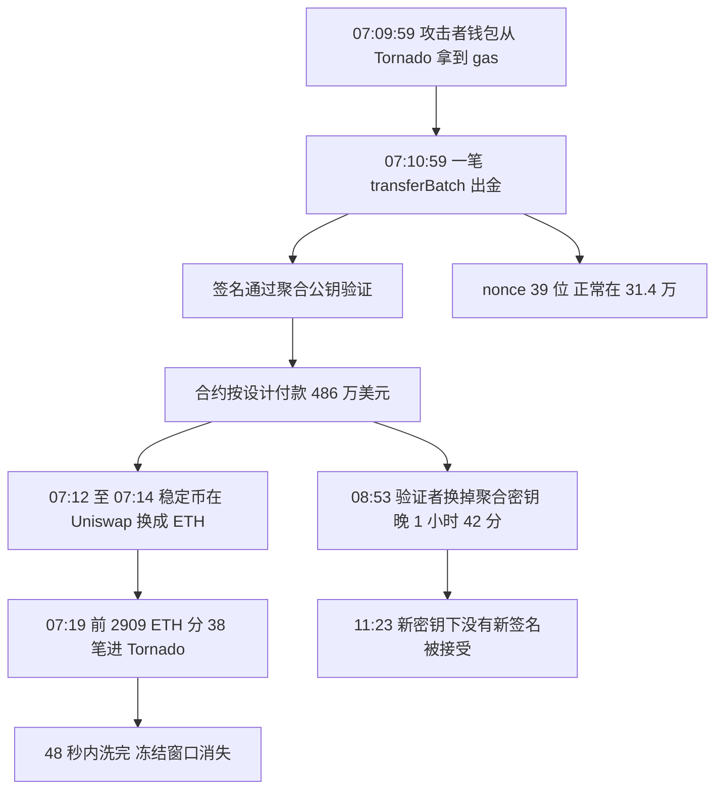
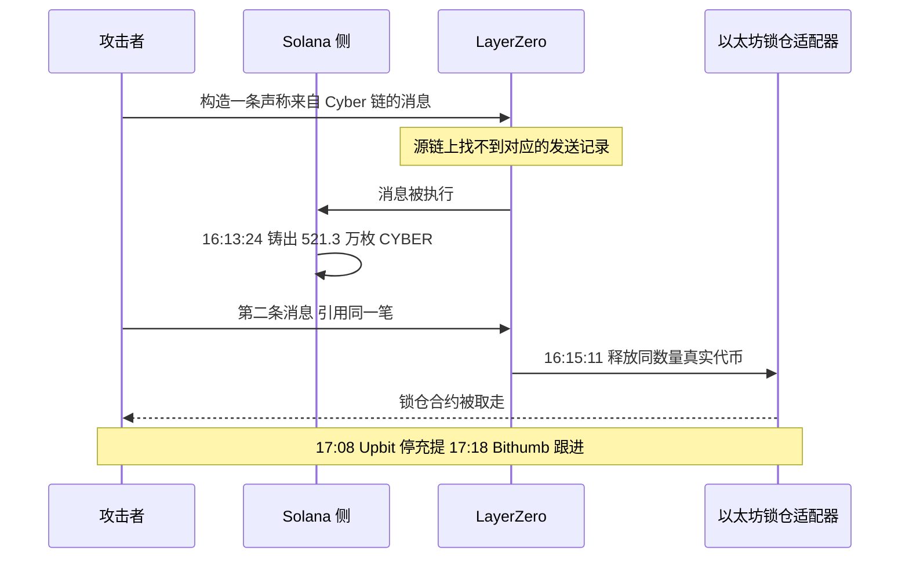
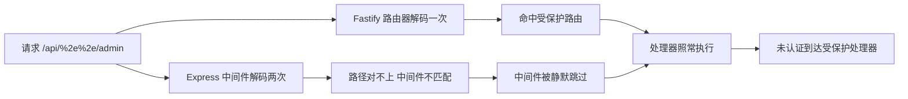
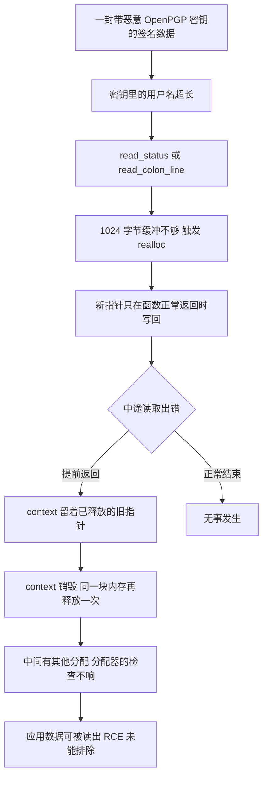
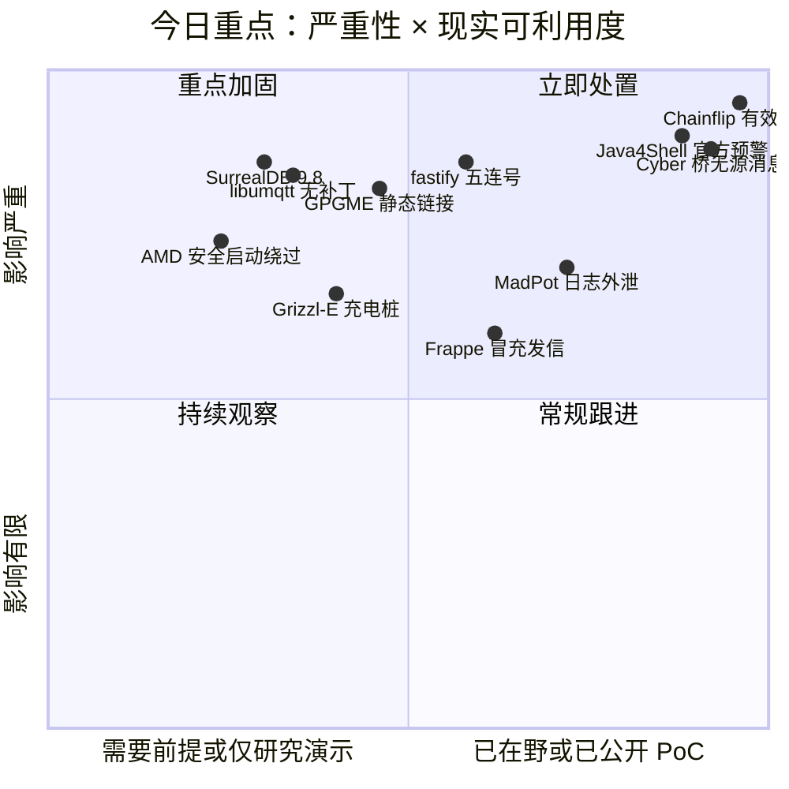
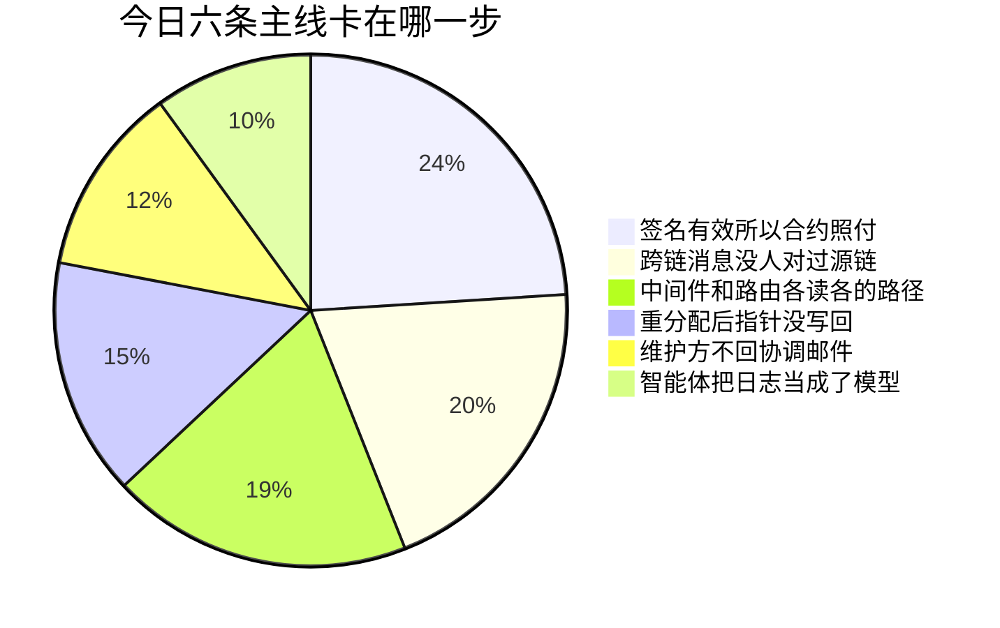
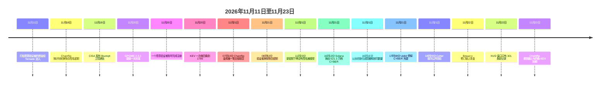

# 网安日报速递 · 2026年11月22日（第 224 期）

> 今日关键词：签名是对的所以金库照付了钱 · 两分钟里两条链各走了一步 · 中间件被跳过而路由照常派发 · 一个超长用户名触发了两次释放 · 工控库那边没人接这通电话 · 智能体把战果直接发给了蜜罐

NVD 在 11-21 15:00 到 11-22 19:30 这个窗口里只收了 301 条新 CVE，按 CVSS 3.1 口径 9.0 以上 9 条，10.0 一条。这是周日，量少是正常的，别拿它跟工作日比。

但今天这六件事没有一件是"把墙打穿"进去的。Chainflip 的金库收到了一张真的签名，合约按设计付了钱；Cyber 的桥收到了一条声称来自对岸的消息，两分钟后两边都动了；Fastify 的路由照常把请求送到了处理器，只是中间件被静默跳过；GPGME 在缓冲区重新分配后忘了把新指针写回；libumqtt 那边连补丁都不存在，因为没人回信。

**校验都通过了。这就是问题所在。** 我们习惯把"认证失败""签名错误""中间件拦住了"当成安全信号，而今天这六条的共同点是：每一道检查都返回了它应该返回的答案，钱还是没了、门还是开了。

---

## 一、Chainflip：签名是真的，所以金库没得选

11 月 21 日 07:10:59 UTC，一笔 `transferBatch` 从 Chainflip 的以太坊金库转出 520.2243399 ETH、3,249,631.41 USDC 与 758,141.33 USDT，按当时价格约 486 万美元。这笔交易带的是有效的聚合 Schnorr 签名，金库合约 `Vault.transferBatch` 验证通过，照设计付了钱。

Chainflip 用的是 FROST 门限签名：最多 150 个验证者共管一把密钥，至少 100 个签名才能拼出一次合法出金。合约能验的只有"这把钥匙签的"，而它验过了。

唯一的异常留在了 nonce 上。Bitquery 拉了 2023 年以来金库接受过的 299,677 个签名，正常的出金 nonce 是顺序递增的，攻击前一个大约在 314,000。这一笔的 nonce 是 39 位。**这里要说清楚：这个 nonce 是合约用于防重放的交易序号，不是 Schnorr 签名内部那个每签一次就用掉的一次性随机数。** 异常值说明这笔出金不在正常签名流水里，但它不能证明 FROST 本身被攻破。

洗钱是脚本化的。07:09:59，攻击者钱包先从 Tornado Cash 收到 gas；07:12 到 07:14，稳定币在 Uniswap 换成以太；到 07:19，约 2,909 ETH 已经分成 38 笔进了 Tornado——其中 29 笔每笔 100 ETH、9 笔每笔 1 ETH，全部在约 48 秒内完成。稳定币占被窃价值的约 82%，先换掉它们是因为 Circle 和 Tether 能冻结，而没人能冻结以太。

08:53:35 UTC，验证者换到了新的聚合密钥，比原定计划提前约 13 小时，也就是出事之后 1 小时 42 分。这个间隔被不少报道当成疑点，Bitquery 自己提醒过：时间差本身不能推出结论，此前也有过非计划的轮换。

事后 Chainflip 把协议切进 Full Safe Mode，存款、提现、兑换、报价全部停摆。全口径损失 Chainflip 自己报的是 122.86137042 BTC、520.2243399 ETH、324.96 万 USDC、75.81 万 USDT，按当时价格约 1,200 万美元。FLIP 跌了 34% 到 39%，市值从约 4,160 万美元掉到 2,480 万。团队向攻击者发了一封公开信，开价 10%（约 120 万美元）换回 90%，期限 11 月 23 日 18:38 UTC，并称掌握那个验证者与其所用服务器的身份信息。

**值得关注的原因：**

- **合约没错，所以没有补丁。** 这次不是重入、不是价格操纵、不是舍入误差。合约做了它能做的全部检查，然后付了钱。传统 DeFi 审计的检查清单在这类事件面前是空的。
- **信任根是钥匙，不是代码。** 100/150 的门限听起来很稳，但 Chainflip 把原因指向 11 月 20 日注册的一个恶意验证者账号，其资金在 11 月 11 日经 Tornado Cash 进入。也就是说，问题可能出在"谁能成为一个验证者"和"密钥生成与签名基础设施"这两步，而不是数学。
- **冻结的时间窗只有分钟级。** 从出金到洗完不到九分钟。任何依赖"发行方冻结"或"交易所拦截"的事后响应，在这条时间线上都来不及。这已经是十一月第三起密钥/凭据驱动的失窃。
- **三个月内第三次。** 八月有一次未成功的利用，九月十二日 Tron 侧因交易备注处理缺陷被重复出金 736,442 USDT，十一月二十一日这次是全口径 1,200 万美元。同一个协议，三种完全不同的失效方式。

---

## 二、Cyber 桥：两分钟，两条链，一条没人签过的消息

同一天下午，跨链桥 Cyber（原 CyberConnect）出了另一件事。16:13:24 UTC，Solana 上一笔交易铸出 5,213,000 枚 CYBER 到单一钱包；16:15:11 UTC，以太坊区块 26,464,606 里，桥的适配器合约把同样数量的 CYBER 放给了另一个地址。两条都是 LayerZero 消息。

两分钟后，20:51 UTC 时适配器里只剩约 6,700 枚 CYBER。攻击者通过 KyberSwap 与 MetaMask Swaps 分多笔卖出，多数是每笔 15 万枚，换到约 575.29 ETH（约 96.8 万美元），转进一个新地址后再没动过。

交易所比项目方快。17:08 UTC，Upbit 停掉 CYBER 的以太坊充提，十二分钟后发波动警示；17:18，Bithumb 跟进，两家援引的都是韩国《虚拟资产用户保护法》施行令第 17 条第 2 项 b。18:25 UTC，Cyber 才在 X 上发第一句"正在排查哪些资产与桥路由受影响"。CYBER 一度跌 8% 到 13%。

**值得关注的原因：**

- **桥的两侧各信各的。** 一条跨链消息的全部安全性，取决于"这条消息真的来自对岸吗"。这次公开报道的说法是伪造消息绕过了校验，但 Cyber 至今没有说明铸造是怎么被授权的，也没给最终损失数字。技术结论还悬着。
- **铸币和释放是两次独立的机会。** 就算第一步只是"多铸了一批没人背书的代币"，只要第二步能让锁仓合约认账，虚拟增发就变成了真实资产流出。任何"先铸后放"的桥都得回答：第二步凭什么相信第一步。
- **交易所成了事实上的断路器。** 冻结发生在项目方发声明之前，而且只停充提不停交易。这意味着同一时刻不同交易所的 CYBER 价格会分叉——套利的人搬不动货。这是应急处置的常态，不是漏洞，但持有者要清楚自己在哪个价格上。
- **同一天两条桥出事。** Chainflip 是"签名是真的但没人授权"，Cyber 是"消息没有源记录"。一个攻击了授权的前提，一个攻击了消息的来源，两条路径都绕过了"代码是对的所以安全"这个假设。

---

## 三、@fastify/express：一个理解分歧，五个 9.1

11 月 21 日，OpenJS 基金会一次性公开了五个 CVE，全部 9.1，全部同一个根因：Fastify 的路由和 Express 的中间件对"这个请求是哪个路径"读出了不同答案。

| CVE | 组件 | 受影响版本 | 触发方式 |
|---|---|---|---|
| CVE-2026-133120 | @fastify/express | < 4.0.10 | 百分号编码被解码两次，传给 Express 的 URL 与路由派发的不一致 |
| CVE-2026-129504 | @fastify/express | 4.0.0 – 4.0.9 | 插件前缀以斜杠结尾，或挂载路径缺前导斜杠，字符串拼接后对不上 |
| CVE-2026-133867 | @fastify/express | 4.0.7 – 4.0.9 | 正则式挂载路径没有按参数化前缀重写 |
| CVE-2026-124626 | @fastify/express | 4.0.5 – 4.0.9 | 动态段的匹配器要求非空值，路由却把空段当命中 |
| CVE-2026-133250 | @fastify/middie | ≤ 9.3.7 | 空参数、不以斜杠开头的请求目标、挂载路径里的字面百分号 |

五个都修在同一天：@fastify/express 4.0.10、@fastify/middie 9.3.8。CVSS 向量完全一致：`AV:N/AC:L/PR:N/UI:N/S:U/C:H/I:H/A:N`，CWE 归在 436（解释冲突）、288（替代路径绕过认证）、174（重复解码）。

**值得关注的原因：**

- **不需要构造请求，也不需要改配置。** 公告写得很直白：任何网络上的攻击者都能用，没有特殊配置前提。这对一个"兼容层"来说是最坏的形状——它本来就是为了让老 Express 中间件在 Fastify 里继续工作，而中间件最常见的用途恰好是鉴权、限流、审计。
- **中间件失败的模式是"静默"。** 它不报错、不 500、不留日志，只是不执行。Fastify 那边照常派发，处理器该跑还是跑。你在访问日志里看到的是一条 200，不是一条 401。
- **五个号，一次教训。** 同一天为同一类缺陷开五个 CVE，说明维护方在拆分披露，也说明这类"两个组件各自解析同一条路径"的问题有多个变体。升级只打一个版本号，但排查思路要覆盖全部五种形态：编码、前缀拼接、正则、空段、异常请求目标。
- **排查看代码，不看版本。** 判断是否受影响，看两件事：有没有在带前缀的插件里用 `app.use('/path', mw)` 这种路径限定中间件来做鉴权；有没有直接用 middie。两条都中的，4.0.10 / 9.3.8 之前一律按已暴露处理。

---

## 四、GPGME：一个超长用户名，两次释放

11 月 20 日晚，GnuPG 发布 GPGME 2.3.1，修一个内部编号 T8557、CVE 编号 CVE-2026-129975 的 double free。同一批放出 Gpg4win 5.1.2，老分支给了 1.24.4。

问题在 `src/engine-gpg.c` 的两个函数：`read_status()` 与 `read_colon_line()`，负责解析 gpg 进程返回的状态行与冒号分隔的密钥列表。两个函数都从 1024 字节的缓冲区起步，行太长就 `realloc` 换更大的块。问题出在换完之后：新地址只在函数正常走到结尾时才写回 engine context，中途因为读错误提前返回，context 里留的还是那个已经被释放的旧指针。等到 context 销毁，同一块内存被释放第二次。

GnuPG 自己的措辞是：这个洞可以被用来从应用里把数据带走，例如通过发送签名数据；远程代码执行"不能排除"。公告没说 RCE 已被验证，也没说观察到在野利用。

时间线值得单独看一眼。漏洞由 Johan Carlsson 发现，GitLab 在 11 月 12 日转给 GnuPG，原本约定的披露日是 11 月 25 日。因为 Ruby2Shell 那条要提前发版，GPGME 这条跟着提前到了 11 月 20 日。**一个洞的披露日期，被另一个洞的补丁节奏推着走了。** 追踪单显示代码至少能追到 1.18.0。

**值得关注的原因：**

- **官方只说 critical，没给分数。** 公告里没有 CVSS。第三方站点上流传的 9.8 是自评，不是 GnuPG 给的口径。这类"官方不评分"的情况，处置优先级不能靠分数推，得靠"影响面有多宽"。
- **影响面是一张隐形清单。** Gpg4win、GnuPG Desktop、GnuPG VS-Desktop、多数邮件客户端、许多 XMPP 客户端、Samba、Flatpak。这些东西没人主动装 GPGME，它是跟着别的软件进来的，所以资产台账上不会有它。
- **静态链接的版本升级系统库也救不了。** 公告明确写：作为共享库、DLL 还是静态链接，全都在影响范围内。静态链接的二进制必须用 2.3.1 重新编译，系统包管理器升到最新也白搭。
- **触发不需要用户点任何东西。** 导入或者仅仅列出一个密钥，是邮件客户端自动取密钥、聊天客户端校验联系人时的日常动作。攻击者只要把那个密钥递过来。

---

## 五、libumqtt：工控库里没人接这通电话

11 月 19 日，CISA 发了 ICSA-26-323-03：libumqtt 1.1.1 及以前所有版本存在整数下溢（CVE-2026-125132），CVSS 3.1 记 8.6，远程攻击者可以让设备拒绝服务、内存损坏或信息泄露。

libumqtt 是个轻量 MQTT 客户端库，嵌在低功耗设备、IoT 网关与 SCADA 系统里，作者是国人，仓库就在 GitHub 上。CISA 列的受影响行业是关键制造、能源、信息技术、交通、水处理。

真正扎眼的一句是：**维护方没有回应 CISA 的协调请求，因此至今没有补丁。** 通告里也没有"更新到修复版本"这一行，只有网络隔离、关掉公网暴露、把 MQTT 端口挡在防火墙外这些防御性建议。目前没有在野利用报告。

**值得关注的原因：**

- **这不是"还没修"，是"没人修"。** 大部分漏洞通告的最后一步是升级版本，这一条没有。工控设备的固件周期以年计，一个上游库没补丁，意味着下游几百个型号都不会有。
- **MQTT 的默认部署方式就是把这东西暴露出来。** 1883 端口、无认证、订阅全通配符，在物联网里是常态。整数下溢这类洞在畸形报文就能触发，而 MQTT 的报文长度字段本来就是攻击面。
- **CISA 的 ICS 通告给的是防守动作，不是补丁。** 这类通告要当"资产排查清单"用：先确认自己哪些设备或网关链接了 libumqtt，再做网段隔离。指望厂商出固件，时间上不现实。
- **开源依赖的"电话没人接"是结构性问题。** 同一天 NVD 里还有 Grizzl-E 充电桩、D-Link 路由器这类没有修复版本的条目。上游库的维护者是一个人，下游用户是一个行业，中间没有合同关系。

---

## 六、MadPot：智能体把自己的作战日志发给了蜜罐

亚马逊威胁情报团队本周公开的一份复盘讲了一件此前没发生过的事：他们部署的 MadPot 诱捕传感器伪装成主流大模型的推理 API，结果收到的不只是扫描流量，而是攻击智能体自己完整的会话记录。

原因是智能体的架构。ARTEX 这类框架会把整段对话历史随每次请求一起发出去——系统提示、工具调用记录、知识图谱状态、已确认的发现。当它把诱捕端点当成一个真的模型后端时，这些内容就一起送到了对端。捕获窗口是 10 月 3 日到 11 月 5 日。

报告拆出两条活动。第一条是模型 API 密钥的自我循环：用偷来的密钥去调模型，用模型带着去偷更多密钥。目标清单覆盖 LLM 网关（One API、New API、Veloza、Sub2API、LiteLLM）与 AI 应用搭建平台（Dify、FastGPT、Langflow、RAGFlow、Open WebUI、LobeChat、Ollama），每个指纹对应一条已知攻击链：未初始化的实例可以被任何人接管、管理接口不设认证、默认管理员密钥、Langflow 的 CVE-2025-3248、RAGFlow 的 CVE-2026-28797、One API 系用 `isCliRequest` 头绕过认证、URL 抓取功能打云元数据。凭据还按可用度分级：L1 是线索，L2 是能调通，L3 是能量化影响；公开暴露超过 30 天的密钥直接判为低价值。

第二条是两家加密货币交易所的 KYC 绕过，用智能体实时生成深度伪造视频去过活体自拍检测，再用伪造的证件照过文档核验，其中至少一家厂商的活体检测机制被反向分析过。

**值得关注的原因：**

- **"对话历史随请求外发"是个新的泄露面。** 智能体为了保持上下文，会把整段作战记录塞进每一次请求。对防守方这是情报富矿，对攻击方这是自带日志外泄。你自己跑的内部智能体如果调第三方端点，同样的问题成立，只是收件方不同。
- **报告给了归因判断，本文不转述。** 技术事实是清楚的：扁平化的目标清单、固定的国家顺序、分级评分、代理出口。这些是工程特征，不是身份。
- **偷密钥的收益已经可以自我融资。** 用偷来的额度跑推理，用推理去找下一个密钥，这个循环不需要外部资金。前面提到的"黑十月"里九家 AI 开发平台接连出事，就是这条产业链的供给端。
- **防御的落点在"默认值"上。** 三十天的暴露窗口、未初始化的实例、默认管理密钥、开着的不认证管理接口。这四条没有一个需要零日。

---

## 速览

**7. Java4Shell 有了官方预警，两个 JVM 参数值得记**
11 月 21 日，国家网络与信息安全信息通报中心就 CVE-2026-114938 发预警。核心事实本刊 11 月 18 日已写过（64 个 `A` 加一个 `=` 触发约 62 字节越界写，AVX-512 VBMI 路径，Calif 用约一小时定位、两小时写出利用）。这里只补新增的运维细节：修复版本是 17.0.21.1、21.0.13.1、25.0.5.1、27.0.1.1，Oracle Java 8 performance pack 升到 8u513-perf；暂时升不了的在 x86 上加 `-XX:-UseBASE64Intrinsics` 或 `-XX:UseAVX=2` 两个启动参数，**ARM64 原生 JVM 不认 `-XX:UseAVX=2`，传进去 JVM 直接起不来**，只能在 x86 上用。

**8. Grizzl-E 充电桩：固件升级接口的越界写，没有修复版本**
CVE-2026-131813，CVSS 7.5，United Chargers Grizzl-E Smart 40A。OCPP 的 `UpdateFirmware` 处理存在越界写，网络相邻的未认证攻击者可以在充电桩上执行代码。ZDI 把它标为零日，未提供修复版本，也没有在野利用记录。家用与商用充电桩的 OCPP 端口通常直接放在局域网里，没有分段。

**9. SurrealDB 9.8：内嵌 JS 引擎绕过能力检查**
CVE-2026-134292，1.0.0 至 4.0.0 之前。`surrealql` 的 `surrealdb.functions` 桥在调用内部 `fnc::synchronous()` 与 `fnc::asynchronous()` 调度器时没有强制函数级 capability 检查，低权限会话可以直接调到本不该开放的函数。这是本期 NVD 窗口里除 D-Link DIR-600L（10.0，`gena.cgi` 的 `service` 参数栈溢出）之外最高的两条之一。

**10. Frappe Framework 8.5：任何登录用户都能用你的域名发信**
GHSA-vwqr-4mjv-ffrm，CVSS 3.1 8.5。邮件相关端点缺少授权校验，任何已认证用户——包括只有 Website User 角色的——都能以别人的身份通过站点配置的邮箱发信，还可能读到本无权限的文件。修在 15.127.1 与 16.60.1，没有 workaround。ERPNext 系部署要按框架版本查，不是按应用版本查。

**11. AMD Zeppelin 9.4：改 SPI flash 就能绕过安全启动**
CVE-2026-74127，CVSS 9.4，Zen1/Zen+ 的 PSP Boot ROM 对密码学签名校验不当。能物理接触并改写 SPI flash 的攻击者可以绕过安全启动认证，执行未签名代码。前提是本地访问，所以远程攻击面为零；它的意义在供应链与二手设备场景——一台看起来正常的机器，固件层已经不是你以为了。

**12. KEV 停在 1,790 条，明天是四条整改期限**
CISA 目录仍是 2026.11.20 版、1,790 条，11-21 与 11-22 都没有新增，其中 361 条标注与勒索软件相关。11 月 20 日那批四条——vCenter 的 CVE-2026-123890、Cisco Expressway 的 CVE-2026-76466、Apache Roller 的 CVE-2026-129448、SAP NetWeaver 的 CVE-2025-42884——整改期限是 11 月 23 日。顺带记一句：Chainflip 与 Cyber 这两条都不在任何漏洞库里有编号，因为它们不是 CVE。

---

## 风险分析

---

## 事件时间线

---

## 一句话带走

今天六条里，五条的责任都不在"检查写错了"，而在"检查的对象选错了"。Chainflip 的合约只会验签名，没人问这个签名是谁的意思；Cyber 的桥只会验消息格式，没人问源链上有没有对应的发送；Fastify 的中间件和路由各算各的路径，没人规定只能算一次；GPGME 的 realloc 换了块新内存，没人把新地址写回去；libumqtt 那边连问的人都没有。

**下次做威胁建模的时候，把"这一步的检查在验什么"和"我想保护的东西是不是同一个"并排放一遍。** 这两者错位的那一格，就是今天所有事故的共同形状。

---

## 相关出处

**Chainflip**

| 来源 | 链接 |
|---|---|
| Bitquery 链上复盘（299,677 个签名、39 位 nonce、38 笔进 Tornado） | https://www.cryptocompass.com/articles/chainflip-loses-4-86m-as-rogue-signature-exposes-vault-risk |
| The Block 首发报道（FLIP 跌 34%、4.86 百万美元口径） | https://theblock.co/news/defi/2026-11-21-chainflips-flip-drops-34-after-attacker-drains-4-86-million-from-vault-with-suspected-key-compromise-444804 |
| Blockchain Breaches 事件总表（全口径 1,200 万美元、11-20 注册的验证者、悬赏条款） | https://www.blockchainbreaches.com/en/breaches/chainflip-november-2026 |
| 时间线细节（07:09:59 至 07:19 的逐分钟记录、08:53:35 换钥） | https://crypto-jazz.com/defi/2026/11/21/chainflip-halts-swaps-4-86-million-ethereum-vault-drain |
| 九月 Tron 重复出金与本次的差异（同一协议两次不同失效） | https://blockchainacademics.com/news/chainflip-vault-drained-of-dollar486m-flip-falls-34percent |

**Cyber 桥**

| 来源 | 链接 |
|---|---|
| CryptoJazz 逐笔时间线（16:13:24 铸币、16:15:11 释放、区块 26,464,606） | https://crypto-jazz.com/blockchain/2026/11/22/cyber-5-21-million-mint-upbit-bithumb-freeze |
| Crypto Briefing（575 ETH 卖出、Upbit 与 Bithumb 冻结、援引法条） | https://cryptobriefing.com/cyber-bridge-exploit-upbit-bithumb-freeze/ |
| CoinArticle（两家交易所公告细节与恢复条件） | https://www.coinarticle.com/article/cyber-bridge-exploit-unbacked-cyber-upbit-bithumb-suspend |
| Crypto Watch Desk（地址与 20:51 UTC 适配器余额） | https://cryptowatchdesk.com/news/security-alert-cyber-bridge-5-21-million-cyber-minted-solana-released-ethereum-lockbox-upbit-bithumb-suspend |

**@fastify/express 与 middie**

| 来源 | 链接 |
|---|---|
| GHSA-w877-hjcp-88rc（@fastify/express 公告，4.0.10 修复） | https://github.com/fastify/fastify-express/security/advisories/GHSA-w877-hjcp-88rc |
| GHSA-gcf6-j9m3-p97x（@fastify/middie 公告，9.3.8 修复） | https://github.com/fastify/middie/security/advisories/GHSA-gcf6-j9m3-p97x |
| CVE-2026-129504 记录（前缀拼接与挂载路径，含五个 CVE 的关联） | https://static.rdintel.com/cve/CVE-2026-129504 |
| CVE-2026-133120 记录（CWE-174 重复解码，CVSS 向量） | https://radar.offseq.com/threat/cve-2026-133120-cwe-174-double-decoding-of-the-same-data-in-fastifyexpress-73cd52237148cdec |
| CVE-2026-133250 记录（middie 空参数与无前导斜杠） | https://hackerfeeds.com/cve/CVE-2026-133250 |
| OpenJS 基金会安全公告汇总 | https://cna.openjsf.org/security-advisories.html |

**GPGME**

| 来源 | 链接 |
|---|---|
| GnuPG 官方公告（T8557，披露日期因 Ruby2Shell 提前） | https://lists.gnupg.org/pipermail/gnupg-announce/2026q4/000517.html |
| 追踪单 T8557（realloc 与 stale pointer 的完整解释） | https://dev.gnupg.org/T8557 |
| 技术拆解（src/engine-gpg.c 两个函数、代码可追到 1.18.0） | https://secnews.co.uk/2026/11/gpgme-double-free-cve-2026-129975-gpg4win-openpgp-key |
| 静态链接检测方法（ldconfig、strings 找 gpgme_get_engine_info） | http://threatseye.io/blog/gpgme-double-free-bug-cve-2026-129975-patch-to-2-3-1-before-a-malicious-openpgp |
| Gpg4win 版本变更记录（5.1.2） | https://www.gpg4win.org/change-history.html |

**libumqtt**

| 来源 | 链接 |
|---|---|
| CISA ICSA-26-323-03（8.6、受影响行业、无修复版本） | https://www.cisa.gov/news-events/ics-advisories/icsa-26-323-03 |
| 通告摘要与"维护方未回应协调请求"的表述 | http://securitydaily.news/article/3738 |
| libumqtt 上游仓库（仍无安全公告） | https://github.com/zhaojh329/libumqtt |
| 同期 ICS 通告清单（Elecbrakes、OpenPLC、Siemens） | http://www.ervik.as/ot-security |

**MadPot 与 AI 智能体活动**

| 来源 | 链接 |
|---|---|
| 诱捕传感器收到完整会话记录（10-03 至 11-05 窗口、ARTEX 两条活动） | https://www.thenextgentechinsider.com/pulse/amazon-decoy-sensors-intercept-complete-logs-from-agentic-ai-attack-frameworks |
| 攻击链清单与凭据分级 L1/L2/L3 | https://www.thenextgentechinsider.com/pulse/amazon-decoy-sensors-intercept-complete-logs-from-agentic-ai-attack-frameworks |
| "黑十月"九家 AI 开发平台被入侵的损失口径 | https://morok.ink/en/privacy/black-october-ai-developer-platform-breaches |

**速览条目**

| 来源 | 链接 |
|---|---|
| 国家网络与信息安全信息通报中心 Java4Shell 预警（修复版本与两个 JVM 参数） | http://mp.weixin.qq.com/s?__biz=MzA3ODcyNzk3NA==&mid=2650287172&idx=1&sn=9b5a6e69ca5eda45ec75d1e539e7cd79 |
| Java4Shell 技术细节（50 字节结果数组、62 字节越界、JIT 预热） | https://dev.to/echakiri/java4shell-turns-an-openjdk-base64-decoder-into-a-remote-code-execution-path-1jgj |
| Grizzl-E 充电桩 CVE-2026-131813（OCPP UpdateFirmware 越界写） | https://churchofmalware.org/news/2026-11-21-cisco-expressway-and-vcenter-zero-days |
| SurrealDB CVE-2026-134292（本刊 NVD 一手统计，9.8） | https://services.nvd.nist.gov/rest/json/cves/2.0 |
| Frappe Framework GHSA-vwqr-4mjv-ffrm（8.5、无 workaround） | https://www.spirityenterprise.com/cve/ghsa-vwqr-4mjv-ffrm-frappe-framework-email-endpoints-unauthorised-sender-spoofing |
| AMD Zeppelin CVE-2026-74127（本刊 NVD 一手统计，9.4） | https://services.nvd.nist.gov/rest/json/cves/2.0 |
| CISA 已知被利用漏洞目录 JSON（2026.11.20 版，1,790 条，361 条勒索相关） | https://www.cisa.gov/sites/default/files/feeds/known_exploited_vulnerabilities.json |
| CISA 11-20 KEV 新增四条的通告 | https://www.cisa.gov/news-events/alerts/2026/11/20/cisa-adds-four-known-exploited-vulnerabilities-catalog |
| NVD API 2.0（本期窗口 301 条、9.0 以上 9 条，本刊一手统计） | https://services.nvd.nist.gov/rest/json/cves/2.0 |

---

**免责声明：** 本报告基于公开信息整理，CVE 编号、CVSS 评分、受影响与修复版本以 NVD / 厂商公告 / CISA 原始记录为准。同一事实在不同来源出现分歧时，正文已标注口径或直接指出差异：Chainflip 的损失有 486 万美元（以太坊单次出金）与约 1,200 万美元（Chainflip 自己报的全口径）两个数字，两者不是冲突而是范围不同；清洗时间有"八分钟"与"九分钟"两说，差异来自统计终点不同；Cyber 的 5,213,000 枚与约 96.8 万美元均来自第三方链上分析，项目方未确认；GPGME 官方只写 critical 未给 CVSS，流传的 9.8 为第三方自评；libumqtt 的 8.6 是 CISA 按 CVSS 3.1 的评分，与 CVSS 4.0 体系不可横比；@fastify 五个 CVE 的 9.1 出自 OpenJS 作为 CNA 的评分，NVD 尚未给出独立评分。本文对恶意活动只记录技术事实，对任何归因结论不作转述。文中涉及的 PoC、IOC 与复现细节仅用于自查与识别，不要用于未授权环境。
