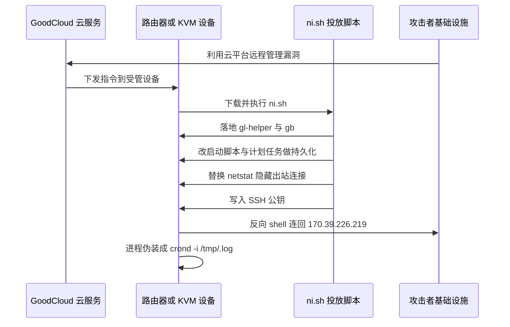
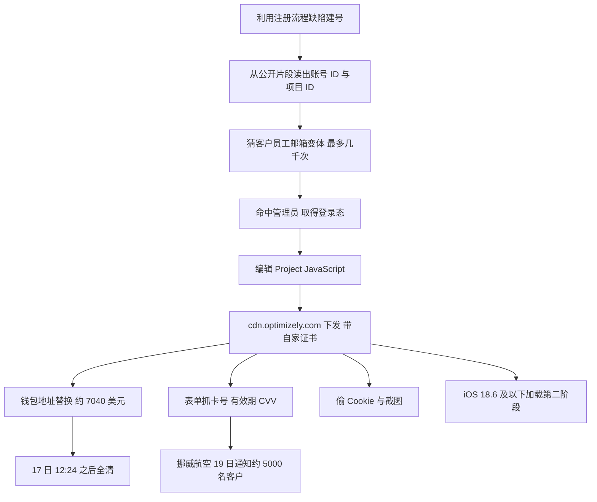
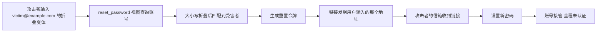
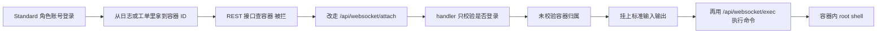
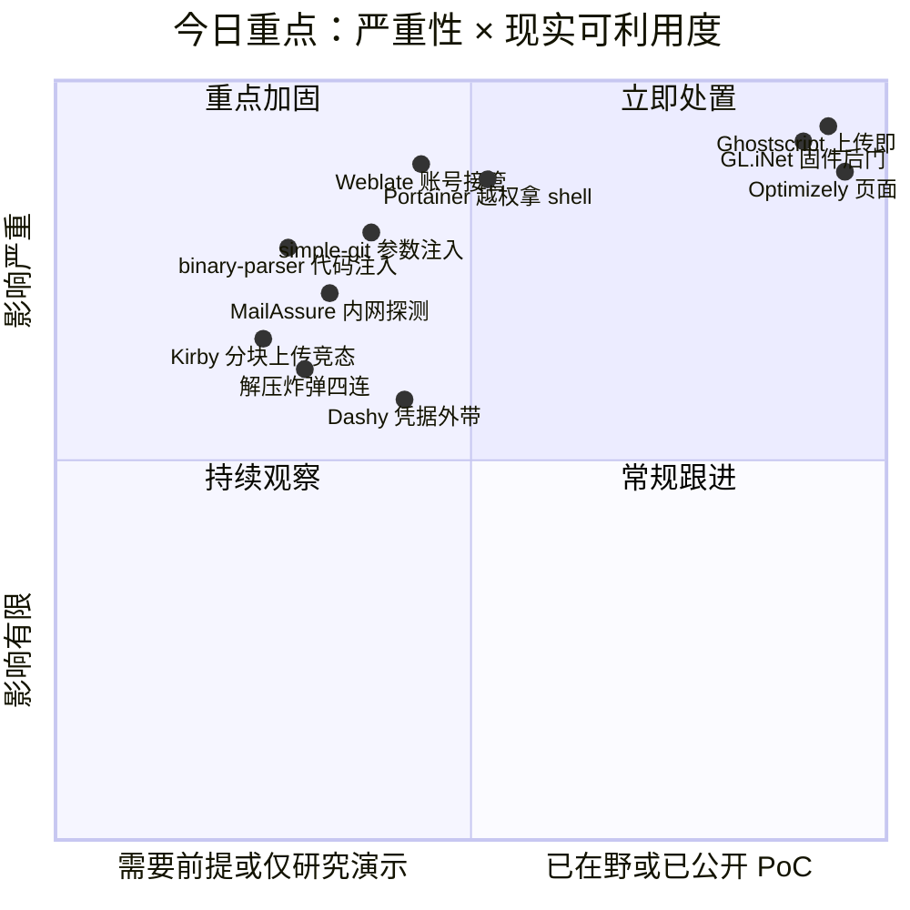
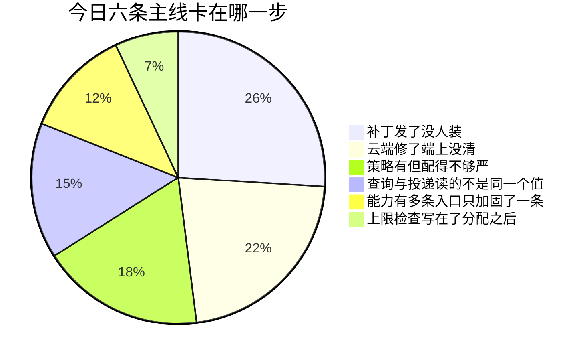
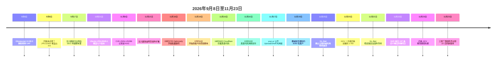

# 网安日报速递 · 2026年11月23日（第 225 期）

> 今日关键词：补丁在九月就发了没人装 · 云修好了设备上的后门还在 · 注册页面替一百七十八家挂了马 · 大小写不敏感把重置链接递错人 · 换一个协议入口就没人查权限 · 先解压再量大小等于从来没量

NVD 在 11-22 00:00 到 11-23 15:00 这个窗口里收了 401 条新记录，按 CVSS 3.1 与 4.0 混合口径 9.0 以上 24 条，10.0 零条，7.0 以上 229 条。401 条里有 133 条是 Linux 内核的合并提交（其中 12 条记 9.8），剩下的 268 条里 12 条在 9.0 以上，WordPress 插件生态占了 16 条。

今天六条主线有一个共同的形状：**修复早就存在，检查也写在代码里，只是没有一处真正生效。**

Ghostscript 的补丁在 9 月 8 日就随 10.08.0 发出去了，两个月后 Debian 12、Amazon Linux、SUSE 和一堆容器镜像里还是旧版本；GL.iNet 的云端漏洞在 11 月 20 日修好了，可已经装进设备的后门不会因为云修好就消失；Optimizely 的客户里 178 家被塞了脚本，其中 118 家要么没有 CSP，要么配得拦不住；Weblate 的账号查询做了大小写折叠，发信却按用户输入的原样投递，两个动作读的不是同一个字符串；Portainer 的 REST 接口加了授权，WebSocket 那两条升级通道没加；四个不同语言的库都在解压之后才去量大小。

---

## 一、Ghostscript：九月修好的洞，现在有十条进门的路

9 月 8 日，Artifex 发布 Ghostscript 10.08.0。这个版本里悄悄修掉了一个 Type 1 字体加载器的 use-after-free，当时没有安全公告，没有 CVE 编号，CHANGELOG 里也看不出这是一次安全修复。11 月 9 日，CVE-2026-125396 的记录进了 NVD。11 月 17 日到 21 日之间，pwn.ai 的研究员 Paulos Yibelo 把完整的利用链公开了，取名 Upload2Shell。**关于公开日期，不同来源给的是 17 日和 21 日两个说法，本文按「11 月中下旬」记，不做更细的断定。**

漏洞本身的机制不复杂。Ghostscript 的 `-dSAFER` 是一个软沙箱，靠进程内部的一张检查表限制 PostScript 能碰什么。Type 1 字体加载的辅助函数在写入一块内存前没有校验输入类型，构造的文档可以让它在这里报错，然后在错误处理路径上把那次受限的写操作捞回来，用来越界改写内存，最后改掉那几条安全检查的判断结果。全程 `-dSAFER` 都是开着的。**沙箱没有被关掉，它被改掉了。**

真正让这件事变严重的是进门的路。受影响的服务器根本不需要直接暴露 Ghostscript，只要它有缩略图、预览、格式转换这类功能，文件就会自动被递进去。而这些库判断文件类型看的是内容不是扩展名：一个叫 `quarterly.jpg` 的文件，里面装的是 PostScript，ImageMagick、Pillow、libvips、Qt 的图像插件都会照单转交。

pwn.ai 测了大约十个应用，其中八个拿到了命令执行：

| 目标 | 版本 | 触发方式 | 命令执行身份 |
|---|---|---|---|
| CUPS 打印服务 | Debian 13 | 匿名 IPP 打印任务，无需凭据 | `lp` |
| Roundcube 网页邮箱 | 1.7.2 | 发一封带假 JPG 附件的信，收件人只看列表不点开 | `www-data` |
| Plesk Obsidian | 18.0.79 | 随包 Roundcube 组件 | `www-data` |
| WordPress 核心 | 低于 7.0.4 | 有上传权限的账号，默认 Author 及以上 | `www-data` |
| Forminator 插件 | 公开上传表单 | 未登录访客直接触发 | `www-data` |
| Essential Addons for Elementor | 公开上传表单 | 未登录访客直接触发 | `www-data` |
| MediaWiki PdfHandler | 受影响版本 | 上传 PDF 触发预览 | Web 用户 |
| DokuWiki / Mayan EDMS / ResourceSpace | 受影响版本 | 上传后自动生成缩略图 | Web 用户 |

CVSS 4.0 记 8.5，3.1 记 7.8，攻击向量按解释器本身算的是本地。这个分数描述的是「能碰到 Ghostscript 之后有多严重」，不描述「隔着网络碰到它有多容易」。上面那张表就是后半句。

补丁状态是这件事最该被记住的部分：

| 发行版或组件 | 状态（截至 11-22） |
|---|---|
| upstream Ghostscript | 10.08.0 已修，9 月 8 日发布 |
| Debian 13 | 已修，先在 `10.05.1~dfsg-1+deb13u2`，后在 u3 |
| Debian 12 | 研究方 11-12 的记录里仍标为受影响 |
| Ubuntu | 10 月 21 日 USN-8949-1 覆盖七个版本，老版本走 Ubuntu Pro |
| Amazon Linux | 修复仍在待发状态 |
| SUSE / openSUSE | 部分版本修复进行中 |
| Red Hat 系 | 是否已带修复，公开来源未建立 |
| WordPress 核心 | 7.0.4（8 月 12 日）关的是自己的上传路径，CVE-2026-65640 |
| 容器镜像与应用自带副本 | 需要逐个重建，宿主机升级无效 |

**值得关注的原因：**

- **不打公告的安全修复，等于没有修复。** 9 月 8 日到现在是十一个礼拜。如果当时有一条 advisory，运维会把 Ghostscript 列进那个月的补丁窗口；没有公告，它就只是一次普通的版本更新，混在几百个包升级里。
- **版本号骗人。** 发行版会把修复回填进旧版本号。Debian 13 上 `10.05.1` 是修好的，Debian 12 上同一个小版本号不是。判断依据只能是发行版的安全公告，不是 `gs --version`。
- **容器把问题复制了一份。** 每个自带 Ghostscript 的镜像都是一个独立副本。宿主机打完补丁，容器里那个还活着，而且往往没人给它排升级。
- **WordPress 与 Ghostscript 修的不是同一处。** 7.0.4 关的是 WordPress 自己那条上传通道，Ghostscript 10.08.0 修的是引擎。两个都要打，只打一个只是把一条路堵上。
- **顺带看一下同一版里的另一个洞。** 10.08.0 还修了 CVE-2026-39919，JPEG 2000 堆溢出，9.8。也就是说，那个版本值得升的理由本来就有两条。

---

## 二、GL.iNet GoodCloud：控制面自己成了后门

11 月 20 日，GL.iNet 发了一份安全通告：攻击者利用 GoodCloud 远程管理服务里的一个漏洞，在部分路由器和 KVM-over-IP 设备上装了恶意软件。公司说云端漏洞已修、攻击路径已切断，紧接着补了一句关键的：**「这些措施不会清除已被感染设备上的恶意软件。」**

这句话把事件劈成了两半。云端是修好了，设备是另一回事。

公开的证据来自第三方。RemoteToHome 是一家做 GL.iNet 设备群管理的公司，它自查了自己持有或代管的 183 台路由器，152 台有可疑活动：24 台存在指向攻击者地址的 root 级反向 shell，47 台有更早的持久化后门，81 台留下了攻击者命令执行过的痕迹。部分恶意文件的时间戳是 2025 年 12 月，如果属实，这批设备被控制的时间接近一年，跟十一月这次不是同一件事。

对一台被拿下的设备，BleepingComputer 分析了一个叫 `ni.sh` 的投放脚本：

- 识别设备型号，从硬编码地址下载 `gl-helper` 和 `gb` 两个可执行文件
- 通过启动脚本和计划任务做持久化，重启和杀进程都清不掉
- 替换 `netstat`，让管理员看不到通往 `66.245.219[.]252` 的连接
- 写入 SSH 公钥，保留长期入口
- 定时拉取并执行远端命令
- 把自己伪装成 `crond -i /tmp/.log`

最后一条就是 GL.iNet 通告里给的唯一 IOC。公开的 C2 与反弹地址包括 `170.39.226[.]219`、`66.245.219[.]252`、`65.20.71[.]131`。

处置动作按型号分。KVM 侧官方点名了 RM10、RM10RC、RM1、RM1V2、RM1PE、RM4PE、RMQ1 七个系列，除 RMQ1 需要 1.8.7 或更新的 beta、其余要 1.10.3 或更新的 beta；路由器侧官方没列型号，只说要装对应型号的最新安全固件。稳定版固件原定 11 月 22 日，11 月 23 日固件列表上已经能看到 22 日、23 日的新版本，更新说明写的是「修复云平台远程管理中的漏洞」。

**值得关注的原因：**

- **云修好不等于设备修好。** 这是所有「云端下发」架构的通病。控制面被攻破之后，攻击者在端侧留下的东西与云端是否修好完全解耦。修云端只是关掉了再来一次的门，屋里的东西还在。
- **自查命令只能证明现在。** `ps | grep tmp` 看到 `crond -i /tmp/.log` 就是中招，看不到只能说这个特征此刻没在跑。论坛里已经有人报告发现其他后门和反向 shell，而 RemoteToHome 的说法更刺：它管的设备里没有一台命中 GL.iNet 这个 IOC，包括那些确认存在远程 shell 的。远端还提到 GL.iNet 固件里一个 SD-WAN 相关的命令注入，云端下发的值被直接拼进 root 权限的 shell 命令，公司未确认这就是本次入口。
- **重置也有讲究。** 出厂重置之后不要恢复旧配置备份，恶意文件可能就藏在配置目录里，普通升级会把它一起带过去。重置完换掉管理员与 Wi-Fi 密码，重新签发 VPN 配置，别再沿用旧密钥。
- **KVM 是通往内网的跳板。** GL.iNet 的 KVM 产品本身就是用来远程控制电脑和服务器的。KVM 被拿下意味着它背后接的那些机器可能一起暴露，公司说还在查这一点。如果机房里有一台这样的设备，排查范围要按「它碰得到什么」来划，不按「它自己是什么」来划。

---

## 三、Optimizely：一个注册流程，一百七十八家网站

11 月 16 日，一个攻击者用 Optimizely Web Experimentation 账号注册流程里的缺陷（CVE-2026-132224），把恶意 JavaScript 写进了客户的 Project JavaScript 配置项。这段代码由 `cdn.optimizely.com` 直接下发，带着 Optimizely 自己的 TLS 证书。访问者去的是 BBC、CNN、Zoom、Salesforce、GitLab、HSBC、IKEA、Equifax、Ledger 的正规域名，浏览器地址栏是干净的。

时间线按 Optimizely 修订后的报告（v1.5）：

| 时间（UTC，11-16） | 事件 |
|---|---|
| 00:37 | 攻击者开始批量注册账号 |
| 07:51 | 开始编辑目标项目的 Project JavaScript |
| 16:06 | Cloudflare 侧拦截恶意代码 |
| 16:10 | 注册流程缺陷关闭 |
| 22:24 | 恶意代码清除完毕 |

Report URI 的观测比官方更宽：BBC 的注入从 04:21 就开始了，全部文件干净要到 23:11。它审计了 1,611 条 Optimizely 片段，其中 188 条在投毒，覆盖 178 家机构。攻击者的载荷当天被重建了 26 次以躲检测。

入侵路径值得单独看：注册流程的缺陷让攻击者能创建账号，然后他们拿公开片段里可见的账号 ID 与项目 ID，去猜客户员工邮箱的各种变体，对单个客户最多试到几千次，直到命中一个管理员。**登录态是真的，身份是猜出来的。**

载荷是四件事一起做：替换剪贴板里的加密货币钱包地址（Report URI 追到约 7,040 美元，11 月 17 日通过一个三月和 11 月 3 日都用过的地址提走）；从页面表单里抓卡号、有效期、CVV；偷 Cookie 和截图；对 iOS/iPadOS 18.6 及以下版本加载第二阶段，指向 Coruna 和 DarkSword 两套利用工具，但没有设备被攻破的证据。

11 月 19 日，挪威航空给约 5,000 名客户发信，说 16 日下午到晚上在部分网站输入的卡号、有效期、CVC 可能经一家外部 IT 供应商泄露，涉及全球约 200 家公司，已报挪威数据保护局。它不在 Report URI 的名单上。

**值得关注的原因：**

- **CSP 是这类攻击唯一的现场防线，而它大面积缺席。** 对 178 家的分析显示：68 家完全没有 CSP，50 家的策略宽松到拦不住，只有 24 家（约 15%）配得足够严。脚本来自可信域名、走的是自家证书、域名没变，浏览器侧能分辨的只剩策略白名单。
- **SRI 在 A/B 测试平台上用不了。** 子资源完整性要求脚本内容固定才能算哈希，而实验平台的脚本天生每次都在变。这条防线在这里结构性失效，只能靠 CSP 与「少加载第三方脚本」。
- **注册流程是攻击面。** 一个面向营销人员的 SaaS，注册入口的速率限制、邮箱验证、租户隔离，决定了能不能被批量试。这次是猜邮箱猜出来的，不是撞库撞出来的。
- **同一个注入器已经跑了两个月。** 9 月 17 日它出现在一个 SEO 外链面板脚本里，11 月 13 日之后经 StorifyMe 组件、Kissmetrics 与 minute-ly 脚本扩散，16 日借 Optimizely 达到峰值。攻击链在换宿主，不在换手法。

---

## 四、Weblate 9.1：重置链接发给了输入的那个地址

CVE-2026-134838，影响 2026.11 之前的 Weblate，`reset_password` 视图存在账号接管。CVSS 4.0 记 9.1，未认证可用。

机制只有一句话：**账号查询是大小写不敏感的，邮件投递是照原样发的。**

Weblate 的表单在匹配邮箱时做了 Unicode 大小写折叠，所以在它看来 `user@example.com` 与 `USER@example.com` 是同一个账号。但重置链接是发到用户刚刚输入的那个地址上的，不是发到数据库里存的地址上。攻击者只要注册或控制一个只在大小写上不同、或者用了无点 i（ı）之类折叠后等价的邮箱，输入那个变体去请求重置，链接就会进他的信箱，然后他给受害者的账号设一个新密码。

修复提交在 `weblate/accounts/forms.py`，配套 PR 22506。

**值得关注的原因：**

- **两个动作读的不是同一个字符串。** 查账号用规范化后的值，发信用原始输入。这类缺陷在任何做「身份归一化」的系统里都可能重演，包括 SSO 回调、邀请链接、工单系统里的邮箱匹配。
- **改密码这件事不需要密码。** 攻击面只剩一个 GET/POST 表单，没有任何前置凭据。对自建翻译平台来说，账号里往往连着仓库写权限与 CI 令牌。
- **邮箱的本地部分理论上区分大小写。** RFC 5321 把 `@` 前面的部分交给收信服务器自行决定，所以 `User@` 与 `user@` 在有的服务上是两个人。系统做折叠是为了体验，但折叠的结论不能外溢到投递环节。
- **这类漏洞不会有告警。** 日志里是一条正常的重置请求，一条正常的邮件发送，一条正常的密码修改。要发现它，得比对「请求里的地址」与「账号上的地址」是否字面一致。

---

## 五、Portainer 8.7：WebSocket 那两条路没查权限

CVE-2026-134804，影响 Portainer 2.39.0 至 2.39.9 之前、2.40.0 至 2.45.4 之前、3.0.0 至 3.1.0 之前。CVSS 4.0 记 8.7，`AV:N / AC:L / PR:L`，也就是说只要有一个普通账号就能打。

Portainer 的容器操作有两条路：REST 接口，和 WebSocket 的升级通道。`/api/websocket/attach` 用来接管一个容器的标准输入输出，`/api/websocket/exec` 用来在容器里执行命令。在受影响版本里，这两个 handler 没有做「这个容器是不是你的」这类授权判断，只校验了「你是不是登录用户」。结果是同一个环境里的 Standard 用户，只要拿到别人的容器 ID 或 exec ID，就能通过这两条通道挂上去，拿到一个可以交互的 root shell。

ID 从哪来并不困难。容器 ID 出现在部署日志、监控面板、截图、工单、CI 输出里，很多还会被直接贴进聊天群。它不是一个需要猜的秘密。

修复提交改的就是这两个 handler，分别对应 `api/http/handler/websocket/attach.go` 与 `exec.go`。

**值得关注的原因：**

- **授权写在一条路上，另一条路就废了。** 同一份能力，两套入口，两套实现，最后只有一套被加固。这种形状在管理平台里很常见：REST 有人审，WebSocket 是后来加的。
- **PR:L 才是这类洞的真实威胁模型。** 8.7 的分数由「低权限 + 网络可达」撑起来。Portainer 通常部署在运维网段，账号来自企业目录，一个离职没删的账号就够。
- **容器里的 root 往往就是宿主机的 root。** Portainer 的正常部署方式是挂载 `/var/run/docker.sock`。拿到容器内 root 之后能做什么，取决于这个挂载还在不在，而大多数部署都没动过它。
- **升级前先想清楚谁有账号。** 修在 2.39.9、2.45.4、3.1.0。补丁之外，把 Standard 用户清单过一遍，比改版本号更值得花时间。

---

## 六、四个库，同一个顺序错误：先解压，再量大小

11 月 22 日进来的这批里有四条 DoS，彼此不认识，语言不同，形状一样：**大小上限是在内容被展开之后才检查的。**

| 组件 | 版本 | 缺陷 | 分数 |
|---|---|---|---|
| Faye websocket-driver / permessage-deflate / websocket-extensions | 0.5.0 至 0.8.0 前 / 0.2.0 前 / 0.2.0 前 | 消息先被完整 inflate，之后才套 `maxLength`，未认证客户端协商 permessage-deflate 就能撑爆内存 | 8.7 |
| Casdoor | 4.27.1 前 | `decodeSamlMessage` 对 DEFLATE 压缩的 SAML 消息不设边界，`/api/saml/logout/:owner/:application` 收一个小包展开成几个 GB | 8.7 |
| Gunicorn | 25.2.0 至 27.0.0 前 | 纯 Python 的 ASGI HTTP/1 解析器缓冲协议行时不设上限，缺 CRLF 的请求行、头、chunk 长度行、trailer 都能把 worker 内存拉高 | 8.7 |
| msgpackr | 2.1.4 前 | 重复结构导致的算法复杂度问题，远端可控输入即可拖住解析 | 8.7 |

四条都是 `PR:N`，不需要账号。四条都没有在野利用报告，也没有 PoC 流出，它们只是被同一批公开了出来。

**值得关注的原因：**

- **顺序错比阈值错更难发现。** 代码里 `maxLength` 这个数字是有的，审查看到了会以为已经防护。要看的是它出现在 `inflate()` 之前还是之后。
- **协议层把这件事交给了应用层。** permessage-deflate、SAML 的 DEFLATE、HTTP 的 chunked，压缩都是协议自带的选项，由应用决定要不要协商。协商了却没在上限上做文章，等于把一个放大倍数交给对端。
- **拒绝服务在评分体系里永远垫底。** 8.7 不低，但四个 8.7 加起来也换不来一次紧急变更窗口。这类补丁通常随下个常规版本走，中间那段时间服务就是可以被一个连接打挂的。
- **改法都一样。** 流式解压 + 边解边计数，超限立即中断；或者先看声明长度，超过直接拒。四种实现，一个思路。

---

## 速览

**7. 今天四条 KEV 到期，目录停在 1,790 条**
CISA 目录仍是 2026.11.20 版、1,790 条，361 条标注与勒索软件相关，11-21 到 11-23 没有新增。11 月 20 日那批四条的整改期限就是今天：vCenter 的 CVE-2026-123890、Cisco Expressway 的 CVE-2026-76466、Apache Roller 的 CVE-2026-129448、SAP NetWeaver 的 CVE-2025-42884。往前一批里，Apache Axis 的 CVE-2026-90436 与 Synology DSM 的 CVE-2024-10441 已经在 11-21 过期。**过期不等于安全，只等于你已经在违规名单上。**

**8. simple-git 9.2 与 binary-parser 9.2：守卫清单漏了一个参数**
两个 npm 包同日公开。CVE-2026-134815，simple-git 4.1.0 之前，`allowUnsafePack` 这道守卫只拦 push 类操作，攻击者能影响 `listRemote()` 或 `raw()` 的参数时，给 `ls-remote`、`archive`、`fetch-pack`、`send-pack` 塞一个 `--exec` 就能在宿主机执行命令。CVE-2026-134814，binary-parser 2.3.1 之前，`Context.generateOption()` 把字符串型选项（`length`、`lengthInBytes`、`key`、`tag`、`offset`、`namely()` 别名）不做校验直接拼进生成代码，控制解析器定义的人可以在编译解析器时执行任意 JavaScript。两条都是 9.2，都是 `AC:H`，都需要「攻击者能影响某个参数」。

**9. N-able MailAssure 9.3：LDAP 同步连接检查没有目标限制**
CVE-2026-134624，MailAssure（原 SpamExperts）20261121.1943 之前。配置中继时触发的 LDAP 同步连接检查不限制目标地址，一个已认证的 API 用户可以让服务器去连任意内网主机和端口，探测哪些可达，并把构造的数据送给内网服务。9.3，但 `PR:H`，所以入口是一个 API 账号。

**10. Kirby 8.7：分块上传的竞态把 SVG 清洗绕了**
CVE-2026-134765，Kirby 5.6.4 之前。`Kirby\Api\Upload::processChunk()` 里，同名的并发分块上传可以互相覆盖：先传一个干净的 SVG 过清洗，再让另一个分块把它换成带脚本的版本，最终在站点源上形成存储型 XSS。需要上传权限，`AC:H`，8.7。

**11. Dashy 8.6：前缀判断把凭据送给了相似域名**
CVE-2026-134836，Dashy 4.9.12 之前。`isLocalRequest` 用前缀比对判断「是不是本站」，攻击者用 `?config=` 指向一个相似域名，已登录用户的 bearer token 或 HTTP 认证头会被一起带过去，进而读走配置里存的 API 密钥；管理员受害时还能改。8.6。

**12. 窗口统计：401 条新记录，零个 10.0**
11-22 00:00 至 11-23 15:00，NVD 收 401 条，9.0 以上 24 条，10.0 零条。133 条是 Linux 内核的合并提交（其中 12 条记 9.8），剩下 268 条里 9.0 以上 12 条，其中两条是 WordPress 插件的反序列化（Simple Shopping Cart 与 APCu Manager，均 9.8）。**窗口里最值得处置的东西，分数往往不是最高的那条。**

---

## 风险分析

---

## 事件时间线

---

## 一句话带走

今天这六件事里，只有一件是「没有修复」。其余五件都有修复，也都有检查，问题出在补丁没有落到实例上、云端修了端上没清、策略配了但不够严、两个函数读的值不一样、同一个能力只加固了一条入口。**漏洞管理的最后一公里不在厂商那边，在你自己的清单上。**

---

## 相关出处

**Ghostscript / Upload2Shell**

| 来源 | 链接 |
|---|---|
| pwn.ai 原始研究页（Upload2Shell，CVE-2026-125396，利用链与十款应用） | https://pwn.ai/upload2shell |
| ThreatTicker：pwn.ai 把 CVE-2026-125396 串成十款应用的未认证 RCE（测试目标与补丁状态） | https://threatticker.com/news/pwn-ai-chains-ghostscript-cve-2026-125396-into-pre-auth-rce-on-cups-roundcube |
| PBX Science：技术拆解（字体加载器、受限写回收、`-dSAFER` 仍在开、三款暴露服务） | https://pbxscience.com/upload2shell-ghostscript-flaw-lets-attackers-run-commands-through-wordpress-roundcube-and-cups-print-servers |
| OrigoTech：修复版本 10.08.0（9 月 8 日）、CVSS 8.5、公开 PoC 只演示内存接管 | https://origotech.dev/articles/ghostscript-flaw-cve-2026-125396-lets-a-crafted-file-escape-its-sandbox-and-run-commands-through-print-queues-webmail-and-wordpress-uploads-fixed-in-10-08-0 |
| Digital Advisors：WordPress 7.0.4 与 CVE-2026-65640、发行版修复差异、容器副本 | https://digitaladvisors.com.au/journal/ghostscript-upload2shell-image-upload-flaw |
| SANS ISC / invisibleCISO 每日摘要（11-23，研究方称由 AI 辅助发现） | https://www.invisibleciso.com/148613966/syslog-timestamps-glinet-goodcloud-breach-ghostscript-upload2shell-rce-cve-2026-125396-nov-23rd-2026 |
| 公开 PoC 仓库的技术评估（14 个文件、仅演示内存接管、未验证二进制 PDF） | https://exploit-intel.com/exploit/7860244914568623 |

**GL.iNet GoodCloud**

| 来源 | 链接 |
|---|---|
| GL.iNet 官方安全通告（11-20 发布，11-21 更新，含各型号固件版本） | https://www.gl-inet.com/en-us/blogs/blog/glinet-security-notice-2026-11-20 |
| GL.iNet 论坛通告贴（KVM 各型号 beta 版本与自查命令） | https://forum.gl-inet.com/t/2026-11-20-gl-inet-security-notice-goodcloud-kvm-routers/73056 |
| BleepingComputer：`ni.sh` 投放脚本、`gl-helper` 与 `gb`、替换 netstat、RemoteToHome 的 152/183 | https://bleepingcomputer.com/news/security/hackers-exploit-glinet-cloud-flaw-to-infect-routers-kvm-devices/ |
| CIO Monitor：24 台 root 反向 shell、47 台旧后门、81 台命令痕迹、2025 年 12 月的时间戳 | https://ciomonitor.com/articles/hackers-breached-gl-inet-s-cloud-to-plant-router-and-kvm-malware |
| PrivacyGear 跟踪页（11-23 更新：三家型号已见新固件、自查的局限、RemoteToHome 的异议） | https://privacygear.nl/en/updates/glinet-security-incident-november-2026 |
| 华军软件园：中文版排查步骤（`ps | grep tmp`、LuCI 进程页、RMQ1 用 `ps -a`） | https://www.onlinedown.net/article/10048875.htm |

**Optimizely / OPTIMJACK**

| 来源 | 链接 |
|---|---|
| InfraStack 事件卡（CVE-2026-132224、v1.5 修订时间线、7,040 美元、两个域名、9 月 17 日首次出现） | https://infrastack.ai/live/CMP-202611-b4u4qv |
| Tech News Reel：178 家、188 条片段、26 次重建、Coruna 与 DarkSword、CSP 分布 68/50/24 | https://technewsreel.com/cybersecurity/optimizely-supply-chain-attack-injects-malware-into-178-high-profile-websites |
| UnboxFuture：技术复盘（Project JavaScript、剪贴板劫持、SRI 为何不适用） | https://www.unboxfuture.com/2026/11/the-optimizely-breach-inside-178-brand.html |
| Bhaskar English：受影响名单与 Optimizely 的处置声明（结束会话、吊销令牌、重置账号） | https://www.bhaskarenglish.in/amp/tech-science/news/major-cyberattack-hits-global-organizations-zoom-cnn-bbc-ikea-139713355.html |
| Corvus 威胁情报列表（事件编号与影响面摘要） | https://corvus-cyber.com/threat-intel/ |

**NVD / CISA 一手数据**

| 来源 | 链接 |
|---|---|
| NVD API 2.0（本期窗口 401 条、9.0 以上 24 条、内核 133 条，本刊一手统计） | https://services.nvd.nist.gov/rest/json/cves/2.0 |
| CVE-2026-134838 Weblate（9.1，`reset_password`，Unicode 大小写折叠） | https://github.com/WeblateOrg/weblate/security/advisories |
| CVE-2026-134804 Portainer（8.7，attach 与 exec 两条 WebSocket 通道） | https://github.com/portainer/portainer/commit/52f82e7c7eec08fa4b421cd423798b8966e13857 |
| CVE-2026-134815 simple-git（9.2，`--exec` 绕过 allowUnsafePack） | https://github.com/steveukx/git-js/releases/tag/simple-git%404.1.0 |
| CVE-2026-134814 binary-parser（9.2，`generateOption()` 字符串拼接） | https://github.com/keichi/binary-parser/security/advisories/GHSA-xmxc-6c22-m377 |
| CVE-2026-134813 Faye websocket-driver（8.7，先 inflate 后查 maxLength） | https://github.com/faye/websocket-driver-node/commit/19853657d2a3a6e4f2450bbac3dfefec66a52376 |
| CVE-2026-134830 Casdoor（8.7，SAML 消息解压无边界） | https://www.vulncheck.com/advisories/casdoor-before-4.27.1-denial-of-service-via-saml-message-decompression |
| CVE-2026-134821 Gunicorn（8.7，ASGI 解析器无长度上限） | https://github.com/benoitc/gunicorn/pull/3789 |
| CVE-2026-134765 Kirby（8.7，分块上传竞态绕过 SVG 清洗） | https://github.com/getkirby/kirby/security/advisories/GHSA-g6q3-mf7c-27jh |
| CVE-2026-134836 Dashy（8.6，前缀比对导致凭据外带） | https://github.com/Lissy93/dashy/security/advisories/GHSA-rv37-gcpm-x55f |
| CVE-2026-134624 N-able MailAssure（9.3，LDAP 同步连接检查无目标限制） | https://me.n-able.com/s/security-advisory/aArVy0000002mrlKAA |
| CISA 已知被利用漏洞目录 JSON（2026.11.20 版，1,790 条，361 条勒索相关） | https://www.cisa.gov/sites/default/files/feeds/known_exploited_vulnerabilities.json |
| CISA 11-20 KEV 新增四条与 11-23 整改期限 | https://www.cisa.gov/news-events/alerts/2026/11/20/cisa-adds-four-known-exploited-vulnerabilities-catalog |
| Threat Times 周度 KEV 汇总（七天新增 9 条，0 条与勒索相关） | https://threattimes.com/category/vulnerabilities/exploited-this-week-cisa-adds-9-vulnerabilities |
| Stackurity 每周补丁清单（11-23 版，七条在野利用条目串讲） | https://stackurity.ai/blog/patch-this-week-2026-11-23 |

---

**免责声明：** 本报告基于公开信息整理，CVE 编号、CVSS 评分、受影响与修复版本以 NVD / 厂商公告 / CISA 原始记录为准。同一事实在不同来源出现分歧时，正文已标注口径或直接指出差异：Upload2Shell 的公开日期有 11-17 与 11-21 两种说法，本文按 11 月中下旬记；Ghostscript 的 CVSS 有 4.0 的 8.5 与 3.1 的 7.8 两个体系，不可横比，其「本地攻击向量」描述的是解释器而非入口；Optimizely 的受影响面有 178 家与 188 条片段两个数字，前者是机构数后者是脚本数，Report URI 把 188 称为下限；Optimizely 的损失有 7,040 美元（Report URI 追到的加密钱包部分）与「未有大规模资金损失」两种表述，后者不含卡片与凭据的后续风险；GL.iNet 的受影响设备数官方未公布，152/183 是 RemoteToHome 自查样本，不等于全局；KEV 的 1,790 条为 2026.11.20 版，11-23 当日是否新增需以官方文件为准；解压炸弹四条的 8.7 均为 CVSS 4.0 评分。本文对恶意活动只记录技术事实，对任何归因结论不作转述。文中涉及的 PoC、IOC 与复现细节仅用于自查与识别，不要用于未授权环境。
