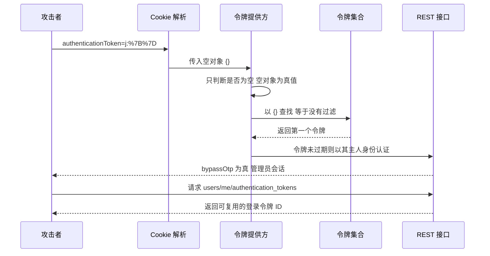
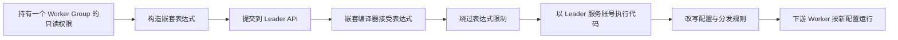
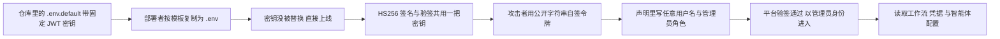
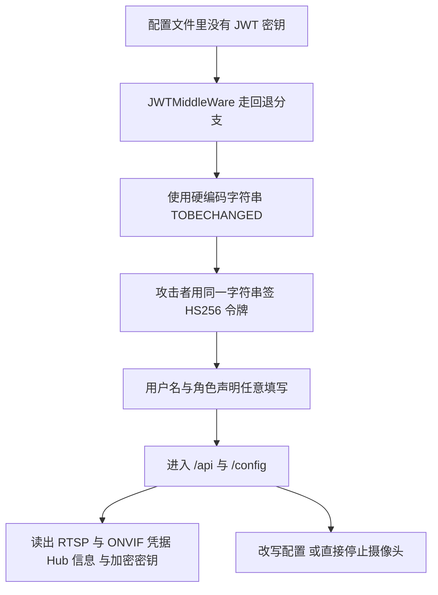
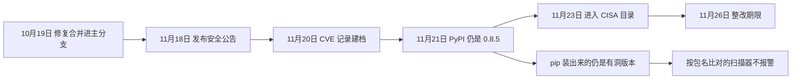
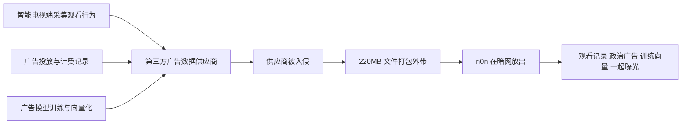
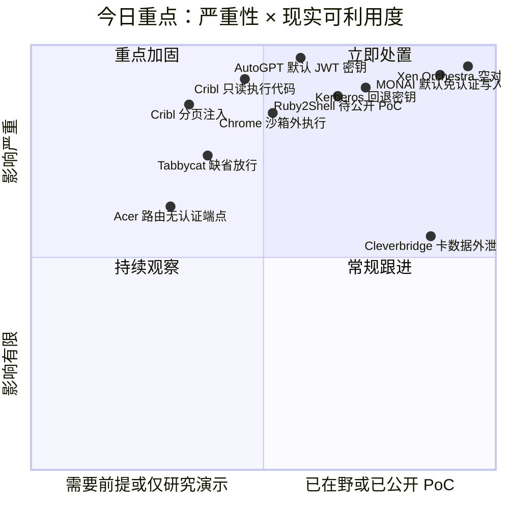
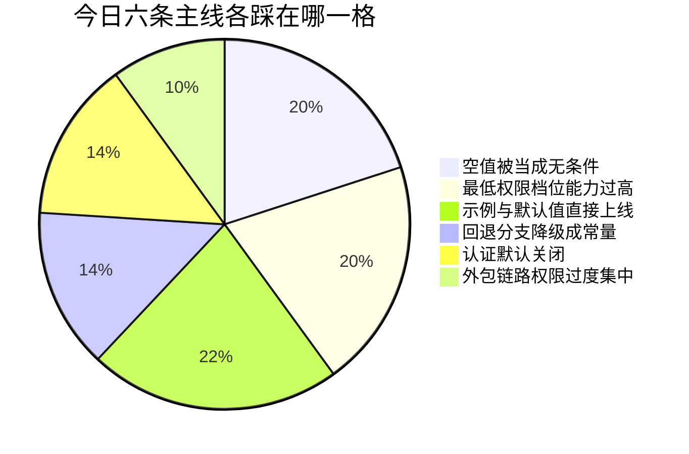
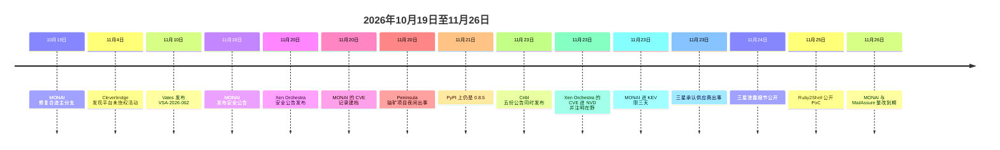

# 网安日报速递 · 2026年11月24日（第 226 期）

> 今日关键词：一个空对象换来了管理员权限 · 只读账号在控制端跑了代码 · 示例文件里的密钥就是生产密钥 · 待改的占位符没改也一直能用 · 认证开关默认关着没人打开 · 一条外包链路串起采集与建模

NVD 在 11 月 23 日 00:00 到 11 月 24 日 13:00 这个窗口里收了 488 条新记录，按 CVSS 3.1 与 4.0 混合口径 7.0 以上 158 条，9.0 以上 28 条，其中 5 条记 10.0。CISA 的已知被利用漏洞目录升到 2026.11.23 版，1,792 条，362 条标注与勒索软件相关；当天新增的两条整改期限都写着 11 月 26 日，也就是从入目录到截止只有三天。

今天六条主线共用一个形状：**权限体系里标着「最低」的那一档，实际能力都是最高那一档。**

Xen Orchestra 的 REST 接口把最「空」的输入 `{}` 当成了没有过滤条件，于是查出了集合里的第一个令牌，登录成了管理员；Cribl Stream 里的「只读」角色，能在 Leader 组件上以 Leader 服务账号的身份执行代码；AutoGPT 的 `.env.default` 是给部署者看的示例文件，里面的 JWT 密钥就是生产环境用的那把；Kerberos Agent 的 JWT 中间件留了一条回退路径，回退到的字符串叫 `TOBECHANGED`，意思是「这里要改」，而它从头到尾没被人改过；MONAI Label 的认证开关默认是关的，于是「默认配置」等于「谁连上谁能用」；三星的广告数据链路把采集、投放和模型训练都压在同一家供应商手上，这家供应商出事，三层数据一起出来。

---

## 一、Xen Orchestra 9.8：一个空对象登录成了管理员

CVE-2026-133469，影响 Xen Orchestra 6.9.2 之前与 6.10.0 至 6.10.1 之前，对应的 xo-server 包是 5.211.2 之前与 5.213.0 至 5.213.1 之前。CVSS 3.1 记 9.8。Vates 的公告编号 VSA-2026-062，日期是 11 月 10 日；GitHub 安全公告 11 月 20 日发出；CVE 记录 11 月 23 日进 NVD，并在描述里写明**该漏洞已在野被利用**。

缺陷的起点是一个类型没被检查就往下传的值。REST 接口解析 Cookie 时，`authenticationToken=j:%7B%7D` 会被反序列化成一个空对象 `{}`。负责签入的 `signIn(credentials)` 没有声明参数结构，所以这个对象一路走到了令牌提供方；`signInWithToken` 倒是声明了令牌是字符串，但走 REST 这条路的请求不经过它。令牌提供方只做了一次「值是否为空」的判断，而**空对象在 JavaScript 里是真值**，于是检查通过。接下来的查找把 `{}` 当成了「没有过滤条件」，返回集合里的第一个令牌。只要那个令牌没有过期、它的主人还在，REST 认证就以那个用户的身份成功了。

拿到会话之后，`/rest/v0/users/me/authentication_tokens` 会把可复用的登录令牌 ID 一并交出来，公告里还写明返回体中 `bypassOtp` 为真，也就是连一次性口令都省了。按 Vates 的说明，Xen Orchestra 被拿下之后，可以向受管的 XCP-ng 池执行任意代码，最终拿到节点的 root。

Vates 给了两条自查线索：在 XCP-ng 主机上查虚拟机平台参数里有没有 `hvm_serial: file`，以及有没有一个名为 `pivot2` 的虚拟机。这两条是活动痕迹，不是版本检查，两件事要分开做。

**值得关注的原因：**

- **「空」在类型系统里不等于「没有」。** `{}` 是可枚举的对象，落到「按条件查一条记录」的逻辑里，它的条件是零个，也就是全表。这类错误在任何把 JSON 直接喂给查询层的地方都能重演，包括 GraphQL 参数、缓存键、ORM 的 filter 对象。
- **签名验证通过，不等于身份是你。** 这一次连签名都没碰，走的就是「合法令牌、错误主人」。前面几期那条 Chainflip 是签名有效而状态错乱，这条是令牌有效而归属错乱，两条都说明「校验通过」这四个字覆盖不了多少东西。
- **管理平面被打穿等于底层被打穿。** Xen Orchestra 是虚拟化管理入口，一次管理员登录往下可以落到每台宿主机的 root。这类系统放在公网上的情况比想象中多，尤其是自建的小规模集群。
- **进 KEV 需要时间，在野利用不需要。** 截至 11 月 23 日版目录，这条还不在 KEV 里。公告日期 11 月 10 日、CVE 建档 11 月 23 日，中间十三天，靠的是读过 VSA 的人自己动手。

---

## 二、Cribl 五连：只读账号在控制端执行了代码

11 月 23 日 08:25 UTC，Cribl 一次性发了四份 CSAF 公告加一份 Edge 公告，全部指向同一条修复线：Stream 4.20.4 及更早受影响，升级到 4.21.0；Edge 同样是 4.21.0。四份 Stream 公告的整改文字一字不差，只有漏洞本身不同。

| CVE | 组件与位置 | 前提条件 | 结果 | CVSS 3.1 / 4.0 |
|---|---|---|---|---|
| CVE-2026-115873 | Stream 嵌套表达式编译器 | 拥有任一 Worker Group 的只读（GroupRead）权限，且能访问 Leader API | 以 Leader 服务账号权限执行代码 | 9.9 / 8.7 |
| CVE-2026-115899 | Stream REST Collector 分页处理 | 能控制某个 REST Collector 所查询上游返回的分页数据，且该任务会处理这些数据 | 以 Worker 服务账号权限执行代码 | 9.8 / 9.3 |
| CVE-2026-115900 | Stream Worker 心跳原型污染 | 持有有效的 Worker 分发凭据并能访问 Leader 分发监听；若启用双向 TLS 还需客户端证书 | 绕过 Leader 的 REST 认证，取得管理 API 访问 | 8.8 / 8.7 |
| CVE-2026-115901 | Stream OIDC 回调 | 身份被可信 IdP 应用接纳，能控制被选作用户标识的声明，通过 SSO 过滤，且有一名在线会话的受害者 | 跨站脚本，受害者是管理员时即管理员权限 | 9.0 / 8.5 |
| CVE-2026-115903 | Edge 文件搜索 | 托管 Edge 部署中拥有只读权限 | 经 Leader 或直接在 Edge 上读取进程可读的文件 | 6.5 / 7.1 |

分数最高的那条，门槛是「只读」。一个在权限模型里被标成最低档的账号，能在 Leader 组件上执行代码，用的是 Leader 服务账号的身份。Cribl 自己的描述里，这个账号的权限边界决定了后果的上限，而在多数部署里，Leader 是管配置下发和分发的那个节点。

分页那条更值得琢磨。它不需要任何账号，但需要一个条件：某个已有 REST Collector 正在查询的上游接口，返回的分页数据能被攻击者影响。这个条件听起来苛刻，实际很容易满足，因为大量 Collector 指向的是第三方 API、静态文件、共享的对象存储，甚至是别人维护的公开数据源。任务跑起来，Worker 就会按上游给的分页信息往下取，而那串信息被拼进了表达式求值。

四条在 NVD 里都找不到「已在野利用」的字样，Cribl 也没说有 PoC。但 9.9 与 9.8 这两条的分差值得注意：同一批漏洞，CVSS 4.0 体系里 9.9 掉到了 8.7，跨过了严重与高危的边界。**两个体系不可横比，处置优先级应该按前提条件的现实程度定，不按数字排。**

**值得关注的原因：**

- **只读是审计里最容易被放过的角色。** 只读账号通常被当成「看了也不会出事」，于是发给了外包、实习生、监控系统、临时排障。这套接口把只读翻译成了「可以提交表达式」，再翻译成「可以执行代码」，中间每一步都合理。
- **数据管道天生信任上游。** 日志与遥测平台的设计前提是「上游给我什么我就处理什么」。分页游标、时间戳、字段名这些元数据从来没被当成不可信输入，而它们最终会进求值器。
- **四个洞共用一次升级。** 不管哪条打得到，动作都是升到 4.21.0。这批最实际的建议是先把 Stream 的 Leader 找出来，确认版本，再看谁有 GroupRead。
- **同一批公告，两种分数差了 1.2 分。** 写在内网工单里「9.9 必须今晚修」的话，用 4.0 口径复核一遍可能会变成 8.7，排期就变了。分数是给流程用的，前提条件是给自己看的。

---

## 三、AutoGPT 10.0：示例配置文件里的那把钥匙就是生产密钥

CVE-2026-130169，影响 AutoGPT Platform 0.6.26 至 0.7.4，0.8.0 修复。CVSS 3.1 记 10.0，CWE-287。GitHub 安全公告 GHSA-24q6-6h89-f9p7。

AutoGPT Platform 是一个用来创建、部署和运行持续型 AI 智能体的工作流平台。它在仓库里带了两个 `.env.default` 文件，分别在 `backend/.env.default` 与 `autogpt_platform/.env.default`。这两个文件按惯例是给部署者做模板的，里面填的应该是占位值。实际情况是，里面那把 JWT 校验密钥是一个**公开已知的固定字符串**，而且签发算法是 HS256。

HS256 是对称算法，签和验用同一把密钥。密钥公开，等于任何人都能给任意用户、包括管理员，签一个合法令牌。不需要交互，不需要前置凭据，不需要受害者做任何动作。攻击者自己签一个 `role: admin` 的令牌，平台就认。

0.8.0 的修法有两步：不再预填密钥，以及拒绝用共享密钥签发的令牌。公告写得很直接，没有临时缓解措施，只能升级。

**值得关注的原因：**

- **默认值与示例值是同一个词，含义却相反。** `.env.default`、`config.sample`、`settings.example` 这些文件名在语义上是「抄一份改掉」，但工具链不会替你检查有没有改。这和今天 Kerberos Agent 那条是同一个错误的两副面孔。
- **10.0 的分数来自「不需要任何前提」。** 这条不需要账号、不需要网络位置、不需要用户点击，也不需要非默认配置。它唯一的条件是部署者按官方模板部署，而那正是官方推荐的做法。
- **AI 智能体平台的凭据密度比一般 Web 应用高。** 一个 AutoGPT 实例里通常挂着模型 API 密钥、数据库连接、第三方工具授权，还有一堆能自己调工具的智能体。管理员令牌在手的价值，不是看一个后台，是接管一整套自动化。
- **自建实例的数量不可忽视。** 这类平台以 Docker Compose 与自托管为主要部署方式，版本信息不外露，外部扫不到。能做的是内部盘点：谁装了 AutoGPT，版本是多少，`.env` 里的密钥是不是那个默认值。

---

## 四、Kerberos Agent 9.8：回退到的那把钥匙写着「待改」

CVE-2026-135208，影响 Kerberos Agent 3.14.4 之前。CVSS 3.1 记 9.8，4.0 记 9.3，CWE-1394（使用默认凭据）。修复在 3.14.4，对应提交 c0baade 与 PR 361。

Kerberos Agent 是一个开源的视频监控代理，装在海康、大华这类摄像机旁边或者直接跑在设备上，负责取 RTSP 流、处理 ONVIF 事件、往 Hub 上报。它的 HTTP 路由用 JWT 中间件保护，`/api` 与 `/config` 都在后面。

问题在 `machinery/src/routers/http/jwt_middleware.go` 的第 17 到 28 行：校验密钥从配置里读，读不到的时候有一条回退路径，回退到硬编码字符串 `TOBECHANGED`。这个字符串本身就是一个提示，意思是「这里需要改」。它被写进代码的时候是占位符，出厂之后成了默认密钥。

进去之后能做的事很具体：读出 RTSP、ONVIF、Hub 的连接信息与加密密钥，改写配置，把摄像头停掉。对一套监控系统来说，**先看清摄像头用什么账号，再让它停**，这两件事放在一起就是物理层面的问题。

`/config` 这条路由尤其值得注意。它返回的是完整配置，包括加密密钥。密钥在手，历史录像的加密就失去意义。

**值得关注的原因：**

- **回退路径是默认值最喜欢的藏身处。** 正常配置分支有代码审查，有文档，有示例；异常分支往往是一行 `||` 或者一个 `if secret == ""`。加这条分支的动机是「让程序别崩」，代价是把认证降级成了一个常量。
- **CWE-1394 这一类正在变多。** 今天三条主线都落在这个类型或它的近邻上：AutoGPT 是预填密钥，Kerberos 是回退密钥，Xen Orchestra 是缺省查询。厂商在打包默认配置这件事上，习惯仍然停留在「让用户能跑起来」。
- **这类设备不进补丁流程。** 监控代理通常由集成商部署，装完就没人管，没有 CMDB 记录，也没有版本巡检。3.14.4 发了，能不能装上去是另一件事。
- **能读到密钥就等于能解密录像。** 很多人把它当成一个「能停摄像头」的中危问题，实际上 `/config` 那条路的影响是长期的：密钥泄露之后，即使升级、改密码，已经流出的录像仍然可解。

---

## 五、MONAI 三天期限：修在代码里，能装到的还是旧的那一版

CVE-2026-133968，CVSS 9.8，落在 MONAI Label 的 `PUT /datastore/image` 与 `PUT /datastore/label` 两处，影响 0.8.5 及更早。11 月 23 日进入 CISA 目录，整改期限 11 月 26 日。

这条在 11 月 21 日的第 222 期写过一次，当时讲的是自主智能体十一分钟摸到这个零日、写 `sitecustomize.py` 拿到 root 的那条链。这次的新信息是三个日期和一个事实。

修复在 10 月 19 日就合进了主分支；安全公告 11 月 18 日发出；CVE 记录 11 月 20 日建档。而 PyPI 上到 11 月 21 日仍然是 2024 年 11 月上传的 0.8.5，**也就是能装到的那一版，还是带洞的那一版**。依赖扫描器按 GitHub 上那条未审阅、未挂包名的公告条目比对，根本不会报。

MONAI Label 的默认配置不开启认证，任何能连到这个端口的人都可以调接口。后端把客户端提交的文件标识符直接和存储目录做字符串拼接，没有规范化，也没有过滤穿越字符。写进去之后，攻击者选的是 Python 解释器启动时会自动加载的配置文件，因为那条路能绕开大多数 Web 层的写入限制。

关于发现过程的归因说法，本文不转述，只记录技术事实与修复状态。

**值得关注的原因：**

- **「有修复」与「能装到修复」是两件不同的事。** 合并、公告、建档、发包是四条独立的流水线，任何一条卡住，用户拿到的都是旧版本。判断一个开源组件是否安全，看的是包管理器里的版本，不是仓库里的提交。
- **三天期限对科研机构不现实。** 这类工具跑在 GPU 机上，常以高权限进程启动，使用人是研究人员而不是运维。让它三天内完成升级加验证，往往做不到，于是现实选择是断网或加一层反代认证。
- **扫描器的盲区是结构性的。** 公告没挂包名、没审阅，按 CPE 或包名比对的工具就不会命中。能补上的只有一条：按进程名、端口、容器镜像去找，而不是按包名去找。
- **进入 KEV 之后，这条不再只是「建议修」。** 联邦机构 11 月 26 日到期，其他组织可以把它当成一个明确信号：这条已经在被真实使用，而且公开的利用手法已经足够简单。

---

## 六、三星广告数据 220MB：一份文件里有观看记录也有训练向量

勒索软件团伙 n0n 在暗网放出约 220MB 文件，Cybernews 分析后确认内容涉及三星智能电视观看记录、广告投放数据与 AI 广告模型训练数据。三星向媒体确认，泄露来自为其北美广告业务 Samsung Ads 处理广告数据的一家第三方供应商，供应商的初步调查显示部分三星信息可能受影响，双方仍在核查范围。

数据分四块：

| 数据集 | 规模 | 时间 | 字段 |
|---|---|---|---|
| 智能电视观看记录 | 约 15 万条 | 2024 年 | 时间戳、开机时长、设备信息，部分含城市、邮编、电视服务商 |
| 政治广告记录 | 约 4.26 万条 | 2026 年 9 至 10 月 | 赞助方、政治归属、议题、预估投放费用 |
| AI 广告模型训练数据 | 约 9.91 万条 | 2021 年 | 以嵌入向量为主 |
| 内部文件 | 2 份 | 未标注 | 员工姓名与邮箱，疑似内容数据仓库的访问资料与基础设施信息 |

从数据结构看，这件事的重点不在 15 万条观看记录。观看记录是行为日志，不含节目内容，能推出的是作息与设备使用习惯。真正敏感的是那 4.26 万条政治广告记录，里面有赞助方、政治归属与预估花费，这是一份可以直接用来画像的投放台账；以及 9.91 万条嵌入向量，那是训练数据的数值表示，原则上不可逆，但它暴露了模型的输入分布与特征维度。

n0n 这个团伙在第 224 期出现过，当时它对 Visa 与摩根大通放过声明，没有证据。**这一次不同：三星自己承认了供应商出事**，只是范围未定。

**值得关注的原因：**

- **广告技术栈是数据密度最高、审计最少的一段。** 采集、归因、投放、建模通常由不同供应商分工，任何一家都有全链路视角的拼接能力。三星这次是「一家供应商同时握着采集与建模」，因为两类数据出现在同一份泄露文件里。
- **政治广告数据的敏感度被系统性低估。** 它不含个人信息，但含立场、议题、资金。这类数据在很多司法辖区不受个人数据法规约束，于是保护强度也最低。
- **嵌入向量正在变成新的泄露品类。** 它看起来「只是一串数字」，实际上决定了模型能做什么、训练集偏向哪里。把它当成公开数据处理的团队不少。
- **供应链事故的通报权在供应商手上。** 三星的表态是「供应商初步调查显示可能受影响」，说明披露节奏由供应商控制，品牌方只能等。这条对所有把数据交给第三方处理的企业都成立。

---

## 速览

**7. Tabbycat 9.1：没有 tournament 属性时权限判断返回 True**
CVE-2026-135429，影响 Tabbycat 2.9.0 至 2.12.1。`TournamentViewSet` 的权限类 `PerTournamentPermissionRequired` 在第 71 至 75 行做判断：取出视图上的 `tournament` 属性再比对。问题是没有这个属性的视图，判断走到异常分支，结果是**返回 True**。于是未认证的人可以对 `/api/v1/tournaments` 发 POST、PUT、PATCH、DELETE，创建、修改、删除赛事，级联删掉下面的队伍与辩手。修复提交 b7f0746，对应 issue 3047。CVSS 3.1 记 9.1，4.0 记 8.8。这是今天第三条「缺省即放行」：拿不到凭据就当作不需要凭据。

**8. Acer Connect M6E 5G 两条 10.0：连上这个 WiFi 就能删录音**
CVE-2026-128791 与 CVE-2026-9790，都是 CVSS 4.0 的 10.0，CWE-306（关键功能缺少认证）。前者是任意 WiFi 客户端可以对 `/meeting-recording/delete` 发 HTTP DELETE，**永久删除录音文件**；后者是一批管理端点完全不校验身份，例如 `/user/hasSimCard`、`/user/pooling`、`/api/device-info`。受影响产品是 Acer Connect M6E 5G 便携式 WiFi 路由器，Acer 已在社区知识库发布固件更新公告。这类设备的默认场景是会议室、差旅、临时办公，攻击者只需要在同一网段。

**9. 微软一批记录入库：Azure Event Grid 拿到 10.0**
11 月 23 日 22:20 UTC 前后，NVD 成批收录了一批 MSRC 记录。分数最高的是 CVE-2026-62841，Azure Event Grid 的不当认证，10.0，未授权攻击者可远程提升权限。同批还有 CVE-2026-50691（M365 Copilot 授权不当，9.9，需要已授权账号）、CVE-2026-70193（SharePoint 路径穿越后执行代码，9.9，需要授权账号）、CVE-2026-70305（Azure 门户跨站脚本，9.6）、CVE-2026-118285（Azure 机器学习服务端请求伪造，9.6）。这批是记录入库，不等于当天发布了新补丁，处置时以 MSRC 更新指南里的发布日期为准。

**10. Cleverbridge：卡号、有效期、CVV 被拷走**
这家做软件与 SaaS 在线结账、订阅计费的支付服务商，11 月 4 日发现平台上有未授权活动，当天短暂下线相关系统，恢复后调查确认有第三方拷走了平台上存储的支付卡数据。公司强调不是勒索软件，没有系统被加密，11 月 20 日开始通知持卡人，能提供信用或身份监控的地区一并提供。据 BleepingComputer 引述，通知信里列的字段是卡号、有效期与安全码。Cleverbridge 没有公布哪些软件厂商的客户受影响。**在它那儿买过软件的人，应该直接找发卡行换卡**，因为 CVV 一起出去了，仅挂失卡号不足以覆盖风险。

**11. Peninsula Energy：铀矿那边先停了牌**
这家在澳交所上市的铀矿公司 11 月 23 日申请停牌，称 11 月 20 日周五夜间（珀斯时间）其位于怀俄明州的 Lance 项目发生网络安全事件。公司说影响限于其「运营系统」，美国与澳洲的行政系统未被入侵，生产会受影响一段时间，初步调查仍在确定时间线与影响范围。停牌持续到公司发布进一步公告或 11 月 25 日周三开盘，以先到者为准。文件没说数据是否被带走，目前也没有勒索声明。资源类企业的远端站点大量依赖工控设备，这类事件的关键指标不是数据量，是产线停了多久。

**12. 今天该升的两样东西：Chrome 与 Ruby**
Chrome 稳定版更新到 158.0.8127.88（Windows 与 Mac 是 .88/.89，Linux 是 .88），修掉 CVE-2026-134401：Variations 组件输入校验不当，构造的网页可以让代码在沙箱之外执行，Chromium 自评 Critical，NVD 按 CVSS 3.1 记 9.6，暂无在野利用报告。另一件是 Ruby2Shell，CVE-2026-132825，修复版是 4.0.10 / 3.4.13 / 3.3.14，Ruby 3.2 及更早不再修；公开 PoC 的时间定在 11 月 25 日 08:00 UTC，也就是明天下午。**升级宝石和 Rails 都没用，要换的是 Ruby 解释器本身**，容器镜像需要重建，自带解释器的 GitLab 这类服务也得跟着升。

---

## 风险分析

---

## 事件时间线

---

## 相关出处

**厂商公告与一手记录**

| 来源 | 链接 |
|---|---|
| Vates 安全公告 VSA-2026-062（Xen Orchestra 令牌解析，附自查命令与 IoC） | https://docs.vates.tech/security-advisories/advisories/2026/vates-sa-2026-062 |
| Xen Orchestra 安全公告 GHSA-2r3w-c2vx-fv5g | https://github.com/vatesfr/xen-orchestra/security/advisories/GHSA-2r3w-c2vx-fv5g |
| Xen Orchestra 修复提交 50166fe | https://github.com/vatesfr/xen-orchestra/commit/50166fe3a49c02069d35ba9046ca4a1f77f4e11d |
| Cribl CSAF cribl-2026-0006（CVE-2026-115873 只读执行代码） | https://csaf.cribl.io/2026/cribl-2026-0006.json |
| Cribl CSAF cribl-2026-0007（CVE-2026-115899 分页注入） | https://csaf.cribl.io/2026/cribl-2026-0007.json |
| Cribl 安全通告中心（Stream 4.21.0 与 Edge 4.21.0） | https://trust.cribl.io/notifications |
| AutoGPT 安全公告 GHSA-24q6-6h89-f9p7 | https://github.com/Significant-Gravitas/AutoGPT/security/advisories/GHSA-24q6-6h89-f9p7 |
| AutoGPT 0.8.0 发布说明 | https://github.com/Significant-Gravitas/AutoGPT/releases/tag/autogpt-platform-beta-v0.8.0 |
| Kerberos Agent JWT 中间件源码第 17 至 28 行（回退到 TOBECHANGED） | https://github.com/kerberos-io/agent/blob/v3.14.1/machinery/src/routers/http/jwt_middleware.go#L17-L28 |
| Kerberos Agent 3.14.4 发布 | https://github.com/kerberos-io/agent/releases/tag/v3.14.4 |
| Tabbycat 权限类源码（无 tournament 属性时返回 True） | https://github.com/TabbycatDebate/tabbycat/blob/v2.12.1/tabbycat/api/permissions.py#L71-L75 |
| Acer 安全公告：Connect M6E 5G 固件更新 | https://community.acer.com/en/en/kb/articles/20236-security-advisory-firmware-update-for-acer-connect-m6e-5g-portable-wi-fi-router |
| Google Chrome 稳定版更新 158.0.8127.88/.89 | https://chromereleases.googleblog.com/2026/11/stable-channel-update-for-desktop_01734282054.html |
| Ruby 安全公告：Regexp 与 String 的多个漏洞（11 月 18 日） | https://www.ruby-lang.org/en/news/2026/11/18/multiple-vulnerabilities-in-regexp-and-string/ |
| Synology SA-26:21（同窗口的 DSM OAuth 参数注入 9.8） | https://www.synology.com/en-global/security/advisory/Synology_SA_26_21 |

**CISA 与 NVD 一手数据**

| 来源 | 链接 |
|---|---|
| NVD API 2.0（本期窗口 488 条、7.0 以上 158 条、9.0 以上 28 条、10.0 五条，本刊一手统计） | https://services.nvd.nist.gov/rest/json/cves/2.0 |
| CISA 已知被利用漏洞目录 JSON（2026.11.23 版，1,792 条，362 条勒索相关） | https://www.cisa.gov/sites/default/files/feeds/known_exploited_vulnerabilities.json |
| CVE-2026-133968 MONAI Label（9.8，进入 KEV，期限 11-26） | https://www.cisa.gov/known-exploited-vulnerabilities-catalog |
| CVE-2026-134624 N-able MailAssure（同日进入 KEV，期限 11-26） | https://me.n-able.com/s/security-advisory/aArVy0000002mrlKAA |
| CVE-2026-133469 Xen Orchestra 记录（含在野利用表述与 PoC 描述） | https://nvd.nist.gov/vuln/detail/CVE-2026-133469 |
| CVE-2026-130169 AutoGPT 记录（10.0） | https://nvd.nist.gov/vuln/detail/CVE-2026-130169 |
| CVE-2026-135208 Kerberos Agent 记录（9.8 / 4.0 记 9.3） | https://nvd.nist.gov/vuln/detail/CVE-2026-135208 |
| CVE-2026-62841 Azure Event Grid 记录（10.0，MSRC 更新指南） | https://msrc.microsoft.com/update-guide/vulnerability/CVE-2026-62841 |
| CVE-2026-135429 Tabbycat 记录（9.1 / 4.0 记 8.8） | https://www.vulncheck.com/advisories/tabbycat-2.9.0-through-2.12.1-unauthenticated-tournament-modification-via-rest-api |

**事件与第三方分析**

| 来源 | 链接 |
|---|---|
| Android Headlines：三星确认 220MB 数据泄露与数据集构成 | https://www.androidheadlines.com/2026/11/samsung-confirms-data-breach-as-hackers-dump-220mb-of-data.html |
| CyberSecurity Hunter：11-22 至 11-24 汇总（Ruby2Shell 扫描预期、Cleverbridge、Peninsula、Bookit 与 Seekom） | https://cybersecurityhunter.com/cyber-news-roundup-22-november-to-24-november-2026 |
| Security Affairs：Cleverbridge 确认支付卡数据被拷走 | https://securityaffairs.com/203851/data-breach/cleverbridge-confirms-attackers-copied-payment-card-data-from-its-platform.html |
| Cleverbridge 官方事件说明与常见问题 | https://grow.cleverbridge.com/incident-update |
| Peninsula Energy 停牌申请原文（ASX，11-23） | https://wcsecure.weblink.com.au/pdf/PEN/03164951.pdf |
| mining.com.au：Peninsula 与 AngloGold 披露矿业网络事件 | https://mining.com.au/angold-peninsula-disclose-mining-cyber-incidents/ |
| Severity Daily：Cribl 9.9 与 4.0 口径 8.7 的差异，以及四个前提条件逐条拆解 | https://severitydaily.com/cribl-stream-cve-2026-115873-november-23-2026-9-9-cvss-3-1-vs-8-7-cvss-4-0-read-only-groupread-worker-group-leader-api-nested-expression-compiler-cwe-94-4-20-4-fixed-4-21-0-absent-from-nvd-received-no |
| Brandefense：Xen Orchestra 漏洞剖析与「在野利用」证据的边界 | https://brandefense.io/knowledge-hub/vulnerabilities/cve-2026-133469 |
| Trickyworld：Xen Orchestra 版本对照、IoC 命令与 PoC 路径 | https://www.trickyworld.in/computer-tricks/cyber-security/cve-2026-133469-xen-orchestra-fixes-token-bypass |
| HKCERT 安全公告：Chrome 远程代码执行（11-24） | https://www.hkcert.org/security-bulletin/google-chrome-remote-code-execution-vulnerability_20261124 |
| SourceCodester 开发者周报：AutoGPT 与 Kerberos Agent 两条同源问题、JWT 默认密钥自检脚本 | https://www.sourcecodester.com/blog/18950/postgresql-19-claude-code-secret-leaks-autogpt-jwt-dev-news-nov-24-2026.html |
| Oflight 漏洞摘要：Cribl、Synology、GL.iNet 同日条目 | https://www.oflight.co.jp/en/columns/vulnerability-digest-2026-11-23 |

---

**免责声明：** 本报告基于公开信息整理，CVE 编号、CVSS 评分、受影响与修复版本以 NVD、厂商公告、CISA 原始记录为准。同一事实在不同来源出现分歧时，正文标注了口径或直接指出差异：Xen Orchestra 的「已在野利用」来自 CNA 的 CVE 描述，Vates 的公告只描述 PoC 与影响，未给时间线与受影响机构，截至 2026.11.23 版目录它不在 KEV 里；Cribl 四个漏洞的分数同时存在 CVSS 3.1 与 4.0 两套口径，本文并列给出，不做换算；MONAI 的攻击者归因众说纷纭，本文只记录技术链与修复状态，不转述任何归因结论；三星泄露的 220MB 与各数据集条数来自 Cybernews 分析，三星只确认供应商出事与「部分信息可能受影响」，范围仍在核查；Cleverbridge 的字段清单（卡号、有效期、CVV）来自 BleepingComputer 引述的通知信，公司自身公告未逐字段列出；Peninsula Energy 的「限于运营系统」是公司自述，尚无独立验证；微软那批记录是 NVD 入库时间，不等于补丁发布日。本文对恶意活动只记录技术事实。文中涉及的 PoC、IoC 与复现细节仅用于自查与识别，不要用于未授权环境。
