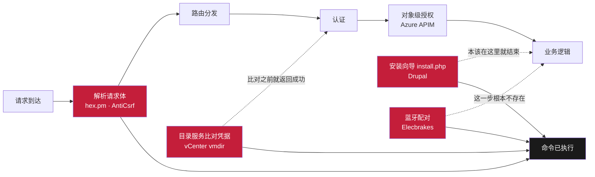
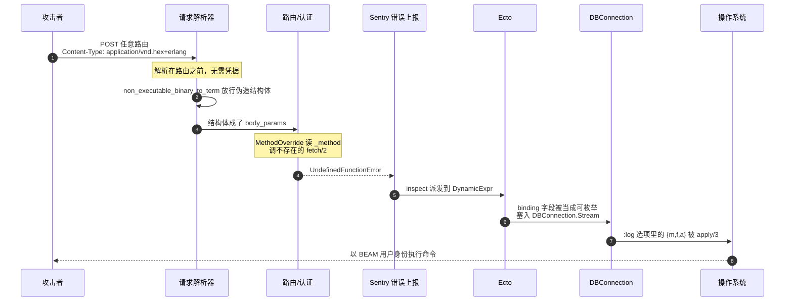
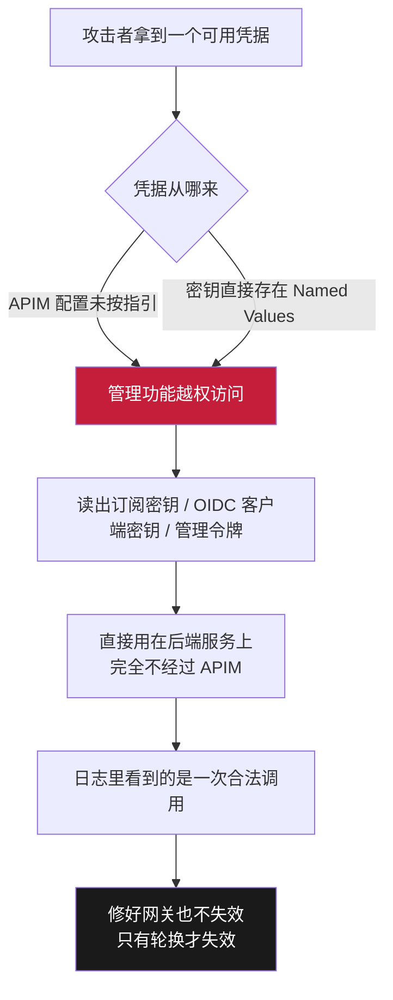
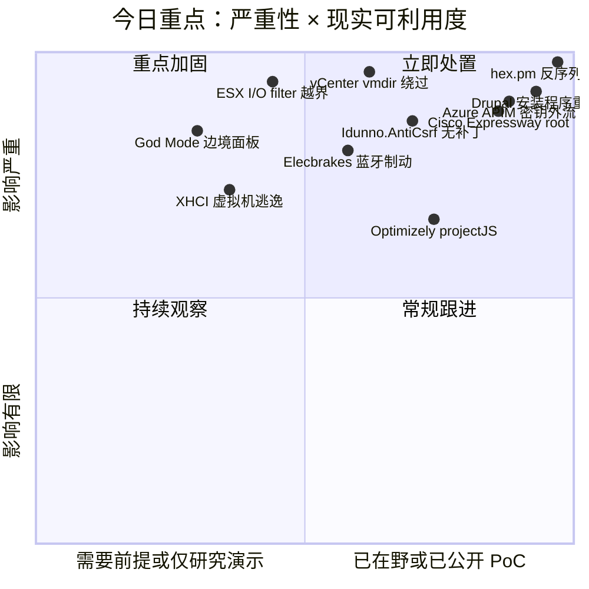
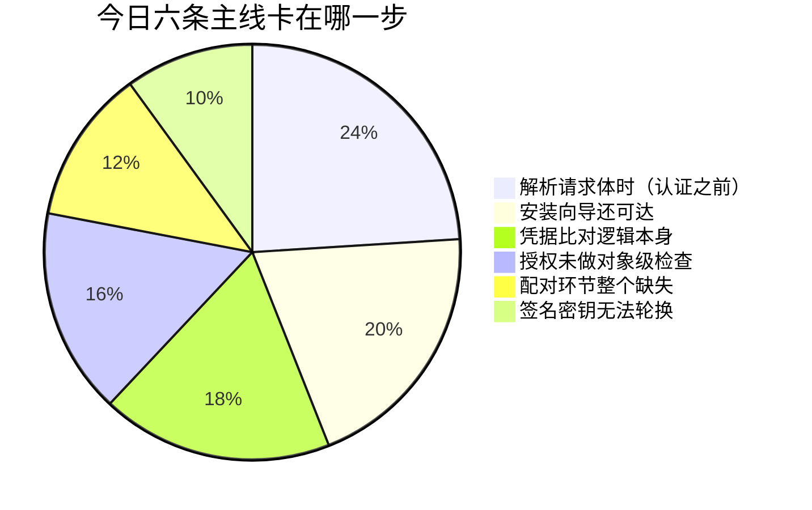
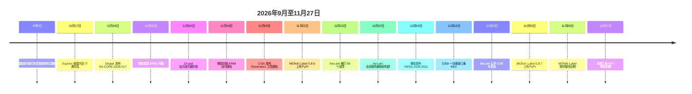

# 网安日报速递 · 2026年11月25日（第 227 期）

> 今日关键词：解析器跑在路由和认证之前 · 安装程序假设站点还不存在 · 目录服务在比对凭据之前就放行 · 反序列化赶在签名校验前面执行 · 蓝牙这一步压根没有配对 · 密钥存在网关里没人搬去保险箱

---

## 一、今日主线：认证还没开始，请求已经被执行了

今天六条主线，位置惊人地一致：全都卡在「身份检查」之前那几步。有的在解析请求体，有的在安装向导，有的在配对流程，有的在签名校验。检查本身没写错，只是它排在执行后面。

一句话总结：**校验写在执行之后，等于没有校验。**

---

## 二、头条：hex.pm 拿到 10.0，从第一个请求到修好用了 20 分钟

Elixir / Erlang / Gleam 生态的官方包仓库 hex.pm，在 11 月 23 日 18:16 UTC 被打了 69 个请求，命令跑在六台 Web 服务器上。Hex 自己的复盘写得很清楚，这是今年披露质量最高的一份事件报告。

### 2.1 漏洞机制

- **编号：**CVE-2026-129514，CVSS 4.0 **10.0**，CWE-502
- **入口：**endpoint 里一个自定义解析器处理 `application/vnd.hex+erlang` 请求体，用的是 `Plug.Crypto.non_executable_binary_to_term/2` 加 `[:safe]`
- **关键：**解析器跑在**路由和认证之前**，任何一个路由上的未认证 POST 都能碰到它
- **绕过：**解码器拒绝函数和新原子，但从不检查 map。Elixir 的结构体就是一个带 `__struct__` 键的 map，所以攻击者可以伪造任意结构体
- **链：**`Plug.MethodOverride` 读 `body_params["_method"]` → 结构体上调用不存在的 `fetch/2` → 抛 `UndefinedFunctionError` → Sentry / Bandit 对栈参数调 `inspect` → `Inspect` 是协议，选 `Ecto.Query.DynamicExpr` → 枚举 `binding` 时把 `DBConnection.Stream` 塞进去 → `Enumerable` 调 `reduce/3` → 错误路径执行 `:log` 选项里的 `{module, function, args}` 三元组 → `apply/3` → 操作系统命令
- **存在时间：**git 历史显示那行安全检查是 **2016 年 2 月 23 日**被移除的，十年

### 2.2 时间线

| UTC 时间 | 事件 |
|---|---|
| 18:14:21 | 攻击者两个地址的第一个请求（任意类型） |
| 18:16:00 | 第一个利用请求，Sentry 同时记下错误 |
| 18:16:46 | 第一台服务器上出现落地文件，距请求 3 毫秒 |
| 18:23:55 | 运维第一次在服务器上动手 |
| 18:27 | 加防火墙规则，18:30 至 18:33 完全生效 |
| 18:28 | 一次重启拉起三台仍在旧构建上的服务器，受影响的机器由三变六 |
| 18:29:33 | 最后一个成功到达服务器的利用请求 |
| 18:30–18:31 | 所有 Web、Worker、Job 服务器换成打了补丁的构建 |
| 18:33:48 | 之后攻击地址的请求全部被拒 |
| 18:49 | 停用受影响服务器使用的 AWS 访问密钥 |
| 19:07 | 收到一封描述同一漏洞的安全报告邮件 |
| 20:21 | 大部分基础设施凭据完成轮换，数据库密码次日 |
| 22:58 | 向瑞典 IMY 报告个人数据泄露 |
| 11-24 10:42 | 除注册表签名密钥外的凭据全部轮换 |
| 11-24 13:48 | 公开 CVE-2026-129514 |

### 2.3 能确认与不能确认

- **能确认：**没有包被改（23 个发布全部对得上审计日志，62 个包文件、186 个注册表文件校验和全对）、没有数据库写入（用 18:13:59 的备份逐行比对）、没有留下 shell、没有新增密钥或账号
- **不能确认：**数据库**读**没有日志。攻击者可能读到了邮箱、bcrypt 密码哈希、HMAC-SHA256 的 API 密钥哈希、2FA 密钥、会话、审计日志
- **没换的：**注册表签名密钥。现有系统不支持轮换，新的签名体系要等客户端更新；在那之前 Hex 的建议是只从 `repo.hex.pm` 取包，不要用任何镜像

### 2.4 同一类链还在别处

Hex 顺手发现了三个同源问题：

| 编号 | 组件 | 说明 | 状态 |
|---|---|---|---|
| CVE-2026-133555 | db_connection 1.1.0–2.10.2 | 就是这条链的落点，执行流里的 `:log` 回调 | 2.10.3 修复 |
| CVE-2026-124283 | ash | keyset 分页游标接受伪造结构体 | 3.38.0（11-24） |
| CVE-2026-130411 | flop 0.8.0–0.29.1 | 游标用 `binary_to_term` 解码 | 已修 |

**值得关注的原因：**

1. **「非可执行」不等于安全。**`non_executable_binary_to_term` 这个函数名本身就是一种安慰：它挡的是函数和原子，不是结构体。名字给了审查者一个错误的结论。
2. **一次解析，全站失守。**解析在路由之前，所以哪个路由写了认证都没用。这类 bug 的位置比逻辑更致命。
3. **报错路径是被忽略的攻击面。**真正执行命令的是错误上报那一段 —— 没人会去给 Sentry 做威胁建模。
4. **二十分钟是运气加流程。**18:16 出事，18:23 人才动手，18:27 才封，中间还有一次重启拉起了三台旧机器。换成没有值班的团队，十七分钟足够做很多事。
5. **签名密钥换不了。**修漏洞是一天的事，换信任根是一个版本周期的事。

---

## 三、Drupal：安装程序还在，站点被重装了

**CVE-2026-132165**，CVSS 未公开具体分值，CISA 归为远程代码执行，11 月 24 日进 KEV，联邦整改期限 **11 月 27 日**。

| 环节 | 事实 |
|---|---|
| 修复发布 | 11-18，SA-CORE-2026-017，评级 highly critical |
| 修复版本 | 10.6.22 / 11.3.22 / 11.4.13 |
| 首次在野利用 | 11-19 19:00 UTC，项目安全团队自行确认 |
| 距修复 | **约 1 天** |
| 进 KEV | 11-24 |
| 机制 | 未认证攻击者通过 `install.php` 尝试在已有站点上重装 Drupal |

安装程序是为「还没有站点」的世界写的。那个世界里没有东西需要保护，所以它不做运行中应用会做的那套检查。站点装好之后这段代码路径如果还能到，假设就崩了。

拿到重装流程等于拿到数据库和配置的控制权，再往上一步就是服务器上的代码执行。Drupal 团队没有公开具体前置条件，所以「我的托管环境安全吗」这种判断目前都是猜。可操作的读法只有一句：**跑在受影响分支上，且安装程序可达，就先当作已暴露。**

**值得关注的原因：**

- 补丁到利用 1 天，这个节奏已经不允许「下个维护窗口再说」。
- 安装向导、设置页、初始化脚本轮番出现在公告里，因为它们的作者从没把「装完之后」当需求。
- KEV 只给三天。11-18 没升的站点，要查的不是版本，是日志。

---

## 四、vCenter 又一条 9.8：五天内第二个认证绕过

Broadcom 11 月 24 日发布 **VMSA-2026-0011**，一次修 23 个漏洞，四个 critical。三个 9.8：

| 编号 | 组件 | 类型 | 分数 |
|---|---|---|---|
| CVE-2026-123903 | VMware Directory Service（vmdir） | 认证绕过 | 9.8 |
| CVE-2026-123910 | ESX I/O filter 服务 | 堆越界写 | 9.8 |
| CVE-2026-123911 | ESX I/O filter 服务 | use-after-free | 9.8 |
| CVE-2026-123912 | XHCI USB 控制器 | 缓冲区越界（VM 逃逸类） | 9.3 |

修好的版本：vSphere / Cloud Foundation 9.1.x 升 9.1.2，9.0.x 升 9.0.2.0300，vCenter 8.0 升 8.0 U3m，Cloud Foundation 5.x 升 5.2.5。vCenter 7.0 要找支持。

几个必须说清的边界：

- 123903 与 11 月 19 日那条 **CVE-2026-123890 是两个不同的洞**。后者被 Mandiant 认定由疑似中国背景的 **ARMORY CASTLE**（原 UNC5221）自 2026 年 9 月起作为零日利用，工具名 **BONESAW**，路径是拿管理员会话、偷数据、建一个新的 SSO 管理员账号，再伪造认证令牌维持访问。
- 123910 / 123911 在网络可达的情况下就能在 ESX 主机上执行代码，不需要先进虚拟机。I/O filter 是存储和复制产品挂进去的框架，不是没人用的角落。
- Broadcom 没有把任何一个标为已利用。SecurityWeek 提醒过，这家很少在公告里写利用状态，**沉默不等于安心**。

**值得关注的原因：**

- 五天里两个 vCenter 认证绕过，其中一个已经有零日在野。有能力的一方现在就在 diff 这两个补丁。
- vmdir 是 SSO 的地基。绕过它拿到的不是某台机器的权限，是整套虚拟化环境的管理权。
- 123912 这类在 ESX 上有 VMX 沙箱兜着，在 Workstation / Fusion 上直接是桌面主机代码执行。同一段代码，落点不同，分数差 1 分，后果差一个数量级。

---

## 五、Idunno.AntiCsrf：一个没人维护的库，补丁不存在

**CVE-2026-131914**，CVSS 9.3，ASP.NET 上的 `Idunno.AntiCsrf` 0.9.1 Beta 及更早版本。双重提交 cookie 与表单字段的校验路径里做了不受信任数据反序列化，远程未认证攻击者可以通过对象注入执行代码。

11 月 24 日进 KEV，期限同样是 **11 月 27 日**。CISA 在条目里直接写了：受影响产品可能已 EoL / EoS，建议停用或迁移到受支持版本。也就是说，**没有官方修复版**。

**值得关注的原因：**

- 一个反 CSRF 库的工作是校验请求是否来自本站。它把「校验」和「解析」写在同一段里，结果在校验完成之前先解析了。
- ASP.NET WebForms 项目里这类小库的存活周期极长，很多是十年前引进去的，依赖清单上早就没人看。
- KEV 给三天，但厂商给不出补丁 —— 这种组合下唯一的动作是找出来、断掉、换掉。

---

## 六、Elecbrakes：四个字节，在高速上把拖车刹停

三份 CVE，CISA 11 月 19 日发 ICSA-26-323-02：

| 编号 | 类型 | 分数 | 后果 |
|---|---|---|---|
| CVE-2026-96805 | 控制路径缺认证（CWE-306） | 9.6 | 范围内任意蓝牙设备可施加任意力度制动 |
| CVE-2026-125273 | 无重放保护（CWE-294） | 9.6 | 命令无序号无 nonce，抓一条就能重放，最后一条跨会话保留 |
| CVE-2026-124281 | 固件更新通道（CWE-749） | 6.1 | 解密密钥打包在 App 里，完整性只靠 CRC32 |

- **受影响：**EB2 ≤ 3.0.4.2.0，VM1 < 1.3.4.2.1，已停产的 ELBC 2000 全部版本
- **修复：**EB2 3.0.4.4.3、VM1 1.3.4.2.1，7 月 6 日就发了，但**要在 App 里手动点**。厂商说日常在连的设备里约 60% 到 70% 已经在新固件上
- **范围：**约 10 到 100 米。断了连接 2 到 5 秒后刹车释放，所以站着不动的人能一直按住
- **发现过程：**研究者的车内遥控器在开车途中自己连上了别人的拖车，没有配对、没有提示。最常见的是塔斯马尼亚州政府那批测速拖车
- **背景重量：**满载船拖车 1.5 到 4 吨。研究者的话：「这东西往公共道路上的轮子输出扭矩，衡量单位是刹车距离、折叠角度和船坡道。」

一个值得记住的细节：两位研究者说，这次分析反编译 App 用了 AI 编程助手。「这类研究以前需要一个相当稀有的技能组合，现在需要好奇心、一台自己的设备，和一个读字节码比人快的 AI。」

**值得关注的原因：**

- 攻击面是「蓝牙范围内的任何人」，所需技能是「会写四个字节」，受害者选择是「可选」。
- 同型号设备卖到澳新两地，装在拖车上跟着车跑，不在任何资产管理清单里。
- 修好的是新出厂和新升级的。剩下三成，只能靠车主自己想起来去点那个按钮。

---

## 七、Azure API Management：密钥在网关里躺了多久，没人知道

这条**没有 CVE 编号**。微软通过 Azure Service Health 发了通告 **MZK9-GH0**：11 月 18 日发现问题，19 日封掉访问路径，微软托管的实例已经全部打了缓解，客户不需要动手。

- **受影响：**APIM **Classic** 的 Developer / Basic / Standard / Premium 四档。Classic Consumption 与全部 v2 档不受影响
- **前提：**实例没有按微软推荐的安全配置来 —— 具体是没按网络访问指引做，或者把密钥直接存在 APIM 里而没引用 Key Vault
- **可能泄露：**Named Values 里的机密、身份提供方与 OpenID Connect 的客户端密钥、订阅密钥、调用管理 API 用的令牌
- **关联事件：**挪威 NSM 把这条和针对 **Equinor**（11-17 披露）、**Skagerak Energi**（11-18 披露）的攻击联系起来。两家都说没有数据被窃取或篡改、生产未受影响。NSM 说利用范围仍不清楚
- **自检：**网关的 `RuntimeVersion` 需在 0.52 线 31936 以上，或 0.53 线 31938 以上

**值得关注的原因：**

- 修的是门，不是已经流出去的钥匙。微软自己在通告里写明：缓解**不会**让修复前可能被拿走的凭据失效。
- 网关是「所有后端服务的钥匙串」。拿网关的权限等于拿一串钥匙，而且每一把都能在网关之外单独使用。
- 没有 CVE 意味着漏洞扫描器不会报。没有 CVE 也意味着「我们没受影响」这句话没有自动化证据，只能自己去查 `RuntimeVersion` 和日志。

---

## 八、速览

**1. God Mode：六个国家的边境系统，管理面板能搜出来**

独立研究者 Eaton Zveare 在尼日利亚、埃塞俄比亚、赞比亚、斯里兰卡、斐济、加纳的在线签证与边境系统里发现 BOLA、BFLA 和缺失认证。尼日利亚一国约十二条，其余各若干。能看的是数百万申请人的签证与护照数据（部分含生物特征），能做的是**批准或拒绝入境**。起点很朴素：一年前在必应搜「admin panel」。细节留到 12 月 10 日 Black Hat Europe。多数问题在披露时已修，修复周期从几天到半年多。研究者提到尼日利亚那套系统大量依赖 AI 生成代码。

**2. Optimizely：注册流程改的是别人网站上的 JS**

CVE-2026-132224，CVSS 7.1，11 月 17 日之前的 Web Experimentation。账号注册流程处理不当，导致 `cdn.optimizely.com` 上某些资源的 `projectJS` 字段里可以放攻击者控制的代码。结果是这段 JS 在访问受影响客户站点的浏览器里执行。托管服务侧 11-17 已修，11-24 进 KEV，期限 11-27。第三方脚本的老问题：修在服务端，跑在千万个别人的页面上。

**3. Cisco Expressway：root 权限，在野，已经过了整改期**

CVE-2026-76466，9.8。硬编码凭据加持久 cookie，加上客户端证书校验不足，未认证远程可以拿到 root。莫斯科的 F6 报告了首例已知利用：先打两台互联网暴露设备，再用自定义脚本横向、扫网、捞数据。CISA 11-20 收录，**整改期 11-23 已过**。自查两条：节点 Erlang 日志里找 `nodeup 'wombat@127.0.0.1'`，以及 `/mnt/harddisk/` 下有没有被投放的 Python 脚本。无临时缓解，只能升。

**4. MONAI Label 更正：新版已经能装到了**

昨天本报告写「PyPI 上仍是 0.8.5」，这句已经过时。核对 PyPI：**0.8.6 于 11 月 22 日上传，0.8.7 于 11 月 25 日上传**。0.8.7 是目前最新。CISA 给联邦机构的期限是 11 月 26 日，会用到这个工具的研究机构今天该升了。同时提醒一句：开了认证也不算修好，ANNOTATOR 这个低权限角色本身就够触发。

**5. 三条 APT 动向，共同点是「不用自己的基础设施」**

- **Webworm**（中国背景，间谍）把开源的 SoftEther VPN Bridge 改了一个版本，内部叫 **NtMonitor VPN**，剥掉特征、改掉流量指纹，混在正常管理流量里做隐蔽远控。排查方向是终端上有没有非授权的 VPN bridge 二进制。
- **Inception**（新追踪的勒索团伙）在大规模电话钓鱼，冒充 IT 支持让人在几十个诱饵域名上完成 SSO 登录，绕开 MFA 之后进云 SaaS 仓库偷数据。
- **Volant Manticore**（伊朗背景）用 64 位 Windows 后门 **KuboShell** 打塞浦路斯和沙特的医疗行业，C2 走 **IPFS** 点对点网络，域名封堵对它无效。

**6. 今日数据**

| 指标 | 数值 |
|---|---|
| NVD 窗口条目（11-24 00:00 至 11-25 13:00 UTC） | 2,613 条 |
| 其中 7.0 以上 | 801 条 |
| 其中 9.0 以上 | 122 条 |
| 其中 10.0 | 11 条 |
| KEV 目录（2026.11.24 版） | 1,795 条 |
| KEV 中标注已用于勒索 | 362 条 |
| 本期新增 KEV | 3 条，均 11-27 到期 |

---

## 九、风险分析

---

## 十、给今天的三条动作

1. **查 hex.pm 账号。**改密码，重置 2FA（会拿到新密钥和新恢复码）。客户端下次更新前只用 `repo.hex.pm`，把 `HEX_MIRROR`、`HEX_MIRROR_URL`、`mirror_url` 都清掉。自建 hexpm 的，确认解码器拒收带 `__struct__` 的 map。
2. **Drupal 站点别只看版本。**11-18 之前没升的，现在要看 11-19 19:00 UTC 之后的访问日志里有没有 `install.php`。KEV 给了三天，重点在「有没有被进过」。
3. **vCenter 与 APIM 一起看。**vCenter 升到 9.1.2 / 9.0.2.0300 / 8.0 U3m，管理面移出不可信网络；APIM Classic 查 `RuntimeVersion`，然后把 Named Values 里的密钥全轮换一遍 —— 这一步和补丁无关，补丁救不了已经出去的钥匙。

---

## 十一、相关出处

| 来源 | 内容 | 链接 |
|---|---|---|
| Hex 官方博客 | 事件复盘、完整时间线、逐步利用链 | https://hex.pm/blog/security-incident-on-hexpm |
| CVE Program（EEF CNA） | CVE-2026-129514 记录 | https://cna.erlef.org/cves/CVE-2026-129514.html |
| GitHub Security Advisory | GHSA-9pmm-hf4r-27pg | https://github.com/hexpm/hexpm/security/advisories/GHSA-9pmm-hf4r-27pg |
| GitHub 修复提交 | 拒绝带 `__struct__` 的 map | https://github.com/hexpm/hexpm/commit/379b0a29bcc95164249f38ad7d772a37a8ff9533 |
| NVD | CVE-2026-129514（10.0） | https://nvd.nist.gov/vuln/detail/CVE-2026-129514 |
| CISA | 11-24 新增三条 KEV 通告 | https://www.cisa.gov/news-events/alerts/2026/11/24/cisa-adds-three-known-exploited-vulnerabilities-catalog |
| CISA KEV JSON | 2026.11.24 版，1,795 条 | https://www.cisa.gov/sites/default/files/feeds/known_exploited_vulnerabilities.json |
| Drupal 安全公告 | SA-CORE-2026-017 | https://www.drupal.org/sa-core-2026-017 |
| NVD | CVE-2026-132165 | https://nvd.nist.gov/vuln/detail/CVE-2026-132165 |
| Broadcom | VMSA-2026-0011 | https://support.broadcom.com/web/ecx/support-content-notification/-/external/content/SecurityAdvisories/0/26201 |
| NVD | CVE-2026-123903 | https://nvd.nist.gov/vuln/detail/CVE-2026-123903 |
| Mandiant / Google TAG | ARMORY CASTLE 与 BONESAW 相关分析 | https://cloud.google.com/blog/topics/threat-intelligence |
| NVD | CVE-2026-131914 | https://nvd.nist.gov/vuln/detail/CVE-2026-131914 |
| CISA ICS 通告 | ICSA-26-323-02 Elecbrakes | https://www.cisa.gov/news-events/ics-advisories/icsa-26-323-02 |
| Element Digital | Elecbrakes 研究报告 | https://www.elecbrakes.com/ |
| NVD | CVE-2026-96805 | https://nvd.nist.gov/vuln/detail/CVE-2026-96805 |
| Microsoft | Azure Service Health 通告 MZK9-GH0 | https://azure.status.microsoft/en-us/status |
| 挪威 NSM | APIM 漏洞处置建议 | https://nsm.no/ |
| Equinor | 11-17 攻击披露与 11-20 进展 | https://www.equinor.com/news |
| Dark Reading | God Mode 六国边境系统 | https://www.darkreading.com/vulnerabilities-threats/god-mode-flaws-wreak-border-control-havoc |
| NVD | CVE-2026-132224 | https://nvd.nist.gov/vuln/detail/CVE-2026-132224 |
| Cisco | Expressway 安全公告 | https://sec.cloudapps.cisco.com/security/center/content/CiscoSecurityAdvisory/cisco-sa-expressway-authbypass |
| NVD | CVE-2026-76466 | https://nvd.nist.gov/vuln/detail/CVE-2026-76466 |
| NVD | CVE-2026-133968（MONAI Label） | https://nvd.nist.gov/vuln/detail/CVE-2026-133968 |
| PyPI | monailabel 版本与上传时间 | https://pypi.org/project/monailabel/#history |
| Amazon Threat Intelligence | Cairn 智能体自主利用零日 | https://aws.amazon.com/blogs/security/ |
| NVD API 2.0 | 本期窗口 2,613 条、9.0 以上 122 条 | https://services.nvd.nist.gov/rest/json/cves/2.0 |

---

*免责声明：本报告基于公开信息整理，CVE 编号、CVSS 评分以官方源为准。hex.pm 事件中的「六台服务器」为 Hex 自述口径，其中三台由 18:28 的重启拉起。Azure API Management 一条截至发稿无 CVE 编号，微软通告仅通过 Azure Service Health 发布。Elecbrakes 三份 CVE 的 CVSS 3.1 与 4.0 双口径存在差异，本文采用 CISA 通告口径。本文对恶意活动只记录技术事实，不转述归因结论。*
