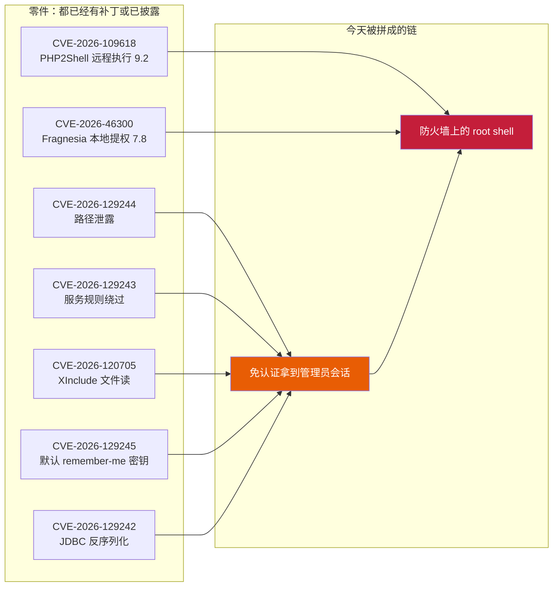
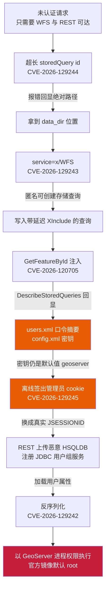
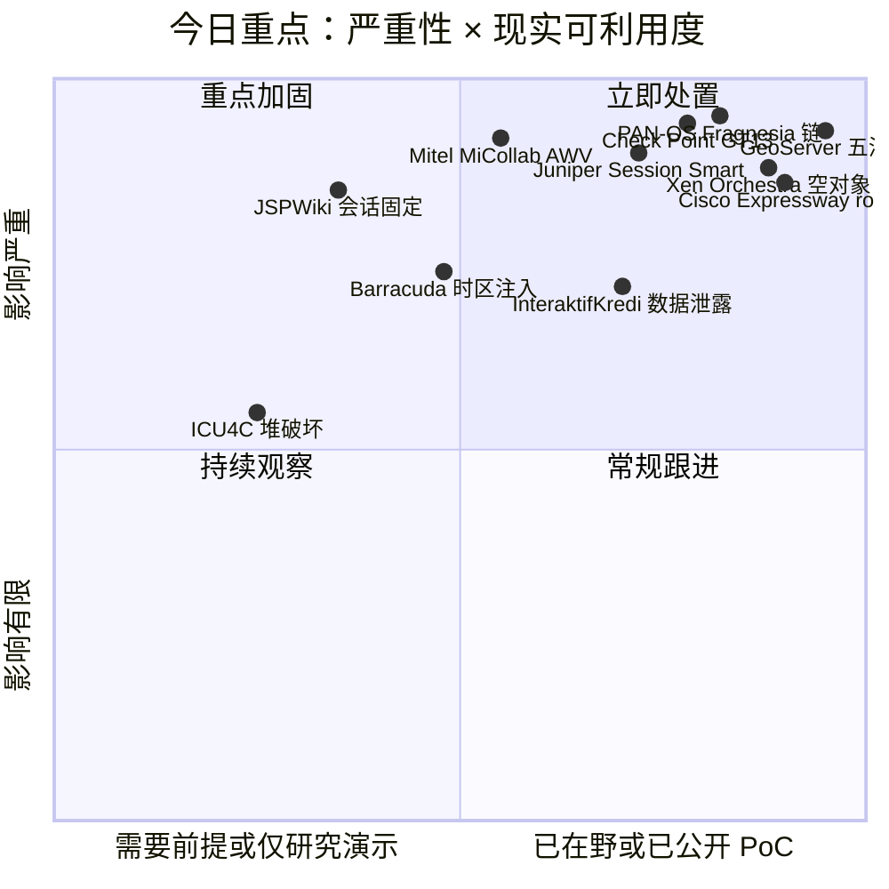
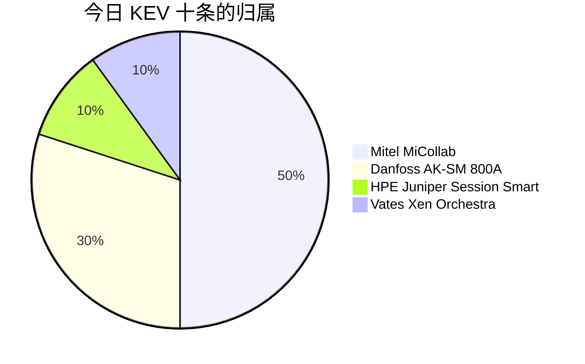
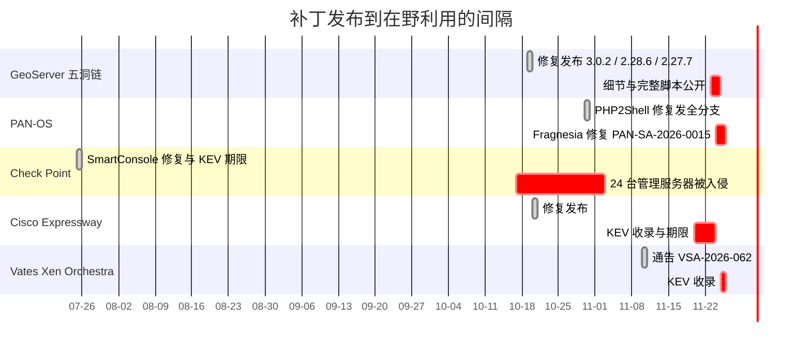
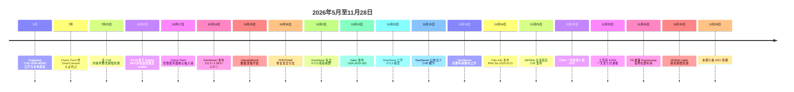

# 网安日报速递 · 2026年11月26日（第 228 期）

> 今日关键词：五个洞没有一个是零日 · 只修其中一个真的等于白修了 · 本地提权接在远程执行后面 · 七月发的补丁到十月还在被人利用 · 登录成功之后也没有换掉会话 · 一个空对象就换来了管理员权限

---

## 一、今日主线：洞都是旧的，链是今天才拼好的

今天六条主线，没有一条用到零日。

GeoServer 那五个 CVE，单看都是「信息泄露」「授权绕过」这种不够格单独上头条的东西；PAN-OS 的 Fragnesia 是一个五月就公开的本地提权，脱离 RCE 什么也不是；Check Point 的 SmartConsole 认证绕过七月就修了，KEV 期限七月二十五日；Cisco Expressway 的硬编码凭据十月发了补丁；Xen Orchestra 的空对象 token 十一月十日就有通告，攻击者当天就在用。

零件全是旧的。今天新的只有拼装方式。



一句话总结：**分级是给单个漏洞打的，攻击者看的是组合。**

---

## 二、头条：GeoServer 五个洞串成一条链，全程不需要密码

十个国内安全团队在两天内先后复现了同一条链。它不是某个组件的高危漏洞，而是五个各自「中等偏上」的缺陷在默认配置下正好能连起来，从一次未认证的 WFS 请求走到 `uid=0(root)`。

### 2.1 涉及的五个 CVE

| CVE | 组件 | 问题 | 单独看是什么 |
|---|---|---|---|
| CVE-2026-129244 | gs-wfs | storedQuery 的 id 映射成数据目录里的文件名，超长 id 触发文件系统异常，异常报告把数据目录绝对路径回显给客户端 | 信息泄露 |
| CVE-2026-129243 | gs-ows | `service=x/WFS` 时调度器截掉前缀按 WFS 处理，安全检查仍用原值 `x/WFS` 匹配规则，一条都不命中 | 授权绕过 |
| CVE-2026-120705 | gs-wfs-core、gt-metadata | WFS 2.0 的 `GetFeatureById` 把调用方传入的 id 未转义拼进 XML 模板，替换后的 XML 又没走配置好的实体解析器，可注入 `xi:include` | 任意文件读 + SSRF |
| CVE-2026-129245 | gs-main | remember-me cookie 的签名密钥取自 `security/config.xml`，发行版默认值是固定字符串 `geoserver`，极少有人改 | 会话伪造 |
| CVE-2026-129242 | gs-sec-jdbc | JDBC 用户/角色服务用 `ResultSet.getObject()` 读属性，HSQLDB 的 OTHER 列会经无过滤的 `ObjectInputStream` 还原 | 代码执行 |

链条顺序就是上面这个顺序，一环给下一环递钥匙：



### 2.2 为什么这条链特别顺

因为 GeoServer 的默认发行包把两件本来该分开的东西放在了一起：JDBC 用户/角色服务模块和 HSQLDB 驱动，都随标准包提供，而这个服务默认不注册。不注册意味着没人会去审它，但只要有管理员会话，一个 REST 请求就能把它注册上，反向打开执行入口。

固定 remember-me 密钥是第二件事。Spring Security 的签名算法是公开的，密钥是固定的，口令摘要在上一步已经读到了，签一个合法 cookie 不需要知道管理员口令，也不需要破解任何东西。

两项默认值单独存在时都只是「配置不严」。叠在一起，第四条把第三条读到的文件变成会话，第五条把会话变成命令。

### 2.3 影响面与修复

- **受影响版本：**2.27.6 及以下、2.28.0 至 2.28.5、3.0.0 至 3.0.1
- **修复版本：**3.0.2、2.28.6、2.27.7（官方十月十九日发布，十一月二十三日公布细节）
- **完整链评分：**CVSS 3.1 **9.8**，奇安信评级高危，安恒零日雷达 1 级
- **资产测绘：**国内风险资产 3,852 个、关联 IP 345 个；全球 18,412 个、1,536 个 IP
- **PoC 状态：**已公开，十一月二十四日出现完整利用脚本；在野利用暂未确认

时间线要看清：修复在十月十九日，细节十一月二十三日，完整脚本十一月二十四日。也就是说，拿到补丁的窗口有整整一个月，而多数人的升级动作发生在脚本公开之后。

### 2.4 值得关注的原因

- **分级体系在这条链上是失效的。**五个 CVE 里挑任何一个单独打分都不会给到 9.8，但没有一个 9.8 能描述「串起来」这件事。
- **只修一个真的不够。**把 120705 修了，攻击者可以走 SSRF 拿密钥；把 129245 修了，密钥仍是默认值。官方公告里写得很直白：修其中一处只能提高门槛。
- **默认值是最贵的负债。**`geoserver` 这个字符串在发行版里躺了十几年，改它只需要一次配置，不改的代价是整条链的最后一环免费。
- **国内暴露量真实。**三千八百多个资产不是估算，是测绘结果，而且 GeoServer 在政务、测绘、自然资源系统里是标配。

---

## 三、CISA 一天收十条进 KEV：六条周六到期

十一月二十五日，CISA 一次往 KEV 里加了十条。目录总数到 1,805 条（2026.11.25 版）。十条里六条整改期限是 **十一月二十八日**，也就是本周六。

| 产品 | CVE | 问题 | 期限 |
|---|---|---|---|
| HPE Juniper Session Smart Conductor / Router | CVE-2026-103406 | 构造 salt minion ID 触发 OS 命令注入，远程以 root 执行 | 11-28 |
| Vates Xen Orchestra | CVE-2026-133469 | 空 JSON 对象构成的认证 token 绕过认证，取得管理员权限 | 11-28 |
| Mitel MiCollab（AWV 组件） | CVE-2026-133323 等五个 | 未认证访问音视频会议组件，最高 10.0 | 11-28 / 12-09 |
| Danfoss AK-SM 800A | CVE-2023-25914、25915、2025-41450 | 路径穿越与认证不当，可导出含内网 IP、账号、门店名的报告 | 11-28 / 12-09 |

### 3.1 Juniper 这条只有三天

CVE-2026-103406 是 Session Smart Conductor 与 Router 里的 OS 命令注入，攻击面是一个 salt minion ID。也就是说，攻击者只要能往 Salt 主控递一个自己造的 minion 标识，命令就在 root 上下文里跑了。修复版本 7.0.5-14-lts、7.1.7-15-sts、7.2.3-8r2，没有 workaround。

Juniper 在十一月二十四日的更新里说，已观察到至少一例恶意利用。CISA 给的三天期限（25 日收录、28 日到期）说明这不是「理论上能打」。

### 3.2 Xen Orchestra 这条是上周的闭环

十一月二十四日本报告的头条是「一个空对象换来了管理员权限」，讲的就是 Vates 的 VSA-2026-062。当时状态是厂商通告加确认在野。今天它进了 KEV，攻击被追溯到十一月十日起。

值得注意的是修复版本口径有分歧：Vates 公告写 6.9.2（stable）与 6.10.1（latest），部分媒体转述成 6.9.1 与 6.10.0。升级前请按厂商页面核对，不要按新闻里的版本号装。

厂商自己的处置建议里有一条容易被跳过：确认被入侵的环境要**轮换所有密钥并重装**。Xen Orchestra 管的是 XCP-ng 宿主机，会话被伪造过就不只是 Web 层的事。

### 3.3 值得关注的原因

- **周六到期。**六条期限落在周末，值班表上得有人，不然周一会发现「过期三天」。
- **三条都在控制面。**路由管理、虚拟化管理、制冷控制器，全是你配置一次就再也不看的东西。
- **Danfoss 用的是 2023 年的编号。**CVE-2023-25914 到 2026 年才进 KEV，老设备被重新捡起来打是常态。

---

## 四、PAN-OS：五月的本地提权，接在十月的远程执行后面

Palo Alto 发布 PAN-SA-2026-0015，为 Linux 内核的 XFRM ESP-in-TCP 缺陷补上 PAN-OS 侧的修复。这个洞叫 Fragnesia，编号 CVE-2026-46300，本地提权，7.8，五月就公开了。

单看它没什么用，要先进系统。问题是十月有人找到了「先进系统」那一步。

### 4.1 四段链

```mermaid
stateDiagram-v2
    [*] --> 管理口暴露
    管理口暴露 --> httpd: 一次 multipart 请求打 change_password.php
    httpd --> nobody: PHP2Shell 触发 OOM 与 UAF
    nobody --> root: Fragnesia 覆写 pam.d/su 指向 pam_permit
    root --> 命令中继: 替换 change_password.php
    命令中继 --> [*]: 保留 health.php 做复打入口
```

三段在同一个 HTTP 请求里跑完。第一段用 PHP2Shell（CVE-2026-109618，9.2，`session.upload_progress` 的 OOM 型 use-after-free）拿到 `nobody`；第二段用 Fragnesia 往只读文件的页缓存里写，把 `/etc/pam.d/su` 换成 `pam_permit.so`，之后 `su` 不需要密码；第三段以 root 把 `change_password.php` 替换成一个能执行命令的中继，原文件与 PAM 配置备份，`health.php` 留着保活。

没有新端口，没有新守护进程。这也是它难被发现的原因：设备上什么都没多出来。

### 4.2 谁在打、打了多少

Dream 的报告口径：用 FOFA 扫到 19,182 个 PAN-OS 管理门户，指纹识别约 5,000 台，筛出 240 个目标，集中在中国台湾、美国、日本、韩国，最终 24 台防火墙加 1 台内部管理服务器被拿下。

Unit 42 在十月二十九日验证过这批发现，并给出暴露面比例：约 0.02% 的客户设备管理口对公网开放。这个数字很小，但分母是几十万台。

攻击侧还有一个细节值得记：Dream 描述的流程里有一个叫 aiscan 的平台自动读取攻击手册、下载工具、准备环境。Palo Alto 的公告没有对归因表态，只强调所有观察到的利用都从暴露的管理口开始。

### 4.3 修复与边界

20 个 hotfix 覆盖 10.2、11.1、11.2、12.1、12.2 五条线（10.2.7-h41、10.2.10-h45、10.2.13-h29、10.2.16-h14、10.2.18-h15、11.1.4-h40、11.1.6-h42、11.1.7-h14、11.1.10-h38、11.1.13-h18、11.1.16-h6、11.2.4-h25、11.2.7-h25、11.2.10-h19、11.2.13-h6、11.2.16-h3、12.1.4-h15、12.1.7-h15、12.1.10-h6、12.2.4-h3）。

公告本身给的是 informational，不评 CVSS，理由是「修的是上游内核问题，不是产品自身缺陷」。这个口径可以理解，但会带来一个操作后果：漏洞扫描器不会为它报警，资产清单上不会出现红点。

真正的边界在于第一步。十月三十日 PHP2Shell 的修复已经发全分支，打过那次补丁的设备，已知入口就是关着的。所以今天这件事正确的读法不是「又有新洞了」，而是「有一批设备从十月三十日到现在没升级」。

### 4.4 值得关注的原因

- **两次补丁之间有一个月的空窗。**PHP2Shell 修了，Fragnesia 没修，中间那一个月正好是链子能跑的时间。
- **本地提权单独评级永远偏低。**7.8 的分数会让人排到后面，但它决定了「进去之后能不能出来」。
- **不留新端口。**替换已有文件、复用已有端点，主机层巡检基本看不出来，只能靠文件完整性。
- **管理口是唯一的门。**所有观察到的利用都从公网可达的管理口开始，这条防线比补丁更便宜。

---

## 五、Check Point：24 台管理服务器，cookie 是自己签的

GreyNoise 十一月二十三日披露的行动，本周被各家安全媒体跟进。代号 GT13，身份未归属，22 家机构的 24 台 Check Point Security Management Server 被拿下，分布 17 个国家与地区，行业跨政府、金融、能源、交通、采矿、工程、制造。确认的活动区间是十月十七日到十一月二日，观察窗口从十月二日开始。

### 5.1 入口不是防火墙，是一台文件服务器

十月二日，攻击者先去打了一台 Rejetto HTTP File Server。手法很巧：HFS 的 `loginSrp1` 端点会下发带 `sid` 的签名会话 cookie，而 `sid` 来自 JavaScript 的 `Math.random()`。通过连续多次登录收集输出，攻击者重建了 V8 伪随机数生成器的内部状态，从而还原出 cookie 的签名密钥，签出一个管理员会话。

这是 CVE-2026-61500，那台服务器没打补丁。伪造的 cookie 里还带了 `allow_session_ip_change:true`，所以从任何 IP 都有效。

三天后，攻击者通过 HFS 的中间件钩子往 `/root/.ssh/authorized_keys` 追加公钥。十月二十日把这台机器改造成跳板：未认证 HTTP 服务用来上传工具，Nmap 加 Chisel 做反向代理服务端。GreyNoise 管它叫 ORB（operational relay box），并特意说明这不是 C2。

### 5.2 打管理服务器用的是七月的洞

后渗透阶段跑的是 CVE-2026-16232，Check Point SmartConsole 的认证绕过，未认证攻击者能拿到应用登录令牌，以管理员身份登录。这个洞七月就修了，也进了 KEV，联邦期限七月二十五日。四个月后还有设备没打。

用这条链，攻击者在多台管理服务器上跑了一百多个管理任务：

- 复制防火墙数据库
- 导出内部 CA 文件
- 签发新证书（`pivot.p12`）
- 卸载安全策略（实际效果等于把防火墙关了）
- 对 Citrix NetScaler、Ivanti Connect Secure、VMware vCenter、Exchange、Oracle TNS、域控做探测与后续利用

GreyNoise 统计的量级：99 个 IP（ExpressVPN 出口或被入侵的 Check Point 设备）、1,400 多次网络会话、800 多个命令行痕迹、1,200 多个文件操作。

### 5.3 十月二十六日那次失败，反而暴露了受害者

攻击者对全部 24 台发起了一次批量证书管理任务，全部失败。但错误日志回传时带着受害者 IP，还暴露出设备上有 `/etc/ld.so.preload` 指向 `/usr/lib/.libproc.so`，一个疑似植入物的痕迹。

GreyNoise 就是靠这批错误信息识别出大部分受害组织并通知的，一部分直接通知，一部分通过政府合作方。

### 5.4 值得关注的原因

- **拿到管理服务器，等于拿到它管的整片网络。**卸载策略这个动作不需要打任何一台防火墙。
- **PRNG 那条路值得单独记。**用 `Math.random()` 生成会话标识，攻击者拿到足够多的样本就能反推状态。这不是密码学问题，是「用了不该用的随机源」。
- **AI 这个结论要谨慎读。**GreyNoise 认为 GT13 用了智能体编排，依据是节奏、工具形态和行为自动化，没有捕获到模型调用记录。这属于评估，不是证据。
- **七月到十月，四个月。**KEV 期限过了四个月的设备还在被当成入口，这是今天所有故事里最重复的一条。

---

## 六、Cisco Expressway：脚本是 AI 写的，日志里留了 nodeup

CVE-2026-76466，9.8，集群模式下的 Expressway-C 与 Expressway-E，硬编码凭据加证书校验不足，未认证远程拿 root。思科十月披露并修复，当时说没看到滥用。

上周末变了。俄罗斯安全公司 F6 在十一月二十六日说，正在调查首例已观察到的利用。

### 6.1 打了什么

攻击者先拿下两台面向互联网的 Expressway 设备，通过其中一台进到该组织内部网络里另外两个集群节点。拿到 root 之后，投放的是定制 Python 脚本，用途很具体：

- 扫描受害者网络里通过 SMB 共享的文件与文件夹
- 与 SQL Server、WinRM 交互
- 在 GitLab 代码仓库里搜凭据和其他敏感信息

F6 说这些脚本的形态表明操作者用了 AI 助手。这句话和 Check Point 那条要放在一起看：同一个星期，两家不同厂商的响应团队，都在报告里写了「疑似 AI 辅助」。这已经不算新闻点，快成标准字段了。

### 6.2 自查两条

- Erlang 系统日志 `erlang.log` 里有没有 `wombat@127.0.0.1` 的节点加入记录
- `/mnt/harddisk/` 下有没有被投放的脚本

CISA 在十一月二十日收录，整改期限十一月二十三日，已经过了三天。

### 6.3 值得关注的原因

- **硬编码凭据在集群模式里。**单机部署不受影响这件事，会让很多人的资产清单直接跳过它。
- **两台变四台。**集群节点之间的信任关系是设计出来的便利，也是横向的现成路径。
- **AI 辅助的落点是「搜凭据」。**不是写 exploit，是写扫描和整理。这部分以前要人做几个小时。

---

## 七、土耳其一天发七份通报：77 万人的工资和逾期记录

KVKK（土耳其个人数据保护局）十一月二十五日一次公布七份数据泄露通报，是这个月单批最多的一次。最大的一份来自消费信贷比价平台 InteraktifKredi Danışmanlık，**769,779 人**。

### 7.1 怎么进去的

通报写得很具体：攻击者事先拿到了公司 ICRM（客户关系管理）系统的私有访问地址，以及一名公司管理员的登录凭据，然后通过经海外服务器跳板的 VPN 连进销售面板。

泄露的字段清单长到需要单独列：姓名、土耳其身份证号、出生日期、婚姻状况、手机与邮箱、省市、就业状态、行业与职业、申报工资与发薪银行、配偶申报收入、房车持有标记、信用分、风险与额度、信贷账户、逾期记录、自动评分结果。

这不是「邮箱和密码泄露」的量级。这是一个人能不能贷到款、能贷多少的完整底稿。

### 7.2 同一天的其他六份

- **Yeditepe 大学：**十一月十五日开始，次日发现，入口是一个面向公网的 POS 应用背后组件的缺陷；涉及教职员工与学生，含健康、宗教信仰、财务数据
- **Dorak Turizm 与 Ata Turizm：**两家旅游集团十一月十九日同一天遭勒索加密
- **Temeltaş İnşaat：**十一月十一日，会计员工点开钓鱼邮件，浏览器里缓存的 VPN 凭据被拿走
- **World Triathlon：**Metabase 实例泄露 1,673 人的数据，含健康信息

七份里有三份的起点是「凭据」：管理员凭据、VPN 凭据、浏览器缓存。没有一份的起点是零日。

### 7.3 值得关注的原因

- **私有访问地址不等于访问控制。**把管理面板放在一个猜不到的 URL 上，只挡住了扫描器，挡不住从别处拿到链接的人。
- **比价、信贷这类平台的数据密度极高。**它天然聚合了收入、负债、逾期，是身份欺诈的原材料。
- **一天七份说明通报机制在起作用。**土耳其这条链路（72 小时内上报、逐案公开）让「有没有被黑」不再是公关问题。

---

## 八、速览区

**1. Apache JSPWiki：登录了，会话没换，10.0**

CVE-2026-78114，CVSS 4.0 **10.0**，CWE-384 会话固定。2.10.0 到 3.0.0 全平台受影响，修复版本 3.0.1（3.x 线）与 2.12.6（2.x 线）。机制是认证成功后没有更换 session 标识：攻击者只要能先往受害者浏览器里塞一个已知的标识，登录之后照样能用。Apache CNA 在十一月二十五日发布。同日还有 CVE-2026-78111（附件页把 CSRF token 放进地址栏）与 CVE-2026-78099（CSRF 保护可绕过），都在 3.0.1 修。ZoomEye 用宽泛语法匹配到 626,685 条结果，这是索引量不是装机量，只能当线索。验证办法很土：登录前后抓两次 cookie，看标识有没有变。

**2. Jenkins Script Security：9.9，一个部分限定名**

CVE-2026-136835，9.9。1436.v1082791135e4 及更早版本在处理 `@Builder` 注解时，如果 `builderStrategy` 用的是部分限定类名，就不会拒绝它指向的任意类，导致沙箱脚本可以逃逸。前提是攻击者本身有「定义并运行沙箱脚本」的权限。但 Jenkins 里这个权限给得往往比想象中宽。

**3. ICU4C：字符集名可以打进堆里**

CVE-2026-137326，7.3，影响 ICU4C 至 79.1。`x11-compound-text` 转换器在克隆时共享 `extraInfo` 块却没有注册 `safeClone` 处理器，造成 use-after-free 与 double free。触发条件是应用把攻击者可控的字符集名传给 `ucnv_open()`，同时又调用 `ucnv_setSubstString()` 或做转换器克隆。修在 PR 4297 与 4376。这类库的问题在于：它在你依赖链的最底层，`ldd` 里能看到，资产清单里看不到。

**4. Barracuda：改个时区就能 root**

CVE-2026-111560，NVD 给 7.2，Mandiant 按 CVSS 4.0 给 8.6。六条产品线（Email Security Gateway、WAF、Web Security Gateway、Load Balancer ADC、Message Archiver、WAF Control Center）的时区配置字段没做 shell 元字符过滤，管理员权限可以注入命令并以 root 执行。已在 KEV 里。在 ESG 上它还能和登录绕过 CVE-2026-116606 串起来用，管理员权限这一步就不再是前提。

**5. Ever Gauzy 与今天的高分堆**

CVE-2026-135400，9.8。开源企业管理平台，111.44.3 之前版本，`jwt.strategy.ts` 里的每请求 JWT 校验直接接受了 `UserService.getIfExists` 的返回结果，用户不存在时校验等于空过。今天 NVD 窗口里 9.0 以上的还有三十条，大部分是这个形状：不是加密写错，是「查不到就当通过」。

**6. 今天该看的三件事**

一是 MONAI Label（CVE-2026-133968）的联邦整改期限就是今天，十一月二十六日。二是本周 KEV 新增披露的勒索受害者有 337 个，比上周多两个，发得最多的是 N0N。三是本期六条 KEV 在十一月二十八日（周六）到期，值班表上要有人。

---

## 九、风险分析







---

## 十、事件时间线



---

## 十一、数据与口径

- **NVD 窗口（11-25 00:00 至 11-26 13:00）：**新增 713 条，其中 615 条有评分；7.0 以上 226 条，9.0 以上 30 条，10.0 一条（CVE-2026-78114）。
- **CISA KEV：**2026.11.25 版 1,805 条，11-25 新增 10 条，六条期限 11-28。
- **GeoServer 资产数：**奇安信鹰图测绘，国内 3,852 个、全球 18,412 个，属「关联风险资产」口径，不等于可成功利用的数量。
- **PAN-OS 被入侵数量：**Dream 报告 24 台防火墙加 1 台管理服务器，Unit 42 验证了发现但未独立确认台数；暴露比例 0.02% 为 Palo Alto 口径。
- **土耳其通报：**数字来自 KVKK 公开通报与董事会决定编号（2026/2534、2026/2535、2026/2584、2026/2585、2026/2586 等）。
- **Xen Orchestra 修复版本：**Vates 公告写 6.9.2 与 6.10.1，部分媒体转述为 6.9.1 与 6.10.0，本文以厂商页面为准并保留分歧说明。

---

## 十二、相关出处

### GeoServer 五洞链

- 奇安信 CERT 风险通告（已复现，含资产测绘）：<https://www.secrss.com/articles/95982>
- 天融信阿尔法实验室逐条拆解：<http://mp.weixin.qq.com/s?__biz=Mzg3MDAzMDQxNw==&mid=2247497135&idx=1&sn=38665ad3d96449e6732a77f8b6f5ef14>
- 亚信安全研究院通告（含修复与缓解建议）：<http://mp.weixin.qq.com/s?__biz=MzcxMDQwMzAwMA==&mid=2247484058&idx=2&sn=e51fe6a450a7a0e40379a9f4db5fd2bb>
- 原始研究（CryptoCat）：<https://cryptocat.me/blog/research/analysis/geoserver_preauth_rce/>
- GitHub 安全公告 CVE-2026-129242：<https://github.com/geoserver/geoserver/security/advisories/GHSA-9wf2-fcgq-vxhq>
- GitHub 安全公告 CVE-2026-129245：<https://github.com/geoserver/geoserver/security/advisories/GHSA-hgm3-wq4h-8vvq>
- GitHub 安全公告 CVE-2026-120705：<https://github.com/geoserver/geoserver/security/advisories/GHSA-39mw-5chv-jh47>
- GitHub 安全公告 CVE-2026-129243：<https://github.com/geoserver/geoserver/security/advisories/GHSA-rv5g-g2r9-58rj>
- GitHub 安全公告 CVE-2026-129244：<https://github.com/geoserver/geoserver/security/advisories/GHSA-4v26-c537-jvxc>
- 官方下载与版本说明：<https://geoserver.org/download/>
- 高校漏洞通告（微软 RAPI 与 GeoServer 并列）：<https://inc.xmu.edu.cn/info/1041/9912.htm>

### CISA KEV

- KEV 官方 JSON（2026.11.25 版 1,805 条）：<https://www.cisa.gov/sites/default/files/feeds/known_exploited_vulnerabilities.json>
- 11-25 新增十条逐条说明：<https://eastbaycyber.com/kev/added/2026-11-25>
- 十条归属与期限汇总：<https://xcybernow.com/cisa-kev-juniper-mitel-xen-orchestra-danfoss>
- Threadlinqs 情报条目 TL-2026-6887：<https://intel.threadlinqs.com/threat/TL-2026-6887>
- Mitel 公告 MISA-2026-0012：<https://www.mitel.com/support/security-advisories>
- Vates 公告 VSA-2026-062：<https://xcp-ng.org/blog/>

### PAN-OS 与 Fragnesia

- Palo Alto 公告 PAN-SA-2026-0015：<https://security.paloaltonetworks.com/PAN-SA-2026-0015>
- 四段链技术拆解：<https://threataft.com/articles/palo-alto-panos-fragnesia-php2shell-root-chain>
- 修复版本与利用确认：<https://www.cve-db.com/article/palo-alto-networks-patches-fragnesia-flaw-used-to-root-firewalls-184a8f04>
- 公告发布与影响范围整理：<https://threatticker.com/news/palo-alto-ships-pan-sa-2026-0015-after-linux-kernel-fragnesia-flaw-is-chained>

### Check Point GT13

- GreyNoise 报告要点与时间线：<https://securitydaily.news/article/3769>
- 受害者分布与技术细节：<https://root2sec.com/news/hackers-compromise-check-point-servers-in-22-organizations>
- 证据边界与 CVE 清单：<https://theterminal.space/security/check-point-gt13-24-management-servers-greynoise>

### Cisco Expressway

- F6 首例在野利用与 IoC：<https://news.qq.com/rain/a/20261126A0708K00>
- 思科安全公告：<https://sec.cloudapps.cisco.com/security/center/content/CiscoSecurityAdvisory/cisco-sa-expressway-authbypass>

### 数据泄露与监管通报

- 土耳其 KVKK 一天七份通报：<https://threatticker.com/news/turkish-data-watchdog-publishes-seven-breach-notifications-in-one-day-as>
- KVKK 泄露通报页：<https://www.kvkk.gov.tr/Icerik/2038/Kisisel-Verileri-Koruma-Kurulu-Ilke-Karari>

### 速览条目

- Apache JSPWiki CVE-2026-78114：<https://brandefense.io/knowledge-hub/vulnerabilities/cve-2026-78114>
- Apache 邮件列表 CVE-2026-78111：<https://lists.apache.org/thread.html/o9o3chszhj17gs5rd689dhc020dpsh46>
- ICU4C CVE-2026-137326：<https://www.vulncheck.com/advisories/icu4c-through-79.1-use-after-free-and-double-free-via-ucnv-safeclone>
- Barracuda CVE-2026-111560：<https://softwsp.com/advisories/cve-2026-111560>
- 本周威胁情报周报（KEV 与勒索受害者）：<https://threatpodium.com/threat-intelligence-report-2026-11-26>
- NVD API 2.0（本期窗口 713 条）：<https://services.nvd.nist.gov/rest/json/cves/2.0>

---

*本期为第 228 期。所有 CVE 编号、评分与时间戳以官方公告为准；涉及利用状态时区分「厂商确认」「第三方观察」「媒体转述」三种口径。*
