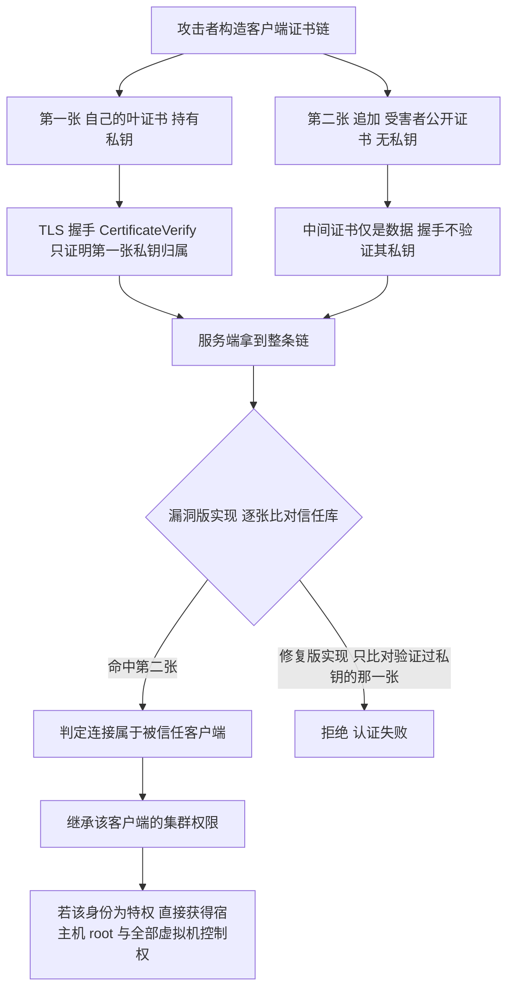
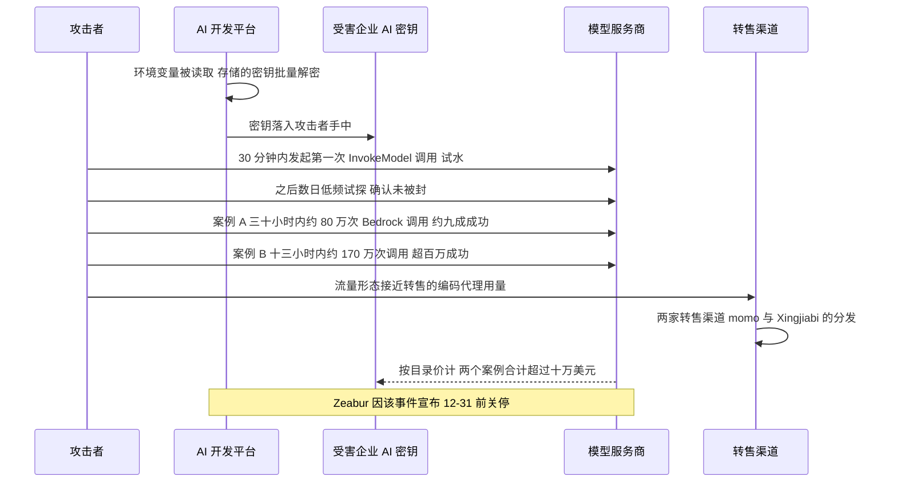
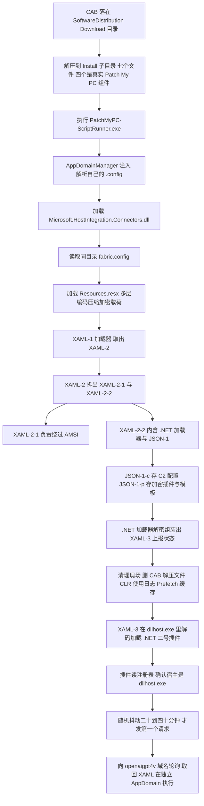
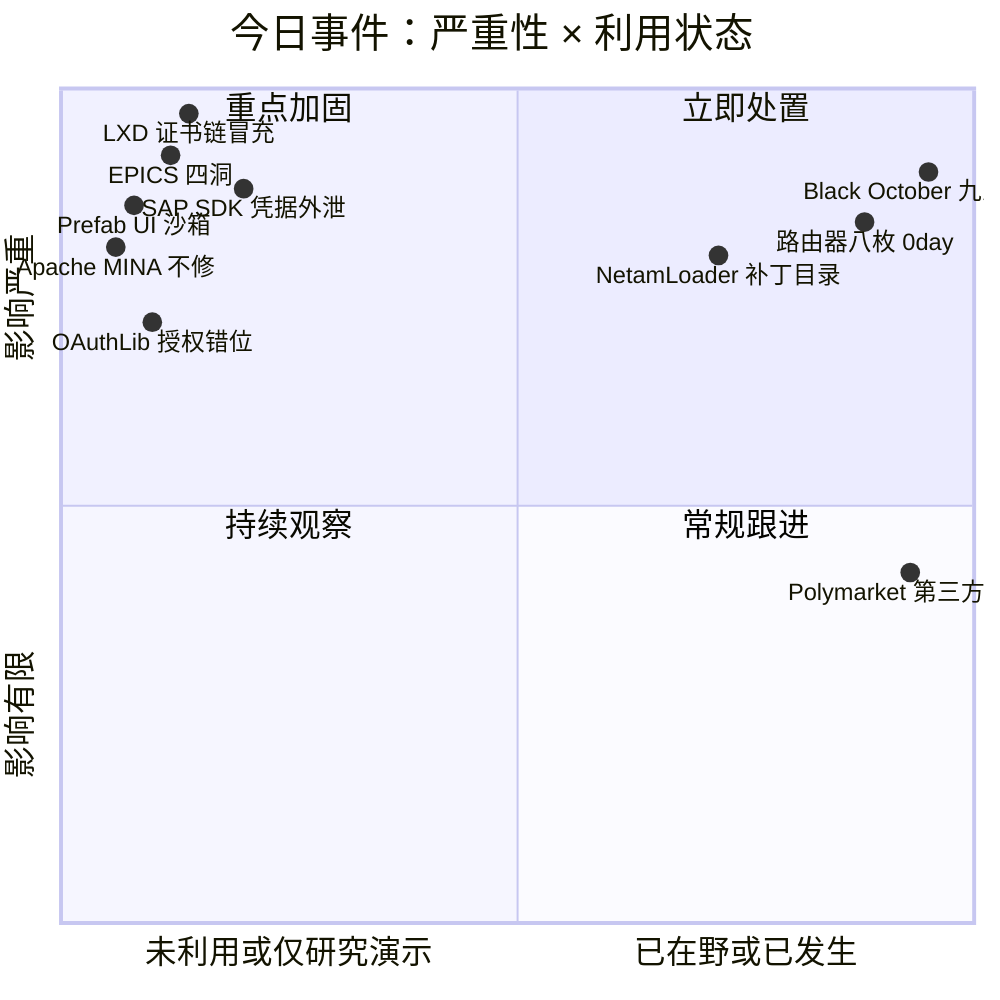
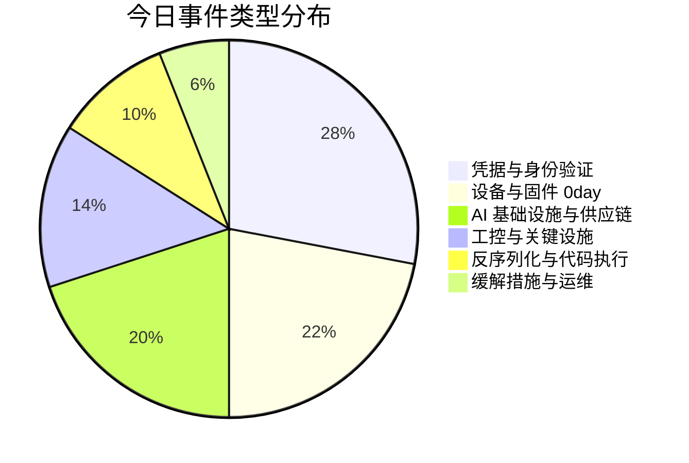
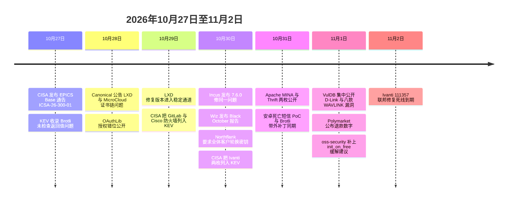

# 网安日报速递 · 2026年11月2日（第 205 期）

> 今日主线：**校验都跑了，校验的对象错了。**
> 一台容器主机的 mTLS 把客户端发来的证书链里每一张都拿去比对信任库，可 TLS 握手只证明了第一张的私钥归属，后面几张全是对方自己贴上去的字节；一套撑了三十年、被无数专家人工审过的工控核心库，一个自主 agent 用三小时四十九分钟翻出四个洞，最狠的那个满分 9.8；九家 AI 开发平台在一个月里陆续出事，攻击者没碰模型，只读环境变量里的那把钥匙，其中两把钥匙在三十小时里烧掉八十万次 Bedrock 调用；一批老旧路由器在同一天被公开八枚 0day，厂商联系不上、补丁没有、PoC 已经在手；一个 Java 网络框架的官方公告直接写明这个分支不再修，让你自己换；一个 .NET 加载器把落脚点选在了 Windows 分发补丁的那个目录里。
> 六件事，共同点是**"我检查过了"这句话里，检查的动作和检查的结果不是一回事**。

---

## 一、LXD / MicroCloud：信任库里每一张证书都核对过了，可只有第一张证明过私钥

**严重程度：严重（CVSS v4.0 10.0，CWE-295 证书验证不当）｜CVE-2026-112816｜时间：10-28 厂商公告，10-29 稳定通道，10-30 Incus 修复**

这是本月到目前为止技术含量最高的一条，因为它的漏洞不在代码写错，**在密码学语义被理解错了**。

**机制说清楚就一句话：**LXD 与 MicroCloud 的远程管理 API 走 mTLS，服务端维护一个信任库，客户端出示的证书只要"在库里"就放行。问题在于实现里把**客户端发来的整条证书链上的每一张**都拿去和信任库比对。而标准 TLS 握手（LXD 文档要求 TLS 1.3）只做一件事：客户端发完证书链后，用**第一张（leaf）证书对应的私钥**签一条 `CertificateVerify`。链上后面的中间证书是**帮助服务端构建到根的可信路径**用的，握手过程中**没有任何步骤证明客户端持有它们的私钥**。

于是攻击路径极其干净：攻击者用自己的密钥对生成一张证书，再在后面**追加一张受害者（被信任客户端）的公开证书**——公开证书本来就不是秘密，任何抓包、任何一次集群加入过程都能拿到——服务端在链上找到那张受信任的证书，就把这条连接当成了那个身份。



**能不能打到，取决于那个监听口开没开。**单机 LXD 默认只监听本地 socket，要管理员显式设置 `core.https_address` 才会监听网络（厂商文档示例是 TCP 8443）。MicroCloud 多了一层特定风险：**集群组建阶段**，新节点加入时它的**公开证书要在网络上传输**，抓到这张证书的人在之后就能以该节点身份登录。也就是说，**入群那一刻的流量就是攻击素材**。

**版本与修复。**受影响的是 LXD 4.0.14、5.0.10、5.21.8、6.9（各自之前的版本）。Canonical 10 月 28 日发公告，10 月 29 日把修复推到稳定通道：LXD 6.10.1 / 5.21.9 / 5.0.11 / 4.0.15，MicroCloud 3.4.1 / 2.1.5。Incus 在 10 月 30 日发布 7.6.0，同一个洞连同另外 17 个安全问题一起修。**这个洞是 Incus 项目发现并上报的**（维护者 Stéphane Graber），Canonical 在公告里点名致谢。

**几个必须写清楚的前提与边界：**

- **没有 workaround。**Canonical 除了升级没给别的办法，Incus 那边也明确说没有配置项能缓解。补丁前的唯一动作是**收缩谁能访问那个监听口**。
- **刷新不等于升上了。**厂商公告发布时修复版本正在从 candidate 往 stable 滚，`snap refresh` 之后要**实际看版本号**，不能假定补丁到了。
- **Ubuntu 归档里的 LXD 包**在 CVE 记录里标为不受影响或未分发，修复只走 snap 通道。
- **没有在野利用。**CISA 10 月 30 日的 SSVC 评估是：利用情况"无"、可自动化"是"、技术影响"完全"。不在 KEV。有一个自称 PoC 的仓库被公开的利用聚合站收录了，但**没有任何独立验证**，我按"存在声称、未经证实"处理。
- **公开证书不是秘密，这一点决定了这个洞的杀伤半径。**任何一次 MicroCloud 入群、任何一份被备份出去的证书、任何一次抓包，都可能成为素材。所以"我没被入侵过，别人不可能有我的证书"这个假设不成立。

**值得关注的原因：**

第一，**它示范了一类极难被代码审查发现的错误**——每一个函数调用看起来都合理，"把客户端给的证书和信任库比对"读起来毫无问题，错的是"客户端给的证书"这个集合里，**只有一张是经过密码学证明的**。

第二，**修复方向不是加校验，是改比对的对象**。这跟"再加一道检查"完全相反：多检查一张，等于多开一个洞。安全评审时问的应该是"这个比较的左边，哪些字节是攻击者可控的"，而不是"这些字节对不对"。

第三，**受影响的是管理面**。LXD / MicroCloud 管的不是业务流量，是宿主机和虚拟机本身。打进去直接是 root，不需要第二步提权。

---

## 二、EPICS Base：三个多小时，翻出三十一年没人看见的四个洞

**严重程度：严重（CVSS v3.1 9.8 / v4.0 9.3，CWE-190 整数溢出）｜CVE-2026-114595 至 114598｜时间：6-09 通报维护者，7 月至 8 月合入，10-27 CISA 公告**

EPICS 是洛斯阿拉莫斯与阿贡国家实验室最初开发的分布式控制系统工具包，用来把操作员与物理设备接起来。全球约 **90 个**大型科研、高校与工业站点在跑它，包括阿贡的**先进光子源（APS）**和 **ITER 聚变堆的控制系统**。

**这次是四个洞一起公开**，全部落在 EPICS 的两个网络协议 Channel Access 与 pvAccess 的报文处理里，全部**不需要认证、不需要用户交互，只要能网络可达 TCP 5064 或 5075**：

| CVE | 缺陷类型 | v3.1 | v4.0 | 后果 |
|---|---|---|---|---|
| CVE-2026-114595 | CWE-190 整数溢出 | **9.8** | 9.3 | 按错误长度分配内存，后续处理攻击者数据导致堆上越界写，可能远程执行代码 |
| CVE-2026-114596 | CWE-190 整数溢出 | 8.2 | 8.8 | 协议解析时消息长度校验失败，越界写，可崩溃控制进程 |
| CVE-2026-114597 | CWE-130 长度参数不一致 | 7.5 | 8.7 | 边界检查不足，越界读，可泄露相邻内存 |
| CVE-2026-114598 | CWE-843 类型混淆 | 7.5 | 8.7 | 越界读，拒绝服务并可能暴露内存 |

**发现方式才是这条新闻的重点。**找到它们的是 Causal Security 的自主 agent **Cipher**，用时 **3 小时 49 分**。联合创始人 Shubham Raj 对 The Register 的说法是：初始调查**完全不需要人工介入**，之后只下了一条指令——"可以在安全环境里做更深的可利用性验证"。也就是说人在整件事里只做了一个决定：允许继续往下走。代码历史追溯显示，这四个缺陷**已经存在约 14.5 到 31.5 年**。

**必须给这个说法打几个折，否则会读成"AI 已经能自动打穿工控"：**

- **Raj 是在卖产品**，他自己把 Cipher 称作"完全自主的超级黑客"，这句要打折。
- **代码执行没有被演示。**公告与厂商措辞都是"可能"，实际验证到的是崩溃、内存破坏与拒绝服务。
- **前置条件是真的**：得先能到控制网里的那些端口。Raj 自己的表述是，一旦攻击者摸到一个配置错误或可达的网络，"后面的攻击就相当容易"。
- **没有在野利用**，CISA 也未收进 KEV。通告编号 ICSA-26-300-01（Revision 1），发布时间 10 月 27 日，**修复版本是 EPICS Base 7.0.11**。

**这条最该被记住的不是"AI 挖洞"，是"隐蔽性防守结束了"。**工控软件长期享受一种隐性保护：懂的人少，写得出利用的人更少。Raj 那句话很直白——攻击者不需要懂加速器的物理，只需要懂控制它的软件。而且这不是 Cipher 第一次出手：今年早些时候它找到过北美与欧洲电网系统的关键攻击路径，CISA 在 10 月 8 日发过通告。

**值得关注的原因：**

第一，**31 年、无数专家人工审过的代码，四小时内出四个洞**。这不再是"AI 帮人提效"，是审查密度的天花板被换掉了。

第二，**四枚里两枚是同一个 CWE**。整数溢出在同一份报文解析代码里出现两次，说明这类缺陷的分布是有规律的——同样的输入处理模式，同样的错误。查一个就该查一片。

第三，**"没人在打"是个短期状态**。SSVC 是"利用情况无、可自动化是、技术影响完全"。可自动化等于：有了公开的编号和协议文档，任何人照着写利用的成本都不高。

---

## 三、Black October：九家 AI 开发平台，丢的不是模型是钥匙

**时间：Wiz 报告 10-30，Northflank 事件 10-30，BleepingComputer 报道 10-31**

Wiz 的研究（Benjamin Read 与 Rami McCarthy）把 10 月串成了一条线：**九家 AI 开发平台在一个月内披露安全事件**，按披露顺序是 Fireworks AI（10-06）、Andromeda（10-09）、Zeabur（10-14）、Lightning AI（10-15）、OpenCode（10-16 至 17）、Railway（10-20）、Warp（10-23）、CommandCode（10-28）、Northflank（10-30）。

**九起事件没有共同的漏洞，也没有共同的依赖。**Wiz 明确说了这一点。共同的是**目标**：每份公开报告都指向**环境变量**，而且明显偏爱那些**能开 AI 服务的变量**。几家的自述还很像——Fireworks、OpenCode、Warp 都报告了"agent 蜂群"迹象；Andromeda 说自己是"行业级攻击"的一部分；OpenCode 和 CommandCode 把事件归为"蒸馏尝试"。已公布的根因各不相同：Fireworks、Zeabur、Lightning 说是凭据被访问，Railway 的初步报告指向**构建基础设施里的提权**，Warp 指向第三方供应商，OpenCode 指向**遗留系统**。

**Northflank 那一天的时间线值得逐行看**，因为它把"响应速度"和"根因空白"同时展示了出来：

| 时间（UTC，10-30） | 发生了什么 |
|---|---|
| 11:43 | Wiz 发出威胁告警，工程团队一分钟内开始核查 |
| 12:02 / 12:50 / 13:05 | 连发三版网络策略补丁 |
| 13:00 | 请求 Wiz 的事件响应团队介入 |
| 13:58 | 状态页写下那句最难看的话：**假定所有环境变量都已被解密，禁用或轮换全部密钥** |
| 15:12 | 为 Postgres 与 MongoDB 附加组件开放紧急密钥轮换，并说明已有多名用户确认自己的 AI 密钥被用过 |
| 23:38 | 把 AI 密钥滥用与更大范围攻击模式挂钩，指向 Wiz 的报告 |
| 10-31 | 审计日志对所有客户（含免费层）开放；轮换扩展到 MySQL、Redis、MinIO、RabbitMQ |

**到 10 月 31 日深夜，Northflank 仍未公布根因**，没说攻击者怎么拿到客户密钥，也没说受影响客户数量；也没区分 BYOC（跑在客户自己 VPC 里）与普通客户的边界。

**下游的账单是可观测的。**Wiz 追了两把被泄露的企业密钥，从第一次异常调用到处置完成：



两个案例合计，**按目录价超过 10 万美元**。案例 A 三十小时里约 80 万次 Bedrock 调用（约九成成功，其中 Opus 5 占 36%、Opus 5.5 占 22%、Opus 4.8 占 10%），案例 B 十三小时里约 170 万次（超百万成功）。Wiz 把流量和两个转售渠道 **momo** 与 **Xingjiabi** 的基础设施关联起来，但**明确说不认为这两家执行了最初的入侵或大规模滥用**。另有一个细节：与某转售方关联的服务器上，托管过一个以 **ARTEX** 命名的页面——那是出现在 Vapor Panda 间谍活动与 ConnectWise 供应链攻击里的自主攻击框架。Wiz 没有把 Black October 归因给这两个行为体，我也照抄这个"不归因"的结论。

**Zeabur 的结局要单独提一句**：它公开了完整复盘，并宣布因这次事件在 12 月 31 日前**关停**。一个平台的生死，被一次凭据失窃决定了。

**值得关注的原因：**

第一，**这轮攻击的目标不是模型，是调用模型的权限**。模型本身不好偷，但"能无限调用前沿模型"这件事在转售市场上是硬通货。LLMJacking 这个叫法不是比喻，它的经济结构和挖矿劫持一模一样。

第二，**环境变量成了新的单点故障**。九家平台，九种根因，同一个暴露面。这不是某家的实现问题，是"把密钥放在能被应用直接读到的环境里"这个行业惯例的结构性问题。

第三，**账单是唯一能及时发现的信号**。从第一次试水到大规模滥用中间隔了数日，平台侧与应用侧都没有拦住；能看见异常的只有用量与费用曲线。所以"给 AI 服务设花费告警"这句话，今年从最佳实践变成了最低要求。

---

## 四、11 月 1 日的一批路由器 0day：厂商联系不上，PoC 已经公开

**严重程度：严重（多枚 CVSS 4.0 满分 10.0，其余 9.9）｜时间：11-01 集中公开**

VulDB 在 11 月 1 日一天里放出了一批家用与小型办公网络设备的漏洞，共同特征极其一致：**远程可达、PoC 公开、厂商提前联系过但没有回应或没有补丁**。

| CVE | 设备 | 位置与成因 | 评分 |
|---|---|---|---|
| CVE-2026-120189 | D-Link DIR-505（1.10B02） | tftpd 上传文件名处理，栈溢出（CWE-121） | **10.0** |
| CVE-2026-120195 | WAVLINK WL-WN579A3-A | 初始设置向导，`wlan_ssid` 参数命令注入 | **10.0** |
| CVE-2026-120198 | WAVLINK WL-WN530BE1-A | 协议处理器，`group_name` 与 IP-FROM 注入 | **10.0** |
| CVE-2026-120276 | WAVLINK WN536AX6-A | `/bin/ioos` 的 `sub_416760`，`group_name` 注入 | **10.0** |
| CVE-2026-120196 | WAVLINK WN579X3-D | 端口转发名称参数注入 | 9.9 |
| CVE-2026-120197 | WAVLINK WL-WN530HG4B | 端口转发名称参数注入 | 9.9 |
| CVE-2026-120227 | WAVLINK WN701AE | `del_staticrule` 的 `rule_name` 直接进 `system()` | 9.9 |
| CVE-2026-120231 | WAVLINK WN553X1-B | OpenVPN CLI 处理 `sub_416568`，`file_id` 未过滤，仅查空格 | 9.9 |

**技术上有两个细节值得拎出来：**

**一是 WAVLINK 那一串几乎都是同一个模板。**参数名不同（`wlan_ssid`、`group_name`、`rule_name`、`file_id`），位置不同（设置向导、协议处理器、静态路由、OpenVPN CLI），但成因完全一样：**用户输入被拼进 `system()` 或 `popen()` 的字符串，只做最粗的过滤**。`CVE-2026-120231` 里那个过滤是 `strchr` 查空格——**只要用引号跳出双引号上下文，空格检查就形同虚设**。这不是八个独立的失误，是同一份代码风格在八个地方的结果。

**二是 D-Link 那台的评分是 10.0，且设备是老的。**DIR-505 属于早年产品，厂商大概率不会再出固件。这种情况下"修复建议"只有一条：**别让它暴露在公网，能换就换**。

**这批的共同处置逻辑只有一条是真正有效的：把管理口从公网撤下来。**因为补丁不存在、"等厂商修"这个选项不存在。至于"设了强密码就安全"——`CVE-2026-120231` 明确写了，出厂默认密码几乎没人改，**这让"需要认证"这个前提在现实中接近于不需要**。

**值得关注的原因：**

第一，**这批不是"新漏洞被发现了"，是"没人管的设备被公开标价了"**。PoC 一公开，脚本小子和僵尸网络运营者的成本曲线立刻拉平。

第二，**同一厂商八个洞一个模板，说明这个厂商的代码里还有更多。**已经公开的八个是发现者愿意公开的部分，不是全部。

第三，**这批设备的位置决定了后果**。家用路由器与分支路由器的价值不在设备本身，在它后面的整段网络、在它承载的 DNS 与端口转发规则。一台被改过 DNS 的路由器，比一台被拿 root 的服务器更难被发现。

---

## 五、Apache MINA 3.0：官方在原公告里写了不修

**严重程度：严重（CVSS v3.1 9.8，CWE-502 不可信数据反序列化）｜CVE-2026-118636｜时间：10-31 公开**

Apache MINA 3.0 的 codec 模块里，`JavaNativeMessageDecoder` 对收到的每一帧**直接调用 `ObjectInputStream.readObject()`，没有任何类过滤器**。Java 原生反序列化的问题是它能从字节流里指定要实例化哪个类；只要目标应用的 classpath 上存在可用的 gadget 链，攻击者构造一个对象图就能在 `readObject()` 期间跑代码。

**成立条件必须说清楚，否则会被误读成"所有 MINA 用户都中"：**

1. 应用把 `JavaNativeMessageDecoder` **接在了面对不可信对端的过滤器链上**；
2. 对端的 classpath 里**存在可用的 gadget 链**；
3. 攻击者**能往这个监听口发帧**。

三条同时满足才是 9.8 的实际风险。EPSS 给的是 **0.57%（第 47 百分位）**，不在 KEV，没有公开 PoC。

**真正的新闻是官方处置：**这条公告被标为 **UNSUPPORTED WHEN ASSIGNED**，原文意思是 3.0.0 分支已停止维护，**不计划发布修复版本**，建议用户改用 **2.2.X 分支**的最新版。受影响版本是 **3.0.0 到 3.0.0-M2**。报告人 Nguyen Cuong。

**同一天还漏了一条同族问题**：Apache Thrift 的 Java 绑定在 **0.24.0 之前**，`TProtocolUtil.skip()` 默认不限制递归深度（**CVE-2026-120135**，CVSS 4.0 8.2），构造的嵌套报文可以把服务打崩。修法是升到 **libthrift 0.24.0**。两条放在一起看才有意思：**同一个生态里，一条没人修，一条一个版本号就解决了。**

**值得关注的原因：**

第一，**"官方说不修"是漏洞管理里最难处理的一类结论**。它把处置责任 100% 推给了资产方，而且推得很干净：没有补丁可以等，没有 workaround 可以配，只有"改代码"和"改网络"两条路。

第二，**处置建议是明确的**：把 `JavaNativeMessageDecoder` 从任何面对不可信对端的监听器上摘掉，换成有 schema 的编解码（Protobuf / JSON / 自定义二进制）；短期降级手段是给 JVM 加 `-Djdk.serialFilter=` 白名单，并收缩监听口的可达范围。

第三，**这条应该进"依赖清单"，不是"待办事项"**。MINA 经常是被框架或内部平台间接带进来的，`mvn dependency:tree` 里翻 `mina-core` 与 3.0 codec 模块，比等扫描器报要快。

---

## 六、NetamLoader：把补丁分发目录当落脚点

**时间：Kaspersky 本周披露，样本首见于 2026 年上半年**

Kaspersky 分析了一条针对**亚洲某地政府机构专用定制版 Windows 10** 的感染链，载荷是一个此前未被记录的 .NET 程序集加载框架，代号 **NetamLoader**。攻击者未被归因，也没有证据说明入侵是否波及多台机器或窃取了敏感数据。

**落脚点的选择是这条最值得学的地方。**那个 CAB 压缩包被放在：

```
C:\Windows\SoftwareDistribution\Download\e4537a1762fcafd2fd96bfc825bad34f9db9a24\
```

内容解压到同级的 `Install\` 目录。**这是 Windows 存更新包的地方**——一个系统级、自动生成、几乎没人会去翻、也极少有工具会拦的路径。把恶意文件放在"系统自己下补丁的目录"里，等于借了系统更新这件事的信任。

**包里七个文件，四个是 Patch My PC（一款端点管理软件）的真实组件：**

```
fabric.config
Microsoft.HostIntegration.Connectors.dll
PatchMyPC-Enum.dll
PatchMyPC-Models.dll
PatchMyPC-ScriptRunner.exe
PatchMyPC-ScriptRunner.exe.config
Resources.resx          ← 唯一真正藏了东西的文件
```

Kaspersky 判断这可能是一次**供应链攻击**：攻破某个第三方供应商，从而触达依赖它的下游。**但具体的投递载体（那个 CAB 是怎么进去的）仍然是未知的。**



**从技术侧挑三个可以拿去写检测的点：**

**一是 AppDomainManager 注入。**`.config` 文件可以指定 CLR 启动时加载哪个 `AppDomainManager`，从而在 .NET 应用起来的瞬间把任意程序集拉进来。效果和 DLL 侧加载一样，但**没有"往应用目录里塞 DLL"这种明显痕迹**，全在配置里。检测上该看的是"谁在写 `.exe.config`"、"进程树里有没有非预期的程序集加载"。

**二是分层载荷全藏在 `.resx` 里。**资源文件本来是放字符串和图标的，正常没人会去审。XAML、.NET 程序集、JSON 一层套一层，其中一份负责绕过 AMSI，一份是加密插件，一份是 C2 配置。这种"把可执行内容伪装成资源"的手法，静态扫描很难给高置信度。

**三是清场动作很完整**：删掉从 CAB 解出来的原始文件、删 CLR 使用日志、删 Prefetch 缓存。**留下的取证素材因此很少**，这也是为什么"补丁目录里出现过 CAB"这件事本身值得当成告警。

**还有两个行为细节**：第一，插件会**先确认自己宿主进程是 `dllhost.exe`** 才继续，宿主不对就不干活——这既躲开沙箱，也躲开那些按进程名做规则的工具；第二，**首次外连前随机等 20 至 40 分钟**，这段时间足够让"执行即联网"的检测规则失效。

**值得关注的原因：**

第一，**"系统自己的目录"不等于"系统自己的文件"**。SoftwareDistribution 是 Windows 更新机制的落地区，把它当可信路径的任何白名单，都会成为这条链的入口。

第二，**合法的第三方组件被拿来当外壳**。七个文件里六个是真的，只有资源文件被动过。签名、文件名、版本信息全部对得上——**"这文件是哪来的"比"这文件签没签名"更值得问**。

第三，**这条链的每一层都在拖时间、减证据**。抖动 20 至 40 分钟、宿主校验、删 Prefetch 与 CLR 日志，三件事合起来让"事后追溯"变成"事后推测"。

---

## 速览

### 7. OAuthLib：认证的是一个客户，授权的是另一个客户

**CVE-2026-118669**（NVD 评 CVSS 4.0 **8.4**，GitLab 咨询库评 **9.6**，CWE-863 授权不当），10 月 28 日公开，**4.0.0 修复**（commit `c951a1d`、PR 920、GHSA-7984-qgvg-3j9c）。机制很短：`client_credentials` 与密码模式的处理函数里，`authenticate_client()` 把 `request.client` 设成"已认证的那个客户"，但**没有任何步骤要求 `request.client_id` 与它一致**。如果请求体里已经带了 `client_id=...`，这个值就活下来了，而被传进 `validate_grant_type()` 与 `validate_scopes()` 的**是请求体那个值，不是已认证的对象**。结果：攻击者用自己一个低权限客户端的凭据认证，然后在请求体里写一个权限更大的客户名，**授权检查就跑在受害者身份下**，签出的令牌带着别人的 grant 与 scope。边界要写清楚：**只有"信任 `client_id` 参数"的校验器受影响**，那些只从 `request.client` 授权的部署按公告说法可能不受影响；受影响的也是**服务端（做 OAuth 提供方）**，不是客户端拿 token 的用法。为什么这条值得单列：**越来越多的 MCP 服务器与 agent 网关自己实现 OAuth 授权服务器**，而这个库就在下面。处置顺序是先升 4.0.0，再把校验器改成只信 `request.client`——**补丁治的是这一处，改法治的是这一类**。

### 8. SAP Cloud SDK for Python：控制租户子域名，就能拿走 OAuth2 客户端凭据

**CVE-2026-89111**，CVSS **10.0**，SSRF 类型。成立条件是攻击者能控制租户子域名，此时 SDK 会把 **OAuth2 应用凭据（client id 与 secret）**送到攻击者那边，而不是只泄露内部端口信息。修复方式是加输入校验。这条我只找到二手汇总口径（多个聚合站转述厂商公告），**原始 SAP 公告页与完整影响版本矩阵没有直接核到**，所以当成"需要自己去厂商页面确认"的条目处理，不给具体受影响版本号。把它放进速览的原因是：**它泄露的不是数据，是身份**——拿到 OAuth2 客户端凭据的攻方，后续动作在日志里全都长得像正常集成。

### 9. Prefab UI：给 LLM 写的代码用的沙箱，读写网络全放开

**CVE-2026-120338**（CVSS **10.0**），影响 Prefab UI **0.14.0 至 0.20.2**：它启动 Python 沙箱时**没有限制读、写与网络**，隔离形同虚设，而它存在的目的正是"安全地跑不可信或由 LLM 生成的代码"。同批还有 **Beta9**（beam-cloud）的 **CVE-2026-120308**（9.9）：网关与 worker **不校验租户是否拥有它要挂载的卷**，因此可以路径穿越。两条都无在野记录、都在等厂商修。**放在速览是因为它和昨天的头条构成对照**：昨天是"沙箱是好的，旁边那个监听器不验来源"，今天是"沙箱本身就是个普通进程"。两个方向都指向同一件事——**"隔离"这个词必须落到具体的系统调用与网络策略上，不能落在产品命名上**。

### 10. Polymarket：726 个钱包，约 270 万美元，账算清了

前情：本刊 10-30 已在速览提过"Polymarket 因第三方供应商被入侵暂停交易、承诺全额补偿"。11 月 1 日 The Hacker News 给出了最终数字与机制：被劫持的是站上一个**第三方页面速度监测脚本（DebugBear）**，交易者在已登录状态下签名时，被这个脚本诱导签了不该签的东西；平台退款约 **270 万美元给 726 个钱包**。到 11 月 1 日核查时，那个恶意域名已经没有 DNS 记录。平台侧的整改是三件：**更强的 CSP、锁定版本号、把第三方脚本放进沙箱**。Hudson Rock 给的建议更根本：**交易或签名页面上不该有不需要的第三方代码**；能锁定版本的就上 SRI（浏览器会在文件内容变化时直接拒绝）；**"允许某个可信 CDN"这条策略并不检查那个 CDN 到底发了什么**；最后一条是给用户的——**拒绝任何你没预期到的签名请求**。

### 11. Linux 98432：多了一个不依赖发行版的临时缓解

前情：本刊 10-29 已详写这枚 IPv4 TCP 握手的释放后重用（CVE-2026-98432），11-01 又记录过 Ubuntu 与 RHEL 全线仍无修复内核。**11 月 1 日 oss-security 上多了一条补充**：在拿不到修复内核的机器上，除"用 nftables 丢掉带 IPv4 选项的入向 TCP"与"关掉 MPTCP"之外，还可以加 **`init_on_free=1`** 启动参数——把已释放内存立刻清零，让"读到刚被释放的那块"拿不到有效内容。**这只降低可利用性，不修漏洞**，代价是性能；而且它要求重启，重启本身又会让内存里的证据消失。顺序仍然是：**先补丁重启，补不了再叠这三条**。这条我保留在速览里，是因为它示范了一个态度——**在发行版补丁空窗期，缓解措施是可以叠加的，但每一条都要写清楚它治的是什么、不治什么**。

---

## 风险分析







**今天的反向信号也得记一笔：**CISA KEV 清单的 `catalogVersion` 仍停在 **2026.10.30**，条目数 1766，**10 月 31 日与 11 月 1 日两天没有新增**。也就是说今天所有"满分 10.0"的条目——LXD 的 112816、SAP 的 89111、Prefab UI 的 120338——**没有一个进了在野清单**。这不代表它们不危险，代表它们**还没有被观测到在打**。今天真正在野的两条（GitLab 97229 与 Cisco 76418）是 10 月 29 日就进了的，联邦死线 11 月 1 日已经过去。

---

## 今日处置建议（按优先级）

| 优先级 | 对象 | 动作 | 判据 |
|---|---|---|---|
| 1 | LXD / MicroCloud / Incus | `snap refresh lxd`、`snap refresh microcloud`，**刷新后核对版本号**；Incus 升 7.6.0 | 版本到没到 6.10.1 / 5.21.9 / 5.0.11 / 4.0.15、2.1.5 / 3.4.1 |
| 2 | 暴露在公网的路由器与网络设备 | 管理口从公网撤下；D-Link DIR-505 与列出的 WAVLINK 型号**按报废处理** | 有没有能从互联网访问的管理界面 / TFTP / 设置向导 |
| 3 | AI 服务凭据 | 逐个平台轮换环境变量里的密钥；**给每个 AI 服务设花费告警** | 有没有 30 天内做过一次全量轮换；账单曲线有没有异常拐点 |
| 4 | Java 服务依赖树 | 摘掉 `JavaNativeMessageDecoder`；MINA 3.0 迁到 2.2.X；Thrift 升 0.24.0 | `mvn dependency:tree` / `gradle dependencies` 里有没有 3.0.0-M1/M2 |
| 5 | EPICS 站点 | 升到 **7.0.11**；做不到就先收缩 5064 / 5075 的可达范围 | 控制网里谁能到那两个端口 |
| 6 | OAuth 授权服务器（含自建 MCP 网关） | OAuthLib 升 4.0.0；校验器改为只从 `request.client` 取身份；已签发令牌视为可疑 | 校验函数里有没有把 `client_id` 参数当身份用 |
| 7 | Windows 高价值终端 | 盯 `SoftwareDistribution\Download` 下异常 CAB 与 `.config` 写入；盯非预期 AppDomainManager 加载 | 有没有进程在写 `.exe.config`、有没有从该目录起的子进程 |

---

## 相关出处

**LXD / MicroCloud / Incus 证书链冒充（CVE-2026-112816）**

- **CSA Labs 研究笔记（11-01）** — 机制逐层拆解：TLS 握手只证明 leaf 私钥、中间证书是攻击者可控字节；Canonical 10-28 公告与四个 LXD 版本线、MicroCloud 两条线的修复号；Incus 7.6.0 于 10-30 发布；CISA SSVC 三项取值；公开索引的 PoC 未经证实。
  <https://labs.cloudsecurityalliance.org/research/csa-research-note-lxd-microcloud-mtls-impersonation-20261101>
- **Random Chaos** — 受影响版本 4.0.14 / 5.0.10 / 5.21.8 / 6.9、Ubuntu 归档包不受影响、MicroCloud 入群过程泄露公开证书的具体路径、Incus 在同版修 17 个其他问题、刷新后必须核对版本的提醒。
  <https://randomchaos.us/articles/lxd-flaw-enables-keyless-client-impersonation>
- **Mallory 漏洞库** — CVSS 10.0、CWE-295、EPSS 0.30%、KEV 未收录、无在野、缓解与"假定已失陷"清单。
  <https://mallory.ai/vulnerabilities/01a18dee-6099-7092-b0fa-468ab41cacad>
- **NetCyberBase** — `core.https_address` 的默认关闭与手动开启、TCP 8443、snap 通道与刷新命令。
  <https://netcyberbase.com/article/critical-cvss-10-0-vulnerability-in-lxd-and-microcloud-enables-root-host-imperso-mvxvbbkb>

**EPICS Base 四洞（CVE-2026-114595 ~ 114598）**

- **CISA 通告 ICSA-26-300-01（10-27，Revision 1）** — 四个编号、CWE 分类、CVSS 两套评分、修复版本 7.0.11、SSVC 三项取值。
  <https://www.cisa.gov/news-events/ics-advisories/icsa-26-300-01>
- **OT/ICS Monitor（11-01）** — 协议面（Channel Access 与 pvAccess、TCP 5064 / 5075）、逐枚评分与向量、CISA 与 CVE 记录的一致性核对、媒体报道中的评分误传纠正。
  <https://otsecuritywire.com/articles/epics-base-icsa-26-300-01-cve-2026-114595-integer-overflow-channel-access-pvaccess>
- **Cyberpresso（转 The Register 采访）** — Cipher 与 Causal Security、3 小时 49 分、Shubham Raj 的两段原话、"未演示代码执行"与"厂商自述需打折"的边界。
  <https://cyberpresso.com/blog/ai-agent-cipher-four-epics-bugs-particle-accelerators-fusion-reactors-under-four-hours>
- **CyberSecurity Institute 周报（11-01）** — 90 个站点的规模、ITER 与 APS 的具体用途、6-09 通报维护者与 7 月、8 月合入修复、代码历史 14.5 至 31.5 年的出处。
  <https://www.cybersecurityinstitute.com/blog?p=6205>

**Black October 与 Northflank**

- **Wiz Research（10-30）** — 九家平台与披露日期、无共同漏洞与共同依赖的结论、两把企业密钥的下游账户明细（80 万次与 170 万次）、momo 与 Xingjiabi 两个转售线索及其"不归因"表述。
- **BreachNews** — Northflank 7:43 至 19:38 的逐条时间线、附加组件轮换的开放顺序、审计日志全量开放、"agent  swarm"与蒸馏的自述对照、ARTEX 页面的出处与边界。
  <https://breachnews.com/cyber-attacks/northflank-breach-wiz-black-october-ai-developer-platforms>
- **BleepingComputer（10-31）** — "假定所有环境变量已被解密"的原话、要求客户到签发方撤销凭据、审查 AI 用量与账单。
- **AL-ICE 复盘（11-01）** — Northflank 时间线的 UTC 版本、截至 10-31 23:31 仍无根因与 BYOC 边界未说明、Zeabur 关停时间点、Railway 的构建基础设施提权表述。
  <https://al-ice.ai/posts/2026/11/wiz-black-october-llmjacking-nine-platforms-northflank-october-2026>
- **TechQuire** — 环境变量通常承载什么、为什么一组凭据能变成进入云账户与计费系统的路径。
  <https://tech-quire.com/articles/northflank-environment-variables-decrypted-ai-api-keys>

**VulDB 11-01 路由器集群**

- **NextGuard（CVE-2026-120189）** — D-Link DIR-505 的 `save_upload_file` / `mp_upload_file`、CVSS 4.0 10.0、CWE-121、EPSS 1.3%、无修复版本、11-01 公开、报告人。
  <https://nextguardhq.com/en/vulnerabilities/cve-2026-120189-link-505>
- **NextGuard（CVE-2026-120276）** — WAVLINK WN536AX6-A 的 `/bin/ioos` 与 `sub_416760`、`group_name` 注入、10.0、无修复。
  <https://nextguardhq.com/en/vulnerabilities/cve-2026-120276-wavlink-wn536ax6>
- **Junglewise（CVE-2026-120227 / 120231）** — `del_staticrule` 的 `rule_name` 进 `system()`；WN553X1-B 的 `file_id` 只查空格、可用引号跳出、默认口令前提。
  <https://junglewise.ai/threats/cve-2026-120227-a-vulnerability-was-detected-in-wavlink-wn701ae-m01ae-v260105>
  <https://junglewise.ai/threats/cve-2026-120231-a-vulnerability-was-determined-in-wavlink-wn553x1-b-v260403-2-0>
- **East Bay Cyber 11-01 汇总** — WL-WN579A3-A（`wlan_ssid`，10.0）、WL-WN530BE1-A（`group_name` 与 IP-FROM，10.0）、WN579X3-D 与 WL-WN530HG4B（端口转发名称，9.9）、DIR-505 的三条处置建议。
  <https://eastbaycyber.com/content/2026-11-01-digest-ai-attacks-netamloader-router-exploits>
- **CVETodo 11-01 日报** — 五款 WAVLINK 的横向清单与"PoC 公开、无在野记录"的标注、D-Link 与 Prefab UI、Beta9 的对照组。
  <https://cvetodo.com/threat-report/au>
- **Hacker Feeds（CVE-2026-120241）** — 锐捷 RG-ES 系列 `httpupg.cgi` 本地固件升级越界（7.5，CWE-119/120）、GitHub 上公开的 PoC 仓库、厂商未回应。
  <https://hackerfeeds.com/cve/CVE-2026-120241>

**Apache MINA 与 Thrift**

- **NextGuard（CVE-2026-118636）** — 9.8、CWE-502、3.0.0 至 3.0.0-M2、UNSUPPORTED WHEN ASSIGNED 的原文、建议改用 2.2.X、EPSS 0.57%、报告人。
  <https://nextguardhq.com/en/vulnerabilities/cve-2026-118636-apache-software-foundation-apache-mina>
- **CosmicBytez Labs** — `ObjectInputStream.readObject()` 无过滤器、gadget 链依赖 classpath、三条实现级处置（摘解码器 / 白名单过滤器 / 迁出分支）与检测思路。
  <https://labs.cosmicbytez.ca/security/cve-2026-118636>
- **Security Insights 摘要（10-28 版，含 11-01 条目）** — Thrift 的 CVE-2026-120135 与 0.24.0、98432 的 `init_on_free=1` 补充、WebDyne for Perl 五个 CVE。
  <https://updates.securityinsights.io/2026/10/security-digest-28-oct-2026.html>

**NetamLoader**

- **The Hacker News（11-01）** — 完整两阶段链：七个文件的构成与哪四个是真实组件、`SoftwareDistribution\Download` 的精确路径、AppDomainManager 注入、XAML-1/2/2-1/2-2 的分工、AMSI 绕过、JSON-1 的 c 与 p、`dllhost.exe` 宿主校验、20 至 40 分钟抖动、`openaigpt4v[.]com`、删除 Prefetch 与 CLR 使用日志。
  <https://thehackernews.com/2026/11/netamloader-malware-targets-government.html>
- **Kaspersky** — 原始分析（经 THN 转述）：2026 年上半年首见、无归因、供应链猜测的边界。
- **Vulnios（11-01）** — 时间与受影响平台标注，可作二手时间锚点。
  <https://vulnios.com/threats/netamloader-malware-targets-government-windows-10-systems-in-asia-via-net-inject-2026-11-01>

**OAuthLib、SAP SDK、Prefab UI**

- **GitHub Security Advisory GHSA-7984-qgvg-3j9c** — 受影响面、校验器契约、4.0.0 修复。
  <https://github.com/oauthlib/oauthlib/security/advisories/GHSA-7984-qgvg-3j9c>
- **CVEFeed（CVE-2026-118669）** — 8.4 / CVSS 4.0 向量、CWE-863、10-28 发布、commit 与 PR 链接。
  <https://cvefeed.io/vuln/detail/CVE-2026-118669>
- **AL-ICE 分析** — "一个请求两个身份"的三行代码级解释、只从 `request.client` 授权的部署可能不受影响、MCP 相关下游包（mcp-google-sheets 经 google-auth-oauthlib、mcp-atlassian）的标记，以及"审的是 token 端点不是依赖树"的处置口径。
  <https://al-ice.ai/posts/2026/11/oauthlib-cve-2026-118669-client-id-grant-scope-confusion-october-2026>
- **RealGround 日报（10-29 / 10-30 / 11-01）** — SAP **CVE-2026-89111** 与 LXD 112816、GitLab 97229 的并列记录；为二手汇总口径，SAP 原始公告未直接核到。
  <https://www.realground.com/daily/2026-11-01>

**Polymarket 与 Linux 98432**

- **The Hacker News（11-01）** — 726 个钱包与约 270 万美元、DebugBear 脚本被劫持、恶意域名已无 DNS 记录、平台三项整改（CSP / 锁定版本 / 沙箱）、Hudson Rock 的四条建议。
  <https://thehackernews.com/2026/11/hackers-steal-about-27-million-from.html>
- **oss-security（11-01）** — `init_on_free=1` 作为附加临时缓解，与 nftables 丢包规则、关闭 MPTCP 并列的层次关系。
- **CISA KEV 清单（catalogVersion 2026.10.30，1766 条）** — 10-31 与 11-01 无新增；10-27 收录 Brotli 未检查返回值；10-29 收录 GitLab 97229 与 Cisco 76418。
  <https://www.cisa.gov/sites/default/files/feeds/known_exploited_vulnerabilities.json>

---

*本报告基于公开信息整理。同一事实在不同来源出现分歧时，正文已标注两边口径；聚合站转述而未能核到原始公告的条目（SAP CVE-2026-89111）已在正文明确标注为二手。CVE 编号、CVSS 评分与修复版本以官方源为准。*
