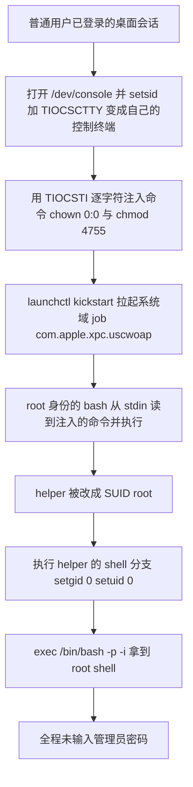
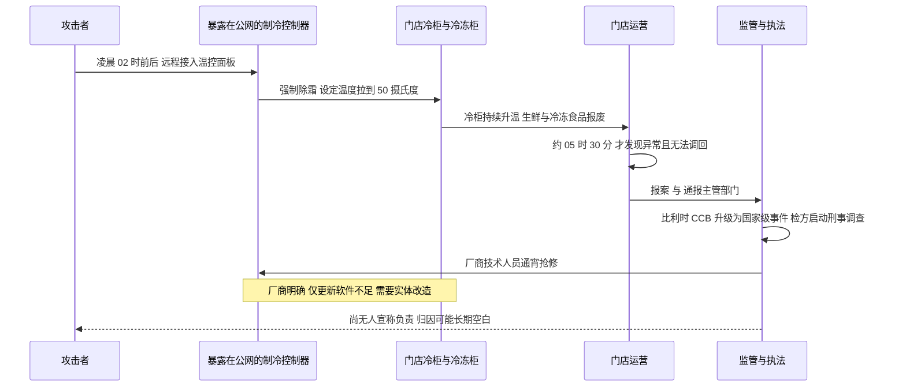
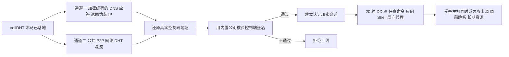
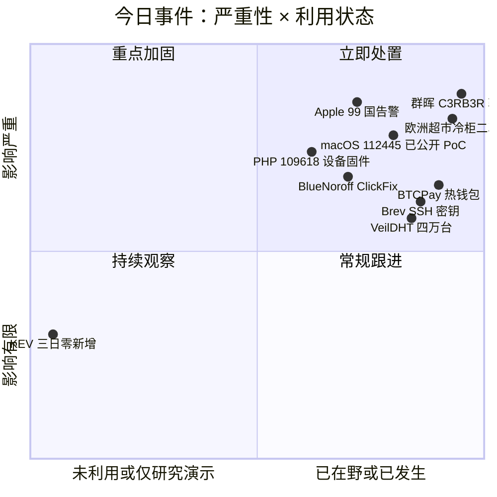
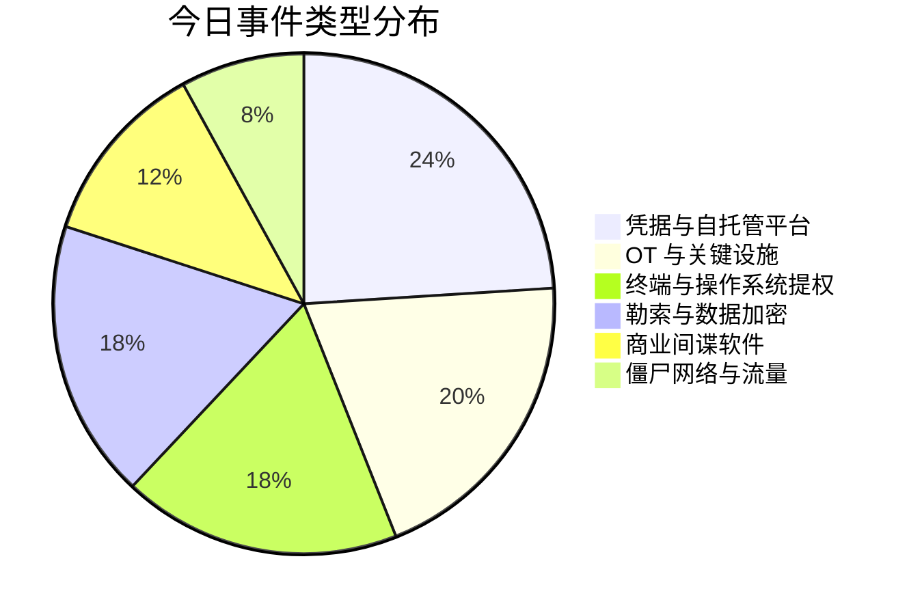
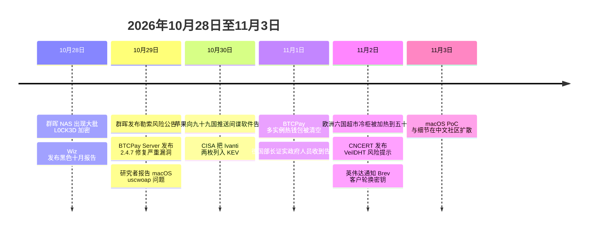

# 网安日报速递 · 2026年11月3日（第 206 期）

> 今日主线：**通告、补丁、通知都发了，关键的那一句都没发。**
> 苹果给一个六年前就被公开贴到 GitHub 上的 launchd 配置发了 CVE 编号，却在同一批安全公告里把这一位跳了过去；群晖说勒索利用的是"2024 年 12 月修过的旧洞"，可它让你升到的版本号对应的其实是今年 9 月那批 CVE；欧洲六国的超市冷柜一个月内第二次被远程加热到 50 度，第一次之后的整改只做到"换一种更安全的联网方式"；苹果向 99 个国家推送间谍软件告警，不说谁干的、也不说是否真的中招；英伟达承认 Brev 有十六天未授权活动窗口，说密钥换了、没发现滥用，不说怎么进来的；BTCPay Server 的补丁 10 月 29 日就发了，两天后一批实例的热钱包照样被清空。
> 六件事共同的形状是：**该公开的那一半公开了，决定你要不要动手的那一半没有。**

---

## 一、macOS CVE-2026-112445：一个 root 的 bash，读着普通用户的终端

**严重程度：严重（本地提权直达 root，暂无公开 CVSS）｜CVE-2026-112445｜时间：10-29 报告，11-01 至 11-02 公开，macOS Golden Gate 27.2 修复**

事情的起点不在 2026 年。2020 年 11 月 23 日，有人在 GitHub 的 clean-osx 仓库提了第 1 号 issue，标题就一句：**"What is uscwoap?"**——macOS 早就换成 zsh 了，系统域里的 `com.apple.xpc.uscwoap` 为什么还在调 bash？回答者贴出了那个 plist 的全文：`BootShell` 为真、三个标准流全部指向 `/dev/console`、`ProgramArguments` 是 `[bash, -sh]`，还好心提醒"这玩意儿关系到单用户模式启动，别乱删"。

六年过去，这个 job 一直躺在 `/System/Library/LaunchDaemons/` 里。10 月 29 日，WeBin Lab 的研究者 YingQi Shi（@Mas0nShi）把它报成了 **CVE-2026-112445**。

**三件事凑在一起才出事，缺一件都不成立：**

1. 这个 job 在 launchd 的**系统域**里，配置里**没有指定 User**，所以 bash 以 **root** 身份运行；`BootShell` 只说明设计用途是单用户救援，**不影响它在正常桌面会话里也能被拉起来**。
2. `StandardInPath` 指向 `/dev/console`。在图形登录会话中，这个设备的**属主是当前那个登录用户**——通常是个非管理员。而读它的 bash 是 root。
3. `TIOCSTI` 这个终端接口可以把字符塞进终端的**输入队列**。能影响输入队列，就能影响 bash 从 stdin 读到的东西。

于是权限边界正好卡在**输入方和执行方之间**：输入来自普通用户，执行者是 root，中间没有任何一次管理员授权校验。

**PoC 与实测。**作者放出了源码与录屏：仓库 `Mas0nShi/CVE-2026-112445`，目前 48 星、6 fork，只有 `exp.c`、`README.md` 和一段 `record.mov`，**没有 release，也没有 LICENSE**。用法是 `cc exp.c -o exp` 然后 `./exp`，程序会自己检查是不是 tty；执行后提示符从 `jeffrey@jeffreys-Mac-mini poc %` 变成 `bash-3.2#`，`id` 打出 `uid=0(root) gid=0(wheel)`。PoC 已被 Vulners、Sploitus 等平台收录。

**修复方式很干脆，公告很反常。**macOS Golden Gate 27.2 的做法是**把 `com.apple.xpc.uscwoap` 这个配置整个删掉**；同批更新修了 **263 个 CVE**，同时发布 Sequoia 15.8.2 与 Tahoe 26.7.2。反常的是：苹果给了 CVE-2026-112445 这个编号，**却没把它写进安全公告**——核对 support.apple.com/en-us/149521 全文，112441、112442、112443、112444、112446、112447 都在，**唯独 112445 这一位被跳过**；公告里"YingQi Shi (@Mas0nShi) of DBApp Security's WeBin lab"的名字还在，只是他这条编号消失了。研究者本人的说法很克制：苹果没把编号写进公告，原因不明；他半开玩笑地说这个洞"好到让人怀疑它是不是苹果留的后门"。

**值得关注的原因：**

第一，**它不是藏得深，是没人把它当成漏洞。**一份 2020 年就被公开贴出来的配置文件，六年里被无数人看过，没人把"root bash + stdin 接在用户拥有的设备节点上"连起来。安全边界的错误往往不在代码里，在**谁拥有那个文件描述符**上。

第二，**公告里少一条，资产台账里就少一条**。企业补丁管理的输入是公告与 CVE 库；编号不在公告里，扫描器与合规清单就抓不到"要修什么"，只能靠"版本到没到 27.2"这种粗粒度判断。这条缺口比漏洞本身更容易被长期忽略。

第三，**自查口径很具体**：审一遍 `/System/Library/LaunchDaemons/`，找"以 root 跑、stdin 或 stdout 接在设备节点上"的 job；再盯系统目录里 setuid 二进制的变化。同时要写清前提——**这是本地提权，攻击者得先有这台机器上的登录账户**；没有本地账户，一切归零。

---

## 二、群晖 C3RB3R：洞是 2024 年修的，也是 9 月修的，机器一个都没装

**严重程度：严重（勒索加密，利用两枚 CVSS 9.8 旧洞）｜CVE-2024-10441 与 CVE-2026-13639 / 13684｜时间：10-28 起大规模中招，10-29 群晖公告，11-02 HKCERT 警报**

10 月 28 日凌晨开始，大量群晖 NAS 用户发现共享目录里的文件被改成 `.L0CK3D` 后缀，每个目录留一份 `read-me3.txt`；勒索软件名为 **C3RB3R**，是 Cerber 家族的变种，会把**系统分区一起加密**导致设备无法启动。10 月 29 日群晖发布公告，11 月 2 日 HKCERT 跟进发布勒索警报。

**官方口径与第三方口径对不上，这件事本身就是新闻。**

群晖的说法是：攻击者利用的是**2024 年 12 月已完成修复**的已知弱点，不是新版 DSM 的零日；多方把这条指向 **CVE-2024-10441**（Synology-SA-24:20，CVSS 9.8，Pwn2Own 一脉）：网页登录框把用户输入打包成内部表单，交给**以 root 身份运行的插件进程**处理，旧版系统不检查用户名里是否被塞进了内部分隔符。

另一条线索来自 360 反勒索团队：本轮被大规模利用的是 **9 月 18 日披露**的两枚 9.8 分漏洞——**CVE-2026-13639**（CWE-331，登录逻辑熵不足）与 **CVE-2026-13684**（CWE-116，SCGI 输出编码不当），两者均可让远程攻击者读写任意文件。

**交叉验证的结果值得单独说。**群晖给出的安全版本是 DSM 7.4-90075、7.3.2-86009-4、7.2.2-72806-9、7.2.1-69057-12 及以上；而这份版本矩阵正是 **SA-26:13（2026-09-18 发布）** 的修复清单，那份公告覆盖的恰好包括 13639 与 13684。也就是说，**群晖口头说的"2024 年 12 月的旧洞"，和它让你升到的版本号，指向的不是同一批 CVE**。官方公告从头到尾没有点名任何 CVE 编号；应急团队也明确提醒，不要把 13639 / 13684 当成"本轮统一入口"的结论传播——两批洞都可能被用，也都可能是不同受害现场的入口。

| DSM 版本线 | 安全版本 |
|---|---|
| 7.4 | 7.4-90075 及以上 |
| 7.3 | 7.3.2-86009-4 及以上 |
| 7.2.2 | 7.2.2-72806-9 及以上 |
| 7.2.1 | 7.2.1-69057-12 及以上 |

**"最新版也中招"这句要打折听。**有应急团队上机检查时看到受害设备跑的是 10 月 12 日才发布的 DSM 7.4.1-90080 Update 1（型号 RS1221+）。但这**不能证明最新版带零日**——同一批人写明，套件版本、凭据强度、暴露服务当时都还在查。它真正证明的是另一件事：**升了 DSM 不等于升了套件**，PHP 这类组件要在套件中心单独更新，只升系统不算完。

**中招之后的第一动作不是关机。**加密密钥可能还留在内存里，有团队放出了内存扫描工具（`c3rb3r_memscan`），在特定条件下可从内存提取 key 与 IV 解密文件；但正文没有认证标签，文件被截断、来自不同运行会话时仍会失败，**恢复后必须逐文件核对**。至于攻击者的运营水平：暗网页面提供不超过 1024 KB 的免费解密证明、自动生成收款地址、6 次链上确认后自动交付解密器。

**值得关注的原因：**

第一，**"补丁早就有"不构成任何防护**。2024 年 12 月修过一次，2026 年 9 月又修过一次，中招的是两次都没装的那批机器。更麻烦的是心态：NAS 常被当成备份目标，而**备份设备与被备份的生产系统在同一个内网、同一套凭据体系下，等于没有备份**。

第二，**通报说不清入口，用户就不知道查哪里**。官方说旧洞、第三方说新洞、公告不点编号，三件事叠在一起，最实用的顺序反而是最笨的那个：先把版本升到公告给的那几条线，再按**套件、凭据、公网暴露**三条线各自排查。

第三，**应急顺序反了会毁掉唯一的机会**。断电、重装、在线重装系统，这三个动作都会让内存里的密钥和现场一起消失；在线重装大多还会直接落到最新版本，反而抹掉证据。

---

## 三、欧洲六国超市冷柜：一个月内的第二次，同一套手法

**严重程度：高（OT 事件造成物理损失，比利时已升级为国家级事件）｜无 CVE，入口是暴露在公网的温控接口｜时间：11-02 当地时间凌晨 02:00 起**

11 月 2 日凌晨，瑞典、比利时、卢森堡、芬兰、爱尔兰、爱沙尼亚多国超市的冷藏与冷冻系统被远程操控，**冷柜温度被拉到 50 摄氏度**，部分门店"调不回来"。斯德哥尔摩一家 ICA 门店的销售经理说，攻击发生在凌晨 2 点，直到 5 点 30 分才被发现，"所有东西都毁了"；瑞典南部 Sjöbo 一家 ICA 负责人说热风一直往冷冻室灌，单店食品损失达数十万瑞典克朗。安特卫普附近一家肉类连锁的创始人凌晨 3 点 30 分被员工电话叫醒，赶到店里时柜温已是 18 摄氏度，约 1.5 万欧元肉类报废。

**受影响名单（各方确认口径）：**Ahold Delhaize 在比利时与卢森堡的门店、Colruyt 旗下 SPAR（5 家）、家乐福比利时（700 家中 15 家）、瑞典 ICA（少数门店）与 Coop（800 家中 7 家）、爱尔兰 Musgrave 旗下 SuperValu（13 家）、宜家（比利时至少 1 家）。另有中文口径称波及 115 家以上门店，属二手汇总，此处标注。

**手法与设备。**比利时制冷设备商 Sabcobel 的 CEO Stéphane Mullens 说，攻击针对的是**除霜模式**——强制进入除霜，温度就会迅速上升；他还说解决问题"除了更新软件，还必须对设备做实体改动"。丹麦厂商丹佛斯的发言人也确认，本次事件同样涉及该公司产品，与 10 月法国那轮一致。

**定性与反应。**比利时网络安全中心（CCB）把事件**升级为国家级事件**，意味着其他情报与安全部门开始交换信息、协同调查；比利时检方已启动刑事调查；瑞典国家网络安全中心介入；法国那轮由巴黎检方网络犯罪部门与 ANSSI 共同调查。欧盟发言人发表声明，农业委员 Christophe Hansen 的措辞很重："有人蓄意破坏我们的食品供应链、削弱消费者对其的信心。"

**归因是空的。**目前无人宣称负责，CCB 发言人的原话是"不知道是谁发动的，而且可能永远也查不出来"，并提到 AI 让攻击者更容易利用漏洞。SentinelOne 研究员 Tom Hegel 的判断是：近期事件没有提出金钱勒索要求，更像**蓄意破坏**；他还说了一句很值得记住的话——"从防御者的角度看，一个青少年和一个情报机构发动的攻击，可能看起来几乎没有区别。"

**前情：**本刊 10-14 期已详写 10 月 11 日法国那轮（丹佛斯控制器、强制除霜、Intermarché 约 300 家门店、部分门店起火、损失或达数千万欧元）。这次是同一条路径的第二次，而且跨到了六国。

**值得关注的原因：**

第一，**一个月内第二次，说明第一次之后的整改只做到了一半**。Sabcobel 的说法是，法国事件之后多数客户做了"最简单的应对"——换一种安全的联网方式；而厂商自己说还需要实体改造。**换了连接方式，设备本身的除霜与温度设定权限没有变。**

第二，**后果是物理的、可计量的**。不是数据泄露，是食品报废、门店起火、供应链信任受损。攻击者不需要 0day，只需要一个能从公网摸到的温控面板。

第三，**"谁干的"可能永远没有答案，但"哪些设备挂在公网上"今天就能查**。对制造业与零售业最有用的动作，是把"带公网出口的生产设备"列一张清单：冷机、空压、锅炉、PLC 触屏、供应商远程维护通道，这些通常不在 EAM/EHS 台账里。

---

## 四、苹果向 99 国推送间谍软件告警，德国政府与议员在列

**严重程度：高（在野定向攻击，零点击）｜无 CVE（商业间谍软件）｜时间：10-29 起通知，10-30 覆盖 99 国，11-01 德国官方证实**

10 月底，苹果开始向多国 iPhone 用户推送"雇佣间谍软件"（mercenary spyware）威胁通知。据收到通知的用户，这批通知覆盖 **99 个国家**；苹果累计已在 150 多个国家发出过同类预警。11 月 1 日，德国数字事务部长 Karsten Wildberger 在德国电视台 ARD 的《柏林报道》中证实，苹果已通知德国政府，**部分政府工作人员与联邦议院议员**可能成为目标；德国联邦信息安全局（BSI）已书面通知所有已知收件人，并要求他们"按设备可能已被入侵来处置"。

德国政府发言人 Stefan Kornelius 表示"非常严肃地对待这一事件和警告"，但没有公布收到警告的人数与部门，也没有说明总理默茨是否在列。英国《金融时报》11 月 2 日的报道称，安全官员认为此次行动**几乎可以确定有国家力量参与**，但未公开归属；攻击利用**零点击**方式，可能仅凭目标电话号码即可发动。

**BSI 的说明比新闻标题更值得读：**苹果的威胁通知**不能证明攻击已经成功**；但一旦感染，攻击者可绕过设备原有防护，读取包括加密通信在内的消息内容，获取通话、联系人、日历与位置数据，甚至在用户不知情时开启麦克风与摄像头；这类攻击通常涉及高度复杂的商业间谍软件，**国家行为体是主要幕后力量之一**，Pegasus 是已知案例。德国官方**没有把事件归咎于任何国家或组织**，也没有确认使用了哪款软件。

**同批的其他印证：**贝鲁特的纪录片制作人 Radwan Mortada 在社交平台上说他收到了新一轮通知，苹果在通知中称本批告警已发送给 99 个国家的用户。多伦多大学 Citizen Lab 高级研究员 John Scott-Railton 的提醒是：**没收到通知不代表没被入侵**；应开启 Lockdown Mode（锁定模式）并联系数字权益机构，同时**警惕市面上付费"清除间谍软件"的商业方案**。Access Now 高级技术法律顾问 Natalia Krapiva 的判断是，间谍软件滥用远未解决。

**时机不是巧合。**这批通知正好落在 **Pall Mall Process**（针对商业黑客工具行业的自愿准则）最终谈判前夕，该进程此前已出台面向政府的行为准则。行业人士的呼吁指向同一个方向：约束要落在**供应商的销售与滥用**上。

**值得关注的原因：**

第一，**通知的价值与边界同时被展示**。它证明的是"苹果认为你可能被针对"，不证明"你已经被入侵"，也不提供归属。把它当结论用会错，把它当无事发生更错——BSI 的处理方式是"先假定已被入侵"。

第二，**目标层级被点名了**：政府工作人员与议员。而可用的防御手段只有锁定模式、不点未知链接、及时更新，**没有"查杀"这个选项**。

第三，**这是买卖，不是自研**。各国政府极少自己开发这类工具，多从商业供应商处购买；所以监管的抓手在供应链，不在受害终端。

---

## 五、英伟达 Brev：十六天未授权活动，SSH 密钥已轮换

**严重程度：中高（客户凭据可能暴露，未证实滥用）｜无公开 CVE｜时间：10-04 至 10-20 未授权活动窗口，11-02 至 11-03 通知与披露**

英伟达已向 Brev 云开发平台的受影响客户发出安全事件通知。调查认定，该平台在 **2026 年 10 月 4 日至 10 月 20 日**期间存在未授权活动，**窗口长达 16 天**；Brev 系统中存储的部分信息可能已被访问，具体是 **Brev 为客户虚拟机配置的 SSH 密钥**。

英伟达的处置是：受影响 SSH 密钥**已轮换**，客户实例已用新密钥更新；截至目前，分析**未发现这些密钥被不当使用**的证据。但公司**没有解释攻击者如何获得访问权限**，也**没有披露客户数据或工作负载是否被实际读取**。

Brev 是英伟达的云开发环境，用来跑 GPU 开发与模型部署；SSH 密钥是开发者远程管理云主机、传文件、执行命令的凭据，一旦泄露，攻击者理论上可在权限范围内接管对应虚拟机。**"16 天"是调查认定的活动窗口，不等于暴露时长**——凭证类事件的真实起点通常早于第一次被记录的可疑访问，而日志保留期往往比这个窗口更短。

**这不是孤立事件。**Wiz 在 10 月 30 日的"黑色十月"报告（本刊 11-02 期已详写）统计，10 月至少**九家** AI 开发平台发生安全事件，包括 Zeabur、Fireworks AI、Lightning AI、OpenCode、Warp 与 Northflank 等；各起事件根因不同，但**攻击目标高度一致：环境变量，尤其是被授予 AI 访问权限的那部分**。Wiz 还记录了两起 Bedrock 凭据滥用：一把密钥在 30 小时内被调用约 80 万次，另一把在 13 小时内约 170 万次，按目录价合计超过 10 万美元。另一层前情是：币安 10 月的事件起点同样是一台开发运维工程师的笔记本。

**值得关注的原因：**

第一，**"没发现滥用"是当前证据状态的描述，不是安全结论**。SSH 密钥泄露的正确处置顺序是：轮换、审计该密钥历史登录记录与来源 IP、检查实例内是否留下持久化（authorized_keys、计划任务、systemd 单元）、再评估数据面影响。

第二，**AI 开发平台正在变成凭据密集区**。一台开发机上通常同时存在三种凭据：环境变量里的 API key、用于登录的 SSH 私钥、以及云厂商的临时令牌。任何一次平台侧泄露，都是三把钥匙一起交出去。

第三，**这次披露的措辞值得当成模板来读**：承认窗口、说明轮换、标注"未发现滥用"、**明确不说的事（怎么进来的、数据有没有被读）**。读这类通知时，要分清哪一句是事实、哪一句是"目前没查到"。

---

## 六、BTCPay Server：补丁 10-29 就发了，热钱包照样被清空

**严重程度：高（资金直接损失，链上不可逆）｜无 CVE 公开，攻击向量指向 2.4.1 及更早｜时间：10-29 发布 2.4.7，11-01 至 11-02 事件与说明**

BTCPay Server 团队在社交平台上说，已收到报告：**多个 BTCPay Server 实例的热钱包正被未授权攻击者清空**；官方建议运行实例的运营者在调查结束前**立即关停服务器**（执行 `./btcpay-down.sh`）。当时攻击原因与损失规模均未披露。

11 月 2 日的跟进说明给出了边界：事件响应调查已识别出**针对运行 2.4.1（2026 年 7 月 23 日发布）或更早版本实例的攻击向量**；目前**没有**运行最新 2.4.7 版本的用户热钱包被盗的可信报告；建议保持更新；受影响者可向 `security@btcpayserver.org` 提交详情与日志。而 **2.4.7 是 10 月 29 日发布的**，修了 1 个严重与多个中危漏洞。

团队还在核对一件事：本次路径是否与 **8 月那次的通信凭证漏洞**存在继承关系。本刊 8-10 期的时间线里记过两个节点：8 月 6 日 BTCPay Server 紧急补丁、8 月 8 日有 Lightning 节点资金被抽干。

**为什么这条值得单独写：**BTCPay Server 是自托管的比特币支付处理器，卖点是"自己跑全节点、自己掌私钥"，用来规避中心化交易所的挪用与破产风险。但自托管只转移了风险，没有消除风险——**它把补丁跟进、凭据管理、日志审计的全部责任，转移到了运营者个人身上**。

**值得关注的原因：**

第一，**补丁 10 月 29 日发，11 月 1 日还在被清空**。在自愿升级的开源生态里，"最新版已修"这句话的实际保护率，取决于多少人真的升了。这与前面群晖那一条是同一个结构性问题，只是受害对象从 NAS 换成了钱包。

第二，**热钱包的定义就是"在线的私钥"**。链上交易不可逆，事后追回基本无望；能做的只有三件事——把大头资金归集到冷存储或多签、给大额外流转账设阈值熔断、保留完整的系统调用日志以便事后定性。

第三，**它与中心化平台事件形成对照**。交易所被盗还有冻结、赔付、执法协作；自托管节点被盗，能冻结的只有你自己还没被转走的那部分。

---

## 速览

### 7. VeilDHT：CNCERT 通报的新型僵尸网络，境内四万台

国家互联网应急中心 11 月 2 日发布风险提示：新型僵尸网络 **VeilDHT** 正在大范围传播，主要感染 Linux 服务器与 IoT 设备；**2026 年 10 月 16 日至 26 日，境内累计约 40,467 台设备受感染，日上线"肉鸡"数量最高达 15,805 台**，目前处于传播扩张期。传播以漏洞利用为主，已观测到使用 **CVE-2024-3912**（ASUS 路由器命令注入）与 **CVE-2021-35394**（Realtek Jungle SDK 命令注入）。

它的工程设计重心不在攻击力，在**隐蔽性**：C&C 地址走两条通道获取——**加密编码的 DNS 应答**与**公共 P2P 网络**，互为备份，控制面因此摆脱了对固定域名或 IP 的依赖；通信全程认证加密，用了 Ed25519、X25519、SHA-512、XChaCha20-Poly1305，上线前用内置公钥核验控制端签名才建会话；配置以乱序密文存放，心跳周期与内容随机化，还支持版本滚动更新。功能上具备覆盖 UDP/TCP/GRE 的 **20 种 DDoS**、任意命令执行、交互式反向 Shell 与反向代理。

放在速览是因为它的价值在**检测口径**：配置乱序加密、DNS 应答全是假 IP、心跳随机，意味着基于固定域名与固定周期的封禁基本失效，只能靠"异常外连 + 进程与端口特征 + IOC 比对"。CNCERT 给出的建议里最实用的是最后一条：**发现主机感染后立即核实入侵途径**——被当跳板用的主机，往往还有别的入口没堵。

### 8. 山石网科：PHP 那两枚洞，落在自家产品的固件里

山石网科 11 月 2 日发布安全公告（内部编号 **HSVD-2026-0113**）：多款产品受第三方 **PHP 组件**漏洞 **CVE-2026-109618** 与 **CVE-2026-109619** 影响。109618 的机制是 PHP 处理内存耗尽时用 `longjmp()` 提前退出上下文，请求内存在完全初始化前已处于可访问状态，关闭流程把无效状态当合法状态处理，攻击者可构造恶意 multipart 请求、在不超过 `post_max_size` 的前提下耗尽 `memory_limit`，触发内存破坏并实现远程代码执行；109619 是工作进程保留了指向前一个请求内存的全局状态、释放前未完全重置，形成**跨请求释放后使用**，攻击者可在同一工作进程的两个请求里分别当生产者和消费者。厂商明确：**设备 Web 管理界面对外暴露时较易被利用**。

前情是本刊 10-21 至 10-28 多期写过的 PHP2Shell（两枚 CVSS 9.2，10-26 进 KEV）。这一条的新意不在漏洞，在**归属**：同样是"上游修了、你未必能修"——PHP 被编进设备固件，用户既不能单独升级 PHP，也不能选择版本，只能等厂商出固件。**买设备的时候，固件里塞了什么运行时，是一笔当时看不见的债。**

### 9. BlueNoroff：先约一场视频会议，再让你自己把木马粘进终端

微步在线 11 月 2 日披露一起针对 Web3 从业者的金融盗窃攻击，归因到 Lazarus 分支 **BlueNoroff**。流程三步：先在 Telegram、LinkedIn 上以"Protofire 项目合作"为名约视频会议，链接指向仿冒的 **meetoa.protofire.org**（会议示例、聊天记录、注册登录、隐私政策一应俱全）；会议开场先用 **AI 生成人脸**让画面看起来正常，短时间后中断，页面提示"摄像头驱动版本过旧"；最后用 **ClickFix** 手法给出修复教程，让人把一条 `curl -k` 命令复制到终端执行——`-k` 专门用来跳过证书校验。

载荷从 `driver.protofire.org` 下载伪装成"驱动修复"的脚本，脚本从自身内嵌的 **Base64** 数据里解出两个程序：木马 `videodriver` 与假冒"摄像头驱动更新"界面的诱饵 App；随后创建用户级 LaunchAgent **com.videodriver.update** 实现持久化与进程重拉。**这条目前只有微步一个来源，标注为单一来源，细节待第二方印证。**

选它进速览的理由是反差：前面第二节讲的是普通用户用 `TIOCSTI` 把命令塞进 root 的终端，这一条是**攻击者让用户自己把命令粘进自己的终端**。同一种"输入被信任"的结构，一个靠内核接口，一个靠社交工程。

### 10. 日本 11-02 的泄露清单：一天之内三家

11 月 2 日，日本多家企业集中公告数据泄露：家电量贩店 **Nojima** 称电商会员管理系统 11 月 1 日遭第三方非法访问，约 **700 万件**会员信息可能泄露（姓名、出生日期、性别、邮编、住址、电话、账号、加密密码、邮箱；公司称未保存信用卡信息）；**三得利控股**称外部云服务遭非法访问，约 **10 万人**信息泄露（约 9 万名集团及关联企业员工、约 7300 名活动报名者、约 7200 名 2026 届招聘报名者），主要为姓名与邮箱；**斯洛文尼亚政府**信息安全办公室补充说明，10 月底攻击者通过一台被攻破的政府网页服务器访问 Domino 系统数据，涉及约 **15,000 条**国家行政部门账户（其中约 7216 条含哈希密码）。

**这两条（Nojima、三得利）目前只核到中文聚合口径，未核到企业原始公告，标注为二手。**放在一起看，日本今年的量级更值得注意：共同社 10 月 29 日援引 Macnica 调查称，今年 1 至 10 月日本企业因非法访问外泄的信息累计约 **3.29 亿条**，是 2024 年全年的近 100 倍；个人信息保护委员会的数据是 4 月至 10 月 16 日报告 2094 起非法访问事件、约 2.6 亿人次信息泄露。安全厂商的判断是：**AI 让无差别攻击的成本降到了日语不再是门槛**。

### 11. KEV 目录：三天零新增

拉取 CISA KEV 的 JSON 核对（catalogVersion 仍为 **2026.10.30**，共 **1766 条**）：**10 月 31 日、11 月 1 日、11 月 2 日三天均无新增条目**。最近的四条依次是 10-28 的 VMware ESX（CVE-2026-41709）与 Linux 内核（CVE-2026-46300）、10-29 的 GitLab（CVE-2026-97229）与 Cisco ASA/FTD（CVE-2026-76418）、10-30 的 Ivanti 两枚（CVE-2026-111357、CVE-2026-118527）。

这条放在速览，是因为"没有新增"本身是信息：**今天所有强烈度条目——macOS 112445 的公开 PoC、群晖那两枚 9.8、超市冷柜、BTCPay——都不在在野利用清单里**。它们要么是本地提权需要前置账户，要么是勒索与破坏类事件而不走 CVE 体系，要么厂商还没把利用情况写进公告。**别拿"不在 KEV"当"没人利用"。**

---

## 风险分析

---

## 今日处置建议（按优先级）

| 优先级 | 对象 | 动作 | 判据 |
|---|---|---|---|
| 1 | 群晖 NAS | 升到 7.4-90075 / 7.3.2-86009-4 / 7.2.2-72806-9 / 7.2.1-69057-12 及以上；**关掉 5000/5001 的公网映射**；开启"自动安装重要更新"；PHP 等套件在套件中心单独升 | 版本号对没对上公告；管理面是否可从互联网访问 |
| 2 | 自托管钱包与支付节点 | BTCPay Server 升到 2.4.7；怀疑被碰过的实例**先 `./btcpay-down.sh` 关停再查**；热钱包余额压降到最低、设大额转出阈值告警 | 版本是否 2.4.7；热钱包余额与历史转出记录 |
| 3 | macOS 终端 | 升到 Golden Gate 27.2（或对应 Sequoia 15.8.2 / Tahoe 26.7.2）；审 `/System/Library/LaunchDaemons/` 里以 root 跑且 stdin 接设备节点的 job；记录系统目录 setuid 二进制基线 | 版本是否 27.2；`uscwoap` 这个 plist 是否还在 |
| 4 | 零售与制造业的温控与楼宇设备 | 温控器、冷机、BMS 面板从公网撤下；远程维护走加密隧道 + 源地址白名单；除霜与温度设定加本地权限与变更审计；**把"带公网出口的生产设备"列清单** | 有没有公网可达的温控面板；默认口令改没改 |
| 5 | AI 开发平台用户 | 轮换环境变量里的 API key 与平台签发的 SSH 密钥；审计该密钥的历史登录来源；检查实例内是否留下 authorized_keys、计划任务、systemd 单元；给 AI 用量设花费告警 | 密钥是否已轮换；异常登录与异常调用量 |
| 6 | 政府、媒体、NGO 的高价值终端 | 开 Lockdown Mode；及时更新；不点未知链接；**不要购买"清除间谍软件"的商业服务** | 是否开启锁定模式；是否有异常发热与流量 |

---

## 出处

**macOS CVE-2026-112445**

- CN-SEC 中文网（11-02）《苹果十年老洞 CVE-2026-112445 修掉了：最简单 macOS 提权 PoC 公开下载》— plist 全文、TIOCSTI 注入六步链、`/dev/console` 属主关系、Golden Gate 27.2 删除配置、同批 263 个 CVE、公告 149521 跳过 112445、PoC 仓库状态与用法
  https://cn-sec.com/archives/5549441.html
- PoC 仓库（README、exp.c、record.mov）— https://github.com/Mas0nShi/CVE-2026-112445
- 苹果安全公告（用于核对编号缺口）— https://support.apple.com/en-us/149521

**群晖 C3RB3R**

- 群晖安全公告 SA-26:13（2026-09-18）— 13639 / 13684 的 CVSS 9.8、CWE 与受影响的 API 位置，以及 7.4-90075 / 7.3.2-86009-4 / 7.2.2-72806-9 / 7.2.1-69057-12 版本矩阵
  https://www.synology.com/en-br/security/advisory/Synology_SA_26_13
- 浙江大学信息技术中心（10-30 发布、11-02 转载）《关于群晖 NAS 被勒索病毒定向攻击的安全预警》— 安全版本清单与升级建议
  https://zuits.zju.edu.cn/2026/1102/c90619a3221567/page.htm
- 吾爱破解（11-02）《.L0CK3D 勒索病毒特定条件下可解密》— 内存扫描工具、key/IV 同会话限制、对"13639/13684 是否统一入口"的纠正、受害版本分布
  https://www.52pojie.cn/thread-2135307-1-1.html
- 什么值得买社区（10-28 至 11-02）— 10-28 首波中招时间、DSM 7.4.1-90080 Update 1 也在受害样本中、暗网交付流程、系统分区被加密
  https://post.m.smzdm.com/p/a6z460le
- 鸿萌数据安全（11-02）— CVE-2024-10441 与 SA-24:20、9 月 18 日两枚 9.8 的并列说法、DSM 自动更新设置路径
  https://www.toutiao.com/article/7703453578857349672

**欧洲超市冷柜**

- 路透社 / IT之家（11-03）— 六国名单、各连锁受影响门店数、ICA 与 Coop 的具体店数、Musgrave 13 家 SuperValu、宜家比利时 1 家、CCB 升级国家级事件、SentinelOne Tom Hegel 与 CCB 发言人表态、欧盟委员 Hansen 措辞
  https://news.qq.com/rain/a/20261103A03UPP00
- 澎湃新闻（11-03）— Danfoss 确认涉及自家产品、瑞典 NCSC 介入、攻击手法的行业解释
  https://www.thepaper.cn/newsDetail_forward_34393762
- 扬子晚报（11-03）— 除霜模式被利用、Sabcobel 的"必须实体改造"、比利时检方刑事调查、法国调查主体（巴黎检方网络犯罪部门 + ANSSI）
  https://www.toutiao.com/article/7703718097047290411
- 金融界 / 凤凰网科技（11-03）— De Laet & Van Haver 的 18℃ 与 1.5 万欧元损失、家乐福比利时 700 家中 15 家
  https://www.163.com/dy/article/LAQ2JC9H0519QIKK.html
- 央视新闻（11-02 至 11-03）— 欧盟发言人声明与比利时检方立案
  https://news.qq.com/rain/a/20261103A03JR800

**Apple 间谍软件告警**

- IT之家 / 凤凰网科技（11-03）— Wildberger 11-01 证实、BSI 书面通知、政府发言人 Kornelius、FT 关于国家力量与零点击的判断
  https://tech.ifeng.com/c/8xkAIzPlrqF
- TechCrunch 转述（11-03）— BSI 上周末提示、99 国通知、Radwan Mortada 的收件经历、Citizen Lab 与 Access Now 表态、BKA 2019 年采购 Pegasus 的旧事
  https://news.qq.com/rain/a/20261103A02X8800
- 安全牛《牛览》（11-02）— 10-30 向 99 国推送、累计 150 多国、Pall Mall Process 谈判时间点、Scott-Railton 与 Krapiva 的具体建议
  https://www.163.com/dy/article/LANP6N0C0511ALHJ.html

**英伟达 Brev**

- 快科技 / 腾讯新闻（11-03）— 10-04 至 10-20 的 16 天窗口、SSH 密钥轮换、未发现滥用、未解释初始访问、与 Wiz 报告的衔接
  https://news.qq.com/rain/a/20261103A04INQ00
- IT时代网（11-03）— 同一通知的另一份转述，措辞与时间窗一致
  https://www.163.com/dy/article/LAPB104E05527PMU.html

**BTCPay Server**

- Odaily / 腾讯新闻（11-02）— 官方要求关停实例（`./btcpay-down.sh`）、攻击向量指向 2.4.1 及更早、2.4.7 无可信被盗报告、security@ 邮箱
  https://news.qq.com/rain/a/20261102A0687A00
- PANews（11-01 至 11-02）— 2.4.7 于 10-29 发布、修 1 严重多个中危；热钱包被清空的首轮通报
  https://www.panewslab.com/zh/articles/01a199fc-2662-771c-8194-52d5f75bede9
- 币圈子（11-02）— 与 8 月通信凭证漏洞的继承关系仍在核对、自托管风险的解读
  https://www.120btc.com/zixun/btc/740431039.html

**VeilDHT**

- 国家互联网应急中心 CNCERT（11-02）《关于新型僵尸网络 VeilDHT 大范围传播的风险提示》— 40467 台与 15805 台峰值、双通道寻址、加密套件、20 种 DDoS、IOC 清单
  https://cn-sec.com/archives/5545902.html
- 安全牛《牛览》（11-02）— 通报要点与检测建议的转述
  https://www.163.com/dy/article/LANP6N0C0511ALHJ.html

**山石网科 / PHP**

- 山石网科安全公告（11-02，HSVD-2026-0113）— CVE-2026-109618 与 109619 的机制描述、利用条件（Web 管理界面公网可达）
  https://www.hillstonenet.com.cn/security-notification/2026/11/02/sswkcve2026109618109619/

**BlueNoroff ClickFix**

- 微步在线（11-02）— 仿冒 meeting 站点、AI 换脸、`curl -k`、Base64 双载荷、LaunchAgent `com.videodriver.update`（**单一来源**）
  https://www.toutiao.com/article/7703386127016657459

**日本与欧洲的泄露事件**

- 安全预警日报（11-02）— Nojima 约 700 万件、三得利约 10 万人、斯洛文尼亚 URSIV 约 15000 条账户的转述（**二手聚合，未核到企业原始公告**）
  http://mp.weixin.qq.com/s?__biz=MzYzMzg5MTYzMg==&mid=2247484047&idx=1&sn=a89e63867c0918ddcf3e77e88b4ebaa6
- 共同社 / 客观日本（10-29）— 日本 1 至 10 月外泄约 3.29 亿条、Macnica 调查方法与"AI 无差别攻击"的判断
  https://www.keguanjp.com/kgjp_gongtong/pt20261102000022.html
- 中华网（11-02）— 个人信息保护委员会口径：4 月至 10 月 16 日 2094 起、约 2.6 亿人次
  https://news.china.com/socialgd/10000169/20261102/49832889.html

**KEV 与其他核对**

- CISA KEV 清单（catalogVersion 2026.10.30，1766 条）— 10-31 / 11-01 / 11-02 无新增；最近四条为 10-28 至 10-30
  https://www.cisa.gov/sites/default/files/feeds/known_exploited_vulnerabilities.json
- 本刊往期：10-14 期（法国超市冷柜）、10-21 至 10-28 期（PHP2Shell）、11-02 期（Wiz 黑色十月）

---

*本报告基于公开信息整理。同一事实在不同来源出现分歧时，正文已并列两边口径；仅单一来源或仅二手聚合的条目已在正文明确标注。CVE 编号、CVSS 评分与修复版本以厂商公告与 NVD 为准。*
