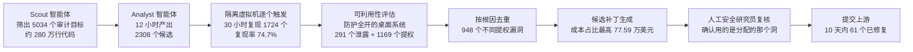
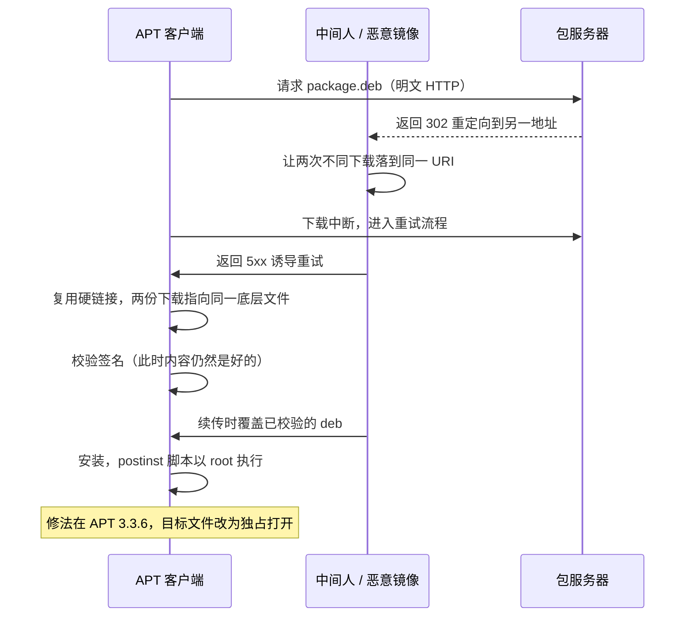
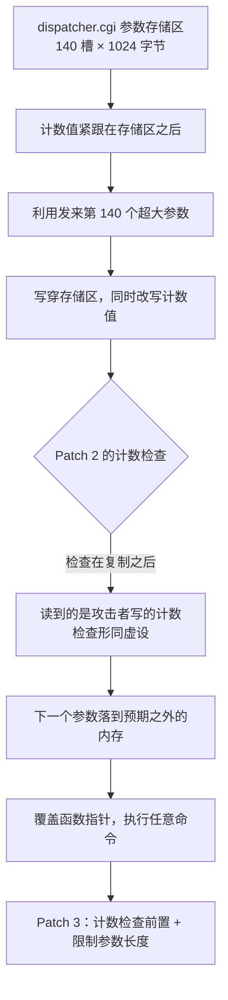
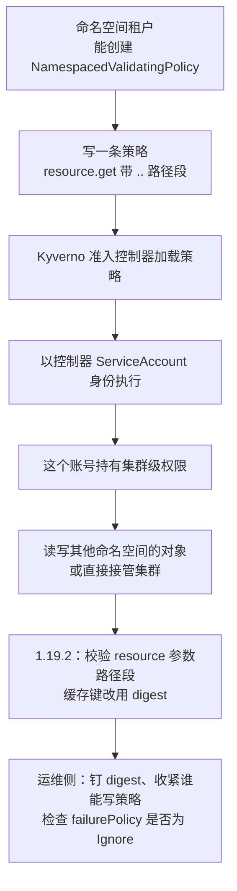
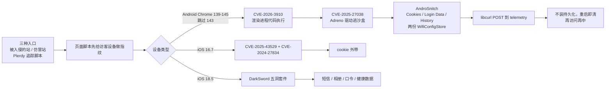
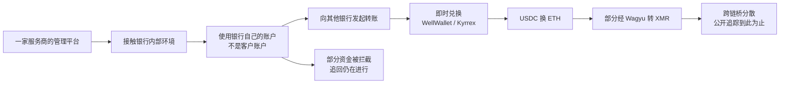
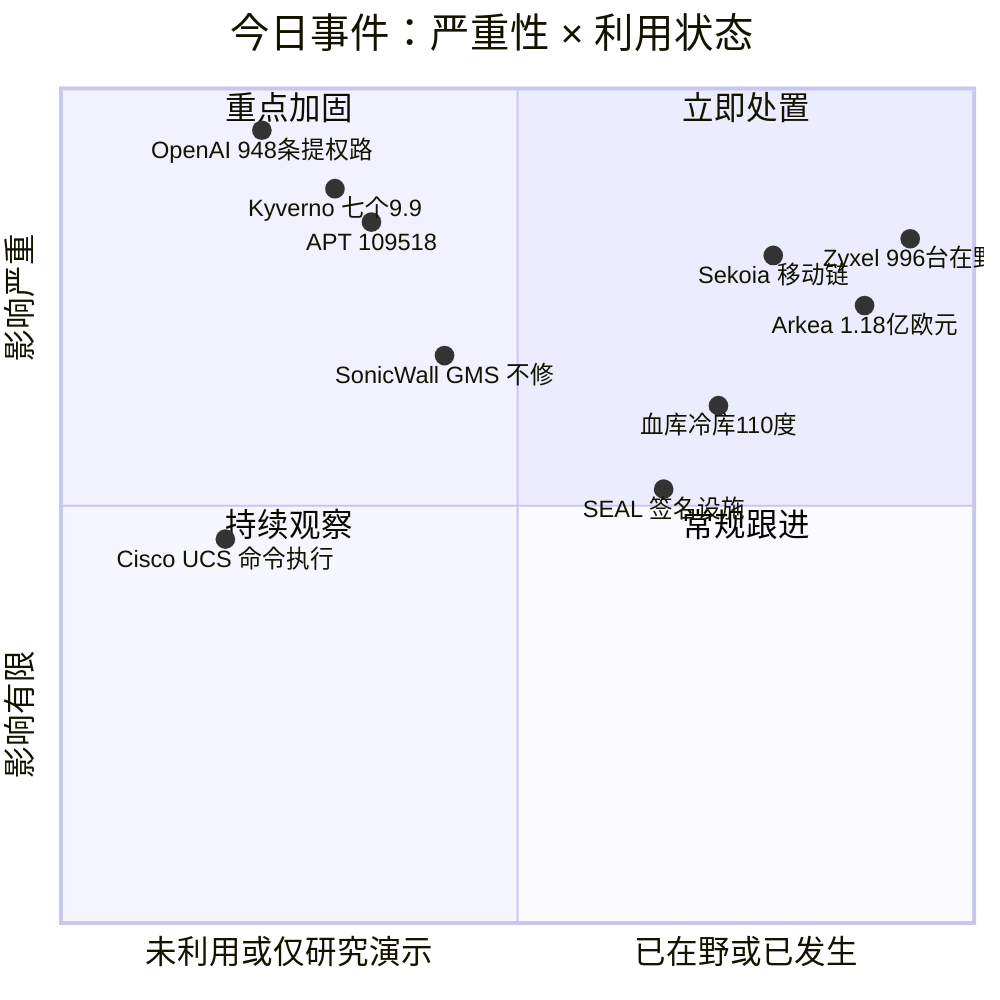
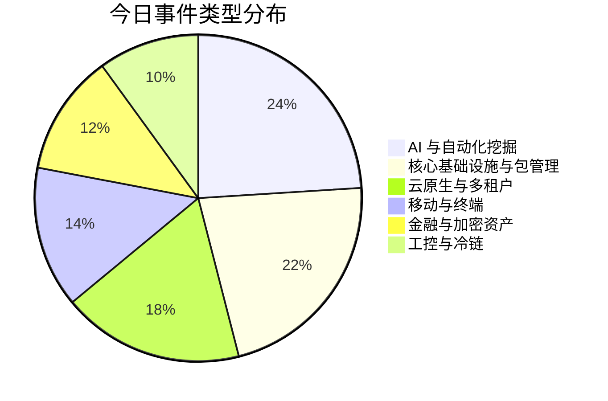
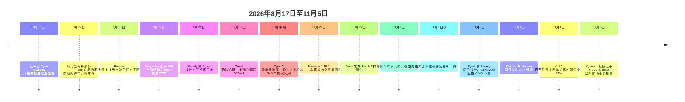

# 网安日报速递 · 2026年11月5日（第208期）

> 今日主线：**每一道检查都做了，只是做在了错的那一步**。OpenAI 的流水线能发现、能复现、能写利用，但"这个利用用的到底是不是分配给他的那个洞"要靠人来核；APT 验签在续传之前完成，续传之后没有再验；Zyxel 六月补丁加了参数计数检查，检查跑在复制之后；Kyverno 把租户写的策略拿控制器的集群权限去执行；Sekoia 那条链上每个漏洞都修好了，只有手机没升；Arkéa 的钱是从银行自己的账户转出去的，入口是服务商的平台。六件事都不缺措施，缺的是措施和危险之间的先后。

---

## 一、头条：一条流水线跑出 948 条通往 root 的路，账单 121 万美元

**OpenAI Cyber 团队 · 2026-11-04 发布《A thousand fewer paths to root》· 单条利用平均成本 1,279 美元 · 目标为常规发行版桌面系统，SMEP / SMAP / KASLR / HARDENED_USERCOPY 全开**

### 事件

OpenAI 在 11 月 4 日（当地时间）公开了一次针对 Linux 内核的自动化安全研究。用的是一款**尚未发布**的网络安全模型，搭出的是一条五段流水线：发现、动态验证、可利用性评估、补丁生成、人工复核。

数字先摆出来：**2,308 个候选漏洞，动态复现 1,724 个**（约 74.7%），生成 **291 个信息泄露 PoC** 和 **1,169 个可用的本地提权（LPE）利用程序**，按根因去重后是 **948 个不同的提权漏洞**。整轮消耗 **121.34 万美元** API 额度，折算单条利用 **1,279 美元**。按 Pwn2Own 两万美元、TyphoonPWN 七万美元的历史赏金口径估算，这 948 条利用的"理论价值"在 **1,890 万至 6,630 万美元**之间，是流水线成本的 **16 到 55 倍**。

各阶段的开销分布本身就有信息量。发现阶段先由 Scout 类智能体挑出低权限用户可达、且安全相关的代码，共 **5,034 个审计目标、约 280 万行**，相当于内核代码总量的 7%；分析智能体在 **12 小时**内产出 2,308 个去重候选，花掉 31.65 万美元。验证阶段把候选丢进隔离虚拟机逐个触发，**30 小时**跑出 74.7% 的复现率，剩下的多数卡在权限要求、竞态时序或特殊触发条件上，**只有 3.1% 是模型分析错误**，也就是假设了一个现实中不可能成立的前提。最贵的一段是**利用开发，77.59 万美元**，占总额六成多。

这段最值得看的是目标环境。跑利用的虚拟机装的是**常规发行版的桌面系统**，不是削弱过的靶机，威胁模型和 Pwn2Own、TyphoonPWN 那一套一致。防护全开的情况下拿到 root，才叫可利用。

还有两个数字把"量变"说清楚了。第一，智能体在样本里用出**至少 10 种此前没见过的利用技术**，OpenAI 把技术细节同步给第三方内核利用专家，对方也确认这些手法是新的（细节按安全理由没有公开）。第二，在适配过的 kernelCTF 环境上跑了 **112 小时、3.29 万美元**，拿到 25 个信息泄露 PoC 和 21 个提权利用；而 kernelCTF 整个 2026 年到目前为止只收了 **26 个确认的 0day 提权利用**。一条流水线四天多的产出，接近一个公开悬赏项目全年的接收量。

OpenAI 自己也写了一段不太好看的自我修正：早期一次运行里，利用阶段声称拿下 **200 个 root 利用**，人工复核发现其中 **20 个**是走了另一个 0day 才拿到 root 的，不是分配给它的那个漏洞。此后他们收紧了任务规则，加了独立校验，确认每条利用用的确实是它该用的那个洞。

到扫描加人工复核结束、共 10 天时，这批提权漏洞里 **61 个已被上游修复、43 个有 staging 补丁、299 个正在公开讨论**。OpenAI 说已按内核社区的建议优先提交严重的那批，目前提交了数百份报告与补丁。



### 为什么值得关注

**第一，"发现"这一段的瓶颈已经被搬走了。** 过去一年业内讨论 AI 找漏洞，卡点一直是"找出来的一大堆，判断不了哪个真"。这次 OpenAI 明确说，运营上的难点不是发现，而是确定哪些能复现、跨的是哪条安全边界、值不值得最早让维护者看。它给出的答案是用动态复现当筛子，74.7% 的命中率把 2,308 压到 1,724，再用可利用性评估压到 948。这是一条**把"疑似"变成"证据"的产线**，不是又一个扫描器。

**第二，单条 1,279 美元这个价格，改变了攻防两侧的成本表。** 一个能稳定提权的内核利用在黑市和赏金市场都在数万美元级。现在这个价格比一次人工评估的人力成本还低，而且可以批量下。对防守方来说，这意味着"这个洞太小、不值得被利用"这个假设正式失效。

**第三，它同时也暴露了 AI 的自评不可靠。** 200 个声称成功的利用里有 20 个走错了洞，比例是 10%。这不是小瑕疵：如果没有人复核，那 20 条会被当成"这个洞可利用"的证据报给维护者，浪费的是上游最稀缺的注意力。OpenAI 加的那道独立校验，本质上和大公司里的双人复核一样古老。

**第四，补丁这一段才是真正的分水岭。** 报告里最扎眼的一句不是 948，而是"10 天内 61 个已被修复"。当发现速度提到这个量级，能跟上节奏的只有自动生成补丁。OpenAI 的判断是：在有专家引导迭代的前提下，AI 补丁可以做到功能正确、风格一致、对变体攻击稳健。这个结论还需要时间验证，但方向已经很清楚——**未来比拼的不是谁找得多，是谁修得快**。

对普通运维来说，今天能做的事没变，只是更紧迫了：内核版本要跟得上发行版的回补节奏（不是看 `uname -r` 的主版本号），暴露在外的多用户主机要重新评估"本地低权限账号"的价值，容器里那个 `nobody` 也不再是安全边界。

---

## 二、Debian 与 Ubuntu 的 APT：签名验过了，续传那一下把包换了

**CVE-2026-109518 · CWE-62 / CWE-367 · Ubuntu CVSS 4.0 7.7（high），Debian 维护者定 critical · DSA-6607-1 / DLA-4880-1 / USN-8996-1，均于 11-04 发布 · 暂无在野报告**

### 事件

APT 在装包前会核对签名，这一步一直是 Debian 系供应链信任的支点。CVE-2026-109518 动的是支点之后的那一小段：**验完到装之间，文件可以被换掉**。

链条是这样的。APT 遇到 HTTP 重定向，可能让两次不同的下载落到同一个地址上，于是把两份下载合并处理；随后的续传环节里，**硬链接被不安全地复用**，两个不同来源的文件指向了同一份底层数据。结果是：签名校验发生在先，攻击者替换发生在后，最终装进系统的是没被验过的那一份。分类上同时命中 CWE-62（UNIX 硬链接）和 CWE-367（检查与使用之间的时序差）。

触发条件写得很明确：**APT 必须开启重试**（`Acquire::Retries` 大于 0），而且攻击者要能改动机器与包服务器之间的 HTTP 流量——恶意镜像、被劫持的代理、同一个网络里的中间人都算。而 `Acquire::Retries` 的默认值从 APT 2.3.2 起就是 **3**，也就是 Debian 12 与 Ubuntu 22.04 及以后**默认就在这个配置里**。反过来，Debian 11、Ubuntu 20.04 在默认配置下不受影响，除非有人手工设过重试次数。

这条的发现者是 **Max Justicz**。2019 年那个让全世界的 `apt` 都得临时关掉重定向的 CVE-2019-3462，也是他报的。七年之后，同一个位置又出了一次：**重定向加重试，仍然是更新工具最脆的一段**。当年的临时处置是 `-o Acquire::http::AllowRedirect=false`，这次的临时处置是 `Acquire::Retries=0`。

修复版本清单要按发行版对：

| 发行版 | 脆弱版本 | 修复版本 |
|---|---|---|
| Debian 13 trixie | 3.0.3 及更早 | 3.0.4（DSA-6607-1） |
| Debian 12 bookworm | 2.6.1 及更早 | 2.6.2（DLA-4880-1） |
| Debian 11 bullseye | 2.2.4 及更早 | 2.2.5（LTS，8-31 已结束常规支持） |
| Ubuntu 22.04 LTS | 2.4.14 及更早 | 2.4.15ubuntu0.1 |
| Ubuntu 24.04 LTS | 2.8.3 及更早 | 2.8.4ubuntu0.1 |
| Ubuntu 26.04 LTS | 3.2.0 及更早 | 3.2.1ubuntu0.1 |
| Ubuntu 26.10 | 3.3.2 及更早 | 3.3.3ubuntu0.1 |

上游把根因解决在 APT **3.3.6**：下载方法改成**独占方式打开目标文件**，两次下载不可能再碰同一个文件。

两个口径需要并列摆出。一是严重性：Debian 的维护者 Julian Andres Klode 在公告里定的是 **critical**，Ubuntu 定 **high**、CVSS 4.0 给 7.7。二是 HTTPS 是否安全：一个来源明确写"HTTPS 与 FTP 源、snap 包不受影响，攻击者必须能改明文 HTTP"，另一来源指出**公告本身没有明说** HTTPS 源是否暴露。稳妥的做法是照着"能换 HTTPS 就换"去做，但别把 HTTPS 当成已经证明了的安全边界。

还有一个披露当天的细节值得记：Ubuntu 在 14:25 UTC 推送了四个发行版的修复，到 15:46 UTC，追踪页面上**从 14.04 到 26.10 八个版本仍全部显示为受影响**；Debian testing 在 14:58 UTC 还停在脆弱的 3.3.5 上。**补丁"已发布"和"你的机器已经拿到"，中间隔着镜像同步和一次 `apt update`。**



### 为什么值得关注

**第一，它打的是"已验证"这三个字。** 供应链安全的整套说辞都建立在"签名过了就等于内容对"上。这条漏洞不伪造签名、不攻破密钥，只是让验过的对象和装上去的对象不是同一个。凡是"先校验、后使用"的流程，都值得照这个思路自查一遍。

**第二，默认配置就在风险里。** 重试是个好东西，弱网环境下几乎是必需的；它同时也是这条链的必要条件。安全默认值和可用性默认值在这里直接对冲，而 APT 选了可用性。这不是谁犯错，是这类设计取舍的固有代价。

**第三，修复顺序有讲究，而且很容易做错。** 正确做法是先用 `Acquire::Retries=0` 把 apt 自己升上去：

```bash
sudo apt update && sudo apt install -o Acquire::Retries=0 --only-upgrade '?source-package(^apt$)'
```

Debian 上是 `sudo apt-get -o Acquire::Retries=0 install --only-upgrade apt`。很多人会直接 `apt upgrade` 一把梭，那时升级动作本身还在旧的重试逻辑里跑，等于在窗口里自己走了一遍。另外别忘了两件容易被漏的：容器基础镜像与金机镜像要重建，否则新机器开机就带着旧 apt；`sources.list` 里的 `http://` 该换 `https://`，但换完要跑一次 `apt update` 验证，部分社区镜像不提供 HTTPS。

---

## 三、Zyxel GS1900：六月的补丁装了，检查跑在复制之后

**CVE-2026-107441 · CWE-787 越界写 · Zyxel 自评 8.8，Binarly 评 9.8 并称可拿到 root · 影响 10 款 GS1900 · Patch 3（10-22）修复 · 11-03 公告 · 未进 KEV**

### 事件

先把前情说清楚：本刊 9 月下旬写过 CVE-2026-7273 的在野与 KEV 收录——Zyxel 在 6 月 16 日发 2.90 Patch 2，修的就是 GS1900 网页管理界面里的一个缓冲区溢出；9 月 21 日 GreyNoise 公开了 48 个国家 996 台交换机被批量取走配置的活动，CISA 当天把 7273 收进 KEV，联邦处置死线 9 月 24 日。

今天的新事实是：**那个补丁没修干净，而且攻击者用的根本不是 7273。**

Binarly 在 9 月 17 日从一台同时充当 JITTERLY 后门控制端的服务器上，在一个开放目录里翻到了一份混淆过的 Python 利用脚本。分析后发现两件事：这个脚本专门检查固件版本，**目标是已经打过 7273 补丁的版本**；并且在全部十款 Patch 2 固件上都能打通。9 月 28 日至 29 日确认，9 月 29 日报给 Zyxel PSIRT，10 月 11 日厂商确认这是一条**独立漏洞**，编号 107441，10 月 22 日发 Patch 3，11 月 3 日双方同天公告。

技术根因值得逐字看，因为它太典型了。`dispatcher.cgi` 用一块固定大小的全局结构存请求参数，**140 个槽位，每个 1,024 字节**，而**计数值就紧挨在这块内存后面**。原始代码有两个缺陷：不检查单个参数的长度，Patch 2 之前也不检查已存了多少个。

Patch 2 补的是后者——加了计数检查。问题在于检查的位置：**利用脚本发来第 140 个超大参数，先把存储区写穿，顺手把计数值也改成了自己想要的值；检查这时才跑，读到的已经是攻击者写的数字，等于什么都没挡。** 下一个参数于是落到预期之外的内存上，函数指针被换掉，程序转而执行攻击者的命令。Patch 3 的改法是把计数检查挪到复制之前，并限制单个参数的大小。

规模上，GreyNoise 记录的 996 台分布在 48 个国家，活动大约从 8 月 17 日开始；被下载的采集脚本会打包交换机配置、**哈希后的 root 凭据**和网络信息。这 996 台里有 **564 台仍在用出厂默认口令**——补丁问题之外另有一层。

有一个时间差必须点出来：利用脚本在攻击者手上、并且在用，比厂商承认"第一次修得不彻底"**早了大约六周**；从最早观测到入侵到真正可用的固件出来，**隔了十一周**。CISA 的 KEV 目录里仍然只有 7273（9 月 21 日收录），107441 到今天还没进去——但这不代表风险更低，只代表还没走完收录流程。

Binarly 表示**近期会公开一个精简版 PoC**。公开之后，这条从"有利用在野"变成"人人可复现"。



### 为什么值得关注

**第一，"打了补丁"这个状态被证伪了一次。** 六月的补丁有公告、有固件、进了 KEV、有联邦死线，所有该有的流程都齐了。它仍然没关掉门。对资产台账来说，这意味着"版本号达标"和"漏洞已消除"是两件事，尤其当补丁是给某个具体 CVE 打的时候。

**第二，这是又一条"检查位置错一行"的案例。** 和今天 APT 那条、昨天蒲公英那条一样，缺陷不在逻辑写错，而在**顺序**：检查必须在被污染之前执行。这类问题在代码评审里极难看出来，因为单看每一行都正确。

**第三，边缘网络设备的补丁周期值得重新算。** 十款型号、十一周、近千台被取走配置和哈希口令。交换机在网里的位置特殊：它不被当作服务器来管，却能看到所有流量、持有全网设备的接入凭据。哈希过的 root 口令被拿走，等于给了对方一张离线爆破的靶纸。

自查三件事：确认十款受影响型号的固件是不是已经到 Patch 3（GS1900-8 / 8HP / 10HP / 16 / 24 / 24E / 24EP / 24HPv2 / 48 / 48HPv2，逐型号对照公告里的版本表）；把这批设备上所有本地账号口令换掉，出厂默认的一定要换；管理界面从公网收回内网，这条几乎对所有这类设备都成立。

---

## 四、Kyverno 一次七个 9.9：租户写的策略，用的是集群的权限

**CVE-2026-122302 / 122303 / 122304 / 122310 / 122311 / 122313 / 122321 · 六个 9.8–9.9，一个 9.1 · 全部在 1.19.2 修复（10-20 发布）· 11-05 由 NVD 收录，评分来自 CNA VulnCheck，NVD 尚未自评**

### 事件

Kyverno 是 Kubernetes 上最常见的策略引擎之一：策略本身就是 K8s 对象，用 YAML 写，被准入控制器调用。它的模型里有一个天然的不对称——**策略是写的人写的，执行却是 Kyverno 自己的 ServiceAccount 在跑**，而这个账号持有集群级权限。

这次公开的七个严重问题，六个就出在这个不对称上，第七个出在镜像签名校验的缓存上。

| CVE | 影响版本 | CVSS 3.1 | 机制 |
|---|---|---|---|
| 122302 | 1.19.2 之前 | 9.8 | `generaterules` 检查的是控制器的权限，不是策略作者的权限 |
| 122303 | 1.17.0 起，1.19.2 前 | 9.9 | `NamespacedMutatingPolicy` 可伪造指向其他命名空间的目标 |
| 122304 | 1.17.0 起，1.19.2 前 | 9.9 | `CleanupPolicy` 的 context 在没有策略的情况下被加载，可读 Secret |
| 122310 | 仅 1.19.1 | 9.9 | `apiCall.urlPath` 校验的是 clean 后的路径，执行的是原始路径 |
| 122311 | 1.16.0 起，1.19.2 前 | 9.9 | `resource.get()` / `resource.post()` 的 resource 参数不校验路径段，`..` 直接逃出命名空间 |
| 122313 | 1.17.0 起，1.19.2 前 | 9.9 | `NamespacedMutatingPolicy` 可改别的租户的 RoleBinding |
| 122321 | 1.18.0 起，1.19.1 前 | 9.1 | `verifyImages` 缓存用镜像引用（tag）当键，不绑定 digest |

122311 的写法最能说明问题：有权限在命名空间里建 `NamespacedValidatingPolicy` 的租户，只要在 `resource.get()` 的 resource 参数里塞进 `..` 段，就能以**准入控制器的 ServiceAccount** 身份读写任意集群对象。路径穿越这个漏洞类别放在 Web 应用里是老掉牙，放在策略引擎里就是"我给自己写了一条规则，规则帮我去读别人的东西"。

122321 是另一种味道。签名校验结果被缓存，缓存的键是镜像引用（比如某个 tag），而不是校验过的 digest。能操作 tag 的人可以先拿一个**签名过的**镜像把缓存焐热，再把 tag 指向别的镜像，工作负载照样通过准入。修法不是改校验逻辑，是把键换成 digest——这也直接给出了运维侧的建议：**生产清单里钉 digest，别钉 tag**。

还有两点需要点明。一是**同一批次还有 14 条**，CVSS 3.1 在 6.2 到 8.5 之间，其中 5 条在 NVD 向量里不需要任何权限。有几条能让准入 webhook 崩溃或耗尽资源，NVD 描述里明确写了：在 `failurePolicy: Ignore` 配置下，崩溃可以变成策略绕过。这个设置值得现在就去翻一遍。二是**时间线**：1.19.2 是 10 月 20 日发的，这些编号 11 月 5 日才出现在 NVD。中间那半个月，补丁在，公告的依据不在。



### 为什么值得关注

**第一，多租户 K8s 的边界被同时打了七个洞。** 共享集群的前提是"命名空间是隔离单位"。这次七个里有六个直接违背这个前提，而且都不需要集群管理员权限，只需要"能在自己的命名空间里建策略"这一项常见授权。凡是把 Kyverno 当多租户策略层用的集群，都该假设租户之间已经不再是信任边界。

**第二，它提醒了一件被忽略的事：策略引擎是提权面，不是纯防御组件。** 大家习惯把准入控制器当"守门的"，忘了守门的人手里有钥匙。任何"低权限用户写入、高权限进程执行"的架构，都在同一个坑里——CI 里的流水线定义、监控里的采集脚本、工单系统里的自动化动作，全是这个形状。

**第三，修了半个月才公开这件事，对防守方其实是好消息。** 只要你的 1.19.2 是在 10 月 20 日之后上的，就已经在保护里了。真正要查的是**谁有权限创建 Policy 类对象**：按最小权限清一遍，然后把审计日志里近期的 RoleBinding、ClusterRoleBinding、ValidatingWebhookConfiguration 变更翻出来看——这几类对象正是这些漏洞能碰到的落点。

---

## 五、Sekoia 的移动水坑：每个洞都修好了，只有手机没升

**Chrome CVE-2026-3910 + 高通 Adreno CVE-2025-27038（Android）· iOS 两条链含 CVE-2024-27834 · 11-05 报告 · 全部为 n-day，无持久化**

### 事件

Sekoia 在 11 月 5 日公开了一场同时打 Android 和 iPhone 的水坑活动。三种投放路径：入侵正常网站、搭仿冒站、以及**攻破一家乌克兰网页分析服务 Plerdy 的追踪脚本**——8 月 27 日到 9 月 3 日之间，数千个主要位于乌克兰的站点加载了带毒的追踪代码，其中包括军方、特种部队与国防供应商的页面。两个仿冒域名克隆了 America250 和一个靠近英国国防部的伦敦酒店（Raffles London at The OWO）。

Android 侧是两段接力。第一段用 Chrome 的 **CVE-2026-3910** 在渲染进程里拿到执行权，加载一段由 loader、stager 和共享库组成的 shellcode；共享库利用高通 Adreno GPU 驱动里的 **CVE-2025-27038** 逃出 Chrome 沙盒，再以更高权限起第二段 shellcode。受害者要做的只有一件事：在**过旧版本的 Chrome** 里打开那个页面。不需要点任何东西，不需要装应用，不需要授权。

目标版本区间是 Chrome **139 到 145，跳过了 143**，Sekoia 说原因不明。第二段载荷被命名为 **AndroSnitch**，内部共享库 `libexploit.so` 只导出 16 个函数，功能极其单一：读 Chrome 的 `Cookies`、`Login Data`、`History` 三个文件，加上系统里两份 `WifiConfigStore.xml`，然后用 libcurl POST 到同一个 telemetry 接口，请求头里一个 `Filename`、一个硬编码的 `X-Device-Id`。Wi-Fi 配置文件里有连过的所有网络口令，这一项在很多"浏览器数据窃取"的分析里被漏掉。

有个细节很有意思：这段利用**检测到设备是 SM-S938B（三星 Galaxy S25 Ultra）就直接中止**。原因没公开，可能是研究者机型、可能是某个已知的检测环境标记。不管哪种，都说明对方在维护一份"不要碰"的名单。

iPhone 侧两条链：iOS 16.7 上把 **CVE-2025-43529**（WebKit 远程代码执行）和 **CVE-2024-27834** 串起来偷 cookie；iOS 18.5 上换了 DarkSword 利用套件，拼的是 CVE-2025-43529、CVE-2026-20700、CVE-2025-14174、CVE-2025-43510、CVE-2025-43520，收的是短信、iMessage、WhatsApp、Telegram、Keychain 口令、定位、健康数据和照片。

**关键在于：这条链上每一个漏洞，在攻击开始之前厂商就已经修好了。** 这不是 0day 战役，是彻底的 n-day 战役。也正因为如此，同一天 CISA 把 **CVE-2024-27834** 收进了 KEV，死线 11 月 18 日。这条是 2024 年 5 月修的（iOS 17.5、iOS 16.7.8、macOS Sonoma 14.5、Safari 17.5），2024 年 3 月 Pwn2Own 温哥华站上被当零日演示过，CVSS 只有 5.5，作用是绕过指针认证（PAC）——单看分数一点都不起眼，放进一条完整链里就成了关键一环。

载荷都**不装持久化**，重启就清。但下次再访问那个页面，照样中。对情报目标来说，"重启能清"和"安全"是两回事。



### 为什么值得关注

**第一，n-day 的成本结构已经彻底变了。** 三个洞全是旧的，最老的一个是 2024 年 5 月修的。攻击方不需要买 0day，只需要等，然后按机型下发对应版本。Sekoia 的判断是这类做法**降低了高级移动攻击的成本与门槛**，这句话比"某组织又出手了"更值得记。

**第二，一个第三方追踪脚本，等于几千个站点的默认入口。** Plerdy 那九天里，任何加载了它追踪代码的站点都把利用送到了访客门口——包括那些自己基础设施管得很严的国防供应商。这也是 2024 年 6 月 polyfill.io 事件之后又一次同样的教材：**你不控制的那段 `<script>`，就是你站点的一部分。**

**第三，CISA 把 5.5 分的那条收进 KEV，是个正确的示范。** 单条评分衡量的是"这个洞自己有多严重"，KEV 衡量的是"有人正在用它"。两个指标回答两个问题，不能互相替代。反过来说，任何只看 CVSS 排序、不看 KEV 和 EPSS 的补丁优先级表，都会把 27834 这种"不起眼但是链条关键环"的漏洞排到最后。

运维侧只有两句话：Chrome 版本要高于 145，Android 安全补丁级别要跟上（GPU 驱动的修复只走月度补丁，不走应用商店）。还有一层组织层面的：把"哪些第三方脚本能进生产站点"变成一个有人签字的白名单，而不是前端同学随手加一行。

---

## 六、Arkéa：钱是从银行自己的账户转走的，入口是服务商的平台

**2026-11-04 监管公告与 FAQ · 未确认具体金额，"只确认量级" · 客户资产未受影响 · 部分资金已拦截**

### 事件

法国合作银行集团 Crédit Mutuel Arkéa 在 11 月 4 日发布监管公告，确认遭到网络攻击并产生了**欺诈性转账**。公告的措辞很克制：事件已受控、业务基本恢复、客户资产未受影响、部分转账出现延迟、已通报监管机构、正与警方合作。

补充 FAQ 里有两句话是全部信息量所在。第一句：攻击者**不是**从它的网银子公司 Fortuneo 进来的，也不是从客户账户进来的，而是**通过一家服务商的平台**接触到银行本身。第二句：钱是从**银行自己的账户**转出去的，转给其他银行，之后**可能**经由专门平台换成加密货币。这两句把事件性质定死了：这不是客户被骗，是银行的资金账户被人当成合法付款方用了。

金额上出现了典型的多口径。链上调查者 ZachXBT 在 11 月 3 日点名该行，给出的数字超过 **1.33 亿美元（约 1.18 亿欧元）**，并称攻击"持续了数天"。银行不确认具体数字，只说"**可以确认量级**"，同时强调部分资金已被拦截、追回工作仍在进行，且金额不足以影响集团财务稳健。另有一份被引用的口径是集团总资产 2,115 亿欧元（约 2,381 亿美元），而 ZachXBT 的说法是 2,350 亿美元——连最能核的一项都对不上 30 亿。

链上侧是另一套数字，衡量的是另一件事。Bitquery 追踪到 **1.088 亿美元 USDC** 从它标记为 Kraken、Crypto.com、OKX 的地址转入 15 个地址，时间从 11 月 1 日 12:25 UTC 到 11 月 2 日 09:09 UTC，约 21 小时；其中两个地址是经中间钱包转来的，去掉它们只剩 **9,570 万**；到 11 月 4 日估计还有约 **4,260 万美元**留在以太坊上。Bitquery 明确说明自己看不到银行转账和交易所账户，**无法独立证明"银行→交易所"这条路径**，也无法识别收款地址的归属。

The Block 补的兑换路径是：USDC 换成 ETH，走 WellWallet、Kyrrex 这类即时兑换，部分经 Wagyu 换成 XMR（门罗币），再跨链桥分散。换成 XMR 之后，公开追踪基本到头。

还有一条是**指控**，不是事实：ZachXBT 批评银行披露太慢，说这个延迟让执法部门错过了冻结约 **3,000 万美元**的窗口。银行的公开材料里没有回应这一点，也没有说明攻击从什么时候开始、持续了多久、有没有数据被拿走。这些都是它自己承认"目前还说不清"的部分。



### 为什么值得关注

**第一，被攻破的不是银行，是银行的供应商。** 这条和过去两年所有大型供应链事件同一个形状：钱庄自己的门锁得很好，但给维修工留的那扇门是别人在管。FAQ 里那句"不是人为失误、是外部高级攻击"，恰恰说明这类入口在防御模型里根本没被当成入口。

**第二，用银行自己的账户转账，是这套手法最狠的一点。** 收款行看到的是一笔来自正规金融机构、报文齐全、路径正常的付款，没有任何异常信号。等到有人发现"这个付款模式不对"，钱已经在链上了。所有做支付风控的团队都该问一句：我们判断一笔转账是否合法，依据是**报文格式**，还是**发起这笔转账的那个会话本身**？

**第三，金额争议本身是新闻的一部分。** 银行说"量级"，调查者给到个位数，链上数据是第三个数字，而且三者量的不是同一件事——一个是声称的被盗总额，一个是链上从交易所流出的稳定币，一个是最终净损失（扣掉已拦截和已追回）。这种时候最该做的是把三个数字分别标注清楚，而不是挑一个最好看的。本刊的做法就是并列写出，不做加总。

**第四，披露时机正在变成一个独立的风险项。** 从发现到公告之间的每一个小时，都是资金继续往外走的时间。这次被公开批评"披露太慢"，无论最终是否成立，都会推动欧洲监管在事件通报时限上再收紧一档。

---

## 速览

### 7. 法国血库的三处冷库，目标温度被改成 110 摄氏度

法国血液机构（EFS）11 月 3 日晚间证实，11 月 1 日夜至 2 日凌晨，三个地区站点的血浆冷库监控与控制系统遭远程入侵。攻击者把原本约 **零下 30 摄氏度** 的目标温度改成 **110 摄氏度**，同时抬高了除霜阈值。受影响冷库里存的是待配送的血液制品、供输血用的血浆，以及用于制药的血浆。EFS 说监控与报警系统及时触发，值班人员把库存转移到未接入受影响平台的设备上，**未造成血液制品损失，采血与配送未中断**。入口指向制冷设备维护服务商 **Coolworld**——它承认发生了"网络安全事件"，但把问题归到"由第三方供应商提供的、不在公司直接控制范围内的组件"。法国卫生部与国家信息系统安全局（ANSSI）已介入，相关设备的远程访问功能已被关闭。同期欧洲八国超市冷柜再遭同类攻击，Ahold Delhaize 11 月 4 日称这波攻击预计使其**第四季度销售额减少 2.5 亿欧元**。前情：本刊 10-14、11-02、11-03、11-04 期连续追踪过超市冷柜；本条是首次出现**医疗冷链**受害方，量级从"食品报废"变成"血浆"。值得记的是一句老话：设定值是一个 API 调用，物理后果是几小时。

### 8. SonicWall GMS：9.1 分那条，官方明确说不修

SonicWall 在 11 月 3 日的公告里给了两条：**CVE-2026-109593（CVSS 3.1 9.1）**，未认证攻击者只要能访问到 GMS 实例，就能读取内部应用文件、拿到敏感信息；**CVE-2026-109594（CVSS 6.8）**，高权限账号可经低复杂度攻击读写 GMS 数据库。影响 GMS **9.5.2 及更早**。然后是最关键的一句：**因为产品已停止支持，不会发布任何补丁或安全更新**，公告里也没有 workaround。GMS 的 EOL 时间表是 2025 年 5 月 5 日宣布、2025 年 10 月 1 日停售、2026 年 9 月 30 日结束支持——也就是今年 9 月底刚过完，一个月后就有新洞且永远不会修。继任者是 NSM，官方提供了 GMS Transition Snapshot 用于迁移数据。为什么要提：GMS 是集中管理几十上百台防火墙的控制台，一个未认证文件读取就够把配置和密钥捞出来。CISA 四年里收过 **19 个** SonicWall 漏洞，其中 **13 个**被勒索团伙用过——这类设备的"不修"从来不是低风险。有 GMS 的单位现在就两件事：管理界面从公网彻底摘掉，限制到堡垒机；迁移排期别拖。

### 9. Cisco 三条：UCS Central 能执行命令，ISE 能拿终端证书

Cisco PSIRT 一次发了三条，都不带 workaround，都无已知利用。**CVE-2026-76506（7.6）**：UCS Central Web 门户的输入校验缺陷，已认证用户可执行任意命令、写文件、读数据；影响 2.0 及更早、以及 2.1 的 2.1(2c) 之前版本。UCS Central 是数据中心服务器机群的管理层，一个"普通门户账号"落在那里，能碰到的东西远比单台主机多。**CVE-2026-20241（5.3）**：ISE 与 ISE-PIC 的授权绕过，未认证远程攻击者可获取**终端证书**；3.1 至 3.5 全中，修复版本分别是 3.1 Patch 12、3.2 Patch 11、3.3 Patch 12、3.4 Patch 7、3.5 Patch 4。ISE-PIC 3.4 是该产品最后一个受支持版本，往后没有分支可升。**CVE-2026-76419（6.1）**：Unified CM 与 Unified CM SME 的 Web 界面 XSS，14 与 15（15SU5 之前）受影响。三条分数都不高，但落在的位置都关键：数据中心管理面、网络准入的身份凭据、电话系统的管理界面。Cisco 给的唯一缓解是把管理门户限制到可信主机——这条几乎零成本，值得先做。

### 10. 奇安信《网络安全威胁 2026 年中报告》：新勒索组织一次冒出来四个

11 月 4 日发布，覆盖 2026 年上半年。报告的几个观察点：**银狐（UTG-Q-1000）** 活动最密集，覆盖境内及中国台湾、日本、东南亚多地；**ShinyHunters、UNC3753** 一类集群的焦点从"偷数据"转向 **SaaS 身份盗窃与数据施压**（拿到身份比拿到库更值钱，因为身份能一直用）；**TridentLocker、Sicarii、Osiris、The Gentlemen** 四个新勒索组织同期涌现，报告判断国家背景组织与勒索团伙的**合流在加深**。技术侧的核心判断是 AI 正在实质改变威胁格局：从辅助木马编码、生成社工话术，到自动化漏洞利用工具开发，压缩的是**攻击准备周期**，降低的是**参与门槛**，抬高的是**溯源难度**。报告给的对策方向是"从被动单点修补转向攻击面收敛与身份中心防御"。选它的理由：这是本刊少见地把"新组织涌现"和"AI 压缩准备周期"放在同一段因果里的表述。前两年新勒索组织出现是偶发，今年上半年一次四个，和准备成本下降是同一件事的两面。

### 11. SEAL 周报：一周 99 起，签名那一段最贵

安全联盟 SEAL 公布 10 月 27 日至 11 月 3 日的一周数据：收到 **99 起**事件报告；不计币安，协议被攻破类损失约 **5,700 万美元外加 2.4 BTC**，其中一起交易所热钱包被盗 **4,900 万美元**、根因尚未公开，另有约 500 万美元的签名基础设施被盗、TON 上一处金库被利用约 115 万美元。**基础设施类 7 起、约 219 万美元，全部是密钥或账号被盗，与合约漏洞无关**——这三条最值得抄下来：一个长期有效的云密钥能读密钥库，导致 Solana 钱包被清空约 85.5 万美元；一台存放交易机器人密钥的服务器被入侵，损失约 99 万美元；还有一起是攻击者在**负责签名的容器里执行代码**，再用服务账号经云 KMS 解密预生成的私钥，**关停系统也没能阻止**。另外种子泄露约 362 万美元、冒充客服来电约 157 万美元。这条要和今天第 6 条对照着看：一个是银行自己的账户被拿去付款，一个是签名容器被拿去签别人的交易，两件事的共同点是**权限是真的，用它的不是本人**。

---

## 风险分析





今天的风险画像有几处需要单独说。

**第一，KEV 只新增了一条，而且是 2024 年的旧洞。** 拉 CISA 的目录，版本 2026.11.04、共 **1,768 条**，自 11 月 3 日那条 WordPress 之后，唯一的新增是 **CVE-2024-27834**（Apple，11 月 4 日收录，死线 11 月 18 日）。这条 CVSS 只有 5.5，却是 Sekoia 那条移动链上的关键一环。它说明两件事：KEV 收录看的是"有没有人在用"，不是"分高不高"；反过来，今天所有 9.9 分的新条目（Kyverno 七个、APT 7.7、SonicWall 9.1）**都没有在野证据**，该紧张但不该恐慌。

**第二，今天的重头戏全部是"旧材料的新用法"。** Zyxel 那个洞在攻击者手上用了六周才被确认为独立漏洞；Sekoia 那条链上最老的漏洞修于 2024 年 5 月；OpenAI 的 948 条里，很多是存在很久、结构复杂的代码。没有一条是全新品类的攻击，全是既有资产的变现速度变快了。

**第三，成本线在移动。** 单条内核提权利用 1,279 美元；一条 n-day 移动链的成本主要花在买仿冒域名和攻破一个分析服务上；一笔 1.18 亿欧元的转账，入口是一个供应商平台。三个数字放在一起，指向同一个判断：**攻击方的边际成本在降，防守方的边际成本在升**，因为防守要覆盖的面比攻击要打穿的点大得多。

**第四，补丁节奏仍然是最大的现实变量。** APT 的修复 11 月 4 日推送，当天下午追踪页面还全绿（表示全部受影响）；Zyxel 的 Patch 3 发了十一天才公告；Kyverno 的 1.19.2 发了半个月才见编号。**"厂商已修复"和"你已经修好"之间，平均隔着两周。**

---

## 事件时间线



---

## 相关出处

| 来源（日期） | 关键内容 | 链接 |
|---|---|---|
| OpenAI（11-04，官方研究博文） | 《A thousand fewer paths to root》：2308 候选 / 1724 复现 / 948 LPE、121.34 万美元、单条 1279 美元、10 种新利用技术、早期 200 条里 20 条走错洞、10 天内 61 个已修 | https://openai.com/index/a-thousand-fewer-paths-to-root/ |
| IT之家（11-05） | 五阶段流水线细节：5034 个审计目标 / 280 万行 / 12 小时、30 小时验证、291 泄露 + 1169 提权、各阶段成本拆分 | https://www.ithome.com/1/022/476.htm |
| Help Net Security（11-05） | kernelCTF 适配环境 112 小时 / 3.29 万美元 / 21 个提权、2026 年 kernelCTF 共收 26 个 0day、赏金估值区间 | https://www.helpnetsecurity.com/2026/11/05/openai-linux-kernel-root-exploits/ |
| 央广网 / 界面（11-05） | 中文口径核对：948 个提权利用、121 万美元、平均 1279 美元、已按内核社区建议优先提交 | https://www.cnr.cn/tech/gstj/20261105/t20261105_527863073.shtml |
| Debian 安全公告 DSA-6607-1（11-04） | APT 3.0.4 修复、trixie、同批修若干越界访问问题 | https://lists.debian.org/debian-security-announce/2026/msg00526.html |
| Ubuntu USN-8996-1（11-04） | 四个发行版修复版本号、CVSS 4.0 7.7、HTTPS 源建议 | https://ubuntu.com/security/notices/USN-8996-1 |
| Positive Technologies dbugs（11-05） | CVE-2026-109518 的 CWE-62 / CWE-367 归类、TOCTOU 与硬链接混用描述、参考清单 | https://dbugs.ptsecurity.com/vulnerability/CVE-2026-109518 |
| CyberExperts（11-05） | 修复优先顺序、`Acquire::Retries=0` 命令、容器镜像与金机镜像重建、HTTPS 验证 | https://cyberexperts.com/2026-11-05-apt-package-swap-root-update |
| Daily Security Review（11-05） | Debian 定 critical 与 Ubuntu 定 high 的分歧、披露当天追踪页仍全绿的时间点、上游 3.3.6 独占打开 | https://dailysecurityreview.com/resources/debian-ubuntu-patch-critical-apt-flaw-cve-2026-109518 |
| BleepingComputer（11-04） | Zyxel 时间线、996 台 / 48 国、Binarly 发现过程、Patch 3 修复 | https://www.bleepingcomputer.com/news/security/zyxel-fixes-zero-day-exploited-to-hack-nearly-1-000-network-switches/ |
| eSecurity Planet（11-05） | 140 槽 × 1024 字节的内存布局、Patch 2 检查位置错误、564 台仍用出厂口令 | https://www.esecurityplanet.com/cybersecurity-threats/news-zyxel-gs1900-zero-day-cve-2026-107441 |
| Shieldworkz（11-05） | 完整时间线（6-16 / 8-17 / 9-17 / 9-21 / 9-28 / 10-11 / 10-22 / 11-03）、十款型号清单 | https://shieldworkz.com/ar/blogs/zyxel-gs1900-zero-day-cve-2026-107441-how-a-patched-switch-became-the-entry-point-for-996-compromises |
| NVD | CVE-2026-122311 等七条 Kyverno 记录、CVSS 向量与受影响版本区间 | https://nvd.nist.gov/vuln/detail/CVE-2026-122311 |
| CVEO（11-05） | Kyverno 七条对照表（CVE / 版本 / CVSS 3.1 与 4.0 / CWE / 机制）、"NVD 尚未分析、评分为 CNA VulnCheck" | https://cveo.tech/blog/kyverno-1-19-2-cve-2026-122302-122321-namespace-escape-en |
| Brandefense（11-05） | 122321 缓存键机制的完整描述、同批 14 条的分布、`failurePolicy: Ignore` 的风险、运维检查清单 | https://brandefense.io/security-news/kyverno-vulnerabilities-1-19-2-compared |
| Android Authority（11-05） | 移动水坑的三种投放路径、Chrome 139–145 跳过 143、Galaxy S25 Ultra 检测即停 | https://www.androidauthority.com/hackers-chrome-snapdragon-gpu-flaws-android-zero-click-3731860/ |
| Daily Security Review（11-05） | CISA 收录 CVE-2024-27834、11-18 死线、CVSS 5.5、2024 年 5 月修复版本、Pwn2Own 温哥华演示 | https://dailysecurityreview.com/resources/cisa-adds-apple-cve-2024-27834-to-kev-after-apt29-phone-attacks |
| 微博长文（11-05，技术拆解） | AndroSnitch 的 `libexploit.so` 16 个导出函数、三个 Chrome 文件 + 两份 WifiConfigStore、libcurl 外发与硬编码头 | https://weibo.com/ttarticle/p/show?id=2309405361921045168179 |
| CISA KEV 目录 JSON | 版本 2026.11.04、共 1768 条、11-04 唯一新增为 CVE-2024-27834、forensicTriage=No、死线 11-18 | https://www.cisa.gov/known-exploited-vulnerabilities-catalog |
| TSNMedia（11-05） | Arkéa 监管公告与 FAQ 原文要点：服务商平台、银行自有账户、否认 Fortuneo、只确认量级 | https://tsnmedia.org/arkea-cyberattack |
| Crypto Jazz（11-05） | ZachXBT 与 Bitquery 两套数字的来源与差异、USDC→ETH→XMR 路径、披露延迟与 3000 万美元的指控 | https://crypto-jazz.com/news/2026/11/05/credit-mutuel-arkea-confirms-attack-not-133m-figure |
| CryptoNews（11-05） | Bitquery 的 1.088 亿美元 / 15 个地址 / 21 小时、去重后 9570 万、4260 万仍留在以太坊 | https://cryptonews.net/news/security/33705567/ |
| 澎湃新闻（11-05） | EFS 三处站点、零下 30 度改到 110 度、Coolworld 与第三方组件、ANSSI 与卫生部介入、远程访问已关 | https://www.thepaper.cn/newsDetail_forward_34410740 |
| 腾讯新闻 / 中青报（11-05） | EFS 未造成损失与供应未中断、Ahold Delhaize 第四季度减收 2.5 亿欧元 | https://news.qq.com/rain/a/20261105A0AAVC00 |
| IT-Connect（11-05） | SonicWall GMS 的 EOL 时间表、两条 CVE 与 CVSS、无补丁无 workaround、迁移到 NSM | https://www.it-connect.tech/sonicwall-gms-two-flaws-including-a-critical-one-will-never-be-fixed |
| Daily Security Review（11-05） | Cisco 三条：76506 / 20241 / 76419 的评分、受影响版本与各分支修复等级 | https://dailysecurityreview.com/resources/cisco-patches-ucs-central-flaw-cve-2026-76506-and-ise-bugs |
| 奇安信（11-04） | 《网络安全威胁 2026 年中报告》：银狐活动密度、SaaS 身份盗窃、四个新勒索组织、AI 压缩准备周期 | https://www.qianxin.com/threat/reportdetail?report_id=350 |
| 今日头条（11-05，安全情报日报） | SEAL 周报细节：99 起、5700 万美元、签名容器内执行代码 + 云 KMS 解密预生成私钥 | https://www.toutiao.com/a7704464136498987530 |

---

*本报告基于公开信息整理，CVE 编号、CVSS 评分与版本号以 NVD、厂商公告与 KEV 目录为准。涉及单一来源、口径冲突或第三方指控的条目已在正文逐处标注。移动水坑一节的攻击方归因沿用 Sekoia 公开表述，本刊仅讨论技术面。*
