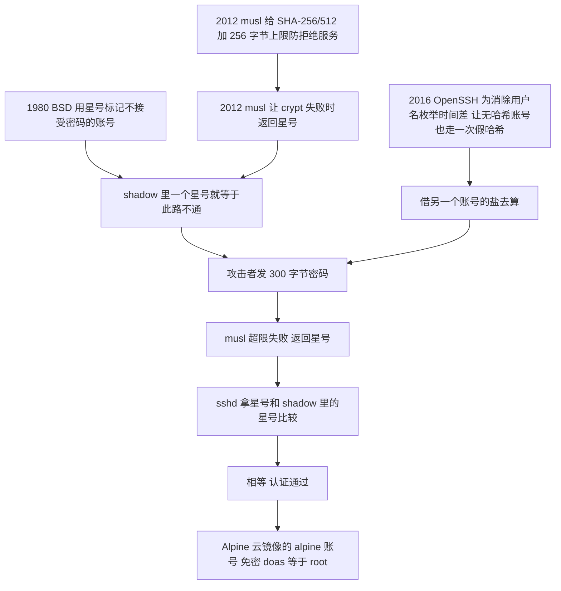
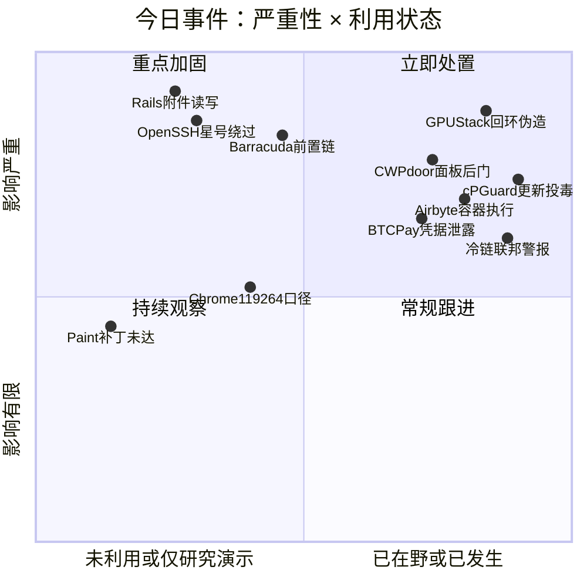
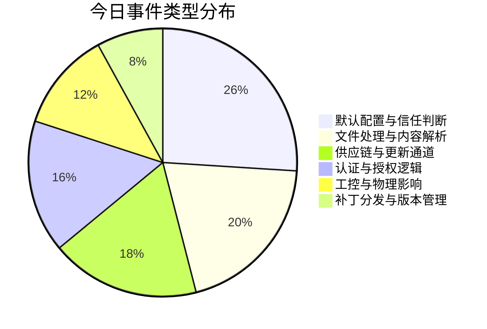
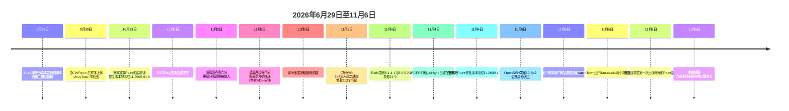

# 网安日报速递 · 2026年11月6日（第 209 期）

> 今日关键词：一个星号既是锁也是失败信号 · 附件一交上去它就已经读完 · 回环地址是可以写在请求头里的 · 认证失败的分支把身份交回去 · 后门就装在你查后门的那个面板 · 只读权限也能在容器里跑命令

---

## 今日主线：每一个默认值单独看都合理，凑在一起就是默认打开的门

今天六条主线，共同点是"默认值"。

Alpine 默认不开 PAM、默认开密码登录、默认带一个免密 `doas` 的 `alpine` 账号，加上 musl 在 2012 年做的那个"失败就返回星号"的决定，以及 OpenSSH 在 2016 年为消除时间差加的那次"假哈希"，四个各自都合理的决定叠在一起，结果是一串 300 字节的密码能登进本来禁止密码登录的账号。

Rails 在 `load_defaults 6.1` 及更早的版本里用 MiniMagick 当默认处理器，Debian 和 Ubuntu 打包的 ImageMagick policy 默认不拦 MSL，而 Active Storage 的图片分析在附件提交的那一刻就自动跑完，不需要任何人点预览。

GPUStack 的 `force_auth_localhost` 默认是 `false`，意思是"从本机来的请求就是管理员"；而判断"是不是本机"用的函数，会接受请求头里客户端自己写的一个回环地址。

Barracuda 的 `index.cgi` 是一个分发器，它默认"拿到 userrole 就继续往下走"，而不是"认证失败就退出"。

CWP 的面板以 root 运行、从公网可达、自带更新机制，这三件事都是它的产品设计，没有一件是配置错误。

Paint 的默认认知是"开了自动更新就等于修好了"，而它的更新走的是应用商店，不是 Windows Update。

六件事里，没有一条是有人把安全开关关掉了。全部是按默认值装、按默认值跑，然后门就开着。

---

## 1. OpenSSH：一串 300 字节的密码，能登进禁止密码登录的账号

**2026-11-05 OpenSSH 发布 10.6p2 · CVE-2026-123158 · CVSS 3.1 8.1（AV:N/AC:H/PR:N/UI:N/S:U/C:H/I:H/A:H）· 暂无在野报告 · 未进 KEV**

研究员 Özgün Kültekin（Wakefield）在 11 月 5 日公开了这个漏洞，代号 `sshole`（部分媒体写作 `sshhole` 或 `*sshole`），同一天 OpenSSH 放出 Portable OpenSSH 10.6p2。官方把它定性为 workaround 而不是根因修复，因为根因不在 sshd 里。

### 触发条件必须同时成立

| 条件 | 说明 |
| --- | --- |
| 系统用 musl libc | Alpine、OpenWrt、Buildroot、Yocto；Debian / Ubuntu / Fedora 用 glibc，不受影响 |
| 没有走 PAM | Alpine 的 `openssh-server` 默认就不带 PAM；`openssh-server-pam` 加 `UsePAM no` 也算 |
| 开了密码认证 | `PasswordAuthentication yes`，这是 OpenSSH 的默认值 |
| 目标账号的哈希字段是 `*` | 也就是"禁止密码登录"的那些账号，包括 Alpine 上的 root |
| 同机另有一个账号存着 `$5$` 或 `$6$` 哈希 | 这条最容易被忽略，但没有它触发不了哈希运算 |

五条全中，攻击者只需要知道账号名，发一段 **257 到 1024 字节**的任意密码，一次连接就能成功，不需要猜、不需要重试。

### 怎么变成一把万能钥匙的



时间线拆开看是这样的：1980 年 BSD 开始用 `*` 表示"这个账号永不接受密码"，这是个很干净的设计，因为星号不是合法哈希，任何密码都算不出它。2012 年 musl 决定 `crypt()` 失败时返回 `"*"` 而不是 POSIX 说的 `NULL`，理由是"这样不检查返回值的程序不会崩"。同一年 musl 给 SHA-256 和 SHA-512 加了 256 字节的密码上限，超过就失败。2016 年 OpenSSH 修 CVE-2016-6210（靠响应时间差枚举用户名），改法是"没有可用哈希也走一次假哈希，让时间恒定"，顺手会借用另一个账号的盐。2022 年 Alpine 3.16 把 root 的密码字段从 `!` 改成 `*`，目的是让 root 能在不用 PAM 的情况下用密钥登录。

四个决定，没有一个是错的。拼在一起，`"*" == "*"` 就成立了。

有个细节值得记下来：glibc 系不受影响，是因为 2013 年有人向 Debian 提议让 glibc 学 musl 的行为，Debian 最后转向了 libxcrypt，而 libxcrypt 失败时返回 **`"*0"`**——多一个字符。一个字符之差，整个 Debian 系就在门外。

### 影响面与修复

最严重的是 Alpine 官方的 AWS 与 Azure 云镜像：默认带一个 `alpine` 账号，配了免密 `doas`，撞开它等于 root。OpenWrt、Buildroot、Yocto 这些"看起来不像服务器"的设备同理。容器里通常没有 sshd，但如果基础镜像为了调试装了 SSH，也要重做。

修复：升级到 **10.6p2**，其中加了一条"存储的密码字段短于 4 个字符就拒绝比较"。Alpine 已回补到 3.16 全部版本，包括已经 EOL 的 3.16 到 3.21，点版本是 3.21.10 / 3.22.8 / 3.23.8 / 3.24.4。**注意 `apk upgrade` 之后必须 `rc-service sshd restart`**，只更新包不重启，跑着的还是旧进程。暂时升不了的，`PasswordAuthentication no` 就能掐掉一个必要条件——这条本来就该是默认。

自查两条命令：

```bash
grep "Accepted password" /var/log/messages
grep '^alpine:' /etc/shadow
```

如果日志里有 `alpine` 或 `root` 的密码登录成功记录，而 shadow 里那个字段是星号，那就不是"可能被利用"，是"被利用了"。Kültekin 也放了一个检测脚本在 GitHub（`oz9un/sshole`）。

### 值得关注的原因

- **这是"失败时的返回值也算契约"的教科书案例。** musl 为了不崩返回星号，OpenSSH 为了不泄露时间也接受星号，两个防御性设计撞出一个绕过。做接口的人都该问一句：我这个函数失败的时候返回什么，调用方会怎么理解它？
- **发现方式比漏洞本身更有信号。** 这不是读代码读出来的，是 AI 智能体跑了大约 **17,600 次**认证测试，混着不同 OpenSSH 配置、畸形哈希和超长密码暴力枚举出来的。组合型缺陷正好是自动化最擅长的领域——人不会去试"五个条件同时成立"的排列。
- **"我们用的是 Ubuntu"这句话今天是对的，明天不一定。** 大量容器基础镜像、边缘网关、国产嵌入式设备早就跑在 Alpine / Buildroot 上。这些设备不会出现在资产台账的"服务器"分类里，但它们开着 22 端口。
- **官方只给 workaround，说明补丁和根因不在一层。** 10.6p2 是让 sshd 别信太短的字段，真正的决定还在 musl 那边。以后再遇到类似组合，同类问题会以别的形状回来。

---

## 2. Rails Active Storage：附件一交上去，它就已经读完了

**2026-11-04 发布 8.1.4.1 与 8.0.5.2 · CVE-2026-122006 / GHSA-f3w6-w445-fwh9 · CVSS 3.1 9.8（AV:N/AC:L/PR:N/UI:N）· 无公开 PoC、无在野（截至 11-05）**

Rails 团队 11 月 4 日一次发了 21 个安全修复，1 个 critical、4 个 high、13 个 medium、3 个 low。排在第一的就是这条：Active Storage 在处理 ImageMagick 附件时，可以让服务器读和写任意文件。

### 攻击链不经过任何业务代码

ImageMagick 判断一个文件怎么读，看的是**文件内容**，不是扩展名。它的一部分"coder"（格式读取器）不止画像素——它们会按照文件里写的指令去打开或写入别的文件。MSL 就是其中之一，那是 ImageMagick 自己的 XML 脚本 coder。

Active Storage 没有禁掉这些 coder，而它的图片分析器（image analyzer）在**附件被 attach 的那一刻**就会自动跑。公告里那句话写得很直白：**"不需要调用 variant、preview 或 analyze"**。也就是说，一个从来不做图片缩放的 Rails 应用，只要接受上传，就走在漏洞路径上。

后果分两层：**写文件**在所有存储后端都成立；**读文件**额外要求附件用 Disk service 存本地，而那种部署下应用进程能读的东西通常包括 `secret_key_base`、数据库口令、第三方 token。

### 三个条件

| 条件 | 说明 |
| --- | --- |
| `config.active_storage.variant_processor = :mini_magick` | `load_defaults 6.1` 及更早的默认值；7.0 起默认改成 `:vips` |
| ImageMagick 的 policy 没拦相关 coder | Rails 明确说 Debian 与 Ubuntu 打包的 policy 都没拦，其中 Ghostscript 和 URL coder 被禁，MSL 没有规则，唯一的 MVG 规则还是注释掉的 |
| 应用接收来自不可信用户的上传 | —— |

最容易中招的画像很清楚：**老应用当年用 6.1 默认值起的，后来升了 Rails 版本但没动 `load_defaults`**。这个设置值得现在去翻 `config/`，别凭印象。

### 补丁之后还有第二件事

如果附件存在本地磁盘，Rails 要求的不是"升级就完事"，而是**轮换**：`secret_key_base`、master key、`config/credentials.yml.enc` 里的全部内容、存储与数据库凭据、第三方 token，**而且不能留一个旧值当回退**。换 `secret_key_base` 会让现有会话失效、签名的 cookie 和 Active Storage 的 URL 全部作废。这是要排一次生产变更的事，不是改个配置。

同一批里还有一条 8.8 分的（GHSA-v924-7rp8-4mxh）：Active Storage 把上传文件的原扩展名直接交给 ffprobe、ffmpeg 和 ImageMagick，等于让上传者自己挑解码器。最坏的路径需要带 AviSynth 的 FFmpeg——发行版包一般不开，ffmpeg.org 的 GPL 构建开着。

升级还会带来行为变化，测试环境先过一遍：MiniMagick 低于 5.1 会在启动时直接报错；用 ImageMagick 渲染 PDF 或 PostScript 的应用要重新在 `policy.xml` 里放行 gs delegate；在 8.1 上，`ActionDispatch::RemoteIp` 在 `Forwarded` 与 `X-Forwarded-For` 不一致时会抛异常，这会暴露反向代理配置不一致的问题。

还有一个时间点：**8.0 分支的安全支持在 11 月 7 日结束**，也就是发版后第三天。11-07 之后只有 8.1 是受支持的系列，还停在 7.2 的不会等到新 gem。

### 值得关注的原因

- **9.8 分发生在"上传头像"这种最普通的动作上。** 不需要登录、不需要社工、不需要用户点任何东西。Rails 撑起来的应用数量太大，这条的暴露面不在"用了 Rails 的公司"，而在"任何一个允许陌生人传图的表单"。
- **它证明"我没用这个功能"不是安全论证。** 分析器是自动挂上去的，很多开发者根本不知道自己开了这个能力。评估这类风险要看框架的默认行为，不能看业务代码调了什么。
- **补丁只关掉门，不追回已经出门的东西。** 公告专门写了轮换清单，这个细节值得所有框架厂商学：如果漏洞的后果是"密钥可能已被读走"，那么修复说明里必须包含"换掉它"。
- **PoC 的时间窗正在关闭。** 截至 11 月 5 日没有公开利用代码，EPSS 0.69%，但漏洞的利用原语（构造一个触发 MSL 的 SVG）门槛很低。9.8 分加低门槛，通常不会安静太久。

---

## 3. GPUStack：回环地址是可以写在请求头里的

**CVE-2026-102895 · CVSS 3.1 9.8（AV:N/AC:L/PR:N/UI:N）· 2.2.0 修复 · CVE 记录里明确写着"已在 2.1.1 部署上观测到在野利用"**

GPUStack 是个开源的 GPU 集群管理器，用来做模型服务和 GPU 实例调度，本质上坐在一堆 GPU、云厂商凭据和模型仓库中间。

漏洞出在 `gpustack/api/auth.py` 的 `get_current_user`：**当 `force_auth_localhost` 为 false（这是默认值）时，它把"请求来自回环地址"当成"这是内置管理员"**。问题在于判断来源的那个 `client_ip_getter`，它接受两种可以伪造的输入——同机反向代理的对端，以及**客户端自己带的 `X-GPUStack-Real-IP` 头里写的回环值**。

于是任何能发 HTTP 请求的人，只要在头里写一句 `X-GPUStack-Real-IP: 127.0.0.1`，就成了管理员。拿到的东西很完整：改用户、改模型、**创建一个持久的admin API key**（这一条意味着即使补丁打上，得先把这个 key 找出来删掉）、读 worker 与云厂商的密钥，以及通过 `POST /v2/inference-backends/from-yaml` 直接执行代码。

修在 **2.2.0**，对应 GHSA-gj9m-f8ph-pmhr 和 commit `53f42a6`。

### 值得关注的原因

- **"可信来源"这类判断，只要依据可以被客户端影响，就一次都不可信。** `X-Forwarded-For` 这套东西被误用十几年了，现在换了个名字出现在 AI 基础设施里。凡是代码里出现 `if client_ip == "127.0.0.1"` 然后跳过认证的写法，都该立刻改成"信任具体的反向代理进程身份"，比如 Unix socket 或 mTLS，而不是信任一个字符串。
- **这是 AI 基础设施第一次以"默认配置 + 已在野"的组合出现在 CVE 记录里。** 过去一年 GPU 集群管理面出问题多是"权限配错"，这次是产品自己的默认假定错了，而且记录正文写了在野观测。托管推理服务的团队要把它当既成事实处理，不是当预警。
- **它的后果比"读数据"重得多。** 一个 AI 集群管理员的权限等于：改模型权重（供应链污染）、读云凭据（横向到整个账号）、创建永久 API key（持久化）。这三件事加起来，比拿一台普通服务器的 root 更值钱。
- **补丁之后要清 key。** 这类"能给自己发凭证"的漏洞，升级只堵住入口。升级完必须翻一遍 API key 列表，把不认识的删掉，然后轮换 worker 与云厂商凭据。

---

## 4. Barracuda ESG：认证失败的分支，把身份交回去了

**CVE-2026-116606（CVSS 4.0 9.3，CWE-288）+ CVE-2026-111560（CVSS 4.0 8.6）· 修复版 9.4.0.029 / 9.4.0.030 · watchTowr 11-05 公开分析**

watchTowr 在 11 月 5 日拆了 Barracuda Email Security Gateway 的补丁，两个洞单看都只是"高危"，串起来是一条**不用登录就能拿到设备 root** 的完整链。

### 一个 `return` 的位置

补丁的 commit 注释写得很直白：`Pre-authentication authorization bypass permits arbitrary Spam_Config restore`。改动落在 `Index.pm` 的密码修改逻辑上。

旧代码在密码修改失败（`ERROR_PASSWD_CHANGE`）时，设置好 `json_authenticate` 之类的参数，然后——**`return $userrole;`**。问题就在这一行：Barracuda 的 `index.cgi` 是个分发器，拿到 `userrole` 之后不会停在原地，而是继续把请求交给对应的 module handler 去处理。本该"认证失败、到此为止"的分支，实际把攻击者送进了后续的业务逻辑。

补丁改的正是这里：失败时直接返回一个 JSON 登录响应并退出，不再把 `userrole` 交回去。

触发条件简单到不像话：密码修改请求只带两个参数，`new_password=one` 和 `retype_password=two`。两个值不一致，修改必然失败，于是走进那条"交回 userrole"的路径。一个正常业务里永远不会出现的输入组合，把攻击者变成了一个"低权限但不是 guest"的会话。

### 从低权限到 root


第二个洞（111560）是时区字段的命令注入。`Backup2::finalize_restore` 用反引号拼了一条 `sed -i 's#TZ=.*#TZ=$system_timezone#'` 交给 shell，那些单引号只是生成命令里的字符，不构成边界。值写成 `UTC#';touch /tmp/x;#` 就能闭合引号、另起一条命令。同一个值还会流进 `fix_tz.pl`，而它是被 `sudo` 拉起来的，所以执行身份是 root。

111560 的影响面比 ESG 宽得多：官方公告列的受影响产品包括 Email Security Gateway、Load Balancer ADC、Message Archiver、WAF Control Center、Web Security Gateway、WAF，修复版本统一到 9.4.0.029。一台设备同时是边界网关和 WAF 的场景，在政企网络里很常见。

### 三处口径要分开看

一是修复版本号：NVD 的两个条目都写 `< 9.4.0.030`，而 watchTowr 拆的是 9.4.0.029 的补丁。稳妥按 **9.4.0.030 及以上**处理。

二是严重性：**补丁代码里那行注释给 116606 标的是 9.8，厂商 CVSS 4.0 给的是 9.3**，而 NVD 两条都还在 Awaiting Analysis、没有 CVSS 3.1，EPSS 只有 0.73%。今天如果按排序工具决定先修谁，这两条会排在最后。

三是历史：2023 年 UNC4841 把同一产品线的 CVE-2023-2868 当零日用了大半年，最后厂商建议客户**物理更换设备**，因为持久化埋得太深，重装都不放心。三年后同一条产品线再出前置认证绕过，客户的耐心是个现实问题。

### 值得关注的原因

- **它不是溢出、不是反序列化、不是路径穿越，是一个控制流错误。** 认证失败的信号被正确处理了（参数设对了），但函数的返回值让调用方误以为"这个请求已经有身份"。这类缺陷代码扫描器很难发现，因为每一行单独看都合法；黑盒扫描器也难发现，因为触发条件是一个"业务上不会出现"的输入组合。
- **"认证失败后继续走业务逻辑"是自研认证框架的高发区。** 国内大量政企系统的登录框架是自己写的，`return` 放在哪儿、失败分支会不会被后面的中间件接住，很少有专门评审。这条给了一个具体的审计点：**认证失败的分支里，返回值是不是一个空的、明确表示"无身份"的值**。
- **评分滞后于风险，这次很典型。** 补丁注释自己写 9.8，NVD 还在等分析，EPSS 不到 1%。三个数字三个方向，只有一个是对的。
- **边界设备的价值在于它同时是入口和出口。** ESG 这类设备能看到全部邮件、持有域凭据、还常和 WAF 同机。它的 root 不是"一台机器"，是"一条邮件链路加一层边界"。

---

## 5. CWPdoor：后门就装在你每天点开的那个面板里

**奇安信 XLab · 2026-06-29 首次捕获 · 替换 cwpsrv 1.15.10 与 1.24.0 · 过去一个月公网暴露约 34 万个 CWP 实例（不等于感染数）**

Control Web Panel（原 CentOS Web Panel）是开源的主机管理面板，用来管网站、邮箱、DNS、数据库。CWPdoor 的打法很直接：**把面板自带的 Web 服务器二进制 `cwpsrv` 换成一个带后门的版本**。

### 反取证做了三步

6 月 29 日捕获的那个脚本伪装成更新程序，做的唯一一件事就是替换 `/usr/local/cwpsrv/bin/cwpsrv`。换完恢复文件与目录时间戳、删除临时文件、清空命令历史。磁盘上能证明"它被换过"的证据基本被抹掉了——`ls -l` 看到的时间还是几年前的。

### 被动后门：平时什么都不做

CWPdoor 不监听端口、不主动外连，等一个带三个头的 HTTP 请求：

| 请求头 | 作用 |
| --- | --- |
| `X-Ngx-Integrity-Data` | 密文命令 |
| `X-Ngx-Integrity-Time` | 时间戳 |
| `X-Ngx-Integrity-Sig` | RSA 签名 |

命令与回显走 AES-256-CBC。执行前先验时间戳是否落在 **±300 秒**窗口内，再验 RSA 签名，通过之后才解密并交给 helper 进程执行。XLab 的说明是：改动时间戳或密文任意一项，签名就失效；三个字段绑定加五分钟窗口，同时提供了防重放和授权控制。它还会干扰 Web 服务器的日志模块，让触发请求不出现在 access log 里。

这三件事叠起来的效果是：**查 webshell 查不到（它不是文件），查异常进程查不到（平时不动），查 access log 也查不到（日志被压了）。**

### 已有真实受害者

发现初始脚本之后，XLab 在 VirusTotal 上找到一份 9 月 30 日上传的样本，同一个压缩包里还有另一个已知后门 **Ebury**。里面那个恶意 `cwpsrv.suspeito` 在当时**零检出**。XLab 的判断是：这不是实验性行动，现实中已经有受害机器。CWPdoor 与 Ebury 的操作者之间有没有直接关系，目前没有结论——而 Ebury 从 2009 年活跃到现在，ESET 2024 年 5 月的报告说它感染过近 40 万台服务器。

### 自查与处置

- 看 `ngx_http_integrity_helper` 这个 Unix socket 是否存在；
- 看有没有异常的 `cwpsrv` 辅助进程；
- 直接在二进制里搜 `X-Ngx-Integrity` 字符串；
- 确认失陷后：用干净包替换二进制、升级到最新版 CWP、轮换面板全部凭据、全盘排查其他后门。

### 值得关注的原因

- **供应链这件事已经从"投毒更新包"进到"投毒运维程序本身"。** cPGuard 那条是伪造更新内容，这条是**把管理员天天双击的那个程序换掉**。它不需要你下载任何东西，不需要你点任何链接。
- **面板类软件是被系统性忽略的攻击面。** 宝塔、CWP、Webmin 这类工具在很多中小客户那里就是"服务器入口"：以 root 运行、从公网可达、自带更新机制。三个条件凑齐，就是一条现成的 root 通道。34 万个公网实例是这个问题最直白的量化。
- **"零检出"这个数字要单独看。** 一个替换了主流面板核心二进制的样本，上传时没有任何引擎报毒。文件完整性监控（对 `/usr/local/cwpsrv/bin/` 做哈希白名单）比杀毒软件可靠得多。
- **被动后门让"没有异常流量"失去意义。** 传统排查思路是找外连、找心跳。这条没有心跳、没有 C2 域名，只有一条你永远看不到的 HTTP 请求。

---

## 6. Airbyte：只读权限的账号，也能在容器里跑命令

**JVN#12040144 · JPCERT/CC 2026-11-04 公告 · CWE-470 Unsafe Reflection · CVSS 4.0 8.7 / 3.0 8.8（部分报道写 9.9，口径见下）· 已确认在野利用**

Airbyte 是数据集成平台，做的事是把数据库、SaaS API、数据仓库连起来。它的容器里存的不是代码，是**一堆系统的连接凭据**。

漏洞在 Connector Builder：2.2.0 之前，它不限制声明式 manifest 里能引用哪些 Python 类作为自定义组件。一个用户可以把 manifest 指向意料之外的 Python 对象，让它在容器里被调用，等于在 Airbyte 容器内执行任意代码。

### 三种人能被这条影响

JPCERT 的公告和厂商通告拼起来是分层看的：

- **Airbyte 2.x（2.2.0 之前）**：一个只有 **Workspace Reader 或 Organization Reader** 权限的已认证用户，就能在 Manifest Server 容器里执行命令。注意这个权限级别——是"只读"，连改数据的权限都不需要。
- **Airbyte 1.x 用旧 Helm chart 部署的**：Connector Builder 服务没有继承 `global.auth.enabled` 设置，于是**任何能访问到该服务的客户端，不需要认证**就能利用。这一条比前一条严重得多。
- **Airbyte Cloud 用户**：官方说不需要动作。

修复在 **2.2.0**，具体是 `airbyte/manifest-server` 7.23.7（`airbyte-cdk` 7.23.7）。修法不是打补丁，是改变行为：manifest 里提交的自定义组件，除非显式设 `AIRBYTE_ENABLE_UNSAFE_CODE=true`，否则一律拒绝。

### 口径差异要说明

JPCERT 页面给的是 CVSS 4.0 **8.7** / CVSS 3.0 **8.8**，而部分报道写 **9.9**。两个数差得不少，本文按 JPCERT 与厂商公告的口径记录 8.7 / 8.8，9.9 视为二手转述或厂商自评，不作为结论。JPCERT 同时写明"**已确认被在野利用**"，但没有点名攻击者、没有给受害数量、没有给 IOC。

另外别跟 10 月的两条搞混：CVE-2026-92203 与 CVE-2026-92204 是 SharePoint / OneDrive 连接器的 SSRF，和这条不是一回事。

### 值得关注的原因

- **"只读权限"在数据平台里等于"能读所有凭据"。** 数据集成工具的整个价值就是"我能连上你所有的库"，所以它的容器天然是一个凭据集中营。一个 Reader 账号能在这个容器里执行代码，等于顺手拿到了上下游所有系统的钥匙。
- **1.x 的 Helm 部署是无声的免认证。** 这是配置继承失败导致的，不是漏洞本身的设计问题：一个本该受全局开关保护的服务，因为没读到那个开关，就默认敞开了。所有用 Helm chart 部署的东西都值得查一遍"我设的 auth 开关，子服务真的读到了吗"。
- **在野确认但不给细节，是这次最难受的地方。** 没有 IOC、没有受害数、没有攻击后的行为描述，管理员没法从公告判断自己有没有被探过。这种情况下唯一能做的就是升级、翻容器日志里的异常 manifest 提交、轮换容器能碰到的凭据。
- **修复方式是"默认拒绝"而不是"加检查"，这个方向对。** 让危险能力默认关闭、需要显式开启，比在一条条路径上加校验更靠得住。

---

## 速览

### 7. Microsoft Paint：修好了，但商店里没有那个版本

Paint 的 CVE-2026-83844 是 10 月 13 日随月度更新披露的，CVSS 3.1 **8.1**（AV:N/AC:H/PR:N/UI:N），微软定级 Important，CWE-125 越界读，公告标题写的是"Windows Paint 远程代码执行漏洞"。

微软的 FAQ 说攻击者可以"向受影响的服务发送特制数据包"来执行代码，不需要认证、不需要用户交互。但它**没有说哪个服务、哪个端口、哪种协议、哪个处理函数**。一个画图软件为什么能被网络数据包打到，公告里没有答案——所以那些"打开一张恶意图片就中招""和 Copilot 有关"的说法，目前都只是媒体的推断，不是微软的表述。

真正值得记的是补丁本身。修复版本最初写 **11.2605.91.0**，而这个版本在商店里根本不存在：管理员反复检查更新、清缓存，拿到的还是 11.2605.81.0。11 月 4 日，微软机器可读的安全更新数据把修复版本改成 **11.2609.401.0**，说明第一个号大概写错了，但微软没确认。到 11 月 5 日 15:10 ET，有人去查商店公共目录（美、英、新加坡三个市场），才第一次看到 11.2609.401.0 上架，而在此之前商店里最新的就是 11.2605.81.0——也就是说，商店说"已是最新"的时候，它没说谎，只是最新的也不是修好的那个。

还有一层：**Paint 走 Microsoft Store 更新，不走 Windows Update**。装完 10 月的累积更新，Paint 还是老版本。企业里如果 Store 应用更新被组策略或 MDM 管住，那就更拿不到。自查只有一条命令：

```powershell
Get-AppxPackage -Name Microsoft.Paint | Select-Object Name, Version
```

低于 11.2609.401.0 就是没修好。截至披露，微软记录为"未被利用、未公开披露"，利用可能性评为"不太可能"，攻击复杂度评为高。这条的价值不在 8.1 分，在于它演示了**"补丁已发布"和"补丁已到达"之间可以隔三周，而且中间没有任何告警**。

### 8. 五个联邦部门联合警报：冷链系统正在被持续攻击

11 月 5 日（周四），CISA、FBI 连同农业部、卫生部、交通部发了一份联合声明和一份单独的 fact sheet，警告黑客正在攻击联网的商用制冷与冷链监控系统。这是这波事件里第一次由联邦层面出面定性。

声明的措辞很克制但信息量够：攻击者能改温度设定，可能造成**火灾风险、库存损失、设备寿命缩短**；fact sheet 补了一句更狠的——攻击者可能"强制设备进入持续加热与化霜循环"，那样就是大面积报废加设备危险。建议也很朴素：把远程控制系统从公网摘掉、改掉并加强口令、能打的补丁打上、厂商不再支持的设备退役。

规模上，两波攻击已经覆盖**至少十几个国家**。比利时与卢森堡约 40 家 Delhaize 超市出现化霜事故；英国独立肉类供应商协会说两家会员的冷柜开始化霜，另一处记录到设备温度升到 **100 摄氏度**（那批设备是空的，所以没损失）；部分被控设备是丹麦 Danfoss 的远程控制机组，老型号已经停止发安全更新。法国血库的事本刊 11-05 已写过。路透报道美国国防部正在调查**六处**军方供应设施的冷柜异常。Ahold Delhaize 说这波攻击预计让第四季度销售额减少 **2.81 亿美元**、营业利润减少超过 **1.12 亿美元**。

归因上要分清：**美国官方没有正式归因**，安全研究者普遍指向伊朗，美国官员也表示怀疑伊朗，但这些都是"指向"和"怀疑"，不是认定。CISA 代理网络安全负责人 Chris Butera 那句话值得抄下来：任何依赖制冷与监控系统的组织，都应当假设自己可能是目标。

前情：本刊 10-14、11-02、11-03、11-05 期连续追踪过超市冷柜与法国血库。这条的新增量是"联邦五部门联合定性"和"军方设施被纳入调查范围"，性质从"一连串零售业事故"变成"关键基础设施级的持续威胁"。

### 9. cPGuard：安全软件的更新通道，2,946 台服务器执行了假更新

OpsShield 披露的这起供应链事件，时间点精确到分钟：11 月 2 日 **02:06 UTC**，攻击者用被盗凭据进入更新分发设施；**02:08 到 03:20 UTC** 之间，cPGuard 的更新通道推送了 **5.88.12 到 5.88.19** 这批假版本，持续约 70 分钟。

脚本以 root 执行，收集 `/etc/shadow`、`/etc/passwd`、`/root/.ssh` 下的私钥与 `authorized_keys`、`/root/.my.cnf`（MySQL root 口令）、root 的 shell 历史，部分机器上还有 `/root/.s3cfg` 的云存储密钥。落盘的东西包括 `/var/tmp/.cpg91511_sh`（一个 setuid root 的 shell）、`/etc/cron.d/i93677` 和 `/var/tmp/.i93677/`。

数字上：约 **2,946 台**服务器执行了这批更新；攻击者从 **32 台**客户服务器取走了打包数据；OpsShield 的计费与授权服务器被克隆了三台云主机，约 **7,900 条**客户账号记录（姓名、公司、地址、邮箱、口令哈希）被复制。

清除版本是 5.88.25，后续的 5.88.26 才彻底去掉那个隐藏的 root shell 和 i93677 计划任务，所以按 **5.88.26 及以上**处理。自查：

```bash
grep 'Successfully updated' /opt/cpguard/logs/install_log
```

日志里有 5.88.12 到 5.88.19 的记录，就当已被入侵处理。OpsShield 同时说明：**日志缺失或不全不能证明安全**，因为清除版会把已知痕迹一起删掉——这也是这次响应里最容易踩的坑，先留证据再升级。

值得记的是这个位置：安全软件为了查杀、管防火墙、管服务器，天然持有最高权限。攻击者不需要攻破客户，只需要攻破"客户主动授予最高权限的那个东西"。

### 10. BTCPay Server：11 月 3 日那批被清空的钱包，洞现在公开了

NVD 在 11 月 5 日收录 **CVE-2026-119757**，CVSS 4.0 **9.3** / 3.1 **9.8**，CWE-522（凭据保护不足）与 CWE-552（外部可访问文件）。描述很短：2.4.2 之前的 BTCPay Server（含 2.4.2 的候选版）存在信息泄露，**未认证的远程攻击者可以取走 LND 节点的 `.macaroon` 凭据文件**；拿到 macaroon 就等于完全控制这个闪电网络节点，包括把钱转走。

前情：本刊 11-03 期写过 10 月 29 日的补丁和 11 月 1 日那一波热钱包被清空。现在这条补上了当时没公开的机制——不是密钥泄露，是**一个 HTTP 请求就能把节点的授权凭证读下来**。攻击向量指向 2.4.1（7 月 23 日发布）及更早版本。

版本号这里有个矛盾要摆出来：NVD 与部分报道写"2.4.2 修复"，而 10 月 29 日发布的安全版本是 **2.4.7**。两个数字对不上，稳妥做法是按 **2.4.7 及以上**处理，同时把 2.4.2 到 2.4.6 视为不确定区间。自建支付节点的，升级优先级等同于生产事故——这类凭据文件本来就不该被 Web 服务够得着。

### 11. Chrome 157：213 个修复里那条 8.8 分，Google 说没在野、聚合源说在野

Chrome 157 在 11 月 3 日进 Stable 通道，一次修 **213 个**问题，其中 **7 个 Critical**；版本号是 157.0.8103.38 / .39（Windows 与 Mac）、157.0.8103.38（Linux）。7 个 Critical 全是图形与渲染子系统的内存破坏：Dawn（WebGPU）一个缓冲区溢出（赏金 1 万美元）、ANGLE 一个内存损坏（1 千美元），其余是四个 use-after-free 和一个溢出。有一处值得记：这批里有 **12 条**是 Anthropic 的研究员在 Claude 辅助下发现的，另有几条来自 OpenAI 的 Codex Security。

争议在 **CVE-2026-119264**（Dawn 的 use-after-free，CVSS 3.1 **8.8**，NVD 10 月 30 日收录）。Google 的公告和 SecurityWeek 的报道都说"未发现被利用"；而 CVETodo 一类的聚合源记录了一条 "exploitation report"，同一页面里自己加了注：标题并不确认攻击。也就是说，那条"在野"标记来自一个自动追踪 feed，不是来自厂商或 CERT。

处置建议不因为口径分歧而改变：**按"已修就升级"做**，不要按"未在野"拖。Chrome 的自动更新在浏览器长期开着、或扩展干扰更新流程时会滞后，走 `设置 > 关于 Chrome` 手动确认版本，比相信"应该已经自动更新了"靠得住。企业端点用策略强推，别指望员工自己点。

---

## 风险分析





## 事件时间线



---

## 相关出处

### 一、OpenSSH 星号绕过

- **OpenSSH 官方 / Portable 10.6p2 发布说明**（11-05）— workaround 性质、拒绝短于 4 字符的存储字段参与比较
  <https://www.openssh.org/releasenotes.html>
- **BleepingComputer（11-05）** — OpenSSH flaw lets attackers log into password-disabled Linux accounts
  <https://www.bleepingcomputer.com/news/security/openssh-flaw-lets-attackers-log-into-password-disabled-linux-accounts/>
- **The Hacker News（11-05）** — OpenSSH Issues Emergency Fix for Flaw Letting Long Passwords Bypass SSH Auth on Alpine Linux
  <https://thehackernews.com/2026/11/openssh-issues-emergency-fix-for-flaw.html>
- **Alpine Linux 安全公告（11-05）** — 四个触发条件、回补到 3.16 全分支、点版本 3.21.10 / 3.22.8 / 3.23.8 / 3.24.4、必须重启 sshd
  <https://security.alpinelinux.org/>
- **Antonio Cortés 技术拆解（11-06）** — 1980 / 2012 / 2016 / 2022 四个决定的完整时间线、libxcrypt 返回 `*0` 的一字之差
  <https://antoniocortes.com/en/sshhole-musl-openssh>
- **Five Nines（11-06）** — 五条件矩阵、tiny-cloud 镜像 3.18.11–3.24.3 的行为、Damien Miller 的原话
  <https://www.thefivenines.com/security/openssh-releases-critical-fix-for-musl-password-authentication-bypass>
- **NVD — CVE-2026-123158**（11-05 收录）— CVSS 3.1 8.1 与向量
  <https://nvd.nist.gov/vuln/detail/CVE-2026-123158>
- **研究者工具与披露页** — Özgün Kültekin，检测脚本与技术说明
  <https://github.com/oz9un/sshole>

### 二、Rails Active Storage

- **GitHub Advisory GHSA-f3w6-w445-fwh9** — 三条件、读与写的差异、"不需要 variant / preview / analyze"
  <https://github.com/advisories/GHSA-f3w6-w445-fwh9>
- **Ruby on Rails 安全公告（11-04）** — 8.1.4.1 与 8.0.5.2、21 个修复的分布
  <https://rubyonrails.org/2026/11/4/Rails-Versions-8-1-4-1-and-8-0-5-2-have-been-released>
- **Stackmaven（11-05）** — MSL coder 的机制、Debian 12 打包 policy 的具体内容、轮换清单、行为变化、8.0 支持到 11-07
  <https://stackmaven.io/news/rails-active-storage-imagemagick-upload-file-write-8-1-4-1>
- **The Layman Security（11-05）** — 三条件的逐条解释、报告人 ryotak（HackerOne）、AviSynth 那条 8.8 分
  <https://thelaymansecurity.com/rails-active-storage-imagemagick-ghsa-f3w6-w445-fwh9>
- **NVD — CVE-2026-122006**（11-04 15:17 UTC 收录）— CVSS 3.1 9.8 与向量
  <https://nvd.nist.gov/vuln/detail/CVE-2026-122006>
- **NextGuard（11-05 更新）** — EPSS 0.69%、无公开 PoC、无 KEV 收录
  <https://nextguardhq.com/en/vulnerabilities/cve-2026-122006-rubyonrails-active-storage>

### 三、GPUStack

- **NVD — CVE-2026-102895**（11-04 收录）— 完整描述，含"已在 2.1.1 部署上观测到在野利用"、CWE-287 / 290 / 346
  <https://nvd.nist.gov/vuln/detail/CVE-2026-102895>
- **GitHub Advisory GHSA-gj9m-f8ph-pmhr** — 修复说明与影响面
  <https://github.com/gpustack/gpustack/security/advisories/GHSA-gj9m-f8ph-pmhr>
- **修复 commit 53f42a6 / PR #5346 / v2.2.0 发布页** — `force_auth_localhost` 与 `client_ip_getter` 的改动
  <https://github.com/gpustack/gpustack/commit/53f42a6a553542974396d16a4ff6b12bcbedb48d>

### 四、Barracuda ESG

- **watchTowr Labs（11-05）** — 补丁对比、`return $userrole` 的控制流、Spam_Config 恢复路径、sed 拼命令到 fix_tz.pl
  <https://labs.watchtowr.com/>
- **Barracuda 安全公告** — Pre-authentication authorization bypass / command injection，受影响产品清单与 9.4.0.029
  <https://trust.barracuda.com/security/pre-authentication-authorization-bypass-command-injection>
- **Mandiant 漏洞披露 MNDT-2026-0042** — 116606 的原始报告
  <https://github.com/mandiant/Vulnerability-Disclosures/blob/master/2026/MNDT-2026-0042.md>
- **NVD — CVE-2026-116606 / CVE-2026-111560**（11-02 收录，Awaiting Analysis）— CVSS 4.0 9.3 / 8.6，修复线写在 9.4.0.030
  <https://nvd.nist.gov/vuln/detail/CVE-2026-116606>

### 五、CWPdoor

- **奇安信 XLab（11-06 由 BleepingComputer 转引）** — Hackers backdoor Linux servers using trojanized CWP web server
  <https://www.bleepingcomputer.com/news/security/hackers-backdoor-linux-servers-using-trojanized-cwp-web-server/>
- **The Cyber Feed（11-06）** — 34 万实例暴露、三个请求头与 AES-256-CBC、±300 秒窗口、日志压制
  <https://cloud.thecyberfeed.com/blog/massive-cpguard-linux-supply-chain-attack-injects-backdoors>
- **Undercode News（11-06）** — 反取证三步、Ebury 关联与 VT 零检出
  <https://undercodenews.com/cwpdoor-new-linux-backdoor-hijacks-control-web-panel-servers-using-stealthy-http-commands>
- **ESET（2024-05）Ebury 报告** — 近 40 万台服务器的历史口径
  <https://www.welivesecurity.com/>

### 六、Airbyte

- **JPCERT/CC JVN#12040144（11-04）** — CWE-470、CVSS 4.0 8.7 / 3.0 8.8、"已确认被在野利用"
  <https://jvn.jp/en/jp/JVN12040144/index.html>
- **Daily Security Review（11-05）** — 影响面分层、容器内凭据集中、公告缺失 IOC 的问题
  <https://dailysecurityreview.com/resources/jpcert-cc-warns-airbyte-cvss-9-9-flaw-is-exploited-in-the-wild>
- **News Brief（11-05）** — 1.x Helm chart 未继承 `global.auth.enabled`、修复版本 manifest-server 7.23.7、与 92203 / 92204 的区别
  <https://news-brief.com/gb/news/airbyte-flaw-confirmed-exploited-in-the-wild-update-self-managed-deployments-to-2-2-0-now-462a56b290b14932>

### 七、Paint

- **MSRC — CVE-2026-83844**（10-13）— CVSS 3.1 8.1、Important、CWE-125、修复版本 11.2609.401.0
  <https://msrc.microsoft.com/update-guide/vulnerability/CVE-2026-83844>
- **Fix My Broken PC（11-05）** — 商店目录三个市场在 15:10 ET 才出现 11.2609.401.0、11.2605.81.0 是此前最新
  <https://www.fixmybrokenpc.com/2026/11/windows-11s-paint-has-remote-code.html>
- **Johō no Tōdai（11-05）** — 实测机仍是 11.2603.251.0、修复版本号从 11.2605.91.0 改成 11.2609.401.0
  <https://joho-todai.com/en/paint-cvss-8-1-vulnerability-cve-2026-83844>
- **NVD — CVE-2026-83844** — 向量 AV:N/AC:H/PR:N/UI:N/S:U/C:H/I:H/A:H
  <https://nvd.nist.gov/vuln/detail/CVE-2026-83844>

### 八、冷链

- **CISA 联合声明与 fact sheet（11-05）** — CISA / FBI / USDA / HHS / DOT 五部门，物理影响与加固建议
  <https://www.cisa.gov/news-events/alerts>
- **TechCrunch（11-05，经 Silicon Report 转述）** — 十几个国家、Danfoss 老型号、五角大楼调查、官方未归因
  <https://www.siliconreport.com/us-agencies-warn-hackers-are-targeting-refrigeration-systems>
- **The Meridiem（11-05）** — 40 家 Delhaize、英国 BAMIS 两家会员、100 摄氏度记录、"持续加热与化霜循环"
  <https://www.themeridiem.com/security/2026/11/05/hackers-target-military-retail-freezers-in-mass-attack>
- **中国日报（11-05）** — Coolworld 的第三方组件说法、Ahold Delhaize 的 2.81 亿美元与 1.12 亿美元口径
  <https://ex.chinadaily.com.cn/exchange/partners/70/rss/channel/www/columns/y38633/stories/WS6aecdc06e4b03ebf8519a9fa.html>

### 九、cPGuard

- **Security.io（11-05）** — 02:06 / 02:08–03:20 UTC 时间点、收集文件清单、`/var/tmp/.cpg91511_sh` 与 cron 落点
  <https://www.security.io/articles/2026/11/05/cpguard-update-channel-compromise>
- **Rescana（11-05）** — 5.88.26 才清除隐藏 root shell、install_log 自查命令、IOC 列表（含 94.183.188.91）
  <https://www.rescana.com/post/cpguard-opsshield-update-channel-compromise-prepare-now>
- **Sec News（11-05）** — 2,950 台执行、32 台数据被取、7,900 条客户记录、三台云主机被克隆
  <https://www.sec-news.ai/news/opsshield-breach-malicious-cpguard-updates-impact-thousands-of-servers>
- **Tech Jacks Solutions（11-05）** — 2,946 台的口径与"假设已被入侵"的处置建议
  <https://techjacksolutions.com/scc-brief/scc-executive-brief-2026-11-05/>

### 十、BTCPay

- **NVD — CVE-2026-119757**（11-05 收录）— CVSS 4.0 9.3 / 3.1 9.8、CWE-522 / 552、`.macaroon` 可被未认证读取
  <https://nvd.nist.gov/vuln/detail/CVE-2026-119757>
- **BTCPay Server 安全公告 2.4.2** — 官方说明原文
  <https://blog.btcpayserver.org/security-advisory-btcpay-server-2-4-2/>
- **VulnCheck 公告** — LND macaroon 凭据文件泄露的独立记录
  <https://www.vulncheck.com/advisories/btcpay-server-lnd-macaroon-credential-file-disclosure>

### 十一、Chrome 157

- **SecurityWeek（11-03）** — 213 个修复、7 个 Critical、Dawn 与 ANGLE 的赏金
  <https://www.securityweek.com/google-patches-213-vulnerabilities-with-chrome-157/>
- **Threat Times（11-06）** — 7 个 Critical 的构成、Anthropic 与 OpenAI 研究者的贡献、Android 版 121229
  <https://threattimes.com/category/tech/chrome-157-update-addresses-213-security-flaws>
- **CVETodo（11-04 / 11-05 威胁报告）** — 119264 的 "exploitation report" 记录，以及同页"标题未确认攻击"的注记
  <https://cvetodo.com/threat-report/au>
- **NVD — CVE-2026-119264**（10-30 收录）— CVSS 3.1 8.8
  <https://nvd.nist.gov/vuln/detail/CVE-2026-119264>

### 十二、数据源

- **CISA KEV 目录 JSON** — 版本 2026.11.04、共 1768 条；11-03 之后唯一新增为 WordPress CVE-2026-119977（11-03）与 Apple CVE-2024-27834（11-04）；**11-05 与 11-06 零新增**
  <https://www.cisa.gov/known-exploited-vulnerabilities-catalog>
- **NVD API 2.0** — 11-05 收录 678 条、11-06 收录 85 条（截稿时），本期的 CVE 编号与 CVSS 向量全部逐条核对
  <https://nvd.nist.gov/developers/vulnerabilities>

---

*本刊内容基于公开信息整理，CVE 编号、CVSS 评分、受影响版本均以 NVD 与厂商公告为准；二手转述与厂商口径不一致处已在正文标注。归因类判断仅记录官方表态，不作延伸。*
