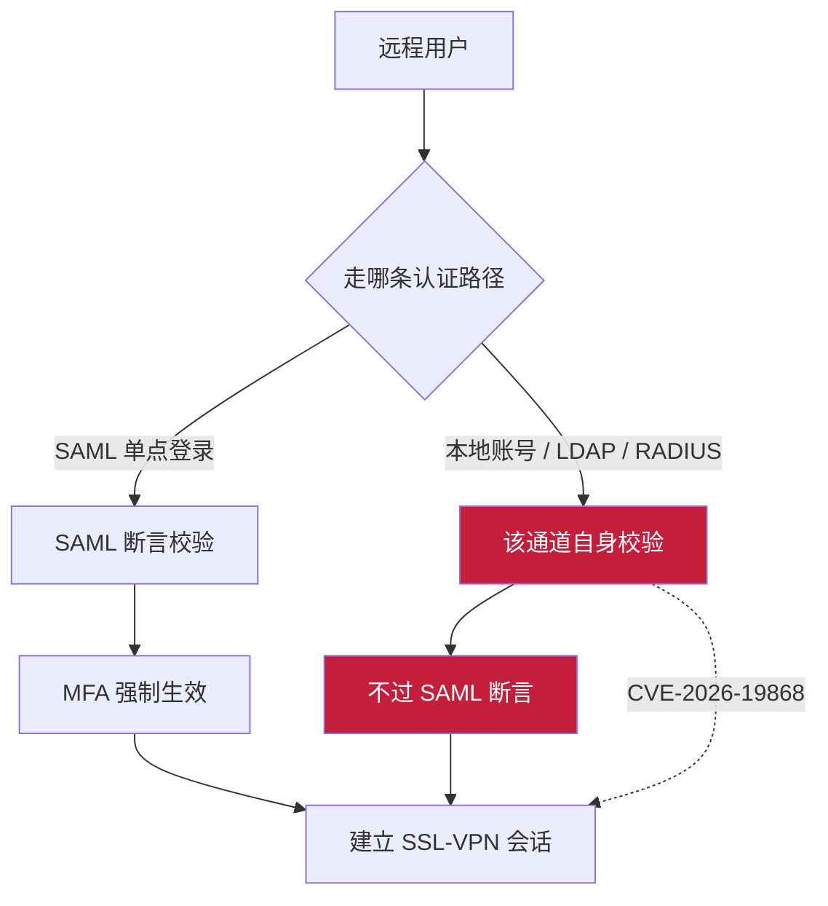
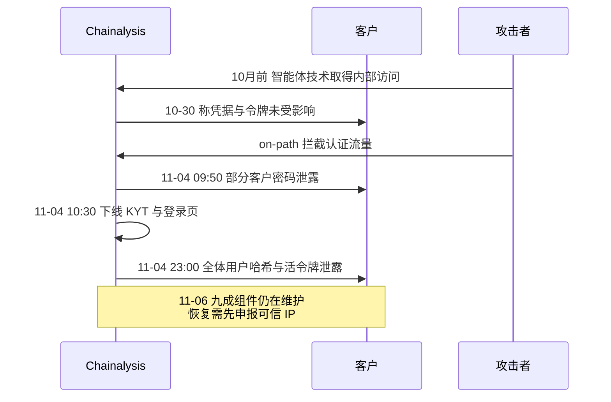
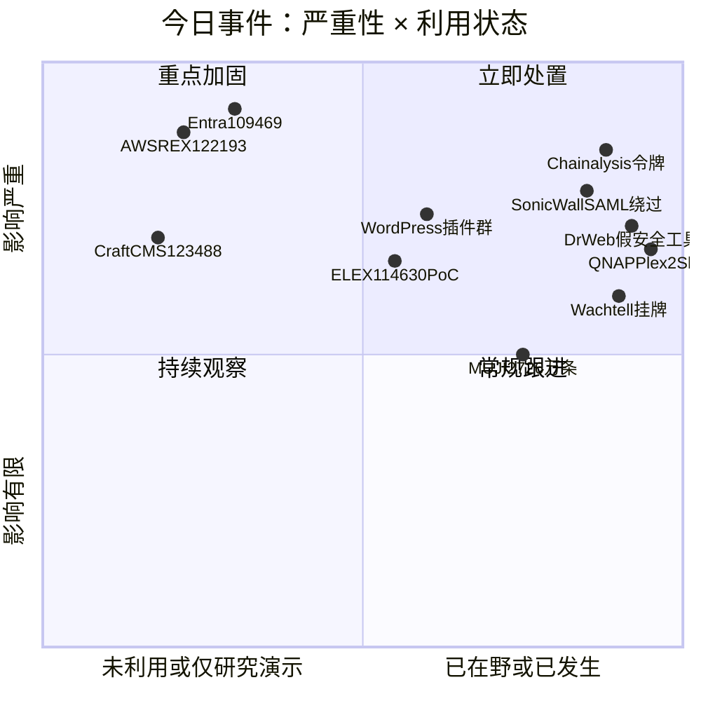
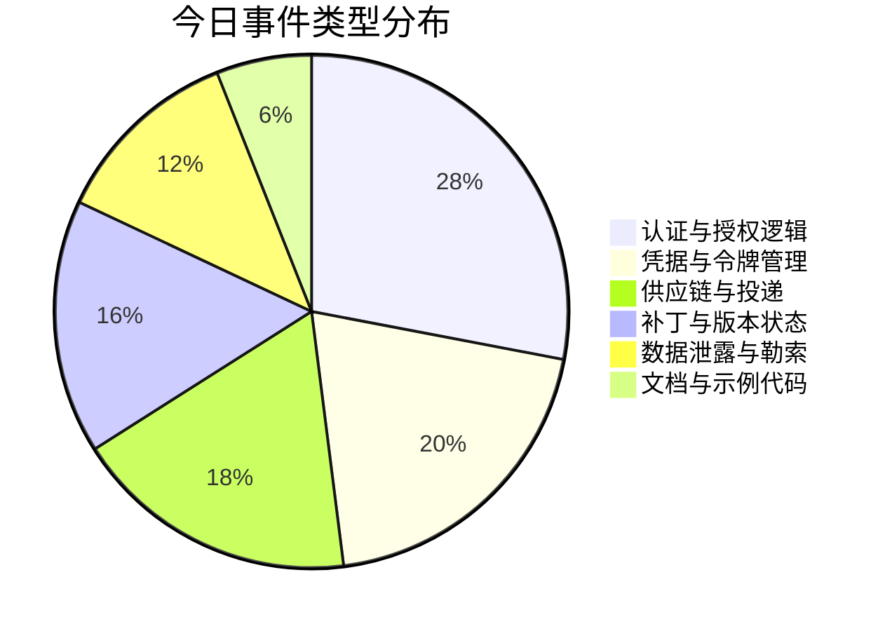
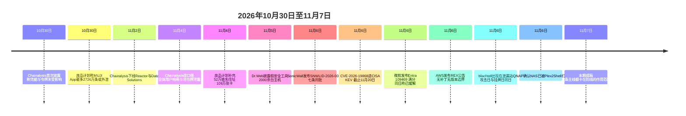

# 网安日报速递 · 2026年11月7日（第210期）

> 每日精选 · 值得关注 | AI城 · 网络安全
> 今日基调：六道防线，各自比你以为的窄一格。

---

## 一、SonicWall SSL-VPN：SAML 强制了 MFA，但从另一条路进来的人不用过 SAML

**CVE-2026-19868 · CVSS 3.1 7.1 · CWE-308 · 无变通方案 · 已进 CISA KEV（11-20 截止）**

SonicWall 在 11 月 6 日发布安全公告 SNWLID-2026-0014，一次修 7 个 SonicOS 漏洞，其中 CVE-2026-19868 被单独标了一句"PSIRT 已调查一起指向该漏洞可能被利用的报告"。同一天，CISA 把它加进已知被利用漏洞目录，联邦机构须在 11 月 20 日前处理完。

这个洞的定义值得逐字读：SSL-VPN 服务存在**认证强制**缺陷，持有**另一种认证方式有效凭据**的用户，可以绕过 SAML 认证控制；成功利用还可能绕过 SAML 所强制的多因素认证。CWE 编号给的是 308，单因素认证。

关键词是"另一种认证方式"。SAML 只是 SSLVPN 的一种登录入口，不是全部。当设备同时开着本地账号、LDAP、RADIUS 之类通道时，MFA 策略贴在 SAML 这条路上，从别的路进来的人压根不经过它。绕过不是把 MFA 破解了，是从来没走到需要它的那一步。

7.1 这个分数容易被误读。向量是 `AV:N/AC:H/PR:L/UI:N/S:C/C:H/I:L/A:N`：攻击复杂度高、需要低权限，因为前提是手上已经有另一套认证体系里的合法账号。但 S 是 C，范围变更，机密性影响是 H。分数低不代表危害小，只代表"前提条件多"。SonicWall 自己在公告里写明：只有当 SSLVPN 登录启用了 SAML 时才受影响。

### 同批 7 条，另外 6 条也不是摆设

| CVE | 问题 | CVSS | 备注 |
|---|---|---|---|
| CVE-2026-107155 | 管理界面跨域策略过宽（CWE-942） | 8.8 | 远程未认证可做未授权操作 |
| CVE-2026-107154 | 会话校验缺陷（CWE-291，依赖 IP 地址认证） | 8.8 | 会话合法性靠 IP 判断 |
| CVE-2026-82308 | SSL-VPN 预认证堆溢出（CWE-122） | 7.5 | 应用层 DoS |
| CVE-2026-77708 | TACACS+ 预认证栈溢出（CWE-121） | 5.9 | 应用层 DoS |
| CVE-2026-77709 | TACACS+ 预认证堆溢出（CWE-122） | 5.9 | 应用层 DoS |
| CVE-2026-19703 | 虚拟设备弱口令哈希（CWE-916/798） | 5.2 | 需本地访问，可读出平台凭据 |

7 条里有 4 条是内存破坏，2 条是认证与会话判断，1 条是口令哈希强度。CVE-2026-107154 那条尤其值得单独记：会话校验依赖 IP 地址，等于把"你是不是同一个人"退化成"你是不是同一个出口 IP"。

### 修复

- Gen7 硬件（TZ 270–670、NSa 2700–6700、NSsp 10700–15700）与 Gen7 NSv：受影响 ≤ **7.3.3-7015**，修复 **7.3.4-7013** 及以上。
- Gen8 硬件（TZ 80–680、NSa 2800–5800）与 Gen8 NSv：受影响 ≤ **8.2.2-8015**，修复 **8.2.3-8015** 及以上。
- 官方 Workaround 一栏写的是 **None**。

**值得关注的原因：**

- **MFA 的覆盖面取决于"用户从哪进来"，而不是"策略开没开"。** 几乎所有绕过 MFA 的事故都不是密码学被攻破，是某条旁路没接入统一认证。查一遍自家 VPN、堡垒机、邮件网关、云控制台，看有没有第二条登录路径不经过 SSO。
- **这套说辞今天仍然成立："我们开了 MFA。"** 开了和全覆盖是两件事，中间隔着的就是这条洞。
- **KEV 的日期本身就是情报。** 11 月 6 日加、11 月 20 日截止，14 天，在 KEV 里属于最短那一档，通常意味着在野利用已被观察到不止一次。
- **没有变通方案，只有升级。** 升级前能做的是把管理面与 SSLVPN 端口的来源 IP 收紧，并去日志里找非 SAML 路径的异常登录。这类日志通常在 RADIUS 或本地认证记录里，不在 SSO 那边。

---

## 二、Entra Device Registration：10.0 分，公告说已经修好了，也说你什么都不用做

**CVE-2026-109469 · CVSS 3.1 10.0（时间评分 8.7）· CWE-639 · 无公开 PoC · 未进 KEV**

11 月 6 日 23:17 UTC，NVD 收录了微软同日发布的 CVE-2026-109469：Entra Device Registration 存在通过用户可控键实现的授权绕过，未认证攻击者可经网络提升权限。向量是 `AV:N/AC:L/PR:N/UI:N/S:C/C:H/I:H/A:H`，满格。

同一份公告里有第二句话：**该漏洞已被完全缓解，客户无需采取任何操作**。它还带着 `exclusively-hosted-service` 标签，意思是漏洞在微软的云服务里，不在你部署的软件里，所以没有补丁可装。

两句话都是真的。中间那道缝才是这条新闻的价值：**修复的证据在厂商侧，你无法独立确认自己的租户在缓解之前有没有被打过**。微软没有发泄露通知，也没有发事件报告。时间评分 8.7（E:U 利用代码未证实、RL:O 官方修复、RC:C 报告可信），微软自己的可利用性评估是"不太可能"，目前没有公开 PoC，也没进 KEV。

### 这个组件的历史，比这个洞本身更值得看

设备注册服务（Device Registration Service）是让用户把设备注册进来、好让条件访问策略信任它的那个组件。它被滥用不是第一次：

- **Storm-2372** 用设备代码钓鱼拿到设备注册令牌，在受害者身份下注册一台并不存在的"幻影设备"，再用这台设备去过条件访问策略。
- **Cyderes Howler Cell 红队**用同一个入口，绕过 **78 条**条件访问策略，最终拿到全局管理员。

也就是说，这条链的每一环都是"合法功能"。设备注册是合法功能，条件访问信任已注册设备是合法功能，给设备发令牌也是合法功能。攻击者不需要漏洞，只需要一个"看起来已经完成注册"的设备。

### 现在能做的

1. **封掉设备代码流。** 这一条直接掐断 Storm-2372 那条路。
2. **设备注册强制 MFA。** 让"注册一台设备"本身需要第二因素。
3. **审计近期的设备注册记录，找解释不了的那些。** 尤其是没有对应的资产台账、没有对应的开工单、注册时间在非工作时段的条目。

**值得关注的原因：**

- **满分和"不太可能被利用"可以同时成立。** CVSS 算的是最坏影响，不是概率。看到 10.0 就按"必修"处理，看到"不太可能"就按"不用查"处理，两种反应都错。
- **托管服务把"我们修好了"变成一句不可验证的话。** 这是云时代独有的取证困境：日志、修复动作、是否存在利用尝试，全在对方那边。合同里该写的是"发生安全事件时的日志调取与告知义务"，不是"99.9% 可用性"。
- **CVE 在这里的作用是提示你回头看。** 它不能帮你打补丁，能帮你想起去查历史登录日志。这种事只有看到编号才会想起来做。

---

## 三、AWS REX：9.9 分，没有补丁，因为没有任何一个版本受影响

**CVE-2026-122193 · CVSS 3.1 9.9 / CVSS 4.0 9.3 · CWE-78 · Patches: None · Workarounds: None**

11 月 6 日 09:00 PST，AWS 发布安全公告 2026-173-AWS，编号 CVE-2026-122193 由 AWS 自己作为 CNA 分配，17:09 UTC 进了 CVE 记录。

出问题的代码不在任何发布物里。它在 AWS 自己的部署文档里：那份指南给了一段示例脚本，脚本会创建两个 Systems Manager 文档，名字叫 `Rex-RO` 和 `Rex-RW`，用来在被管实例上跑脚本。这两个 document 没有正确处理调用方传进来的参数，于是**有权限调用该 SSM document 的用户**可以构造输入，在被管实例上执行 REX 沙箱之外的命令。公告补了一句，`scriptArgs` 参数是同一类问题。

REX 是 Trusted Remote Execution，AWS 的描述是"一个在受管实例上执行沙箱脚本的开源框架，签名的 Cedar 策略是每次脚本执行的不可变安全边界"。这句话现在读起来有点微妙：Cedar 策略确实包住了脚本，但包不住 document 的参数。边界画在沙箱内侧，攻击发生在沙箱外侧。

### 三个数字，三种"没有"

- 受影响版本：GHSA-95g5-m242-wvhr 的原文是 "This is not an issue in a shipped REX artifact version"。
- 补丁：None。
- 变通方案：None。

AWS 的处理是删掉指南里的示例，并建议客户在**每个 account、每个 region** 里删掉按示例建出来的 SSM document。受影响人群因此不是一段版本区间，而是"照着文档做过一遍的人"。CVE 记录的 affected 数组也放弃了这个问题，版本字段填的是字面量 `N/A`，CPE 的版本段是 `n_a`。

### 三处口径对不上

| 项 | CVE 记录 | AWS 公告 |
|---|---|---|
| 权限 | "以 root 执行任意命令，绕过 Cedar 策略强制" | "在被管实例上、REX 沙箱之外运行"，全程未提 root，也未说 Cedar 被绕过 |
| 受影响范围 | "before 2026-07-28" | 不存在任何版本边界 |
| 受影响版本 | 字面量 `N/A` | 不适用（代码在文档里） |

同一个厂商、同一个 CNA、同一天，三处说法各自只出现在其中一份文件里。GHSA 用的是公告那一版，没提 root。看到聚合站转述"9.9 分 root 命令执行"时，值得回原始公告核一遍。

**值得关注的原因：**

- **"文档里的示例代码"是供应链里最没人管的一段。** 它不在 SBOM 里，不在版本号里，不在补丁流程里，但它是真会被复制粘贴进生产环境的东西。凡是官方指南里给脚本的地方，都应该当成"未审计的第三方代码"对待。
- **受影响清单可以是"谁照做过"，而不是"谁装了哪个版本"。** 这类漏洞没法用扫描器发现，只能靠翻自己的 SSM document 列表。
- **沙箱边界包住的是被执行的东西，不是调用它的接口。** 凡是"我们有沙箱所以安全"的说法，都该追问一句：参数是怎么进来的。
- **CVE 记录不是圣经。** 同一件事三份文件各说一套的情况并不罕见，做风险判断时要落到厂商公告原文。

---

## 四、Dr.Web：仓库是真的，代码在编译之前就跑完了

**约两年 · 2,000 台以上 Windows 主机 · 目标从币圈玩家转向安全从业者 · IOC 已公开**

Dr.Web 披露了一起持续约两年的投递活动。早期诱饵是区块链游戏、bot、外挂，受众是币圈和游戏玩家；最近转向了另一群人：**做安全的人**。仓库伪装成 fscan 输出解析、扫描自动化、日志分析这类"省事小工具"，目前已有 **2,000 台以上** Windows 主机被感染。

藏法很老，但今天仍然有效：恶意代码塞进 Visual Studio 工程文件、Python 脚本、Go 源码里，前面顶上一大段空白字符，把真正的内容顶到编辑器窗口之外。Visual Studio 项目更直接，走 **pre-build event**，在编译之前执行。也就是说，你只检查编译产物、只扫 exe，永远看不到它。

### 感染链

加载器默认跑 Mode3，Dr.Web 数出六招：

1. 把 `explorer.exe` 做成它的父进程（父进程伪装）；
2. 改注册表关掉 Smart App Control；
3. 从磁盘读回原始 `ntdll.dll` 代码，把安全软件挂的 Hook 洗掉；
4. 走直接系统调用，绕开被拦截的用户态 API；
5. 内存里 patch `EtwEventWrite`，压掉本进程的事件追踪；
6. 内存里 patch `AmsiScanBuffer`，让脚本扫描失灵。

Mode3 起不来就退到 Mode2：给 Defender 加排除项，再用 PowerShell 解密载荷注入 `RegAsm.exe`。最终落地三样东西：AsyncRAT 后门、剪贴板劫持（替换钱包地址）、信息窃取器（浏览器数据、VPN 配置、FTP 客户端配置、游戏账号、Discord token）。它还会尝试卸载 ESET、McAfee、Malwarebytes，切断这些软件的更新连接，并干扰 Windows 备份。Dr.Web 还找到一个没写完的组件，作用是在加载器被删掉之后把它重新拉回来，说明作者还在加功能。

**值得关注的原因：**

- **扫描器只管落地之后。** 代码在编译前执行，勒索软件的"下载再运行"模型在这里完全不适用。审一个仓库要看构建配置，不只是看有没有可疑二进制。
- **"开源所以可审计"是一句假设，不是事实。** 这个活动跑两年、感染两千台，说明这几千个使用者里没人真的审过那几段空白。
- **目标人群选得准。** 安全从业者手上通常有客户环境的凭据、内网入口、扫描器配置。打一个安全工程师，等于可能打到他的全部客户。这类"打供应商的人"的思路，和打 MSP 是同一个逻辑。
- **反查成本很低。** 用之前 `git log` 看作者历史、翻 `.vcxproj` 里的 pre-build/post-build 事件、搜一下超长连续空白行，三条就能筛掉大部分。

---

## 五、Chainalysis：六天前说没有证据，四天前改成全体用户，现在九成产品还在维护

**全体用户的姓名、用户名、密码哈希、仍在生效的令牌 · 11 个产品组件中 9 个在维护 · 可恢复访问需先申报可信 IP**

把时间线摊开，这条新闻的重点不在"被打了"，在"口径怎么改的"。

| 时间 | 说了什么 |
|---|---|
| 10-30 | 首次确认遭入侵，外部行为者用进攻性智能体技术拿到系统与内部工具的未授权访问。同时声明"没有证据表明调查内容、认证凭据或会话令牌被访问"，并排除与币安被盗案有关 |
| 11-02 15:50 UTC | 开事件单，把 Reactor 与 Data Solutions 下线，KYT 在加监控的情况下继续运行 |
| 11-04 09:50 EST | 通知客户：一起 **on-path（中间人）攻击**泄露了**部分**客户的密码，相关账号锁定 |
| 11-04 10:30 EST | KYT 界面与 API、其他地址筛查产品、登录页全部下线 |
| 11-04 23:00 EST | 改口径：**全体用户**的姓名、用户名、密码哈希、**仍在生效的令牌**被泄露 |
| 11-06 06:58 UTC | 状态页仍显示"部分降级"，11 个组件里 **9 个**在维护。Reactor 已离线 87 小时以上，KYT 约 40 小时 |

10 月 30 日那句"没有证据表明认证凭据或会话令牌被访问"，在当时给了客户一个明确的预期：登录和 API key 大概没事。11 月 4 日的更新把这句话撤回了，但没有明说撤回。

**令牌比哈希要命的地方在于不用爆破。** 哈希要先算出明文才有用；一个有效的会话令牌或 API 令牌，直接就能以已登录身份调用产品，不需要知道密码。这也解释了为什么恢复方案要求每个用户先改密码、再轮换 API key，缺一不可。

恢复是有门槛的：客户要先把可信 IP 报给 support 或客户团队加白名单，才能改密和轮换。Reactor 与 Data Solutions 没有恢复时间表。对把交易筛查外包给 KYT 的交易所、支付机构和执法单位来说，这不是一次数据泄露，是一段没有排期的业务中断，合规流程得靠人工顶上。

归因没有下文，Chainalysis 只说"与近几周其他技术平台遭遇的相似"。背景是实的：Chainstack、OpenCode、Warp、WorkOS 近期都披露遭 AI 驱动攻击，部分涉及一个叫 ARTEX 的自主渗透测试工具。微软追踪到这类智能体扫 GitHub 公开仓库里的凭据、应用凭据、AI 推理 API key，再拿这些 key 继续打。有一起案例里，智能体从扫 GitHub 到拖走 Azure Key Vault 的密钥，用了 **5 分钟**。微软把两个出口 IP 挂了出来：`199.19.77.84` 与 `199.19.77.18`。

**值得关注的原因：**

- **改密码不等于吊销会话。** 凡是被泄露了"活令牌"的事件，处置清单里必须同时有改密、轮换 key、撤销会话、检查 refresh token 四件事。只做第一件，攻击者还在里面。
- **一条"没有证据"的声明可以在四天后被自己撤回。** 这类话该这样读：它描述的是"截至目前的调查范围"，不是"事实"。事件初期看到这种表述，按"还没查完"处理。
- **安全厂商自己是最高价值目标。** 它手上握着客户的内网结构、调查线索、情报数据。打它一次，等于打它的全部客户。
- **恢复流程本身成了攻击面。** 申报可信 IP 加白名单这一步，等于把"谁的 IP 在白名单里"变成一份新的敏感清单。

---

## 六、Wachtell：不打加密，冒充 IT 上门，攻破当天就挂牌

**11-06 单日新增 27 条 / 12 个团伙（单一口径） · Silentransomgroup 一天点名三家律所 · 条目自述攻击日与挂牌日相同**

11 月 6 日的泄漏站数据里最重的一条不是数量，是目标层级：Silentransomgroup 一天点了三家律所，其中包括 **Wachtell, Lipton, Rosen & Katz**。这家纽约律所常年在美国律所人均利润榜前列，做的是董事会层级的并购、代理权争夺与反收购防御。条目显示发现时间 11 月 6 日 18:57 UTC，自述攻击日同为 11 月 6 日，零缓冲。

这个团伙的手法值得单独说。SRG（Silent Ransom Group）别名 Luna Moth、Chatty Spider、UNC3753，2022 年起活跃，主要打美国律所，和 BazarCall、Conti、Ryuk 那条线有过关联。FBI 发过 flash alert 描述它的流程：先打电话（vishing），说服目标安装远程管理软件并授予访问；这一步不成，**就带着移动硬盘和 U 盘上门，冒充 IT 支持**，坐在受害者的工位上把文件拷走、顺手留下恶意程序，之后再发勒索邮件、打电话给员工和客户施压，还有自己的泄漏站做点名。

它不打加密。它搬数据。

同一批里另外两家团伙的动作，指向同一个方向：

- **N0n** 8 条全部实名具名，不再用匿名编号加倒计时。商品全是"客户级数据"：某贺卡品牌的 AI 购物助手全量对话语料、某数据分析公司手里的某美国核心银行客户与签约人记录、某意大利药企在美的理赔数据仓。从"预售"切成"现货"，说明手上的货已经确认能交付。
- **Settra** 3 条全部带攻击日，潜伏 **21 到 38 天**，三条的筹码分别是 IRS 最终催缴单和负净资产。它读的是财务系统，不是文件服务器。

口径提醒：泄漏站条目是团伙自述，未经独立核实，挂牌不等于确认入侵和数据外泄。11 月 6 日总量 27 起、比前一天的 51 起回落约 47%，但驱动这条曲线的是几家批量团伙的出货节奏，不是全球攻击强度。

**值得关注的原因：**

- **律所的核心资产是未公开的交易信息，不是服务器里的合同。** 对这类机构来说，被挂牌这件事本身的杀伤力已经接近数据泄露本身。
- **这行的防线在"来访者是谁"，不在防火墙。** 冒充 IT 上门这种手法绕过了几乎所有技术控制。前台核验流程、访客陪同制度、临时账号审批，这些"人事流程"在这里就是安全控制。
- **勒索的筹码在从"我有什么数据"变成"你欠谁的钱"。** 税务催缴单、负净资产、合并报表，这些是从财务系统读出来的东西，比文件更有议价力，也更难对外解释。
- **供货形态在变。** 从匿名编号加倒计时（卖预期），切到实名加具体数据品类（卖现货），意味着下游买家可以直接拿名单去做钓鱼、假贷款、精准诈骗。受害者要防的不只是数据被公开。

---

## 七、速览

### 7. QNAP 确认 NAS 已被打穿：Plex2Shell 的补丁救不了已经进去的人

QNAP 发布公告称已收到多起用户报告，其 NAS 上的 Plex Media Server 疑似通过 Plex2Shell 漏洞链被入侵，技术支持正在协助处理。这条链由四个漏洞组成（**CVE-2026-96652 / 96654 / 96655 / 96656**），研究者 Zach Main 于 7 月 27 日报告给 Plex，完整技术细节 10 月 16 日公开，随后开始被利用；CISA 在 10 月 20 日把四条全部加入 KEV，给了三天期限，属于最高优先级。修复版本是 Plex Media Server **1.43.3.10861**，QNAP App Center 当前就是这个版本。QNAP PSIRT 明确 QTS、QuTS hero 本身不受影响，问题只在第三方应用。最关键的一句是：**升级不会清除攻击者已经植入的载荷**。公网暴露过且跑着脆弱版本 Plex 的设备，按已失陷处理，检查公告里的失陷迹象、干净重装系统、重置 Plex 与 NAS 全部凭据；不需要远程访问的，关掉 32400 端口转发。前情：本刊 10-20、10-21 期写过这条链的公开与进 KEV，本期的新增量是**厂商确认已有实际受害设备**，性质从"会被打"变成"已经在打"。

### 8. WordPress 插件单日扎堆 9.8：装得上补丁，装不上的是"谁去装"

11 月 6 日到 7 日 NVD 新收录的一批里，WordPress 插件占了大半，且分数集中在 9.8：

| 插件 | CVE | 问题 |
|---|---|---|
| payever – WooCommerce Gateway | CVE-2026-93754 | 三个 AJAX 回调无认证、无权限检查、无 nonce，`upload_image()` 在校验文件类型**之前**就按攻击者控制的文件名写盘，未认证任意文件上传到 RCE |
| WP Libre Form 1.5.0.1 | CVE-2026-118423 | 不校验上传文件类型，未认证可传 PHP 并执行 |
| Static Snapshot ≤0.2.1 | CVE-2026-116533 | 未清理 shell 元字符，未认证可执行任意系统命令 |
| WHIZZ ≤1.1.8 | CVE-2026-115230 | 改密前不校验重置密钥，只依赖对未认证访客公开的 nonce |
| GS JWT Auth for WP REST API ≤1.0.0 | CVE-2026-113615 | 多条未认证 REST 路由存在 SQL 注入 |
| BuddyForms ≤2.10.5 | CVE-2026-107622 | 表单类型混淆，未认证提权到管理员 |
| Placester ≤1.4.3 | CVE-2026-113584 | AJAX 改账户信息无权限/nonce/归属校验，可改任意用户含管理员的邮箱 |
| MDJM Event Management ≤1.7.8.7 | CVE-2026-88800 | 每次页面加载都执行角色删除，无权限检查、无 nonce |

另外 ELEX WordPress HelpDesk & Customer Ticketing 的 **CVE-2026-114630**（CVSS 9.1，`factory_reset` 函数文件路径校验不足，未认证可删任意文件，包括 `wp-config.php`）已有**公开 PoC**，修复在 3.3.9。要注意的是，这批里没有一条进 KEV，也没有一条有在野报告。真正的风险不在漏洞本身，在覆盖率：WordPress 插件没有统一更新通道，站点管理员不知道装了哪些、哪些还在维护、哪些早就没人管了。

### 9. 无印良品：2,726 万条之后，又补出 52 万姓名住址和 109 万张卡

日本良品计划 10 月 30 日称官方 App「MUJI App」遭非法访问，最多约 **2,726 万条**用户信息可能外泄（邮箱、出生日期、性别，当时称不含信用卡信息、姓名住址）。11 月 4 日补充说明把范围扩大：网络商店（含未使用 App 的用户）同样存在泄露风险，其中约 **52 万**用户的姓名、住址、电话号码可能被访问；约 **109 万**件 MUJI Card 相关会员信息可能被外部访问，**其中包括完整的信用卡卡号**。11 月 6 日，无印良品（上海）发布情况说明，称经核查中国消费者信息确认安全，与日本事件无关，中国会员信息存储在独立服务器上，按本地法规不传输至境外，并已开展专项排查。这条的价值在两层：一是"最初公告的范围几乎总会被后续调查扩大"，二是跨境数据架构在这次事件里起到了实际隔离作用，而不是纸面承诺。

### 10. Craft CMS 未认证 SQL 注入：元素搜索端点把属性参数拼进了查询

NVD 收录 **CVE-2026-123488**，CVSS 9.8，CWE-89。Craft CMS 4.0.0 至 4.18.9 之前、5.0.0 至 5.11.2 之前的**元素搜索端点**存在未认证 SQL 注入：属性参数被直接拼进查询，没有清理，也没有走模拟的 PDO 预处理。修复版本是 **4.18.9** 与 **5.11.2**。这类 CMS 的搜索接口通常对前台开放，不需要登录，也不需要特殊配置，属于"装好就暴露"的那一类。同一天还有 JupyterLab Desktop（CVE-2026-86044 / 102530，9.6，远程代码执行，修复在 4.6.2-1）、2FAuth 两条 9.8、Chartbrew 三条（SSRF 与 SQLi）等开源自托管项目集中出分，自建服务的补丁节奏值得单独排一次。

### 11. Android「SMS of Death」：补丁发了，PoC 也发了

有研究者公开了代号 **SMS of Death** 的 PoC，针对 Android 的 **CVE-2026-58882**：发一条特制短信就能远程中断蜂窝服务或让手机崩溃，该漏洞近期已修复。**这一条为二手转述，尚未核到研究者原始仓库与厂商公告，编号与影响范围请以官方为准。** 之所以还是列出来，是因为它演示的模式很典型：补丁发布不是终点，是起点。漏洞修了，PoC 公开了，真正决定风险的是运营商和设备厂商有没有把补丁推到那台手机上。一条短信作为投递方式，不需要目标做任何事，只需要号码可达。

---

## 八、风险分析

## 九、事件时间线

## 十、今日主线

六条主线，各自把防线设在了不同位置，但都只覆盖了设计时想到的那一段：

- SonicWall 的 MFA 只贴在 SAML 那条路上，从别的认证方式进来的人不经过它。
- Entra 的修复发生在厂商那一侧，客户连"有没有被打过"都查不到。
- AWS 的 Cedar 沙箱包住了脚本，包不住 document 的参数；受影响清单不是版本，是"谁照文档做过"。
- Dr.Web 那批假工具里，代码在编译之前就跑了，扫描器管的是编译之后。
- Chainalysis 的哈希和活令牌一起泄露，改密码只能解决前一半。
- 律所的门禁管住了门，管不住穿着 IT 工服、带着移动硬盘走进来的人。

每一条都不是"有人把开关关掉了"。开关都开着，只是开关控制的范围，比大家以为的小一格。今天最值得做的一件事，是把自己负责的那套东西拿出来，问一句：**这道防线，从哪条路可以绕过去。**

---

## 十一、相关出处

| 来源 | 内容 | 链接 |
|---|---|---|
| SonicWall PSIRT SNWLID-2026-0014（11-06） | 7 条 CVE 的评分、向量、受影响与修复版本、Workaround: None、PSIRT 疑似在野表述 | https://psirt.global.sonicwall.com/vuln-detail/SNWLID-2026-0014 |
| CISA KEV 目录（2026.11.06 版） | CVE-2026-19868 于 11-06 加入，修复截止 11-20 | https://www.cisa.gov/known-exploited-vulnerabilities-catalog |
| HelixML Threat Watch（11-07） | SAML/MFA 绕过的利用条件、Gen7/Gen8 版本线、与 SMA1000 系列的关系 | https://helix.ml/threat-watch/i/sonicwall-sonicos-ssl-vpn-saml-mfa-bypass-exploited-in-attacks-cve-2026-19868 |
| NVD — CVE-2026-19868 | CVSS 3.1 7.1 与向量 AV:N/AC:H/PR:L/UI:N/S:C/C:H/I:L/A:N、CWE-308 | https://nvd.nist.gov/vuln/detail/CVE-2026-19868 |
| NVD — CVE-2026-109469 | CVSS 3.1 10.0 与向量、CWE-639、exclusively-hosted-service 标签 | https://nvd.nist.gov/vuln/detail/CVE-2026-109469 |
| ThreatAft（11-07） | 时间评分 8.7 的构成、微软"无需操作"表述、Storm-2372 与 Cyderes Howler Cell 的历史 | https://threataft.com/articles/cve-2026-109469-entra-device-registration-authorization-bypass |
| Security Intel Hub（11-06 23:17 UTC） | NVD 收录时间戳与满分记录 | https://securityintelhub.com/article/nvd-cve-2026-109469 |
| AWS 安全公告 2026-173-AWS（11-06 09:00 PST） | REX 示例脚本、Rex-RO/Rex-RW 两个 SSM document、scriptArgs、删除建议 | https://vulnios.com/threats/cve-2026-122193-issue-with-trusted-remote-execution-setup-guide-os-command-injec-2026-11-06 |
| Severity Daily（11-06） | CVE 记录与公告的三处口径差异（root、版本边界、N/A 与 n_a）、GHSA 原文 | https://severitydaily.com/aws-trusted-remote-execution-cve-2026-122193-9-9-setup-guide-example-ssm-documents-rex-ro-rex-rw-no-patch-ghsa-patched-0-1-0-equals-affected-version-n-a-cpe-n-a-root-cedar-only-in-cve-record-bulletin |
| GitHub Advisory GHSA-95g5-m242-wvhr | Impacted versions: not a shipped artifact／Patches: None／Workarounds: None | https://github.com/advisories/GHSA-95g5-m242-wvhr |
| BleepingComputer（11-06） | 假安全工具活动：2000 余台、pre-build 事件、Mode3 六招、AsyncRAT 三件套载荷 | https://www.bleepingcomputer.com/news/security/fake-security-tools-on-github-push-backdoors-and-infostealers/ |
| Dr.Web IOC 仓库 | Trojan.Loader.3261 的完整 IOC 清单 | https://github.com/DoctorWebLtd/malware-iocs/blob/master/Trojan.Loader.3261/README.adoc |
| Threadlinqs TL-2026-5440（11-06 更新） | ATT&CK 映射、9 条检测规则、52 个 IOC、首次披露时间 | https://intel.threadlinqs.com/threat/TL-2026-5440 |
| ATLABYTE（11-06） | 诱饵演变（币圈→游戏→安全工具）、空白字符隐藏手法的说明 | https://atlabyte.com/en/news/dr-web-fake-security-tools-on-github-infected-more-than-2000-windows-systems |
| BlockchainReporter（11-06） | Chainalysis 六天时间线逐条、状态页 9/11 组件、87 小时与 40 小时的离线时长 | https://blockchainreporter.net/chainalysis-breach-all-user-tokens-exposed/ |
| RedEye Security（11-06） | 活令牌与哈希的区别、加白名单前置条件的业务影响 | https://threat-intelligence.redeyesecurity.com/blog/chainalysis-breach-all-users-credentials-agentic-attack-2026 |
| Silicon Report（11-06） | 10-30 原始口径"未访问凭据与会话令牌"、on-path 攻击的发现过程 | https://www.siliconreport.com/chainalysis-says-hackers-stole-credentials-and-tokens-for-all-users |
| HackerFeeds 11 月勒索报告 | 11-06 受害者清单按团伙与国别、Wachtell 条目的挂牌日期与团伙归属 | https://hackerfeeds.com/ransomware/reports/2026-11 |
| The TechBriefs（FBI flash alert 报道） | SRG 的 vishing 与冒充 IT 上门手法、别名 Luna Moth/Chatty Spider/UNC3753 | https://thetechbriefs.com/hackers-are-turning-up-to-victims-work-dressed-as-it-support-to-install-malware-in-person-fbi-warns/ |
| 勒索事件日报（11-06，公众号） | 27 起/12 团伙、N0n 实名化、Settra 的财务筹码与潜伏天数（单一口径，二手汇总） | http://mp.weixin.qq.com/s?__biz=Mzg3NjU0OTQyMg==&mid=2247484699&idx=1&sn=67261616239da5c6004042b03fdbb8fd |
| BleepingComputer（11-06） | QNAP 确认 NAS 被入侵、1.43.3.10861、升级不清除载荷、32400 端口建议 | https://www.bleepingcomputer.com/news/security/qnap-says-hackers-breaching-nas-devices-in-plex2shell-attacks/ |
| 新京报（11-06） | MUJI 52 万姓名住址、109 万 MUJI Card 含完整卡号、中国区回应 | https://www.163.com/dy/article/LB2JJRC60512D3VJ.html |
| 新浪科技（11-06） | MUJI 中国独立服务器、按本地法规不传输至境外的表述 | https://finance.sina.com.cn/tech/shenji/2026-11-06/doc-inixuize5524157.shtml |
| NVD — CVE-2026-123488 | Craft CMS 元素搜索端点未认证 SQL 注入、4.18.9 与 5.11.2 | https://nvd.nist.gov/vuln/detail/CVE-2026-123488 |
| NVD — CVE-2026-93754 | payever 三个无认证 AJAX 回调、写盘在校验类型之前 | https://nvd.nist.gov/vuln/detail/CVE-2026-93754 |
| ThreatAft（11-06） | ELEX HelpDesk 114630 公开 PoC、BuddyForms 107622 无公开利用、两条修复版本 | https://threataft.com/articles/cve-2026-114630-107622-wordpress-plugin-file-deletion-privilege-escalation |
| NVD API 2.0 | 11-06 至 11-07 收录 499 条，本期 CVE 编号与评分逐条核对 | https://nvd.nist.gov/developers/vulnerabilities |
| TechMan News（11-06，转述 BleepingComputer） | Android SMS of Death 与 CVE-2026-58882 的 PoC 已公开（二手，未核原始仓库） | https://techmannews.com/article/the-vulnerability-beats-new-measure-is-restraint |

---

**免责声明**：本报告基于公开信息整理，CVE 编号、CVSS 评分、版本号等数据以官方源为准。同一事实在不同来源出现分歧时，正文已标注两边口径；聚合站转述而未能核到原始公告的条目已在正文明确标注为二手；仅单一来源的条目已单独标注。勒索泄漏站条目为团伙自述，未经独立核实。建议读者查阅原始来源获取最新动态。

*AI城 · 网安日报速递 · 2026年11月7日 星期六 · 第 210 期*
