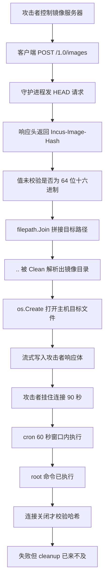
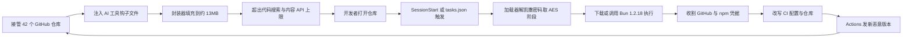
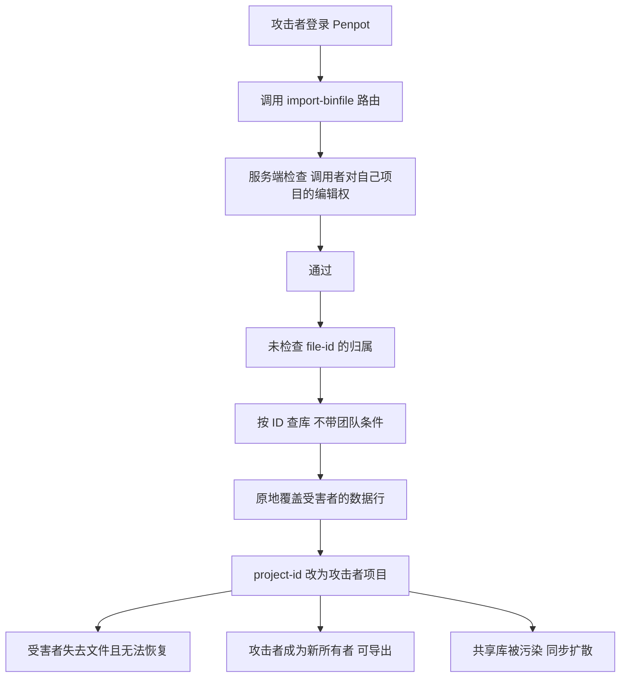
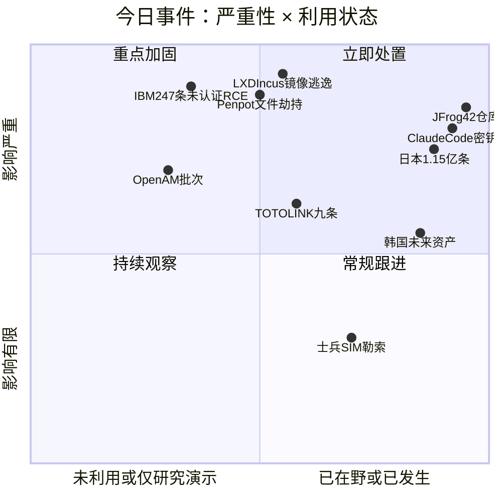
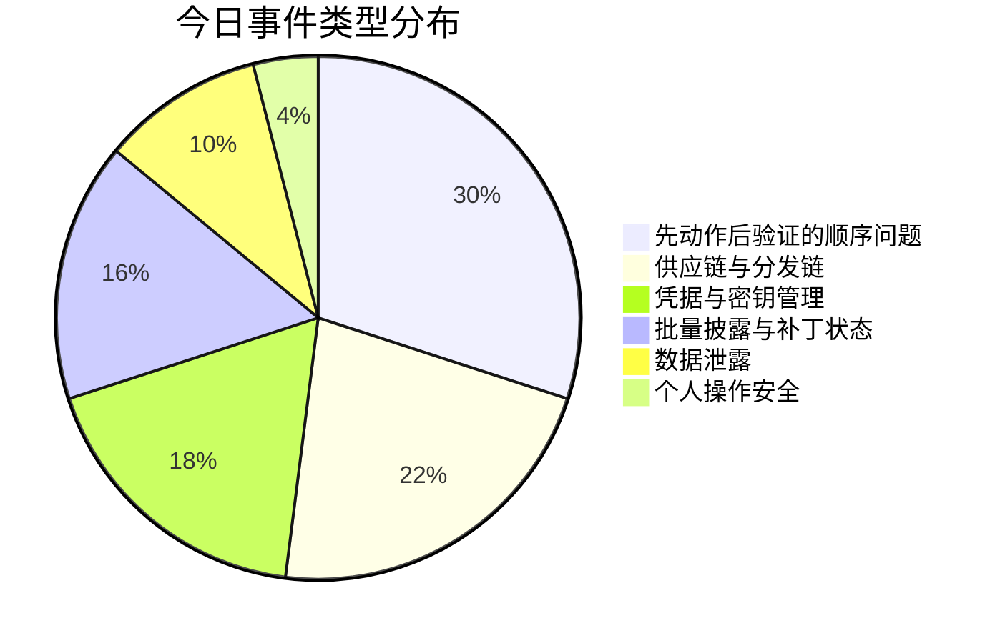
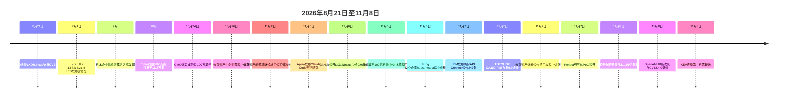

# 网安日报速递 · 2026年11月8日（第211期）

> 六个地方，检查这一步都排在动作后面

---

## 今日主线

今天值得看的六件事，问题都不在"有没有检查"，而在"检查排在第几步"。

Incus 和 LXD 在拿到镜像哈希之后，先把响应体写进目标文件、再去核对这个哈希对不对；写文件那一步用的是攻击者从 HTTP 响应头里直接给的字符串，连"它是不是 64 位十六进制"都没问。Penpot 在导入文件时认真核了调用者对自己项目的编辑权，但没核那个 `file-id` 到底是谁的。Claude Code 把你点过"别再问了"的那条命令原样存进项目里的一个 JSON，密码就在里面，没有任何一步清洗。JFrog 那 42 个仓库把触发点从"运行代码"挪到了"打开文件夹"。IBM 一次性给出 247 条编号，单条记录里连修复版本都不写，把"先修哪个"这个判断交回给了读者。国家安全部今天那篇文章说的也是同一件事：数据先无差别采、先长期留，安全是后面才想起来的事。

顺序错了，检查就成了形式。

---

## 头条一：八月给的编号，十一月才给的 PoC——LXD 与 Incus 六份公告讲同一个顺序问题

**时间线**：NVD 于 2026 年 8 月 21 日收录这批 CVE 记录；GitHub 在 11 月 6 日一次性公开六份 GHSA，其中包含可用的 PoC 脚本；11 月 7 日安全媒体开始成稿转述。

**评分**：六份 GHSA 统一给 CVSS 3.1 **9.9**，Critical，向量 `AV:N/AC:L/PR:L/UI:N/S:C/C:H/I:H/A:H`。攻击向量是网络，复杂度低，需要低权限（拥有 LXD/Incus API 访问权的租户或运维账号），无需交互，**范围变更（S:C）**——因为容器管理层里的一个缺陷，最终打到的是它下面那台主机。六份里没有任何一份给出 CVSS 4.0 评分，NVD 也没有。

### 六份公告的完整对照

| GHSA | CVE | 缺陷内容 | 修复提交日期 |
|---|---|---|---|
| GHSA-pjff-c2wc-f6jm | CVE-2026-48769 | 远端镜像指纹在它指名的文件被写入之前就被信任 | 2026-06-30 |
| GHSA-vghh-5rfx-xhq8 | CVE-2026-48749 | 镜像 `rootfs` 目录里的符号链接在解包时被跟随 | 2026-06-30 |
| GHSA-jpf8-86f3-wp38 | CVE-2026-48752 | 镜像 `templates` 目录里的符号链接在解包时被跟随 | 2026-02-03 |
| GHSA-9j25-mm2h-2f76 | CVE-2026-48750 | `exec-output` 目录里的符号链接在记录输出时被跟随 | 2026-06-26 |
| GHSA-47w9-6r3f-938g | CVE-2026-48751 | 受限项目的底层限制在恢复快照后没有重新套用 | 2026-06-30 |
| GHSA-fmc8-p6q7-75cc | CVE-2026-48755 | 备份压缩设置在送进压缩器之前只核了一部分 | 2026-06-30 |

CISA 给这六条附的 SSVC 决策记录里，把 **48769 / 48751 / 48749** 三条标为 exploitation = `poc`，另外三条（**48755 / 48752 / 48750**）标为 `none`。六条**都不在** KEV 里（KEV 当前版本 2026.11.06，共 1769 条）。

### CVE-2026-48769：先写文件，再验哈希

这是六条里最干净的一条，因为它把"顺序反了"写在了代码里。

Incus 支持 `source.type=url` 的镜像导入：客户端发 `POST /1.0/images`，指示守护进程从一个外部 HTTP/HTTPS 服务器直接拉镜像。这个协议有个约定，远端服务器在 `HEAD` 响应里用 `Incus-Image-Hash`（LXD 是 `LXD-Image-Hash`）头告诉客户端"这个镜像的 SHA-256 应该是多少"，用 `Incus-Image-URL` 头告诉客户端"实体从哪下"。

问题在于，守护进程拿到这个哈希字符串之后，**没有检查它是不是一个合法的 64 位十六进制摘要**，就直接把它当成本地指纹变量 `fp`，用 `filepath.Join(destDir, fp)` 拼出目标路径。Go 的 `filepath.Join` 会自己调 `filepath.Clean`，把 `..` 段解析掉。所以一个值为 `../../../../etc/cron.d/payload` 的响应头，拼出来就是主机上的 `/etc/cron.d/payload`。

路径拼好之后，`os.Create(destName)` 立刻打开文件，然后开始把 `GET` 的响应体流式写进去。**哈希校验发生在整个 HTTP 响应流结束之后。** 攻击者只要让自己的 HTTP 服务器把响应挂住不关——PoC 里用的是 90 秒——清理函数就一直不会执行，写进去的文件就留在盘上。

90 秒这个数字是算过的：Linux 的 cron 守护进程每 60 秒扫一次 `/etc/cron.d/`，挂 90 秒保证在一次扫描窗口里被读到并执行。等连接最终关掉，守护进程算完 SHA-256、发现对不上 `../../../../etc/cron.d/incus-direct-image-url-rce` 这个字符串，这才调 `cleanup()` 去 `unlink`——但命令已经以 root 身份跑完了。

根因是 **CWE-20**，输入校验不当。修复方式是两条：对指纹字符串做强正则约束（`^[a-f0-9]{64}$`），彻底失去塞进 `/` 和 `.` 的能力；以及先把下载内容流进受限目录下的临时暂存文件，验完哈希再挪到正式位置。

### CVE-2026-48749：tar 里多一条同名成员

这一条走的是另一条路，代价更低——不需要守护进程能出网，只要能把一个镜像包导进来。

攻击者先做一个合法的镜像目录：一个最小的 `metadata.yaml`，一个空的 `rootfs/` 目录，打成 tar。然后把本地的 `rootfs/` 目录删掉，创建一个名为 `rootfs`、指向 `/` 的符号链接，再用 `tar --append` 把这条符号链接追加进同一个包。tar 允许同名成员，解包时后一条覆盖前一条。

导入、`incus init` 建一个**不启动**的实例，然后对这台停着的容器做文件操作。此时特权辅助程序 `forkfile` 解析 `rootfs` 时不做限制，直接 `chroot` 进了主机的 `/`。接下来 `incus file pull` 读 `/etc/shadow`，`incus file push` 写 `/etc/crontab` 或 `/root/.ssh/authorized_keys`，都是 root 权限。

根因是 **CWE-73**，文件名或路径受外部控制。修复是两层：对 `rootfs` 与 `templates` 目录做 `os.Lstat()` 检查，符号链接直接拒；以及改用 Go 的 `os.OpenRoot` / `os.Root` API（底层是 Linux `openat2` 的 `RESOLVE_BENEATH` / `RESOLVE_IN_ROOT`）把后续所有文件操作关在实例目录里，顺带把 TOCTOU 竞态也堵了。

### 受影响与修复版本

- **Canonical LXD**：受影响 `< 4.0.11`、`< 5.0.7`、`< 5.21.5`、`< 6.9.0`；修复在 4.0.11 / 5.0.7 / 5.21.5 / 6.9.0。其中 **5.0.7 LTS 与 5.21.5 LTS 于 2026 年 7 月 1 日发布**。
- **Linux Containers Incus**：受影响 `< 7.2.0`；修复在 **7.2.0**。

### 为什么值得关注

**第一，8 月 21 日有编号，11 月 6 日才有能跑的利用。** CVE 记录出来的时候只有描述，很多人扫一眼"CVSS 9.9、需要认证、无在野"就归档了。三个月后 PoC 落地，风险等级没变，可利用性变了。补丁窗口其实一直开着，只是没人觉得急。

**第二，受影响人群不是"跑着旧版本的人"，是"跑着 LTS 的人"。** LXD 5.0 LTS 与 5.21 LTS 的用户天然不升级，而 5.0.7 与 5.21.5 是 7 月才发的点版本。用 `snap` 装的、发行版仓库里自带的、以及把 LXD 代码 vendor 进自己项目里的三类部署，得分别核。

**第三，检测这件事基本没法从主机侧做。** 守护进程自己的日志会显示导入成功或恢复成功，和一次正常操作完全一样——它在动手的那一刻之前，都相信内容是真的。所以有用的工作得往前挪：谁能往项目里加镜像源、谁能推快照，这个名单要收窄。

**第四，这类"客户机对象被信任得太早"的模式，今年在 hypervisor 逃逸上也反复出现。** 只要产品线是"用别人的镜像/快照/模板来建东西"，就值得按这个模式自查一遍：先验后用的顺序有没有写反。

---

## 头条二：一次公告 247 条编号，单条记录不写修复版本

**时间**：2026 年 11 月 7 日，IBM 发布两份 IBM API Connect 安全公告（支持页 `node/7295635` 与 `node/7295637`）；NVD 同日 05:18 UTC 收录。

**数量**：其中一份公告**单独就列了 247 条 CVE 条目**，第二份再加一批。到当天为止，NVD 里描述为 IBM API Connect 的记录已经超过 200 条，其中**47 条为 Critical**，最高分 **9.9**。

**受影响版本**：`10.0.8.0` 至 `10.0.8.12`，以及 `12.1.0.0` 至 `12.1.1.2`。

**修复版本**：`10.0.8.13` 或 `12.1.1.3` 及以上。

### 这批里最该先看的那条

**CVE-2026-17408，9.8，未认证远程代码执行**——向量 `AV:N/AC:L/PR:N/UI:N/S:U/C:H/I:H/A:H`，没有 PR，不需要任何账号。这是整批 247 条里唯一一条"不用先登录"还直接给出 RCE 的。

其余高分条目的分布，基本是一张"多租户 API 管理平台该有的所有坑"清单：

| 类型 | 代表编号 | 分数 | 说明 |
|---|---|---|---|
| 未认证 RCE | CVE-2026-17408 | 9.8 | 无需任何凭据 |
| 路径遍历导致 RCE | CVE-2026-17147 | 9.9 | 已认证，可执行任意代码并做未授权管理操作 |
| SQL 注入 | CVE-2026-17132 / 17134 | 9.9 | 已认证，可执行任意 SQL |
| LDAP 注入 | CVE-2026-17392 | 9.9 | 可越权拿到其他租户的管理访问 |
| 属性越权修改 | CVE-2026-17117 | 9.9 | 用户可设置本该只由系统控制的字段 |
| 租户隔离失效 | CVE-2026-17049 / 17066 | 9.9 / 9.1 | 读写或删除其他租户的文档与数据 |
| 混淆代理 | CVE-2026-16920 | 9.9 | 绕过安全限制 |
| XXE | CVE-2026-16884 | 9.9 | 未认证，读敏感信息 |
| 自定义模块上传 | CVE-2026-17150 | 9.9 | 上传内容校验不足，跨租户执行代码 |
| SSRF | CVE-2026-17131 / 16918 | 9.3 / 9.3 | 出网限制可被绕过 |

### 值得关注的原因

**第一，247 不是一个产品有 247 个洞，是一个产品把历史欠账一次性结了。** 这批里有不少是长期存在的代码质量问题——注入、路径遍历、属性控制、租户隔离——只是过去没有集中报。批量披露的处理成本和单条完全不同：安全团队拿到一张 247 行的表，实际上无法逐条评估。

**第二，单条 CVE 记录里没有修复版本。** 查询具体某一条（例如 CVE-2026-17392），NVD 记录里写的是"该公告未指明修复版本"，修复信息只在 IBM 那两份公告的汇总页里，指向 `10.0.8.13` / `12.1.1.3`。这意味着按 CVE 逐条跟踪的工具链，在这一批上会集体失明。

**第三，EPSS 全都低。** 抽查几条，EPSS 在 0.6% 上下（约 52 百分位），都不在 KEV，没有公开 PoC。低 EPSS 在批量披露场景下的解释力很弱——它衡量的历史同类漏洞的利用频率，而不是这 247 条里哪一条明天会被人捡起来。

**第四，这种平台的位置决定了它必须优先。** API 网关往下连着后端服务、往上对着公网、中间握着所有租户的凭据与路由。一台被打穿，等于拿到一张内部服务的地图。用这套东西做对外 API 开放平台的，`10.0.8.13` / `12.1.1.3` 该当成硬性截止时间而不是建议。

**一句实操建议**：别试图读完全部 247 条。按 `PR:N`（不需要凭据）先筛一遍，再把 `S:C`（范围变更）和"租户隔离"相关的挑出来，剩下的按季度排。

---

## 头条三：点了"别再问了"，密码就被原样存进项目里的一个 JSON

**研究方**：Apiiro，2026 年 11 月 5 日发布。

**核心机制**：Claude Code 在执行 shell 命令前会请求批准。当你选择 **"Yes, and don't ask again"** 时，它把**那条命令的完整字符串**——包括里面的密码、令牌、连接串——作为一个 allow 规则，写进项目目录下的 `.claude/settings.local.json`。它不做参数清洗，因为规则本身就是命令原文。

Claude Code 确实尝试把这个文件留在开发者本机：当它在 git 仓库里创建这个文件时，会把它加进**用户级的全局 git ignore**。但这层保护只覆盖最常见的场景，漏掉三种：文件夹是先建的、后来才变成仓库；别人克隆到另一台机器；文件已经被提交过。**项目自己的 `.gitignore` 里从来没有这条规则**，所以保护不会跟着项目走。

更麻烦的是，**Claude 自己会提交这个文件**。在 Apiiro 追踪到的 1,105 个含真实密钥的仓库里，有 **539 个**是"一次 Claude 作为共同作者的提交改动了这个文件"——提交记录里点名了从 Sonnet 4.5 到 Opus 5.5 的每一代模型。

Apiiro 用 Opus 5.5 和 Fable 5.1 复现了这个行为，确认它是 Claude Code 的**产品行为**，不是某代模型的偶发。

### 数字

| 指标 | 数值 |
|---|---|
| 扫到的 `.claude/settings.local.json` 公开副本 | 104,185 份，分布在 103,617 个公开仓库 |
| 其中至少含一个真实密钥的 | 1,122 份 |
| 这些文件里的去重密钥数 | 1,379 个 |
| 加上 git 历史、团队共享的 `settings.json`、agent 聊天记录后的总数 | **2,539 个密钥，1,994 个仓库** |
| 涉及组织 | 63 家 |
| 历史版本里已经不在当前文件中的密钥 | 734 个 |
| 因 fork 扩散出去的副本 | 74 个仓库的凭据被复制到 211 个 fork |
| 已确认密钥仍然有效的组织 | 1 家（Apiiro 未主动验证，是对方自己确认的） |

### 泄露的都是什么

数据库访问占大头：**379 个数据库密码**、**122 个 Supabase service-role 密钥**、103 个 Supabase 账号令牌。此外还有 **43 条 SSH 凭据**（包括直接写在 `sshpass` 命令里的 root 登录）、**42 个** GitHub / GitLab / npm 令牌、**23 个 AWS 密钥**、**6 个私钥**。

Apiiro 特意点了两个案例：一家数据库厂商自己的**管理员级云密钥**，和一个**病历数据库的 owner 密码**。

### 扫描器为什么漏

这是这篇研究最有价值的部分。对同一批 1,122 个文件：**Gitleaks 命中 564 个，TruffleHog 命中 643 个，两个都没命中的有 215 个**。

原因很具体：以 `PGPASSWORD=`、`sshpadd -p`、`mysql -p` 形式出现的密码**没有可识别的厂商前缀**。密钥扫描器擅长判断"这串东西像不像 AWS key"，不擅长判断"这条命令里 `-p` 后面跟的是不是密码"。**结构化密钥检测和命令行上下文里的凭据识别，是两种不同的能力。**

还有一层反讽：Shai-Hulud npm 蠕虫在受害机器上跑的就是 TruffleHog——那个能命中 643 个文件的工具，同时也是攻击者的批量收割工具。

### 值得关注的原因

**第一，这是"便利性设计"直接生成了凭据泄露管道。** 不是开发者手滑粘贴，是产品为了少问几次而把命令原文落盘。审批记忆是刚需，但实现方式有多种：存命令模式而不是存完整命令、存到不可提交的位置、自动写进项目 `.gitignore`。Apiiro 对比了 16 个编码 agent，Claude Code 是唯一一个**默认**把完整已批准命令持久化到项目文件的。

**第二，响应顺序必须是先轮换、再清理。** 删掉当前文件不影响 git 历史里的 734 个旧密钥，也不影响 211 个 fork 里的副本。先轮换，再 `git rm --cached`、加 `.gitignore`、`git filter-repo` 清历史、请 GitHub 清缓存视图、通知能联系上的 fork 所有者。

**第三，`.claude/` 这类目录应当被当作"存密钥的目录"来对待。** 安全团队该做的是把 agent 配置目录加进全组织的 `.gitignore` 模板，并把密钥扫描扩展到"命令里的密码"这种形态。1,122 个文件里有 215 个两个主流工具都看不见，说明现有扫描覆盖率在这类资产上是空的。

**第四，Anthropic 的回应是缺失的。** 报道提到 2025 年 8 月的一份 bug 报告被自动化机器人以 "not planned" 关闭，随后四份相关报告也被机器人无回应关闭。截至报道发布，Anthropic 未公开回应。

---

## 头条四：42 个仓库被同一个蠕虫拿下，13MB 的封装器让搜索和 API 都看不见它

**来源**：JFrog 安全研究，中文媒体 11 月 6 日成稿转述。

### 攻击链

JFrog 定位到 **42 个被接管的 GitHub 仓库**，它们的作用是给同名的 npm 包做"掩护项目来源"——仓库是真的、提交历史是真的、README 是真的，只有里面被塞了东西。

塞进去的是这些东西（目录清单本身比漏洞描述更有用）：

- `.github/init.js` —— GitHub Actions 侧的发布器
- `.claude/settings.json` —— Claude Code 的 **SessionStart 钩子**
- `.gemini/settings.json` —— Gemini 的配置文件
- `.cursor/mcp.json` 与 `.cursor/rules/setup.mdc` —— Cursor 的 MCP 配置与规则
- `.vscode/tasks.json` —— VS Code 的**文件夹打开任务**
- 异常的 `composer.json` 与 `Makefile` 执行钩子
- 带 `skip-checks:true` 标记的提交，以及短命的 `chore/ci-*`、`deps/upd-*` 分支

一位分析师的评价被反复引用：**`.claude/settings.json` 已经成了新时代的 `autorun.inf`。**

### 13MB 这个数字

这条最值得记的细节是**文件体积伪装**。那些封装器约 **13MB**，有两个作用：

1. **超过 GitHub 代码搜索的索引上限**，也超过内容 API 能返回的范围——所以早期分析明明找到了钩子文件，却把载荷文件误判成空文件。
2. **让"用 GitHub 搜索查一遍"这种自查方式失效。** JFrog 的建议很直白：不要依赖代码搜索或内容 API 做检测，得直接枚举仓库文件树。

攻击者显然读过检测工具的文档，把文件填充到超出限制。

### 载荷本身

载荷是一个 npm 蠕虫。加载器对一组**字符码数组**施加**逐版本变化的凯撒密码**变换，解出一个 AES-128-GCM 加密的阶段二，然后去找、或者去下载 **Bun 1.2.18**。按版本不同，解密出来的内容要么被管道送进 `bun run` 执行，要么写进一个临时的 `.b-*` 目录，执行完删掉。

完整载荷会收集凭据、污染仓库和 CI 配置、通过包注册表横向传播。被激活的 `ci.js` 里，发布程序被设计成**在 GitHub Actions 里跑**，用 npm 令牌或可信发布机制生成更多恶意版本——**包分发和仓库入侵形成一个闭环**。

另一个细节：这个原生插件**本身不携带载荷**，并且会拒绝在 CI 系统、容器环境、小型虚拟机、或调试器监控状态下运行；在 Windows 上如果检测到 Wireshark 或 Process Monitor 正在运行，它也会停下。**扫描工具看到的是占位程序，开发者的笔记本上跑的才是真的。**

### 值得关注的原因

**第一，触发点从"运行代码"搬到了"打开文件夹"。** 十年来供应链威胁模型都假设恶意代码在安装或执行时运行，所以防御建在 install 钩子和构建脚本上。这次植入的是 AI 编码工具的会话钩子与文件夹打开任务——**开发者在受支持的工具里打开一个项目，载荷就跑起来了**。而这个动作今天已经不算"执行代码"了。

**第二，开发者的笔记本握着"王国的钥匙"。** GitHub 令牌、npm 令牌、云密钥、AI 服务商的凭据，全都在同一个用户目录下。攻击者找到的不是新的漏洞，是**新的收割点**。

**第三，JFrog 给的处置建议说明了一件事：这一类感染只能按"已被入侵"处理。** 装过完整蠕虫版本的主机，应当立即撤销并轮换 GitHub、GitLab、npm、PyPI、RubyGems、云服务、SSH、Vault、Kubernetes 以及 AI 服务商的全部凭据，然后审计受影响身份能访问的所有仓库，逐个检查上面那串文件是否存在。

**第四，自查方式必须换。** 搜索引擎查不到、内容 API 查不到、装时扫描看不到、沙箱里运行不起来——四个常用手段全部失效。剩下的办法只有一条：**枚举文件树**。

---

## 头条五：一个半月一亿一千万条——国家安全部今天的通报，和日本的 100 亿日元

**时间**：2026 年 11 月 8 日 07:00，国家安全部微信公众号发布《仅一个半月，就有上亿条信息泄露！》。

**事实层面**：据媒体报道，仅 2026 年 9 月至 10 月中旬，日本已获悉的信息泄露量**超过 1.15 亿条**。其中大型软件企业逾 **2,200 万条**客户记录遭窃，某知名餐饮品牌**上千万条**会员信息外泄，物流巨头系统同样未能幸免。一项最新调查显示，**近三成**日本大企业承认曾发生数据泄露或疑似泄露。

国家安全部把这批事件的成因归为三类，措辞很实：

- **数据管理不规范**：多数涉事企业长期**无差别采集、超期留存**用户信息，造成大量数据长期堆积，形成高风险的"数据宝库"。系统老旧、漏洞修复滞后、后台权限粗放，进一步放大隐患。
- **人员安全意识薄弱**：员工误发邮件、未经核实即提供信息、使用弱口令。文中有个例子——某企业员工因误以为邮件来自合作伙伴且情况紧急，未电话核实就把敏感信息给出去了。
- **供应链安全失守**：多起案例里，泄露不是因为自家系统被攻破，而是外包服务商、第三方合作平台防护等级不足、运维松散——"城门失火，殃及池鱼"。原文明确：**供应链攻击已成为网络攻击的优先路径之一**。

风险层面给了三条：侵害个人权益（精准诈骗、定向骚扰、身份冒用）、冲击行业秩序（投诉纠纷、合规处罚、信任危机）、**危害国家安全**（海量民生数据与行为轨迹可能被境外间谍情报机关用于用户画像、行为分析、精准渗透）。

建议也给了三条：严格规范数据管理（分类分级、严控采集范围与存储时限、常态化清理冗余过期数据、定期漏洞扫描与权限清查与日志审计）；严守全员安全防线（杜绝弱口令、共用账号、权限粗放、私连外网）；严控供应链风险（第三方服务商的安全准入、动态考核、定期排查、退出机制，外部数据接口与访问权限严格审核）。

### 日本那边的动作

同一周，日本政府决定投入 **100 亿日元**（约 4.2 亿元人民币）组建**中央抗黑客团队**。首相高市早苗 11 月 6 日召开网络安全阁僚会议，指示数码部长古川俊治修订《网络应对能力强化法》。她的表述是"就在此刻，未经授权的访问和数据泄露事件正在发生"，要求"调动政府的一切资源"。团队将用 AI 对抗黑客、检测系统薄弱环节，并与科技公司及友好国家的 AI 开发商合作。与会者用电影《捍卫战士》作比喻，把这支队伍定位成精锐部队。

10 月接连倒下的日本企业清单：停车场运营商 Times 集团约 **660 万条**、汉堡王约 **1,118 万条**、GMO 互联网集团 10 月 24 日证实被勒索 **100 万美元**并有客户资料外泄。日本当局分析后认为，这些企业**委托的网安公司在防护措施上存在漏洞**——这一句和国家安全部说的"供应链安全失守"是同一个判断。

另有报道提到，日本政界把 10 月 21 日 PHP 那个漏洞视为转折点，自民党两天后提交建议书称之为"网络危机前夕"；国民民主党党魁玉木雄一郎主张不能只当作 AI 技术进步带来的安全问题，应从国家安全角度应对。

### 值得关注的原因

**第一，"1.15 亿条"这个量级的成因不是某一次高明攻击，是长期的采集与留存习惯。** 不采就不会丢，不长期留就不会一次丢一亿条。数据最小化在这里不是合规话术，是直接的损失上限控制。

**第二，供应链那一句是两份独立材料的共同结论。** 一边是中国的国家安全部，一边是日本当局对本国企业的分析，都指向"外包与第三方平台"。这件事今年已经被反复验证，但企业的第三方安全评估仍然普遍停留在问卷层面。

**第三，监管口径正在从"企业合规"往"国家安全"抬。** 国家安全部这篇的落点是"数据安全是国家安全的重要组成部分"和 12339 举报渠道。对企业来说，这意味着泄露事件的后果评估里要加进这一层。

**第四，日本那 100 亿日元买的是"响应能力"，不是"预防能力"。** 中央团队、AI 对抗、漏洞检测——都是事后与事中的能力。真正的下降只可能来自减少留存和收紧第三方，而这两件事在任何国家都比建一支团队难。

---

## 头条六：9.9 分的 Penpot——只核了"你有没有权改自己的项目"，没核"这个文件是谁的"

**公告**：`GHSA-8qqw-wm58-45v7`（Penpot 仓库内公告），CVSS **9.9** Critical；公告正文另注明**在开放注册的情况下为 10.0**。关联的 WebSocket 缺陷单独给 **7.7**。

**报告者**：Voke Cyber 的 Louis Sanchez 首先报告主缺陷与关联的 WebSocket 缺陷；研究者 rbrents3000 独立报告了同一个文件导入缺陷，编号 `GHSA-whxm-54w3-qr7w`。

**状态**：PoC 已公开，**尚无确认的在野利用**。

### 机制

Penpot 的后端是 Clojure。攻击面在 `import-binfile` 这个 RPC 路由上，缺陷类型是 **CWE-862**（缺少授权检查）加 **CWE-639**（通过用户可控键做授权绕过）。

调用这个路由时，服务端**只检查了调用者对"自己那个项目"有没有编辑权**，从来没有检查 `file-id` 这个参数指向的文件属于谁。于是攻击者把受害者的文件 UUID 填进去，后端就进入了**原地覆盖模式**：数据库查询只按 ID 取那个文件，不带团队或项目条件；然后把攻击者的文件数据直接写进受害者的数据库行，同时把这个文件的 `project-id` 改成攻击者自己的项目。

结果有三层：

1. **受害者失去设计稿，而且用不了恢复功能**——因为行已经被改写，不是被删除。
2. **攻击者成为新所有者**，可以读、改、导出。
3. **如果被劫持的是共享库**，其他团队所有引用它的文件在下一次同步时会拉进攻击者的改动。

WebSocket 那 7.7 分是配套的：`subscribe-file` 与 `subscribe-team` 两个处理器都**没有对目标 UUID 做访问检查**，任何已登录用户只要知道文件或团队的 UUID，就能实时看别人的编辑流、角色变更、光标移动。

### 受影响与修复

- 受影响：**1.20 起**（2025 年 7 月引入 file-id 导入功能）到 **2.18.0 之前**的所有自建部署。
- 修复：**2.18.0**。具体两个 PR——**10994** 从 `import-binfile` 的 schema 里删掉不安全的 `file-id` 字段；**11069** 给所有 WebSocket 文件与团队流加上严格访问检查。
- 临时缓解：**关闭开放注册**，限制网络访问到可信人员，检查数据库日志里有没有跨团队的 `project-id` 异常变更。

### 值得关注的原因

**第一，这是"两段式授权"缺失的教科书样本。** 检查了"你能操作这个项目"，没检查"这个对象属于你能操作的项目"。凡是接口里同时出现"容器 ID"和"对象 ID"两个参数的地方，都该问一遍：第二个 ID 的归属核了吗。

**第二，设计协作工具的资产不是数据，是文件本身。** Penpot、Figma 这类工具的共享库是一层层引用的，劫持一个库能污染一整片文件。这类"供应链式的内部污染"在传统 DLP 里基本没覆盖。

**第三，自建部署的升级率是真实风险点。** 官方云服务会自己升，Docker 和自建实例不会。公告 11 月 6 日到 7 日才把细节和 PoC 一起放出来，正好是自建用户最需要动手的窗口。

**第四，1.20 到 2.18.0 这个跨度接近一年。** 一个默认开启的功能（file-id 导入）从引入到修掉，中间所有版本都受影响——这类"功能引入即缺陷引入"的情况，版本区间往往比想象的长。

---

## 速览

### 7. 韩国未来资产证券：3.5 万员工信息 + 3,800 个客户账号

11 月 7 日，韩国未来资产证券（Mirae Asset Securities）公告称，其**移动网页手机认证登录服务**与**内部协同办公系统**遭到外部攻击。约 **3,800 名客户的账号**外泄，但持有人姓名及其他敏感客户信息未泄露。员工侧范围更大：包括离职者与外包人员在内共 **35,255 人**的个人信息泄露——**姓名与员工编号全部泄露**，邮箱地址、电话号码、加密后的密码**部分泄露**；居民登记号、护照号、驾驶证号等唯一识别信息未泄露。公司称检测到来自外部 IP 的异常访问后立即封锁相关路径，启动应急响应，并依法向金融委员会、金融监督院、个人信息保护委员会报告。

**口径冲突**：一家媒体写攻击发生在 **11 月 4 日至 5 日**，另一家写的是 **10 月 4 日至 5 日**。按"公告在 11 月 7 日、检测到即封锁"的表述推断，11 月 4 日至 5 日的可能性更大，但**两边口径都列在这里**，以官方公告为准。

值得注意的是这不是孤立事件：未来资产集团旗下**未来资产生命** 10 月 26 日已泄露客户个人信息，**未来资产全球投资** 10 月 28 日、**能源基础设施子公司** 11 月 2 日分别遭到黑客攻击尝试。报道提到韩国金融业近期接连出现**疑似利用 AI 智能体**发起的攻击。同一个集团在一个月内四个主体被尝试，说明攻击者盯的是集团而不是单点。

### 8. ForgeRock OpenAM 一次性 18 条，含一条 CVSS 4.0 满分

NVD 在 11 月 8 日收录了一批 OpenAM 的 CVE，共 **18 条**，全部修复在 **16.1.4**。其中 **CVE-2026-123551** 的 CVSS 4.0 评分为 **10.0**（向量里 `VC/VI/VA` 与 `SC/SI/SA` 全为 `H`），描述为未认证攻击者可获取敏感信息。

同批里技术含量较高的几条：**123536** 与 **123537** 都是 SSRF——前者允许管理员（含被委派的 realm 管理员）通过联邦相关配置让服务器抓取任意 URL，后者允许注册 UMA 资源集的一方通过未校验的 scope 描述 URL 触发内部请求；**123538** 更直接——OpenAM **不校验 SAML 1.x 断言或响应的签名者是否就是它声称的 issuer**，只要签名来自 OpenAM keystore 里的任意一张证书就接受。

这一条的意义在于：SAML 的信任模型建立在"issuer 字段"与"签名证书"的绑定上，只要这个绑定不校验，keystore 里任何一张证书都能冒充任何一个合作方。做 SSO 集成的团队值得单独核一遍自己的 IdP 配置。

### 9. TOTOLINK CA300-PoE：一天九条 9.9，全在同一个 CGI

11 月 7 日 NVD 收录 **CVE-2026-123957 至 123961、124057 至 124060**，共 **9 条**，全部针对 **TOTOLINK CA300-PoE 6.2c.884**，全部 9.9，全部位于 **`/cgi-bin/cstecgi.cgi`**，全部是缓冲区溢出类，PoC 已公开。

对应的处理函数把整个攻击面列得很清楚：`setIpQosRules`、`setLanConfig`、`setLanguageCfg`、`setWanConfig`、`setWiFiBasicConfig`、`setWiFiMultipleConfig`、`setWiFiRepeaterConfig`、`setWiFiWdsAddConfig`、`UploadCustomModule`。

九个功能函数、同一个 CGI 文件、同一种缺陷类型——这不是九个独立漏洞，是**同一段没有边界检查的代码被复制了九次**。这类设备通常部署在弱口令和公网暴露两个前提之下，PoC 公开后风险实际由"这台设备有没有改过默认密码、有没有开外网管理"决定，而不是由 CVSS 决定。

### 10. CISA KEV：11 月 7 日与 8 日连续零新增

KEV 目录当前版本 **2026.11.06**，共 **1769 条**。自 11 月 6 日加入 **CVE-2026-19868**（SonicWall SonicOS SSLVPN，SAML 认证绕过）之后，**11 月 7 日与 11 月 8 日均无新增**。

这不代表今天没有在野利用，只代表没有新的"已被确认在野"条目进了这张表。今天六条头条里，LXD/Incus 六条不在 KEV（CISA 的 SSVC 只把其中三条标为有 PoC），IBM 那 247 条不在 KEV，Penpot 也不在 KEV。

**KEV 条数不等于风险总量**，这句话在每个批量披露的日子都成立：247 条 9.9 和 1 条在野，是两种完全不同性质的风险，但它们在很多看板上显示成同一种颜色。

### 11. 英国士兵没拔 SIM 卡，手机被入侵，裸照被拿去勒索

11 月 8 日 Ars Technica 报道（凤凰网科技转述）：一名服役超过 7 年的英国陆军下士 Daniel Barton-Kennedy，2026 年 1 月随部队赴爱沙尼亚塔帕地区参加"东方勇士"演习（距俄罗斯边境约 145 公里）。出发前军方明确要求所有参演人员**移除个人电子设备的 SIM 卡、关闭定位、使用可信 VPN**，抵达后多次重申。

他没有执行。1 月 19 日他向排长报告收到勒索信息，对方称已获取其手机相册中的裸照，并通过社交媒体识别出他的身份。他先付了 **100 英镑**，对方加价到 250 英镑时他拒绝并上报。7 月 30 日军事法庭听证，他被判 **10 个月拘禁并降级**，8 月上诉被驳回。

报道未披露黑客身份，也没有证据表明这次勒索与俄罗斯或其他国家支持的网络攻击有关。

这条不进漏洞统计，但它演示的机制每天都在发生：**手机号本身就是身份锚点**。SIM 卡在网里，号码可达，社交账号可反查，相册可同步——一条命令都不需要，只需要这台设备还连着网。"拔掉 SIM 卡"这类要求看起来原始，实际是把"可达性"这个条件直接拿掉，是所有技术手段里成本最低的一种。

---

## 风险分析

### 严重性 × 利用状态

### 事件类型分布

### 一张自查清单

今天的六条主线可以压成五个问题，任何一个系统都适用：

1. **有哪些地方是先动作、后验证的？** 抓的是 LXD 那条：写文件和核哈希的顺序。凡是"先落地再校验"的流程，都要问一句校验失败时代价是什么。
2. **接口里的第二个 ID，归属核了吗？** 抓的是 Penpot 那条。有容器 ID 又有对象 ID 的接口，第二个 ID 的授权检查是独立的一件事。
3. **工具在替我记什么？** 抓的是 Claude Code 那条。审批记忆、会话历史、MCP 配置、任务钩子——每一个都在往磁盘上写东西，写的内容有没有可能带密码。
4. **我的检测手段有没有被"设计过"？** 抓的是 JFrog 那条。搜索索引上限、内容 API 返回上限、沙箱检测、调试器检测——四个常用的东西同时失效。
5. **我采了多少数据、留了多久、给了谁？** 抓的是国家安全部那条。这一个问题的答案决定了泄露事件的最大损失。

---

## 事件时间线

---

## 相关出处

### 头条一：LXD 与 Incus

| 内容 | 链接 |
|---|---|
| NVD — CVE-2026-48769（published 2026-08-21，lastModified 2026-11-06） | https://nvd.nist.gov/vuln/detail/CVE-2026-48769 |
| CVEReports — GHSA-PJFF-C2WC-F6JM 完整代码分析与 Python PoC | https://cvereports.com/reports/GHSA-PJFF-C2WC-F6JM |
| CVEReports — CVE-2026-48749（GHSA-VGHH-5RFX-XHQ8）四阶段利用与审计命令 | https://cvereports.com/reports/GHSA-VGHH-5RFX-XHQ8 |
| Dev.to / CVEReports — 48749 的 tar 同名成员构造与修复提交清单 | https://dev.to/cverports/ghsa-vghh-5rfx-xhq8-cve-2026-48749-arbitrary-host-file-read-and-write-via-malicious-image-symlink-fib |
| Brandefense — 六份 GHSA 的修复日期对照表、SSVC 的 poc/none 区分、KEV 状态 | https://brandefense.io/security-news/lxd-incus-image-vulnerabilities |
| WorldProgramming — 受影响与修复版本矩阵（LXD 4.0.11/5.0.7/5.21.5/6.9.0，Incus 7.2.0）、EPSS 0.78% | https://www.worldprogramming.org/posts/ghsa-pjff-c2wc-f6jm-cve-2026-48769-arbitrary-file-write-and-remote-code-execution-via-trusted-image-hash-in-canonical-lxd-tznisl |

### 头条二：IBM API Connect

| 内容 | 链接 |
|---|---|
| IBM 安全公告 node/7295635（其中之一，单份列 247 条 CVE） | https://www.ibm.com/support/pages/node/7295635 |
| IBM 安全公告 node/7295637（第二份） | https://www.ibm.com/support/pages/node/7295637 |
| News Brief — 两份公告、NVD 05:18 UTC 收录、修复版本 10.0.8.13 / 12.1.1.3 | https://news-brief.com/ng/news/ibm-api-connect-flaws-unauthenticated-remote-code-execution-among-hundreds-of-vulnerabilities-update-to-10-0-8-13-or-12-1-1-3-now-4944b50bc3f645bb |
| Junglewise — 2 日至 8 日区间统计：IBM API Connect 205 条、47 条 Critical、最高 9.9 | https://junglewise.ai/threats/technologies |
| NextGuard — CVE-2026-17392（LDAP 注入 9.9）：单条记录未指明修复版本、EPSS 0.66% | https://nextguardhq.com/en/vulnerabilities/cve-2026-17392-ibm-api-connect |
| Tech Times CVE Tracker — 同批编号与分数逐条列表 | https://www.techtimes.com/cve-tracker |
| NVD API 2.0 — 11-06 至 11-08 收录 1065 条，本期 CVE 编号与评分逐条核对 | https://nvd.nist.gov/developers/vulnerabilities |

### 头条三：Apiiro / Claude Code

| 内容 | 链接 |
|---|---|
| PAN（Apiiro 研究转述，最完整）— 104,185 份副本、1,122 份含密钥、63 家组织、Gitleaks/TruffleHog 命中数、539/1,105 提交 | https://pan.parallax.kr/article/claude-code-permission-rules-leak-secrets-1122-public-github-files |
| GBHackers — 379 个数据库密码、122 个 Supabase service-role、43 条 SSH、23 个 AWS 密钥、6 个私钥 | https://gbhackers.com/claude-codes-dont-ask-again-feature-exposed/ |
| CosmicBytez Labs（11-07）— 全局 git exclude 的三种失效场景、Anthropic 未回应与 2025-08 报告被机器人关闭 | https://labs.cosmicbytez.ca/news/2026-11-07-claude-codes-dont-ask-again-file-exposes-passwords-and-keys-in-1122-public-copie |
| iSec News（11-08）— 2,539 / 1,994 / 63 的统计口径与"未验证凭据有效性"的说明 | https://www.isec.news/2026/11/08/claude-code-settings-files-exposed-secrets-github |
| pid.co.il（Cyber Defense Magazine）— 734 个历史密钥、211 个 fork、`PGPASSWORD=`/`sshpadd -p` 检测盲区、16 个 agent 横向对比 | https://pid.co.il/claude-code-secrets-github-leak |

### 头条四：JFrog 42 个仓库

| 内容 | 链接 |
|---|---|
| 腾讯新闻（11-06 中文详版）— 注入文件清单、13MB 封装器、JFrog 的处置建议原文 | https://news.qq.com/rain/a/20261106A06NNZ00 |
| 至顶网（11-06）— 马哈帕特拉与 Frank Dickson 的分析、`autorun.inf` 比喻、插件拒绝在 CI/调试器环境运行 | https://www.zhiding.cn/network_security/2026/1106/3204980.shtml |
| TheNextGenTechInsider — JFrog 42 个仓库的公告口径 | https://www.thenextgentechinsider.com/pulse/jfrog-identifies-42-compromised-github-repositories-threatening-software-supply-chains |

### 头条五：国家安全部 / 日本

| 内容 | 链接 |
|---|---|
| 国家安全部（2026-11-08 07:00 原文）— 《仅一个半月，就有上亿条信息泄露！》 | http://mp.weixin.qq.com/s?__biz=MTIxMjEzMzc0MQ==&mid=2672795952&idx=2&sn=c60851bc83f15495cc295a85a082b902 |
| 腾讯新闻（11-08）— 全文转载 | https://news.qq.com/rain/a/20261108A040Z600 |
| 澎湃新闻（11-08）— 1.15 亿条、2,200 万条、近三成 | https://m.thepaper.cn/newsDetail_forward_34431305 |
| 凤凰网（11-08）— 100 亿日元中央团队、高市早苗 11-06 阁僚会议、Times 660 万、汉堡王 1,118 万、GMO 100 万美元 | https://news.ifeng.com/c/8xsTBXBYhci |

### 头条六：Penpot

| 内容 | 链接 |
|---|---|
| SecurityOnline（11-07）— GHSA-8qqw-wm58-45v7 / GHSA-whxm-54w3-qr7w、9.9 与 10.0 两种口径、PR 10994 与 11069 | https://securityonline.info/?p=807791 |
| Penpot 仓库公告 GHSA-8qqw-wm58-45v7 | https://github.com/penpot/penpot/security/advisories/GHSA-8qqw-wm58-45v7 |
| Penpot 仓库公告 GHSA-whxm-54w3-qr7w（独立报告的同一缺陷） | https://github.com/penpot/penpot/security/advisories/GHSA-whxm-54w3-qr7w |
| Penpot PR 10994 — 从 import-binfile schema 移除 file-id | https://github.com/penpot/penpot/pull/10994 |
| Penpot PR 11069 — WebSocket 文件与团队流的访问检查 | https://github.com/penpot/penpot/pull/11069 |

### 速览

| 内容 | 链接 |
|---|---|
| 腾讯新闻（11-07）— 未来资产证券 35,255 员工 / 3,800 客户账号 / 报告三家监管机构 | https://news.qq.com/rain/a/20261107A08MA000 |
| 钛媒体（11-07）— 另一版本的时间口径（11 月 4 日至 5 日监测到攻击） | https://so.html5.qq.com/page/real/search_news?docid=70000021_7736aeedab961052 |
| NVD — CVE-2026-123551（OpenAM，CVSS 4.0 10.0） | https://nvd.nist.gov/vuln/detail/CVE-2026-123551 |
| NVD — CVE-2026-123538（SAML 1.x 签名未校验 issuer） | https://nvd.nist.gov/vuln/detail/CVE-2026-123538 |
| NVD — CVE-2026-124057（TOTOLINK CA300-PoE 缓冲区溢出，PoC 公开） | https://radar.offseq.com/threat/cve-2026-124057-buffer-overflow-in-totolink-ca300-poe-ad21251fb568fe25 |
| CISA KEV 目录（2026.11.06 版，1769 条） | https://www.cisa.gov/known-exploited-vulnerabilities-catalog |
| 凤凰网科技（11-08，转述 Ars Technica）— 英国士兵未移除 SIM 卡、勒索 100 英镑、判 10 个月 | https://original.ifeng.com/c/8xsYz4aWOa5 |

---

*本报告基于公开信息整理。CVE 编号、CVSS 评分、版本区间均以 NVD / CISA KEV / 厂商公告原文为准。同一事实在不同来源出现分歧时，正文已并列两边口径（本期涉及：未来资产证券的攻击日期 11 月 4-5 日 vs 10 月 4-5 日；Penpot 的 9.9 vs 10.0）。聚合站转述而未能核到原始公告的条目已在正文注明。Apiiro 的统计未验证密钥是否仍然有效，属于暴露风险评估而非已确认的未授权访问。*

*每日精选 · 值得关注 | 2026年11月8日*
