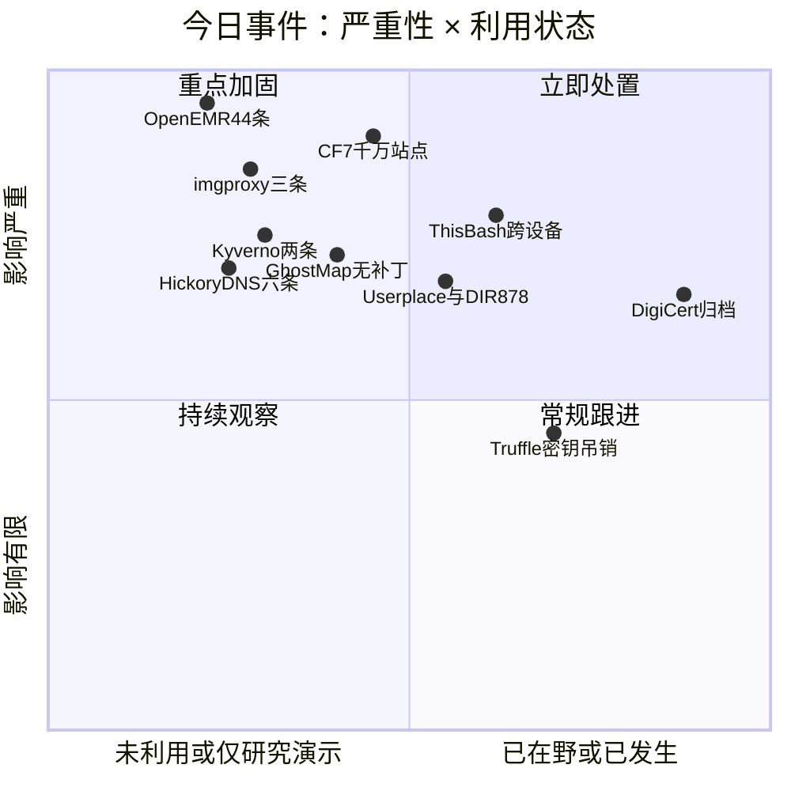
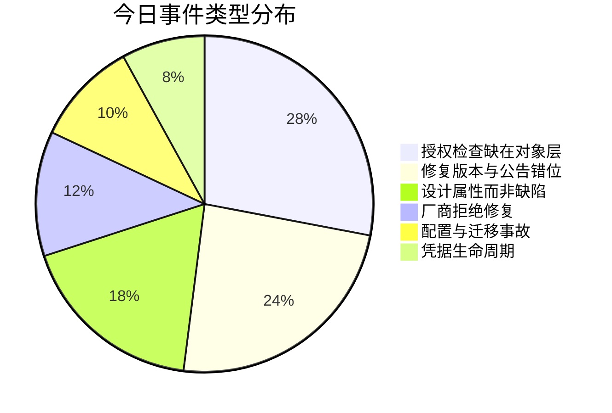
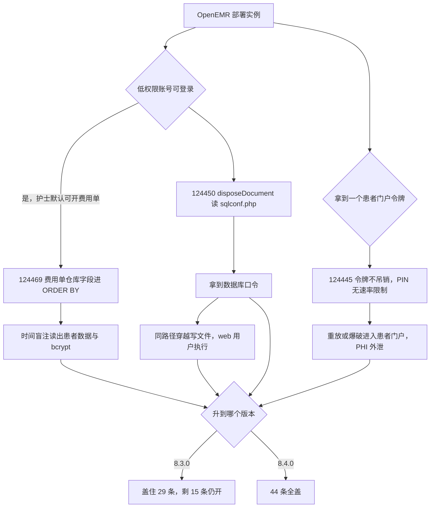
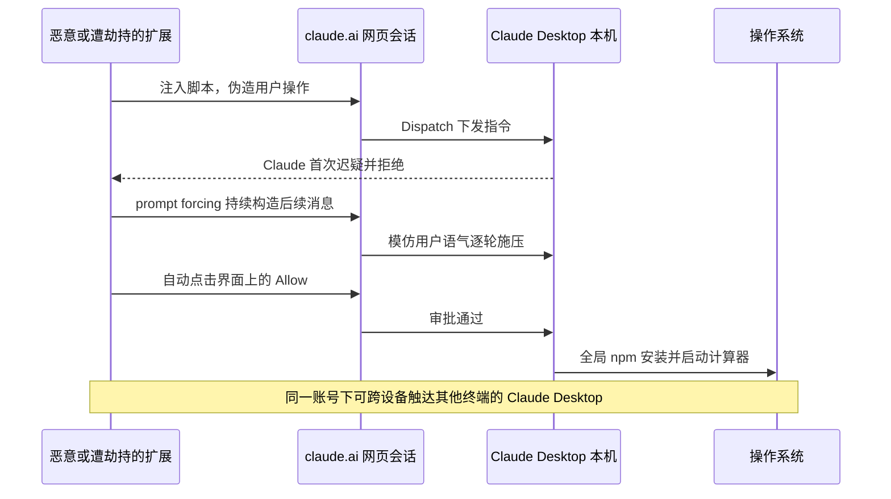
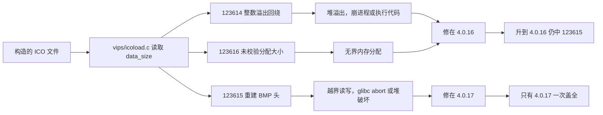
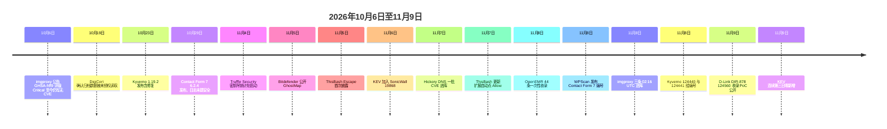

# 网安日报速递 · 2026年11月9日（第212期）

> 修是修了，修的不是你以为的那一层

---

## 今日主线

今天六条值得看的事，共用同一个形状：**修复动作确实发生了，但落在离你以为的位置差一格的地方。**

OpenEMR 在 11 月 8 日一次性进了 44 条 CVE，这 44 条**分成两个修复版本**——29 条修在 8.3.0，15 条要 8.4.0 才修完。你按公告升到 8.3.0，还剩 15 条开着，其中一条是 9.8 分的患者门户令牌重放。Contact Form 7 的补丁在 **10 月 29 日**就发了，可插件的更新日志里只写了一句版本号，没有任何一句提到安全——直到 11 月 8 日 WPScan 给出 CVE 编号，一千万个站点才知道自己已经在那个版本上待了十天。imgproxy 的公告点名 4.0.16 是修复版本，但三条里有一条要到 **4.0.17**。GhostMap 更干脆：Google 第一次回"无法复现"，第二次带着可用 PoC 再报，回的是"不属于安全更新的范围"——修是不会有的。ThisBash Escape 里，Anthropic 按计划把 Dispatch 这个功能下线，但同一个设计缺陷还留在 Claude Code Remote Control 和 Claude Cowork 的网页会话里。DigiCert 把自注册口子补上了，四个月后才发现数据早在那之前就被读走了。

**修好一个东西，和修好你以为的那个东西，是两件事。**

---

## 头条一：44 条一次进库，修复版本号有两个——OpenEMR 这批的读法

**时间**：2026 年 11 月 8 日，NVD 一次性收录 44 条描述指向 OpenEMR 的记录，CNA 全部是 VulnCheck。

**分组**：按记录正文里写的修复版本拆开——**29 条**写的是 `before 8.3.0`，**15 条**写的是 `before 8.4.0`。这不是笔误，是两条不同的修复线。升到 8.3.0，那 15 条一条都没盖住。

| 修复版本 | 条数 | 代表条目 |
|---|---|---|
| 8.3.0 | 29 | 124469（9.9 SQLi）、124450（9.9 路径穿越）、124490（9.1 路径穿越）、124463（8.7 存储型 XSS） |
| 8.4.0 | 15 | 124445（9.8 令牌重放）、124467（8.8 LFI 到 RCE）、124483（8.7 处方越权）、124480（8.8 FHIR 越权）、124484 / 124486 / 124477（8.8 授权缺失） |

OpenEMR 是开源社区里部署量最大的电子病历系统，跑在医院、诊所、社区卫生院这类地方。它的数据不是"用户资料"，是**病历**——诊断、用药、检验、账单。这批东西的性质，和 WordPress 插件那种"站点被挂马"不是一个量级。

### 124469：护士账号就能把整库拖走

缺陷在 Fee Sheet（费用单）的药品库存查询，`DrugSalesService::sellDrug`。表单里 `prod[N][warehouse]` 这个 POST 字段被直接拼进 SQL 的 `ORDER BY` 子句，没有任何白名单。

关键在于门槛。**能打开 Fee Sheet 的账号就能打**——默认安装下，护士这类低权限临床角色就有这个权限。攻击者提交带常量子查询的产品行，构成时间盲注 oracle，逐位把数据读出来：患者数据，以及 `users_secure` 表里的 bcrypt 哈希。拿到哈希之后是离线爆破，爆破出来的是医生和管理员账号。

CVSS 3.1 给 **9.9**，向量里有 `S:C`——范围变更，因为从 Fee Sheet 这一个表单能走到整个数据库。

### 124450：读一个配置文件，拿到数据库口令，然后写文件

Fax/SMS 模块的 `disposeDocument` 动作接收一个 `file_path` 参数，不校验。低权限已认证用户可以拿它读 `sqlconf.php`——OpenEMR 的数据库配置文件，里面是明文口令。读到口令之后是两件事：直接连数据库，或者用同一个路径穿越往 web 目录写文件，以 web 用户身份执行。

路径穿越能读文件的地方，通常也能写文件；能读写文件的地方，通常就是 RCE。这条给 **9.9 / 9.3**。

### 124445：一次性令牌从来不是一次性的

这条是 15 条里最该单独拎出来的，因为它根本不需要"账号"。

`src/Common/Auth/OneTimeAuth.php` 是患者门户的一次性登录链接组件。它有三个问题叠在一起：

- **不执行调用方设的限额**——`enforce_onetime_use` 与 `max_access_count` 两个标志被忽略；
- **用完不吊销**——被消费过的 `service_auth` 令牌一直有效；
- **PIN 校验没有速率限制**，而且用的是非严格比较。

后果：一个被截获的令牌可以重放；配合无速率限制的 PIN 校验，可以爆破。进去之后是完整的患者门户会话，里面是 PHI。受影响区间从 **7.0.1** 起，修在 **8.4.0**。CVSS 3.1 **9.8**，`PR:N`。

### 124467：上传一个叫 Controller.php 的文件

ESign 路由 `library/ESign/Router.php` 把未净化的 `module` 参数塞进 `require_once '<module>/Controller.php'`。同时 fax 模块的 `faxProcessUploads` 把攻击者命名的文件写到一个可预测的临时路径，**不检查扩展名**。

两件事拼起来：传一个名叫 `Controller.php` 的文件进去，然后请求 `interface/esign/index.php` 并在 `module` 参数里塞路径穿越，指到刚传上去的那个文件。`require_once` 执行它。**8.8**，修在 8.4.0。

### 这批的三个共同点

**授权检查写在"有没有这个页面的权限"上，不写在"这个对象是不是你的"上。** 15 条 8.4.0 分组里，大半是 `CWE-639` / `CWE-862` / `CWE-863` 这一类——portal 的 onsite document、FHIR 的 QuestionnaireResponse、处方 REST API、SMART standalone launch。它们全都在做"你能进这个模块吗"的检查，没有做"这条记录属于你能看的人吗"的检查。病历系统里这个区别就是"能看自己的病人"和"能看所有人"。

**FHIR 那一侧的 `APICSRFTOKEN` 是个放大器。** 124480 与 124483 都提到同一个手法：页面里暴露给 JS 的 `api_csrf_token_js` 值可以直接塞进 `APICSRFTOKEN` 请求头，跳过 FHIR scope 检查。CSRF token 的作用是证明"请求来自本站页面"，它一旦能被拿来当授权凭据用，就等于把"我是本站用户"当成了"我有权读这条"。

**两个修复版本号这件事，是这批最实际的运维陷阱。** 拿到一张 44 行的表，第一反应通常是"升到最新版"。但"最新版"在这里有两个：8.3.0 和 8.4.0。**只有 8.4.0 能一次盖全。**

### 值得关注的原因

- **医疗机构的时间窗和别的行业不一样。** 病历系统停机要评估临床影响，升级要排窗口、要做回归、要厂商配合。所以"分两次修"在这里不是小事——它意味着第一次升级之后，系统会有一段时间处在"看起来打过补丁了"的状态，而 15 条里最狠的那条还在。
- **这批的利用门槛低到不需要写 exploit。** 124469 是用浏览器打开一个表单、改一个 POST 字段；124445 是重放一个链接。这类漏洞在野利用起来不需要工具链，日志里也不会出现明显的攻击载荷特征。
- **暂无在野证据，也没有公开 PoC。** 截至 11 月 8 日，OffSeq 的记录显示没有 nuclei 模板、没有 Metasploit 模块、没有 Exploit-DB 条目，也不在 KEV。这一点要写在风险判断里，但不能拿来当"可以慢慢来"的理由——44 条里有 10 条 9 分以上，而 OpenEMR 的实例大多数直接对着公网。
- **EPSS 这类指标在这里同样没有解释力。** 批量披露时，单条的 EPSS 反映的是"历史上同类漏洞被利用的频率"，不是"这一条明天会不会被捡起来"。

---

## 头条二：补丁十天前就发了，可没人知道该升——Contact Form 7 的 1000 万站点

**编号**：CVE-2026-114432，CVSS 3.1 **9.8**，`AV:N/AC:L/PR:N/UI:N/S:U/C:H/I:H/A:H`，CWE-434（危险类型文件无限制上传）。WPScan 于 **11 月 8 日**发布。

**受影响**：Contact Form 7 **6.2 至 6.2.3**。修复在 **6.2.4**——发布日期是 **10 月 29 日**，同日还跟了一个 6.2.4.1。

**装机量**：WordPress 官方目录显示 **1000 万以上**活跃安装。这是 WordPress 生态里最常见的"陌生人给你提交东西"的入口，而这个洞正好坐在那个位置上。

### 机制

两层叠在一起：

1. 表单的文件字段**不校验文件类型，也不校验扩展名**；
2. 临时文件清理逻辑本身有缺陷，**上传的文件没有被删掉，留在了磁盘上**。

第二层是决定性的。很多上传漏洞之所以只是"能传不能执行"，是因为文件落在临时目录、请求结束就没了。这里文件留下来了，攻击者可以从容去找它。

后续取决于服务器配置：

- **Debian / Ubuntu 默认的 Apache**：目录列表是开的，`.phar` 被映射到 PHP handler。攻击者列出目录、找到自己传的文件、请求它——**RCE**。
- **nginx，或开了 `.htaccess` 覆盖的 Apache**：拿不到执行，但攻击者仍能往 uploads 目录写任意文件。而这个目录是本站 origin 下的，写进去的 HTML 或 SVG 会被当成本站内容提供出去——存储型 XSS、钓鱼页、绕 CSP 的载荷入口，都在这一层。

修复方式是**把文件名切到扩展名白名单**。

### 这里有两套口径，得分开写

**口径一（Brandefense）**：标注"exploited in the wild"，并称 11 月 8 日进入 Industry KEV feed；同时写明"不在 CISA KEV"、"无公开 PoC 代码"。

**口径二（pwn.watch 的追踪条目）**：明确写 **"No exploitation has been reported"**，并把 WPScan 的 PoC 发布时间标为 **11 月 19 日**。

CISA KEV 目录（2026.11.06 版，1769 条）里没有这一条。也就是说，"Industry KEV"和 CISA 的 KEV 是两个不同的表，前者是厂商/情报方自己维护的在野清单，进得快、门槛低、可被单一情报源推动。**同一件事在两套表里给出相反结论，这件事本身值得记住**：查"有没有在打"的时候，得说清查的是哪张表。

### 还有一层：更新日志里没写"安全"

插件作者在 10 月 29 日发了 6.2.4，changelog 里只是一次版本号更新，没有任何一句提到安全修复。技术上这没有任何问题——很多项目这么做是为了在补丁扩散前不给攻击者指路。但它带来一个实际后果：**10 月 29 日到 11 月 8 日这十天里，一个跑着 6.2.3 的站点管理员，没有任何理由去点那个更新按钮。**

另外，NVD 到现在没有给这条打分，页面上显示的 9.8 是 CNA（WPScan）的分数。这不影响处置优先级，但会影响那些按"NVD 评分"做自动化排序的资产台账。

### 值得关注的原因

- **1000 万站点这个基数下，"低概率"没有意义。** EPSS 给 0.2%（约 12 百分位），但这个数字衡量的是"未来 30 天被利用的概率"，它是按全网平均算的。真正决定风险的是两个本地变量：这个站点有没有开文件上传字段、服务器是不是 Debian/Ubuntu 的默认 Apache。两个都中的站点，概率不是 0.2%。
- **6.2.4 是 10 月 29 日发的，往前推的每一天都在受影响区间里。** 受影响下限是 6.2，不是"很久以前"。也就是说这是一个近期版本引入的问题，不是陈年旧账。
- **"能写文件"这个后果不该被降级。** 很多处置流程里，"没有 RCE，只是任意文件写入"会被降一档。但写在自家 origin 下的 HTML/SVG，在钓鱼、绕过同源策略、投放恶意脚本这三件事上都是完整能力。
- **11 月 19 日的 PoC 是个明确的时间点。** 在那之前把版本号推上去，成本是一次点击；在那之后，成本取决于有多少自动化扫描器已经把这个洞加进指纹库。

---

## 头条三：一个浏览器扩展，让两台机器上的 Claude 都听话

**代号**：ThisBash Escape。披露方 Forever Security，研究者 Weizman。首次公开 **11 月 5 日**，11 月 7 日 02:30 UTC 更新。**没有 CVE 编号，没有补丁。**

### 攻击链

前提只有两个，都很普通：

1. 用户装了某个**有权访问 `claude.ai` 的浏览器扩展**（恶意扩展，或者被劫持的正常扩展）；
2. 用户**同时**登录着 `claude.ai` 网页和 Claude Desktop。

中间的通道叫 **Dispatch**——它是 claude.ai 网页和 Claude Desktop 之间的通信功能，让网页上的操作能触发桌面应用里的行为。产品设计上，这是"我在网页上让 Claude 干点事，它在我的电脑上干"。

攻击流程：

- 扩展往 `claude.ai` 页面注入脚本，通过 Dispatch **向 Claude Desktop 下发指令**，在协议层面看起来和用户自己操作没有区别；
- 要求 Claude 执行一条命令时，它会迟疑——研究里让它装一个陌生的 npm 包，Claude 起初是拒绝的。于是扩展**持续构造后续消息**（研究者称之为 prompt forcing），模仿用户的语气一轮轮往下推，直到它同意；
- 最后一步是那个"允许"按钮。**扩展自动点击页面上的 Allow 提示**，人不在场也能过。

实测结果是：**全局 npm 安装成功，然后在本机启动了计算器**。计算器只是用来证明"命令真的执行了"。

### 三个让它比"一次点击"更麻烦的地方

**不需要浏览器漏洞。** 整条链上没有一个内存破坏、没有一个沙箱逃逸。用的是产品自己的功能，加上"用户已经批准过这个扩展"这个既成事实。

**跨设备。** 在同一个 Claude 账号下，被控的那台浏览器可以操控**其他终端**上的 Claude Desktop。研究者提到，他们在客户的办公电脑上见过个人 Claude 账号开着跨设备的 Dispatch——个人账号登在工作机器上，这个组合让"一台机器上的浏览器扩展"变成了"多台机器上的命令执行入口"。

**同一个设计缺陷还在别处。** 研究者指出，Claude Code Remote Control 和 Claude Cowork 的网页会话里存在同类弱点。这一点很重要，因为它决定了"下线 Dispatch"到底解决了多少。

### Anthropic 的处理，和那个时间差

Anthropic 表示计划在 **2026 年 10 月底**停用 Dispatch 功能。

但截至 **10 月 30 日**，其支持页面仍把 Dispatch 列为"面向现有用户的 limited beta"。功能下线和技术债清理是两件不同的事：把入口关掉，不代表"网页能驱动桌面执行"这个模式在其他产品里也被重新设计过。

### 值得关注的原因

- **这暴露的是"跨信任域桥接"这一类设计的通病。** 浏览器里的东西（低信任）能触发桌面上的执行（高信任），中间的授权判断依赖"用户点过允许"。只要允许是可以被脚本点的，这个判断就等于没有。同类设计在今天的产品里非常多：网页版 IDE 连着本地 agent、浏览器插件连着本地服务、手机 App 连着桌面客户端。
- **企业终端的风险不是"员工用了 Claude"，是"个人账号登在公司机器上"。** 跨设备 Dispatch 让攻击面从"这台机器"扩到"这个账号登录过的所有机器"。这类影子 IT 组合在终端管理里基本是盲区。
- **没有 CVE，意味着它不会出现在任何漏洞扫描结果里。** 它是一个设计属性，不是一个可修补的缺陷。处置只能靠策略：扩展白名单、限制浏览器对本地服务的访问、要求个人账号与工作设备分离。
- **"AI 会拒绝"这件事，在持续施压下不成立。** 研究里 Claude 第一次确实拒了。防护的价值在于它把攻击成本从一个请求抬到多轮对话，但只要对手能自动重试，这个成本就趋近于零。这也是为什么"自动化点击 Allow"这一步比 prompt injection 本身更值得记。

---

## 头条四：装上去，不用打开，手机就起不来了——GhostMap，Google 说不修

**披露**：Bitdefender Labs，**11 月 5 日**。**无 CVE 编号，无补丁，Google 明确表示不会为它发安全更新。**

### 触发条件只有一个：安装

不需要权限，不需要运行，不需要打开。装完就行。

研究团队在 **Pixel 10 / Android 17 / 2026 年 8 月 5 日安全补丁**上复现，并确认 **Android 10 及以上**都受影响。记录里一次测试是：安装后约 **1 秒**出现首次崩溃，随后循环 **110 次**，屏幕停在启动动画；另一次安全模式下的运行循环了 **72 次**。重启无效，安全模式也无效。

### 根因是两个库对同一个字段的判断不一致

APK 是 ZIP。ZIP 条目里记录两件事：**压缩方式**和**声明的解压后大小**。

- `libziparchive`：**只有当条目被标记为 `stored`（不压缩）时**，才去核对声明的解压大小；
- `libandroidfw`：**只要条目不是标记为 `deflated`**，就按声明的解压大小去映射内存。

一个条目的压缩方式填**第三种值**（既不是 stored 也不是 deflated），两个库各自的判断都能通过。于是 Android 把一个小文件按一个远大于实际的值映射进内存，进程读到文件真实结尾之外的那一页，收到 **SIGBUS**，当场死掉。

如果这个畸形条目是一个**资源文件**，而读它的是 `system_server`，事情就变成循环：进程崩、系统把它拉起来、它重新扫已安装应用、又读到同一个文件、又崩。启动永远走不完。

同一手法还能用在别的地方：让启动器崩（删不掉那个应用）、让"设置"里的卸载界面崩、让安全检查工具在读它的时候崩掉。

### Google 的两次回复

- **8 月 20 日**第一次报告 → 以 **"Won't Fix (Not Reproducible)"** 关闭。
- **8 月 25 日**第二次报告，附可用 PoC 与复现步骤 → 判定**"不属于安全更新的修复范围"**，转给功能团队，评估是否放进未来某个 Android 版本。

Bitdefender 拿了一个先例来对比：**CVE-2016-6724**，性质更弱的同类问题，Google 当时按 Moderate 修了，而那个问题同样需要恢复出厂设置。按今天的严重性分级标准，Bitdefender 认为 GhostMap 应该评 High。

### 起点很荒诞：一个装不上的银行木马

2026 年 8 月 12 日，Bitdefender 的分析环境里有一个从野外套来的 APK 在安装时把模拟器搞崩了。样本是一个银行木马 dropper，被加壳器重写过——加壳器为了对抗逆向，改写了 APK 的内部结构，**顺手把 Android 解析安装包的逻辑搞坏了**。

也就是说：写这个木马的人**不知道**自己做出了一个能让手机变砖的文件。真正把它变成武器的，是研究团队后续的构造工作。

### 现在能做什么

没有补丁，所以只有三层：装之前拦住（安全软件把这种畸形文件标记为 `Android.Riskware.Ghostmap.rA`，但 Android 的权限模型不允许第三方应用自己阻止安装或卸载别的应用，最后按下按钮的还是机主）、出事之后恢复（只能恢复出厂，本地数据全没）、以及在极端情况下用 ADB 删文件（**前提是 USB 调试本来就开着**，而且要在崩溃间隙完成，设备完整重启过一次之后这条路也失效）。

### 值得关注的原因

- **"厂商判定不修"这一类结论，需要被纳入风险模型。** 漏洞管理里默认假设"有编号的会被修"，但现实里有一类问题被明确归类为"不是安全问题"——功能设计、边界情况、需要恢复出厂的 DoS。这类东西没有补丁日期，也就永远不会出现在"补丁合规率"这个指标里。
- **一个不需要权限、不需要运行的安装包，能做到"设备变砖"。** 这个能力在勒索场景里是现成的杠杆：不给钱就让你恢复出厂。研究者说没有观察到在野使用，但能力的成本和收益都摆在那里。
- **解析器的"两套实现"是这类缺陷的高发区。** 同一个文件格式，装包时由一个库看，运行时由另一个库看，两边对"边界"的定义不一样，中间就有缝。这类缝在压缩包、图片、字体、文档解析里反复出现。
- **时间线的落差值得记一笔：8 月报告、11 月公开、Android 10 到 17 全部在内、没有编号。** 用户侧唯一的防线是"不要装来源不明的 APK"——这句话在 2026 年已经被说了太多次，但在这里它是唯一有效的那一条。

---

## 头条五：公告点名 4.0.16，可三条里有一条要 4.0.17——imgproxy 的 ICO 加载器

**时间**：2026 年 11 月 8 日 **02:16 UTC**，NVD 一次收进三条 imgproxy 记录，CNA 都是 VulnCheck，三条提交时间相差不到半秒。

imgproxy 是自建的图片处理服务，常见于"上传图片自动裁剪/转码"这条链路上，通常直接对公网。三条全部在 **ICO 图片加载器**里，全部可以被**未认证攻击者**触发——只要能把一张构造好的图片送进服务。

| CVE | CVSS 3.1 | CVSS 4.0 | 缺陷 | 受影响 | 修复 |
|---|---|---|---|---|---|
| CVE-2026-123614 | **9.8** | 9.3 | 整数溢出（CWE-122），`vips/icoload.c` 里 `data_size` 回绕导致堆溢出 | 4.0.0 – 4.0.15 | **4.0.16** |
| CVE-2026-123615 | 7.5 | 8.7 | 越界读写（CWE-787），`vips_foreign_load_ico_header` 重建 BMP 头时按过小的 data_size 算 | 3.3.0 起 | **4.0.17** |
| CVE-2026-123616 | 7.5 | 8.7 | 无界内存分配（CWE-789），`data_size` 未校验（CWE-789 = 过多内存分配） | 3.3.0 起 | **4.0.16** |

### 那张表读错的后果

三条同时公开，其中一条 9.8。最自然的动作是"看最高分那条的修复版本"→ 4.0.16 → 升级到 4.0.16。

**然后你身上还留着 CVE-2026-123615。** 它要到 4.0.17 才修。

受影响的下限也不一样：9.8 那条从 **4.0.0** 开始，两个 7.5 从 **3.3.0** 开始。所以停在 3.x 的部署，**不在那个吓人的 9.8 范围里，却在两个 7.5 的范围里**——如果只按"我版本号比 9.8 的起点小，应该没事"来判断，结论正好是反的。

### 公告比 CVE 早了 33 天

关键那条（123614）不是新东西。项目自己在 **10 月 6 日**就发了 **GHSA-hff9-5pqw-6w9f**，标题是"ICO 加载器整数溢出导致远程拒绝服务，并通过堆溢出允许远程代码执行"，评级 Critical **9.8**，向量和现在的 CVE 记录完全一致，标了 CWE-122 / CWE-190 / CWE-787。受影响版本写的是 `>= 4.0.0, = 4.0.16`——一个下限加一个单点，这个写法本身就不太常规。报告者是 mateofumis 与 JasonPuglisi，分析者 JacobBrackett，指向提交 `f4fedbb`，**没有 workarounds 一节**。

而到 11 月 8 日，CVE 记录已经上线几小时之后，**那份公告页面上仍然印着 "No known CVE"**。

### 三个技术细节

**NVD 还没分析。** 三条的 `vulnStatus` 都是 **Received**，也就是说分数是 CNA（VulnCheck）给的，NVD 没有自己的评分，也没有 configurations 块。这意味着自动化工具如果依赖 NVD 的 CPE 匹配来判断"我这份资产中不中"，在这里会落空。

**123615 连 packageURL 都没有。** 另外两条至少有 `pkg:golang/github.com/imgproxy/imgproxy/v4` 这个模块坐标，123615 的 affected 数据是两个裸字符串 `imgproxy`、`imgproxy` 加一个版本区间。

**项目自 7 月以来没发 release notes。** 也就是说 4.0.16 和 4.0.17 这两个版本"修了什么"，除了公告本身，没有第二处可查。

### 值得关注的原因

- **"按最高分那条的修复版本升级"是一个会出错的启发式。** 批量披露时，不同 CVE 的修复版本经常不一致，尤其是在同一天里由同一个 CNA 一次性提交的情况下。**做升级决策的正确输入是"所有条目的修复版本取最大值"，不是"最高分那条的修复版本"**。
- **受影响下限不一致，会让"我不在范围内"这个判断失效。** 3.x 用户今天的正确结论是"我不中 9.8，但我中两个 7.5"，而不是"我安全"。
- **图片处理服务是最容易被推到公网的一类中间件。** 它天生要接收外部上传，天生要解析别人给的二进制，天生跑在容器里、经常以非 root 但带出网权限的方式运行。ICO 这种"很少人用但解析器一定会支持"的格式，是这类服务里最容易被忽略的入口。
- **公告页面上的元数据会误导人。** 一份 33 天前就公开、评级 Critical、带修复版本的公告，页面上写着"No known CVE"——如果有人按"CVE 编号"去建工单，这条永远不会被建出来。资产台账的输入如果只有 CVE，GitHub Security Advisory 这一层的信息就全丢了。

---

## 头条六：迁移到公网没做安全评审，四个月后才发现数据早被读走——DigiCert

**性质**：数据泄露，涉及身份核验文件。**不是**证书或私钥泄露。

### 时间线

| 时间 | 事件 |
|---|---|
| 2025-02 | 一次基础设施迁移，把一个原本只能在 VPN 后访问的内部业务系统搬到了公网可达的网段，**没有对新暴露面做安全评审** |
| 2026-06-18 | 发现该系统上存在非员工账号 |
| 2026-06-21 | 通过其托管安全研究项目收到报告，指出外部用户可以在该系统上自助注册 |
| 2026-06-27 至 07-02 | 未授权账号读取归档客户数据 |
| 2026-07 | 修补注册缺陷、限制访问 |
| 2026-10-19 | 确认数据确实被读取，事件升级为可报告级别 |
| 2026-11 | 通知受影响客户 |

### 为什么一次"配置问题"能持续一年多

那个系统本来只给内部用，所以带了一个**自注册端点**——设计目的是让其他内部应用能自己开户。搬到公网之后，这个端点就对着全世界了。而通过这条路径创建的账号：

- **不走 MFA**（系统本来没打算面对外部用户）；
- **没有被分配到任何应用**；
- 但因为一个**授权缺陷**，默认拿到了对归档客户数据的**只读**权限。

发现非员工账号时，公司的初判是"这些账号没有绑定应用，碰不到客户数据"。四天后一份外部报告让这个判断被推翻。而"数据到底有没有被读走"这个问题，要到 **10 月 19 日**才有确定答案——从首次检测到确认外泄，中间隔了约**四个月**。

DigiCert 自己的根因分析写得很直白：这次迁移被当成**基础设施变更**处理，而不是**安全变更**，因此没有触发配套的评审；网络可达性改了，但没有重新评估由此产生的暴露面。另外还有一个监控缺口：被拦下的访问尝试**没有产生 SIEM 告警**，直到事后才补上。

### 泄露的是什么，不是什么

**是**：姓名、公司邮箱、电话、公司地址；部分记录还带身份核验材料——**护照、驾照、水电账单**扫描件。

**不是**：CA 核心服务、CertCentral、DiGiCert ONE、已签发的证书、客户登录凭据。

受影响人数**没有披露**，公司称仍在核查归档的身份文件、会继续通知。

### 为什么"只读"这件事不能安慰人

安全工程师 Donovan Farrell 的说法被反复引用：**一张护照扫描件加一张水电账单，已经够过很多客服的身份核验了**——改手机号、改银行预留、重置账号，这类操作要的往往就是这两样。安全架构师 Fabian Bader 本人也在受影响范围内，他说"有限"的泄露覆盖了他的完整个人数据，可能还包括他为申请证书提交的核验文件。

放在 CA 这个位置上还有一层：**证书的信任建立在核验流程的完整性上，不只是密钥的保密性。** 这次核验材料本身泄露了，证书没被伪造，但"我们靠这些材料确认过你是谁"这件事的可信度被动摇了。

### 值得关注的原因

- **"从 VPN 后面搬到公网"是一次安全变更，不是一次网络变更。** 这句话在 DigiCert 的根因分析里是自己写的，也是整件事最可复用的一条。任何"临时开放""迁移期间放通""新区域可达"的动作，都该触发一次对暴露面的重新评估，而不是只改路由。
- **只读权限在归档数据面前等于完全权限。** 只读能做的事就是读，而这类系统的全部价值就是"里面存着东西"。把"不能改"当成"危害有限"，是权限分级里最常见的误判。
- **检测到异常账号，和确认数据是否被读，是两件事。** 前者是账号层面的信号，后者需要查访问日志、对象级读取记录。中间那四个月，是这次事件真正的成本——如果 6 月就把"这个账号读过哪些归档"查清楚，通知能在 7 月发出去。
- **身份核验材料是一类被低估的高价值资产。** 它不参与任何加密运算、不签发任何东西、不在密钥管理体系里，所以经常不在最高保护级别。但它能做的事（冒充一个人去过客服）比一把密钥更直接。

---

## 速览

### 7. Hickory DNS 六条，DNSSEC 验签不看 Signer's Name 是不是本区

11 月 7 日至 8 日，NVD 收进一批 Hickory DNS（Rust 生态里最常用的 DNS 库，`hickory-proto` / `hickory-net` / `hickory-resolver`）的 CVE，全部修在 **0.26.2**，报告者 qifan-sailboat。

最重的是 **CVE-2026-123605**（CVSS 3.1 **8.8** / 4.0 8.7，CWE-347）：校验器拿 RRSIG 去比对的 DNSKEY，是**按 RRSIG 里 Signer's Name 字段写的那个名字**去取的，**没有核对这个名字是不是这条 RRset 所在的区**。后果是：任何控制了一个安全区（有 DNSSEC 签名的区）的人，都能为**任意不相关区**里的记录签出"有效"签名，而用 `DnssecDnsHandle` 的解析器、递归服务器和客户端会把它当已认证数据接受。

同批还有几条：**123581**（6.9，CWE-345）——应答区里只要出现任何一个有效 RRset 就当成肯定回答，不检查这个 RRset 是不是在回答这个查询，攻击者可以塞"签过名但不相关"的 RRset，把本该是 no-data 的响应变成肯定回答；**123583**（6.3）——对否定应答没有做出站域（bailiwick）过滤，可以投毒缓存，也让上面那个验签缺陷更容易被利用；**123597**（3.7）——DS 查询路径把 SERVFAIL / REFUSED / 超时这类瞬时错误缓存成 Bogus 结论，攻击者只要让子区的 DS 子查询失败，该区下所有名字会一直返回 SERVFAIL 直到缓存 TTL 到期。另外还有 123582、123596 两条。

DNSSEC 的整个信任模型建立在"签名者身份"和"签名范围"的绑定上。这个绑定不校验，等于把"我控制了一个区"放大成"我能替所有区签名"。做递归解析、做 DNS 中间件、把 hickory 编进自己产品的团队，值得单独核一遍版本。

### 8. Kyverno 两条：10 月 23 日就修好了，11 月 8 日才给编号

**CVE-2026-124440**（CVSS 3.1 **9.9**）——1.19.1 里那个 apiCall 命名空间限制，可以被**畸形的百分号转义**绕过，再次到达集群管理员权限；**CVE-2026-124441**（8.8）——generate 规则在目标 kind 或 namespace 是变量时**跳过授权检查**。两条都修在 **1.19.2**（Helm chart 3.9.2），而这个版本 **10 月 23 日**就发布了。

这和 11 月 5 日那一批是同一个模式：项目早发版，CVE 编号晚到。11-05 期已经写过同批七条（122302/303/304/310/311/313/321，六个 9.8–9.9），今天这两条是那批的补充。在 10 月 23 日到 11 月 8 日之间升级过 Kyverno 的集群，实际上已经安全了；只看 CVE 编号的资产台账，会把它们记成"今天新出的高危"。

多租户集群、租户能写命名空间级 Kyverno 策略的环境，是这批的共同受害面。

### 9. 两个不需要账号的 9.8：一个 WordPress 插件，一台停产路由器

**CVE-2026-110963**（**9.8**，Userplace WordPress 插件 ≤ 1.2.0）：一个对未认证用户开放的 AJAX 动作**没有做授权检查**，而且保护它的 nonce **是公开暴露的**。两件事加起来，未认证访问者可以**直接创建一个管理员账号**，或者写任意站点选项——站点接管。修在 1.3.0。

**CVE-2026-124560**（**9.8**，CVSS 4.0 8.9，D-Link DIR-878 1.20B05）：HNAP 处理器的 `GetCAPTCHAsetting` 函数，`uid` 参数未做边界检查，导致**堆溢出**，可远程触发。**PoC 已公开**（GitHub 上有专门目录），而且这条记录明确写着"该产品已不再由维护者支持"——不会有补丁。11 月 9 日发布，VulDB 是 CNA。

两台设备的共同点：一旦暴露在公网，决定风险的不是 CVSS，是"有没有改过默认口令"和"有没有开外网管理"。

### 10. Truffle Security 直接去找发钥匙的人：140 万条还活着的泄露密钥

**11 月 4 日**，Truffle Security（TruffleHog 的维护方）启动 **Secrets Revocation Program**，免费，目标是处置约 **140 万条**在公网上公开暴露、**经实测仍然有效**的密钥。

推它出来的数字很刺眼：**去年上报的密钥里，有 81% 在六个月后依然可用。** 通知不管用。

机制是绕开"等人来改"这一步：把经过验证的活密钥直接交给**发钥匙的那一方**。发行方可以提供一个吊销端点让 Truffle 直接调用，也可以通过 webhook 接收已验证的密钥、**在 14 天内自行吊销**。无论密钥主人看不看邮件，钥匙都会死。

目前 **16 家**发行方接入，包括 Hugging Face、Notion、Vercel、Resend、RubyGems、Twilio。

效果有先例可参照：Google 从 2024 年 6 月 16 日起默认禁用暴露的 GCP 服务账号密钥。在只做通知的年代，Truffle 测到 **72%** 的暴露密钥保持有效；改成自动禁用之后，这个数字降到 **11%**（用户可以主动退出，所以到不了零）。

AI 编码工具这一层也在统计里：**2025 年 1 月以来，在 AI 编码工具的配置文件里找到 2,655 个有效密钥**——这一类在一年前几乎不存在。参照物是今年 7 月那次事件里，暴露的 Hugging Face 令牌被 AI 智能体拿去从平台拖数据。

顺带两个更大的存量数字：公开 GitHub 仓库里 **54.3 万**条有效凭据，跨代码库/镜像/CI 日志的 **43.1 万**条 AWS 密钥。

### 11. KEV 连续三天零新增，而云端那两个 10.0 客户什么也不用装

CISA KEV 目录当前版本 **2026.11.06**，共 **1769 条**。自 11 月 6 日加入 CVE-2026-19868（SonicWall SonicOS SSLVPN，SAML 认证绕过）之后，**11 月 7 日、8 日、9 日均无新增**。

今天六条头条里，OpenEMR 那 44 条不在 KEV，Contact Form 7 不在 CISA KEV（尽管有情报源把它列进了自己的 Industry KEV 表），imgproxy 三条不在，GhostMap 连编号都没有。**KEV 零新增不等于没有在打**，它只说明没有新的"已被确认在野"条目进表。

对照的另一面：11 月 5 日至 6 日，微软安全更新指南挂出两个 CVSS **10.0**——**CVE-2026-85889**（Azure AI Foundry，CWE-306 关键功能缺失认证，`PR:N`，范围变更，可由未认证攻击者通过网络提权，报告者 Rémy Marot）和 Entra 设备注册那条（11-07 期已写）。两条公告都写着同一句：**客户不需要执行任何操作即可解决**。同一批里真正需要装补丁的本地提权（UMPS 的 **7.8** 与安全内核的 **8.2**），分数反而更低，埋在 26H1 的带外累积更新 KB5129194 里。

所以看板上"分数 × 是否需要我动手"这两个维度必须分开：**云端满分 = 一条通知，本地 7.8 = 一项待办。**

---

## 风险分析

### 严重性 × 利用状态

### 事件类型分布

### OpenEMR 那两条路，和那个决定一切的版本号

### ThisBash Escape 的六步

### imgproxy 三条与两个修复版本

### 一张自查清单

按今天的形状，问自己五个问题：

1. **我的升级决策输入是"最高分那条的修复版本"，还是"所有条目的修复版本取最大值"？** OpenEMR（8.3.0 / 8.4.0）和 imgproxy（4.0.16 / 4.0.17）今天各提供了一个反例。
2. **我有没有在最近 12 个月里，把某个"只在 VPN 后"的系统搬到过公网？** 如果有，那次动作有没有触发对暴露面的重新评估，而不是只改了路由。参考 DigiCert。
3. **我的资产台账除了 CVE 编号，还接 GitHub Security Advisory 吗？** imgproxy 那份 10 月 6 日的公告，到 11 月 8 日仍印着 "No known CVE"，只按编号建的工单永远不会出现。
4. **我有没有在统计"补丁合规率"时，把"厂商明确不修"的条目剔除掉？** GhostMap 没有编号、没有补丁日期，它不会让任何指标变差，但它能让一台手机变砖。
5. **员工的工作机器上，有没有登录着个人的 AI 账号？** ThisBash 的成本不在"用了什么工具"，在"一个账号把多台机器连起来"。

---

## 事件时间线

---

## 相关出处

### OpenEMR

- NVD — CVE-2026-124469（Fee Sheet 药品库存 SQL 注入，CVSS 3.1 9.9 / 4.0 9.4，低权限可打，可读 bcrypt）：https://nvd.nist.gov/vuln/detail/CVE-2026-124469
- VulnCheck — CVE-2026-124450（fax/sms disposeDocument 路径遍历，读 sqlconf.php 后写文件到 RCE，9.9）：https://www.vulncheck.com/advisories/openemr-before-8.3.0-arbitrary-file-read-write-via-disposedocument
- VulnCheck — CVE-2026-124445（OneTimeAuth 忽略一次性与访问次数限制、消费后不吊销、PIN 无速率限制，9.8，修 8.4.0）：https://www.vulncheck.com/advisories/openemr-7.0.1-before-8.4.0-onetimeauth-token-replay-and-pin-brute-force
- NVD — CVE-2026-124467（ESign Router require_once 未净化 module 参数 + fax 上传任意文件名到可预测路径，8.8）：https://nvd.nist.gov/vuln/detail/CVE-2026-124467
- VulnCheck — CVE-2026-124483（处方 REST API 检查 patients.med 而非 patients.rx，可伪造与停用处方的全租户生效，8.7）：https://www.vulncheck.com/advisories/openemr-before-8.4.0-improper-authorization-via-prescription-rest-api
- VulnCheck — CVE-2026-124458（FHIR /fhir/Person/:uuid 患者区隔绕过，可读全体员工人口学信息，7.1）：https://www.vulncheck.com/advisories/openemr-before-8.4.0-fhir-patient-compartment-bypass-via-person-endpoint
- GitHub Advisory — GHSA-rq9x-wq7p-vvvq（CVE-2026-124480，APICSRFTOKEN 跳过 FHIR scope 检查，8.8）：https://github.com/advisories/GHSA-rq9x-wq7p-vvvq
- Brandefense — 五个高危条目的版本对照表（CVE 与 OpenEMR 自身严重性评级两个口径）、8.4.0 才盖全的结论：https://brandefense.io/security-news/openemr-critical-vulnerabilities-8-3-0-8-4-0
- OffSeq Threat Radar — CVE-2026-124483（发布 11-08、无 nuclei 模板、无 Metasploit / Exploit-DB 条目、不在 KEV）：https://radar.offseq.com/threat/cve-2026-124483-incorrect-authorization-in-openemr-7d0b6925b1343df3
- NVD API 2.0 — 11-08 至 11-09 收录 338 条，OpenEMR 44 条按修复版本分组统计（8.3.0 共 29 条 / 8.4.0 共 15 条）：https://nvd.nist.gov/developers/vulnerabilities

### Contact Form 7

- WPScan — CVE-2026-114432 原始条目（6.2 至 6.2.3、无类型与扩展名校验、临时文件未清理、扩展名白名单修复）：https://wpscan.com/vulnerability/6b0a5d1f-84fb-425f-8d37-ddde5703937c/
- NVD — CVE-2026-114432（CVSS 3.1 9.8，向量 `AV:N/AC:L/PR:N/UI:N/S:U/C:H/I:H/A:H`，NVD 尚未分析）：https://nvd.nist.gov/vuln/detail/CVE-2026-114432
- Brandefense ATLAS — 口径一：标注 exploited in the wild、11-08 进 Industry KEV feed、不在 CISA KEV、无公开 PoC、EPSS 0.2%：https://atlas.brandefense.io/vulnerability-intelligence/CVE-2026-114432
- pwn.watch — 口径二："No exploitation has been reported"、6.2.4 发布于 10-29 并同日跟 6.2.4.1、WPScan 将于 11-19 发布 PoC：https://pwn.watch/
- Azeem Hassni — 1000 万活跃安装、Debian/Ubuntu Apache 的 .phar 执行路径、nginx 与 .htaccess 场景降级为任意文件写入、changelog 未点名安全修复：https://azeemhassni.com/blog/wire-contact-form-7-unauthenticated-file-upload

### ThisBash Escape

- pwn.watch — 追踪条目（自 11-05、11-07 02:30 UTC 更新、无补丁、需扩展有 claude.ai 权限且双端登录、同缺陷存在于 Claude Code Remote Control 与 Claude Cowork、10-30 支持页仍标 limited beta）：https://pwn.watch/
- 商传媒（转述 The Hacker News）— Forever Security 演示、prompt forcing 与自动点击 Allow、全局 npm 安装后启动计算器、跨设备触达、Anthropic 计划 10 月底停用 Dispatch：https://sunmedia.tw/news/technology/1794014743
- 腾讯新闻（11-08 中文综述）— ThisBash Escape 的攻击链描述与"暂无 CVE 编号"的表述：http://mp.weixin.qq.com/s?__biz=Mzg5MjEzMjE4Mw==&mid=2247566629&idx=3&sn=89a1e84db142feb5e0ebb30e72c2dcf5

### GhostMap

- ThreatCluster（Bitdefender Labs 研究转述）— SIGBUS 机制、安装即触发、110 次循环、Pixel 10 / Android 17 / 8-05 补丁复现、起点是加壳银行木马 dropper：https://threatcluster.io/article/ghostmap-android-90c15c7d
- Brandefense — libziparchive 只在 stored 时校验、libandroidfw 对非 deflated 一律按声明大小映射、Google 两次回复原文（Won't Fix / 不属于安全更新范围）、三个滥用方向：https://brandefense.io/security-news/ghostmap-android-flaw
- AndroidPure — 安全模式下 72 次循环、ADB 恢复的严格前提、CVE-2016-6724 先例对比、检测名 Android.Riskware.Ghostmap.rA：https://www.androidpure.com/android-ghostmap-crash-loop-flaw
- 网易（11-05 中文详版）— 1 秒首崩、110 次循环、8 月 20 日与 25 日两次报告、截至披露无修复方案：https://www.163.com/dy/article/LB3IOLNV0511CQ7I.html

### imgproxy

- SeverityDaily — 三条的完整参数对照、公告 10-06 比 CVE 早 33 天、受影响区间下限不一致（4.0.0 与 3.3.0）、公告页仍印 "No known CVE"、vulnStatus 全为 Received、123615 无 packageURL：https://severitydaily.com/imgproxy-three-ico-loader-cves-november-8-cve-2026-123614-9-8-integer-overflow-data-size-fix-4-0-16-cve-2026-123615-7-5-out-of-bounds-write-fix-4-0-17-cve-2026-123616-ghsa-hff9-october-6-33-days-no-re
- GitHub Advisory — GHSA-hff9-5pqw-6w9f（10-06 发布，Critical 9.8，CWE-122/190/787，报告者 mateofumis 与 JasonPuglisi，分析者 JacobBrackett，提交 f4fedbb，无 workarounds）：https://github.com/imgproxy/imgproxy/security/advisories/GHSA-hff9-5pqw-6w9f
- NVD — CVE-2026-123614（整数溢出导致堆溢出，4.0.0 至 4.0.16 前）：https://nvd.nist.gov/vuln/detail/CVE-2026-123614
- VulnCheck — CVE-2026-123615 与 123616 的公告页（含 4.0.17 修复的越界写）：https://www.vulncheck.com/advisories

### DigiCert

- The Record / readkernel 转述 — 迁移被当作基础设施变更而非安全变更、6-18 发现非员工账号、6-21 外部报告、6-27 至 7-02 读取、10-19 确认、已报执法：https://readkernel.com/security/digicert-data-breach
- pid.co.il（Cyber Defense Magazine）— 自注册端点原为内部应用设计、账号不走 MFA、默认只读、四个月空窗、Donovan Farrell 关于护照加水电账单的评估、处置四项：https://pid.co.il/digicert-data-breach-identity-documents
- Future Technology — 控制对照表（迁移前评审 / MFA / 监控与研判 / 网络位置）、Fabian Bader 本人数据在受影响范围内：https://futuretechnologyhq.com/article/digicert-breach-id-documents-exposed-by-botched-migration
- IT Daily — 事件报告发布在 Mozilla Bugzilla、公司最初把事件按"账号创建问题"而非"数据访问事件"处理：https://en.it-daily.net/shortnews-en/digicert-data-breach-passports

### 速览

- VulnCheck — CVE-2026-123605（RRSIG 按 Signer's Name 取 DNSKEY 而不校验是否本区，8.8/8.7，修 0.26.2，报告者 qifan-sailboat）：https://www.vulncheck.com/advisories/hickory-dns-through-0.25.0-alpha.3-dnssec-validation-bypass-via-rrsig-signer-s-name
- VulnCheck — CVE-2026-123581（有效但不相关的 RRset 被当成肯定回答，6.9）：https://www.vulncheck.com/advisories/hickory-dns-through-0.26.0-alpha.1-dnssec-validation-bypass-via-unrelated-rrset
- OffSeq — CVE-2026-123583（否定应答未做出站域过滤，6.3，修 0.26.2）与 CVE-2026-123597（DS 瞬时错误被缓存为 Bogus，3.7）：https://radar.offseq.com/threat/cve-2026-123583-acceptance-of-extraneous-untrusted-data-with-trusted-data-in-hickory-dns-0b86bf7bbd74f11a
- pwn.watch — Kyverno 124440（畸形百分号转义绕过命名空间限制至集群管理员，9.9）与 124441（目标为变量时跳过授权，8.8），均修于 1.19.2、发布于 10-23、编号 11-08：https://pwn.watch/
- WPScan — CVE-2026-110963（Userplace ≤ 1.2.0，未认证 AJAX 动作无授权检查且 nonce 公开，可建管理员，9.8）：https://wpscan.com/vulnerability/c30f71d3-2ec4-4bee-8864-f7c19cf6fcb7/
- NVD — CVE-2026-124560（D-Link DIR-878 1.20B05 HNAP GetCAPTCHAsetting uid 堆溢出，9.8 / 4.0 8.9 / v2 10.0，PoC 公开，产品已停产）：https://nvd.nist.gov/vuln/detail/CVE-2026-124560
- VulDB — CVE-2026-124560 的提交与 PoC 目录（GitHub Zimo-666/DIR-878-cves）：https://vuldb.com/vuln/432892
- Quantum Dispatch — Truffle Security 密钥吊销计划（140 万条、81%、16 家发行方、72% 降至 11%、2025 年 1 月以来 AI 工具配置文件 2,655 个有效密钥）：https://thequantumdispatch.com/articles/truffle-secrets-revocation-program-leaked-keys
- TSCO（转述 BleepingComputer）— 两种接入方式（吊销端点 / webhook 14 天内自行吊销）、54.3 万 GitHub 凭据与 43.1 万 AWS 密钥：https://tscogroup.com/truffle-security-launches-program-to-revoke-14-million-live-secrets
- CISA KEV 目录 JSON（2026.11.06 版，1769 条，最近一条为 11-06 的 CVE-2026-19868；11-07 至 11-09 无新增）：https://www.cisa.gov/known-exploited-vulnerabilities-catalog
- CSDN DevPress（微软技术日报 11-08 转述）— CVE-2026-85889（Azure AI Foundry，CWE-306，CVSS 3.1 10.0，`PR:N`，报告者 Rémy Marot，客户无需操作）、CVE-2026-85885（M365 Copilot 命令注入 9.9）、本地两条 7.8 与 8.2 修于 KB5129194：https://devpress.csdn.net/aibjcy/6aefb52c40858c2d88192cbb.html
- 安天威胁情报（每日安全简讯 20261108）— 当日六条要闻清单（ThisBash 传播、Paint 修复上架、OpenAI 大模型挖洞、Zyxel 零日、DigiCert、Truffle 密钥吊销），用于交叉核对条目存在性：http://ti.antiy.cn/

---

*本报告基于公开信息整理。CVE 编号、CVSS 评分与版本区间以 NVD / 厂商公告 / GitHub Security Advisory 为准。同一事实在不同来源出现分歧时，正文已标注两边口径（Contact Form 7 是否已在野、GhostMap 崩溃循环次数、OpenEMR 的 CVE 与项目自身评级两套标准）。仅单一来源支撑的判断已在正文单独标注。勒索泄漏站条目为团伙自述，未经独立核实。*
